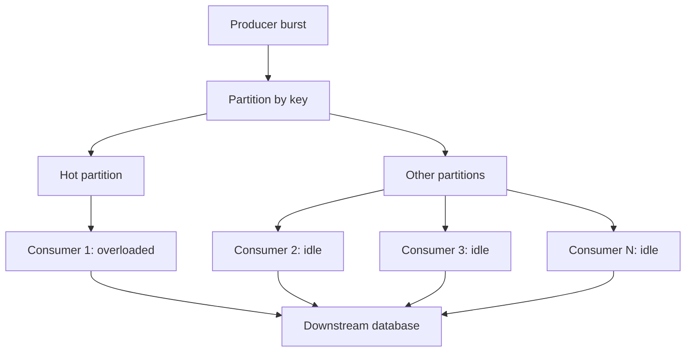
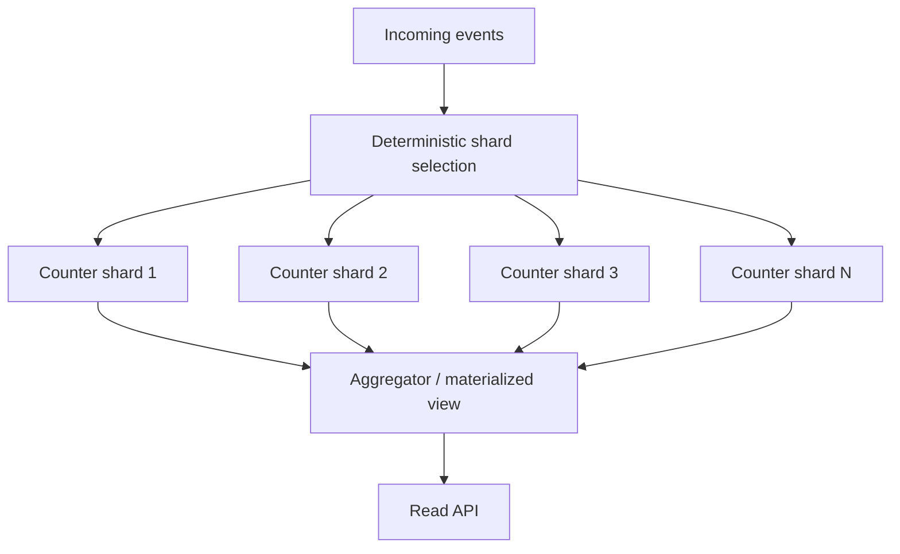

# Ngăn hot partition, hot key và mất cân bằng tải

Serverless có thể tăng số function instance rất nhanh, nhưng tăng instance không đồng nghĩa mọi thành phần phía sau cũng tăng khả năng xử lý. Nếu hàng triệu request cùng truy cập một partition, một database row, một cache key hoặc một message group, toàn hệ thống vẫn bị giới hạn bởi điểm nóng đó. Kết quả thường là latency tăng, throttling, retry dồn dập và chi phí compute tăng mà throughput nghiệp vụ không cải thiện.

**Hot key** là một khóa nhận lượng truy cập vượt trội so với các khóa khác. **Hot partition** là partition vật lý hoặc logic nhận tải vượt khả năng phục vụ. **Load imbalance** là tình trạng tải phân bố không đều giữa partition, shard, queue consumer hoặc function instance. Ba hiện tượng liên quan nhưng không hoàn toàn giống nhau; cần xác định đúng điểm nghẽn trước khi chọn biện pháp.

Bài này giải thích cách nhận diện và xử lý hotspot trong hệ thống Java serverless dùng database, cache, queue, stream và event-driven function. Trọng tâm là thiết kế partition key, sharding/salting, fan-out, điều tiết concurrency, backpressure, ordering và idempotency.

## 1. Hot key, hot partition và load imbalance

### 1.1. Partition là gì?

Partition là một phần dữ liệu hoặc công việc được chia ra để nhiều node/worker có thể lưu trữ và xử lý song song. Hệ thống có thể phân phối partition dựa trên hash key, range, tenant, time window hoặc quy tắc riêng của sản phẩm.

Ví dụ:

- database NoSQL phân phối item theo partition key;
- Kafka chia topic thành nhiều partition, mỗi partition có thứ tự record riêng;
- queue FIFO có thể nhóm message theo message group ID;
- cache phân tán định tuyến key đến một node/shard;
- database quan hệ có thể partition table hoặc index theo range/hash;
- worker pool chia message hoặc task cho nhiều consumer.

Partition giúp mở rộng bằng cách phân chia tải. Nhưng nếu một partition nhận quá nhiều request, partition đó trở thành bottleneck dù các partition khác còn rảnh.

### 1.2. Hot key

Hot key xảy ra khi một khóa logic nhận phần lớn traffic. Ví dụ:

- một tenant lớn tạo 70% event;
- một sản phẩm đang khuyến mãi bị đọc/ghi liên tục;
- tất cả lượt xem trang chủ cập nhật cùng một counter `homepage:views`;
- một user hoặc device gửi telemetry với tần suất cao bất thường;
- mọi function ghi vào cùng một database row để tăng số lượng đơn hàng.

Hot key có thể làm nóng một partition nếu hệ thống định tuyến theo key. Ngay cả khi partition được phân phối tốt, một item duy nhất vẫn có thể bị giới hạn bởi lock, conditional update, transaction hoặc serialization ở cấp item/row.

### 1.3. Hot partition

Hot partition xảy ra khi một partition vật lý nhận quá nhiều request, bytes hoặc thao tác ghi. Có thể do:

- một hot key được hash vào partition đó;
- nhiều key khác nhau tình cờ cùng nằm trên partition;
- key có phân bố lệch;
- range partition nhận các key mới liên tiếp;
- một partition có dữ liệu hoặc index được truy cập thường xuyên hơn.

Một số database quản lý phân vùng vật lý tự động, vì vậy ứng dụng không trực tiếp nhìn thấy partition ID. Dù vậy, key skew vẫn có thể khiến một vùng dữ liệu hoặc một tập storage node nóng lên. Cần dùng metric và diagnostic do nhà cung cấp hỗ trợ, không suy ra chính xác partition vật lý chỉ từ tên key.

### 1.4. Load imbalance

Load imbalance rộng hơn hot key. Ví dụ có 16 consumer nhưng một consumer xử lý 50% record do phân phối partition không đều; hoặc 10 function instance có concurrency khác nhau do payload/processing time không đồng nhất.

| Hiện tượng | Dấu hiệu | Giới hạn thường gặp |
| --- | --- | --- |
| Hot key | Một vài key chiếm tỷ trọng request lớn | Một item/tenant/entity hoặc lock bị tranh chấp |
| Hot partition | Một partition/shard có throughput hoặc latency xấu hơn | Giới hạn IOPS, throughput, CPU hoặc network của partition |
| Consumer imbalance | Một consumer lag cao, consumer khác rảnh | Partition assignment, key distribution hoặc xử lý không đều |
| Instance imbalance | Một số function instance xử lý lâu hơn | Payload skew, cache locality, downstream contention |
| Range/index hotspot | Ghi tập trung vào vùng key/index mới nhất | Page/partition/index contention hoặc sequential insert |

### 1.5. Vì sao scale-out không tự giải quyết được?

Giả sử một queue có 12 partition và 12 consumer. Nếu 80% message có cùng partition key, một consumer có thể xử lý phần lớn công việc trong khi 11 consumer còn lại gần như rảnh. Tăng function concurrency lên 100 cũng không tạo thêm khả năng đọc song song từ cùng partition nếu transport chỉ cho một consumer trong consumer group đọc partition đó tại một thời điểm.



Scale-out chỉ có hiệu quả khi công việc có thể được chia nhỏ và phân phối đến các worker độc lập. Nếu mọi worker cùng tranh chấp một lock hoặc một key, tăng concurrency có thể làm contention và retry tăng mạnh hơn.

## 2. Nhận diện hotspot bằng dữ liệu

### 2.1. Đo phân bố thay vì chỉ xem trung bình

CPU hoặc request rate trung bình của toàn hệ thống có thể che giấu một partition đang quá tải. Hãy đo theo dimension phù hợp:

- partition/shard ID nếu nền tảng cung cấp;
- tenant, entity type hoặc key class;
- queue group/partition/consumer;
- operation type: read, write, conditional update, transaction;
- bytes, request count, throttling và latency;
- function version, region và downstream target.

Theo dõi p50/p95/p99, max, tỷ lệ lỗi và phân bố tải. Một partition có p99 rất cao nhưng trung bình toàn cluster thấp vẫn có thể làm request timeout.

### 2.2. Top key và key frequency

Tạo thống kê top-N key trong một cửa sổ thời gian để tìm khóa chiếm tải bất thường. Không nhất thiết ghi raw key vào metric label vì cardinality cao và có thể lộ dữ liệu. Có thể dùng log có kiểm soát, sampling, hash/ẩn danh key hoặc báo cáo top key ở một hệ thống phân tích riêng.

Các chỉ số hữu ích:

| Chỉ số | Cách đọc |
| --- | --- |
| Top key share | Tỷ lệ traffic của key lớn nhất hoặc top 10 key |
| Partition traffic ratio | Tỷ lệ request/bytes của partition lớn nhất so với trung bình |
| Coefficient of variation | Độ lệch chuẩn chia trung bình giữa partition; cao cho thấy phân bố lệch |
| Consumer lag by partition | Partition nào tích backlog nhanh hơn |
| Throttle by key/partition | Xác định nơi vượt capacity hoặc quota |
| Lock wait / row contention | Phát hiện hotspot ở database quan hệ |
| Retry amplification | Số lần thử trung bình trên một event thành công |

### 2.3. Dùng hệ số mất cân bằng

Một phép đo đơn giản là:

\[
ImbalanceRatio = \frac{MaxLoadPerPartition}{AverageLoadPerPartition}
\]

Nếu 8 partition có tải trung bình 1.000 request/giây nhưng partition nóng nhất nhận 6.000 request/giây, imbalance ratio là 6. Tỷ số này không phải SLO phổ quát; dùng để so sánh trước/sau khi thay đổi key strategy.

Có thể đo thêm coefficient of variation:

\[
CV = \frac{StandardDeviation(PartitionLoad)}{Mean(PartitionLoad)}
\]

CV gần 0 cho thấy tải tương đối đồng đều; CV lớn cho thấy có độ lệch. Khi mean bằng 0 hoặc số partition rất ít, cần diễn giải cẩn thận.

### 2.4. Phân biệt hot key với downstream bottleneck

Nếu mọi partition có tải tương tự nhưng database latency cao, nguyên nhân có thể là database capacity hoặc query plan. Nếu một key có tần suất cao nhưng partition metrics không nóng, có thể cache đang hấp thụ read traffic. Nếu queue lag tăng ở một partition trong khi consumer CPU thấp, có thể partition assignment hoặc ordering đang giới hạn parallelism.

Hãy lần theo một request từ trigger đến dependency:

1. trigger nhận bao nhiêu event và phân bố theo key ra sao;
2. event source mapping phân phối record thế nào;
3. function instance/concurrency xử lý ra sao;
4. key nào được đọc/ghi và transaction nào bị tranh chấp;
5. downstream throttling/latency có tương quan với key/partition không.

Không đổi partition key trước khi có bằng chứng về nơi mất cân bằng.

## 3. Thiết kế partition key có phân bố tốt

### 3.1. Tránh key có cardinality thấp

Key như `status`, `country`, `eventType` hoặc một hằng số thường có cardinality thấp. Nếu hàng triệu record chỉ có vài giá trị key, một số partition sẽ nhận phần lớn dữ liệu.

Key tốt thường có:

- đủ cardinality để phân tán dữ liệu;
- phân bố gần đồng đều trong workload thực;
- ổn định cho những thao tác cần cùng entity về cùng partition;
- hỗ trợ access pattern chính của ứng dụng;
- không tạo một hot item/row dù partition được phân tán.

Không có partition key tốt cho mọi truy vấn. Thiết kế phải bắt đầu từ access pattern, ordering requirement và mức độ skew thực tế.

### 3.2. Tránh timestamp thuần làm partition key

Nếu key chỉ là ngày hiện tại hoặc giờ hiện tại, tất cả ghi mới cùng thời điểm có thể dồn vào một partition/range. Ví dụ `2026-11-17` làm partition key cho toàn bộ telemetry ngày đó có thể tạo hotspot vào partition của ngày hiện tại.

Có thể kết hợp tenant/entity hash hoặc bucket:

```text
tenant-42#2026-11-17#bucket-07
```

Phần bucket giúp phân tán writes trong cùng time window. Tuy nhiên, truy vấn toàn bộ dữ liệu trong ngày cần đọc nhiều bucket và merge kết quả.

### 3.3. Composite key

Composite key kết hợp nhiều thành phần:

```text
<tenant>#<entity>#<time-window>
<region>#<device>#<date>#<bucket>
<account>#<ledger-shard>
```

Chọn thành phần theo access pattern. Ví dụ cần truy vấn toàn bộ đơn hàng của một tenant trong ngày thì `tenant#date#bucket` có thể phù hợp; nếu cần giữ thứ tự theo từng order aggregate, key theo `orderId` hoặc aggregate ID có thể quan trọng hơn.

### 3.4. Hash partitioning

Hash key phân phối các giá trị đầu vào vào nhiều bucket. Một hash ổn định giúp cùng logical key luôn vào cùng bucket. Cần cân nhắc:

- hash function và cách encode input;
- số bucket;
- version của thuật toán/key format;
- thay đổi số bucket khi mở rộng;
- khả năng truy vấn/aggregate qua nhiều bucket.

Không dùng `Random` để chọn bucket nếu cần đọc lại đúng bucket của một entity. Random bucket mỗi lần ghi làm cho dữ liệu cùng entity nằm rải rác mà ứng dụng không biết phải đọc ở đâu.

### 3.5. Không tối ưu phân bố bằng cách phá ordering

Nếu cần mọi event của một đơn hàng được xử lý tuần tự, partition key theo `orderId` là lựa chọn tự nhiên. Thêm salt ngẫu nhiên vào key có thể phân tán event nhưng phá thứ tự của cùng đơn hàng.

Trước khi sharding, hãy trả lời:

- Có cần strict ordering không?
- Ordering cần ở cấp toàn hệ thống, tenant hay entity?
- Có thể chấp nhận eventual consistency không?
- Có thể aggregate kết quả từ nhiều shard không?
- Có một bước duy nhất phải serialize hay không?

Nếu một entity bắt buộc xử lý tuần tự, có thể phải giữ một single-writer cho entity đó và tối ưu phần còn lại, thay vì cố chia một chuỗi phụ thuộc thành nhiều worker song song.

## 4. Salting và write sharding

### 4.1. Salting là gì?

Salting thêm một thành phần bucket vào partition key để một logical key được phân phối thành nhiều physical/logical key. Ví dụ counter `product-123` được chia thành 16 shard:

```text
product-123#00
product-123#01
...
product-123#15
```

Mỗi write chọn một shard xác định; read tổng hợp giá trị của các shard. Thay vì mọi invocation cập nhật một counter duy nhất, writes được phân tán.

### 4.2. Chọn salt/bucket ổn định

Có thể hash event ID hoặc request ID để phân phối write:

```text
bucket = hash(eventId) mod bucketCount
key = logicalKey + "#" + bucket
```

Hash theo event ID phù hợp khi mỗi event là một write độc lập và không cần tất cả event của một entity vào cùng shard. Nếu cần thứ tự theo entity, hash theo entity ID để mọi event của entity vào cùng shard; nhưng khi đó entity hot vẫn có thể nóng.

Không dùng timestamp có độ phân giải thấp làm salt vì nhiều event cùng thời điểm có thể rơi vào cùng bucket. Cũng không dùng random salt nếu sau này cần xác định shard của event để deduplicate hoặc cập nhật.

### 4.3. Java: tạo partition key có bucket xác định

Ví dụ dùng `String.hashCode()` của Java để minh họa bucket ổn định giữa các JVM cho cùng chuỗi:

```java
import java.time.LocalDate;

public final class PartitionKeys {
    private PartitionKeys() {}

    public static int bucketFor(String stableId, int bucketCount) {
        if (stableId == null || stableId.isBlank()) {
            throw new IllegalArgumentException("stableId is required");
        }
        if (bucketCount <= 0) {
            throw new IllegalArgumentException("bucketCount must be positive");
        }
        return Math.floorMod(stableId.hashCode(), bucketCount);
    }

    public static String telemetryKey(
            String tenantId,
            String eventId,
            LocalDate eventDate,
            int bucketCount) {

        int bucket = bucketFor(eventId, bucketCount);
        return tenantId + "#" + eventDate + "#b" + bucket;
    }
}
```

Trong ví dụ, hash theo `eventId` giúp phân tán event trong tenant/ngày. `String.hashCode()` ổn định theo hợp đồng Java nhưng không phải hash mật mã; nếu input do attacker kiểm soát và có nguy cơ hash flooding, cân nhắc hash có seed/algorithm phù hợp và giới hạn input. Với hệ thống lâu dài, ghi rõ `bucketCount` và key format version trong metadata; thay số bucket sẽ làm thay đổi mapping.

### 4.4. Read amplification

Write sharding giảm contention khi ghi nhưng làm read phức tạp hơn. Muốn đọc tổng counter, ứng dụng phải đọc tất cả shard và cộng lại. Nếu có 32 shard, một read logic có thể tạo 32 read vật lý.

Các cách kiểm soát read amplification:

- cache aggregate trong thời gian ngắn;
- duy trì materialized aggregate bất đồng bộ;
- chỉ đọc shard cần thiết theo query;
- dùng batch read nếu database hỗ trợ;
- chấp nhận eventual consistency cho dashboard/counter;
- dùng một snapshot aggregate định kỳ.

Không dùng write sharding cho dữ liệu cần một giá trị nhất quán tức thời nếu chi phí aggregate/coordination lớn hơn lợi ích.

### 4.5. Idempotency khi ghi nhiều shard

Event có thể được giao lại. Nếu mỗi lần retry chọn shard ngẫu nhiên, một event có thể tăng counter ở nhiều shard. Dùng bucket xác định từ event ID và một deduplication record/conditional write để mỗi event chỉ áp dụng một lần.

Một transaction có thể ghi inbox/dedup record và cập nhật shard counter cùng nhau nếu database hỗ trợ transaction. Nếu không, cần thiết kế reconciliation hoặc outbox/inbox phù hợp; không giả định hai thao tác riêng lẻ là atomic.

## 5. Sharding nâng cao và thay đổi số shard

### 5.1. Fixed shard count

Số shard cố định dễ triển khai và đọc dữ liệu. Tuy nhiên, khi traffic tăng, một logical entity vẫn có thể cần thêm shard. Đổi `bucketCount` từ 16 lên 32 khiến cùng event ID có thể map sang bucket khác; dữ liệu cũ vẫn nằm trong 16 bucket ban đầu.

Đừng chỉ đổi hằng số trong code rồi triển khai. Cần version key schema và chiến lược đọc/ghi trong giai đoạn chuyển đổi.

### 5.2. Versioned sharding

Một key có thể mang version:

```text
v1#tenant-42#bucket-03
v2#tenant-42#bucket-19
```

Trong giai đoạn migration:

1. reader hiểu cả v1 và v2;
2. writer chuyển sang v2 hoặc dual-write theo kế hoạch;
3. backfill dữ liệu cũ nếu cần;
4. đối chiếu tổng số liệu giữa các version;
5. ngừng v1 sau khi không còn consumer phụ thuộc.

Dual-write có thể tạo duplicate hoặc lệch số liệu nếu không idempotent. Cần transaction/outbox hoặc reconciliation để bảo đảm tính đúng.

### 5.3. Virtual shards và consistent hashing

Virtual shard tạo nhiều logical shard hơn số node vật lý. Node có thể sở hữu nhiều virtual shard, giúp chuyển tải khi thêm/bớt node mà không phải di chuyển toàn bộ key. Consistent hashing giảm lượng key cần remap khi topology thay đổi.

Các cơ chế này không tự giải quyết một hot key duy nhất nếu tất cả request của key vẫn phải vào cùng virtual shard. Muốn phân tán hot key, phải thay đổi data model hoặc cho phép chia key thành nhiều shard con.

### 5.4. Hot entity không thể luôn chia nhỏ

Một account balance cần cập nhật tuần tự có thể bị giới hạn bởi một row/aggregate. Chia balance thành nhiều shard làm cho số dư đọc được là tổng nhiều thành phần và có thể cần transaction/coordination khi chuyển tiền.

Các lựa chọn:

- giữ single-writer cho entity nhưng batch nhiều lệnh trong một transaction;
- partition theo sub-entity nếu nghiệp vụ độc lập;
- dùng ledger append-only rồi aggregate;
- dùng reservation/escrow để phân bổ hạn mức trước;
- cache read path nhưng giữ write path nhất quán;
- áp dụng rate limit cho entity nóng.

Chọn theo invariant nghiệp vụ. Không hy sinh tính đúng của số dư, ordering hoặc audit chỉ để tăng throughput.

## 6. Ví dụ theo loại hệ thống

### 6.1. DynamoDB hoặc key-value database

Partition key quyết định phân phối item. Nếu mọi request dùng một partition key như `GLOBAL_COUNTER`, partition đó có thể nóng. Với counter/telemetry, có thể dùng write sharding và aggregate. Với entity cần truy vấn theo ID, dùng key có cardinality phù hợp và sort key theo access pattern.

Hot item vẫn có thể tồn tại ngay cả khi table có nhiều partition. Một conditional update trên cùng item có thể serialize hoặc bị throttling. Khi đó, thêm function instance không giúp; cần giảm tần suất cập nhật, batch, shard counter hoặc thay đổi mô hình dữ liệu.

### 6.2. Kafka và stream processing

Kafka phân phối record vào partition dựa trên key/partitioner. Record cùng key thường đi vào cùng partition để giữ thứ tự trong partition. Nếu một key chiếm phần lớn traffic, một partition có thể nóng và consumer group không thể tăng số consumer active vượt số partition được assign.

Biện pháp:

- chọn key phân bố tốt nhưng vẫn đáp ứng ordering requirement;
- tăng số partition khi cần parallelism tổng thể và chấp nhận tác động đến key mapping/order;
- tách hot key thành sub-key nếu nghiệp vụ cho phép;
- batch record và tối ưu consumer processing;
- theo dõi bytes-in, records-in, consumer lag và skew theo partition;
- không giả định tăng partition sẽ chia lại dữ liệu cũ hoặc khôi phục thứ tự toàn cục.

Tăng partition có thể làm thay đổi mapping của key mới trong khi record cũ vẫn ở partition cũ. Nếu ordering theo entity là bắt buộc, cần migration/coordination rõ ràng.

### 6.3. Queue FIFO và message group

Queue FIFO thường dùng group ID để bảo đảm thứ tự trong cùng group. Nếu mọi message dùng một group ID, chỉ một luồng xử lý có thể tiến triển tại một thời điểm theo semantics của dịch vụ. Tạo nhiều group theo entity/tenant có thể tăng song song nhưng vẫn giữ thứ tự trong từng group.

Không chia group của cùng aggregate thành nhiều ID nếu các event phụ thuộc thứ tự. Đặt visibility timeout, batch size, max concurrency và DLQ phù hợp; theo dõi age of oldest message và message group backlog.

### 6.4. Redis/cache

Một cache key có lượng read rất lớn có thể trở thành hot key ở một node. Các cách xử lý:

- local in-memory cache với TTL ngắn cho dữ liệu có thể stale;
- replicate/read replica nếu hệ thống hỗ trợ;
- client-side request coalescing để nhiều request cùng chờ một lần fetch;
- cache key versioning để phân tán refresh;
- tách một aggregate thành nhiều phần nếu read semantics cho phép.

Local cache làm giảm tải Redis nhưng có thể tăng memory, stale data và cold-start miss. TTL đồng loạt có thể gây cache stampede; dùng jitter và single-flight refresh.

### 6.5. SQL database

Hotspot có thể xuất hiện ở:

- một row được nhiều transaction cập nhật;
- một index có insert tuần tự theo timestamp/ID;
- một counter row dùng chung;
- lock escalation hoặc transaction dài;
- connection pool tập trung quá nhiều vào một database.

Biện pháp gồm batch update, append-only ledger, partition table/index, giảm transaction duration, optimistic concurrency, cache read, phân tách write model hoặc sharding. Với số dư/tồn kho, mọi thay đổi phải giữ invariant và transaction semantics.

## 7. Fan-out, aggregation và read/write trade-off

### 7.1. Fan-out write

Fan-out write chia một logical update thành nhiều cập nhật độc lập. Ví dụ counter lượt xem được ghi vào 16 shard thay vì một row duy nhất.



Fan-out tăng write parallelism nhưng cần một cơ chế aggregate. Aggregate có thể cập nhật mỗi event, theo micro-batch hoặc theo lịch. Cập nhật mỗi event vào một aggregate duy nhất lại tạo hotspot mới; có thể dùng hierarchical aggregation hoặc batch window.

### 7.2. Fan-out read

Khi một query phải đọc nhiều shard, fan-out read có thể tăng latency và số request. Có thể chạy song song có giới hạn, nhưng không tạo một future cho hàng nghìn shard cùng lúc.

Đặt concurrency limit, deadline, partial result policy và cache. Nếu query thường xuyên cần tất cả shard, cân nhắc materialized view hoặc read model được cập nhật bất đồng bộ.

### 7.3. Hierarchical aggregation

Thay vì mọi shard cập nhật một tổng duy nhất, chia shard thành nhóm; mỗi nhóm có aggregate riêng rồi một tầng trên tổng hợp định kỳ. Cách này giảm contention ở tầng cuối nhưng tăng độ trễ cập nhật và số bước vận hành.

### 7.4. Eventual consistency có chủ đích

Counter dashboard, analytics và telemetry thường chấp nhận dữ liệu trễ vài giây hoặc phút. Chấp nhận eventual consistency giúp phân tán write và batch aggregate. Nhưng payment, inventory reservation hoặc ledger balance có thể cần consistency mạnh hơn.

Ghi rõ freshness SLA: ví dụ dashboard chấp nhận trễ 10 giây; API số dư cần đọc nhất quán theo transaction. Không dùng một chiến lược sharding cho mọi loại dữ liệu.

## 8. Điều tiết tải ở producer và API

### 8.1. Admission control

Admission control quyết định request nào được nhận vào hệ thống dựa trên capacity hiện tại. Có thể giới hạn theo:

- toàn service;
- tenant/API key;
- logical entity hoặc hot key;
- loại operation;
- dependency/downstream;
- vùng hoặc queue.

Khi quá tải, trả response có thể retry được (ví dụ 429/503 theo contract) kèm `Retry-After` nếu phù hợp. Không nhận request rồi để chúng chờ vô hạn trong memory.

### 8.2. Rate limiting và quota theo tenant

Một tenant nóng có thể làm ảnh hưởng tenant khác. Quota theo tenant giúp bảo vệ fairness và giới hạn blast radius. Có thể dùng token bucket hoặc leaky bucket ở gateway, distributed rate limiter hoặc queue admission.

Rate limit nên có:

- sustained rate;
- burst capacity;
- window/clock semantics;
- key scope và TTL;
- behavior khi rate-limit store lỗi;
- response/error metric.

Nếu rate-limit store trở thành hot key toàn cục, chính bộ điều tiết tải lại thành bottleneck. Dùng sharded counters hoặc service chuyên dụng phù hợp, nhưng cần hiểu độ chính xác và eventual consistency của quota.

### 8.3. Fair scheduling

Một tenant lớn không nên chiếm toàn bộ worker capacity nếu nhiều tenant khác cần SLA. Fair scheduling có thể dùng queue riêng theo tenant, weighted fair queue, per-tenant concurrency cap hoặc scheduler chia quota.

Không nhất thiết tạo queue riêng cho mọi tenant nếu số tenant rất lớn; có thể dùng partitioned queue và scheduler ở tầng ứng dụng. Chọn dựa trên số tenant, độ lệch tải và yêu cầu cô lập.

### 8.4. Load shedding

Load shedding chủ động từ chối hoặc trì hoãn công việc ít ưu tiên khi hệ thống gần quá tải. Ví dụ:

- từ chối request không thiết yếu;
- giảm độ chi tiết telemetry;
- tạm ngừng background recomputation;
- ưu tiên traffic trả phí/critical theo policy công khai;
- trả stale cache thay vì gọi database đang quá tải.

Không shed request đã được xác nhận bền vững mà không có trạng thái hoặc cơ chế retry/replay. Với event, chỉ ack khi message đã được xử lý hoặc đã được lưu an toàn vào nơi tiếp nhận khác.

## 9. Backpressure và queue smoothing

### 9.1. Queue làm bộ đệm, không tạo capacity vô hạn

Queue hấp thụ burst và tách tốc độ producer khỏi consumer. Nhưng nếu producer liên tục nhanh hơn consumer, backlog tăng mãi. Queue chỉ trì hoãn thời điểm quá tải; không loại bỏ nó.

Theo dõi:

- queue depth/backlog;
- age of oldest message;
- enqueue/dequeue rate;
- processing duration;
- retry/DLQ rate;
- consumer concurrency;
- downstream throttle/latency.

Đặt maximum backlog hoặc maximum message age phù hợp với SLA. Khi backlog vượt ngưỡng, giảm producer admission, tăng consumer capacity nếu downstream cho phép hoặc áp dụng business degradation.

### 9.2. Backpressure

Backpressure truyền tín hiệu từ downstream đang chậm về producer/consumer để giảm tốc độ. Ví dụ consumer giảm concurrency khi database connection pool gần đầy; producer giảm publish rate khi queue lag tăng.

Không chỉ dựa vào CPU. Database có thể quá tải trong khi function CPU thấp. Backpressure nên dùng tín hiệu thực tế của bottleneck như connection saturation, throttling, latency và queue age.

### 9.3. Batch và micro-batch

Batching giảm overhead mỗi message và số lần gọi database/API. Nhưng batch quá lớn làm tăng memory, latency, retry blast radius và khả năng timeout. Chọn batch size theo payload, processing duration, memory budget và partial failure semantics.

Micro-batch aggregate nhiều event trong một cửa sổ ngắn, phù hợp counter/analytics. Cần xác định max wait time để không vi phạm freshness SLA.

### 9.4. Visibility timeout và retry budget

Với queue có visibility timeout, timeout cần dài hơn thời gian xử lý dự kiến và phù hợp với retry policy. Nếu quá ngắn, message có thể được giao lại khi invocation trước vẫn đang chạy, tạo duplicate concurrency. Nếu quá dài, phục hồi sau worker crash chậm.

Đặt retry budget, exponential backoff và jitter. Poison message cần DLQ/failure destination để không giữ backlog vô hạn. Idempotency vẫn bắt buộc vì retry có thể xảy ra sau khi side effect đã commit.

## 10. Điều khiển concurrency của Java function

### 10.1. Concurrency phải dựa trên downstream budget

Một công thức sàng lọc:

\[
MaxFunctionConcurrency \leq
\frac{DownstreamSafeCapacity}{ResourcePerInvocation}
\]

Ví dụ database an toàn với 400 connection dành cho ứng dụng; mỗi invocation có thể giữ 2 connection; concurrency lý thuyết tối đa là 200, nhưng phải trừ connection cho admin, background jobs và headroom. Không dùng con số này thay cho load test.

Với HTTP API, giới hạn concurrency/reserved concurrency hoặc platform max instances có thể bảo vệ dependency. Với queue, giới hạn event source mapping/consumer concurrency. Tên cấu hình khác nhau theo nền tảng.

### 10.2. Semaphore trong JVM không phải global limit

Một `Semaphore(20)` trong Java chỉ giới hạn 20 task trong một execution environment. Nếu nền tảng chạy 50 instance, tổng concurrency có thể lên đến 1.000. Muốn giới hạn toàn service, dùng platform-level concurrency, queue consumer cap, gateway rate limit hoặc distributed admission control.

Semaphore cục bộ vẫn hữu ích để bảo vệ thread pool hoặc client pool trong một instance, nhưng không thay thế quota toàn hệ thống.

### 10.3. Tránh retry amplification

Khi database chậm, function timeout và trigger retry; retry làm database nhận thêm request, khiến latency càng tăng. Đây là retry storm.

Biện pháp:

- retry chỉ lỗi transient;
- exponential backoff với jitter;
- giới hạn attempt và total retry time;
- circuit breaker hoặc concurrency limiter;
- load shedding và queue backpressure;
- idempotency để retry an toàn;
- không retry đồng thời ở nhiều tầng mà không có tổng budget.

### 10.4. Java: giới hạn song song cục bộ

Ví dụ dùng semaphore để bảo vệ một client/worker pool trong một JVM:

```java
import java.util.concurrent.Semaphore;
import java.util.concurrent.TimeUnit;

public final class LocalConcurrencyGate {
    private final Semaphore permits;

    public LocalConcurrencyGate(int maxInFlight) {
        if (maxInFlight <= 0) {
            throw new IllegalArgumentException("maxInFlight must be positive");
        }
        this.permits = new Semaphore(maxInFlight);
    }

    public <T> T execute(
            java.util.concurrent.Callable<T> operation,
            long wait,
            TimeUnit unit) throws Exception {

        if (!permits.tryAcquire(wait, unit)) {
            throw new CapacityExceededException("Local concurrency limit reached");
        }
        try {
            return operation.call();
        } finally {
            permits.release();
        }
    }
}
```

`CapacityExceededException` là exception của ứng dụng. Khi gate từ chối, handler cần map sang response/retry semantics phù hợp; không tự động trả success hoặc ack message. Gate này chỉ giới hạn một process và không điều phối capacity giữa nhiều function instance.

## 11. Cache và request coalescing

### 11.1. Giảm read pressure cho hot key

Nếu một key được đọc hàng chục nghìn lần mỗi giây nhưng dữ liệu chỉ đổi vài phút một lần, cache có thể giảm tải đáng kể. Tuy nhiên, một key trong distributed cache vẫn có thể trở thành hot key.

Các lựa chọn:

- local cache per instance với TTL ngắn;
- replicated cache/read replica;
- cache immutable/versioned value;
- precompute/materialized view;
- request coalescing để chỉ một request fetch khi cache miss.

### 11.2. Cache stampede

Cache stampede xảy ra khi một key hết hạn và nhiều request đồng thời cùng gọi database để nạp lại. Cách giảm:

- TTL jitter;
- single-flight/mutex theo key;
- stale-while-revalidate;
- refresh trước khi hết hạn;
- giới hạn số refresh đồng thời;
- negative caching cho kết quả không tồn tại trong thời gian ngắn nếu an toàn.

Mutex theo một hot key cũng có thể trở thành bottleneck; cần timeout, lease và xử lý owner chết. Không dùng distributed lock nếu chỉ cần request coalescing cục bộ và stale data được chấp nhận.

### 11.3. Local cache trong serverless

Local cache có thể tồn tại khi execution environment được tái sử dụng, nhưng không được chia sẻ giữa mọi instance và có thể biến mất bất cứ lúc nào. Không dùng local cache làm source of truth hoặc cơ chế idempotency toàn hệ thống.

Cache key phải chứa tenant/authorization scope phù hợp để tránh trả dữ liệu tenant này cho tenant khác. Khi dữ liệu nhạy cảm hoặc cần thu hồi quyền tức thời, cân nhắc cache TTL và invalidation semantics.

## 12. Java: phân phối counter theo shard

Ví dụ sau minh họa mô hình counter sharded. Mỗi event chọn shard xác định từ event ID; repository phải thực hiện deduplication và increment trong một transaction/atomic operation phù hợp.

```java
public record CounterShardKey(String counterName, int shard) {
}

public interface ShardedCounterRepository {
    // Contract: applyOnce atomically records eventId and increments one shard.
    boolean applyOnce(String eventId, CounterShardKey key, long delta);

    long readShard(CounterShardKey key);
}

public final class ShardedCounterService {
    private final ShardedCounterRepository repository;
    private final int shardCount;

    public ShardedCounterService(
            ShardedCounterRepository repository,
            int shardCount) {
        if (shardCount <= 0) {
            throw new IllegalArgumentException("shardCount must be positive");
        }
        this.repository = repository;
        this.shardCount = shardCount;
    }

    public boolean recordView(String productId, String eventId) {
        int shard = Math.floorMod(eventId.hashCode(), shardCount);
        CounterShardKey key = new CounterShardKey(productId, shard);
        return repository.applyOnce(eventId, key, 1L);
    }

    public long totalViews(String productId) {
        long total = 0;
        for (int shard = 0; shard < shardCount; shard++) {
            total = Math.addExact(total,
                    repository.readShard(new CounterShardKey(productId, shard)));
        }
        return total;
    }
}
```

Đây là application-level example, không phải một transaction implementation cụ thể. `applyOnce` cần lưu event ID và tăng shard atomically; nếu không, retry sau partial failure có thể tăng counter hai lần. `totalViews` thực hiện N read và có thể cần batch read, cache hoặc aggregate materialized view khi shard count lớn.

Nếu `productId` là một sản phẩm rất nóng, sharding theo event ID phân tán writes của counter. Nếu cần giữ mọi event của sản phẩm theo thứ tự, mô hình này không tự bảo đảm ordering; cần sequence/ledger hoặc một cơ chế ordering riêng.

## 13. Chọn số bucket và chiến lược migration

### 13.1. Bắt đầu từ capacity và phân bố thực tế

Số bucket không nên chọn tùy ý. Cân nhắc:

- throughput tối đa mỗi partition/shard;
- tỷ lệ skew và burst;
- số consumer/worker có thể chạy song song;
- giới hạn request/transaction của database;
- read amplification và aggregate cost;
- số shard có thể vận hành/monitor;
- tăng trưởng traffic dự kiến.

Nếu một logical key nhận 100.000 writes/giây và một shard an toàn chỉ xử lý 5.000 writes/giây, cần ít nhất 20 shard theo phép chia lý tưởng; thực tế cần headroom và benchmark vì phân bố không hoàn hảo, retry và aggregate cũng tiêu thụ capacity.

### 13.2. Tránh quá nhiều shard

Quá nhiều shard làm tăng:

- metadata và partition management;
- số request khi aggregate/read;
- số consumer/worker và chi phí nền tảng;
- complexity của migration, monitoring và cleanup;
- khả năng dữ liệu nhỏ bị phân tán quá mức.

Chọn số shard đủ để đáp ứng peak với headroom, không tối đa hóa số shard.

### 13.3. Tăng shard count có kế hoạch

Một quy trình migration có thể:

1. ghi lại key schema version và shard count hiện tại;
2. triển khai reader hỗ trợ cả schema cũ và mới;
3. tạo shard mới và xác minh IAM/capacity;
4. chuyển writer theo tenant/partition cohort;
5. theo dõi phân bố tải và đối chiếu số liệu;
6. backfill hoặc dual-read nếu cần;
7. chuyển hoàn toàn và ngừng format cũ sau thời gian an toàn.

Nếu dữ liệu cũ không thể remap ngay, reader phải biết shard count/version của từng record. Không tính bucket bằng shard count mới rồi tìm dữ liệu cũ theo mapping mới.

## 14. Ordering, consistency và idempotency

### 14.1. Ordering scope

Hãy định nghĩa thứ tự cần bảo đảm ở cấp nào:

- toàn bộ hệ thống;
- tenant;
- aggregate/entity;
- partition;
- chỉ trong một batch hoặc transaction.

Ordering toàn cục làm giảm parallelism. Thường chỉ cần ordering theo entity, ví dụ mọi event của một order. Chọn key theo entity ID để giữ event cùng entity trên cùng partition/group.

### 14.2. Idempotency khi shard/fan-out

Fan-out có thể tạo nhiều side effect. Dùng event ID duy nhất, deduplication record và conditional write. Nếu fan-out có nhiều shard, mỗi child operation cần idempotency key ổn định; parent workflow cần biết shard nào hoàn tất để retry phần còn thiếu.

### 14.3. Partial completion

Giả sử cập nhật 16 shard nhưng function timeout sau khi hoàn thành 10 shard. Retry phải biết 10 shard nào đã commit. Các cách:

- mỗi shard operation idempotent theo event ID;
- lưu trạng thái child task;
- dùng outbox/workflow orchestration;
- aggregate lại từ nguồn event bất biến;
- reconciliation định kỳ.

Không giả định fan-out gồm nhiều database write là atomic nếu không có distributed transaction thực sự.

### 14.4. Eventual consistency và read-your-writes

Sau khi ghi shard, aggregate có thể chưa cập nhật. Nếu client cần đọc lại kết quả vừa ghi, có thể trả receipt/version, đọc trực tiếp shard liên quan hoặc chờ aggregate checkpoint. Hãy mô tả freshness guarantee rõ ràng trong API.

## 15. Kiểm thử hotspot và mất cân bằng

### 15.1. Synthetic skew test

Load test chỉ dùng key ngẫu nhiên đồng đều có thể bỏ sót hotspot production. Cần tạo nhiều profile:

- phân bố đều;
- 10% key chiếm 80% traffic;
- một hot key nhận phần lớn writes;
- một tenant lớn và nhiều tenant nhỏ;
- burst theo time window;
- payload/processing time không đồng nhất;
- một partition hoặc consumer bị chậm.

Test cả read/write mix và retry. Quan sát partition load, queue lag, database lock, throttling và cost.

### 15.2. Kiểm tra đúng đắn sau sharding

Ngoài throughput, xác nhận:

- tổng counter trước/sau migration khớp;
- không mất hoặc nhân đôi event;
- ordering trong scope đã cam kết được giữ;
- mọi shard đều được đọc/aggregate;
- retry sau partial failure an toàn;
- tenant isolation không bị phá bởi key format mới.

### 15.3. Chaos/failure test có giới hạn

Thử consumer chậm, partition unavailable, database throttling hoặc worker restart trong môi trường kiểm thử. Đo thời gian phục hồi và backlog drain. Không tạo hot-key load test không giới hạn trên production hoặc dùng dữ liệu khách hàng thật nếu chưa có kế hoạch kiểm soát.

## 16. Vận hành và playbook xử lý hotspot

### 16.1. Khi phát hiện partition nóng

1. Xác định resource và dimension nóng: database partition, queue group, stream partition, cache key hay row lock.
2. Đo top key, request/bytes, p95/p99, throttle và consumer lag.
3. Xác định hotspot do một logical key hay do nhiều key cùng partition.
4. Kiểm tra retry amplification và downstream capacity.
5. Áp dụng giảm tải tạm thời: rate limit, queue smoothing, concurrency cap hoặc stale cache.
6. Chọn sửa key/data model, sharding, batching hoặc query/index.
7. Migration theo version, giữ idempotency và ordering.
8. So sánh metric trước/sau, xác nhận không chuyển hotspot sang aggregate/read path.

### 16.2. Dashboard nên có

- request/bytes per partition hoặc shard;
- top key share và tenant share;
- consumer lag và oldest message age theo partition;
- function concurrency, duration và throttle;
- database connection, row lock wait, IOPS và throttling;
- cache hit/miss và hot-key request rate;
- retry attempts, DLQ và idempotency duplicate count;
- aggregate lag và freshness;
- cost per successful business operation.

### 16.3. Alerting

Alert khi:

- imbalance ratio vượt ngưỡng trong thời gian đủ dài;
- một partition liên tục throttled;
- queue age vượt SLA;
- consumer lag tăng trong khi các consumer khác rảnh;
- retry rate hoặc duplicate rate tăng đột biến;
- aggregate freshness giảm;
- downstream connection/lock saturation tăng.

Tránh alert chỉ dựa trên một spike ngắn. Dùng duration, baseline và multi-window alert để giảm noise.

## 17. Checklist thiết kế và production

- [ ] Partition key có cardinality và phân bố phù hợp với traffic thực tế.
- [ ] Không dùng một constant hoặc time bucket đơn lẻ cho lượng ghi lớn.
- [ ] Đã xác định ordering scope trước khi thêm salt/shard.
- [ ] Hot key được phân biệt với hot partition và downstream bottleneck.
- [ ] Có metric phân bố tải theo partition/consumer/tenant và top key.
- [ ] Có synthetic skew test, không chỉ uniform random load test.
- [ ] Write sharding dùng bucket xác định và idempotency key ổn định.
- [ ] Read amplification và aggregate freshness được tính vào thiết kế.
- [ ] Shard count/version được lưu rõ và có migration plan.
- [ ] Consumer concurrency không vượt downstream safe capacity.
- [ ] Local semaphore không bị nhầm là global concurrency limit.
- [ ] Queue backlog, age, retry và DLQ có ngưỡng vận hành.
- [ ] Có rate limit/fair scheduling để bảo vệ tenant khác khi một tenant nóng.
- [ ] Backpressure dựa trên bottleneck thật, không chỉ CPU.
- [ ] Cache có TTL jitter/request coalescing để tránh stampede.
- [ ] Partial fan-out completion có thể retry/reconcile an toàn.
- [ ] Test giữ ordering và consistency invariant sau sharding.
- [ ] Dashboard/alert theo dõi hotspot và chi phí trên business success.
- [ ] Có playbook giảm tải, migration và rollback.

## Kết luận

Hot key và hot partition là vấn đề phân bố tải và giới hạn của tài nguyên được chia sẻ. Tăng số Java function instance không giải quyết được một key bị tranh chấp, một partition bị giới hạn hoặc một message group phải xử lý tuần tự. Cần đo tải theo key/partition, xác định bottleneck và thiết kế partition key theo access pattern cùng ordering requirement.

Salting/write sharding có thể phân tán writes của counter hoặc telemetry, nhưng làm tăng read amplification, aggregate cost và độ phức tạp idempotency. Queue, rate limit, fair scheduling, backpressure và concurrency cap giúp bảo vệ dependency khi tải tăng; chúng phải được đặt ở đúng phạm vi, vì semaphore trong một JVM không giới hạn toàn hệ thống.

Trước khi thay đổi key schema hoặc shard count, hãy lập kế hoạch migration/versioning, giữ reader tương thích và kiểm thử duplicate, partial failure, ordering cùng tổng dữ liệu. Theo dõi cả partition utilization, consumer lag, retry, aggregate freshness và cost per successful operation để xác nhận hotspot đã được xử lý thay vì chỉ chuyển sang một điểm nghẽn khác.
