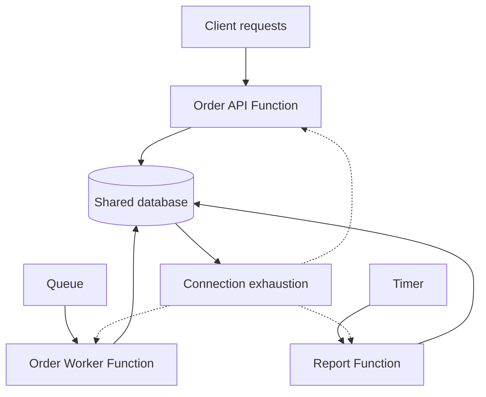
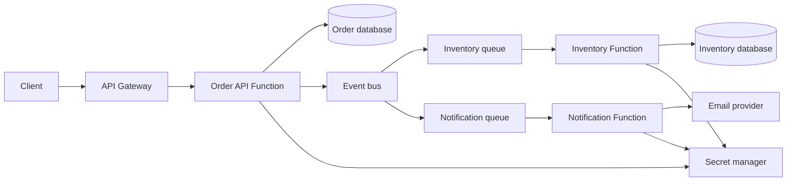
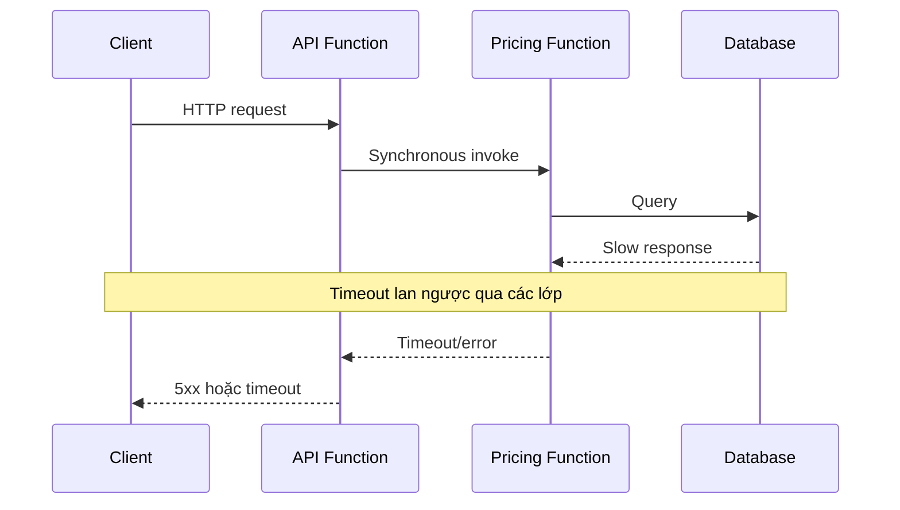
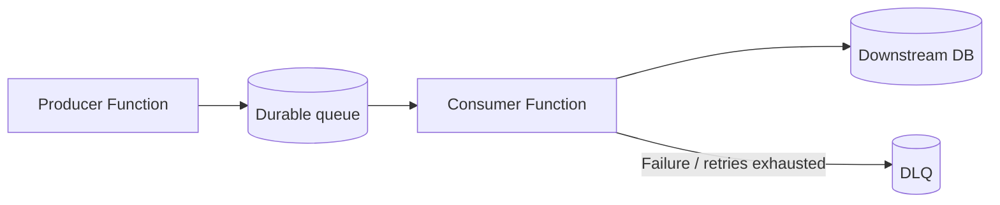

# Nhận diện điểm lỗi và phạm vi ảnh hưởng trong kiến trúc serverless

Một hệ thống serverless có thể không cần quản lý máy chủ, nhưng vẫn có nhiều điểm có thể hỏng: function, trigger, queue, event bus, database, secret store, mạng, quyền truy cập, cấu hình và dịch vụ bên ngoài. Một thành phần lỗi không nhất thiết chỉ làm hỏng chính nó. Nếu nhiều function dùng chung một database connection pool hoặc cùng phụ thuộc một API, sự cố ở dependency đó có thể lan sang nhiều luồng nghiệp vụ.

Khi thiết kế độ tin cậy, cần xác định **failure domain** (miền lỗi), **blast radius** (phạm vi ảnh hưởng) và các đường lan truyền lỗi trước khi chọn cách retry, scale hoặc failover. Mục tiêu là trả lời được: thành phần nào có thể hỏng cùng lúc, service nào bị ảnh hưởng, nghiệp vụ nào bị gián đoạn, và hệ thống còn có thể hoạt động ở mức nào khi một dependency mất khả năng phục vụ.

## 1. Failure domain và blast radius

**Failure domain** là một ranh giới trong đó một nguyên nhân lỗi có thể làm nhiều thành phần cùng mất khả năng hoạt động. Ranh giới này có thể là một function instance, một queue, một database cluster, một vùng mạng, một cloud region, một tài khoản cloud hoặc một nhà cung cấp bên ngoài.

**Blast radius** là phạm vi hệ thống và nghiệp vụ chịu ảnh hưởng khi sự cố xảy ra. Blast radius càng lớn, càng nhiều request, tenant, service hoặc dữ liệu bị tác động. Một thiết kế tốt cố gắng giới hạn blast radius bằng cách chia nhỏ quyền, tài nguyên, tải và đường phụ thuộc.

Ví dụ: một Java function xử lý đơn hàng chạy tốt, nhưng mọi function trong hệ thống đều dùng chung một database cluster. Khi connection pool của cluster cạn, API tạo đơn, worker cập nhật tồn kho và function báo cáo đều có thể thất bại. Điểm lỗi nằm ở database/connection capacity; blast radius là nhiều luồng nghiệp vụ cùng lúc.

Trong sơ đồ, ba function có thể chạy độc lập, nhưng dependency dùng chung tạo một failure domain chung. Chỉ nhìn số lượng function hoặc số lượng instance không đủ để đánh giá độ cô lập.

### 1.1. Phân biệt lỗi cục bộ và lỗi lan truyền

| Loại lỗi | Ví dụ | Phạm vi ban đầu | Khả năng lan truyền |
|---|---|---|---|
| Invocation đơn lẻ | Payload không hợp lệ, lỗi validation | Một request/event | Thấp nếu được phân loại và cách ly đúng |
| Execution environment | JVM crash, memory exhaustion, static initializer lỗi | Một process/instance | Có thể tăng nếu mọi instance dùng cùng artifact lỗi |
| Function/version | Bug trong release mới | Một function hoặc alias/slot | Tăng theo tỷ lệ traffic chuyển sang version đó |
| Trigger/source | Event source mapping sai, queue không nhận message | Một luồng trigger | Có thể gây backlog hoặc mất xử lý nếu cấu hình sai |
| Shared dependency | Database, Redis, DNS, secret store lỗi | Nhiều consumer | Cao nếu nhiều service phụ thuộc trực tiếp |
| Network boundary | NAT, route, firewall, private endpoint | Các workload đi qua cùng đường mạng | Có thể ảnh hưởng nhiều dependency cùng lúc |
| Regional/service provider | Region hoặc dịch vụ cloud gặp sự cố | Một vùng hoặc nhóm dịch vụ | Cao nếu không có đường phục hồi khác |
| Control plane/configuration | IAM policy, DNS record, deployment pipeline thay đổi sai | Nhiều resource | Có thể ảnh hưởng diện rộng và kéo dài |

Không phải lỗi nào cũng là outage. Một dependency có thể chậm, trả lỗi theo tỷ lệ, giới hạn throughput hoặc mất một phần chức năng. Những trạng thái suy giảm này thường gây lan truyền khó nhận biết hơn việc dependency ngừng hoạt động hoàn toàn.

## 2. Vẽ dependency graph trước khi đánh giá độ tin cậy

Dependency graph thể hiện các thành phần và hướng phụ thuộc. Hãy vẽ từ luồng nghiệp vụ thực tế, bao gồm cả dependency đồng bộ, bất đồng bộ, dữ liệu, danh tính và mạng.

Ví dụ một luồng đặt hàng:

Sơ đồ này cho thấy một số loại phụ thuộc khác nhau:

- API Gateway và Order API là đường đồng bộ: lỗi thường được phản hồi ngay cho client.
- Event bus và queue tạo ranh giới bất đồng bộ: producer có thể đã trả thành công trong khi consumer vẫn đang xử lý.
- Inventory và Notification có thể thất bại độc lập nếu có queue riêng.
- Secret manager có thể là dependency dùng chung; lỗi truy cập secret lúc khởi tạo có thể làm nhiều function không khởi động được.
- Email provider là dependency ngoài; nếu notification không phải chức năng cốt lõi của việc tạo đơn, lỗi email không nên làm API tạo đơn thất bại.

### 2.1. Phân loại dependency

Với mỗi node/edge trong graph, ghi lại:

1. **Criticality:** dependency có nằm trên đường hoàn tất nghiệp vụ chính không?
2. **Mode:** gọi đồng bộ, async event, poll/consume, hay truy cập khi khởi tạo?
3. **Ownership:** team nào sở hữu và vận hành?
4. **Failure behavior:** timeout, lỗi 4xx/5xx, throttling, dữ liệu sai, mất kết nối hay stale data?
5. **Capacity:** quota, connection, concurrency, throughput và giới hạn payload.
6. **Recovery:** retry, fallback, queue, DLQ, failover hoặc thao tác thủ công nào được hỗ trợ?
7. **Shared consumers:** những function/service/tenant nào cùng phụ thuộc resource này?

Đừng chỉ ghi các dịch vụ cloud. DNS, chứng thư TLS, identity provider, secret manager, container registry, artifact repository và CI/CD cũng có thể là dependency quan trọng. Một function đang chạy có thể vẫn hoạt động khi registry tạm thời lỗi, nhưng deployment mới hoặc scale-out cần image mới có thể thất bại.

## 3. Failure domain theo lớp trong serverless

### 3.1. Lớp invocation và execution environment

Một invocation có thể thất bại do exception, timeout, memory limit, thread deadlock, lỗi serialization hoặc dependency chậm. Execution environment có thể bị recycle, scale-in hoặc tạo mới. Static state và in-memory cache không phải trạng thái bền vững; khi process bị thay thế, dữ liệu đó mất.

Những câu hỏi cần kiểm tra:

- Handler có phân biệt lỗi dữ liệu vĩnh viễn với lỗi tạm thời không?
- Một request quá lớn hoặc một record độc hại có thể làm crash cả batch không?
- Static initializer có gọi network hoặc đọc secret khiến mọi cold start cùng thất bại không?
- Một function có thể tiêu thụ hết memory, thread hoặc connection pool của environment không?
- Khi function timeout sau khi đã ghi dữ liệu, retry có tạo side effect trùng không?

### 3.2. Lớp function, version và deployment

Một lỗi trong version mới có thể ảnh hưởng tất cả invocation được route đến version đó. Alias, canary, deployment slot và gradual rollout giúp giảm tỷ lệ traffic tiếp xúc với candidate, nhưng chỉ có tác dụng nếu có metric và rollback gate đủ nhanh.

Các failure mode thường gặp:

- Handler hoặc serializer không tương thích payload cũ.
- Environment variable thiếu hoặc sai tên.
- IAM/RBAC policy bị thu hẹp quá mức hoặc cấp nhầm quyền.
- Runtime/architecture không tương thích với artifact hoặc native library.
- Timeout, memory, concurrency hoặc batch size thay đổi ngoài dự kiến.
- Version mới ghi schema/event mà version cũ không đọc được trong thời gian rollout.

### 3.3. Lớp trigger, queue và event source

Trigger có thể là HTTP, timer, object storage, event bus, queue hoặc stream. Mỗi loại có cách giao nhận và xác nhận khác nhau. Một queue có thể vẫn nhận message trong khi consumer lỗi; khi đó hệ thống chưa mất dữ liệu ngay nhưng backlog tăng và thời gian hoàn tất nghiệp vụ kéo dài.

Đánh giá riêng:

- Producer có tiếp tục gửi khi consumer không hoạt động không?
- Queue/stream có retention đủ dài cho thời gian khôi phục không?
- Retry có giữ thứ tự hoặc chặn partition/shard không?
- Batch failure có làm các record thành công bị giao lại không?
- DLQ có giới hạn, alarm và quy trình replay không?
- Một poison message có thể khiến cả batch hoặc shard bị kẹt không?

### 3.4. Lớp dependency dùng chung

Database, cache, message broker, secret manager, DNS và external API thường có nhiều consumer. Đây là nơi blast radius dễ lớn hơn phạm vi một function.

Ví dụ một database chậm có thể tạo chuỗi:

1. Function giữ connection lâu hơn.
2. Connection pool đầy.
3. Invocation mới chờ connection và tăng duration.
4. Queue consumer xử lý chậm, backlog tăng.
5. Retry và redelivery làm số lần gọi database tăng.
6. Database chịu tải lớn hơn và tiếp tục chậm.

Đây là **retry amplification** và **resource exhaustion feedback loop**. Chỉ tăng concurrency hoặc retry count có thể làm sự cố nặng hơn.

### 3.5. Lớp mạng, identity và control plane

Private subnet, NAT Gateway, VPC/VNet routing, DNS resolver, firewall, security group và private endpoint có thể tạo failure domain chung. Nhiều function độc lập về code vẫn có thể mất kết nối cùng lúc vì cùng đi qua một NAT hoặc resolver.

Identity cũng có thể là điểm lỗi chung: token issuer không sẵn sàng, role bị thay đổi, key bị rotate sai hoặc secret manager bị throttling. Control plane và deployment pipeline có thể ảnh hưởng khả năng phát hành/khôi phục dù data plane vẫn đang chạy.

## 4. Xác định blast radius bằng ma trận tác động

Không nên đánh giá sự cố chỉ theo số resource bị lỗi. Hãy đánh giá theo nghiệp vụ, tenant, dữ liệu, thời gian và khả năng phục hồi.

| Chiều đánh giá | Câu hỏi | Ví dụ phạm vi |
|---|---|---|
| Service | Bao nhiêu service bị ảnh hưởng? | Chỉ notification hay cả order và inventory? |
| Function/version | Một function, một alias hay mọi version? | Chỉ canary 10% hay toàn bộ traffic? |
| Tenant/customer | Một tenant hay mọi khách hàng? | Một tenant có quota riêng bị cạn |
| Region/zone | Một vùng, nhiều vùng hay global? | Dependency chỉ có ở một region |
| Data | Dữ liệu chỉ chậm, bị mất, sai hoặc lộ? | Queue backlog so với mất event |
| Duration | Sự cố kéo dài bao lâu và backlog mất bao lâu để xử lý hết? | 5 phút outage nhưng 2 giờ drain queue |
| Recovery | Tự phục hồi, retry, replay hay cần thao tác người? | DLQ cần redrive có kiểm soát |
| Compliance | Có ảnh hưởng audit, retention hoặc data residency? | Event bị chuyển sai vùng |

### 4.1. Ước lượng phạm vi bằng dependency graph

Với từng dependency, liệt kê tất cả consumer trực tiếp và gián tiếp. Có thể dùng một bảng đơn giản:

| Dependency | Consumer | Criticality | Failure mode | Phạm vi dự kiến |
|---|---|---|---|---|
| Orders DB | Order API, Order Worker | Cao | Connection exhaustion | Tạo đơn và cập nhật trạng thái đơn bị chậm/lỗi |
| Inventory DB | Inventory Worker, Reservation API | Cao với checkout | Throttling | Không thể xác nhận/giữ hàng |
| Email provider | Notification Worker | Thấp với checkout | 5xx/rate limit | Email chậm; đơn vẫn được tạo |
| Shared secret store | Order, Inventory, Notification | Tùy secret | Throttling/permission error | Nhiều function có thể không khởi tạo client |
| Event bus | Order producer, nhiều consumer | Cao | Publish failure/backlog | Consumer không nhận event mới |

Dependency có nhiều consumer, criticality cao và ít đường thay thế thường là ứng viên ưu tiên cho isolation, capacity protection và recovery testing.

### 4.2. Dùng mức độ nghiêm trọng thay vì chỉ đếm lỗi

Một lỗi validation ở một request không có cùng mức độ với việc mất toàn bộ event bus. Có thể dùng thang severity nội bộ, ví dụ:

- **SEV 1:** nghiệp vụ cốt lõi ngừng hoạt động diện rộng, mất dữ liệu hoặc có nguy cơ bảo mật nghiêm trọng.
- **SEV 2:** một nhóm service/tenant lớn bị suy giảm; backlog hoặc lỗi ảnh hưởng SLO.
- **SEV 3:** chức năng phụ bị lỗi, có workaround và dữ liệu vẫn được bảo toàn.
- **SEV 4:** lỗi nhỏ, không ảnh hưởng đáng kể người dùng hoặc có thể xử lý trong lịch bảo trì.

Định nghĩa severity cần phù hợp quy trình tổ chức. Không dùng nhãn severity để thay thế đo lường thực tế; cần có ngưỡng theo SLO, số người dùng, dữ liệu và thời gian ảnh hưởng.

## 5. Phụ thuộc đồng bộ và bất đồng bộ tạo blast radius khác nhau

### 5.1. Chuỗi đồng bộ

Trong chuỗi HTTP/function-to-function đồng bộ, caller thường chờ downstream hoàn tất. Nếu một dependency chậm, thread/request phía trên cũng bị giữ lâu. Chuỗi nhiều bước có thể cộng dồn latency và timeout.

Biện pháp giới hạn phạm vi:

- Đặt timeout theo từng dependency, nhỏ hơn timeout tổng của request.
- Dùng bulkhead/concurrency limit để một downstream không chiếm toàn bộ capacity.
- Dùng circuit breaker cho dependency có lỗi lặp lại.
- Chỉ retry lỗi tạm thời, có giới hạn và jitter.
- Đặt fallback nghiệp vụ khi dependency không thiết yếu.
- Tránh chuỗi đồng bộ dài cho công việc có thể xử lý nền.

### 5.2. Luồng bất đồng bộ

Queue/event bus tạo buffer và tách thời gian xử lý của producer với consumer. Nếu consumer ngừng hoạt động, message có thể chờ trong retention; producer vẫn có thể tiếp tục nhận việc đến giới hạn của broker.

Async không tự động loại bỏ blast radius. Queue đầy, retention hết hạn, event bus mất khả năng publish hoặc consumer retry quá nhiều vẫn có thể làm hỏng nghiệp vụ. Cần giám sát oldest message age, backlog, consumer lag, DLQ và tốc độ drain sau recovery.

### 5.3. Event fan-out

Một event có thể kích hoạt nhiều consumer. Fan-out giúp tách consumer, nhưng một producer hoặc event bus dùng chung vẫn là điểm lỗi chung. Consumer chậm không nên chặn consumer khác nếu mỗi consumer có subscription/queue riêng. Nếu tất cả consumer cùng poll một queue cạnh tranh, một consumer có thể lấy mất message mà consumer khác cần xử lý.

## 6. Retry amplification và vòng lặp sự cố

Retry giúp vượt qua lỗi tạm thời, nhưng retry đồng loạt có thể làm dependency đang yếu chịu tải lớn hơn. Nếu mỗi lớp retry độc lập, một request ban đầu có thể tạo nhiều lần gọi downstream.

Ví dụ: API retry 3 lần, function retry dependency 3 lần và HTTP client retry 3 lần. Một thao tác có thể tạo tối đa (3 \times 3 \times 3 = 27) lần gọi ở dependency cuối nếu các retry lồng nhau. Đây là lý do cần xác định một retry owner, giới hạn tổng retry budget và tránh retry ở mọi lớp cùng lúc.

Các dấu hiệu retry amplification:

- Request rate đến dependency tăng dù traffic đầu vào không tăng.
- Throttling/5xx tăng cùng với số lần retry.
- Queue age tăng và consumer duration tăng.
- Một số message được giao lại nhiều lần hoặc DLQ tăng nhanh.
- Connection pool và worker concurrency chạm giới hạn.

### 6.1. Phân loại lỗi trước khi retry

| Nhóm lỗi | Ví dụ | Hành động thường phù hợp |
|---|---|---|
| Lỗi tạm thời | Timeout, 429, một số 5xx, connection reset | Retry có exponential backoff, jitter và giới hạn |
| Lỗi dữ liệu vĩnh viễn | Schema sai, thiếu trường bắt buộc, unsupported event type | Không retry vô hạn; cách ly/DLQ và điều tra producer |
| Lỗi quyền/cấu hình | 401/403, secret sai, resource ARN sai | Dừng retry nhanh hoặc dùng retry rất hạn chế; sửa cấu hình/quyền |
| Lỗi capacity | Throttling, pool exhausted, quota exceeded | Giảm concurrency/backpressure; retry có kiểm soát sau khi capacity hồi phục |
| Kết quả không xác định | Timeout sau khi downstream có thể đã commit | Dùng idempotency key hoặc query trạng thái trước khi lặp side effect |

Không phải mọi HTTP 5xx đều retry an toàn; downstream có thể đã thực hiện side effect trước khi kết nối bị ngắt. Với thao tác ghi, cần idempotency hoặc operation ID ổn định.

## 7. Nhận diện shared dependency và noisy neighbor

Một shared dependency tạo rủi ro khi nhiều service cùng tiêu thụ capacity nhưng không có quota hoặc identity riêng. Một service tăng tải có thể làm service khác chậm dù code của chúng không thay đổi.

Ví dụ database cluster dùng chung:

- Order Worker tăng concurrency và mở nhiều connection.
- Report Function chạy query scan lớn.
- Notification Function chờ query metadata.
- Database cạn connection/CPU, tất cả consumer cùng bị ảnh hưởng.

Để nhận diện noisy neighbor, cần metric theo service/consumer thay vì chỉ metric tổng của cluster. Có thể dùng database role, schema, application name, queue name, consumer group hoặc resource tag để phân tách số liệu.

Các biện pháp giới hạn:

- Giới hạn concurrency theo function và theo downstream.
- Pool size nhỏ, connection timeout và query timeout rõ ràng.
- Queue riêng/subscription riêng cho consumer có đặc tính tải khác nhau.
- Quota theo tenant/service khi dịch vụ hỗ trợ.
- Tách workload batch/report khỏi đường giao dịch trực tuyến.
- Tách resource vật lý khi yêu cầu SLO, bảo mật hoặc tải khác biệt lớn.

## 8. Failure domain về identity, secret và mạng

### 8.1. Identity và quyền truy cập

Một policy sai có thể làm nhiều function cùng mất quyền hoặc được cấp quyền quá rộng. Cần phân biệt:

- Caller principal có được phép invoke function không?
- Execution role/managed identity có được phép truy cập downstream không?
- Trigger poller có quyền đọc queue/stream không?
- Deployment identity có quyền cập nhật function và policy không?

Không dùng một role quản trị chung cho mọi function. Nếu nhiều function dùng cùng identity và policy bị thay đổi, blast radius sẽ tăng. Ưu tiên identity riêng hoặc policy theo service và resource.

### 8.2. Secret store và rotation

Secret manager có thể là dependency lúc khởi động hoặc lúc mỗi invocation. Nếu function đọc secret đồng bộ ở mọi request, sự cố secret store có thể làm tất cả request thất bại và tạo burst retry. Nếu cache secret quá lâu, rotation hoặc revocation có thể không có hiệu lực kịp thời.

Thiết kế cần cân bằng:

- Cache secret trong thời gian có giới hạn và hỗ trợ refresh.
- Cấp quyền đọc đúng secret cho từng workload identity.
- Theo dõi throttling, access denied và refresh failure.
- Dùng overlap khi rotate credential nếu downstream hỗ trợ.
- Không đưa secret vào event, log, artifact hoặc response.

### 8.3. Mạng và DNS

Nhiều function có thể cùng phụ thuộc một VPC/VNet, NAT, DNS resolver hoặc firewall. Nếu một NAT Gateway cạn port hoặc DNS không phân giải được hostname của database, function ở nhiều nhóm khác nhau có thể cùng timeout.

Khi chẩn đoán, phân biệt lỗi mạng với lỗi authorization:

- DNS failure, connect timeout, TLS handshake hoặc route failure thường chỉ ra network path.
- 401/403 hoặc `AccessDenied` thường liên quan token, identity hoặc policy.
- 429/throttling thường liên quan quota/capacity, dù network proxy cũng có thể trả status tương tự.

Kiểm tra log ở cả caller và resource đích; một số dịch vụ cố ý không tiết lộ chi tiết để bảo vệ tài nguyên.

## 9. Đánh giá điểm lỗi bằng FMEA

FMEA (Failure Mode and Effects Analysis) là cách liệt kê failure mode, nguyên nhân, hậu quả, khả năng phát hiện và biện pháp kiểm soát. Có thể dùng thang điểm nội bộ cho mức nghiêm trọng, khả năng xảy ra và khả năng phát hiện; không có một công thức RPN bắt buộc phù hợp mọi tổ chức.

Ví dụ ma trận cho hệ thống serverless:

| Thành phần | Failure mode | Effect | Detection | Existing control / gap |
|---|---|---|---|---|
| Order API | DB timeout | Không tạo được đơn | API 5xx, dependency latency | Timeout; cần giới hạn pool và circuit breaker |
| Event bus | Publish throttled | Consumer không nhận event mới | Publish errors, producer retry | Cần outbox và alarm |
| Inventory consumer | Poison message | Message retry lặp, backlog tăng | Receive count, DLQ, oldest age | Cần schema validation và DLQ runbook |
| Secret store | Access denied sau rotation | Function không kết nối downstream | 403, refresh failure | Cần rotation overlap và permission test |
| NAT/network | Port exhaustion | Nhiều function timeout | Connection errors, NAT metrics | Cần capacity review và endpoint phù hợp |
| Release | Version mới sai schema | Consumer cũ không đọc được event | Deserialize errors, DLQ | Cần schema compatibility và canary |

Sau khi lập bảng, ưu tiên các failure mode có tác động lớn, nhiều consumer, khó phát hiện hoặc thời gian khôi phục dài. Gắn mỗi rủi ro với owner, action, metric và ngày kiểm tra lại.

## 10. Xác định SLO, RTO và RPO theo nghiệp vụ

Blast radius không chỉ là “bao nhiêu service bị lỗi”. Cần hiểu người dùng chịu ảnh hưởng bao lâu và dữ liệu có thể mất bao nhiêu.

- **SLO:** mục tiêu độ tin cậy/độ trễ trong một cửa sổ, ví dụ tỷ lệ request thành công hoặc thời gian hoàn tất message.
- **RTO (Recovery Time Objective):** thời gian mục tiêu để khôi phục dịch vụ sau gián đoạn.
- **RPO (Recovery Point Objective):** lượng dữ liệu hoặc khoảng thời gian dữ liệu có thể chấp nhận mất khi khôi phục.

Với HTTP function, RTO có thể gắn với thời gian đưa alias/slot về version ổn định. Với queue worker, khôi phục function chưa đủ; còn phải drain backlog trong thời gian phù hợp và bảo đảm message chưa hết retention. Với database, cần tính thời gian restore và mức dữ liệu có thể mất theo backup/replication policy.

RTO/RPO phải dựa trên nghiệp vụ. Một email thông báo có thể chấp nhận trễ; một lệnh thanh toán hoặc dữ liệu kiểm toán có thể cần durability và recovery nghiêm ngặt hơn.

## 11. Thiết kế giới hạn blast radius

Không thể loại bỏ mọi lỗi, nhưng có thể giảm số thành phần bị ảnh hưởng cùng lúc.

### 11.1. Bulkhead và resource isolation

Chia capacity theo function, tenant hoặc loại workload. Một consumer chạy batch lớn không nên chiếm hết concurrency hoặc database connection dành cho API giao dịch. Có thể dùng queue riêng, concurrency limit, pool riêng, database role/quota hoặc resource riêng.

### 11.2. Timeout và deadline propagation

Mỗi dependency call cần timeout nhỏ hơn thời gian còn lại của invocation. Propagate deadline/correlation ID qua các service; không để request phía dưới chạy lâu hơn caller đã hết hạn. Timeout không hủy chắc chắn side effect đã xảy ra, vì vậy thao tác ghi cần idempotency.

### 11.3. Circuit breaker và fallback

Circuit breaker ngăn gọi liên tục đến dependency đang lỗi. Khi circuit mở, có thể trả fallback hoặc từ chối nhanh. Fallback chỉ hợp lệ nếu không vi phạm consistency/security contract. Không trả dữ liệu cũ cho authorization hoặc balance chỉ để API có vẻ hoạt động.

### 11.4. Queue buffering và backpressure

Queue hấp thụ burst và tách producer khỏi consumer. Nhưng phải có giới hạn backlog, retention, max receive count, DLQ và scaling policy. Nếu queue age vượt ngưỡng, giảm producer rate hoặc điều tiết consumer thay vì tăng concurrency không giới hạn.

### 11.5. Canary, alias và deployment isolation

Phát hành theo tỷ lệ nhỏ giúp hạn chế số request tiếp xúc với version mới. Gắn alarm và smoke test để tự động dừng/rollback. Schema và event contract phải tương thích trong thời gian version cũ/mới cùng chạy.

## 12. Ví dụ: phân tích sự cố database dùng chung

Giả sử sau một release, Order Worker tăng concurrency từ 20 lên 200. Database cluster dùng chung có giới hạn 150 connection. Report Function đồng thời chạy một truy vấn tổng hợp lớn.

Chuỗi tác động:

1. Worker scale-out và mỗi environment tạo connection pool.
2. Tổng connection vượt capacity; database từ chối hoặc làm chậm kết nối.
3. Order Worker timeout, message không được ACK và được giao lại.
4. Retry làm số lần query tăng thêm.
5. Report Function và API cũng chậm do dùng cùng database.
6. Queue age tăng; client API nhận nhiều 5xx.

Đây là sự cố có blast radius lớn hơn một function vì database là shared failure domain. Cách điều tra:

- So sánh thời điểm release với concurrency, connection count và DB CPU.
- Kiểm tra pool size nhân với số instance và số function consumer.
- Xem query latency, lock wait, throttling và connection errors.
- Kiểm tra queue age, receive count, retry và DLQ.
- Tách tải report khỏi workload giao dịch; giới hạn concurrency worker.
- Giảm retry amplification và xác minh message xử lý idempotent.
- Khôi phục dần consumer, theo dõi tốc độ drain backlog và database recovery.

Sau sự cố, thêm guardrail: concurrency limit, pool sizing, alarm connection saturation, load test scale-out và runbook cho backlog recovery.

## 13. Quan sát để phát hiện điểm lỗi trước khi lan rộng

Mỗi failure domain cần một số tín hiệu phát hiện. Metrics tổng thể cần được bổ sung bằng dimensions theo service, function, version, tenant hoặc consumer group.

| Failure domain | Tín hiệu nên theo dõi | Dấu hiệu blast radius tăng |
|---|---|---|
| Function/runtime | Errors, duration p95/p99, throttles, memory, init duration | Nhiều function/version cùng lỗi hoặc concurrency chạm giới hạn |
| API/gateway | 4xx/5xx, integration latency, auth failure | Tỷ lệ lỗi tăng ở nhiều route hoặc tenant |
| Queue/stream | Oldest message age, backlog, consumer lag, retry, DLQ | Backlog tăng liên tục hoặc nhiều consumer cùng tụt lag |
| Database | Connections, CPU, storage, lock wait, query latency | Nhiều workload cùng timeout hoặc connection pool cạn |
| Cache | Error rate, latency, eviction, memory, hit ratio | Nhiều service fallback về database cùng lúc |
| Network | DNS failures, connection resets, NAT port/throughput, TLS errors | Nhiều dependency khác nhau cùng timeout |
| Identity/secret | Token errors, access denied, secret refresh/throttle | Nhiều function khởi tạo hoặc gọi downstream thất bại |
| Deployment | Version traffic, alarm state, rollback, config drift | Lỗi tập trung ở candidate hoặc sau một config change |

Log và trace cần có correlation ID, event ID, invocation ID, service name và version. Không ghi payload nhạy cảm hoặc secret. Khi có nhiều function xử lý một event, truyền trace context để dựng lại đường đi và xác định node nào tạo lỗi đầu tiên.

## 14. Kiểm thử failure domain và khả năng giới hạn ảnh hưởng

Đọc sơ đồ dependency chưa đủ; cần kiểm chứng bằng thử nghiệm có kiểm soát. Bắt đầu trong môi trường test/staging và xác định rõ điều kiện dừng.

Các thử nghiệm hữu ích:

- **Dependency timeout:** làm database hoặc HTTP mock chậm để xác nhận timeout và circuit breaker hoạt động.
- **Throttling:** mô phỏng 429/quota để xác minh backoff, jitter và concurrency limit.
- **Queue consumer outage:** dừng consumer trong thời gian giới hạn, kiểm tra backlog, retention, DLQ và drain sau khi khôi phục.
- **Poison message:** gửi event sai schema để xác minh nó được cách ly thay vì retry vô hạn.
- **Secret rotation:** đổi secret trong sandbox và kiểm tra worker refresh credential mà không gây outage rộng.
- **Network failure:** chặn một đường kết nối thử nghiệm để xác định timeout, DNS và fallback behavior.
- **Bad release:** triển khai candidate lỗi có chủ đích trong staging để kiểm tra smoke gate, alarm và rollback.
- **Scale-out burst:** tăng tải trong giới hạn để kiểm tra connection pool, downstream capacity và retry amplification.

Fault injection không nên bắt đầu bằng cách ngắt production dependency dùng chung. Xác định blast radius của chính bài thử, giới hạn tenant/traffic, có người theo dõi, metric và lệnh dừng/khôi phục. Chỉ mở rộng thử nghiệm khi kết quả ở phạm vi nhỏ đã được hiểu.

## 15. Quy trình nhận diện điểm lỗi

Có thể dùng quy trình sau trong design review hoặc reliability review:

1. **Vẽ luồng nghiệp vụ:** bắt đầu từ request/event và đi đến kết quả người dùng cần.
2. **Liệt kê dependency:** gồm function, trigger, queue, database, network, identity, secret, external API và deployment/control plane.
3. **Vẽ dependency graph:** phân biệt synchronous, asynchronous, shared và optional dependency.
4. **Đánh dấu failure domain:** process, function/version, resource, account, region, network và provider.
5. **Tính blast radius:** service, tenant, data, duration, SLO, RTO/RPO và consumer bị ảnh hưởng.
6. **Xác định propagation path:** timeout, retry, queue backlog, connection exhaustion, shared quota hoặc stale state.
7. **Kiểm tra detection:** metric/log/trace nào cho biết lỗi bắt đầu ở đâu và lan đến đâu?
8. **Đề xuất containment:** bulkhead, quota, identity isolation, queue riêng, circuit breaker hoặc failover.
9. **Kiểm thử recovery:** retry/replay, restore, rollback, drain backlog và xử lý dữ liệu không nhất quán.
10. **Giao owner:** mỗi rủi ro có người chịu trách nhiệm, action, metric và thời hạn.

## 16. Checklist đánh giá failure domain và blast radius

1. Luồng nghiệp vụ có dependency graph cập nhật không?
2. Đã phân biệt dependency bắt buộc với dependency tùy chọn chưa?
3. Có resource dùng chung nào là điểm lỗi đơn hoặc giới hạn capacity chung không?
4. Một lỗi process/function/version ảnh hưởng bao nhiêu traffic và tenant?
5. Trigger/queue có retention, retry, DLQ và replay procedure phù hợp không?
6. Retry ở các lớp có thể nhân lên thành retry amplification không?
7. Scale-out có thể làm cạn connection, thread, quota hoặc downstream capacity không?
8. Identity, secret, DNS, NAT, VPC/VNet và private endpoint có failure domain chung không?
9. Deployment candidate có canary/rollback và schema/event compatibility không?
10. Có metric theo service/consumer để phát hiện noisy neighbor không?
11. SLO, RTO, RPO và thời gian drain backlog đã được xác định chưa?
12. Đã thực hiện fault injection trong phạm vi kiểm soát và kiểm tra runbook recovery chưa?
13. Mỗi rủi ro có owner, severity, mitigation và ngày review lại chưa?

## Kết luận

Nhận diện điểm lỗi trong serverless cần nhìn toàn bộ dependency graph, không chỉ từng function. Failure domain có thể nằm ở execution environment, trigger, shared database, queue, network, identity, secret store, region hoặc pipeline triển khai. Blast radius được quyết định bởi số service/tenant phụ thuộc, criticality của nghiệp vụ, khả năng lan truyền qua timeout/retry và thời gian phục hồi. Hãy phân loại dependency, đo tín hiệu theo từng consumer, giới hạn concurrency và retry, tách tài nguyên khi cần, rồi kiểm chứng bằng fault injection có kiểm soát. Một hệ thống đáng tin cậy không phải hệ thống không bao giờ lỗi; đó là hệ thống biết lỗi bắt đầu ở đâu, giới hạn được phạm vi ảnh hưởng và phục hồi trong mục tiêu nghiệp vụ đã đặt ra.
