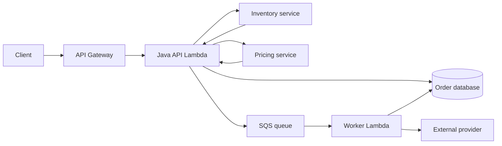

# Thiết kế timeout budget xuyên suốt chuỗi dịch vụ

## 1. Vì sao cần timeout budget end-to-end?

Một request serverless thường đi qua nhiều thành phần: API Gateway, Java Lambda, dịch vụ xác thực, database, queue, worker và API của nhà cung cấp bên ngoài. Mỗi thành phần có timeout riêng. Nếu từng thành phần tự chọn timeout mà không xét thời hạn chung, tổng thời gian có thể vượt quá thời gian người gọi chờ; các function vẫn tiếp tục chạy, giữ connection, tiêu thụ concurrency và phát sinh chi phí sau khi client đã bỏ cuộc.

Timeout budget là khoảng thời gian tối đa được cấp cho một thao tác hoặc một hành trình nghiệp vụ. Budget end-to-end bắt đầu khi hệ thống nhận yêu cầu và kết thúc khi trả kết quả hoặc xác định thất bại. Các thành phần phía sau phải chia sẻ budget đó, trừ những công việc bất đồng bộ được tách thành một SLA riêng.

Ví dụ một API tạo đơn hàng có ngân sách phản hồi 2,5 giây. Request đi qua gateway, Lambda, kiểm tra tồn kho, tính giá và ghi database. Nếu mỗi dependency đều được phép chờ 2 giây, chuỗi tuần tự có thể vượt quá 8 giây. Khi client timeout ở giây thứ 2,5, Lambda có thể vẫn đang chờ database hoặc tiếp tục gọi dịch vụ khác. Một budget chung giúp mỗi bước biết còn bao nhiêu thời gian và dừng trước khi vượt hạn.

Trong module CLOUD_SERVERLESS, timeout budget cần được thiết kế cùng trigger, retry, idempotency, concurrency, queue backlog và trạng thái bền vững. Timeout không chỉ là một giá trị cấu hình trên Lambda; nó là hợp đồng thời gian giữa producer, gateway, function, dependency và consumer.

## 2. Phân biệt timeout, deadline và latency

Ba khái niệm thường bị dùng lẫn nhau:

| Khái niệm | Ý nghĩa | Ví dụ |
|---|---|---|
| Timeout | Giới hạn chờ của một thao tác hoặc một thành phần | HTTP client dừng chờ sau 400 ms |
| Deadline | Thời điểm tuyệt đối mà toàn bộ thao tác phải hoàn tất | Request phải kết thúc trước 10:00:02.500 UTC |
| Latency | Thời gian thực tế đã tiêu tốn | Database query mất 120 ms |
| Budget còn lại | Khoảng thời gian trước deadline sau khi trừ thời gian đã dùng | Còn 800 ms cho các bước tiếp theo |

Timeout thường là giới hạn cục bộ. Deadline là hạn chung được truyền xuyên suốt chuỗi. Một request có deadline 2,5 giây có thể cấp 500 ms cho dịch vụ tồn kho, 300 ms cho dịch vụ tính giá và 250 ms cho database; các con số này là giới hạn cục bộ nằm trong budget tổng.

Không nên đặt timeout mỗi hop bằng toàn bộ deadline ban đầu. Nếu mỗi service lại chờ đủ 2,5 giây, tổng latency có thể tăng theo số hop. Mỗi downstream call phải dùng thời gian còn lại, trừ phần dự phòng cho xử lý sau call và trả response.

## 3. Vẽ chuỗi dịch vụ và xác định critical path

Trước khi đặt timeout, vẽ các bước đồng bộ và bất đồng bộ của luồng nghiệp vụ.



Trong ví dụ này, `Inventory` và `Pricing` có thể được gọi song song; `Order database` được ghi sau khi có kết quả. API có thể trả `202 Accepted` sau khi lưu đơn và enqueue công việc. Worker xử lý provider sau đó, theo một SLA bất đồng bộ riêng.

Phân biệt:

- **Critical path đồng bộ:** các bước phải hoàn tất trước khi trả response. Budget được chia trên đường dài nhất, không phải cộng mọi nhánh song song.
- **Nhánh song song:** thời gian chờ thường bằng thời gian của nhánh chậm nhất cộng overhead, nhưng mỗi nhánh vẫn phải có timeout và cancellation riêng.
- **Công việc bất đồng bộ:** producer chỉ cam kết nhận/lưu công việc; consumer có processing deadline/SLA riêng bắt đầu khi nhận message hoặc theo thời điểm nghiệp vụ.
- **Workflow dài:** nếu quy trình vượt thời gian HTTP hoặc function, dùng orchestration như Step Functions hoặc durable workflow thay vì kéo dài một request đồng bộ.

Không cộng timeout của mọi service một cách máy móc. Hãy tính theo dependency graph và đường hoàn tất thực tế.

## 4. Đặt mục tiêu thời gian từ trải nghiệm người dùng và SLO

Timeout nên xuất phát từ yêu cầu nghiệp vụ và SLO. Ví dụ:

- API tra cứu đơn hàng: p95 dưới 500 ms, timeout tổng 1,5 giây.
- API tạo đơn: trả trạng thái accepted trong 2 giây, xử lý thanh toán bất đồng bộ trong tối đa 2 phút.
- Webhook: xác nhận đã nhận event trong 1 giây, xử lý event ở worker trong 30 giây.
- Batch worker: xử lý batch trong 45 giây, có thể retry theo chính sách queue.

Các con số chỉ là ví dụ. Chọn deadline dựa trên client timeout, SLO, đặc tính dependency và khả năng retry. Nếu client chỉ chờ 3 giây, server không nên thiết kế critical path 8 giây rồi kỳ vọng client luôn chờ.

Hãy phân biệt latency mục tiêu và hard deadline. p95 500 ms không có nghĩa mọi request phải timeout sau 500 ms. Deadline là giới hạn tối đa; SLO là mục tiêu phân phối latency của phần lớn request.

## 5. Phân bổ budget và giữ phần dự phòng

Một budget tổng cần dành thời gian cho cả network, gateway, function, dependency và response serialization. Không phân hết thời gian cho downstream calls.

Ví dụ budget 2.500 ms cho một API đồng bộ:

| Bước | Budget tối đa | Ghi chú |
|---|---:|---|
| Client/network và API Gateway | 250 ms | DNS/TLS, gateway routing, response transfer |
| Khởi tạo/dispatch và validate trong Lambda | 200 ms | Không bao gồm cold start nếu platform tính riêng; cần đo thực tế |
| Inventory API | 550 ms | HTTP connect + request/response |
| Pricing API | 400 ms | Gọi song song với inventory |
| Ghi order database | 350 ms | Transaction và commit |
| Serialize và trả response | 150 ms | Mapping, logging tối thiểu |
| Safety reserve | 600 ms | Network jitter, retry có kiểm soát, cleanup và sai số |
| **Tổng** | **2.500 ms** | Các nhánh song song không cộng thời gian chờ với nhau |

Trong bảng, Inventory và Pricing chạy song song nên critical path chỉ chịu nhánh chậm hơn, khoảng 550 ms. Các bước thực tế có thể khác thứ tự; bảng là cách lập kế hoạch chứ không phải cấu hình mặc định.

Một số nguyên tắc:

- Giữ reserve cho xử lý lỗi, ghi trạng thái, đóng resource và trả response.
- Không đặt timeout downstream bằng đúng thời gian còn lại; để lại thời gian cho caller xử lý kết quả.
- Dành một phần budget cho network jitter và biến động tải.
- Với retry, trừ thời gian chờ/backoff vào cùng budget.
- Nếu budget không đủ, fail sớm hoặc chuyển công việc sang async; không âm thầm mở rộng deadline.

## 6. Truyền deadline xuyên qua HTTP

Khi gọi service khác, truyền thông tin thời hạn để downstream không tiếp tục xử lý quá lâu. Có thể dùng một header nội bộ như `X-Request-Deadline` chứa UTC timestamp hoặc `X-Request-Timeout-Ms` chứa thời gian còn lại. Với gRPC, có metadata `grpc-timeout`; với HTTP, W3C Trace Context giúp nối trace nhưng không tự mang deadline nghiệp vụ.

### Deadline tuyệt đối và timeout tương đối

Deadline tuyệt đối có thể truyền giữa nhiều process/máy vì mỗi bên biết thời điểm hết hạn. Tuy nhiên, nó phụ thuộc đồng hồ hệ thống và có thể chịu clock skew. Timeout tương đối dễ hiểu nhưng nếu mỗi hop nhận lại cùng một giá trị thì budget bị reset và tăng vô hạn.

Một cách thực hành:

1. Gateway hoặc service đầu tiên xác định deadline tối đa theo policy.
2. Truyền deadline UTC qua header nội bộ đã được xác thực.
3. Mỗi service chuyển deadline thành thời gian còn lại tại thời điểm nhận.
4. Dùng đồng hồ monotonic (`System.nanoTime`) để đo thời gian cục bộ.
5. Giới hạn timeout bằng min(remaining budget, timeout tối đa của dependency).
6. Trừ safety reserve trước khi gọi downstream.

Không tin trực tiếp deadline do client bên ngoài gửi. Service biên phải validate và cap deadline theo policy để client không thể yêu cầu function chạy vô hạn hoặc ép giữ tài nguyên quá lâu.

## 7. Tạo Deadline utility trong Java

`System.currentTimeMillis()` có thể thay đổi do đồng bộ đồng hồ. Để đo thời gian đã trôi qua trong một process, dùng `System.nanoTime()`. Có thể nhận deadline UTC ở biên rồi chuyển thành monotonic deadline cho phần xử lý còn lại.

```java
import java.time.Duration;
import java.time.Instant;
import java.util.Objects;

public final class Deadline {
    private static final Duration MAX_MONOTONIC_BUDGET = Duration.ofDays(1);
    private final long deadlineNanos;

    private Deadline(long deadlineNanos) {
        this.deadlineNanos = deadlineNanos;
    }

    public static Deadline after(Duration budget) {
        Objects.requireNonNull(budget, "budget");
        if (budget.isNegative() || budget.isZero()
                || budget.compareTo(MAX_MONOTONIC_BUDGET) > 0) {
            throw new IllegalArgumentException("budget must be positive and at most one day");
        }
        return new Deadline(System.nanoTime() + budget.toNanos());
    }

    public static Deadline fromUtc(Instant deadlineUtc, Duration maxAllowed) {
        Objects.requireNonNull(deadlineUtc, "deadlineUtc");
        Objects.requireNonNull(maxAllowed, "maxAllowed");
        if (maxAllowed.isNegative() || maxAllowed.isZero()
                || maxAllowed.compareTo(MAX_MONOTONIC_BUDGET) > 0) {
            throw new IllegalArgumentException("maxAllowed must be positive and at most one day");
        }

        Duration remaining = Duration.between(Instant.now(), deadlineUtc);
        if (remaining.isNegative() || remaining.isZero()) {
            throw new DeadlineExceededException("deadline already expired");
        }
        if (remaining.compareTo(maxAllowed) > 0) {
            remaining = maxAllowed;
        }
        return after(remaining);
    }

    public Duration remaining() {
        long nanos = deadlineNanos - System.nanoTime();
        return nanos <= 0 ? Duration.ZERO : Duration.ofNanos(nanos);
    }

    public Duration remainingMinus(Duration reserve) {
        Objects.requireNonNull(reserve, "reserve");
        if (reserve.isNegative()) {
            throw new IllegalArgumentException("reserve must not be negative");
        }
        Duration value = remaining().minus(reserve);
        return value.isNegative() ? Duration.ZERO : value;
    }

    public Duration cap(Duration maxTimeout, Duration reserve) {
        Objects.requireNonNull(maxTimeout, "maxTimeout");
        if (maxTimeout.isNegative() || maxTimeout.isZero()) {
            throw new IllegalArgumentException("maxTimeout must be positive");
        }
        Duration usable = remainingMinus(reserve);
        if (usable.isZero()) {
            throw new DeadlineExceededException("insufficient time remaining");
        }
        return usable.compareTo(maxTimeout) < 0 ? usable : maxTimeout;
    }

    public void throwIfExpired() {
        if (remaining().isZero()) {
            throw new DeadlineExceededException("request deadline exceeded");
        }
    }
}

class DeadlineExceededException extends RuntimeException {
    DeadlineExceededException(String message) {
        super(message);
    }
}
```

Utility trên minh họa cách chuyển deadline UTC sang monotonic clock và cap budget. Trong code production, đặt exception ở file riêng, xử lý duration quá lớn/overflow, validate header và không cho client điều khiển `maxAllowed`. `Instant.now()` chỉ được dùng khi chuyển deadline từ wire; phép đo cục bộ sau đó dùng `nanoTime()`.

## 8. Dùng thời gian còn lại khi gọi HTTP bằng Java

`HttpClient` có `connectTimeout` ở cấp client và `HttpRequest.timeout` ở cấp request. Hãy đặt timeout request theo thời gian còn lại, không dùng một giá trị cố định lớn hơn deadline.

```java
import java.net.URI;
import java.net.http.HttpClient;
import java.net.http.HttpRequest;
import java.net.http.HttpResponse;
import java.time.Duration;

public final class InventoryClient {
    private static final Duration CONNECT_TIMEOUT = Duration.ofMillis(150);
    private static final Duration MAX_REQUEST_TIMEOUT = Duration.ofMillis(550);
    private static final Duration RESPONSE_RESERVE = Duration.ofMillis(100);

    private final HttpClient client = HttpClient.newBuilder()
            .connectTimeout(CONNECT_TIMEOUT)
            .build();

    public HttpResponse<String> getStock(
            String sku,
            Deadline deadline) throws Exception {

        Duration requestTimeout = deadline.cap(
                MAX_REQUEST_TIMEOUT,
                RESPONSE_RESERVE);

        HttpRequest request = HttpRequest.newBuilder()
                .uri(URI.create("https://inventory.internal/items/" + sku))
                .timeout(requestTimeout)
                .GET()
                .build();

        return client.send(request, HttpResponse.BodyHandlers.ofString());
    }
}
```

`connectTimeout` chỉ áp dụng khi cần thiết lập kết nối mới; connection đã được reuse không cần handshake mới. `HttpRequest.timeout` giới hạn thời gian trao đổi của request. Với async `sendAsync`, cần quản lý `CompletableFuture` và cancellation khi deadline hết. Không dùng `orTimeout` như bằng chứng chắc chắn rằng socket và downstream đã dừng; cancellation có thể là best effort.

Trong thực tế, cần cấu hình thêm connection pool, TLS handshake, response body size, DNS và retry. Tránh tạo `HttpClient` mới cho mọi invocation; tái sử dụng client ở phạm vi execution environment khi phù hợp và đóng/refresh connection stale theo thư viện.

## 9. Deadline trong AWS Lambda Java

Lambda cung cấp `Context.getRemainingTimeInMillis()` để handler biết thời gian còn lại trước function timeout. Dùng giá trị này để cap timeout của database/HTTP call và dành reserve cho cleanup.

```java
import com.amazonaws.services.lambda.runtime.Context;
import com.amazonaws.services.lambda.runtime.RequestHandler;

public class OrderHandler implements RequestHandler<OrderRequest, OrderResponse> {
    @Override
    public OrderResponse handleRequest(OrderRequest input, Context context) {
        long remainingMs = context.getRemainingTimeInMillis();
        long reserveMs = 300;
        long dependencyBudgetMs = Math.min(700, remainingMs - reserveMs);

        if (dependencyBudgetMs <= 0) {
            throw new DeadlineExceededException("not enough Lambda time remaining");
        }

        // Gọi dependency với timeout <= dependencyBudgetMs.
        // Sau đó kiểm tra remaining time trước khi ghi kết quả/trả response.
        return process(input, dependencyBudgetMs, context);
    }

    private OrderResponse process(
            OrderRequest input,
            long dependencyBudgetMs,
            Context context) {
        // Application logic.
        return new OrderResponse("ACCEPTED", input.orderId());
    }
}
```

Ví dụ dùng Java runtime interface của Lambda. Nếu framework adapter hoặc handler signature khác, lấy Lambda context qua cơ chế tích hợp tương ứng. Không đặt timeout dependency bằng toàn bộ `remainingTimeInMillis`; giữ reserve để ghi log, hoàn tất transaction, trả lỗi có cấu trúc hoặc lưu idempotency state.

Lambda timeout là giới hạn cứng cho invocation. Nếu function bị timeout, Lambda chấm dứt execution environment; code không được bảo đảm có cơ hội chạy `finally` hoặc cleanup. Vì vậy, không dùng Lambda timeout như cơ chế đóng transaction an toàn. Phải đặt timeout thấp hơn giới hạn function và thiết kế operation có thể phục hồi khi process bị dừng đột ngột.

## 10. Sắp xếp timeout giữa client, gateway, Lambda và dependency

Với một request đồng bộ, timeout các lớp cần lồng nhau có chủ đích. Thông thường, downstream timeout nhỏ nhất; Lambda có thời gian để xử lý lỗi và trả kết quả; gateway có thời gian chờ lớn hơn Lambda một khoảng; client có đủ thời gian nhận response.

```text
Downstream call timeout  < Lambda remaining/function timeout
Lambda timeout           < Gateway integration timeout
Gateway timeout          < Client total deadline
```

Đây là quan hệ thiết kế điển hình, không phải quy luật tuyệt đối cho mọi gateway. Phải kiểm tra giới hạn timeout và quota của dịch vụ đang dùng, vì một số gateway có hard limit hoặc timeout có thể cấu hình khác nhau theo loại API/Region.

Ví dụ:

| Lớp | Timeout minh họa |
|---|---:|
| Database query | 250 ms |
| Inventory HTTP call | 500 ms |
| Java Lambda | 1.800 ms |
| Gateway integration | 2.000 ms |
| Client total timeout | 2.500 ms |

Nếu gateway timeout trước Lambda, client có thể nhận lỗi trong khi Lambda tiếp tục chạy và tạo side effect. Nếu client timeout trước gateway, client cũng có thể retry trong khi request đầu tiên vẫn đang xử lý. Vì vậy, idempotency là phần bắt buộc của thiết kế timeout/retry.

## 11. Timeout của database và connection pool

Database operation thường có nhiều điểm chờ:

- Chờ lấy connection từ pool.
- DNS/TLS hoặc kết nối TCP.
- Chờ lock/transaction.
- Chạy query.
- Truyền kết quả và commit.

Đặt riêng connection acquisition timeout, network/socket timeout, statement/query timeout và transaction timeout nếu driver/database hỗ trợ. Một query timeout không nhất thiết giới hạn thời gian chờ connection pool hoặc thời gian commit.

Ví dụ JDBC:

```java
Duration usable = deadline.cap(Duration.ofSeconds(2), Duration.ofMillis(50));
if (usable.compareTo(Duration.ofSeconds(1)) < 0) {
    throw new DeadlineExceededException("less than one second remains for JDBC query");
}
int queryTimeoutSeconds = Math.min(2, Math.toIntExact(usable.toSeconds()));

try (Connection connection = dataSource.getConnection()) {
    connection.setAutoCommit(false);

    try {
        try (PreparedStatement statement = connection.prepareStatement(
                "UPDATE orders SET status = ? WHERE order_id = ?")) {
            statement.setQueryTimeout(queryTimeoutSeconds);
            statement.setString(1, "CONFIRMED");
            statement.setString(2, orderId);
            statement.executeUpdate();
        }

        connection.commit();
    } catch (SQLException | RuntimeException error) {
        try {
            connection.rollback();
        } catch (SQLException rollbackError) {
            error.addSuppressed(rollbackError);
        }
        throw error;
    }
}
```

`Statement.setQueryTimeout` nhận số giây nguyên và driver có thể triển khai khác nhau. Ví dụ fail fast nếu còn dưới một giây vì API này không biểu diễn được timeout dưới giây. `dataSource` cũng cần cấu hình connection acquisition timeout riêng; thời gian chờ lấy connection đã tiêu thụ budget trước khi đoạn code trên bắt đầu. Với transaction, đặt timeout ở database/driver và xử lý rollback; không giả định query timeout tự giới hạn mọi thao tác commit.

Connection pool cần giới hạn số connection theo concurrency của Lambda và capacity database. Nếu mỗi invocation tạo nhiều connection hoặc pool quá lớn, scale-out có thể làm database cạn connection dù từng request có timeout hợp lý.

## 12. Timeout của các loại trigger

Không phải trigger nào cũng có một client đang chờ response. Mỗi trigger có một mô hình timeout khác nhau.

| Trigger | Ai chờ? | Budget cần quản lý |
|---|---|---|
| HTTP/API Gateway | Client và gateway | Client deadline, integration timeout, Lambda timeout, dependency budget |
| Lambda Function URL | HTTP client | Client deadline, function timeout, dependency budget |
| Synchronous SDK invoke | Caller SDK | SDK call timeout, Lambda timeout và deadline caller |
| Asynchronous Lambda invoke | Producer chỉ chờ xác nhận nhận event | Producer publish timeout; function retry/age policy và processing SLA riêng |
| SQS event source mapping | Queue giữ message; worker xử lý | Function timeout, visibility timeout, batch window, message age và DLQ policy |
| EventBridge | Event bus giao event | Delivery retry/retention và consumer processing SLA |
| Kinesis/DynamoDB Streams | Event source mapping poll stream | Function timeout, batch/window, checkpoint, record age và retry policy |
| Step Functions | State machine điều phối | Task timeout, heartbeat, execution timeout và deadline nghiệp vụ |

Đừng lấy timeout của HTTP request áp cho toàn bộ công việc xử lý queue. Với async flow, producer có thể trả `202` trong vài trăm ms; worker có thể xử lý trong 30 giây hoặc vài phút theo SLA riêng. Cần lưu deadline nghiệp vụ hoặc `expiresAt` trong message nếu event không còn giá trị sau một thời điểm.

## 13. Timeout và visibility timeout của SQS

Với SQS event source mapping, message trở nên invisible khi Lambda nhận nó. Nếu function không hoàn tất/xóa message trước khi visibility timeout hết, message có thể xuất hiện lại và được xử lý lần nữa.

AWS khuyến nghị visibility timeout của queue ít nhất sáu lần timeout của Lambda function, cộng thêm maximum batching window nếu có. Điều này tạo khoảng trống cho retry và điều chỉnh khi service throttling. <https://docs.aws.amazon.com/lambda/latest/dg/with-sqs.html>

Ví dụ:

```text
Lambda timeout:             30 giây
Maximum batching window:     5 giây
Visibility timeout tối thiểu theo khuyến nghị: 6 × 30 + 5 = 185 giây
```

Con số trên là ví dụ theo khuyến nghị AWS; kiểm tra cấu hình event source mapping và queue hiện hành. Visibility timeout không phải deadline nghiệp vụ của message. Nếu message đã hết hạn về mặt nghiệp vụ, worker cần kiểm tra `expiresAt` và bỏ qua hoặc chuyển sang trạng thái expired.

Với batch, một record lỗi có thể khiến cả batch được giao lại nếu không bật partial batch response. Khi bật `ReportBatchItemFailures`, handler cần trả đúng danh sách item lỗi. Timeout toàn function vẫn có thể khiến batch được giao lại; idempotency vẫn cần thiết.

## 14. Deadline cho event-driven và message processing

Trong async flow, hãy phân biệt ba mốc:

1. **Acceptance deadline:** producer phải gửi/lưu message thành công trong bao lâu.
2. **Processing deadline:** consumer phải bắt đầu hoặc hoàn thành xử lý trước thời điểm nào.
3. **Business expiry:** event còn ý nghĩa nghiệp vụ đến khi nào.

Ví dụ một webhook thông báo giao dịch:

- API nhận webhook và trả 2xx trong 1 giây.
- Message được xử lý trong vòng 30 giây kể từ khi enqueue.
- Event thanh toán có thể được retry trong 15 phút trước khi chuyển DLQ.
- Sau thời hạn nghiệp vụ, event chuyển sang trạng thái cần reconciliation thay vì tự động charge lại.

Các thời hạn trên là ví dụ. Message nên mang `eventId`, `createdAt`, `expiresAt`, `correlationId` và schema version. Consumer tính budget từ thời điểm hiện tại và deadline nghiệp vụ; không reset một timeout dài mỗi lần retry.

## 15. Retry phải tiêu thụ cùng budget

Retry không tạo thêm thời gian cho request. Mọi attempt, backoff và network overhead đều tiêu thụ deadline ban đầu.

Ví dụ budget còn 900 ms:

| Thành phần | Thời gian |
|---|---:|
| Attempt 1 | 250 ms |
| Backoff có jitter | 100 ms |
| Attempt 2 | 250 ms |
| Xử lý kết quả và response reserve | 150 ms |
| Tổng | 750 ms |

Nếu attempt đầu đã mất 700 ms, không còn đủ thời gian cho retry 250 ms cộng reserve; cần trả lỗi/timeout ngay thay vì bắt đầu một attempt chắc chắn vượt deadline.

### Exponential backoff có jitter

Một công thức phổ biến:

```text
delay = random(0, min(maxDelay, baseDelay × 2^attempt))
```

Trước khi retry:

- Kiểm tra lỗi có transient và retryable không.
- Kiểm tra operation có idempotent hoặc có idempotency key không.
- Kiểm tra còn đủ deadline cho một attempt và reserve.
- Giới hạn số lần retry và tổng thời gian retry.
- Không retry đồng thời ở mọi tầng (SDK, framework, Lambda, queue và workflow) mà không có một retry budget chung.

Retry storm có thể làm dependency quá tải hơn. Kết hợp exponential backoff, jitter, circuit breaker, bulkhead và concurrency limit.

## 16. Idempotency khi caller timeout nhưng server vẫn chạy

Một tình huống quan trọng: client gửi `POST /orders`, server tạo order thành công nhưng response bị timeout trên đường về. Client không biết giao dịch đã commit hay chưa và gửi lại request. Nếu server tạo order lần nữa, hệ thống có duplicate.

Giải pháp:

- Client gửi idempotency key ổn định cho cùng một thao tác nghiệp vụ.
- Server lưu key, trạng thái và kết quả trong kho bền vững.
- Request trùng trả lại kết quả đã ghi hoặc trạng thái đang xử lý.
- Database dùng unique constraint/conditional write để ngăn race condition.
- Worker dùng event ID ổn định để chống xử lý lại khi message redeliver.

Idempotency record cần có retention dài hơn cửa sổ retry/replay có thể xảy ra. Không dùng Lambda request ID làm idempotency key vì retry có thể tạo invocation ID khác.

Timeout của client không có nghĩa server đã rollback. Thiết kế API phải cho phép client hỏi trạng thái bằng operation ID hoặc gửi lại cùng idempotency key để nhận kết quả nhất quán.

## 17. Cancellation và dừng công việc khi hết deadline

Khi deadline hết, service nên dừng tạo công việc mới và cố gắng hủy các thao tác đang chờ. Tuy nhiên, cancellation thường là best effort:

- HTTP client có thể hủy request/future nhưng remote server có thể đã xử lý.
- JDBC statement cancel có thể không ngắt được mọi driver/query ngay lập tức.
- Future bị cancel không bảo đảm thread hoặc native call dừng tức thì.
- Lambda timeout có thể kết thúc process mà không chạy cleanup code.
- Queue message không tự biến mất nếu worker timeout; nó có thể được giao lại.

Vì vậy:

- Truyền cancellation signal đến async task và downstream client.
- Kiểm tra deadline trước các side effect mới.
- Dùng transaction và idempotency cho side effect đã bắt đầu.
- Không giữ lock hoặc connection sau khi request không còn hữu ích.
- Có reconciliation cho trạng thái không rõ kết quả (unknown outcome).
- Không dựa vào `finally` làm cơ chế phục hồi duy nhất.

## 18. Parallel calls và fan-out

Nếu một function gọi nhiều service song song, tổng thời gian không nhất thiết là tổng timeout của mọi nhánh. Critical path là nhánh chậm nhất, cộng thời gian khởi tạo, join và xử lý kết quả.

Ví dụ:

```java
CompletableFuture<Inventory> inventoryFuture =
        inventoryClient.fetch(sku, inventoryTimeout);
CompletableFuture<Price> priceFuture =
        pricingClient.fetch(sku, pricingTimeout);

// Cả hai nhánh dùng cùng deadline tổng nhưng có cap riêng.
CompletableFuture.allOf(inventoryFuture, priceFuture)
        .orTimeout(remaining.toMillis(), TimeUnit.MILLISECONDS)
        .join();
```

Đây chỉ là khung minh họa. `orTimeout` hoàn thành future bằng exception khi hết hạn, nhưng không tự bảo đảm hủy HTTP request phía dưới. Cần giữ handle của từng request/future và gọi cancellation API phù hợp. Khi một nhánh thất bại và kết quả của nhánh kia không còn cần thiết, hủy nhánh còn lại nếu an toàn.

Fan-out lớn cũng cần giới hạn concurrency. Nếu một invocation tạo hàng trăm call cùng lúc, dependency có thể bị overload dù từng call có timeout ngắn. Dùng semaphore/bulkhead và budget cho mỗi nhánh.

## 19. Timeout cho workflow dài bằng Step Functions

Nếu một quy trình cần nhiều phút/giờ, không giữ một HTTP request hoặc Lambda invocation mở suốt thời gian đó. Chuyển quy trình sang orchestration:

- Mỗi task có timeout riêng.
- Retry policy có backoff, giới hạn attempts và lỗi được retry.
- Catch/compensation xử lý lỗi cuối.
- Wait state chờ một khoảng thời gian mà không giữ Lambda chạy.
- Callback task token cho tác vụ chờ hệ thống bên ngoài.
- Execution timeout giới hạn toàn workflow.
- Heartbeat timeout phát hiện worker không còn tiến triển ở task hỗ trợ heartbeat.

Ví dụ một workflow đặt hàng có thể xác thực tồn kho trong 2 giây, giữ hàng trong 30 giây, chờ thanh toán tối đa 2 phút và gửi thông báo sau khi hoàn tất. Mỗi task có deadline riêng nhưng execution vẫn tuân thủ một business deadline tổng.

Không kéo dài Lambda timeout để thay thế workflow engine. Lambda có giới hạn thời gian thực thi; workflow orchestration phù hợp hơn cho quy trình dài, có wait, retry, state và compensation.

## 20. Timeout, circuit breaker và bulkhead

Timeout giới hạn thời gian một call. Circuit breaker ngăn tiếp tục gọi dependency đang lỗi. Bulkhead giới hạn tài nguyên dành cho một nhóm call để một dependency không chiếm hết thread/connection.

| Cơ chế | Mục đích | Tương tác với deadline |
|---|---|---|
| Timeout | Dừng chờ quá lâu | Luôn nhỏ hơn hoặc bằng budget còn lại |
| Circuit breaker | Fail fast khi dependency có lỗi liên tiếp | Không chờ call nếu breaker open |
| Bulkhead | Giới hạn concurrency/connection | Nếu không lấy được slot trước deadline thì fail fast |
| Retry | Phục hồi lỗi transient | Chỉ retry nếu còn đủ budget và operation an toàn |
| Rate limit | Bảo vệ service khỏi quá tải | Từ chối sớm nếu không thể xử lý trong budget |

Không retry khi circuit breaker đang open. Không xếp hàng chờ semaphore vô thời hạn; thời gian chờ lấy slot cũng phải tiêu thụ budget. Với serverless scale-out, bulkhead cần bảo vệ cả dependency toàn hệ thống chứ không chỉ một execution environment.

## 21. Observability cho timeout budget

Chỉ log “request timed out” là chưa đủ. Cần biết timeout xảy ra ở đâu và budget đã tiêu thụ như thế nào.

Log/trace fields hữu ích:

- `deadline_at` hoặc `deadline_ms` (không dùng làm metric label).
- `remaining_budget_ms` trước mỗi downstream call.
- `dependency.name`, `operation.name` và `timeout.configured_ms`.
- `elapsed_ms`, `attempt`, `retry_delay_ms`.
- `timeout.source`: client, gateway, Lambda, HTTP client, database, queue hoặc workflow.
- `correlation_id`, `trace_id`, `event_id`.
- `outcome`: success, timeout, cancelled, retry_exhausted hoặc unknown.

Metrics nên có cardinality thấp:

- `dependency_request_duration` theo service, operation, outcome.
- `dependency_timeout_total` theo dependency và timeout class.
- `deadline_exceeded_total` theo route/operation đã chuẩn hóa.
- `retry_attempts_total` theo dependency và error class.
- `remaining_budget_at_hop` dạng histogram.
- `queue_age`, `message_processing_duration` và `workflow_execution_duration`.

Không thêm request ID, order ID hoặc raw URL làm metric dimension. Giữ ID trong trace/log để điều tra; metric chỉ dùng thuộc tính có tập giá trị hữu hạn.

## 22. Kiểm thử timeout budget

Timeout cần được kiểm thử như một hành vi chức năng và độ tin cậy, không chỉ kiểm tra cấu hình tồn tại.

Các scenario nên có:

1. Dependency trả kết quả nhanh: request hoàn tất trong budget.
2. Dependency chậm hơn timeout cục bộ: caller fail đúng hạn và có timeout source rõ.
3. Dependency chậm nhưng vẫn nằm trong deadline tổng: request được xử lý bình thường.
4. Hai nhánh song song, một nhánh timeout: nhánh còn lại được cancel nếu không còn cần.
5. Client timeout trong khi server đã commit: retry cùng idempotency key không tạo duplicate.
6. Lambda gần hết remaining time: handler không bắt đầu operation mới nếu không còn reserve.
7. SQS worker timeout: message được giao lại và side effect không trùng.
8. Queue backlog: message hết business expiry được xử lý theo policy.
9. Database pool cạn: acquisition timeout xảy ra trước Lambda timeout.
10. Retry storm: backoff/jitter và retry budget giới hạn tổng số call.
11. Clock skew: deadline UTC không cho phép service chạy vượt max allowed.
12. Workflow dài: task timeout, heartbeat và execution timeout kích hoạt đúng.

Dùng test server hoặc dependency giả lập có thể cấu hình latency, connection reset và lỗi transient. Với cloud integration test, tạo môi trường cô lập và cleanup theo test run; không cố ý gây timeout trên dependency production.

## 23. Các lỗi thiết kế thường gặp

| Lỗi | Hậu quả | Cách sửa |
|---|---|---|
| Mỗi hop đặt timeout bằng toàn bộ budget | Tổng latency tăng theo số hop | Truyền deadline và dùng remaining budget |
| Retry reset timeout | Request có thể chạy vô hạn | Giữ deadline gốc qua mọi attempt |
| Client timeout nhưng server tiếp tục side effect | Client retry tạo duplicate | Idempotency key và trạng thái bền vững |
| Gateway timeout ngắn hơn Lambda quá nhiều | Lambda tiếp tục chạy sau khi caller đã bỏ | Căn chỉnh timeout và xử lý cancellation |
| Lambda timeout đúng bằng downstream timeout | Không còn thời gian xử lý lỗi/cleanup | Giữ reserve giữa dependency và function timeout |
| Chỉ đặt JDBC query timeout | Connection pool/commit vẫn có thể chờ lâu | Đặt acquisition, network, statement và transaction timeout |
| Dùng `Thread.sleep` để chờ retry | Lãng phí budget và concurrency | Backoff có giới hạn, ưu tiên async queue/workflow |
| Tạo HTTP client mới mỗi invocation | Tăng handshake và latency | Tái sử dụng client/pool trong environment |
| Visibility timeout nhỏ hơn thời gian xử lý | Message redeliver khi worker vẫn chạy | Căn chỉnh theo Lambda timeout và batch window |
| Dùng timeout HTTP cho queue worker | Bỏ qua message age và business expiry | Đặt SLA riêng cho async processing |
| Cho rằng cancel future dừng remote call | Side effect vẫn có thể hoàn tất | Idempotency, transaction và reconciliation |
| Không quan sát remaining budget | Khó tìm hop gây chậm | Ghi remaining budget và timeout source |

## 24. Quy trình thiết kế timeout budget

1. **Xác định user/business deadline:** thời gian tối đa người gọi hoặc nghiệp vụ chấp nhận.
2. **Vẽ dependency graph:** phân biệt bước tuần tự, song song và bất đồng bộ.
3. **Xác định critical path:** tính thời gian của đường hoàn tất dài nhất.
4. **Phân bổ budget:** đặt giới hạn cho gateway, function, HTTP, database và phần dự phòng.
5. **Truyền deadline:** dùng header/metadata/event field có hợp đồng rõ ràng.
6. **Cap deadline tại biên:** không tin client có thể yêu cầu timeout vô hạn.
7. **Dùng remaining time:** downstream timeout không vượt budget còn lại trừ reserve.
8. **Thiết kế retry:** backoff, jitter, retryable errors, attempt limit và idempotency.
9. **Xử lý cancellation:** dừng công việc không còn cần, nhưng chuẩn bị cho kết quả không rõ.
10. **Tách async SLA:** queue/event/workflow có processing deadline và business expiry riêng.
11. **Quan sát:** đo latency từng hop, remaining budget, timeout source và retry.
12. **Kiểm thử failure:** dependency chậm, timeout, duplicate, backlog, cancellation và clock skew.
13. **Rà soát định kỳ:** cập nhật budget khi dependency, traffic, runtime hoặc SLO thay đổi.

## 25. Checklist trước production

- [ ] Có deadline tổng được xác định từ SLO và trải nghiệm người dùng.
- [ ] Dependency graph xác định rõ bước tuần tự, song song và async.
- [ ] Timeout của caller, gateway, Lambda và downstream được căn chỉnh.
- [ ] Mỗi downstream call dùng remaining budget, không reset timeout.
- [ ] Có safety reserve cho response, transaction và error handling.
- [ ] Deadline được truyền qua HTTP/message/event theo hợp đồng đã xác thực.
- [ ] Deadline từ client được cap theo policy.
- [ ] Java dùng monotonic clock cho elapsed time và timeout cục bộ.
- [ ] HTTP connect/request timeout và database pool/query/transaction timeout được cấu hình.
- [ ] Lambda handler kiểm tra `getRemainingTimeInMillis()` trước operation dài.
- [ ] Retry có backoff, jitter, attempt limit và retry budget chung.
- [ ] Side effect có idempotency key và trạng thái bền vững.
- [ ] Cancellation được coi là best effort; có reconciliation cho unknown outcome.
- [ ] Queue visibility timeout phù hợp Lambda timeout và batching window.
- [ ] Async processing có SLA, message expiry và DLQ policy riêng.
- [ ] Workflow dài dùng orchestration thay vì giữ invocation mở.
- [ ] Circuit breaker, bulkhead và rate limit bảo vệ dependency.
- [ ] Metrics/log/trace xác định được timeout source và remaining budget.
- [ ] Có test cho slow dependency, retry, duplicate, timeout và backlog.
- [ ] Có cảnh báo deadline exceeded, timeout rate, queue age và retry exhaustion.

## Tài liệu tham khảo

- [AWS Lambda timeout configuration](https://docs.aws.amazon.com/lambda/latest/dg/configuration-timeout.html)
- [AWS Lambda context object](https://docs.aws.amazon.com/lambda/latest/dg/java-context.html)
- [Using Lambda with Amazon SQS](https://docs.aws.amazon.com/lambda/latest/dg/with-sqs.html)
- [Lambda asynchronous invocation error handling](https://docs.aws.amazon.com/lambda/latest/dg/invocation-async-error-handling.html)
- [AWS Step Functions state/task timeouts](https://docs.aws.amazon.com/step-functions/latest/dg/sfn-states-Task.html)
- [Java HttpClient](https://docs.oracle.com/en/java/javase/21/docs/api/java.net.http/java/net/http/HttpClient.html)
- [Java HttpRequest timeout](https://docs.oracle.com/en/java/javase/21/docs/api/java.net.http/java/net/http/HttpRequest.Builder.html#timeout(java.time.Duration))
- [JDBC Statement query timeout](https://docs.oracle.com/en/java/javase/21/docs/api/java.sql/java/sql/Statement.html#setQueryTimeout(int))
- [W3C Trace Context](https://www.w3.org/TR/trace-context/)

## Kết luận

Timeout budget phải đi theo toàn bộ hành trình nghiệp vụ. Xác định deadline từ SLO, vẽ critical path, chia budget cho gateway/function/dependency và giữ reserve cho response. Mỗi Java service truyền deadline, dùng monotonic clock để tính thời gian còn lại và cap timeout của HTTP/database call. Retry phải tiêu thụ cùng budget và chỉ thực hiện khi operation an toàn; idempotency xử lý trường hợp caller timeout nhưng side effect đã commit. Với queue và workflow bất đồng bộ, đặt SLA xử lý và business expiry riêng. Quan sát remaining budget từng hop và kiểm thử dependency chậm, duplicate, cancellation cùng backlog giúp chuỗi serverless kết thúc đúng hạn mà không tạo thêm tải hoặc side effect ngoài dự kiến.
