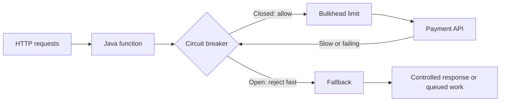
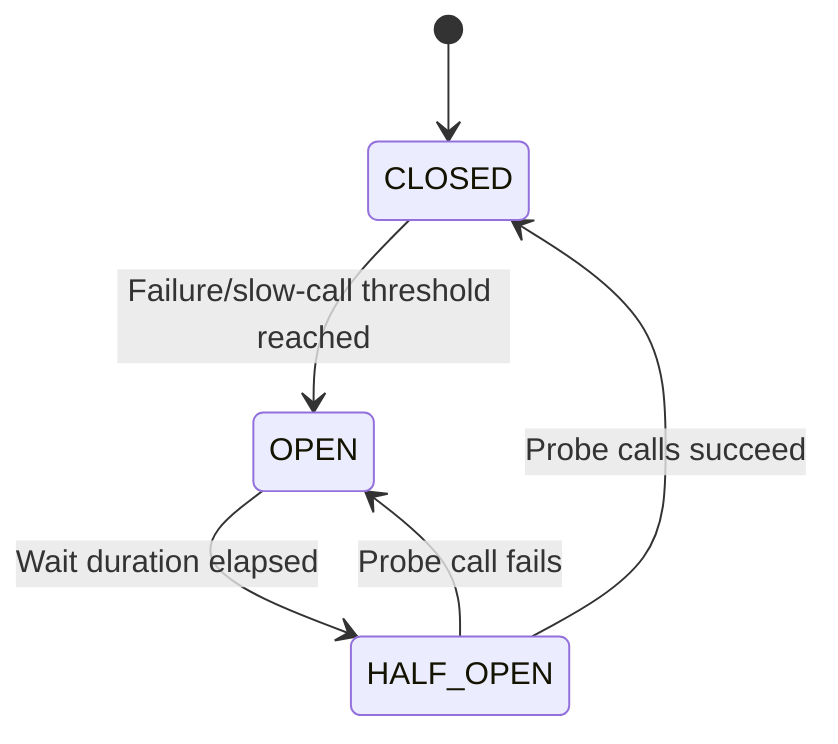
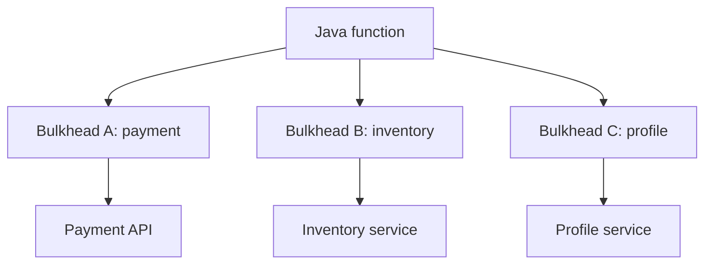

# Circuit breaker, bulkhead và fallback trong function

Một Java function serverless có thể phụ thuộc vào database, payment API, identity provider, object storage hoặc một dịch vụ HTTP bên ngoài. Khi dependency chậm hoặc ngừng hoạt động, function thường giữ connection và thread lâu hơn, invocation timeout tăng, queue backlog tích tụ và chi phí tiếp tục phát sinh. Nếu mọi invocation vẫn cố gọi dependency đang lỗi, một sự cố cục bộ có thể lan thành sự cố toàn hệ thống.

Ba mẫu thiết kế giúp giới hạn tác động là **circuit breaker**, **bulkhead** và **fallback**. Circuit breaker tạm ngừng gọi dependency đang thất bại; bulkhead giới hạn số request đồng thời có thể chiếm tài nguyên; fallback cung cấp hành vi thay thế đã được định nghĩa khi đường xử lý chính không khả dụng. Chúng bổ sung cho timeout, retry, rate limit và idempotency, chứ không thay thế các cơ chế đó.

Trong phạm vi **CLOUD_SERVERLESS**, bài học tập trung vào phát triển và triển khai ứng dụng serverless, đặc biệt là Java function kích hoạt bởi HTTP, message hoặc event. Người học xử lý trigger, trạng thái, quyền truy cập, retry, idempotency, cold start, mở rộng và chi phí. Bài này trình bày cách phối hợp circuit breaker, bulkhead và fallback để bảo vệ function cùng các dịch vụ phụ thuộc.

## 1. Vì sao function cần bảo vệ dependency?

Giả sử một Java HTTP function gọi payment API. Bình thường API phản hồi trong 100 ms. Khi payment provider bị suy giảm, response time tăng lên 8 giây. Nếu function timeout sau 10 giây và có 100 invocation đồng thời, nhiều thread và connection sẽ bị giữ lâu. Autoscaler có thể tạo thêm instance, làm tổng số request đến payment provider tăng cao hơn và khiến sự cố trầm trọng hơn.



Các mục tiêu:

- Không chờ vô ích đến hết function timeout khi dependency đang lỗi.
- Giới hạn số invocation cùng lúc được phép gọi một dependency.
- Giữ tài nguyên cho các request khác và cho phần nghiệp vụ không phụ thuộc dịch vụ đang lỗi.
- Trả kết quả trung thực hoặc chuyển công việc sang cơ chế xử lý sau.
- Khôi phục lưu lượng từng bước khi dependency hoạt động trở lại.

## 2. Circuit breaker là gì?

Circuit breaker là bộ điều khiển trạng thái đặt trước một dependency. Nó quan sát kết quả gọi và quyết định có cho phép lời gọi tiếp theo đi qua hay không.

Circuit breaker thường có ba trạng thái:

| Trạng thái | Hành vi | Mục đích |
|---|---|---|
| `CLOSED` | Cho phép request đi qua và ghi nhận kết quả | Hoạt động bình thường, theo dõi lỗi |
| `OPEN` | Từ chối nhanh lời gọi mới, không gọi dependency | Ngăn tiếp tục gây tải lên dependency đang lỗi |
| `HALF_OPEN` | Cho phép một số ít probe request | Kiểm tra dependency đã phục hồi chưa |



Khi circuit ở `CLOSED`, request được gửi đến dependency. Nếu tỷ lệ lỗi hoặc tỷ lệ lời gọi chậm vượt ngưỡng trong cửa sổ thống kê, circuit chuyển sang `OPEN`. Sau một khoảng chờ, circuit chuyển sang `HALF_OPEN` để thử một số request giới hạn. Nếu probe thành công, circuit đóng lại; nếu tiếp tục thất bại, circuit mở lại.

Circuit breaker không phải retry mechanism. Retry gọi lại một operation sau lỗi; breaker quyết định có nên gọi dependency nữa hay không. Retry quá mạnh có thể làm breaker mở nhanh hơn, vì vậy hai cơ chế cần được cấu hình phối hợp.

## 3. Chọn lỗi nào được tính vào circuit breaker?

Không phải mọi exception đều chứng minh dependency đang hỏng. Ví dụ HTTP 400 do payload không hợp lệ là lỗi đầu vào, không phải lý do mở circuit của payment provider. HTTP 401/403 có thể là lỗi credential hoặc cấu hình; cần xử lý và cảnh báo riêng. HTTP 429 hoặc 5xx có thể phản ánh rate limit hay sự cố phía dependency.

Phân loại trước khi cấu hình:

| Kết quả | Có nên tính là dependency failure? | Ghi chú |
|---|---|---|
| Connection timeout/refused | Thường có | Dependency hoặc network không đáp ứng |
| HTTP 5xx | Thường có | Có thể loại trừ một số mã theo hợp đồng |
| HTTP 429 | Tùy hợp đồng | Thường cần backoff và tôn trọng `Retry-After` |
| HTTP 400 do input | Không | Lỗi caller hoặc validation |
| HTTP 401/403 | Thường tách riêng | Có thể là credential/configuration failure; cần cảnh báo |
| HTTP 404 nghiệp vụ | Thường không | Resource không tồn tại không nhất thiết là dependency outage |
| Business decline | Không | Ví dụ thanh toán bị từ chối hợp lệ |
| Slow call vượt ngưỡng | Có thể | Cấu hình slow-call threshold riêng |

Nếu breaker tính cả lỗi nghiệp vụ bình thường, circuit có thể mở dù dependency khỏe. Nếu chỉ tính exception mà bỏ qua HTTP 5xx được trả như response bình thường, breaker có thể không phát hiện sự cố. Adapter nên chuyển response thành kết quả hoặc exception có phân loại rõ ràng.

## 4. Timeout phải giới hạn từng lần gọi và tổng deadline

Mọi lời gọi dependency cần timeout hữu hạn. Nếu không có timeout, một request có thể treo lâu và chiếm slot bulkhead. HTTP/database client cần timeout cho từng lần gọi; toàn bộ chuỗi retry còn cần một deadline tổng ngắn hơn thời hạn invocation. Các giá trị được chọn theo latency phân phối, SLO và hợp đồng dependency.

Ví dụ thứ tự xử lý thường gặp:

1. Caller/function xác định deadline tổng cho operation.
2. Bulkhead giới hạn số lời gọi có thể chiếm tài nguyên.
3. Circuit breaker quyết định có cho phép gọi dependency.
4. HTTP/database client giới hạn từng lần gọi bằng connect/read/request timeout.
5. Retry chỉ thử lỗi tạm thời và phải còn nằm trong deadline tổng.
6. Nếu không thể hoàn tất, fallback hoặc trả lỗi có kiểm soát.

Thứ tự decorator cụ thể phụ thuộc thư viện và cách bọc function. Điều quan trọng là không retry một request đã hết deadline, không giữ bulkhead permit trong thời gian chờ không giới hạn và không để retry vượt timeout tổng của function.

## 5. Circuit breaker trong môi trường serverless có đặc thù gì?

Instance serverless có thể được tạo, đóng, scale-out hoặc tái sử dụng không theo lịch cố định. Một circuit breaker lưu trong memory của JVM chỉ tồn tại trong một instance.

Điều đó có các hệ quả:

- Mỗi instance có thể có trạng thái breaker riêng.
- Instance mới bắt đầu với trạng thái breaker mới, thường là `CLOSED`.
- Scale-out tạo nhiều breaker độc lập; một instance có thể mở circuit trong khi instance khác vẫn gọi dependency.
- Instance bị recycle làm mất thống kê cửa sổ lỗi.
- Warm instance có thể phục vụ nhiều invocation đồng thời, nên breaker state và metrics phải thread-safe.

Vì vậy, local circuit breaker bảo vệ tài nguyên của từng instance và giảm lời gọi lặp từ instance đó. Nó không tạo một circuit breaker toàn cục cho cả service. Nếu cần điều phối toàn cục, cân nhắc API gateway, service mesh, distributed rate limiter hoặc admission control ở tầng dùng chung. Không nên lưu toàn bộ trạng thái breaker vào database chỉ để chia sẻ nếu độ phức tạp và latency vượt lợi ích.

## 6. Bulkhead là gì?

Bulkhead lấy ý tưởng từ các khoang kín trên tàu: sự cố ở một khoang không làm chìm toàn bộ tàu. Trong phần mềm, bulkhead cô lập tài nguyên giữa các dependency hoặc loại công việc.

Ví dụ một function gọi ba dependency:



Nếu payment provider chậm, chỉ các slot dành cho payment bị chiếm. Các request chỉ cần profile hoặc inventory vẫn có thể tiếp tục nếu chúng dùng pool/tài nguyên tách biệt.

Các cách triển khai bulkhead:

- Semaphore bulkhead: giới hạn số lời gọi đồng thời.
- Thread-pool bulkhead: dùng pool thread và queue riêng cho dependency.
- Connection pool riêng: giới hạn số kết nối database hoặc HTTP theo dependency.
- Queue/worker pool riêng: tách loại workload để một nhóm không chiếm toàn bộ worker.
- Concurrency cap ở nền tảng: giới hạn function instance hoặc event source mapping.

## 7. Semaphore bulkhead và thread-pool bulkhead

| Loại | Cách hoạt động | Ưu điểm | Chi phí/giới hạn |
|---|---|---|---|
| Semaphore | Chỉ cho phép tối đa N lời gọi đang chạy; caller dùng thread hiện tại | Ít thread, phù hợp I/O client bất đồng bộ hoặc synchronous | Caller có thể chờ permit; cần timeout chờ |
| Thread pool | Gửi công việc vào pool riêng có số thread và queue giới hạn | Cô lập thread và hàng đợi giữa dependency | Tốn thread/memory; queue đầy phải xử lý rõ |
| Connection pool | Giới hạn kết nối đồng thời đến dependency | Bảo vệ connection budget | Không tự giới hạn mọi loại công việc trước khi lấy connection |
| Platform concurrency | Giới hạn invocation hoặc worker ở tầng serverless | Giảm tổng tải trước khi vào code | Không tách biệt nhiều dependency trong cùng function |

Trong Java serverless, semaphore thường là lựa chọn gọn cho lời gọi blocking hoặc async operation có giới hạn. Thread-pool bulkhead phù hợp khi cần tách workload blocking, nhưng cần cân nhắc số thread mỗi instance nhân với số instance có thể scale.

## 8. Bulkhead phải phù hợp với concurrency serverless

Giả sử một Cloud Run instance nhận 40 request đồng thời, nhưng payment bulkhead chỉ cho 5 request gọi payment API. Tối đa 5 request gọi provider; các request còn lại có thể bị từ chối nhanh hoặc chờ permit trong thời gian giới hạn.

Nếu service có 20 instance, tổng số lời gọi payment có thể lên đến khoảng 100, dù mỗi instance chỉ cho 5. Local bulkhead không giới hạn tổng service-wide concurrency.

Để bảo vệ downstream, cần tính:

\[
Global\ calls \approx Instances \times Local\ bulkhead\ permits
\]

Nếu dependency chỉ chịu được 60 concurrent calls và có tối đa 20 instance, mỗi instance có thể cần giới hạn trung bình không quá 3 slot, hoặc cần thêm quota/rate limit toàn cục. Phải tính cả các service khác cùng gọi dependency.

Đừng chỉ dựa vào `max instances`; một instance có thể tạo nhiều thread, request hoặc connection. Ngược lại, bulkhead local thấp quá có thể làm queueing trong function và tăng timeout. Hãy benchmark cùng với concurrency và connection pool.

## 9. Fallback là gì?

Fallback là hành vi thay thế khi lời gọi chính thất bại, bị circuit breaker chặn hoặc không còn đủ tài nguyên để xử lý. Fallback cần phản ánh đúng semantics nghiệp vụ.

Ví dụ fallback hợp lệ:

- Trả dữ liệu cache/stale có ghi rõ thời điểm cập nhật.
- Trả trạng thái `PENDING` và operation ID để xử lý bất đồng bộ sau.
- Đưa công việc vào queue retry nếu việc ghi queue thành công và caller được thông báo đúng.
- Dùng một provider dự phòng đã được kiểm thử và có dữ liệu nhất quán phù hợp.
- Bỏ qua một enrichment không bắt buộc, nhưng vẫn hoàn tất nghiệp vụ chính.

Fallback nguy hiểm:

- Trả `SUCCESS` dù payment chưa được xác nhận.
- Trả dữ liệu giả hoặc giá trị mặc định làm thay đổi quyết định nghiệp vụ.
- Ghi message vào một queue không bền vững rồi báo đã nhận.
- Gọi fallback dependency cũng đang quá tải mà không có giới hạn.
- Nuốt exception và không ghi nhận trạng thái degraded.

Fallback không nhất thiết là thành công. Một response `503`, `202 PENDING` hoặc dữ liệu cache có nhãn stale có thể là hành vi đúng hơn là trả một kết quả sai.

## 10. Chọn fallback theo tính chất nghiệp vụ

| Dependency | Fallback có thể phù hợp | Cần tránh |
|---|---|---|
| Product/catalog read | Cache gần nhất, kèm timestamp hoặc stale flag | Hiển thị giá tồn kho như dữ liệu realtime |
| Profile enrichment | Bỏ qua enrichment không bắt buộc | Bịa dữ liệu hồ sơ hoặc quyền người dùng |
| Payment authorization | Trả `PENDING`, enqueue reconciliation nếu thiết kế cho phép | Giả vờ payment đã thành công |
| Inventory reservation | Trả trạng thái chờ hoặc từ chối tạm thời | Xác nhận có hàng khi chưa reserve |
| Email notification | Lưu outbox và gửi lại sau | Báo đã gửi khi provider chưa nhận |
| Risk/fraud check | Fail closed hoặc pending theo risk policy | Fail open nếu bỏ qua kiểm tra có thể gây tổn thất |
| Analytics/telemetry | Buffer hoặc drop có kiểm soát | Làm hỏng nghiệp vụ chính chỉ vì telemetry lỗi |

Quyết định fail-open hay fail-closed phải do owner nghiệp vụ và bảo mật xác định. Với authorization, payment, fraud và thao tác nhạy cảm, mặc định bỏ qua dependency thường không an toàn.

## 11. Ví dụ Java với Resilience4j CircuitBreaker

Resilience4j cung cấp các module circuit breaker, bulkhead, retry, rate limiter và time limiter cho Java. Ví dụ dưới đây minh họa cách cấu hình circuit breaker cho một payment client.

Dependency Maven (quản lý version bằng BOM của dự án):

```xml
<dependency>
  <groupId>io.github.resilience4j</groupId>
  <artifactId>resilience4j-circuitbreaker</artifactId>
</dependency>
```

Tạo registry và breaker:

```java
CircuitBreakerConfig config = CircuitBreakerConfig.custom()
        .failureRateThreshold(50)
        .slowCallRateThreshold(60)
        .slowCallDurationThreshold(Duration.ofSeconds(2))
        .slidingWindowType(CircuitBreakerConfig.SlidingWindowType.COUNT_BASED)
        .slidingWindowSize(20)
        .minimumNumberOfCalls(10)
        .waitDurationInOpenState(Duration.ofSeconds(15))
        .permittedNumberOfCallsInHalfOpenState(3)
        .automaticTransitionFromOpenToHalfOpenEnabled(true)
        .build();

CircuitBreaker breaker = CircuitBreaker.of("payment", config);
```

Đặt `minimumNumberOfCalls` để tránh mở circuit chỉ vì một vài lời gọi đầu tiên. Cửa sổ count-based phù hợp khi traffic đều; time-based window có thể phù hợp khi traffic thay đổi mạnh theo thời gian. Threshold cần dựa trên baseline và SLA của dependency.

Bọc lời gọi:

```java
Supplier<PaymentResult> protectedCall = CircuitBreaker
        .decorateSupplier(breaker, () -> paymentClient.authorize(command));

PaymentResult result = Try.ofSupplier(protectedCall)
        .recover(CallNotPermittedException.class,
                ignored -> PaymentResult.pending(command.orderId()))
        .get();
```

Ví dụ dùng `Try` cần dependency Vavr hoặc có thể thay bằng `try/catch` thuần Java. Chỉ xử lý `CallNotPermittedException` như circuit-open fallback; các lỗi nghiệp vụ khác cần được phân loại và xử lý riêng. Không biến mọi exception thành `pending` nếu payment provider đã trả một kết quả xác định.

## 12. Ví dụ Java với SemaphoreBulkhead

Dependency:

```xml
<dependency>
  <groupId>io.github.resilience4j</groupId>
  <artifactId>resilience4j-bulkhead</artifactId>
</dependency>
```

Cấu hình semaphore bulkhead:

```java
BulkheadConfig bulkheadConfig = BulkheadConfig.custom()
        .maxConcurrentCalls(8)
        .maxWaitDuration(Duration.ofMillis(50))
        .build();

Bulkhead paymentBulkhead = Bulkhead.of("payment", bulkheadConfig);

Supplier<PaymentResult> limitedCall = Bulkhead.decorateSupplier(
        paymentBulkhead,
        () -> paymentClient.authorize(command));
```

Nếu không lấy được permit trong thời gian cho phép, Resilience4j có thể ném `BulkheadFullException`. Ứng dụng cần xử lý lỗi này theo hợp đồng, ví dụ trả `503`/`429` hoặc chuyển sang queue nếu fallback được thiết kế. Không nên đợi vô hạn để lấy permit.

## 13. Kết hợp circuit breaker, bulkhead, timeout và retry

Các pattern có thể được kết hợp bằng decorator hoặc annotation. Thứ tự bọc ảnh hưởng đến hành vi, vì vậy cần viết test xác nhận khi circuit mở, bulkhead đầy hoặc retry xảy ra.

Một ví dụ đồng bộ, trong đó timeout từng lần gọi được đặt ở HTTP client:

```java
Supplier<PaymentResult> call = () -> paymentClient.authorize(command);

Supplier<PaymentResult> withCircuitBreaker = CircuitBreaker.decorateSupplier(
        paymentCircuitBreaker, call);

Supplier<PaymentResult> protectedCall = Bulkhead.decorateSupplier(
        paymentBulkhead, withCircuitBreaker);

try {
    return protectedCall.get();
} catch (CallNotPermittedException circuitOpen) {
    return PaymentResult.pending(command.orderId());
} catch (BulkheadFullException overloaded) {
    throw new DependencyCapacityException("Payment capacity is full", overloaded);
}
```

Đặt bulkhead bên ngoài circuit breaker trong ví dụ này để lời gọi bị từ chối do hết permit không bị tính nhầm là lỗi của payment provider. `paymentClient` phải đặt timeout hữu hạn cho từng request. Nếu dùng `TimeLimiter` với future hoặc HTTP client bất đồng bộ, cần giữ đúng kiểu `CompletionStage` và chọn bulkhead phù hợp với operation bất đồng bộ; semaphore bulkhead quanh một supplier trả future có thể giải phóng permit ngay khi future được tạo, trước khi I/O kết thúc. Với blocking network call, không dùng common pool mặc định; dùng executor riêng có kích thước và queue giới hạn.

Retry chỉ nên bao quanh operation có thể retry an toàn và chỉ thử lỗi tạm thời. Một request payment cần idempotency key; nếu timeout sau khi provider đã charge nhưng response bị mất, retry không có idempotency có thể charge hai lần.

## 14. Cấu hình Resilience4j bằng YAML

Ví dụ cấu hình cho Spring Boot:

```yaml
resilience4j:
  circuitbreaker:
    instances:
      payment:
        registerHealthIndicator: true
        slidingWindowType: COUNT_BASED
        slidingWindowSize: 20
        minimumNumberOfCalls: 10
        failureRateThreshold: 50
        slowCallRateThreshold: 60
        slowCallDurationThreshold: 2s
        waitDurationInOpenState: 15s
        permittedNumberOfCallsInHalfOpenState: 3
  bulkhead:
    instances:
      payment:
        maxConcurrentCalls: 8
        maxWaitDuration: 50ms
  timelimiter:
    instances:
      payment:
        timeoutDuration: 1500ms
        cancelRunningFuture: true
```

Các giá trị chỉ là điểm khởi đầu minh họa. `timeoutDuration` phải tương thích với HTTP client timeout, function timeout và deadline nghiệp vụ. Với blocking client, cancel future không bảo đảm socket operation đã bị hủy nếu client không hỗ trợ cancellation đúng cách.

Trong serverless, tránh cấu hình thread-pool quá lớn. Nếu mỗi instance có 40 thread và nền tảng scale lên 30 instance, hệ thống có thể tạo đến 1.200 thread. Cần tính tổng resource budget theo số instance tối đa.

## 15. Circuit breaker state có nên chia sẻ giữa các instance?

Local breaker là lựa chọn đơn giản và thường đủ để ngăn một instance liên tục gọi dependency lỗi. Tuy nhiên, với nhiều instance, mỗi breaker quan sát một phần traffic nên trạng thái có thể khác nhau.

Có ba lựa chọn:

| Cách làm | Khi phù hợp | Đánh đổi |
|---|---|---|
| Breaker local trong JVM | Bảo vệ từng instance, phản ứng nhanh | Trạng thái phân tán; instance mới chưa có lịch sử |
| Gateway/service mesh breaker | Cần chính sách tập trung cho nhiều function/service | Thêm thành phần vận hành và phụ thuộc nền tảng |
| Distributed coordinator | Cần quota/state toàn cục có kiểm soát | Tăng latency, chi phí và một dependency mới |

Không cần chia sẻ trạng thái breaker toàn cục trong mọi trường hợp. Nếu dependency có rate limit toàn cục, distributed rate limiter hoặc queue dispatch cap có thể phù hợp hơn việc đồng bộ trạng thái breaker liên tục.

## 16. Warm instance và thread safety

Một JVM warm có thể xử lý nhiều invocation đồng thời. Đối tượng `CircuitBreaker`, `Bulkhead` và registry của Resilience4j được thiết kế để dùng đồng thời, nhưng code bao quanh chúng vẫn phải thread-safe.

Thực hành tốt:

- Khởi tạo registry/client ở cấp instance để tái sử dụng connection và state local.
- Không lưu request-specific data trong field dùng chung.
- Không dùng mutable collection không đồng bộ cho fallback cache.
- Đặt giới hạn cho HTTP connection pool và executor.
- Không giả định instance sẽ tồn tại đủ lâu để giữ circuit state hoặc cache.
- Chấp nhận instance mới có breaker state mới và quan sát cold-start behavior.

Nếu function có concurrency bằng 1, vẫn cần timeout và breaker; một invocation bị treo có thể giữ instance lâu và làm queue tăng. Nếu concurrency cao, bulkhead càng quan trọng để một dependency không chiếm hết tài nguyên.

## 17. Fallback cache và dữ liệu stale

Cache fallback hữu ích cho dữ liệu đọc ít thay đổi như catalog hoặc cấu hình hiển thị. Nhưng fallback phải cho biết dữ liệu cũ đến đâu và có còn được phép dùng trong nghiệp vụ hay không.

Ví dụ response:

```json
{
  "status": "DEGRADED",
  "source": "CACHE",
  "asOf": "2026-11-17T08:55:00Z",
  "data": {
    "currency": "USD",
    "displayRate": 1.08
  }
}
```

Chỉ trả stale data nếu domain cho phép. Giá tồn kho, tỷ giá để thanh toán hoặc trạng thái quyền truy cập có thể cần dữ liệu mới; cache cũ không được xem là thay thế hợp lệ.

Cache local trong function instance không chia sẻ giữa các instance và có thể mất khi recycle. Nếu cần cache dùng chung, chọn một shared cache có TTL và chính sách invalidation rõ ràng. Shared cache lại là dependency cần có timeout, circuit breaker hoặc fallback riêng.

## 18. Fallback sang queue hoặc xử lý bất đồng bộ

Khi dependency chậm, có thể chuyển công việc sang queue nếu nghiệp vụ cho phép trì hoãn. Ví dụ, API nhận yêu cầu tạo báo cáo có thể ghi job vào queue và trả operation ID thay vì chờ dịch vụ tổng hợp đang bận.

Điều kiện cần:

- Queue là durable và publish được xác nhận trước khi báo đã nhận.
- Message có idempotency key và deadline.
- Client biết trạng thái là `PENDING`, không phải `COMPLETED`.
- Có worker retry, DLQ và reconciliation.
- Admission control bảo vệ queue khỏi backlog vô hạn.

Không thể dùng queue fallback để giả lập thành công cho thao tác cần kết quả tức thời như authorize payment trước khi xác nhận đơn. Trong trường hợp đó, trả lỗi tạm thời hoặc trạng thái chờ theo hợp đồng nghiệp vụ.

## 19. Bulkhead theo loại dependency

Mỗi dependency nên có ngân sách tài nguyên riêng. Ví dụ:

| Dependency | Tài nguyên cần giới hạn | Lý do |
|---|---|---|
| Payment API | Concurrent request, request rate, timeout | Quota provider và tính đúng đắn giao dịch |
| Database | Connection pool, query timeout, transaction duration | Giới hạn connection và lock contention |
| Identity provider | Concurrent token request, cache, timeout | Tránh auth outage làm cạn mọi request |
| Object storage | Concurrent upload/download, payload size | Bảo vệ network/memory và request quota |
| Email provider | Send rate, queue depth | Tránh vượt quota hoặc spam khi retry |
| Telemetry exporter | Buffer size, export timeout, drop policy | Telemetry lỗi không được làm hỏng business operation |

Bulkhead nên đặt sát dependency adapter để mọi use case gọi qua adapter đều được bảo vệ. Tuy nhiên, vẫn cần quota ở ingress/platform để giới hạn tổng tải từ nhiều instance.

## 20. Phân biệt lỗi tạm thời và lỗi vĩnh viễn

Circuit breaker phù hợp với lỗi dependency hoặc slow call có xu hướng lặp lại. Nó không phải cách xử lý mọi exception.

| Loại lỗi | Hành vi thường phù hợp |
|---|---|
| Network timeout | Retry có giới hạn, breaker ghi nhận failure, fallback nếu an toàn |
| HTTP 503 | Backoff, breaker, fallback hoặc queue |
| HTTP 429 | Tôn trọng `Retry-After`, rate limit phía caller, breaker tùy policy |
| Invalid request 400 | Trả lỗi validation, không retry và thường không tính breaker |
| Unauthorized 401/403 | Cảnh báo credential/policy; không retry liên tục |
| Business decline | Trả kết quả nghiệp vụ; không mở breaker |
| Serialization/schema error | Cách ly message hoặc DLQ; sửa contract |
| Bulkhead full | Từ chối nhanh/queue theo hợp đồng; không gọi dependency |
| Circuit open | Fallback hoặc trả trạng thái degraded mà không gọi dependency |

Nếu exception mapping không rõ, breaker có thể mở sai hoặc không mở khi cần. Adapter nên chuyển lỗi kỹ thuật thành loại exception riêng và giữ nguyên business result.

## 21. Phối hợp circuit breaker với retry

Retry và breaker có thể tạo vòng lặp xấu nếu cấu hình không hợp lý. Ví dụ mỗi invocation thử 5 lần, còn client phía ngoài cũng retry 3 lần, một request gốc có thể tạo đến 15 lời gọi dependency. Nếu queue cũng redeliver, số lần thử còn lớn hơn.

Nguyên tắc:

- Chỉ retry lỗi có khả năng tạm thời.
- Giới hạn tổng thời gian retry theo deadline.
- Dùng exponential backoff và jitter.
- Tránh retry ở nhiều tầng cùng lúc nếu không có ngân sách chung.
- Dùng idempotency cho operation có side effect.
- Breaker cần quan sát kết quả của lời gọi thực tế; xác định rõ lỗi từ bulkhead/circuit-open có được tính là dependency failure hay không.
- Không tính lỗi validation/caller vào failure rate của dependency.

Một circuit đang `OPEN` thường nên fail fast thay vì tiếp tục retry. Khi `HALF_OPEN`, chỉ số probe nhỏ được phép để xác định dependency đã hồi phục.

## 22. HTTP response và message settlement khi fallback

Với HTTP trigger:

- `503 Service Unavailable` phù hợp khi function không thể nhận hoặc xử lý request tạm thời.
- `429 Too Many Requests` phù hợp khi caller vượt quota hoặc bulkhead/admission limit; có thể kèm `Retry-After`.
- `202 Accepted` chỉ phù hợp khi công việc đã được lưu bền vững để xử lý sau.
- Response degraded/cache cần thể hiện nguồn và độ cũ nếu client cần biết.

Với message trigger:

- Nếu fallback đã ghi công việc vào một durable queue khác, chỉ ack message gốc sau khi publish fallback được xác nhận và có cơ chế idempotency.
- Nếu dependency lỗi tạm thời và message cần retry, không ack/complete message theo semantics của broker.
- Nếu payload sai vĩnh viễn, đưa vào DLQ/quarantine theo policy.
- Không ack message chỉ vì circuit đang open; nếu làm vậy, công việc có thể bị mất.

Mỗi provider có semantics ack, lock, visibility timeout và checkpoint khác nhau. Cần thiết kế theo loại trigger thực tế.

## 23. Quan sát circuit breaker và bulkhead

Không thể vận hành tốt nếu chỉ biết function error rate. Cần theo dõi trạng thái và tác động của từng pattern:

| Metric | Ý nghĩa |
|---|---|
| Circuit state | CLOSED, OPEN hoặc HALF_OPEN theo dependency |
| Circuit transitions | Số lần breaker mở/đóng trong khoảng thời gian |
| Failure rate | Tỷ lệ lỗi được tính trong sliding window |
| Slow-call rate | Tỷ lệ lời gọi vượt ngưỡng thời gian |
| Not-permitted calls | Số lời gọi bị chặn do circuit OPEN |
| Bulkhead available permits | Số slot còn trống |
| Bulkhead rejected calls | Số lời gọi bị từ chối vì hết slot |
| Bulkhead wait duration | Thời gian chờ lấy permit |
| Fallback count | Số lần dùng fallback theo loại |
| Dependency latency | p50/p95/p99 và error rate của dependency |

Resilience4j có Micrometer integration để export metrics. Cần dùng label có cardinality giới hạn như `dependency`, `operation` và `outcome`; không gắn request ID hoặc customer ID vào metric.

Alert hữu ích:

- Circuit OPEN kéo dài hơn ngưỡng vận hành.
- Breaker chuyển OPEN/CLOSED liên tục (flapping).
- Bulkhead rejection tăng nhanh.
- Fallback rate tăng vượt baseline.
- Dependency latency và error rate cùng tăng.
- Function timeout, queue age hoặc DLQ tăng sau khi breaker mở.

## 24. Kiểm thử circuit breaker

Unit test nên kiểm tra state transition với clock/scheduler có thể điều khiển hoặc cấu hình thời gian ngắn trong test:

1. Khi dependency thành công, breaker ở `CLOSED`.
2. Khi đủ số lỗi và vượt failure threshold, breaker chuyển `OPEN`.
3. Khi `OPEN`, lời gọi bị từ chối nhanh và dependency mock không được gọi.
4. Sau wait duration, breaker chuyển `HALF_OPEN` theo cấu hình.
5. Probe thành công đưa breaker về `CLOSED`.
6. Probe thất bại đưa breaker về `OPEN`.
7. Lỗi validation hoặc business decline không làm tăng failure rate nếu policy đã loại trừ.

Bulkhead tests nên xác minh không bao giờ có quá N operation cùng lúc, lời gọi vượt giới hạn bị từ chối/chờ đúng timeout và permit được giải phóng khi operation thành công hoặc ném exception.

Fallback tests cần kiểm tra response không giả mạo thành công, stale data có timestamp và message chỉ được ack sau khi fallback durable đã được ghi.

## 25. Kiểm thử trên serverless runtime thật

Test trong JVM local không thể chứng minh mọi instance serverless dùng chung circuit state hoặc concurrency như mong muốn. Trên staging cloud, cần kiểm tra:

- Nhiều instance được tạo khi burst và mỗi instance có breaker state riêng.
- Tổng request đến dependency không vượt capacity dự kiến.
- Max instances, function concurrency và local bulkhead phối hợp đúng.
- Cold start không tạo burst probe hoặc làm sai threshold.
- Instance recycle không làm mất trạng thái nghiệp vụ hoặc idempotency.
- Trigger retry/ack/DLQ hoạt động đúng khi breaker OPEN.
- Queue fallback không tạo vòng lặp giữa các queue.
- Dependency phục hồi không tạo thundering herd khi tất cả instance chuyển HALF_OPEN cùng lúc.

Với dependency quan trọng, nên có test fault injection trong staging: tăng latency, trả 5xx, từ chối kết nối và phục hồi theo từng bước. Không gây lỗi trên production nếu chưa có quy trình chaos testing được phê duyệt.

## 26. Tránh thundering herd khi circuit phục hồi

Nếu hàng trăm instance cùng chuyển sang `HALF_OPEN` sau một khoảng chờ giống nhau, chúng có thể đồng loạt probe dependency. Khi dependency vừa phục hồi, burst probe này có thể làm nó sập trở lại.

Biện pháp:

- Randomize hoặc jitter thời điểm probe nếu thư viện/kiến trúc hỗ trợ.
- Giới hạn số probe trên mỗi instance.
- Dùng rate limit/gateway ở tầng chung.
- Mở traffic từ từ sau khi health check ổn định.
- Không đồng bộ mọi retry vào cùng một thời điểm.
- Dùng queue để drain backlog theo tốc độ giới hạn.

Local breaker chỉ biết traffic của instance. Với service có scale lớn, một admission controller hoặc gateway chung có thể kiểm soát tổng probe và dispatch rate tốt hơn.

## 27. Những lỗi thường gặp

| Lỗi | Hậu quả | Cách xử lý |
|---|---|---|
| Không đặt timeout | Thread/connection bị giữ vô hạn | Timeout theo deadline và dependency SLO |
| Retry quá nhiều | Tăng tải khi dependency đang lỗi | Retry cap, backoff, jitter và breaker |
| Breaker tính cả lỗi 400 | Mở circuit dù dependency khỏe | Phân loại business và technical failure |
| Mỗi instance có breaker riêng nhưng nghĩ là global | Tổng traffic vẫn vượt quota | Tính instance × local permits; thêm quota chung nếu cần |
| Bulkhead queue không giới hạn | Memory tăng và latency kéo dài | Giới hạn queue hoặc dùng semaphore fail-fast |
| Fallback trả success giả | Trạng thái nghiệp vụ sai | Trả PENDING/degraded/error đúng semantics |
| Ack message khi breaker open | Mất công việc | Giữ retry hoặc chuyển durable fallback trước ack |
| Dùng common ForkJoinPool cho blocking call | Thread starvation và ảnh hưởng workload khác | Executor riêng có giới hạn hoặc async client |
| Không đo fallback/rejection | Suy giảm bị che khuất | Metric và alert theo dependency |
| Tất cả instance probe cùng lúc | Thundering herd | Jitter, rate limit và gradual recovery |

## 28. Quy trình áp dụng cho Java function

1. **Liệt kê dependency:** xác định operation, latency, quota, failure mode và mức độ quan trọng.
2. **Đặt timeout:** chọn connect/read/request timeout và deadline tổng.
3. **Phân loại lỗi:** tách technical failure, slow call, caller error và business result.
4. **Chọn breaker policy:** sliding window, minimum calls, failure/slow threshold, open wait và half-open probes.
5. **Đặt bulkhead:** semaphore/thread pool/connection pool với giới hạn theo dependency.
6. **Thiết kế fallback:** cache stale, queue, pending hoặc reject theo business semantics.
7. **Phối hợp retry:** retry lỗi tạm thời trong ngân sách deadline, có jitter và idempotency.
8. **Tính tổng capacity:** instances × local permits và workload khác dùng cùng dependency.
9. **Instrument:** breaker state, transitions, rejection, fallback, dependency latency và queue age.
10. **Test failure/recovery:** fault injection, scale-out, cold start, replay và dependency recovery.

## 29. Checklist production

| Câu hỏi | Bằng chứng cần có |
|---|---|
| Mọi dependency quan trọng có timeout? | Connect/read/request timeout nhỏ hơn invocation deadline |
| Breaker chỉ tính lỗi phù hợp? | Exception/HTTP status classification được kiểm thử |
| Sliding window đủ mẫu? | Minimum calls và threshold dựa trên traffic thực |
| Half-open có giới hạn probe? | Probe count và wait duration được cấu hình |
| Breaker local hay global đã rõ? | Capacity tính theo instance và có quota chung nếu cần |
| Bulkhead có giới hạn? | Max concurrent calls, wait timeout và queue size |
| Executor có giới hạn? | Không dùng unbounded queue/common pool cho blocking work |
| Fallback đúng nghiệp vụ? | Không báo success giả; stale/pending được gắn nhãn |
| Queue fallback có durable? | Publish xác nhận, idempotency và ack ordering |
| Retry có ngân sách? | Retry cap, backoff, jitter và deadline |
| Side effect có idempotent? | Durable key/transaction/provider idempotency |
| Có metric và alert? | Circuit state, rejection, fallback và dependency health |
| Có test serverless scale-out? | Nhiều instance, cold start và aggregate concurrency được kiểm tra |
| Có test phục hồi dependency? | Probe, jitter và thundering herd được kiểm tra |
| Có runbook? | Owner, ngưỡng, thao tác pause/resume và fallback rõ ràng |

Circuit breaker ngăn function tiếp tục gọi một dependency đang thất bại; bulkhead giới hạn tài nguyên mà dependency đó có thể chiếm; fallback giữ cho nghiệp vụ có một hành vi được kiểm soát khi đường chính không khả dụng. Trong serverless, cần nhớ trạng thái breaker thường nằm riêng trong từng JVM instance, vì vậy giới hạn local phải được tính cùng max instances và quota toàn cục. Khi phối hợp timeout, retry có giới hạn, idempotency, queue và observability, Java function có thể cô lập sự cố tốt hơn, tránh làm một dependency chậm kéo sập toàn bộ luồng xử lý.
