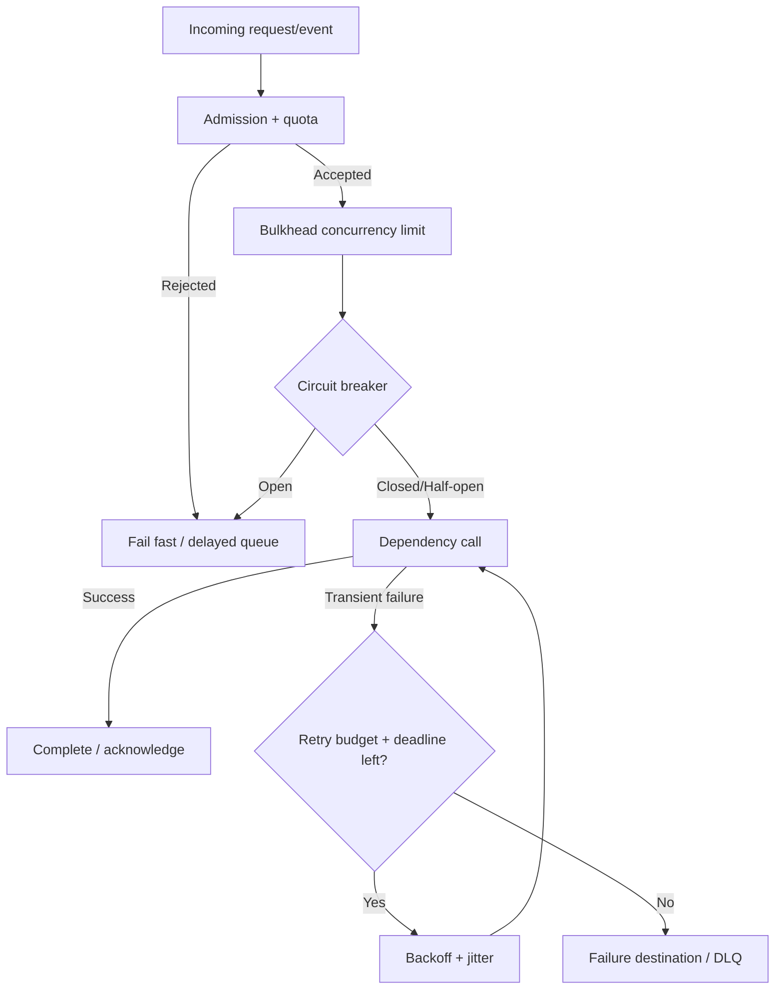
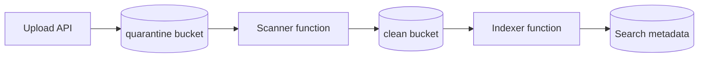

# Ngăn retry storm và vòng lặp sự kiện vô hạn

Trong hệ thống serverless, một lỗi tạm thời có thể nhanh chóng biến thành sự cố diện rộng. Function gọi database bị timeout, trigger giao lại event, invocation mới lại gọi database, trong khi HTTP client hoặc workflow cũng tự retry. Số lần gọi tăng theo cấp số nhân, làm dependency vốn đã chậm càng quá tải. Một lỗi cấu hình khác có thể tạo vòng lặp sự kiện: function nhận event, ghi object mới vào đúng vùng đang được theo dõi, rồi tự kích hoạt chính nó liên tục.

**Retry storm** là tình trạng nhiều tầng cùng thử lại một thao tác trong thời gian ngắn, khuếch đại tải và làm giảm khả năng phục hồi. **Event loop** là chuỗi event tạo ra event mới khiến một hoặc nhiều consumer kích hoạt lại liên tục mà không tiến tới trạng thái kết thúc. Cả hai đều có thể làm tăng chi phí, backlog, duplicate side effect và ảnh hưởng đến tenant khác.

Bài này tập trung vào cách thiết kế retry có giới hạn và ngăn feedback loop trong Java FaaS. Trọng tâm là phân loại lỗi, retry budget, exponential backoff với jitter, deadline, concurrency limit, circuit breaker, DLQ/redrive, idempotency và kiểm soát topology/filter của event.

## 1. Retry storm và event loop khác nhau thế nào?

### 1.1. Retry storm

Retry storm thường bắt đầu từ một dependency hoặc một đợt tải vượt capacity:

1. Database chậm hoặc trả throttling.
2. Function không hoàn thành trong timeout.
3. Queue/event source giao lại message hoặc caller gửi lại request.
4. Mỗi invocation lại retry dependency nhiều lần.
5. Số request tăng trong khi capacity dependency giảm.
6. Queue backlog, timeout và retry tiếp tục tăng.

Một lỗi nhỏ có thể lan sang các service khác vì retry chiếm thread, connection, concurrency và quota. Nếu nhiều service cùng retry theo chu kỳ cố định, chúng có thể tạo thành những đợt tải đồng bộ.

### 1.2. Event loop vô hạn

Event loop xuất hiện khi output của một handler lại thỏa điều kiện trigger của chính handler đó hoặc một chuỗi handler khác quay lại điểm bắt đầu.

Ví dụ:

- Function được kích hoạt khi object được tạo trong bucket, sau đó ghi file kết quả vào cùng bucket/prefix.
- Function xử lý database stream rồi cập nhật lại chính record khiến stream phát event mới.
- Rule event bus bắt mọi event của một source, trong khi consumer publish event cùng source/type.
- Function A đọc queue A, ghi queue B; function B đọc queue B rồi ghi lại queue A.
- Webhook nhận thay đổi, cập nhật hệ thống nguồn và hệ thống nguồn phát webhook mới.

### 1.3. Bảng phân biệt

| Hiện tượng | Tác nhân chính | Dấu hiệu | Biện pháp trọng tâm |
| --- | --- | --- | --- |
| Retry storm | Thử lại cùng một thao tác khi dependency lỗi/quá tải | Request, invocation, timeout và retry tăng đồng thời | Retry budget, backoff, jitter, deadline, circuit breaker, concurrency cap |
| Duplicate delivery | Trigger giao cùng event nhiều lần theo semantics at-least-once | Cùng event ID được xử lý nhiều lần | Idempotency và deduplication bền vững |
| Event loop | Handler tạo event mới lại kích hoạt handler hoặc chuỗi handler | Event count tăng liên tục, cùng entity/source lặp lại | Tách input/output, filter, causation/hop limit và state transition guard |
| Backlog growth | Producer liên tục nhanh hơn consumer | Queue age và depth tăng | Backpressure, admission control, scale có giới hạn, giảm tốc producer |

Idempotency xử lý duplicate delivery nhưng không tự dừng event loop nếu mỗi vòng tạo một event ID mới. Retry budget xử lý retry storm nhưng không sửa được topology event tự kích hoạt. Cần dùng đúng biện pháp cho từng vấn đề.

## 2. Xác định tất cả tầng có thể retry

### 2.1. Retry có thể xảy ra ở nhiều nơi

Trong một request serverless, retry có thể xuất hiện ở:

- HTTP client hoặc SDK của caller;
- API gateway, proxy hoặc service mesh theo policy;
- code Java gọi HTTP/database SDK;
- nền tảng function khi xử lý asynchronous invocation;
- queue/event source mapping khi message chưa được acknowledge;
- stream consumer khi batch/checkpoint thất bại;
- workflow orchestrator tại từng task;
- dịch vụ downstream tiếp tục retry một thao tác của nó.

Phải lập bản đồ retry cho từng dependency. Nếu không biết tầng nào sở hữu retry, rất dễ bật retry ở mọi nơi.

### 2.2. Retry lồng nhau làm số lần gọi nhân lên

Giả sử HTTP client thử tối đa 3 lần cho mỗi invocation, function platform giao tối đa 3 lần và workflow gọi function tối đa 3 lần. Trong trường hợp xấu, một thao tác nghiệp vụ có thể tạo đến:

\[
Attempts_{total} = 3 \times 3 \times 3 = 27
\]

Ở đây mỗi con số là tổng số lần thử đã bao gồm lần đầu. Nếu cấu hình là 3 retries cộng lần đầu ở mỗi tầng, tổng số lần có thể lên đến:

\[
(3+1) \times (3+1) \times (3+1) = 64
\]

Đây là phép minh họa cho retry lồng nhau, không phải công thức chung cho mọi nền tảng; queue, workflow và HTTP có thể có semantics khác nhau. Điều quan trọng là xác định tổng retry budget cho một business operation thay vì chỉ nhìn số lần thử ở từng SDK.

### 2.3. Chọn retry owner

Với mỗi ranh giới, hãy ghi rõ thành phần nào chịu trách nhiệm retry:

| Ranh giới | Retry owner thường phù hợp | Cần quy định |
| --- | --- | --- |
| HTTP caller → API | Caller hoặc một lớp client/gateway đã chọn | Idempotency key, status retryable, total deadline |
| Function → HTTP dependency | Một HTTP client policy | Timeout, retryable status/exception, attempt budget |
| Async function invocation | Platform async delivery policy | Retry window/count, failure destination |
| Queue → function | Queue/event source | Visibility/lease, receive count, DLQ, batch failure |
| Stream → function | Event source/checkpoint policy | Batch retry, poison record, ordering/partition impact |
| Workflow → task | Workflow orchestrator | Retry/Catch, backoff, timeout, compensation |
| Function → database | Driver/client ở mức phù hợp | Transaction retry, deadlock/serialization handling |

Không để cả function code, SDK, queue và workflow retry không giới hạn cùng một lỗi. Nếu một tầng đã quản lý delivery retry, code bên trong thường chỉ nên retry rất ít cho lỗi transient ngắn và phải tính vào tổng deadline.

## 3. Phân loại lỗi trước khi retry

### 3.1. Lỗi transient

Lỗi transient có khả năng tự hết sau một khoảng thời gian:

- connection reset hoặc network timeout;
- throttling/rate limit có hướng dẫn retry;
- service unavailable hoặc dependency đang failover;
- lỗi transaction serialization/deadlock có thể thử lại toàn transaction;
- DNS hoặc endpoint tạm thời không sẵn sàng.

Retry có giới hạn và backoff có thể phù hợp. Cần kiểm tra thao tác có an toàn khi chạy lại hay không.

### 3.2. Lỗi permanent hoặc business rejection

Các trường hợp thường không nên retry:

- payload sai schema hoặc thiếu field bắt buộc;
- dữ liệu không thỏa business rule;
- resource không tồn tại theo contract;
- credential không hợp lệ hoặc IAM bị từ chối do cấu hình;
- request vượt quota nghiệp vụ;
- phiên bản event không được hỗ trợ;
- dữ liệu vi phạm policy.

Retry những lỗi này chỉ tạo thêm tải và làm chậm việc đưa message lỗi sang failure path. Nên trả kết quả rõ ràng, reject, quarantine hoặc chuyển DLQ tùy trigger.

### 3.3. Kết quả không xác định

Một trường hợp khó là timeout sau khi downstream đã commit side effect nhưng trước khi caller nhận được response. Caller không biết thao tác đã thành công hay chưa.

Ví dụ payment provider đã trừ tiền nhưng connection bị reset trước response. Retry thanh toán bằng request mới có thể trừ tiền lần hai. Với kết quả không xác định:

- truy vấn trạng thái theo idempotency key hoặc operation ID;
- dùng idempotency key được provider hỗ trợ;
- đối soát trước khi gửi lại;
- không retry mù quáng một side effect không idempotent.

### 3.4. Error classifier

Tách quyết định retry khỏi code thực hiện thao tác. Ví dụ:

```java
public enum FailureKind {
    TRANSIENT,
    THROTTLED,
    PERMANENT,
    CONFIGURATION,
    UNKNOWN_OUTCOME
}

public final class RetryClassifier {
    private RetryClassifier() {}

    public static boolean shouldRetry(FailureKind kind) {
        return kind == FailureKind.TRANSIENT
                || kind == FailureKind.THROTTLED;
    }
}
```

`UNKNOWN_OUTCOME` không được tự động coi là transient. Ứng dụng cần reconciliation/idempotency trước khi quyết định thử lại.

## 4. Retry có giới hạn: attempts, deadline và budget

### 4.1. Giới hạn số lần thử

Mỗi retry policy cần có:

- số lần thử tối đa, tính rõ lần đầu hay chỉ retries;
- tổng thời gian tối đa;
- timeout cho từng attempt;
- loại lỗi được retry;
- mức delay nhỏ nhất/lớn nhất;
- điều kiện dừng khi caller hết deadline hoặc invocation gần timeout.

Không cấu hình retry vô hạn cho request synchronous. Với queue, việc delivery có thể kéo dài theo retention, nhưng vẫn phải có receive limit, DLQ hoặc failure destination và chính sách redrive.

### 4.2. Exponential backoff

Exponential backoff tăng khoảng chờ sau mỗi lần thất bại:

\[
Delay_n = \min(MaxDelay, BaseDelay \times 2^n)
\]

Trong đó `n` là số lần retry đã thực hiện. Backoff giảm tốc độ request đến dependency đang lỗi.

### 4.3. Jitter

Nếu mọi client cùng retry sau đúng 1, 2, 4, 8 giây, chúng có thể đồng bộ và tạo đợt tải mới. Jitter thêm ngẫu nhiên vào thời gian chờ.

Một lựa chọn phổ biến là full jitter:

\[
Delay_n = Random(0, \min(MaxDelay, BaseDelay \times 2^n))
\]

Jitter phân tán retry theo thời gian, giảm khả năng nhiều function cùng gọi dependency tại một thời điểm.

### 4.4. Java: tính exponential backoff với full jitter

```java
import java.util.concurrent.ThreadLocalRandom;

public final class RetryDelay {
    private RetryDelay() {}

    public static long fullJitterMillis(
            int retryNumber,
            long baseDelayMillis,
            long maxDelayMillis) {

        if (retryNumber < 0 || baseDelayMillis <= 0
                || maxDelayMillis < baseDelayMillis) {
            throw new IllegalArgumentException("Invalid retry delay settings");
        }

        long cap = baseDelayMillis;
        for (int i = 0; i < retryNumber && cap < maxDelayMillis; i++) {
            cap = cap > maxDelayMillis / 2
                    ? maxDelayMillis
                    : Math.min(maxDelayMillis, cap * 2);
        }

        // maxDelayMillis should be bounded well below Long.MAX_VALUE.
        return ThreadLocalRandom.current().nextLong(cap + 1);
    }
}
```

Ví dụ với base 200 ms, max 10.000 ms, retry number 0 có delay ngẫu nhiên từ 0 đến 200 ms; retry number 4 có cap 3.200 ms. Trong test, inject một random source hoặc tách hàm tính cap khỏi hàm random để kiểm tra deterministic; không dùng `Thread.sleep()` để kiểm tra thuật toán.

### 4.5. Retry budget tổng thể

Retry budget giới hạn lượng retry được phép trong một khoảng thời gian hoặc trên một nhóm request. Ví dụ chỉ cho phép tỷ lệ retry tối đa so với request gốc, hoặc chỉ cho phép một số token retry trong một cửa sổ.

Một retry budget có thể được áp dụng:

- theo request/business operation;
- theo function/service;
- theo tenant;
- theo dependency;
- toàn hệ thống qua gateway hoặc platform control.

Budget cục bộ trong một JVM không phải budget toàn service. Nếu cần giới hạn toàn cục, dùng gateway, queue, distributed limiter hoặc control plane phù hợp. Khi budget cạn, fail fast hoặc đưa event vào delayed retry/failure path theo contract; không tiếp tục tạo tải.

## 5. Deadline và timeout propagation

### 5.1. Tổng deadline quan trọng hơn timeout riêng lẻ

Giả sử HTTP request có deadline 3 giây. Nếu function dùng 2 giây cho lần đầu, rồi tiếp tục retry thêm 3 lần mỗi lần timeout 2 giây, caller đã hết thời gian từ lâu nhưng function vẫn tiêu thụ tài nguyên.

Truyền deadline hoặc remaining time qua các lớp. Trước mỗi attempt:

1. tính thời gian còn lại;
2. trừ phần cần dành cho serialize/response/cleanup;
3. đặt timeout dependency nhỏ hơn thời gian còn lại;
4. không bắt đầu retry nếu không đủ thời gian cho một attempt có ý nghĩa.

### 5.2. Java: kiểm tra remaining deadline

```java
import java.time.Duration;
import java.time.Instant;

public final class Deadline {
    private final Instant expiresAt;

    public Deadline(Instant expiresAt) {
        this.expiresAt = expiresAt;
    }

    public Duration remaining(Instant now) {
        Duration value = Duration.between(now, expiresAt);
        return value.isNegative() ? Duration.ZERO : value;
    }

    public boolean canStart(Duration minimumAttemptBudget, Instant now) {
        return remaining(now).compareTo(minimumAttemptBudget) >= 0;
    }
}
```

Trong production, dùng `Clock` được inject để test được; với đo timeout nội bộ trong một process, monotonic clock như `System.nanoTime()` phù hợp hơn wall clock vì đồng hồ hệ thống có thể bị điều chỉnh. Khi truyền deadline qua network, gửi thời điểm/remaining budget theo contract và tính đến clock skew.

### 5.3. Không để timeout tầng trong dài hơn tầng ngoài

Timeout của HTTP client, database statement, function runtime, gateway và workflow cần được sắp xếp hợp lý. Nếu gateway timeout trước function, caller có thể retry trong khi function cũ vẫn chạy. Nếu function timeout trước khi queue visibility timeout hết, message có thể được giao lại khi invocation cũ chưa kết thúc.

Thiết kế timeout theo thứ tự và semantics của từng nền tảng. Không có một con số chung cho mọi trigger.

## 6. Circuit breaker, bulkhead và load shedding

### 6.1. Circuit breaker

Circuit breaker ngăn gọi liên tục đến dependency đang lỗi. Ba trạng thái thường gặp:

- **Closed:** cho phép request; theo dõi lỗi.
- **Open:** từ chối nhanh trong một khoảng thời gian.
- **Half-open:** cho một số probe giới hạn để xác định dependency đã phục hồi chưa.

Circuit breaker giúp function fail fast thay vì giữ connection/thread trong các request chắc chắn thất bại. Nó không thay thế retry policy; phối hợp hai cơ chế để retry không vượt budget và breaker có thể mở khi lỗi tăng.

### 6.2. Bulkhead

Bulkhead chia tài nguyên theo dependency hoặc loại workload. Ví dụ payment API có pool/concurrency riêng với report generation. Khi một dependency chậm, nó không chiếm hết thread hoặc connection của function xử lý nghiệp vụ khác.

Trong FaaS, bulkhead có thể được thực hiện bằng concurrency limit riêng, queue riêng, function riêng hoặc connection pool riêng. Semaphore trong một JVM chỉ bảo vệ một execution environment; quota toàn hệ thống cần đặt ở platform/gateway/queue.

### 6.3. Load shedding

Khi hệ thống gần quá tải, từ chối sớm công việc ít ưu tiên hoặc không thể hoàn thành trong deadline. Với HTTP có thể trả 429/503 theo API contract và `Retry-After` khi phù hợp. Với queue, không ack message chưa được lưu bền vững; có thể giảm consumer concurrency để tạo backpressure.

Không shed bằng cách bỏ event âm thầm. Nếu không thể xử lý ngay, phải giữ event ở queue/durable store hoặc chuyển failure path.

### 6.4. Kết hợp các cơ chế

Một luồng bảo vệ dependency có thể là:



## 7. Retry theo từng loại trigger serverless

### 7.1. HTTP synchronous

HTTP caller thường nhận response ngay trong request. Nếu client retry khi timeout, request cũ có thể vẫn đang chạy. Vì vậy:

- API nên hỗ trợ idempotency key cho thao tác tạo side effect;
- retry chỉ với lỗi được xác định retryable;
- dùng deadline tổng thể và jitter;
- trả status/error code phân biệt validation, throttling và transient failure;
- không retry POST không idempotent chỉ vì client không nhận được response.

### 7.2. Asynchronous invocation

Nền tảng có thể retry khi function báo lỗi hoặc invocation không hoàn tất, theo policy của dịch vụ. Cần cấu hình số lần/thời gian retry, maximum event age và destination/DLQ theo khả năng của platform.

Function nên idempotent vì cùng event có thể được giao lại. Không giả định một event chỉ chạy đúng một lần. Theo dõi age, retry count và failure destination.

### 7.3. Queue trigger

Queue thường giao message ít nhất một lần. Nếu consumer không acknowledge/delete thành công trước khi visibility/lease hết hạn, message có thể được giao lại. Cần:

- visibility timeout phù hợp với thời gian xử lý và timeout function;
- receive count/max delivery;
- DLQ và redrive policy;
- batch failure semantics và partial batch response nếu hỗ trợ;
- idempotency ở persistence boundary;
- concurrency cap theo downstream capacity.

Nếu batch có một record lỗi, nền tảng có thể giao lại toàn batch trừ khi hỗ trợ partial failure response. Test chính xác semantics của trigger.

### 7.4. Stream trigger

Với stream partition/shard, lỗi ở một record có thể làm checkpoint không tiến và các record sau bị chặn. Retry vô hạn có thể giữ shard và làm lag tăng. Cần xác định:

- retry tối đa hoặc maximum record age;
- bisect batch hoặc partial batch failure nếu hỗ trợ;
- failure destination cho record không xử lý được;
- ordering requirement;
- cách cô lập poison record mà không bỏ qua dữ liệu hợp lệ.

Không chuyển record lỗi sang DLQ rồi advance checkpoint nếu nghiệp vụ yêu cầu ordering/consistency mà chưa có quy trình replay và đối soát.

### 7.5. Workflow orchestrator

Workflow thường có retry policy riêng cho từng task và nhánh Catch/compensation. Đừng để workflow retry 5 lần trong khi SDK bên trong task cũng retry 5 lần mà không tính tổng. Mỗi task cần timeout, error classification, retry count và compensation semantics rõ.

### 7.6. Bảng chọn failure path

| Loại lỗi | HTTP | Queue/event | Workflow |
| --- | --- | --- | --- |
| Validation/permanent | Trả 4xx theo contract | Reject/DLQ/quarantine | Catch và kết thúc nhánh lỗi |
| Throttling/transient | 429/503 hoặc retryable error | Delay/backoff hoặc không ack theo policy | Retry có giới hạn |
| Permission/configuration | Báo lỗi vận hành, không retry dồn dập | DLQ/disable consumer nếu cần | Fail fast và alert |
| Unknown side-effect outcome | Query theo idempotency key | Reconcile trước redelivery | Reconcile/compensate trước retry |
| Hết retry budget | Trả lỗi/operation status | DLQ/failure destination | Catch/compensation/manual intervention |

## 8. Dead-letter queue và redrive an toàn

### 8.1. DLQ không phải thùng rác

DLQ giữ event không thể xử lý sau policy retry. Mỗi message cần metadata đủ để điều tra:

- event/message ID;
- source queue/topic và event type/version;
- lần giao/thử cuối nếu có;
- error category và timestamp;
- correlation/causation ID;
- consumer/function version;
- schema version và idempotency key.

Không ghi credential, signed URL hoặc toàn bộ payload nhạy cảm vào log/alert. Payload trong DLQ vẫn cần encryption, retention và access control.

### 8.2. Redrive không nên tạo retry storm mới

Trước khi redrive:

1. phân loại nguyên nhân lỗi;
2. sửa code/config/dependency hoặc xác nhận transient issue đã hết;
3. kiểm tra event schema và tuổi dữ liệu;
4. xác nhận consumer idempotent;
5. chọn một batch nhỏ hoặc rate giới hạn;
6. theo dõi success, retry và downstream capacity;
7. dừng redrive nếu error rate hoặc backlog tăng.

Không tự động redrive DLQ vô hạn về queue gốc theo vòng lặp. Nếu lỗi permanent, redrive chỉ tạo thêm chi phí và duplicate.

### 8.3. Replay có kiểm soát

Replay có thể chạy bằng job riêng, queue replay hoặc workflow. Giữ original event ID để deduplicate, thêm replay run ID/attempt metadata để điều tra. Nếu cần tạo event ID mới cho một thao tác nghiệp vụ mới, phải phân biệt với redelivery của event cũ.

Đặt tốc độ replay thấp hơn capacity an toàn của consumer và dependency. Có thể chia theo tenant/time range để giảm blast radius.

## 9. Idempotency: retry an toàn

### 9.1. Vì sao retry cần idempotency?

At-least-once delivery có thể gọi handler nhiều lần. Một timeout cũng không chứng minh side effect chưa xảy ra. Idempotency đảm bảo cùng một logical operation không tạo kết quả nghiệp vụ lặp.

Khóa idempotency nên dựa trên event ID hoặc business operation ID ổn định, không dùng invocation ID hoặc trace ID. Cần xác định scope: tenant, operation type và key.

### 9.2. Inbox/deduplication record

Consumer có thể ghi event ID vào inbox table với unique constraint. Trong cùng transaction, ghi nhận event đã xử lý và áp dụng thay đổi nghiệp vụ. Khi nhận duplicate, transaction không áp dụng side effect lần nữa.

```java
public interface InboxRepository {
    // Returns true only when this event is inserted for the first time.
    boolean insertIfAbsent(String consumerName, String eventId);
}

public interface TransactionRunner {
    void execute(Runnable work);
}

public final class PaymentEventHandler {
    private final TransactionRunner transactions;
    private final InboxRepository inbox;
    private final PaymentRepository payments;
    private final OutboxRepository outbox;

    public PaymentEventHandler(
            TransactionRunner transactions,
            InboxRepository inbox,
            PaymentRepository payments,
            OutboxRepository outbox) {
        this.transactions = transactions;
        this.inbox = inbox;
        this.payments = payments;
        this.outbox = outbox;
    }

    public void handle(PaymentCaptured event) {
        transactions.execute(() -> {
            boolean firstDelivery = inbox.insertIfAbsent(
                    "payment-captured-consumer", event.eventId());
            if (!firstDelivery) {
                return;
            }

            payments.markCaptured(event.paymentId(), event.amount());
            outbox.append(new ReceiptRequested(
                    "receipt:" + event.eventId(), event.paymentId()));
        });
    }
}
```

Ví dụ giả định inbox, payment state và outbox nằm trong cùng transactional database. `insertIfAbsent` phải được bảo vệ bằng unique constraint và tham gia cùng transaction; nếu chỉ kiểm tra rồi insert bằng hai thao tác không atomic, hai invocation đồng thời vẫn có thể cùng xử lý. Outbox publisher gửi event sau commit và có thể publish lặp, vì vậy consumer tiếp theo cũng cần idempotency.

### 9.3. Side effect ngoài database

Nếu function gọi payment provider, gửi email hoặc gọi API bên ngoài, transaction database không thể tự rollback side effect đó. Các lựa chọn:

- provider hỗ trợ idempotency key;
- transactional outbox để ghi yêu cầu gửi trong DB rồi worker xử lý;
- state machine với trạng thái `PENDING`, `SENT`, `CONFIRMED`, `UNKNOWN`;
- reconciliation query theo operation ID;
- compensation nếu nghiệp vụ cho phép.

Không giữ transaction database mở trong lúc chờ HTTP call dài. Tách state transition và side effect thành workflow/outbox thường an toàn hơn.

### 9.4. TTL của idempotency record

TTL phải dài hơn cửa sổ retry/redelivery/replay thực tế. Nếu xóa record quá sớm, event cũ replay có thể tạo side effect lần nữa. Với payment hoặc ledger, có thể cần giữ key lâu dài hoặc lưu lịch sử nghiệp vụ theo retention policy.

## 10. Ngăn event feedback loop

### 10.1. Thiết kế topology một chiều khi có thể

Đặt tên resource theo vai trò input/output và tách chúng khi cần:



Scanner chỉ nhận event từ quarantine và ghi sang clean. Indexer chỉ nhận event từ clean và ghi metadata vào database. Không để scanner lắng nghe clean bucket hoặc indexer lắng nghe bảng điều khiển trạng thái của chính nó nếu không có filter rõ.

### 10.2. Tách input và output resource

Biện pháp mạnh là dùng resource riêng:

- bucket/prefix riêng cho upload và output;
- queue/topic riêng cho command và result;
- bảng riêng cho event log và projection;
- event type riêng cho input và output;
- subscription riêng theo consumer responsibility.

Nếu phải dùng chung resource, dùng prefix/attribute filter chặt và test cả event do chính function tạo.

### 10.3. Filter theo source, type và trạng thái

Event rule nên lọc theo:

- `source` chỉ định producer hợp lệ;
- `detail-type`/event type chỉ định event cần xử lý;
- resource/prefix cụ thể;
- trạng thái chuyển đổi thực sự cần xử lý;
- operation/event name như `INSERT` hoặc một loại update phù hợp;
- metadata đánh dấu output/internal event.

Không subscribe tất cả event rồi chỉ lọc trong handler nếu có thể loại bỏ ngay tại broker/router. Filter ở tầng routing giảm invocation, chi phí và nguy cơ loop.

### 10.4. Guard cho database stream

Nếu function đọc stream từ table rồi cập nhật lại cùng table, update đó có thể tạo record stream mới. Chỉ xử lý event cần thiết:

- lọc theo operation type;
- chỉ xử lý khi các field nghiệp vụ mục tiêu thay đổi;
- bỏ qua update do chính projection/metadata write tạo ra;
- ghi projection sang table riêng nếu phù hợp;
- dùng conditional update để tránh phát event khi trạng thái không đổi.

Ví dụ: consumer xử lý `ORDER_CREATED`, cập nhật `status=PROCESSING`. Nếu stream cũng phát event cho update status và handler lại xử lý mọi `MODIFY`, nó có thể tạo vòng lặp. Filter theo transition cụ thể và kiểm tra old/new image nếu nền tảng cung cấp.

### 10.5. Guard cho object storage

Một function được kích hoạt bởi object-created event không nên ghi output vào cùng prefix mà trigger theo dõi. Có thể:

- dùng bucket input và bucket output riêng;
- dùng prefix `incoming/` cho trigger và `processed/` cho output;
- filter suffix hoặc metadata nếu phù hợp;
- không để file tạm/manifest tạo event khớp trigger.

Nếu output cần nằm trong cùng bucket, cấu hình event notification chỉ cho prefix input. Đừng dựa vào tên file tạm khó đoán để ngăn loop.

## 11. Causation ID, hop count và event lineage

### 11.1. Event envelope có nguồn gốc rõ ràng

Một event envelope nội bộ có thể mang:

```json
{
  "eventId": "evt-1002",
  "source": "orders-service",
  "type": "OrderPaid",
  "occurredAt": "2026-11-17T10:15:30Z",
  "correlationId": "checkout-77",
  "causationId": "evt-1001",
  "hopCount": 2,
  "data": {
    "orderId": "order-42"
  }
}
```

Trong đó:

- `eventId` định danh event hiện tại;
- `correlationId` nối một workflow/business operation;
- `causationId` chỉ event trực tiếp gây ra event hiện tại;
- `hopCount` đếm số bước qua event chain theo quy ước nội bộ;
- `source` và `type` mô tả nguồn và loại event.

Trace ID phục vụ observability; correlation/causation phục vụ lineage nghiệp vụ. Không dùng một ID thay thế tất cả.

### 11.2. Giới hạn hop/depth

Với event chain nội bộ, có thể đặt maximum hop count hoặc maximum workflow depth. Khi vượt giới hạn:

- không publish tiếp event;
- ghi trạng thái `LOOP_SUSPECTED` hoặc failure record;
- gửi alert có event lineage;
- giữ payload ở quarantine/failure store nếu cần điều tra.

Hop count là guard bổ sung, không thay thế routing/filter. Nếu mỗi vòng tạo envelope mới nhưng reset hop count, loop vẫn tiếp diễn. Chỉ tin hop metadata do producer nội bộ được xác thực tạo; metadata từ caller ngoài phải được kiểm tra/chuẩn hóa.

### 11.3. Java: tạo event con có lineage

```java
import java.time.Instant;
import java.util.UUID;

public record EventEnvelope<T>(
        String eventId,
        String source,
        String type,
        Instant occurredAt,
        String correlationId,
        String causationId,
        int hopCount,
        T data) {
}

public final class EventFactory {
    private static final int MAX_HOPS = 8;

    private EventFactory() {}

    public static <T> EventEnvelope<T> childOf(
            EventEnvelope<?> parent,
            String source,
            String type,
            T data) {

        if (parent.hopCount() >= MAX_HOPS) {
            throw new EventLoopSuspectedException(
                    "Maximum event chain depth exceeded");
        }

        return new EventEnvelope<>(
                UUID.randomUUID().toString(),
                source,
                type,
                Instant.now(),
                parent.correlationId(),
                parent.eventId(),
                parent.hopCount() + 1,
                data);
    }
}
```

`EventLoopSuspectedException` là exception ứng dụng. Trong production, inject `Clock` và ID generator để test deterministic. `MAX_HOPS` phải theo workflow thực tế; không chọn một ngưỡng quá thấp khiến chuỗi hợp lệ bị chặn. Hop count cũng phải được giữ xuyên qua broker và không bị reset ở adapter.

### 11.4. Loop guard không thay thế topology tốt

Nếu event A tạo B, B tạo C và C tạo A mới, hop count có thể phát hiện chuỗi dài nhưng chỉ sau khi đã tiêu thụ tài nguyên. Tốt hơn là ngăn ngay tại rule/filter và không để consumer nhận event output của chính nó.

## 12. Chặn vòng lặp do trạng thái và business transition

### 12.1. Chỉ phát event khi trạng thái thực sự thay đổi

Một update lặp cùng giá trị không nên luôn phát event mới. Dùng conditional update hoặc compare-and-set:

```sql
UPDATE orders
SET status = 'PROCESSING', updated_at = CURRENT_TIMESTAMP
WHERE order_id = :orderId
  AND status = 'CREATED';
```

Chỉ khi số row update bằng 1, transition mới được áp dụng và có thể phát event `OrderProcessingStarted`. Nếu không row nào được cập nhật, event đã xử lý hoặc trạng thái không hợp lệ; không publish tiếp một event mới giống hệt.

### 12.2. Event type phải biểu đạt transition

Ưu tiên event mô tả sự kiện đã xảy ra (`OrderPaid`, `InventoryReserved`) thay vì event chung chung (`OrderUpdated`). Event chung chung khiến consumer phải đoán thay đổi nào quan trọng và dễ tạo vòng lặp khi consumer ghi metadata.

### 12.3. Command và event khác nhau

Command yêu cầu một service thực hiện hành động; event thông báo một sự việc đã xảy ra. Nếu consumer nhận event rồi phát lại command về producer gốc mà không có state guard, có thể tạo feedback loop. Tách command channel và event channel, đặt owner rõ ràng và không tự subscribe output của mình.

## 13. Transactional outbox và tránh publish lặp

### 13.1. Vấn đề dual write

Nếu function ghi database rồi publish event bằng hai thao tác riêng, có hai failure mode:

- database commit thành công nhưng publish thất bại: trạng thái đã đổi nhưng không có event;
- publish thành công nhưng database rollback/lỗi: consumer nhận event cho trạng thái chưa commit.

Transactional outbox ghi business change và event record trong cùng database transaction. Publisher đọc outbox và gửi event; publisher có thể gửi lặp nếu mất acknowledgement, nên consumer vẫn cần idempotency.

### 13.2. Outbox không tự ngăn event loop

Outbox bảo đảm event không bị mất giữa database commit và publish, nhưng nếu business handler cứ tạo một state transition/event mới mỗi lần nhận event, outbox sẽ phát vòng lặp rất ổn định. Kết hợp outbox với:

- transition guard;
- event type/filter rõ;
- idempotency;
- causation lineage;
- hop/depth limit;
- alert cho event rate bất thường.

## 14. Phát hiện retry storm và event loop trong production

### 14.1. Metrics cho retry storm

Theo dõi:

- attempts per business operation;
- retry rate theo dependency và error class;
- timeout/throttle/5xx rate;
- circuit breaker state và rejected calls;
- queue depth và oldest message age;
- DLQ depth;
- function concurrency, duration và throttles;
- downstream connection/CPU/latency;
- retry budget exhaustion.

Một chỉ số hữu ích:

\[
RetryAmplification = \frac{TotalAttempts}{OriginalOperations}
\]

Nếu mỗi business operation trung bình tạo 4 lần gọi downstream, retry amplification là 4. Theo dõi theo thời gian và dependency để nhận ra retry storm sớm.

### 14.2. Metrics cho event loop

Theo dõi:

- event count theo source/type/resource;
- event generation rate so với business operation rate;
- hop count distribution;
- cùng correlation ID/causation chain tạo bao nhiêu event;
- event age và số lần quay lại cùng consumer;
- function invocation rate và cost theo trigger;
- trạng thái transition lặp;
- DLQ và loop-suspected count.

Nếu một business action bình thường tạo 2 event nhưng đột nhiên tạo hàng nghìn event cùng correlation ID, cần cảnh báo ngay.

### 14.3. Log lineage có cấu trúc

Ghi các trường:

- `eventId`, `correlationId`, `causationId`;
- `source`, `eventType`, `consumerName`;
- `hopCount`, `deliveryAttempt`, `replayRunId`;
- `functionVersion`, `requestId`, `traceId`;
- `result`, `errorCategory`, `retryDecision`.

Không dùng toàn bộ các ID này làm metric label vì cardinality cao. Dùng log/trace để điều tra từng event; metrics dùng label ít giá trị như source, type, result và dependency.

## 15. Kill switch và quy trình ứng phó

### 15.1. Chuẩn bị kill switch

Với consumer có nguy cơ tạo feedback loop, chuẩn bị cách dừng an toàn:

- disable event source mapping/subscription;
- tạm dừng rule/route gây loop;
- giảm concurrency hoặc pause consumer;
- bật feature flag chặn publish loại event nghi vấn;
- route event vào quarantine thay vì xử lý tiếp.

Kill switch cần được bảo vệ bằng quyền vận hành, audit và quy trình khôi phục. Không xóa queue hoặc event data để “dọn” loop khi chưa xác định khả năng mất dữ liệu.

### 15.2. Playbook khi retry storm

1. Xác định dependency đang bị quá tải và retry owner ở từng tầng.
2. Giảm concurrency/admission rate để ngăn thêm tải.
3. Mở circuit breaker hoặc tắt retry tầng không cần thiết theo runbook.
4. Kiểm tra timeout, connection pool và error classification.
5. Giữ message bền vững; không ack dữ liệu chưa xử lý.
6. Chuyển poison/permanent failures sang DLQ.
7. Chỉ khôi phục retry khi dependency ổn định và budget phù hợp.
8. Redrive theo batch nhỏ, theo dõi queue age và downstream capacity.

### 15.3. Playbook khi event loop

1. Dùng event ID/correlation/causation để tìm chuỗi tạo event.
2. Xác định trigger/rule/consumer nào tạo lại event đầu tiên.
3. Disable route/subscription hoặc bật kill switch có blast radius nhỏ.
4. Giữ event ở queue/quarantine và lưu bằng chứng cần thiết.
5. Sửa filter, tách input/output resource hoặc thêm state transition guard.
6. Thêm idempotency và hop limit như lớp bảo vệ bổ sung.
7. Test event do chính function tạo không kích hoạt lại consumer ngoài ý muốn.
8. Resume với tốc độ giới hạn và replay dữ liệu hợp lệ.

## 16. Kiểm thử retry và event loop

### 16.1. Unit test retry policy

Kiểm tra:

- transient được retry, permanent không retry;
- attempt count không vượt max;
- delay tăng theo exponential cap;
- jitter nằm trong khoảng hợp lệ;
- deadline hết thì không bắt đầu attempt mới;
- retry budget cạn thì dừng;
- unknown outcome yêu cầu reconciliation.

Inject `Clock`, random source và sleeper abstraction. Không dùng thời gian chờ thật trong unit test.

### 16.2. Integration test duplicate và partial failure

Mô phỏng:

- side effect commit nhưng acknowledgement thất bại;
- cùng message được giao hai lần;
- hai invocation cùng event ID chạy đồng thời;
- batch có một record lỗi;
- worker timeout sau khi xử lý một phần batch;
- redrive từ DLQ sau nhiều giờ/ngày.

Xác nhận số side effect nghiệp vụ cuối cùng, không chỉ số lần gọi mock.

### 16.3. Test event loop

Tạo test graph có event input và output. Xác nhận:

- output prefix/topic không khớp input filter;
- event type do function tạo không match rule đầu vào;
- update metadata không tạo business transition mới;
- hop count vượt ngưỡng bị chặn và phát alert;
- cùng event duplicate không tạo side effect lặp;
- một chain hợp lệ nhiều bước vẫn chạy được.

Test không nên tự tạo vòng lặp vô hạn. Dùng simulator giới hạn số bước hoặc timeout ngắn trong môi trường cô lập.

### 16.4. Failure injection

Trong staging, có thể giả lập dependency timeout, throttling, network reset, queue delay và consumer crash. Xác nhận retry giảm tốc, circuit breaker mở, backlog được giữ và recovery không tạo retry storm thứ hai.

Không thực hiện chaos test không giới hạn trên production. Đặt blast radius, traffic cap, thời gian thử và điều kiện dừng trước khi chạy.

## 17. Ví dụ cấu hình retry policy theo nghiệp vụ

Một policy có thể được mô tả trong cấu hình không chứa secret:

```yaml
retryPolicy:
  maxAttempts: 4 # includes the initial attempt
  baseDelay: 200ms
  maxDelay: 5s
  strategy: exponential-full-jitter
  totalDeadline: 12s
  retryableErrors:
    - THROTTLED
    - TRANSIENT_NETWORK
    - TEMPORARY_UNAVAILABLE
  nonRetryableErrors:
    - VALIDATION
    - AUTHORIZATION
    - BUSINESS_REJECTED
  unknownOutcome:
    action: RECONCILE_BEFORE_RETRY
```

Đây là schema minh họa, không phải cấu hình chuẩn của một cloud provider. Adapter cần map sang SDK/platform policy và kiểm tra tổng số attempt giữa các tầng. `maxAttempts` ở đây đã bao gồm lần gọi đầu.

## 18. Checklist production

- [ ] Đã lập bản đồ mọi tầng có thể retry từ caller đến dependency.
- [ ] Mỗi ranh giới có retry owner và tổng budget rõ.
- [ ] Phân loại transient, throttled, permanent, configuration và unknown outcome.
- [ ] Retry có max attempts, max delay và total deadline.
- [ ] Exponential backoff có jitter.
- [ ] Timeout mỗi attempt không vượt remaining deadline.
- [ ] Không retry side effect không idempotent khi kết quả chưa xác định.
- [ ] Có circuit breaker, bulkhead hoặc concurrency cap cho dependency quan trọng.
- [ ] Queue có visibility/lease, receive limit, DLQ và redrive policy phù hợp.
- [ ] Stream poison record không giữ partition vô hạn ngoài policy.
- [ ] Batch partial failure được xử lý đúng semantics của trigger.
- [ ] Consumer idempotent ở persistence boundary.
- [ ] Outbox/inbox hoặc reconciliation bảo vệ dual write và side effect ngoài DB.
- [ ] Input/output event resource hoặc prefix được tách rõ.
- [ ] Event rule filter theo source, type, resource và state transition.
- [ ] Database stream bỏ qua update do chính consumer tạo nếu không phải business event.
- [ ] Có event ID, correlation ID, causation ID và hop/depth metadata.
- [ ] Hop count được giữ xuyên qua các producer/consumer và không bị reset tùy tiện.
- [ ] Có kill switch và runbook cho retry storm/event loop.
- [ ] Metrics theo dõi retry amplification, queue age, event rate và hop count.
- [ ] DLQ replay được rate-limit và kiểm tra idempotency.
- [ ] Unit/integration test bao phủ retry, duplicate, partial failure và loop guard.
- [ ] Failure injection chạy trong môi trường cô lập với blast radius giới hạn.

## Kết luận

Retry là cơ chế phục hồi, nhưng retry không giới hạn hoặc được bật đồng thời ở nhiều tầng có thể khuếch đại sự cố. Hãy phân loại lỗi, chọn retry owner, đặt max attempts và deadline tổng, dùng exponential backoff với jitter, giới hạn concurrency và mở circuit breaker khi dependency không thể phục vụ. Với queue/stream, cấu hình visibility/lease, batch failure, DLQ và redrive theo semantics thật của trigger.

Event loop là lỗi topology hoặc điều kiện routing: output lại trở thành input. Tách input/output resource, filter theo source/type/prefix/state transition và chỉ publish event khi nghiệp vụ thực sự đổi trạng thái. Causation ID, hop count, idempotency và kill switch là các lớp bảo vệ bổ sung; chúng không thay thế một event topology có hướng và filter đúng.

Trong Java FaaS, xử lý retry phải tôn trọng remaining deadline và idempotency tại nơi side effect được commit. Theo dõi retry amplification, queue age, event lineage và downstream saturation để phát hiện sớm. Kiểm thử duplicate, partial failure, retry storm và event loop trong môi trường cô lập trước khi đưa cấu hình vào production.
