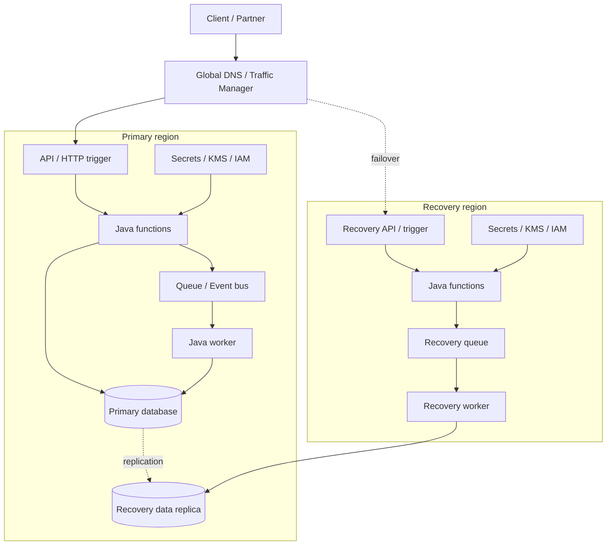

# Thiết kế disaster recovery theo RTO và RPO

Serverless giúp triển khai lại compute nhanh và giảm việc quản lý máy chủ, nhưng không tự bảo đảm ứng dụng có thể phục hồi sau khi một region, database, queue, identity provider hoặc dịch vụ phụ thuộc gặp sự cố. Một Java function có thể được tạo lại trong vài phút, trong khi dữ liệu cần restore nhiều giờ, secret không có ở region dự phòng, queue chưa được chuyển hoặc DNS vẫn trỏ tới endpoint lỗi.

Disaster recovery (DR) là khả năng khôi phục dịch vụ và dữ liệu sau một sự cố lớn. Hai mục tiêu quan trọng nhất để thiết kế và đo DR là **Recovery Time Objective (RTO)** và **Recovery Point Objective (RPO)**. RTO giới hạn thời gian dịch vụ được phép gián đoạn; RPO giới hạn lượng dữ liệu có thể mất tính theo thời gian. Hai mục tiêu này phải xuất phát từ tác động nghiệp vụ, sau đó mới chọn chiến lược backup, replication, failover và kiến trúc serverless phù hợp.

Bài học này trình bày cách xác định RTO/RPO, phân loại workload, lựa chọn chiến lược DR, thiết kế multi-region cho Java serverless, bảo vệ dữ liệu và event, tổ chức failover/failback, viết runbook và kiểm thử phục hồi có thể đo lường.

## 1. RTO và RPO là gì?

**RTO (Recovery Time Objective)** là khoảng thời gian mục tiêu tối đa để khôi phục một dịch vụ sau khi bị gián đoạn. Nó trả lời câu hỏi: *Từ lúc dịch vụ bị sự cố, chúng ta có thể chấp nhận mất khả năng phục vụ trong bao lâu?*

**RPO (Recovery Point Objective)** là khoảng thời gian dữ liệu tối đa mà tổ chức chấp nhận bị mất khi khôi phục. Nó trả lời câu hỏi: *Sau khi phục hồi, dữ liệu có thể lùi về thời điểm nào so với lúc sự cố xảy ra?*

Ví dụ, một dịch vụ xử lý đơn hàng có:

- RTO mục tiêu: 60 phút.
- RPO mục tiêu: 5 phút.

Nếu region chính ngừng hoạt động lúc 10:00, dịch vụ cần hoạt động lại chậm nhất vào 11:00. Dữ liệu phục hồi có thể thiếu tối đa 5 phút giao dịch mới nhất, nghĩa là recovery point cần đạt ít nhất 09:55. Đây là mục tiêu thiết kế, không phải bằng chứng hệ thống tự động đạt được. Phải đo bằng replication lag, thời gian restore, thời gian chuyển traffic và kiểm thử nghiệp vụ.

### RTO và RPO khác nhau như thế nào?

| Thuộc tính | RTO | RPO |
|---|---|---|
| Tập trung vào | Thời gian gián đoạn dịch vụ | Mức mất dữ liệu theo thời gian |
| Đơn vị thường dùng | Phút, giờ | Giây, phút, giờ |
| Đo bằng | Thời điểm sự cố tới lúc dịch vụ phục vụ lại đạt tiêu chí | Thời điểm dữ liệu nhất quán mới nhất có thể phục hồi so với thời điểm sự cố |
| Bị ảnh hưởng bởi | Phát hiện, quyết định, triển khai, restore, failover, kiểm tra và chuyển traffic | Tần suất backup, replication lag, transaction durability và khả năng khôi phục |
| Ví dụ | Phục hồi trong 30 phút | Chấp nhận mất tối đa 2 phút dữ liệu |

RTO không chỉ là thời gian chạy lệnh deploy. RPO cũng không chỉ là tần suất tạo backup. Một backup chạy mỗi 5 phút chưa chắc bảo đảm RPO 5 phút nếu backup mất 10 phút mới hoàn tất, dữ liệu không nhất quán hoặc bản backup không thể restore.

### Mốc thời gian cần đo


Khoảng từ A đến H là thời gian phục hồi thực tế dùng để so với RTO. Recovery point được xác định từ dữ liệu nhất quán mới nhất có thể sử dụng sau bước E; so với thời điểm sự cố để tính RPO thực tế. Hãy thống nhất cách tính với đội nghiệp vụ, vì một endpoint trả 200 chưa chắc hệ thống đã phục hồi nếu đơn hàng chưa thể xử lý hoặc dữ liệu còn thiếu.

## 2. Xác định RTO/RPO từ tác động nghiệp vụ

Không nên chọn RTO/RPO chỉ vì một dịch vụ cloud có thể cấu hình replication theo một con số nhất định. Bắt đầu từ quy trình nghiệp vụ và tác động khi gián đoạn.

Với từng capability, hỏi:

- Ai bị ảnh hưởng nếu dịch vụ không hoạt động: người dùng, nhân viên, đối tác hay hệ thống nội bộ?
- Một phút gián đoạn gây mất doanh thu, trì hoãn xử lý, vi phạm SLA hoặc rủi ro an toàn ở mức nào?
- Dữ liệu nào có thể tái tạo từ nguồn khác, dữ liệu nào không thể tái tạo?
- Có thể xử lý thủ công tạm thời không?
- Có thể chấp nhận chế độ read-only hoặc xử lý chậm hơn không?
- Khi phục hồi, cần khôi phục toàn bộ lịch sử hay chỉ phần giao dịch mới?
- Ai có quyền tuyên bố sự cố và kích hoạt failover?

### Ví dụ phân tầng dịch vụ

| Capability | Mức độ ảnh hưởng | RTO mục tiêu ví dụ | RPO mục tiêu ví dụ | Hướng thiết kế có thể phù hợp |
|---|---|---:|---:|---|
| Tiếp nhận thanh toán | Rất cao | 15 phút | Gần 0 hoặc theo yêu cầu ledger | Multi-region data strategy, failover được diễn tập, audit và reconciliation |
| Tạo đơn hàng | Cao | 30 phút | 1 phút | Replication thường xuyên, queue/event recovery và idempotency |
| Tra cứu catalog | Trung bình | 4 giờ | 1 giờ | Backup/restore hoặc replica có thể tái tạo |
| Báo cáo nội bộ | Thấp | 24 giờ | 24 giờ | Backup định kỳ và khôi phục theo yêu cầu |

Các con số là ví dụ minh họa, không phải chuẩn cho mọi ngành. RTO/RPO của một ứng dụng thường được quyết định bởi capability quan trọng nhất và dependency bắt buộc của nó.

### BIA và dependency mapping

Business Impact Analysis (BIA) xác định quy trình nào quan trọng, thời gian gián đoạn có thể chấp nhận và tổn thất khi vượt ngưỡng. Sau BIA, lập bản đồ dependency cho từng function:

- API Gateway/ingress, DNS và certificate.
- Java function, runtime configuration, artifact và layer/extension.
- Database, object storage, cache và search index.
- Queue, event bus, stream, scheduler và DLQ.
- IAM role/service account, KMS key, secret và identity provider.
- VPC/VNet, subnet, route, NAT, firewall và private endpoint.
- Observability backend, alerting và deployment pipeline.

Một function không thể phục hồi nếu dependency bắt buộc của nó không thể truy cập. Hãy đánh dấu dependency nào cần phục hồi trước, dependency nào có thể thay thế tạm thời và dependency nào có thể tái tạo sau.

## 3. Chọn chiến lược disaster recovery

Các chiến lược DR khác nhau về chi phí duy trì, độ phức tạp và RTO/RPO có thể đạt được. Tên gọi có thể khác nhau giữa nhà cung cấp, nhưng bốn mẫu phổ biến là backup and restore, pilot light, warm standby và active-active.

| Chiến lược | Mô tả | RTO tương đối | RPO tương đối | Chi phí/độ phức tạp |
|---|---|---|---|---|
| Backup and restore | Backup dữ liệu/config; dựng lại hạ tầng khi có sự cố | Cao hơn | Phụ thuộc backup interval và restore | Thấp hơn khi bình thường, nhưng restore cần thời gian |
| Pilot light | Một số dependency/data nền được duy trì ở region dự phòng; compute scale lên khi failover | Trung bình | Phụ thuộc replication/backup | Trung bình |
| Warm standby | Bản hệ thống thu nhỏ chạy sẵn ở region dự phòng, dữ liệu được đồng bộ | Thấp đến trung bình | Thường thấp hơn backup-only | Cao hơn do phải duy trì compute và data path |
| Active-active | Nhiều region cùng phục vụ traffic và ghi dữ liệu theo mô hình đã thiết kế | Có thể rất thấp | Có thể thấp, nhưng phụ thuộc consistency/conflict handling | Cao nhất về thiết kế và vận hành |

Không có chiến lược nào tự động bảo đảm RTO/RPO. Ví dụ warm standby vẫn có thể phục hồi chậm nếu database promotion mất nhiều thời gian, secret thiếu hoặc DNS cache chưa hết TTL. Active-active vẫn có thể mất dữ liệu nếu ghi chưa được replicate hoặc xảy ra conflict không thể hòa giải.

### Backup and restore

Phù hợp khi tổ chức chấp nhận RTO tính bằng giờ và RPO phụ thuộc lịch backup. Dữ liệu được backup định kỳ; IaC, artifact và cấu hình được lưu trong version control/artifact repository. Khi sự cố xảy ra, nhóm tạo resource, restore dữ liệu, cấu hình trigger và chuyển traffic.

Ưu điểm là chi phí thường thấp hơn do không phải chạy toàn bộ hệ thống dự phòng liên tục. Nhược điểm là restore có thể lâu, backup có thể lỗi hoặc thiếu dependency, và đội vận hành phải thực hiện nhiều bước thủ công. Cần kiểm thử restore thực tế thay vì chỉ kiểm tra job backup thành công.

### Pilot light

Một số thành phần nền như bản sao dữ liệu, registry, network hoặc key có thể đã được chuẩn bị ở region dự phòng. Compute serverless, API route và worker được triển khai hoặc scale lên khi kích hoạt DR.

Pilot light phù hợp khi muốn giảm chi phí idle nhưng vẫn cần rút ngắn thời gian dựng lại. RTO phụ thuộc tốc độ deploy, quota, khởi động dependency và chuyển traffic. Pipeline/IaC phải sẵn sàng và có quyền triển khai vào region dự phòng.

### Warm standby

Một phiên bản nhỏ hơn của hệ thống chạy thường xuyên ở region dự phòng. Data replication và các dependency quan trọng được duy trì. Khi failover, nhóm tăng concurrency/instance, mở rộng database hoặc chuyển traffic.

Warm standby giảm thời gian dựng hạ tầng nhưng cần kiểm thử scale-up. Một worker chạy ở 10% capacity không chứng minh có thể xử lý toàn bộ traffic khi được nâng lên 100%; cần xác minh quota, downstream connections và tốc độ scale.

### Active-active

Nhiều region cùng nhận traffic. Có thể route theo địa lý, latency hoặc health. Active-active giảm phụ thuộc vào một region, nhưng làm tăng yêu cầu về consistency, idempotency, conflict resolution, global rate limiting và vận hành.

Nếu hai region cùng ghi vào dữ liệu có ràng buộc duy nhất hoặc thứ tự nghiệp vụ, cần xác định nơi nào có quyền quyết định. Không chỉ nhân đôi function rồi cho hai vùng ghi độc lập vào hai database mà không có mô hình hợp nhất dữ liệu.

## 4. Kiến trúc DR cho ứng dụng Java serverless

Một hệ thống serverless thường gồm compute stateless và data/event stateful. Compute có thể được triển khai lại tương đối nhanh; data, identity, network, event source và external dependency thường quyết định độ khó của DR.



Sơ đồ là một mẫu khái niệm. Replication của database không tự đồng bộ queue, secret, IAM policy hoặc function configuration. Mỗi dependency cần một kế hoạch riêng và phải được kiểm thử cùng nhau.

### Tách stateless compute khỏi durable state

Java function nên giữ state nghiệp vụ trong database/object storage hoặc dịch vụ lưu trữ bền vững. Local file, `/tmp`, static cache và memory trong execution environment không phải dữ liệu DR. Chúng có thể biến mất khi environment bị thu hồi hoặc region mất khả năng phục vụ.

Artifact Java cần được lưu ở nơi có thể truy cập từ region dự phòng, có version/checksum rõ ràng. Không phụ thuộc vào artifact chỉ tồn tại trong local build agent hoặc registry của region đã mất.

### Các thành phần cần chuẩn bị ở recovery region

- Function package/runtime/layer/extension và cấu hình tương thích.
- API route, authorizer, domain/certificate và throttling policy.
- Queue, event bus, stream, DLQ, scheduler và subscription.
- Database replica/restore target, bucket và encryption key.
- Execution role/service account, resource policy và secret.
- Network, endpoint, DNS và firewall.
- Log/metric/trace pipeline, dashboard và alert.
- Deployment pipeline, artifact, IaC state và quota.

Đừng chỉ kiểm tra function có thể deploy. Kiểm tra end-to-end rằng trigger có thể gọi function, function có quyền và network để đọc dữ liệu, ghi kết quả, gửi event và phát telemetry.

## 5. Thiết kế data protection theo RPO

RPO phụ thuộc vào thời điểm dữ liệu được ghi bền vững và có thể khôi phục ở nơi khác. Cần phân biệt backup, snapshot, synchronous replication và asynchronous replication.

| Cơ chế | Đặc điểm | Tác động tới RPO |
|---|---|---|
| Backup định kỳ | Tạo bản phục hồi tại các thời điểm cố định | Có thể mất thay đổi từ backup gần nhất tới lúc sự cố |
| Snapshot | Chụp trạng thái storage/database theo cơ chế dịch vụ | Phụ thuộc lịch snapshot và consistency |
| Asynchronous replication | Ghi ở primary rồi truyền sang replica sau | RPO phụ thuộc replication lag; có thể mất giao dịch chưa tới replica |
| Synchronous replication | Xác nhận ghi sau khi dữ liệu được lưu ở nhiều vị trí theo semantics dịch vụ | Có thể đạt RPO rất thấp, nhưng ảnh hưởng latency/availability và giới hạn địa lý |
| Event log/CDC | Lưu thay đổi hoặc event để replay | RPO phụ thuộc durability, replication và khả năng replay đúng thứ tự |

Không tuyên bố RPO bằng 0 chỉ vì bật replication. Cần biết lúc nào write được xác nhận, replica có nhận dữ liệu chưa, transaction có nhất quán không và có thể phục hồi tới một checkpoint nào.

### Chọn RPO theo loại dữ liệu

- **Ledger/thanh toán:** thường cần RPO rất thấp, audit đầy đủ và reconciliation; có thể cần synchronous/quorum semantics hoặc hệ thống ledger chuyên dụng.
- **Đơn hàng:** cần giữ event và trạng thái giao dịch; async replication có thể phù hợp nếu chấp nhận một cửa sổ mất dữ liệu nhỏ và có thể đối soát.
- **Catalog/cache:** có thể tái tạo từ nguồn dữ liệu chuẩn; RPO có thể rộng hơn.
- **Log/analytics:** có thể chấp nhận mất một phần telemetry, nhưng phải tách khỏi audit record bắt buộc.

### Backup phải có khả năng restore

Backup plan nên ghi rõ:

1. Resource và dữ liệu được backup.
2. Tần suất, retention và vị trí lưu bản backup.
3. Mã hóa và key cần thiết để giải mã.
4. Quyền đọc/restore và người sở hữu.
5. Thời gian restore dự kiến và kích thước dữ liệu.
6. Cách xác minh tính toàn vẹn và tính nhất quán.
7. Cách replay event sau recovery point.
8. Bằng chứng kiểm thử restore gần nhất.

Một backup bị mã hóa bằng KMS key đã bị xóa hoặc không có quyền truy cập không có giá trị phục hồi. Hãy quản lý key, secret và backup như một tập dependency.

## 6. Data replication và consistency giữa các region

Replication có thể đồng bộ hoặc bất đồng bộ, một chiều hoặc hai chiều, theo block, snapshot, transaction hoặc event. Chọn mô hình dựa trên consistency requirement và khả năng xử lý conflict.

### Asynchronous replication

Primary xác nhận ghi trước, sau đó replicate thay đổi tới recovery region. Ưu điểm là giảm latency ghi và giảm phụ thuộc vào liên kết liên vùng. Đổi lại, replica có thể trễ; nếu primary mất đột ngột, các write chưa replicate có thể bị mất.

Theo dõi replication lag liên tục. Nếu lag vượt RPO, cần cảnh báo trước khi có sự cố. Khi failover, ghi nhận recovery point được chọn và thông báo mức dữ liệu có thể thiếu cho nghiệp vụ.

### Synchronous replication

Hệ thống chỉ xác nhận write khi điều kiện durability/replication được đáp ứng theo semantics của dịch vụ. Điều này có thể giảm data loss nhưng tăng write latency và làm write phụ thuộc vào availability của các vùng tham gia. Với khoảng cách địa lý lớn, round trip liên vùng có thể ảnh hưởng đáng kể.

### Multi-writer và conflict resolution

Active-active có thể cho nhiều region cùng ghi. Cần xác định:

- Hai region có thể cập nhật cùng một record không?
- Conflict được giải quyết bằng version, timestamp, compare-and-set hay quy tắc nghiệp vụ?
- Đồng hồ giữa region có thể lệch; có dựa vào wall-clock để quyết định thứ tự không?
- Có thao tác nào phải thực hiện đúng một lần về mặt nghiệp vụ không?
- Nếu conflict không thể tự hòa giải, ai xử lý thủ công?

Last-write-wins không luôn đúng cho nghiệp vụ tài chính hoặc inventory. Có thể cần single-writer per entity, partition ownership hoặc command routing về một region có quyền ghi.

## 7. Queue, event và stream trong DR

Compute và database có thể đã sẵn sàng ở recovery region nhưng công việc chưa được phục hồi nếu message nằm trong queue của region chính. Queue/event infrastructure cần kế hoạch riêng.

Các câu hỏi cần trả lời:

- Message đã được replicate sang region dự phòng hay chỉ lưu ở primary?
- Producer có thể publish tới endpoint recovery không?
- Consumer nào được phép chạy trong mỗi region?
- Làm sao tránh hai region cùng xử lý một event trong thời gian failover?
- Message ordering và partition/shard ownership được khôi phục thế nào?
- DLQ, retry policy và visibility/retention được cấu hình ra sao?
- Có thể replay từ event archive hoặc nguồn dữ liệu chuẩn không?

### At-least-once và idempotency

Nhiều hệ thống event/queue có delivery semantics at-least-once. Trong DR, event có thể được replay sau khi failover hoặc gửi lại vì producer không nhận được acknowledgement. Một message có thể được xử lý ở primary trước sự cố rồi được phát lại ở recovery region.

Consumer cần idempotency dựa trên event ID hoặc business operation ID ổn định. Không dùng trace ID hoặc invocation ID làm idempotency key vì chúng có thể thay đổi giữa các lần retry.

Ví dụ bảng idempotency trong database:

```sql
CREATE TABLE processed_event (
    event_id       VARCHAR(128) PRIMARY KEY,
    processed_at   TIMESTAMP NOT NULL,
    result_ref     VARCHAR(256)
);
```

Java consumer cần ghi nhận event và side effect trong cùng transaction hoặc dùng một mẫu transaction/outbox phù hợp. Pseudocode:

```java
public ProcessResult handle(OrderEvent event) {
    return transactionTemplate.execute(status -> {
        boolean firstDelivery = processedEventRepository.insertIfAbsent(
                event.eventId(), Instant.now());

        if (!firstDelivery) {
            return ProcessResult.duplicate(event.eventId());
        }

        orderRepository.apply(event);
        outboxRepository.append(OrderUpdated.from(event));
        return ProcessResult.success(event.eventId());
    });
}
```

`insertIfAbsent` cần được triển khai bằng thao tác atomic/unique constraint của database. Nếu side effect là gọi API ngoài, không thể tự động đưa HTTP call vào cùng transaction database; dùng outbox, idempotency key phía đối tác hoặc workflow có trạng thái và reconciliation. Nếu đánh dấu event processed trước khi side effect hoàn tất, một crash có thể khiến event bị bỏ qua dù nghiệp vụ chưa được thực hiện.

### Tránh split-brain consumer

Khi primary chỉ bị mất kết nối một phần, consumer ở cả hai region có thể cùng chạy. Nếu cả hai cùng xử lý event hoặc ghi cùng dữ liệu, có thể tạo duplicate side effect và conflict.

Một số biện pháp:

- Chỉ bật consumer ở recovery region sau khi xác nhận failover được kích hoạt.
- Dùng lease/leader election hoặc cơ chế ownership có fencing token cho single-writer workload.
- Dùng idempotency và unique constraint ở data layer.
- Định tuyến producer theo một writer region hoặc partition owner rõ ràng.
- Ghi nhận epoch/fencing token trong write để từ chối writer cũ sau khi chuyển vùng.

Idempotency giảm tác động duplicate nhưng không tự ngăn split-brain hoặc hai region ghi đè dữ liệu của nhau.

## 8. Phục hồi Java function và cấu hình runtime

Java function có thể được deploy lại từ artifact bất biến. Để recovery nhanh và tái lập được, cần lưu:

- JAR/container image và checksum/version.
- Java runtime, architecture, handler và layer/extension.
- Memory/CPU, timeout, concurrency và environment configuration.
- IAM role/service account và resource policy.
- Trigger mapping, filter, batch size, retry, DLQ và schedule.
- VPC/VNet, subnet, route, security group/firewall và endpoint.
- Secret reference, KMS key ARN/alias và certificate.
- Observability exporter, sampling, log retention và alert.

Infrastructure as Code giúp tái tạo cấu hình ở region dự phòng. Tuy nhiên, provider resource có thể khác region/account, quota có thể thấp hơn và một số resource không được tự động replicate. Pipeline cần hỗ trợ deploy tới recovery region mà không phụ thuộc control plane hoặc artifact registry chỉ có ở primary.

### Kiểm tra quota trước sự cố

Recovery region có thể có concurrency quota, API rate quota, database capacity hoặc IP/subnet capacity thấp hơn primary. Đừng đợi sự cố mới yêu cầu tăng quota. Đưa quota cần thiết vào DR readiness review và kiểm thử scale-up ở vùng dự phòng.

### Secret, KMS và certificate

Secret phải được replicate hoặc có thể tạo lại an toàn ở recovery region. KMS key thường có phạm vi region; nếu dữ liệu được mã hóa bằng key ở primary, recovery region cần có đường giải mã hợp lệ, multi-Region key phù hợp hoặc quy trình re-encryption. Certificate, private endpoint và trust chain cũng cần sẵn sàng.

Không copy plaintext secret qua file cấu hình hoặc pipeline log để “khôi phục nhanh”. Dùng secret manager và identity có quyền tối thiểu.

## 9. Chuyển traffic và failover

Failover chuyển người dùng hoặc producer từ primary sang recovery region. Cơ chế có thể là DNS failover, global load balancer, traffic manager, API gateway endpoint switch hoặc service discovery.

Trình tự failover cần xác định:

1. Phát hiện sự cố và đánh giá phạm vi.
2. Quyết định kích hoạt DR bởi người có thẩm quyền.
3. Ngăn writer/consumer cũ nếu có nguy cơ split-brain.
4. Chọn và kiểm tra recovery point dữ liệu.
5. Promote database/replica hoặc restore backup.
6. Bật queue/event consumer và cấu hình producer ở recovery region.
7. Kiểm tra secret, IAM, KMS, network và quota.
8. Deploy/scale Java function và API route.
9. Chạy smoke test và business validation.
10. Chuyển traffic từng phần hoặc toàn bộ theo runbook.
11. Theo dõi error rate, latency, backlog, data consistency và replication.

DNS failover không tức thời với mọi client. Resolver, browser, JVM hoặc proxy có thể cache DNS theo TTL hoặc giữ connection cũ. Đặt TTL thấp trước sự cố có thể giúp nhưng không bảo đảm mọi client chuyển ngay. Cần kiểm thử hành vi thực tế và có phương án endpoint/service discovery khác nếu RTO yêu cầu.

### Health check phải kiểm tra đúng mức

Health check quá nông chỉ kiểm tra function trả 200, trong khi database hoặc queue không hoạt động. Health check quá sâu lại có thể đánh dấu cả region unhealthy khi một dependency phụ không quan trọng gặp sự cố.

Nên có:

- **Liveness:** process/function có thể chạy hay không.
- **Readiness:** instance/region có thể nhận loại traffic cần phục vụ hay không.
- **Dependency health:** database, queue, secret và external API có đáp ứng yêu cầu không.
- **Business synthetic check:** có thể thực hiện một giao dịch thử an toàn xuyên suốt không.

Không để health check tạo side effect hoặc tải lớn. Một số dependency có thể được degrade gracefully; readiness policy cần phản ánh khả năng phục vụ thực tế chứ không chỉ “mọi dependency đều xanh”.

## 10. Failback: quay lại region chính

Failback là quá trình chuyển workload từ recovery region về primary sau khi primary được sửa chữa. Failback không đơn giản là đổi DNS về endpoint cũ.

Trước khi failback, cần:

- Xác định recovery region đang sở hữu dữ liệu mới nhất.
- Đồng bộ dữ liệu từ vùng đang hoạt động về primary.
- Kiểm tra replication lag và consistency.
- Đưa primary về trạng thái có thể nhận traffic mà không gây conflict.
- Quyết định thứ tự chuyển writer, consumer và producer.
- Chạy smoke test và đối soát dữ liệu.
- Chuyển traffic từng phần, theo dõi rồi mới hoàn tất.

Trong thời gian DR, primary có thể đã trở thành stale replica. Nếu chuyển traffic về primary trước khi đồng bộ, dữ liệu mới có thể bị ghi đè hoặc mất. Với active-active, failback có thể là chuyển traffic policy và partition ownership; với single-writer, cần chuyển quyền ghi một cách có fencing.

## 11. Ví dụ runbook DR cho Java order service

Giả sử hệ thống có API Gateway, Java Lambda HTTP function, SQS worker và database. Primary region gặp sự cố diện rộng; recovery region có function/queue được deploy bằng IaC và database replica đang nhận asynchronous replication.

### Điều kiện kích hoạt

- Primary API không phục vụ được trong ngưỡng thời gian đã định.
- Database primary không thể phục hồi trong RTO.
- Incident commander và data owner xác nhận chuyển vùng.
- Replication lag/recovery point được ghi nhận và nằm trong hoặc được chấp thuận so với RPO.

### Các bước vận hành

| Bước | Hành động | Bằng chứng cần lưu |
|---|---|---|
| 1 | Mở incident, xác định primary region và dependency bị ảnh hưởng | Incident ID, thời điểm phát hiện |
| 2 | Tạm dừng producer/consumer có nguy cơ ghi song song | Queue state, consumer status, fencing epoch |
| 3 | Xác định recovery point và promote database replica | Replication lag, checkpoint, promotion result |
| 4 | Kiểm tra KMS, secret, IAM, network và quota ở recovery region | Access test, secret retrieval, endpoint health |
| 5 | Deploy/scale Java functions và API resources | Artifact checksum, IaC plan/apply ID |
| 6 | Bật consumer recovery và kiểm tra DLQ/queue | Queue depth, sample message result |
| 7 | Chạy smoke test tạo/đọc đơn hàng bằng dữ liệu thử | Transaction ID, response, database record |
| 8 | Chuyển traffic theo tỷ lệ tăng dần | Traffic split, error rate, latency |
| 9 | Đối soát dữ liệu và theo dõi backlog | Missing/duplicate event report, queue age |
| 10 | Tuyên bố dịch vụ phục hồi và tiếp tục theo dõi | Thời điểm đạt RTO, RPO thực tế |

Không đưa credential hoặc dữ liệu production nhạy cảm vào runbook. Runbook nên chứa link tới secret manager, dashboard và công cụ có kiểm soát quyền.

### Kiểm tra nghiệp vụ sau failover

- Tạo một đơn hàng thử và xác nhận chỉ có một bản ghi.
- Gửi cùng event hai lần và xác nhận idempotency.
- Đọc trạng thái đơn hàng đã tồn tại trước recovery point.
- Kiểm tra event sau recovery point có được replay hoặc đối soát.
- Xác nhận queue backlog giảm và DLQ không tăng bất thường.
- Kiểm tra payment/inventory partner không nhận side effect trùng.
- Xác nhận log, trace, alert và audit tiếp tục hoạt động.

## 12. Ví dụ Java: idempotent recovery và replay

Sau failover, message có thể được gửi lại từ queue hoặc event archive. Consumer cần dùng event ID ổn định để ngăn xử lý nghiệp vụ trùng.

Một interface đơn giản:

```java
public record OrderEvent(
        String eventId,
        String orderId,
        long eventVersion,
        String eventType,
        String payload) {}

public interface ProcessedEventRepository {
    boolean claim(String eventId, Instant processedAt);
}

public interface OrderRepository {
    void applyIfNewer(String orderId, long eventVersion, OrderEvent event);
}
```

Consumer:

```java
import java.time.Instant;

public final class OrderEventConsumer {
    private final TransactionRunner transactions;
    private final ProcessedEventRepository processedEvents;
    private final OrderRepository orders;
    private final OutboxRepository outbox;

    public OrderEventConsumer(
            TransactionRunner transactions,
            ProcessedEventRepository processedEvents,
            OrderRepository orders,
            OutboxRepository outbox) {
        this.transactions = transactions;
        this.processedEvents = processedEvents;
        this.orders = orders;
        this.outbox = outbox;
    }

    public void handle(OrderEvent event) {
        transactions.inTransaction(() -> {
            if (!processedEvents.claim(event.eventId(), Instant.now())) {
                return; // Event đã được xử lý hoặc đã được claim atomic.
            }

            orders.applyIfNewer(event.orderId(), event.eventVersion(), event);
            outbox.append(OrderUpdated.from(event));
        });
    }
}
```

Đây là skeleton; `claim` phải dùng unique constraint/insert atomic và cùng transaction với cập nhật order/outbox. Nếu hai region có database độc lập, unique constraint ở mỗi region không tự ngăn duplicate toàn cầu. Cần một nguồn idempotency chung, single-writer ownership hoặc cơ chế merge có quy tắc rõ. `eventVersion` giúp từ chối event cũ nếu domain hỗ trợ version đơn điệu; không dùng timestamp hệ thống thay thế version nghiệp vụ khi đồng hồ có thể lệch.

### Replay có kiểm soát

Khi replay event:

- Chọn khoảng thời gian hoặc partition rõ ràng.
- Lưu run ID và event ID đã replay.
- Giới hạn tốc độ để không làm downstream quá tải.
- Chỉ replay event chưa được xác nhận hoàn tất hoặc event được nghiệp vụ cho phép chạy lại.
- Giữ idempotency và version check.
- Theo dõi số event đọc, thành công, duplicate, lỗi và DLQ.
- Có cơ chế pause/stop nếu error rate hoặc downstream latency vượt ngưỡng.

Không replay toàn bộ event log một cách tự động sau failover mà chưa xác định event nào đã được xử lý trước sự cố. Replay cần đối chiếu trạng thái hiện tại và idempotency store.

## 13. DR cho các loại trigger serverless

Mỗi trigger có cách phục hồi khác nhau:

| Trigger | Cần chuẩn bị | Vấn đề khi failover |
|---|---|---|
| HTTP/API | API route, domain, authorizer, certificate, DNS/global routing | DNS cache, client retry, duplicate POST và auth configuration |
| Queue | Queue, DLQ, redrive policy, producer endpoint và consumer mapping | Message chưa replicate, duplicate delivery, visibility và ordering |
| Event bus | Event rules, target, archive/replay và permission | Rule/target không tồn tại ở region mới; event bị gửi hai lần |
| Stream | Stream/consumer, checkpoint và dữ liệu nguồn | Partition ownership, offset/checkpoint và thứ tự |
| Object storage | Bucket/container, replication, notification và encryption key | Object/metadata chưa replicate, notification có thể khác vùng |
| Scheduler | Schedule, timezone, target và permission | Schedule có thể chạy ở cả hai vùng, tạo công việc trùng |

Với schedule, thường cần cơ chế xác định một region active cho job hoặc idempotency theo business time window. Không chỉ bật cùng cron ở hai vùng nếu tác vụ không được phép chạy hai lần.

## 14. Infrastructure as Code và deployment readiness

IaC giúp tái tạo compute và resource configuration. Để dùng cho DR, cần:

- Module hỗ trợ region/account/project khác nhau bằng input rõ ràng.
- Artifact và module version được pin, không phụ thuộc branch thay đổi.
- Backend/state và credential triển khai có khả năng truy cập khi primary gặp sự cố.
- Secret reference và KMS key được tạo/replicate theo policy.
- Resource name/ARN và endpoint được cấu hình theo region.
- Quota và service availability ở recovery region đã được kiểm tra.
- Plan được tạo/test định kỳ để phát hiện drift.
- Không có resource stateful bị destroy/recreate ngoài ý muốn khi chuyển region.

Một số tài nguyên có thể cần import/restore hoặc promotion thủ công thay vì `terraform apply` đơn giản. Runbook phải phân biệt resource được IaC tạo mới, resource được service replicate và resource cần thao tác promotion.

### Pipeline cần sống sót khi primary lỗi

Đặt source code, artifact, IaC module và deployment instructions ở vị trí có thể truy cập độc lập với primary region. Nếu pipeline runner, registry, secret hoặc remote state chỉ nằm ở region bị lỗi, đội vận hành có thể không deploy được recovery stack. Cân nhắc mirror artifact/config và kiểm thử pipeline từ recovery environment.

## 15. DR testing và game day

DR chỉ đáng tin khi đã được thực hành. Backup job xanh không chứng minh restore đạt RTO; replica healthy không chứng minh failover hoạt động; IaC plan thành công không chứng minh ứng dụng có thể phục vụ nghiệp vụ.

Các mức kiểm thử:

| Loại test | Nội dung | Mức rủi ro |
|---|---|---|
| Tabletop exercise | Đọc runbook, phân vai và đi qua quyết định giả định | Thấp |
| Backup restore test | Restore dữ liệu vào môi trường cô lập và kiểm tra consistency | Thấp đến trung bình |
| Component failover | Chuyển một dependency hoặc function sang recovery region | Trung bình |
| Traffic failover drill | Chuyển traffic test hoặc một phần traffic có kiểm soát | Trung bình đến cao |
| Regional game day | Giả lập mất region/đường mạng theo kế hoạch được phê duyệt | Cao |
| Failback exercise | Đồng bộ và chuyển quyền hoạt động trở lại primary | Cao |

### Kịch bản kiểm thử tối thiểu

1. Mất API ingress ở primary nhưng database còn hoạt động.
2. Database primary không thể ghi; recovery replica cần được promote.
3. Queue primary không truy cập được; producer chuyển vùng và consumer replay.
4. KMS/secret/network dependency thiếu ở recovery region.
5. Replication lag vượt RPO trước khi failover.
6. Hai region cùng nhận event và có nguy cơ xử lý trùng.
7. Recovery region thiếu quota để scale tới peak concurrency.
8. Primary phục hồi và cần failback mà không ghi đè dữ liệu mới.

Mỗi bài test cần có phạm vi, người điều phối, điều kiện dừng, dữ liệu test, thông báo liên quan, tiêu chí pass/fail và phương án rollback.

### Đo RTO/RPO thực tế

Ghi timestamp có đồng bộ thời gian cho:

- `incident_detected_at`.
- `dr_declared_at`.
- `recovery_started_at`.
- `data_promoted_at` hoặc `restore_completed_at`.
- `smoke_test_passed_at`.
- `traffic_switched_at`.
- `service_recovered_at`.

RTO thực tế được tính từ mốc sự cố theo định nghĩa tổ chức tới thời điểm service đạt tiêu chí phục vụ. RPO thực tế dựa trên thời điểm dữ liệu nhất quán mới nhất có thể phục hồi, không chỉ dựa vào timestamp backup file. Lưu các mốc và bằng chứng trong incident report để so với mục tiêu.

## 16. Observability trong DR

Khi failover, telemetry cần cho biết region nào đang phục vụ, dữ liệu đang ở recovery point nào và backlog có được xử lý không.

Các chỉ số nên theo dõi:

- Request rate, p95/p99 latency, error rate và throttling theo region.
- Function concurrency, duration, cold start và invocation errors.
- Database replication lag, connection count, promotion state và transaction errors.
- Queue depth, oldest-message age, retry count và DLQ depth.
- Event replay progress và duplicate/idempotency rate.
- Secret/KMS access failures và network connectivity.
- DNS/traffic routing state và tỷ lệ request tới từng region.
- Thời điểm đạt business synthetic transaction.

Trace/log nên mang resource attributes như `cloud.region`, `service.name`, `service.version` và correlation ID. Không dùng telemetry backend chỉ ở primary nếu nó có thể mất cùng region; cần export hoặc lưu audit quan trọng ở vị trí độc lập.

## 17. Những lỗi DR thường gặp

| Lỗi | Hệ quả | Cách khắc phục |
|---|---|---|
| Chọn RTO/RPO theo cảm tính | Chi phí quá cao hoặc mục tiêu không thể đạt | Dựa trên BIA và dependency mapping |
| Chỉ backup code, không backup data/config | Compute phục hồi nhưng không có trạng thái nghiệp vụ | Backup/replicate data, secrets, keys, trigger và config |
| Cho rằng serverless tự multi-region | Function không có route, queue, role hoặc data ở vùng khác | Thiết kế recovery region và kiểm thử end-to-end |
| Dùng backup schedule làm bằng chứng RPO | Backup có thể không nhất quán hoặc không restore được | Đo recovery point và kiểm thử restore |
| Không theo dõi replication lag | Failover dùng dữ liệu cũ hơn RPO | Alert lag và quy định điểm quyết định failover |
| Chạy consumer ở cả hai vùng | Duplicate side effect hoặc split-brain | Single-writer/fencing, idempotency và ownership |
| Chỉ deploy function, quên quota | Recovery region không scale được | Kiểm tra/tăng quota trước và load test |
| DNS TTL thấp nhưng không test client | Client vẫn giữ DNS/connection cũ | Kiểm thử resolver, client cache và connection behavior |
| Xóa KMS key cũ quá sớm | Backup/ciphertext không thể giải mã | Giữ key theo retention và kiểm tra restore |
| Replay toàn bộ event không kiểm soát | Xử lý trùng, tạo burst và quá tải dependency | Replay có checkpoint, rate limit và idempotency |
| Không diễn tập failback | Chuyển về primary gây mất dữ liệu mới | Test đồng bộ ngược và chuyển writer có kiểm soát |
| Dashboard chỉ ở primary | Mất khả năng quan sát trong sự cố region | Telemetry độc lập hoặc multi-region |

## 18. Quy trình thiết kế DR theo RTO/RPO

1. **Phân loại capability.** Dùng BIA để xếp mức quan trọng và thời gian gián đoạn có thể chấp nhận.
2. **Đặt RTO/RPO.** Thống nhất cách tính, mốc bắt đầu/kết thúc và recovery point với business owner.
3. **Vẽ dependency map.** Liệt kê function, trigger, data, queue, identity, KMS, network, DNS và observability.
4. **Chọn chiến lược.** Backup/restore, pilot light, warm standby hoặc active-active theo mục tiêu và ngân sách.
5. **Thiết kế data protection.** Backup, snapshot, replication, event archive, consistency và conflict handling.
6. **Thiết kế event recovery.** Idempotency, replay, DLQ, ordering, consumer ownership và split-brain protection.
7. **Chuẩn bị recovery region.** IaC, artifact, quota, IAM, secret, key, network và trigger.
8. **Viết runbook.** Điều kiện kích hoạt, người quyết định, thứ tự thao tác, smoke test và rollback.
9. **Kiểm thử.** Restore, failover, scale, replay, failback và các lỗi dependency.
10. **Đo thực tế.** Tính RTO/RPO từ timestamp và recovery point, ghi gap so với mục tiêu.
11. **Cải thiện.** Tự động hóa bước lặp lại, tăng replication frequency hoặc thay đổi chiến lược khi cần.
12. **Lặp lại định kỳ.** Chạy game day sau thay đổi kiến trúc, data volume, runtime hoặc dependency quan trọng.

## 19. Checklist trước production

- [ ] RTO/RPO được business owner phê duyệt và có cách đo cụ thể.
- [ ] BIA và dependency map bao gồm cả data, event, identity, network và observability.
- [ ] DR strategy phù hợp với RTO/RPO và ngân sách.
- [ ] Backup có retention, encryption, access control và restore test.
- [ ] Replication lag được theo dõi và nằm trong RPO mục tiêu.
- [ ] Recovery region có IaC, artifact, quota, role, secret, KMS key và network.
- [ ] Function có thể truy cập data/queue và phát telemetry sau failover.
- [ ] Queue/event replay có checkpoint, rate limit, idempotency và DLQ.
- [ ] Có cơ chế ngăn split-brain hoặc hai writer không tương thích.
- [ ] DNS/global routing, certificate và client retry đã được kiểm thử.
- [ ] Runbook có người quyết định, điều kiện kích hoạt, smoke test và rollback.
- [ ] Failover và failback đều được diễn tập.
- [ ] RTO/RPO thực tế được ghi nhận sau mỗi drill/incident.
- [ ] Có cảnh báo khi replication lag, backlog, quota hoặc recovery readiness vượt ngưỡng.

## Kết luận

Thiết kế disaster recovery bắt đầu từ tác động nghiệp vụ, chuyển thành RTO/RPO có thể đo, rồi mới chọn backup, replication và chiến lược multi-region. Trong Java serverless, compute thường dễ triển khai lại hơn dữ liệu và các dependency stateful; vì vậy cần chuẩn bị database, queue/event, KMS, secret, IAM, network, quota, DNS và observability cùng function. Idempotency, replay có kiểm soát và fencing giúp bảo vệ nghiệp vụ khi message được giao lại hoặc hai region cùng hoạt động. Cuối cùng, chỉ một lần restore/failover/failback được diễn tập và đo bằng dữ liệu thực mới chứng minh hệ thống có thể đạt RTO/RPO đã cam kết.
