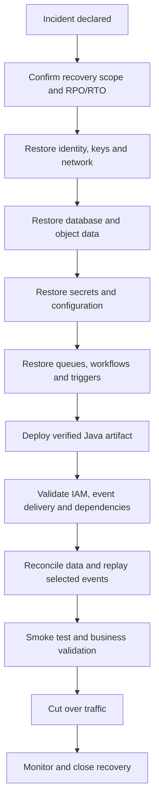

# Sao lưu trạng thái, cấu hình và dữ liệu phục vụ khôi phục

Java serverless function thường được thiết kế để xử lý một request hoặc event rồi kết thúc. Instance có thể bị scale xuống, khởi động lại hoặc thay thế bất kỳ lúc nào. Vì vậy, trạng thái nghiệp vụ không được phụ thuộc vào heap, biến `static`, local filesystem hoặc cache của một instance. Dữ liệu cần tồn tại sau invocation phải được lưu ở database, object storage, queue/event store hoặc một dịch vụ lưu trữ bền vững khác.

Tuy nhiên, lưu trạng thái bên ngoài function mới chỉ giải quyết bài toán persistence. Để phục hồi sau lỗi người dùng, lỗi triển khai, xóa nhầm, hỏng dữ liệu, mất region hoặc sự cố tài khoản, hệ thống còn cần sao lưu dữ liệu, cấu hình, secret, encryption key, artifact và thông tin trigger. Các bản backup phải có thể truy cập khi xảy ra sự cố, có tính nhất quán và đã được kiểm thử restore.

Bài học này trình bày cách xây dựng chiến lược backup/recovery cho ứng dụng Java serverless được kích hoạt bởi HTTP, message hoặc event. Trọng tâm là xác định dữ liệu nào cần bảo vệ, đặt RPO/RTO, chọn snapshot/PITR/versioning, bảo vệ bản sao lưu, khôi phục theo thứ tự và diễn tập phục hồi trên AWS, Azure và Google Cloud.

## 1. Phân biệt state trong function và state bền vững

Một serverless execution environment có thể được tái sử dụng giữa nhiều invocation, nhưng không có cam kết rằng instance sẽ tồn tại lâu dài. Runtime có thể freeze, restart, scale-to-zero hoặc tạo instance mới khi tải tăng. Do đó:

- Biến local, object trong heap và `static` chỉ là state tạm trong process.
- `/tmp` hoặc filesystem writable nếu có thường chỉ dùng tạm; không phải nơi lưu dữ liệu nghiệp vụ lâu dài.
- Cache trong memory có thể mất khi instance kết thúc và có thể khác nhau giữa các instance.
- Connection pool/client có thể được tái sử dụng để giảm overhead, nhưng không phải nơi lưu trạng thái cần khôi phục.
- Database, object storage, durable queue, event store và persistent workflow state mới là nguồn dữ liệu cần được backup theo chính sách.

Ví dụ, một Java function xử lý đơn hàng không nên chỉ lưu `orderStatus` trong `ConcurrentHashMap` static. Nếu instance bị thay thế, trạng thái biến mất; nếu scale-out, hai instance còn có thể giữ hai bản khác nhau. Hãy lưu trạng thái đơn hàng trong database và dùng cache chỉ để tăng tốc.

| Loại state | Ví dụ | Cần backup? | Cách bảo vệ |
| --- | --- | --- | --- |
| In-memory state | Biến static, object cache trong JVM | Không backup như dữ liệu gốc | Có thể tạo lại từ nguồn bền vững |
| Temporary state | File tạm, scratch data, local `/tmp` | Thường không; nếu có giá trị thì phải copy ra storage bền vững | Lifecycle/cleanup và upload kết quả |
| Business state | Order, payment, job status, user profile | Có | Database snapshot, PITR, export/replica |
| Object data | File upload, report, attachment | Có | Versioning, soft delete, replication, backup |
| Workflow state | Step status, retry count, checkpoint | Có nếu cần tiếp tục/đối soát | Durable workflow store, database backup |
| Queue/event data | Pending command, event log, DLQ | Tùy vai trò nguồn dữ liệu | Retention, archive, replay, DLQ export |
| Configuration | Runtime settings, routing, trigger, IAM, network | Có | IaC, version control, configuration export |
| Secret/key | API key, DB password, signing/encryption key | Có kế hoạch phục hồi riêng | Secret versioning, key recovery, rotation record |
| Release artifact | JAR/ZIP, image digest, SBOM | Có | Artifact registry/repository, retention, provenance |

## 2. Xác định phạm vi backup trước khi chọn công cụ

Một hệ thống serverless thường có nhiều thành phần thuộc các dịch vụ khác nhau. Backup database mà quên object storage có thể làm mất file tham chiếu; backup dữ liệu mà quên encryption key có thể khiến bản sao không giải mã được; khôi phục function mà quên trigger/IAM có thể khiến ứng dụng không nhận event.

Hãy lập inventory theo nhóm:

1. **Application data:** database, object, file, bảng metadata và dữ liệu tenant.
2. **Operational state:** job status, checkpoint, idempotency record, workflow execution và DLQ.
3. **Event source:** queue/topic, stream, event archive và retention.
4. **Configuration:** environment settings, routing, runtime/handler, timeout, memory, concurrency, trigger và network.
5. **Identity and security:** IAM/RBAC, service account, managed identity, resource policy, secret reference và KMS/key vault key.
6. **Code and artifact:** source commit, build artifact, container digest, dependency metadata, SBOM và deploy manifest.
7. **Observability:** log/trace/metric cần cho điều tra, audit và chứng minh phục hồi.

Với mỗi thành phần, ghi owner, nguồn dữ liệu gốc, cách backup, tần suất, retention, encryption, vị trí lưu, RPO, RTO, quyền restore và người chịu trách nhiệm. Không phải mọi log hoặc cache đều cần cùng mức bảo vệ; phân loại theo giá trị nghiệp vụ, pháp lý và khả năng tạo lại.

## 3. RPO và RTO quyết định chiến lược

Hai chỉ số quan trọng nhất khi thiết kế recovery:

- **RPO (Recovery Point Objective):** lượng dữ liệu tối đa có thể chấp nhận mất, thường biểu diễn bằng thời gian. RPO 15 phút nghĩa là sau sự cố, mục tiêu là khôi phục dữ liệu đến một thời điểm không cũ hơn khoảng 15 phút trước sự cố.
- **RTO (Recovery Time Objective):** thời gian tối đa mục tiêu để khôi phục dịch vụ về trạng thái hoạt động được. RTO 2 giờ nghĩa là hệ thống cần sẵn sàng lại trong vòng 2 giờ theo định nghĩa dịch vụ.

RPO/RTO là mục tiêu nghiệp vụ và cần được đo trong diễn tập. Bật backup hàng ngày không tự động đảm bảo RPO 24 giờ nếu snapshot thất bại, backup không nhất quán hoặc restore mất 8 giờ.

| Workload | RPO minh họa | RTO minh họa | Chiến lược có thể phù hợp |
| --- | ---: | ---: | --- |
| API đọc danh mục có thể tạo lại | 24 giờ | 8 giờ | Snapshot định kỳ, rebuild từ nguồn |
| Đơn hàng/thanh toán | 1–5 phút hoặc thấp hơn | 30–60 phút | PITR, multi-zone, transaction log/replication, runbook |
| File người dùng tải lên | 15 phút | 2 giờ | Versioning, replication và backup độc lập |
| Báo cáo batch có thể chạy lại | 24 giờ | 8 giờ | Lưu input, manifest và checkpoint; chạy lại job |
| Workflow giao hàng đang xử lý | 1–5 phút | 30 phút | Durable state, event archive, replay có idempotency |

Các con số trên chỉ là ví dụ để thảo luận, không phải mặc định cho mọi hệ thống. RPO/RTO khác nhau theo dữ liệu và luồng nghiệp vụ; một ứng dụng có thể có nhiều tier phục hồi.

### RPO và tần suất backup

Nếu chỉ dùng snapshot mỗi 24 giờ, RPO thực tế có thể gần 24 giờ hoặc lớn hơn nếu snapshot lỗi. PITR/log backup có thể giảm khoảng mất dữ liệu xuống vài phút hoặc ít hơn tùy dịch vụ. Cần xem thời điểm backup hoàn tất, replication lag và khả năng phục hồi tới timestamp cụ thể.

### RTO và tổng thời gian khôi phục

RTO không chỉ là thời gian restore database. Tổng thời gian có thể gồm:

- Phát hiện và xác nhận sự cố.
- Quyết định failover/restore.
- Cấp quyền và chuẩn bị region/account đích.
- Restore database/object và kiểm tra consistency.
- Khôi phục key/secret/config/IAM.
- Deploy function và trigger.
- Replay event hoặc queue backlog.
- Smoke test, business validation và chuyển traffic.

Hãy đo toàn bộ quy trình từ lúc bắt đầu incident đến khi người dùng hoàn tất được nghiệp vụ quan trọng.

## 4. Chọn backup, replication, versioning và PITR

Các cơ chế này giải quyết các vấn đề khác nhau:

| Cơ chế | Mục đích | Giới hạn cần hiểu |
| --- | --- | --- |
| Snapshot/backup | Tạo bản sao tại một thời điểm | Có thể mất thay đổi sau snapshot; restore cần thời gian |
| Point-in-time recovery (PITR) | Khôi phục database về thời điểm trong cửa sổ cho phép | Phụ thuộc retention log và giới hạn dịch vụ |
| Object versioning | Giữ nhiều phiên bản object | Xóa nhầm/versioning sai policy vẫn có thể gây mất; chi phí tăng |
| Soft delete/recycle bin | Cho phép phục hồi sau thao tác xóa | Có retention window; không thay thế backup độc lập |
| Replication | Duy trì bản sao ở vùng/tài khoản khác | Xóa nhầm hoặc dữ liệu lỗi có thể được replicate theo |
| Archive/event retention | Giữ event để replay/điều tra | Không phải snapshot trạng thái database và replay có thể tạo side effect |
| Export/dump | Tạo bản sao logic có thể chuyển môi trường | Cần kiểm soát consistency, schema và thời gian export/restore |

Không chọn một cơ chế làm giải pháp duy nhất. Ví dụ database có PITR, object storage có versioning/replication, IaC lưu cấu hình, secret manager giữ version, còn event archive hỗ trợ replay một số workflow.

## 5. Quy tắc 3-2-1 và tính độc lập của backup

Quy tắc 3-2-1 thường được dùng như điểm khởi đầu:

- Có ít nhất 3 bản dữ liệu (bao gồm bản production và các bản sao).
- Lưu trên ít nhất 2 loại môi trường/phương tiện hoặc failure domain khác nhau.
- Có ít nhất 1 bản ở vị trí khác (offsite/off-account/off-region) phù hợp với threat model.

Với cloud, “khác region” chưa chắc đã độc lập nếu cùng account, cùng quyền admin hoặc cùng automation có thể xóa cả hai. Hãy xem xét:

- Backup account/project/subscription riêng hoặc vault được quản trị độc lập.
- Quyền xóa backup tách khỏi quyền vận hành workload.
- Immutable retention/WORM hoặc object lock khi yêu cầu.
- Cross-region copy/replication cho thảm họa vùng.
- Encryption key và quyền khôi phục không phụ thuộc duy nhất vào workload bị sự cố.
- Backup catalog/manifest được lưu ở vị trí có thể truy cập khi control plane chính gặp sự cố.

Replication bảo vệ availability nhưng không nhất thiết bảo vệ trước xóa nhầm hoặc ransomware. Nếu xóa nhầm được replicate ngay, cả bản chính và bản replica có thể cùng mất. Cần versioning, immutable backup hoặc PITR để phục hồi trạng thái trước thời điểm lỗi.

## 6. Backup database: snapshot, PITR và consistency

Database thường chứa trạng thái nghiệp vụ quan trọng nhất. Cần chọn cơ chế theo engine và dịch vụ managed database.

### Snapshot

Snapshot tạo bản sao database tại thời điểm hoặc theo cơ chế nhất quán của dịch vụ. Ưu điểm là dễ quản lý và thường restore thành instance mới. Nhược điểm là thay đổi sau snapshot có thể mất và snapshot lớn có thể mất thời gian/chi phí.

### Point-in-time recovery

PITR dùng snapshot kết hợp transaction log/change log để khôi phục database về một timestamp trong retention window. Nó hữu ích khi:

- Developer chạy câu `DELETE` hoặc `UPDATE` nhầm.
- Một deployment ghi dữ liệu sai trong một khoảng thời gian.
- Bug trong function tạo duplicate hoặc corrupt record.
- Cần khôi phục dữ liệu gần thời điểm incident.

PITR không tự quyết định dữ liệu nào là đúng. Nếu bug đã ghi sai trong nhiều giờ, restore toàn bộ database có thể làm mất giao dịch hợp lệ sau timestamp khôi phục. Có thể restore sang instance mới, trích xuất record cần cứu rồi reconcile vào production hiện tại.

### Consistency giữa database và object storage

Nếu database lưu metadata trỏ đến object trong bucket, snapshot database và backup object phải có điểm nhất quán. Ví dụ:

1. Database có row `document_id=123` trỏ tới `s3://bucket/123.pdf`.
2. Object được upload sau snapshot.
3. Khôi phục database về trước thời điểm upload nhưng object vẫn còn; đây có thể là orphan object.
4. Hoặc database còn row nhưng object đã bị xóa khỏi backup; đây là broken reference.

Giải pháp có thể là object versioning, immutable object ID, manifest/checkpoint, snapshot coordinated hoặc reconciliation job sau restore. Đừng giả định hai dịch vụ lưu trữ có một transaction nguyên tử.

## 7. Backup và phục hồi object storage

Object storage thường chứa file upload, report, image, document và artifact. Các cơ chế cần xem xét:

- Versioning để giữ phiên bản trước khi overwrite.
- Soft delete/retention để phục hồi object hoặc container/bucket bị xóa.
- Replication sang region/account khác.
- Lifecycle rule chuyển object cũ sang storage class phù hợp.
- Object Lock/immutable retention khi cần chống sửa/xóa.
- Inventory và checksum để kiểm tra completeness/integrity.
- Backup metadata, tags, ACL/IAM policy và encryption configuration nếu cần tái tạo chính xác.

Versioning có thể làm tăng chi phí vì mọi lần overwrite tạo thêm version. Cần lifecycle policy xóa/archival version cũ theo yêu cầu pháp lý và RPO, nhưng phải tránh tự động xóa các version duy nhất còn khả năng khôi phục.

### Kiểm tra tính toàn vẹn

Khi restore file, kiểm tra:

- Object count và tổng dung lượng so với manifest.
- Checksum/hash hoặc ETag theo semantics của dịch vụ.
- Content type, metadata, encryption key và object version.
- Quan hệ giữa object và row database.
- Quyền đọc của function runtime và quyền truy cập của người dùng.

Không phải ETag luôn là MD5 của object; multipart upload và encryption có thể làm semantics khác. Dùng checksum do dịch vụ hỗ trợ hoặc hash do ứng dụng tính/lưu khi upload.

## 8. Backup queue, event và workflow state

Queue thường là cơ chế truyền công việc, không phải bản backup duy nhất của dữ liệu nghiệp vụ. Message có thể bị xóa sau khi ACK, hết retention hoặc bị chuyển DLQ. Hãy phân biệt:

- **Source of truth:** dữ liệu nghiệp vụ bền vững trong database/object store.
- **Queue:** công việc đang chờ consumer xử lý.
- **DLQ:** message không xử lý được sau retry policy; hữu ích để điều tra/replay.
- **Event archive:** bản lưu event phục vụ replay hoặc audit nếu hệ thống hỗ trợ.
- **Workflow state/checkpoint:** tiến độ các bước cần tiếp tục sau lỗi.

Nếu queue bị xóa, có thể tái tạo message từ source of truth hoặc event archive nếu thiết kế lưu đủ dữ liệu. Không nên coi DLQ là backup hoàn chỉnh; nó chỉ chứa message được route vào DLQ theo điều kiện và policy.

### Replay phải idempotent

Replay event sau recovery có thể chạy lại side effect đã hoàn tất trước sự cố. Consumer cần idempotency key, inbox/processed-event record, unique constraint hoặc downstream idempotency support. Trước khi replay:

1. Xác định event range và timestamp cần chạy lại.
2. Kiểm tra event schema và consumer version.
3. Đối chiếu trạng thái nghiệp vụ để loại event đã hoàn tất.
4. Chọn tốc độ replay để không làm quá tải downstream.
5. Theo dõi duplicate, failure, DLQ và event age.

Không replay toàn bộ event archive trực tiếp vào production mà không có dry-run, filter và giới hạn tốc độ.

## 9. Backup cấu hình và hạ tầng

Một function không chỉ gồm JAR/image. Để khôi phục, cần tái tạo được:

- Runtime/language version, handler/entry point và architecture.
- Environment variables không nhạy cảm và secret references.
- Memory/CPU, timeout, concurrency, min/max instances và retry.
- HTTP route, API gateway integration, auth level và custom domain mapping.
- Queue/topic, event subscription, event filter, scheduler và DLQ.
- IAM role/service account/managed identity và resource policy.
- VPC/subnet/security group/private endpoint/DNS/egress.
- Database/bucket/secret manager/registry và encryption configuration.
- Log group, metric, alert, dashboard và retention.

### Infrastructure as Code

Terraform, CloudFormation/SAM, Bicep/ARM hoặc công cụ IaC tương đương giúp lưu cấu hình thành source có version control. Backup cấu hình nên bao gồm:

- Source IaC và module/provider version đã pin.
- State backend được bảo vệ, backup và lock.
- Variables/parameter names và cấu hình theo môi trường.
- Deployment manifest, release version và image digest.
- Policy/role definition và resource dependencies.
- Hướng dẫn bootstrap khi account/project/region mới chưa có resource.

Không commit secret plaintext vào IaC. Lưu secret reference và metadata; giá trị được quản lý trong secret manager. Terraform state hoặc deployment state có thể chứa secret value tùy provider/resource, vì vậy phải mã hóa, giới hạn quyền đọc và quản lý retention của state backend.

### Configuration drift

Nếu operator sửa cấu hình trực tiếp trên console, IaC có thể không còn phản ánh trạng thái thực. Drift detection giúp tìm sự khác biệt. Sau khi phát hiện drift, xác định thay đổi có chủ ý hay không rồi cập nhật IaC hoặc khôi phục cấu hình. Không tự động apply IaC để xóa thay đổi production chưa được hiểu rõ.

## 10. Backup secrets, certificates và encryption keys

Backup dữ liệu mà không có key phù hợp có thể khiến dữ liệu không thể giải mã. Với mỗi secret/key, cần ghi nhận:

- Secret name/ID và version metadata.
- Owner, consumer, rotation schedule và expiry.
- Secret manager/vault và region/account/project.
- KMS/Key Vault/Cloud KMS key ID, key policy và rotation status.
- Cách khôi phục quyền truy cập khi identity production bị mất.
- Certificate chain, issuer, renewal procedure và private key handling.

Không xuất plaintext secret vào cùng backup bucket với database. Dùng secret manager versioning/backup mechanism được provider hỗ trợ, tách quyền quản trị và kiểm soát audit. Với encryption key, hiểu rõ key material có thể export hay không; nhiều managed KMS key không cho export plaintext key material. Recovery có thể cần giữ nguyên key/resource, policy, account và trạng thái key thay vì tải key ra file.

### Key dependency

Nếu backup database được mã hóa bằng customer-managed key, restore cần key còn hoạt động và principal có quyền decrypt. Nếu key bị disable, schedule deletion hoặc policy bị thay đổi, backup có thể tồn tại nhưng không thể restore. Hãy đưa key availability, key policy và deletion protection vào DR test.

### Rotation và recovery

Secret rotation có thể khiến ứng dụng mới dùng credential khác với bản backup cũ. Sau restore, không nhất thiết nên khôi phục password cũ đã bị thu hồi. Hãy khôi phục phiên bản secret phù hợp với target hiện tại hoặc tạo credential mới rồi cập nhật consumer. Giữ audit/version metadata để biết secret nào từng được sử dụng.

## 11. Backup code, artifact và release metadata

Khôi phục function cần đúng source và đúng binary đã được kiểm thử. Nên lưu:

- Git commit/tag và repository mirror/backup.
- JAR/ZIP hoặc OCI image theo immutable digest.
- SBOM, vulnerability scan report và provenance/attestation.
- Runtime version, build toolchain và dependency lock/metadata.
- IaC commit tương ứng với release.
- Deployment record: region, function version, alias/revision và trigger mapping.
- Migration version và compatibility notes.

Không chỉ lưu source rồi giả định có thể build lại chính xác nhiều tháng sau. Dependency repository có thể xóa version, base image có thể biến mất hoặc build toolchain thay đổi. Lưu artifact release bất biến và kiểm soát retention phù hợp.

## 12. Mô hình disaster recovery

Các chiến lược DR khác nhau về chi phí, độ phức tạp và RTO:

| Chiến lược | Cách hoạt động | RTO/RPO tương đối | Chi phí/độ phức tạp |
| --- | --- | --- | --- |
| Backup and restore | Backup định kỳ; khi sự cố mới tạo resource và restore | RTO cao hơn; RPO phụ thuộc backup/PITR | Thấp hơn, restore lâu hơn |
| Pilot light | Giữ sẵn thành phần cốt lõi tối thiểu, mở rộng khi sự cố | RTO trung bình; RPO tùy replication | Trung bình |
| Warm standby | Môi trường DR chạy ở capacity thấp, dữ liệu được replicate | RTO thấp hơn; RPO thấp hơn tùy replication lag | Cao hơn |
| Active-active | Hai vùng cùng phục vụ traffic và đồng bộ dữ liệu | Có thể RTO thấp; RPO phụ thuộc consistency/replication | Cao và phức tạp nhất |

Không có chiến lược tốt nhất cho mọi function. Một report worker có thể dùng backup-and-restore; API thanh toán có thể cần warm standby hoặc kiến trúc multi-region. Cần cân bằng chi phí, data consistency, operational complexity và khả năng kiểm thử.

### Multi-region không tự động là backup

Replication liên vùng giúp tiếp tục phục vụ khi một region gặp sự cố, nhưng dữ liệu lỗi/xóa nhầm có thể được replicate. Một region thứ hai cũng có thể chia sẻ cùng account/IAM control plane. Kết hợp replication với point-in-time backup, versioning, immutable retention và quyền restore độc lập.

## 13. AWS: backup và recovery cho Lambda workload

AWS Lambda code/config và các dịch vụ dữ liệu có vòng đời backup khác nhau. Lambda function không tự sao lưu database hoặc S3 chỉ vì function dùng các resource đó.

### Lambda code và configuration

- Lưu source trong Git và artifact JAR/ZIP hoặc ECR image theo digest.
- Lưu IaC định nghĩa function, execution role, environment variables, VPC, event source mapping, alias và reserved concurrency.
- Giữ Lambda published versions/aliases theo release policy; version không thay thế backup database.
- Lưu deployment package ngoài vòng đời function nếu cần khôi phục account/region.

### RDS/Aurora và DynamoDB

- Amazon RDS/Aurora hỗ trợ automated backup, manual snapshot và PITR theo engine/retention/configuration.
- DynamoDB hỗ trợ point-in-time recovery và on-demand backup/restore.
- Kiểm tra backup retention, cross-region copy, KMS key và quyền restore.
- Thử restore sang resource mới rồi kiểm tra schema, index, encryption và connectivity.

### S3

- Bật versioning cho bucket chứa file quan trọng.
- Cân nhắc Object Lock, replication và lifecycle policy.
- Dùng AWS Backup hoặc cơ chế backup phù hợp cho resource được hỗ trợ.
- Backup bucket policy, lifecycle, encryption và access point configuration bằng IaC.

### SQS, SNS và EventBridge

Queue/topic/event bus không thay thế source of truth. Lưu payload gốc hoặc event archive nếu cần replay; cấu hình DLQ, retention và redrive. Với EventBridge event archive/replay, xác định event bus, filter, retention và cách consumer xử lý duplicate. Không replay sự kiện thanh toán/đặt hàng nếu chưa kiểm tra idempotency.

### Ví dụ lệnh restore cần kiểm soát

Ví dụ restore RDS snapshot tạo instance mới:

```bash
aws rds restore-db-instance-from-db-snapshot \
  --db-instance-identifier orders-restore-test \
  --db-snapshot-identifier orders-backup-snapshot
```

Lệnh minh họa; cần chọn engine/class/subnet/security group/parameter group/KMS key phù hợp. Không restore đè production ngay trong bước đầu. Tạo instance mới, validate dữ liệu, sau đó mới quyết định cutover.

## 14. Azure: backup và recovery cho Functions workload

### Function App và cấu hình

- Lưu source và deployment package trong repository/artifact storage.
- Dùng Bicep/ARM/Terraform để tái tạo Function App, hosting plan, identity, network, app settings, trigger và diagnostic settings.
- Không coi `local.settings.json` là backup production configuration.
- Ghi nhận runtime stack, Functions host version, extension bundle và deployment slot settings.
- Giữ package/image theo release version để rollback.

### Azure SQL và database

Azure SQL có automated backups, point-in-time restore và geo-restore theo tier/region/feature. Azure Database for PostgreSQL/MySQL có backup/PITR theo cấu hình dịch vụ. Kiểm tra retention, geo-redundancy, restore target và encryption/key dependency.

Restore thường tạo database mới hoặc target mới; xác minh firewall/private endpoint, managed identity permissions, connection string/secret reference và schema trước cutover.

### Azure Storage

- Bật blob versioning và soft delete khi phù hợp.
- Dùng container/blob restore hoặc point-in-time restore theo loại account/feature được hỗ trợ.
- Cân nhắc object replication và backup vault policy cho dữ liệu quan trọng.
- Backup storage account config, lifecycle, networking, encryption và RBAC bằng IaC.

### Key Vault và configuration

Giữ version secret và thiết kế quyền phục hồi riêng. Key Vault soft delete/purge protection giúp bảo vệ vault/secret khỏi xóa nhầm theo retention. Backup/restore secret/key/certificate có giới hạn theo loại object và tenant/region; kiểm tra tài liệu của vault trước khi dựa vào export/import. Azure App Configuration có thể dùng snapshot/version label để khôi phục cấu hình ứng dụng.

## 15. Google Cloud: backup và recovery cho Cloud Run/Functions

### Cloud Run/Functions configuration

- Lưu source, Dockerfile/build configuration, Functions Framework entry point và artifact/image digest.
- Dùng Terraform hoặc IaC để tái tạo service, job, function, service account, IAM, Eventarc trigger, environment variables, VPC egress và scaling limits.
- Ghi nhận revision, traffic split, job task/parallelism và trigger filter.
- Lưu secret reference và version ID; không dựa vào một service account key file trong artifact.

### Cloud SQL, Firestore và database

Cloud SQL hỗ trợ automated backups, on-demand backups và PITR theo engine/configuration. Firestore có backup/scheduled backup và restore theo tính năng/database mode được hỗ trợ. Bigtable/Spanner có backup hoặc export/restore strategy riêng. Cần xác minh retention, region, encryption và restore constraints của từng dịch vụ.

### Cloud Storage

- Dùng object versioning hoặc soft delete theo yêu cầu.
- Cân nhắc bucket replication/dual-region và retention policy.
- Lưu metadata, IAM policy, lifecycle và encryption configuration bằng IaC.
- Kiểm tra quyền restore và location constraint.

### Secret Manager và KMS

Secret Manager lưu version bất biến và hỗ trợ disable/destroy theo policy. Giữ secret version metadata và quy trình phục hồi; với key, kiểm soát Cloud KMS key ring/location, IAM và rotation. Không xóa key version hoặc key ring cần để giải mã backup.

## 16. Khôi phục theo thứ tự phụ thuộc

Khôi phục từng resource riêng lẻ nhưng không theo thứ tự có thể làm function khởi động trước khi dependency sẵn sàng. Một thứ tự tham khảo:

1. **Identity/control plane:** xác minh account/project/subscription, admin access, break-glass identity và quyền restore.
2. **Encryption/key:** khôi phục hoặc xác minh KMS/Key Vault/Cloud KMS key, policy và trạng thái enabled.
3. **Network foundation:** VPC/VNet, subnet, route, DNS, firewall, private endpoint và connectivity.
4. **Data stores:** restore database, object storage và durable state; kiểm tra consistency.
5. **Secrets/config:** khôi phục secret version phù hợp, app config, connection reference và feature flags.
6. **Messaging/workflow:** tạo queue/topic/subscription, DLQ, event archive và workflow state.
7. **Application artifact:** deploy JAR/ZIP/image đã xác minh digest và provenance.
8. **IAM/trigger:** gán runtime identity, resource policy, invoke permission và event source mapping.
9. **Observability:** log, metric, alert, dashboard và audit sink.
10. **Validation/cutover:** smoke test, business reconciliation, replay có kiểm soát và chuyển traffic.

Thứ tự thực tế phụ thuộc dependency graph. Một số resource cần được tạo trước để nhận backup; một số secret chỉ nên publish sau khi database mới đã sẵn sàng. Runbook cần nêu rõ điều kiện hoàn tất từng bước và người xác nhận.



## 17. Phục hồi dữ liệu sai và xóa nhầm

Không phải mọi sự cố đều cần khôi phục toàn bộ hệ thống. Nếu một function bug ghi sai 500 row, có thể restore database sang instance tạm tại thời điểm trước bug, trích xuất record bị ảnh hưởng rồi sửa/reconcile vào production.

Quy trình:

1. Xác định khoảng thời gian và loại dữ liệu bị ảnh hưởng.
2. Dừng hoặc giảm tốc function gây lỗi để ngăn thêm corruption.
3. Chọn recovery point trước thao tác sai.
4. Restore backup/PITR sang môi trường cô lập.
5. So sánh record trước/sau và xác định tập dữ liệu cần cứu.
6. Xác minh quan hệ với object, event, payment và downstream system.
7. Tạo migration/repair script idempotent có review.
8. Áp dụng sửa chữa trong transaction/batch có checkpoint.
9. Kiểm tra business invariant và audit log.
10. Mở lại traffic theo từng bước và tiếp tục giám sát.

Nếu side effect đã xảy ra ở hệ thống ngoài (ví dụ đã gửi email hoặc charge payment), restore database không thể tự hoàn tác chúng. Cần compensation/reconciliation với provider hoặc business process.

## 18. Replay queue và event sau recovery

Sau khi database được khôi phục, queue/event có thể chứa message trước và sau recovery point. Replay không được thực hiện một cách mù quáng.

Trước replay, cần xác định:

- Event ID, sequence number, timestamp hoặc partition offset.
- Event nào đã được áp dụng trước sự cố.
- Event nào bị mất trong khoảng RPO.
- Consumer version/schema tương thích.
- Side effect có idempotent hoặc có compensation không.
- Replay rate tối đa để bảo vệ database/API.
- Quy trình dừng replay nếu error rate, backlog age hoặc duplicate tăng.

Một chiến lược có thể là replay từ event archive vào một queue recovery riêng, chạy consumer ở chế độ dry-run/validation, sau đó chuyển sang apply mode. Với stream, checkpoint/offset phải được khôi phục đúng và tránh bỏ qua record chưa xử lý.

DLQ là nguồn hữu ích để redrive poison message sau khi sửa lỗi, nhưng cần review từng loại lỗi. Không redrive message chứa payload không hợp lệ mà không thay đổi consumer hoặc dữ liệu đầu vào.

## 19. Khôi phục trạng thái workflow và job

Workflow dài hạn có thể dừng giữa hai bước. Cần lưu trạng thái đủ để biết:

- Workflow/job ID và business key.
- Step đã hoàn tất, step đang chạy và step tiếp theo.
- Input/output reference và schema version.
- Retry count, error reason và next attempt time.
- Checkpoint/partition đã hoàn tất.
- Side effect đã commit hoặc cần reconcile.

Không lưu toàn bộ payload lớn trong workflow state nếu hệ thống giới hạn kích thước; lưu object reference và checksum. Khi restore, xác minh checkpoint phù hợp với database/object state. Nếu checkpoint đi trước dữ liệu đã commit hoặc ngược lại, có thể bỏ sót hoặc xử lý trùng.

Với Cloud Run Jobs, Lambda async workflow hoặc Azure Durable Functions, backup state machine/workflow history theo cơ chế dịch vụ và giữ application data riêng. Không giả định function package chứa được execution history.

## 20. Bảo vệ backup khỏi xóa nhầm và ransomware

Backup có thể bị xóa hoặc mã hóa nếu attacker chiếm quyền admin của cùng account. Hãy giảm khả năng một credential bị lộ phá hủy cả production lẫn backup.

- Tách backup account/project/subscription hoặc vault theo failure domain.
- Dùng role backup riêng và role restore riêng; runtime function không được quyền xóa backup.
- Áp dụng immutable retention/Object Lock/WORM khi yêu cầu.
- Bật deletion protection, soft delete và purge protection cho resource/key phù hợp.
- Yêu cầu MFA/approval hoặc break-glass process cho thao tác xóa backup quan trọng.
- Gửi audit log về hệ thống log độc lập và cảnh báo khi retention bị thay đổi.
- Mã hóa backup và bảo vệ key/policy độc lập.
- Kiểm tra backup copy không thể bị xóa bởi principal production thông thường.
- Thử khôi phục khi account/region chính bị mất quyền truy cập.

Không cấp quyền backup vault admin cho Java function. Function runtime thường chỉ cần quyền đọc/ghi dữ liệu nghiệp vụ; backup/restore là trách nhiệm của control plane hoặc automation identity riêng.

## 21. Backup encryption và data residency

Backup thường chứa dữ liệu nhạy cảm tương đương production. Cần kiểm soát:

- Encryption at rest bằng provider-managed hoặc customer-managed key theo policy.
- TLS khi copy/restore qua network.
- Quyền đọc/restore theo least privilege.
- Vị trí region/country và yêu cầu data residency.
- Retention, deletion và legal hold.
- Masking/tokenization nếu bản sao dùng cho test.
- Audit cho backup, export, restore và download.

Không khôi phục dữ liệu production vào dev/test mà không có kiểm soát. Có thể dùng dữ liệu synthetic hoặc masking để giảm rủi ro lộ thông tin cá nhân.

## 22. Kiểm tra backup tự động

Backup job thành công ở control plane không đủ chứng minh dữ liệu có thể phục hồi. Nên kiểm tra:

- Backup hoàn tất và có recovery point mới trong SLA.
- Kích thước, object count hoặc row count không bất thường.
- Encryption/key vẫn hoạt động.
- Backup được copy sang vị trí độc lập theo policy.
- Retention không bị thay đổi ngoài dự kiến.
- Restore test tạo được resource mới.
- Application có thể kết nối và đọc/ghi dữ liệu đã khôi phục.
- Checksum/integrity và business invariant đạt.
- RPO/RTO đo được trong lần diễn tập.

Có thể dùng backup catalog hoặc manifest chứa resource ID, recovery point, timestamp, region, key ID, checksum và status. Manifest không chứa secret value.

## 23. Restore test và disaster recovery drill

Một backup chưa từng được restore chỉ là giả định. Hãy lập lịch diễn tập:

1. Chọn một database/object set hoặc môi trường recovery.
2. Chọn recovery point theo RPO mục tiêu.
3. Restore sang account/project/region hoặc namespace cô lập.
4. Khôi phục key/secret/config và deploy đúng artifact.
5. Kiểm tra trigger, IAM, network và kết nối dependency.
6. Chạy smoke test và business reconciliation.
7. Đo thời gian từng bước và tổng RTO.
8. So sánh dữ liệu phục hồi với checksum/manifest/source of truth.
9. Ghi lỗi, quyền còn thiếu, quota và bước manual.
10. Cập nhật runbook, automation và người chịu trách nhiệm.

Diễn tập cần bao gồm cả trường hợp operator không thể truy cập account chính hoặc region chính. Nếu mọi tài liệu và credential phục hồi đều nằm trong account bị mất, DR plan không thực tế.

### Chỉ số backup/recovery

| Metric | Ý nghĩa |
| --- | --- |
| Backup success rate | Tỷ lệ backup hoàn tất theo lịch |
| Backup age | Thời gian từ recovery point gần nhất đến hiện tại |
| Replication lag | Độ trễ của bản sao liên vùng/liên tài khoản |
| Restore success rate | Tỷ lệ restore test thành công |
| Measured RPO | Lượng dữ liệu thực tế mất trong drill |
| Measured RTO | Thời gian phục hồi toàn bộ dịch vụ |
| Backup coverage | Tỷ lệ resource quan trọng có backup policy |
| Immutable coverage | Tỷ lệ bản backup có bảo vệ chống sửa/xóa |
| Restore validation errors | Lỗi checksum, schema, permission hoặc business invariant |

Alert khi backup age vượt RPO, backup job thất bại liên tiếp, replication lag tăng hoặc retention bị thay đổi. Không chỉ cảnh báo khi backup task lỗi; backup có thể báo thành công nhưng bản copy không nằm ở vị trí cần thiết.

## 24. Runbook khôi phục cho Java serverless

Runbook nên được viết để người trực có thể thực hiện khi chịu áp lực incident. Tối thiểu gồm:

### Trước sự cố

- Danh sách contact, service owner, backup owner và approver.
- Link tới IaC, artifact repository, backup vault và dashboard.
- Account/project/subscription/region chính và DR.
- RPO/RTO theo data tier.
- Cách lấy break-glass access và phê duyệt.
- Lệnh restore đã được thử nghiệm, biến cần thay và resource name.
- Cách xác minh key, IAM, network và secret.
- Cách disable trigger hoặc giảm concurrency để ngăn ghi dữ liệu sai.

### Trong sự cố

1. Xác nhận phạm vi và loại sự cố: xóa nhầm, corruption, region outage, credential compromise hay deployment bug.
2. Dừng hoặc giới hạn writer/trigger gây corruption nếu cần.
3. Chọn recovery point và xác nhận RPO/RTO.
4. Khôi phục key/network/identity và data store theo thứ tự.
5. Deploy artifact đã xác minh và cấu hình đã version hóa.
6. Khôi phục trigger/queue có kiểm soát.
7. Reconcile/replay event và job state.
8. Chạy smoke test và business validation.
9. Chuyển traffic, theo dõi error/backlog/duplicate và ghi nhận thời gian.

### Sau sự cố

- Bảo toàn audit log và bằng chứng.
- Đối soát dữ liệu/transaction với downstream provider.
- Xác định root cause và dữ liệu có thể bị lộ/mất.
- Cập nhật backup policy, retention, IAM và automation.
- Diễn tập lại phần quy trình đã thất bại.
- Ghi nhận RPO/RTO thực tế và thông báo theo quy định.

## 25. Ví dụ: backup manifest cho một release

Một manifest có thể ghi lại những gì cần để tái tạo release và liên kết nó với recovery point:

```yaml
service: orders-api
environment: production
release:
  version: 2.4.1
  commit: 7a3f1c9
  image: registry.example.com/orders@sha256:abc123...
  sbom: orders-api-2.4.1.cdx.json
infrastructure:
  iacCommit: 9f2d8a1
  region: ap-southeast-1
  runtimeIdentity: orders-api-runtime
data:
  database:
    resource: orders-prod
    recoveryPoint: 2026-11-17T10:00:00Z
    backupId: backup-20261117-1000
  objectStore:
    bucket: orders-prod-files
    versioning: enabled
security:
  secretReferences:
    - name: orders-db-credentials
      version: 18
  encryptionKeyReference: orders-data-key
```

Đây là manifest minh họa, không phải file cấu hình deploy trực tiếp. Không đưa secret value, access key hoặc private key vào manifest. Resource name, secret version và key reference phải được bảo vệ vì chúng tiết lộ topology và có thể giúp attacker lập bản đồ hệ thống.

## 26. Kịch bản thực tế: function ghi nhầm dữ liệu

Giả sử một release mới của `invoice-worker` có bug khiến số tiền hóa đơn bị nhân đôi. Function được kích hoạt bởi SQS và đã xử lý trong 20 phút trước khi phát hiện.

Một quy trình xử lý có thể là:

1. Tắt hoặc giảm concurrency event source mapping để ngăn thêm dữ liệu sai.
2. Ghi nhận release ID, message ID, khoảng thời gian và tập invoice bị ảnh hưởng.
3. Xác định database recovery point trước khi release lỗi bắt đầu ghi dữ liệu.
4. Restore database snapshot/PITR sang instance cô lập.
5. So sánh invoice trong bản restore với production hiện tại để tìm record thay đổi sai.
6. Kiểm tra payment provider: có khoản thanh toán thực sự bị charge sai không?
7. Tạo repair script theo invoice ID, kiểm tra idempotency và chạy trên staging copy.
8. Áp dụng correction/compensation vào production hiện tại; tránh restore toàn database nếu có giao dịch hợp lệ phát sinh sau đó.
9. Deploy worker version đã sửa, xác minh queue consumer và trigger.
10. Replay có chọn lọc message chưa hoàn tất, theo dõi duplicate và DLQ.
11. Đối soát invoice/payment và mở lại concurrency dần.

Điểm quan trọng: khôi phục database không tự hoàn tác payment đã gửi tới nhà cung cấp. Cần đối soát và compensation qua API/provider. Message đã ACK cũng không tự quay lại queue; cần event archive hoặc nguồn dữ liệu gốc để tái tạo công việc.

## 27. Kịch bản thực tế: mất region

Giả sử region chính không thể truy cập. Một DR plan warm standby có thể:

1. Kích hoạt incident và xác nhận region DR còn hoạt động.
2. Kiểm tra replication lag và recovery point của database/object store.
3. Xác minh KMS/key, secret version, IAM/service account và network ở region DR.
4. Tạo hoặc scale Cloud Run/Lambda/Azure Function runtime theo capacity cần thiết.
5. Deploy artifact digest đã được kiểm tra, dùng IaC và config DR.
6. Tạo trigger/event source mapping hoặc chuyển endpoint/API gateway.
7. Kiểm tra database connection, DNS, private endpoint và downstream quota.
8. Chạy synthetic transaction và business validation.
9. Chuyển traffic theo DNS/traffic manager/API gateway.
10. Theo dõi error rate, latency, event age, queue backlog và duplicate.
11. Khi region chính phục hồi, không tự động failback ngay; reconcile dữ liệu hai phía và chọn nguồn authoritative.

Failback cũng là một migration dữ liệu và traffic. Nếu cả hai region nhận write trong thời gian incident, cần conflict resolution hoặc single-writer strategy. Không chuyển traffic qua lại chỉ bằng DNS mà không kiểm tra data consistency.

## 28. Các lỗi thường gặp

1. **Coi warm instance là nơi lưu state.** Instance có thể bị kết thúc bất kỳ lúc nào.
2. **Chỉ backup database.** Có thể thiếu object, secret, key, queue, workflow state và config.
3. **Coi replication là backup.** Xóa nhầm/corruption có thể replicate sang bản sao.
4. **Không đặt RPO/RTO.** Không biết backup frequency và restore time có đáp ứng nghiệp vụ hay không.
5. **Backup chưa từng restore.** Có thể thiếu key, permission, network hoặc metadata.
6. **Lưu backup cùng account/quyền admin.** Một credential bị lộ có thể xóa cả production và backup.
7. **Quên encryption key.** Backup còn nhưng không giải mã được.
8. **Restore database nhưng quên object storage.** Record trỏ tới object không tồn tại hoặc ngược lại.
9. **Replay event không idempotent.** Side effect bị thực hiện hai lần.
10. **Khôi phục code mà không khôi phục trigger/IAM/config.** Function deploy thành công nhưng không xử lý được request/event.
11. **Restore toàn bộ production sau một lỗi dữ liệu nhỏ.** Có thể xóa giao dịch hợp lệ sau recovery point.
12. **Không kiểm tra artifact và dependency.** Không tái tạo được bản code đã được kiểm thử.
13. **Failback vội vàng sau region outage.** Hai phía có thể chưa đồng bộ hoặc có conflict.
14. **Đưa dữ liệu production vào môi trường test không masking.** Backup trở thành nguồn rò rỉ dữ liệu.

## 29. Quy trình thiết kế backup/recovery

1. **Inventory:** liệt kê data, state, config, secret/key, artifact, trigger và log.
2. **Classify:** phân loại theo business criticality, sensitivity và khả năng tạo lại.
3. **Set objectives:** thống nhất RPO/RTO và retention cho từng nhóm.
4. **Choose controls:** chọn snapshot, PITR, versioning, replication, archive, IaC và artifact retention.
5. **Isolate:** tách backup account/vault, identity và key; áp dụng immutable protection khi cần.
6. **Automate:** lên lịch backup, kiểm tra completion, copy và catalog/manifest.
7. **Validate:** checksum, consistency, restore test, application smoke test và business invariant.
8. **Document:** viết runbook theo dependency order, owner, command và approval.
9. **Drill:** diễn tập xóa nhầm, corruption, region outage và credential loss.
10. **Improve:** cập nhật RPO/RTO đo được, policy, quota, permission và automation sau mỗi drill/incident.

## 30. Checklist trước production

- [ ] Trạng thái nghiệp vụ không phụ thuộc heap, `static`, local filesystem hoặc cache của function.
- [ ] Đã lập inventory database, object, queue, workflow, config, secret/key và artifact.
- [ ] Mỗi data tier có owner, RPO, RTO, retention và recovery method.
- [ ] Database có snapshot/PITR phù hợp với RPO.
- [ ] Object storage có versioning/soft delete/replication hoặc backup phù hợp.
- [ ] Queue/event có retention, DLQ, archive/replay strategy khi cần.
- [ ] Workflow state/checkpoint và idempotency record được bảo vệ.
- [ ] IaC, state backend và environment configuration có backup/version control.
- [ ] JAR/ZIP/image digest, SBOM, provenance và release metadata được lưu bất biến.
- [ ] Secret version, certificate và encryption key có recovery plan.
- [ ] Backup nằm ở failure domain đủ độc lập; quyền xóa/restore được tách.
- [ ] Backup được mã hóa, có audit, retention và deletion protection phù hợp.
- [ ] Có manifest/catalog để tìm recovery point và xác định dependency.
- [ ] Restore test đã được thực hiện và đo RPO/RTO thực tế.
- [ ] Runbook có thứ tự restore identity/key/network/data/config/function/trigger.
- [ ] Event replay có filter, rate limit, idempotency và reconciliation.
- [ ] Có quy trình xử lý dữ liệu sai mà không nhất thiết restore toàn bộ production.
- [ ] Có kế hoạch failover/failback và xác định single-writer/conflict policy.
- [ ] Backup/restore monitoring có alert khi backup cũ, lỗi hoặc replication lag tăng.
- [ ] Dữ liệu production dùng trong test được bảo vệ/masking theo chính sách.

Backup/recovery cho Java serverless không chỉ là tạo snapshot database. Cần bảo vệ toàn bộ dependency để function có thể hoạt động lại: dữ liệu nghiệp vụ, object, workflow state, event/queue, cấu hình, identity, secret, encryption key và artifact. RPO/RTO định hướng lựa chọn snapshot/PITR/replication; backup độc lập và immutable protection giảm rủi ro xóa nhầm hoặc ransomware; restore drill xác minh mọi thành phần có thể khôi phục thật. Khi runbook bao gồm cả deploy function, khôi phục trigger, replay event và đối soát side effect, hệ thống mới có khả năng phục hồi end-to-end.

## Tài liệu tham khảo chính thức

- [AWS Backup – Developer Guide](https://docs.aws.amazon.com/aws-backup/latest/devguide/whatisbackup.html)
- [Amazon RDS – Backing up and restoring](https://docs.aws.amazon.com/AmazonRDS/latest/UserGuide/CHAP_CommonTasks.BackupRestore.html)
- [Amazon DynamoDB – Point-in-time recovery](https://docs.aws.amazon.com/amazondynamodb/latest/developerguide/PointInTimeRecovery.html)
- [Amazon S3 – Versioning](https://docs.aws.amazon.com/AmazonS3/latest/userguide/Versioning.html)
- [Amazon S3 – Object Lock](https://docs.aws.amazon.com/AmazonS3/latest/userguide/object-lock.html)
- [AWS Lambda – Versions and aliases](https://docs.aws.amazon.com/lambda/latest/dg/configuration-versions.html)
- [Azure Backup documentation](https://learn.microsoft.com/azure/backup/backup-overview)
- [Azure SQL – Automated backups](https://learn.microsoft.com/azure/azure-sql/database/automated-backups-overview)
- [Azure Blob Storage – Versioning](https://learn.microsoft.com/azure/storage/blobs/versioning-overview)
- [Azure Key Vault – Soft delete and purge protection](https://learn.microsoft.com/azure/key-vault/general/soft-delete-overview)
- [Google Cloud Backup and DR](https://cloud.google.com/backup-disaster-recovery/docs/concepts/backup-dr)
- [Cloud SQL – Backup and restore](https://cloud.google.com/sql/docs/mysql/backup-recovery/backups)
- [Cloud Storage – Object Versioning](https://cloud.google.com/storage/docs/object-versioning)
- [Google Secret Manager – Best practices](https://cloud.google.com/secret-manager/docs/best-practices)
