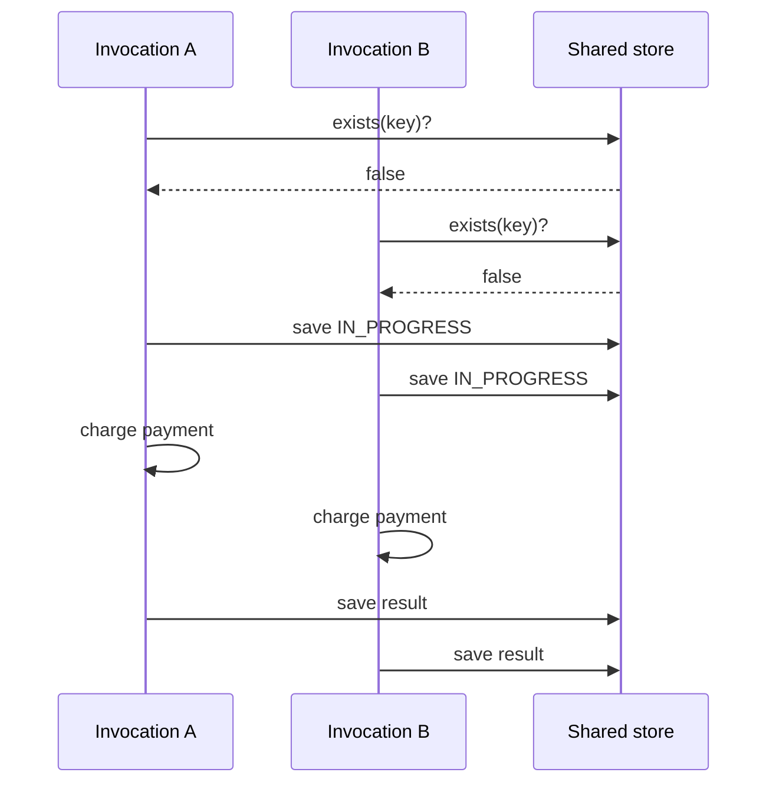
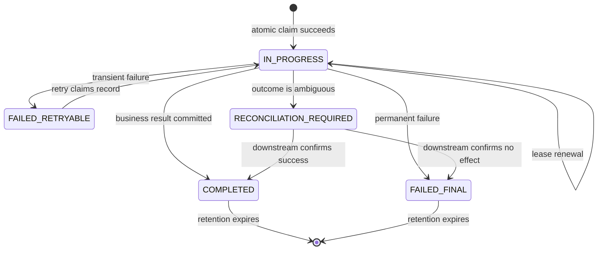
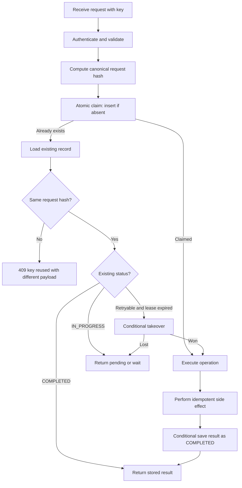
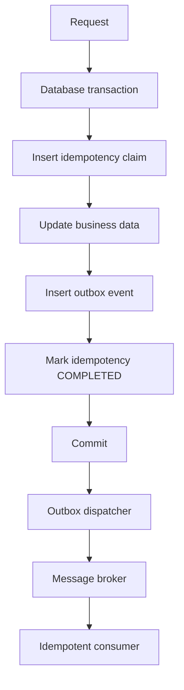

# Xử lý hai invocation đồng thời với cùng idempotency key

## 1. Bài toán trong hệ thống serverless

Idempotency bảo đảm một thao tác logic chỉ tạo ra một kết quả nghiệp vụ, ngay cả khi request hoặc message được gửi lại nhiều lần. Điều này đặc biệt quan trọng với API tạo đơn, thanh toán, phát hành hóa đơn, cập nhật tồn kho và các consumer xử lý event có thể được giao lại.

Trong serverless, cùng một request có thể kích hoạt hai invocation gần như đồng thời. Ví dụ, client gửi `POST /payments` với `Idempotency-Key: pay-2026-0042`. Gateway bị timeout trước khi nhận response nên client retry. Request đầu vẫn đang chạy, request thứ hai đến một execution environment khác. Cả hai function instance đều có thể nhìn thấy cùng một key.

Nếu mỗi invocation kiểm tra “key đã tồn tại chưa?” rồi mới ghi, cả hai có thể cùng đọc kết quả chưa tồn tại và cùng thực hiện thao tác thanh toán. Đây là race condition. Việc lưu key trong `static Map`, `ConcurrentHashMap` hoặc cache cục bộ không giải quyết được vì các invocation có thể chạy trên hai instance khác nhau, và instance có thể bị khởi tạo lại bất kỳ lúc nào.

Muốn xử lý đúng, hệ thống cần một thao tác **claim nguyên tử** tại kho lưu trữ dùng chung. Chỉ một invocation được quyền trở thành chủ sở hữu của thao tác; các invocation còn lại phải đọc trạng thái và tuân theo cùng một chính sách: trả kết quả đã hoàn tất, chờ, trả trạng thái đang xử lý hoặc báo conflict.

## 2. Idempotency key đại diện cho thao tác logic

Idempotency key là định danh do client hoặc producer tạo ra cho một thao tác logic. Khi retry cùng thao tác, bên gửi phải giữ nguyên key. Khi bắt đầu một thao tác mới, bên gửi tạo key mới, kể cả khi payload giống hệt thao tác trước.

Ví dụ:

| Lần gửi | Idempotency key | Payload | Ý nghĩa |
| --- | --- | --- | --- |
| Request đầu | `order-42-charge` | Thu 120.000 VND cho order 42 | Thao tác thanh toán mới |
| Retry do timeout | `order-42-charge` | Cùng payload | Cùng thao tác, cần nhận kết quả cũ hoặc trạng thái đang chạy |
| Thao tác khác | `order-42-refund` | Hoàn tiền cho order 42 | Một thao tác logic khác, cần key khác |

Không nên dùng hash của payload làm key một cách máy móc. Hai lần mua hàng hợp pháp có thể có payload giống nhau nhưng là hai thao tác khác nhau. Client nên tạo key ngẫu nhiên đủ mạnh, lưu key cùng thao tác và tái sử dụng nó qua các lần retry.

### 2.1. Chọn phạm vi duy nhất của key

Key cần được namespace để tránh va chạm giữa tenant, client và operation. Một khóa duy nhất thường là tổ hợp:

```text
(tenant_id, operation, idempotency_key)
```

Ví dụ:

```text
(tenant-17, POST:/v1/payments, pay-2026-0042)
```

Nếu chỉ dùng `idempotency_key` toàn cục, hai khách hàng có thể vô tình hoặc cố ý dùng cùng một chuỗi. Nếu chỉ namespace theo tenant mà bỏ operation, một key được dùng cho hai endpoint khác nhau có thể trả nhầm kết quả.

Phạm vi key phải được xác định trong API contract. Nên giới hạn độ dài và ký tự, xác thực tenant/principal trước khi tra cứu, và không để một tenant đọc kết quả của tenant khác bằng cách đoán key.

### 2.2. Thời gian lưu key

Idempotency record phải tồn tại ít nhất trong khoảng thời gian client, gateway, broker hoặc đối tác có thể retry cùng thao tác. Thời gian này phụ thuộc nghiệp vụ: API thanh toán có thể cần giữ lâu hơn một API tra cứu tạm thời; event consumer có thể cần giữ theo retention và replay window của broker.

Không xóa record quá sớm. Nếu key đã bị xóa nhưng client vẫn retry, thao tác có thể được thực hiện lần nữa. TTL của database/cache thường là cơ chế dọn dữ liệu bất đồng bộ, không phải cam kết record biến mất chính xác vào giây hết hạn. Ở thời điểm xử lý request, cần kiểm tra `expires_at` theo đồng hồ server và chính sách đã công bố.

Ưu tiên không tái sử dụng key đã hết hạn: client tạo key mới cho thao tác mới và record cũ được dọn sau retention. Nếu API cho phép cùng chuỗi key được dùng lại sau expiry, việc tái claim phải là conditional update nguyên tử trên row hết hạn, tăng `generation`, thay fingerprint và owner; không được chờ TTL xóa row rồi mới giả định key đã trống. Đồng thời, không cho phép tái sử dụng khi operation cũ vẫn đang chạy hoặc còn cần reconciliation.

Ví dụ Java trong bài chọn policy an toàn, dễ hiểu: nếu row vẫn tồn tại nhưng `expires_at` đã qua, trả `IdempotencyKeyExpiredException` và yêu cầu client tạo key mới cho thao tác mới. API có thể ánh xạ lỗi này sang `409` hoặc `410` theo contract.

## 3. Hai invocation đồng thời tạo ra race condition như thế nào?

Một cách triển khai sai thường có dạng:

```java
if (!repository.exists(key)) {
    repository.save(key, "IN_PROGRESS");
    Payment payment = paymentService.charge(request);
    repository.saveResult(key, payment);
}
```

Hai invocation có thể chạy xen kẽ:



Đây là lỗi check-then-act. Hai bước “kiểm tra” và “đánh dấu” tách rời nên không tạo ra quyền sở hữu duy nhất. Một `synchronized` block trong Java cũng không giải quyết được race giữa hai execution environment hoặc hai container khác nhau.

Giải pháp là gộp việc kiểm tra và claim vào một thao tác nguyên tử do storage engine bảo đảm, ví dụ:

- Insert với unique constraint trong relational database.
- Conditional `PutItem` với `attribute_not_exists` trong DynamoDB.
- Redis `SET key value NX EX` khi Redis được cấu hình phù hợp cho yêu cầu durability/consistency.
- Compare-and-set/conditional create trong một kho lưu trữ hỗ trợ thao tác tương đương.

## 4. State machine cho idempotency record

Không nên chỉ lưu một boolean `processed`. Một thao tác có thể đang chạy, đã hoàn tất, thất bại tạm thời hoặc thất bại vĩnh viễn. State machine giúp các invocation phối hợp và giúp hệ thống phục hồi sau crash.

### 4.1. Các trạng thái đề xuất

| Trạng thái | Ý nghĩa | Hành vi với invocation cùng key |
| --- | --- | --- |
| `IN_PROGRESS` | Một invocation đã claim và đang thực hiện | Không chạy side effect lần nữa; trả trạng thái đang xử lý hoặc chờ theo contract |
| `COMPLETED` | Kết quả nghiệp vụ và response đã được lưu | Trả lại kết quả đã lưu |
| `FAILED_RETRYABLE` | Thất bại tạm thời, có thể thử lại theo policy | Claim lại theo quy tắc retry và lease |
| `FAILED_FINAL` | Thất bại không nên retry với cùng request | Trả lại lỗi đã lưu |
| `RECONCILIATION_REQUIRED` | Side effect có thể đã xảy ra nhưng chưa xác định được kết quả | Không chạy lại mù quáng; đối soát với downstream |
| `EXPIRED` | Record đã qua thời hạn idempotency | Đây thường là trạng thái logic suy ra từ `expires_at`, không nhất thiết là row được lưu |

Không phải ứng dụng nào cũng cần lưu tất cả trạng thái. Một API đơn giản có thể chỉ dùng `IN_PROGRESS` và `COMPLETED`; một workflow dài hoặc có nhiều dependency nên lưu trạng thái lỗi và metadata phục hồi rõ ràng.

### 4.2. Chuyển trạng thái hợp lệ



Chỉ invocation sở hữu claim hiện tại mới được phép hoàn tất hoặc cập nhật record. Việc đổi trạng thái cần có điều kiện theo owner token/generation để invocation cũ không ghi đè kết quả của invocation mới sau khi lease đã hết hạn.

### 4.3. Các trường nên lưu

Một idempotency record có thể gồm:

| Field | Mục đích |
| --- | --- |
| `tenant_id` | Namespace theo tenant/client |
| `operation` | Endpoint hoặc tên thao tác nghiệp vụ |
| `idempotency_key` | Key do bên gửi cung cấp |
| `request_hash` | Fingerprint của payload/operation đã chuẩn hóa |
| `status` | `IN_PROGRESS`, `COMPLETED`, ... |
| `owner_token` | Token ngẫu nhiên của invocation đang sở hữu claim |
| `generation` | Số fencing/version tăng khi claim được takeover |
| `lease_until` | Thời điểm claim đang chạy hết hiệu lực nếu không được gia hạn |
| `retry_after` | Thời điểm sớm nhất cho phép thử lại sau lỗi tạm thời |
| `response_status` | HTTP status đã trả cho thao tác hoàn tất |
| `response_body` | Kết quả có thể trả lại cho retry, nếu phù hợp |
| `resource_id` | ID của resource/giao dịch đã tạo |
| `reconciliation_ref` | Reference để tra cứu side effect chưa rõ kết quả |
| `created_at`, `updated_at` | Theo dõi thời gian và điều tra |
| `expires_at` | Thời điểm hết hạn idempotency theo policy |

Không phải lúc nào cũng cần lưu toàn bộ response body. Có thể lưu resource ID hoặc reference đến kết quả rồi dựng response lại. Nếu lưu response, cần cân nhắc dữ liệu cá nhân, bí mật, dung lượng, mã hóa và quyền truy cập.

## 5. Quy trình xử lý chuẩn

Một request có idempotency key nên đi qua các bước sau:

1. Xác thực caller và xác định tenant/principal.
2. Validate key, operation và payload.
3. Chuẩn hóa dữ liệu nghiệp vụ rồi tính `request_hash`.
4. Sinh `owner_token` ngẫu nhiên cho invocation hiện tại.
5. Thực hiện atomic claim với unique key và trạng thái `IN_PROGRESS`.
6. Nếu claim thành công, invocation hiện tại là owner và có thể tiếp tục xử lý.
7. Nếu claim thất bại vì record đã tồn tại, đọc record bằng consistency phù hợp.
8. So sánh `request_hash`; cùng key nhưng payload khác phải bị từ chối.
9. Nếu `COMPLETED`, trả kết quả đã lưu.
10. Nếu `IN_PROGRESS`, không chạy side effect lần nữa; trả trạng thái đang xử lý hoặc chờ theo API contract.
11. Nếu lease hết hạn hoặc record retryable, chỉ takeover bằng conditional update nguyên tử.
12. Thực hiện side effect với idempotency key ổn định ở hệ thống downstream nếu có hỗ trợ.
13. Lưu kết quả và chuyển record sang `COMPLETED` bằng conditional update theo owner/generation.
14. Ghi metric/log và trả response.



Điểm quyết định là bước 5 và bước 11 phải nguyên tử ở storage. Không được đọc `IN_PROGRESS` rồi tự cho rằng invocation có thể chạy lại chỉ vì đã chờ một khoảng thời gian; cần conditional takeover để chỉ một invocation thắng.

## 6. Request fingerprint: cùng key phải cùng ý nghĩa

Idempotency key không được tái sử dụng cho payload khác. Nếu cùng key được gửi với amount hoặc resource khác, trả kết quả cũ có thể gây nhầm lẫn hoặc lỗ hổng nghiệp vụ.

Tạo fingerprint từ các field quyết định ý nghĩa thao tác, ví dụ:

```text
operation = POST:/v1/payments
tenant = tenant-17
orderId = order-42
amountMinor = 120000
currency = VND
paymentMethodRef = pm-88
```

Sau khi canonicalize theo quy tắc ổn định, tính SHA-256 hoặc HMAC của chuỗi/byte canonical. Không đưa timestamp transport, trace ID hoặc header thay đổi theo mỗi lần retry vào fingerprint nếu chúng không làm thay đổi ý nghĩa nghiệp vụ.

### 6.1. Canonicalization

Nếu payload là JSON, hai request có thể khác whitespace hoặc thứ tự key nhưng cùng ý nghĩa. Có thể parse thành DTO, validate và serialize theo canonical representation trước khi hash. Cần định nghĩa rõ:

- Field nào thuộc business request.
- Field nào được bỏ qua hoặc có default.
- Cách xử lý `null` so với field bị thiếu.
- Kiểu số, precision tiền tệ và timezone.
- Thứ tự array nếu array có ý nghĩa thứ tự.
- Chuẩn Unicode/encoding.

Không dùng `Object.toString()` hoặc serializer không có cấu hình ổn định để tạo fingerprint. Nếu dùng raw body hash, cần quy định rằng byte-identical body là yêu cầu của contract.

### 6.2. Cùng key, khác payload

Ví dụ:

- Lần đầu: key `pay-42`, amount `120000`.
- Lần sau: key `pay-42`, amount `150000`.

Request thứ hai phải nhận lỗi conflict (thường là HTTP `409 Conflict`) vì key đã được gắn với một thao tác có fingerprint khác. Không trả response cũ như thể khoản 150.000 đã được xử lý, và không chạy thao tác mới dưới key cũ.

## 7. Atomic claim bằng relational database

Relational database phù hợp khi idempotency record cần transaction cùng dữ liệu nghiệp vụ hoặc cần unique constraint rõ ràng.

### 7.1. Schema ví dụ

```sql
CREATE TABLE idempotency_record (
    tenant_id          VARCHAR(100) NOT NULL,
    operation          VARCHAR(160) NOT NULL,
    idempotency_key    VARCHAR(200) NOT NULL,
    request_hash       CHAR(64) NOT NULL,
    status             VARCHAR(24) NOT NULL,
    owner_token        UUID,
    generation         BIGINT NOT NULL DEFAULT 1,
    lease_until        TIMESTAMPTZ,
    retry_after        TIMESTAMPTZ,
    response_status    INTEGER,
    response_body      JSONB,
    resource_id        VARCHAR(200),
    reconciliation_ref VARCHAR(240),
    created_at         TIMESTAMPTZ NOT NULL DEFAULT now(),
    updated_at         TIMESTAMPTZ NOT NULL DEFAULT now(),
    expires_at         TIMESTAMPTZ NOT NULL,
    PRIMARY KEY (tenant_id, operation, idempotency_key),
    CHECK (status IN (
        'IN_PROGRESS', 'COMPLETED', 'FAILED_RETRYABLE', 'FAILED_FINAL',
        'RECONCILIATION_REQUIRED'
    ))
);

CREATE INDEX idx_idempotency_expiry
    ON idempotency_record (expires_at);
```

Primary key tạo unique constraint trên phạm vi tenant/operation/key. Mọi invocation cùng key đều tranh cùng một row identity.

### 7.2. Insert-if-absent

Với PostgreSQL, có thể dùng `INSERT ... ON CONFLICT DO NOTHING RETURNING`:

```sql
INSERT INTO idempotency_record (
    tenant_id,
    operation,
    idempotency_key,
    request_hash,
    status,
    owner_token,
    generation,
    lease_until,
    expires_at
)
VALUES (
    :tenant_id,
    :operation,
    :idempotency_key,
    :request_hash,
    'IN_PROGRESS',
    :owner_token,
    1,
    now() + interval '30 seconds',
    now() + interval '24 hours'
)
ON CONFLICT (tenant_id, operation, idempotency_key) DO NOTHING
RETURNING tenant_id, operation, idempotency_key, owner_token, generation;
```

Nếu câu lệnh trả về một row, invocation đã claim thành công. Nếu không có row, một record đã tồn tại hoặc transaction khác vừa tạo nó; invocation phải đọc trạng thái hiện tại và xử lý theo state machine.

Unique constraint là cơ chế bảo vệ cuối cùng. Không thay bằng `SELECT` kiểm tra trước rồi mới `INSERT` mà không có constraint.

### 7.3. Đọc record sau khi claim thất bại

```sql
SELECT request_hash,
       status,
       owner_token,
       generation,
       lease_until,
       retry_after,
       response_status,
       response_body,
       resource_id,
       reconciliation_ref,
       expires_at
FROM idempotency_record
WHERE tenant_id = :tenant_id
  AND operation = :operation
  AND idempotency_key = :idempotency_key;
```

Nếu dùng read replica có eventual consistency, invocation có thể chưa nhìn thấy row vừa được ghi và kết luận sai rằng key chưa tồn tại. Đọc trạng thái idempotency từ primary hoặc dùng consistency bảo đảm thấy claim vừa commit.

### 7.4. Hoàn tất có điều kiện

```sql
UPDATE idempotency_record
SET status = 'COMPLETED',
    response_status = :response_status,
    response_body = CAST(:response_body AS JSONB),
    resource_id = :resource_id,
    updated_at = now(),
    lease_until = NULL
WHERE tenant_id = :tenant_id
  AND operation = :operation
  AND idempotency_key = :idempotency_key
  AND status = 'IN_PROGRESS'
  AND owner_token = :owner_token
  AND generation = :generation;
```

Phải kiểm tra số row được cập nhật bằng 1. Nếu là 0, invocation không còn sở hữu claim hoặc record đã đổi trạng thái; không được ghi đè kết quả mới hơn. Cần phát cảnh báo/log để điều tra takeover hoặc stale owner.

## 8. Transaction khi side effect nằm trong cùng database

Nếu nghiệp vụ chỉ cập nhật cùng relational database, cách mạnh nhất thường là thực hiện claim, business mutation và lưu kết quả trong **một transaction**:

1. Bắt đầu transaction.
2. Insert idempotency row bằng unique constraint.
3. Nếu insert không thành công, đọc record đã có và xử lý duplicate.
4. Nếu insert thành công, ghi order/payment state trong cùng database.
5. Cập nhật idempotency record thành `COMPLETED` và lưu kết quả.
6. Commit transaction.

Nếu function chết trước commit, cả idempotency row và business mutation đều rollback. Invocation retry có thể claim lại. Nếu commit thành công nhưng response bị mất trên mạng, invocation retry đọc `COMPLETED` và trả kết quả cũ.

Không giữ transaction database mở trong lúc chờ HTTP call dài đến payment provider hoặc dịch vụ bên ngoài. Transaction dài làm giữ lock/connection và có thể gây contention. Với side effect ngoài database, cần một mô hình phối hợp khác.

## 9. Side effect bên ngoài: không có exactly-once chỉ nhờ idempotency store

Một tình huống khó:

1. Invocation A claim key thành công.
2. A gọi payment provider; provider đã thu tiền.
3. A bị timeout hoặc process bị dừng trước khi lưu trạng thái `COMPLETED`.
4. Lease hết hạn; invocation B takeover.
5. B không biết provider đã thu tiền và gọi thu tiền lần nữa.

Idempotency store chỉ điều phối invocation trong hệ thống của bạn. Nó không tự tạo transaction phân tán với payment provider. Có thể dùng các biện pháp:

- Gửi cùng idempotency key đến payment provider nếu provider hỗ trợ.
- Dùng một operation ID ổn định ở downstream qua mọi retry.
- Tra cứu trạng thái giao dịch bằng merchant reference trước khi thử lại nếu API provider hỗ trợ.
- Ghi intent/outbox bền vững trước khi dispatch side effect.
- Đối soát/reconcile khi kết quả không rõ.
- Dùng saga/compensation cho chuỗi side effect không thể transaction cùng nhau.

Nếu downstream không hỗ trợ idempotency hoặc query trạng thái, cần thiết kế quy trình xử lý kết quả không xác định. Không thể đảm bảo “exactly once” end-to-end chỉ bằng một lock hoặc một bảng idempotency cục bộ.

### 9.1. Dùng cùng key ở downstream

Tạo key downstream ổn định từ operation đã claim, ví dụ:

```text
payment-provider-key = tenant-17:POST:/v1/payments:pay-2026-0042
```

Khi invocation B takeover sau timeout, B gửi cùng key đến provider. Nếu provider đã hoàn tất lần đầu, provider trả kết quả đã lưu thay vì thu tiền lần nữa. Cần kiểm tra chính sách key scope và retention của provider; không giả định mọi API đều hỗ trợ giống nhau.

### 9.2. Transactional outbox

Nếu nghiệp vụ cần cập nhật database và phát event, ghi business row, idempotency completion và outbox event trong cùng transaction. Một dispatcher riêng đọc outbox và publish event; nếu publish thành công nhưng chưa đánh dấu sent, dispatcher có thể publish lại, vì vậy consumer vẫn cần idempotency theo event ID.



Outbox loại bỏ khoảng trống giữa commit business data và publish event, nhưng không loại bỏ duplicate delivery. Consumer vẫn phải deduplicate và xử lý retry an toàn.

## 10. Lease, timeout và takeover an toàn

Với thao tác kéo dài hơn một invocation hoặc cần phục hồi sau crash, record `IN_PROGRESS` có thể chứa lease. Lease cho biết owner hiện tại được quyền tiếp tục đến thời điểm nào nếu còn gia hạn.

### 10.1. Lease không phải bằng chứng invocation đã chết

Lease hết hạn chỉ có nghĩa owner không gia hạn đúng hạn. Owner cũ có thể vẫn đang chạy do pause dài, network partition hoặc clock skew. Nếu invocation mới takeover trong khi owner cũ vẫn thực hiện side effect, hai owner có thể cùng hoạt động.

Vì vậy:

- Dùng đồng hồ server/storage cho so sánh thời gian lease.
- Gia hạn lease có điều kiện theo owner token/generation hiện tại.
- Dùng fencing token tăng đơn điệu khi takeover.
- Chỉ cho phép owner hiện tại cập nhật trạng thái hoàn tất.
- Downstream cần idempotency hoặc hỗ trợ fencing nếu side effect có thể bị gọi lại.

Lease giúp phục hồi, nhưng không thay thế idempotency ở hệ thống nhận side effect.

### 10.2. Conditional takeover

Ví dụ PostgreSQL:

```sql
UPDATE idempotency_record
SET status = 'IN_PROGRESS',
    owner_token = :new_owner_token,
    generation = generation + 1,
    lease_until = now() + interval '30 seconds',
    retry_after = NULL,
    updated_at = now()
WHERE tenant_id = :tenant_id
  AND operation = :operation
  AND idempotency_key = :idempotency_key
  AND request_hash = :request_hash
  AND (
      (status = 'IN_PROGRESS' AND lease_until < now())
      OR
      (status = 'FAILED_RETRYABLE' AND (retry_after IS NULL OR retry_after <= now()))
  )
RETURNING owner_token, generation, lease_until;
```

Chỉ một invocation có thể cập nhật row khi điều kiện lease hết hạn còn đúng. Invocation thắng nhận generation mới. Invocation thua đọc lại trạng thái và không chạy side effect.

Khi owner gặp lỗi tạm thời mà biết chắc side effect chưa xảy ra, chuyển sang `FAILED_RETRYABLE` bằng conditional update theo owner/generation, đặt `retry_after` theo backoff và xóa `lease_until`. Ví dụ:

```sql
UPDATE idempotency_record
SET status = 'FAILED_RETRYABLE',
    retry_after = :retry_after,
    lease_until = NULL,
    updated_at = now()
WHERE tenant_id = :tenant_id
  AND operation = :operation
  AND idempotency_key = :idempotency_key
  AND status = 'IN_PROGRESS'
  AND owner_token = :owner_token
  AND generation = :generation;
```

Nếu lỗi không rõ side effect đã xảy ra chưa, chuyển sang `RECONCILIATION_REQUIRED` và lưu `reconciliation_ref`; không dùng `FAILED_RETRYABLE` cho trường hợp mơ hồ.

### 10.3. Fencing token

Fencing token là số generation tăng đơn điệu mỗi lần owner được thay thế. Một resource downstream có thể từ chối lệnh mang generation cũ hơn generation mới nhất đã thấy. Điều này ngăn stale owner ghi dữ liệu sau takeover nếu downstream tham gia kiểm tra fencing.

Nếu downstream không hiểu fencing token, điều kiện `owner_token` ở idempotency store chỉ ngăn stale owner ghi đè record; nó không ngăn stale owner gọi một HTTP API bên ngoài. Trong trường hợp đó, idempotency key downstream và reconciliation vẫn cần thiết.

## 11. Hành vi HTTP khi key đang được xử lý

API cần công bố rõ điều gì xảy ra khi cùng key đến trong lúc invocation đầu chưa hoàn tất. Một số lựa chọn:

| Trạng thái record | Hành vi có thể chọn | Khi phù hợp |
| --- | --- | --- |
| `COMPLETED` | Trả lại status/body/header kết quả đã lưu | Retry sau khi response đầu bị mất |
| `IN_PROGRESS` | Trả `202 Accepted` cùng operation/status URL | Client có thể poll trạng thái |
| `IN_PROGRESS` | Trả `409 Conflict` hoặc `425 Too Early` theo contract | Client cần chờ rồi retry; không muốn request thứ hai chờ lâu |
| `IN_PROGRESS` | Chờ có giới hạn rồi trả kết quả nếu hoàn tất | Request ngắn và hệ thống có thể chờ trong timeout budget |
| `FAILED_FINAL` | Trả lại lỗi cuối đã lưu | Cùng request không thể thành công nếu không đổi input/key |
| `FAILED_RETRYABLE` | Cho takeover/retry theo policy | Lỗi tạm thời và lease đã hết hạn |

Không có một status code duy nhất phù hợp mọi API. Nếu dùng `202`, response nên có `Location` hoặc operation URL và định nghĩa cách poll. Nếu dùng `409`, body cần mã lỗi ổn định như `IDEMPOTENCY_IN_PROGRESS` và chỉ dẫn retry. Tránh để client retry liên tục mỗi vài mili giây; có thể cung cấp `Retry-After`.

### 11.1. Trả lại response đã lưu

Khi trạng thái `COMPLETED`, API thường trả lại status code và body đã lưu cho lần đầu. Có thể tạo lại một số header như `Date` hoặc `X-Request-Id`, nhưng không nên thay đổi nội dung nghiệp vụ. Cần định nghĩa header nào được replay và header nào được tạo mới.

Nếu response chứa dữ liệu nhạy cảm, phải xác thực caller và kiểm tra quyền truy cập hiện tại trước khi trả lại. Không cho phép ai biết idempotency key có thể lấy response của người khác.

## 12. Ví dụ Java: service điều phối idempotency

Ví dụ dưới đây minh họa cấu trúc ứng dụng. Repository phải triển khai atomic claim bằng unique constraint/conditional write như phần SQL; không được triển khai `claimIfAbsent` bằng một cặp `exists()` rồi `insert()` riêng.

```java
import java.time.Duration;
import java.time.Clock;
import java.time.Instant;
import java.util.UUID;

public final class IdempotentPaymentService {
    private final IdempotencyRepository repository;
    private final PaymentGateway gateway;
    private final RequestFingerprint fingerprint;
    private final Clock clock;

    public IdempotentPaymentService(
            IdempotencyRepository repository,
            PaymentGateway gateway,
            RequestFingerprint fingerprint,
            Clock clock) {
        this.repository = repository;
        this.gateway = gateway;
        this.fingerprint = fingerprint;
        this.clock = clock;
    }

    public PaymentResult charge(
            String tenantId,
            String idempotencyKey,
            CreatePaymentRequest request) {

        String operation = "POST:/v1/payments";
        String requestHash = fingerprint.sha256(tenantId, operation, request);
        String ownerToken = UUID.randomUUID().toString();
        Instant now = clock.instant();
        Instant leaseUntil = now.plus(Duration.ofSeconds(30));

        ClaimResult claim = repository.claimIfAbsent(
                tenantId,
                operation,
                idempotencyKey,
                requestHash,
                ownerToken,
                leaseUntil);

        if (!claim.acquired()) {
            IdempotencyRecord existing = repository.findStronglyConsistent(
                    tenantId, operation, idempotencyKey)
                    .orElseThrow(() -> new IllegalStateException(
                            "Claim conflict without visible record"));

            if (!existing.expiresAt().isAfter(now)) {
                throw new IdempotencyKeyExpiredException();
            }

            if (!existing.requestHash().equals(requestHash)) {
                throw new IdempotencyConflictException(
                        "Key was already used with a different request");
            }

            switch (existing.status()) {
                case COMPLETED -> {
                    return existing.toPaymentResult();
                }
                case FAILED_FINAL -> throw existing.toStoredFailure();
                case RECONCILIATION_REQUIRED -> throw new ReconciliationRequiredException(
                        existing.reconciliationRef());
                case IN_PROGRESS, FAILED_RETRYABLE -> {
                    if (existing.status() == Status.IN_PROGRESS
                            && (existing.leaseUntil() == null
                                || existing.leaseUntil().isAfter(now))) {
                        throw new OperationInProgressException(
                                existing.resourceId(), existing.leaseUntil());
                    }
                    if (existing.status() == Status.FAILED_RETRYABLE
                            && existing.retryAfter() != null
                            && existing.retryAfter().isAfter(now)) {
                        throw new RetryNotYetAllowedException(existing.retryAfter());
                    }

                    // Conditional takeover increments generation atomically.
                    claim = repository.takeoverIfEligible(
                            tenantId, operation, idempotencyKey, requestHash,
                            ownerToken, now, leaseUntil);
                    if (!claim.acquired()) {
                        IdempotencyRecord latest = repository.findStronglyConsistent(
                                tenantId, operation, idempotencyKey)
                                .orElseThrow(() -> new IllegalStateException(
                                        "Record disappeared during takeover"));
                        if (latest.status() == Status.COMPLETED) {
                            return latest.toPaymentResult();
                        }
                        throw new OperationInProgressException(
                                latest.resourceId(), latest.leaseUntil());
                    }
                }
            }
        }

        try {
            // Gateway cần truyền cùng idempotency key xuống payment provider.
            PaymentResult result = gateway.charge(
                    request,
                    downstreamKey(tenantId, operation, idempotencyKey));

            boolean completed = repository.completeIfOwner(
                    tenantId,
                    operation,
                    idempotencyKey,
                    ownerToken,
                    claim.generation(),
                    result);

            if (!completed) {
                throw new LostIdempotencyOwnershipException();
            }
            return result;
        } catch (PermanentPaymentException ex) {
            repository.failFinalIfOwner(
                    tenantId, operation, idempotencyKey,
                    ownerToken, claim.generation(), ex.toPublicFailure());
            throw ex;
        } catch (AmbiguousPaymentOutcomeException ex) {
            repository.markReconciliationRequiredIfOwner(
                    tenantId, operation, idempotencyKey,
                    ownerToken, claim.generation(), ex.reference());
            throw ex;
        } catch (RetryableBeforeSideEffectException ex) {
            repository.failRetryableIfOwner(
                    tenantId, operation, idempotencyKey,
                    ownerToken, claim.generation(), ex.retryAfter(), ex.getMessage());
            throw ex;
        }
    }

    private String downstreamKey(String tenant, String operation, String key) {
        return tenant + ":" + operation + ":" + key;
    }
}
```

Đây là skeleton để minh họa orchestration, không phải một class copy/paste hoàn chỉnh: các type `IdempotencyRepository`, `ClaimResult`, `IdempotencyRecord`, `PaymentGateway`, exception và `RequestFingerprint` cần được định nghĩa theo ứng dụng. Ví dụ dùng cú pháp switch của Java 17. `takeoverIfEligible` phải là conditional update nguyên tử như truy vấn SQL ở trên; nó không được triển khai bằng cách đọc lease rồi ghi riêng. `Clock` được inject để test thời gian; trong production, kiểm tra expiry và lease nên dựa trên đồng hồ storage/DB hoặc time source được đồng bộ để tránh mỗi instance quyết định khác nhau.

`RetryableBeforeSideEffectException` chỉ dành cho lỗi mà gateway có thể khẳng định request chưa tạo side effect. Timeout sau khi gửi request, mất kết nối khi đang chờ response hoặc lỗi không rõ provider đã commit hay chưa phải là `AmbiguousPaymentOutcomeException`; giữ operation ở trạng thái cần đối soát, không đánh dấu retryable một cách tùy tiện.

Nếu gateway timeout sau khi provider đã hoàn tất nhưng trước khi `completeIfOwner`, lần retry cần gọi provider bằng downstream key ổn định hoặc tra cứu kết quả. Không được xem việc record vẫn `IN_PROGRESS` là bằng chứng payment chưa xảy ra.

## 13. Repository contract cần bảo đảm atomicity

Interface repository nên nói rõ semantics thay vì để caller tự ghép các thao tác:

```java
public interface IdempotencyRepository {
    ClaimResult claimIfAbsent(
            String tenantId,
            String operation,
            String key,
            String requestHash,
            String ownerToken,
            Instant leaseUntil);

    ClaimResult takeoverIfEligible(
            String tenantId,
            String operation,
            String key,
            String requestHash,
            String newOwnerToken,
            Instant now,
            Instant newLeaseUntil);

    Optional<IdempotencyRecord> findStronglyConsistent(
            String tenantId,
            String operation,
            String key);

    boolean completeIfOwner(
            String tenantId,
            String operation,
            String key,
            String ownerToken,
            long generation,
            PaymentResult result);

    boolean failRetryableIfOwner(
            String tenantId,
            String operation,
            String key,
            String ownerToken,
            long generation,
            Instant retryAfter,
            String reason);

    boolean failFinalIfOwner(
            String tenantId,
            String operation,
            String key,
            String ownerToken,
            long generation,
            PublicFailure failure);

    boolean markReconciliationRequiredIfOwner(
            String tenantId,
            String operation,
            String key,
            String ownerToken,
            long generation,
            String reconciliationRef);
}
```

Hợp đồng của `claimIfAbsent` phải cam kết chỉ một caller nhận `acquired=true` cho cùng khóa. Hợp đồng `completeIfOwner` phải cam kết update chỉ thành công nếu status vẫn `IN_PROGRESS`, owner token và generation vẫn khớp. Đây là yêu cầu correctness, không phải tối ưu hiệu năng.

`takeoverIfEligible` chỉ claim lại khi trạng thái và thời điểm cho phép: `IN_PROGRESS` với lease đã hết hoặc `FAILED_RETRYABLE` đã qua `retry_after`. Thao tác phải tăng generation trong cùng conditional update. `failRetryableIfOwner` cần lưu `retry_after` và xóa/đặt lại lease theo schema; `markReconciliationRequiredIfOwner` giữ lại reference để worker đối soát biết cần truy vấn downstream nào.

## 14. DynamoDB: conditional write

Với AWS Lambda, DynamoDB thường được dùng làm idempotency store vì hỗ trợ conditional write và TTL. Một item có thể dùng partition key tổng hợp theo tenant/operation/key hoặc một khóa hash ổn định.

Ví dụ item:

```json
{
  "pk": "TENANT#tenant-17#OP#POST_PAYMENTS#KEY#pay-2026-0042",
  "requestHash": "e3b0c44298fc1c149afbf4c8996fb924...",
  "status": "IN_PROGRESS",
  "ownerToken": "7a6c...",
  "generation": 1,
  "leaseUntil": 1794927600,
  "expiresAt": 1795014000
}
```

Claim dùng `PutItem` với condition expression `attribute_not_exists(pk)`. Chỉ một invocation tạo item thành công; invocation khác nhận `ConditionalCheckFailedException` và đọc item hiện tại.

Khi hoàn tất, dùng `UpdateItem` với condition kiểm tra `status = IN_PROGRESS`, `ownerToken` và `generation`. TTL attribute chỉ giúp DynamoDB dọn item sau thời hạn; TTL deletion không diễn ra ngay lập tức. Ứng dụng vẫn cần kiểm tra thời hạn và retention policy.

Với operation có nhiều ghi cần cùng commit, cân nhắc `TransactWriteItems` để cập nhật idempotency record và dữ liệu nghiệp vụ trong cùng transaction nếu tất cả nằm trong DynamoDB và đáp ứng giới hạn transaction. Transaction không bao trùm side effect ở HTTP provider hoặc broker bên ngoài.

## 15. Redis: SET NX và các giới hạn cần hiểu

Redis hỗ trợ claim ngắn hạn bằng lệnh:

```text
SET idempotency:<scope>:<key> <owner-token> NX EX 60
```

- `NX`: chỉ ghi nếu key chưa tồn tại.
- `EX 60`: đặt TTL 60 giây.
- Giá trị owner token giúp nhận diện owner hiện tại.

Nếu Redis trả `OK`, invocation đã claim; nếu không, key đã có. Tuy nhiên, chỉ lưu một lock key là chưa đủ để replay kết quả `COMPLETED`. Ứng dụng cần lưu status, fingerprint và kết quả ở record bền vững phù hợp.

Khi release lock, không dùng `DEL` vô điều kiện vì lease có thể đã hết và key được invocation khác claim. Chỉ xóa nếu giá trị owner token vẫn khớp, thông qua Lua script/atomic compare-and-delete. Tương tự, gia hạn lease phải compare owner token.

Redis replication/failover, persistence và eviction policy ảnh hưởng bảo đảm correctness. Nếu mất key sau failover có thể cho phép thao tác chạy lại; không dùng cache best-effort làm nguồn sự thật cho thanh toán hoặc nghiệp vụ không thể lặp. Chọn cấu hình và dịch vụ lưu trữ theo durability/consistency cần thiết.

## 16. Message consumer và event idempotency

Queue và event stream thường giao message theo at-least-once. Cùng một event có thể đến lại do consumer timeout, acknowledgement thất bại, visibility timeout hết hoặc retry từ broker.

Với consumer, key thường nên dựa trên:

```text
(consumer_name, tenant_id, event_id)
```

Không dùng message delivery attempt hoặc invocation ID làm key vì mỗi lần redelivery có thể có attempt/invocation ID mới. Event ID phải ổn định theo producer contract. Nếu một event có thể được xử lý bởi nhiều consumer với mục đích khác nhau, namespace theo consumer để tránh một consumer làm mất công việc của consumer khác.

Quy trình consumer:

1. Parse envelope và validate event type/schema version.
2. Tạo key theo consumer + event ID.
3. Claim atomically.
4. Nếu đã `COMPLETED`, acknowledge message mà không chạy lại side effect.
5. Nếu `IN_PROGRESS`, không chạy song song; để broker retry sau hoặc chờ trạng thái theo semantics.
6. Nếu claim thành công, xử lý event và ghi kết quả/side effect.
7. Mark `COMPLETED` trước khi acknowledgement/checkpoint theo cách bảo đảm không mất event.

Nếu mark `COMPLETED` rồi process chết trước acknowledgement, broker có thể giao lại; lần sau consumer đọc `COMPLETED` và ack. Nếu ack trước khi lưu `COMPLETED`, process có thể chết và event bị mất khỏi queue trong khi nghiệp vụ chưa được ghi nhận. Thứ tự commit và ack phải theo thiết kế transaction/outbox hoặc broker semantics.

## 17. Xử lý lỗi và phục hồi

### 17.1. Invocation chết trước khi side effect bắt đầu

Record có thể còn `IN_PROGRESS`. Khi lease hết hạn, invocation mới có thể takeover bằng conditional update. Nếu operation an toàn để chạy lại và chưa có side effect, xử lý tiếp.

### 17.2. Invocation chết trong khi side effect chưa rõ kết quả

Đây là trường hợp khó nhất. Không biết downstream đã commit hay chưa. Không được đơn giản đặt record thành `FAILED_RETRYABLE` rồi gọi lại side effect nếu downstream không idempotent. Cần tra cứu theo operation ID, gửi cùng idempotency key downstream, hoặc đưa operation vào trạng thái `RECONCILIATION_REQUIRED` để đối soát.

### 17.3. Invocation chết sau khi side effect thành công nhưng trước khi lưu kết quả

Retry phải nhận lại kết quả từ downstream bằng cùng key/reference. Sau khi xác minh, ghi `COMPLETED`. Nếu không có cách tra cứu hoặc downstream idempotency, cần quy trình đối soát thủ công/compensation; không thể suy ra side effect thất bại chỉ vì function timeout.

### 17.4. Invocation chết sau khi lưu `COMPLETED` nhưng trước response

Đây là trường hợp idempotency xử lý tốt: client retry cùng key, server đọc kết quả đã lưu và trả lại. Không chạy nghiệp vụ lần nữa.

### 17.5. Lỗi khi ghi trạng thái `COMPLETED`

Nếu business side effect đã xảy ra nhưng update record thất bại, cần giữ nguyên trạng thái không chắc chắn và chạy reconciliation. Không xóa record để “cho retry lại từ đầu”. Một record `IN_PROGRESS` có thể là bằng chứng cần điều tra chứ không phải rác.

## 18. Trả lỗi và chính sách retry

Phân loại lỗi trước khi cho phép key chạy lại:

| Lỗi | Trạng thái gợi ý | Hành vi |
| --- | --- | --- |
| Payload invalid/authorization denied trước side effect | `FAILED_FINAL` hoặc không claim | Trả lỗi; sửa request cần key mới theo contract |
| Cùng key, fingerprint khác | Không đổi record hiện tại | `409 Conflict` |
| Đang có owner với lease hợp lệ | `IN_PROGRESS` | Trả pending/Retry-After; không chạy side effect |
| Dependency timeout, kết quả không rõ | `RECONCILIATION_REQUIRED` | Tra cứu downstream trước khi retry; không tự động takeover để chạy lại side effect |
| Lỗi tạm thời chắc chắn chưa tạo side effect | `FAILED_RETRYABLE` | Retry sau backoff và conditional takeover |
| Lỗi nghiệp vụ không thể khắc phục bằng retry | `FAILED_FINAL` | Replay lỗi đã lưu |
| Storage idempotency không khả dụng | Không thể claim an toàn | Fail closed cho operation nhạy cảm; trả lỗi tạm thời |

Không coi mọi exception là retryable. Nếu storage idempotency lỗi, chạy nghiệp vụ không kiểm soát sẽ làm mất bảo đảm duy nhất. Với thao tác thanh toán hoặc thay đổi dữ liệu quan trọng, thường nên fail closed và trả `503`/lỗi tạm thời để client retry cùng key sau khi store phục hồi.

## 19. Những lỗi triển khai thường gặp

| Lỗi | Hậu quả | Cách khắc phục |
| --- | --- | --- |
| `exists()` rồi `insert()` riêng | Hai invocation cùng vượt qua kiểm tra | Unique constraint/conditional create |
| Lưu key trong static map | Không chia sẻ giữa instance và mất khi restart | Shared durable store |
| Dùng lock nhưng không lưu kết quả | Retry không thể nhận lại response nghiệp vụ | Lưu status, fingerprint và result/reference |
| Cùng key nhưng không so request hash | Trả nhầm kết quả cho payload khác | Canonical fingerprint và `409` khi mismatch |
| Lease hết hạn là cho chạy lại ngay | Owner cũ có thể vẫn đang thực hiện side effect | Conditional takeover, fencing và downstream idempotency |
| Delete lock vô điều kiện | Owner cũ xóa claim của owner mới | Compare owner token khi release |
| Mark completed trước business commit | Có thể mất nghiệp vụ nhưng retry bị coi là hoàn tất | Transaction chung hoặc outbox/state machine |
| Side effect xong rồi mới lưu, không có downstream key | Crash tạo khả năng side effect trùng | Downstream idempotency, query/reconcile |
| Dùng message attempt ID làm key | Redelivery được xem là thao tác mới | Dùng event ID ổn định và namespace consumer |
| TTL ngắn hơn retry/retention window | Key cũ bị xử lý lại | Chọn retention theo contract và broker replay policy |
| Đọc từ replica eventual consistency | Không thấy claim vừa tạo | Strongly consistent read hoặc primary |
| Fail-open khi idempotency store lỗi | Hai invocation có thể cùng thực hiện | Fail closed cho side effect quan trọng |

## 20. Kiểm thử race condition

Unit test tuần tự không đủ chứng minh atomic claim. Cần test đồng thời với storage thật hoặc môi trường có semantics tương đương production.

Các kịch bản tối thiểu:

| Kịch bản | Kết quả mong đợi |
| --- | --- |
| Hai invocation đồng thời, cùng key và cùng payload | Chỉ một claim thành công; side effect chạy một lần |
| 20 invocation đồng thời cùng key | Một owner; các invocation khác đọc pending/completed |
| Cùng key, payload khác | Một request được claim; request còn lại nhận conflict |
| Invocation đầu hoàn tất, response bị mất | Retry trả lại response cũ |
| Invocation đầu crash trước side effect | Lease takeover an toàn sau expiry |
| Crash sau side effect, trước complete | Downstream key/query/reconciliation ngăn side effect lặp |
| Owner cũ chạy chậm sau takeover | Stale owner không thể ghi đè record mới; downstream chống duplicate |
| Idempotency store unavailable | Không thực hiện side effect khi policy là fail-closed |
| Record hết hạn | Hành vi đúng theo retention contract |
| Hai region nhận cùng key | Storage/partition strategy vẫn chỉ cho một claim toàn cục theo yêu cầu |
| Queue redelivery cùng event ID | Consumer không lặp side effect |

### 20.1. Ví dụ test Java đồng thời

Đoạn test minh họa ý tưởng: khởi chạy nhiều thread cùng gọi service với một key và đếm số lần gateway được gọi. Test repository cần kết nối database test để kiểm tra unique constraint thực sự.

```java
import static org.junit.jupiter.api.Assertions.assertEquals;

import java.util.ArrayList;
import java.util.List;
import java.util.concurrent.CountDownLatch;
import java.util.concurrent.ExecutorService;
import java.util.concurrent.Executors;
import java.util.concurrent.TimeUnit;
import java.util.concurrent.atomic.AtomicInteger;
import org.junit.jupiter.api.Test;

class IdempotencyConcurrencyTest {
    @Test
    void onlyOneInvocationCallsGatewayForSameKey() throws Exception {
        int callers = 20;
        CountDownLatch ready = new CountDownLatch(callers);
        CountDownLatch start = new CountDownLatch(1);
        AtomicInteger gatewayCalls = new AtomicInteger();
        ExecutorService pool = Executors.newFixedThreadPool(callers);

        IdempotentPaymentService service = testService(() -> {
            gatewayCalls.incrementAndGet();
            return successfulPayment();
        });

        List<java.util.concurrent.Future<?>> futures = new ArrayList<>();
        for (int i = 0; i < callers; i++) {
            futures.add(pool.submit(() -> {
                ready.countDown();
                start.await();
                try {
                    service.charge("tenant-17", "pay-42", sampleRequest());
                } catch (OperationInProgressException expected) {
                    // Request đồng thời có thể thấy owner đang xử lý.
                }
                return null;
            }));
        }

        ready.await(5, TimeUnit.SECONDS);
        start.countDown();
        for (var future : futures) {
            future.get(10, TimeUnit.SECONDS);
        }
        pool.shutdown();

        assertEquals(1, gatewayCalls.get());
    }
}
```

`testService`, `sampleRequest` và `successfulPayment` là fixture của dự án. Để test đáng tin cậy, mọi thread phải dùng chung database repository nhưng có request context riêng. Chạy test nhiều lần và thêm test qua nhiều process/container nếu cần xác minh behavior phân tán.

Không dùng mock repository cho test race chính: mock có thể luôn trả `acquired=true` hoặc đồng bộ hóa ngoài ý muốn, khiến test pass dù database implementation sai.

## 21. Quan sát và bảo mật idempotency record

Nên theo dõi:

- Số claim thành công và claim conflict.
- Tỷ lệ request gặp `IN_PROGRESS`.
- Số record `IN_PROGRESS` quá lease.
- Số takeover và fencing conflict.
- Tỷ lệ replay từ `COMPLETED`.
- Số key bị reuse với fingerprint khác.
- Latency và lỗi của idempotency store.
- Số operation cần reconciliation.
- Tỷ lệ downstream duplicate được chặn.

Log nên có operation, tenant đã được kiểm soát, trạng thái và correlation ID. Không đưa raw idempotency key, payment token hoặc payload nhạy cảm vào metric label. Có thể ghi fingerprint rút gọn nếu chính sách bảo mật cho phép, nhưng tránh cardinality cao.

Idempotency key không phải credential. Không dùng nó thay cho authentication/authorization. Khi đọc record cũ, vẫn phải kiểm tra caller có quyền truy cập resource và response. Mã hóa dữ liệu lưu trữ, giới hạn IAM/database permission, đặt TTL/retention phù hợp và không lưu response nhạy cảm nếu không cần.

## 22. Checklist triển khai production

- [ ] Định nghĩa key scope theo tenant/client và operation.
- [ ] Client giữ nguyên key qua retry và tạo key mới cho thao tác mới.
- [ ] Validate key và giới hạn độ dài/format.
- [ ] Tạo canonical request fingerprint ổn định.
- [ ] Có unique constraint hoặc conditional write cho atomic claim.
- [ ] Lưu state `IN_PROGRESS` và kết quả `COMPLETED` bền vững.
- [ ] Cùng key nhưng fingerprint khác trả conflict.
- [ ] Invocation duplicate không chạy side effect khi record đang `IN_PROGRESS`.
- [ ] Response của thao tác hoàn tất được lưu hoặc có thể dựng lại an toàn.
- [ ] Update state có điều kiện theo owner token/generation.
- [ ] Lease có thời hạn, renewal và takeover nguyên tử nếu operation dài.
- [ ] Downstream nhận cùng idempotency key hoặc có cơ chế query/reconciliation.
- [ ] Dùng transaction/outbox khi business write và event publish cần nhất quán.
- [ ] Retention dài hơn retry/replay window đã cam kết.
- [ ] Storage lỗi thì áp dụng fail-open/fail-closed có chủ đích.
- [ ] Test hai invocation và nhiều invocation đồng thời bằng storage thật.
- [ ] Test crash ở trước/sau side effect và trước/sau commit.
- [ ] Theo dõi duplicate, in-progress quá hạn, takeover và reconciliation.
- [ ] Xác thực caller trước khi trả lại kết quả đã lưu.

## 23. Kết luận

Hai invocation serverless có cùng idempotency key phải được phối hợp qua một kho trạng thái dùng chung. Cốt lõi là atomic claim: unique constraint, conditional write hoặc compare-and-set bảo đảm chỉ một invocation trở thành owner. Các invocation còn lại kiểm tra fingerprint và state, sau đó trả kết quả cũ, trạng thái đang xử lý hoặc lỗi conflict theo contract.

Với operation ngắn và side effect trong cùng database, transaction có thể gộp claim, business mutation và completion. Với side effect bên ngoài, idempotency store không tự bảo đảm exactly-once; cần truyền cùng key xuống downstream, dùng outbox, fencing, query trạng thái hoặc reconciliation. Lease hỗ trợ phục hồi khi owner crash nhưng không chứng minh owner cũ đã dừng.

Trong Java serverless, không dùng static memory làm nguồn idempotency. Hãy kiểm thử race bằng nhiều invocation đồng thời trên storage thật, định nghĩa retention và retry rõ ràng, quan sát các record bị kẹt và bảo vệ dữ liệu kết quả. Khi atomicity và recovery được thiết kế đúng, retry trở thành một phần bình thường của hệ thống phân tán thay vì nguyên nhân tạo giao dịch trùng.

## Tài liệu tham khảo

- [AWS Lambda Powertools for Java – Idempotency](https://docs.powertools.aws.dev/lambda/java/latest/utilities/idempotency/)
- [Amazon DynamoDB – Conditional writes](https://docs.aws.amazon.com/amazondynamodb/latest/developerguide/Expressions.ConditionExpressions.html)
- [Amazon DynamoDB – Transactions](https://docs.aws.amazon.com/amazondynamodb/latest/developerguide/transactions.html)
- [PostgreSQL – INSERT / ON CONFLICT](https://www.postgresql.org/docs/current/sql-insert.html)
- [Redis – SET command and NX option](https://redis.io/docs/latest/commands/set/)
- [AWS Prescriptive Guidance – Transactional outbox pattern](https://docs.aws.amazon.com/prescriptive-guidance/latest/cloud-design-patterns/transactional-outbox.html)
