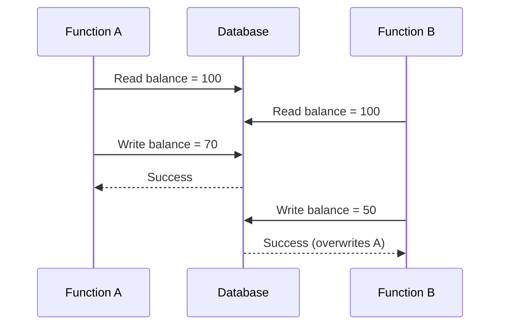

# Conditional write, optimistic locking và kiểm soát phiên bản

Java serverless function thường xử lý nhiều request hoặc message đồng thời. Hai invocation có thể cùng đọc một bản ghi, cùng tính toán trên giá trị cũ rồi ghi kết quả theo thứ tự bất kỳ. Nếu lần ghi sau ghi đè lần ghi trước, hệ thống gặp **lost update**: một thay đổi hợp lệ bị mất dù cả hai function đều trả về thành công.

Conditional write và optimistic locking giúp chỉ ghi dữ liệu khi trạng thái hiện tại vẫn thỏa điều kiện đã quan sát. Kiểm soát phiên bản giúp phát hiện dữ liệu đã thay đổi, bảo vệ cập nhật đồng thời và cho phép API/event xác định rõ phiên bản mà client hoặc consumer đang xử lý. Đây là các cơ chế quan trọng trong môi trường serverless vì nhiều instance có thể chạy song song, retry và xử lý lại cùng một event.

Trong phạm vi **CLOUD_SERVERLESS**, bài học tập trung vào phát triển và triển khai ứng dụng serverless, đặc biệt là Java function kích hoạt bởi HTTP, message hoặc event. Người học xử lý trigger, trạng thái, quyền truy cập, retry, idempotency, cold start, mở rộng và chi phí. Bài này trình bày cách bảo vệ tính đúng đắn dữ liệu bằng conditional write, optimistic locking và versioning ở database, API, object storage và event contract.

## 1. Vấn đề cập nhật đồng thời

Giả sử một tài khoản có số dư 100. Hai HTTP request đến gần như cùng lúc:

1. Function A đọc số dư 100.
2. Function B cũng đọc số dư 100.
3. A trừ 30 và ghi 70.
4. B trừ 50 và ghi 50.

Kết quả cuối là 50, trong khi nếu cả hai giao dịch được áp dụng tuần tự thì số dư phải là 20. Cập nhật của A đã bị B ghi đè.



Đây là lost update. Một race condition khác có thể xảy ra khi hai worker cùng kiểm tra tồn kho còn 1 sản phẩm rồi cả hai cùng xác nhận đơn hàng. Kiểm tra và cập nhật tách rời tạo ra khoảng thời gian để trạng thái thay đổi giữa hai thao tác.

## 2. Vì sao serverless dễ gặp race condition?

Serverless platform có thể chạy nhiều instance của cùng một function để xử lý burst. Với message trigger, cùng một business entity có thể nhận event từ nhiều producer hoặc bị redeliver. Với HTTP trigger, client có thể gửi hai request đồng thời hoặc retry request sau timeout.

Các nguyên nhân phổ biến:

- Hai invocation đọc cùng một version rồi cùng ghi.
- Queue giao lại message khi consumer chưa ack hoặc lock hết hạn.
- Client retry vì response bị mất dù server đã ghi thành công.
- Nhiều function cập nhật cùng một aggregate hoặc record.
- Một batch có các record cùng tác động lên cùng entity.
- Job định kỳ và request trực tuyến cùng sửa một trạng thái.

Không nên dựa vào việc một function instance thường xử lý tuần tự. Scale-out, warm instance concurrency, retry và nhiều trigger độc lập làm cho cập nhật đồng thời trở thành điều bình thường.

## 3. Conditional write là gì?

Conditional write là thao tác ghi chỉ được thực hiện khi điều kiện trên trạng thái hiện tại vẫn đúng. Điều kiện được kiểm tra nguyên tử cùng thao tác ghi bởi database hoặc storage service.

Ví dụ:

- Chỉ tạo order nếu `orderId` chưa tồn tại.
- Chỉ cập nhật bản ghi nếu `version` vẫn bằng 7.
- Chỉ trừ tồn kho nếu `availableQuantity >= requestedQuantity`.
- Chỉ ghi object nếu object chưa tồn tại hoặc ETag/generation vẫn khớp.
- Chỉ chuyển state từ `PENDING` sang `CONFIRMED` nếu state hiện tại vẫn là `PENDING`.

Điểm cốt lõi là kiểm tra và ghi phải nằm trong cùng một thao tác atomic. Mẫu đọc trước, kiểm tra trong Java rồi ghi không điều kiện vẫn có race condition:

```java
Inventory item = repository.findBySku(sku);
if (item.available() >= quantity) {
    repository.save(item.withAvailable(item.available() - quantity));
}
```

Giữa `findBySku` và `save`, một invocation khác có thể thay đổi tồn kho. Điều kiện cần được đẩy xuống database trong câu lệnh update hoặc transaction có isolation phù hợp.

## 4. Compare-and-set (CAS)

Compare-and-set là thao tác so sánh giá trị hiện tại với giá trị kỳ vọng, chỉ ghi giá trị mới nếu phép so sánh thành công.

```text
compare currentVersion with expectedVersion
if equal:
    write newValue and nextVersion
else:
    report conflict
```

CAS thường dùng version number, sequence hoặc ETag. Nếu một worker đọc version 12, một worker khác cập nhật thành version 13, lần ghi của worker đầu phải thất bại vì version hiện tại không còn là 12.

CAS không tự giải quyết nghiệp vụ conflict. Ứng dụng phải quyết định đọc lại và tính toán lại, trả `409 Conflict`/`412 Precondition Failed`, bỏ qua event cũ hay đưa message vào retry. Không nên tự động ghi đè version mới chỉ để làm request thành công.

## 5. Optimistic locking là gì?

Optimistic locking giả định xung đột không xảy ra thường xuyên. Mỗi record có một version hoặc revision. Khi đọc, ứng dụng giữ version đã quan sát. Khi ghi, database chỉ chấp nhận nếu version hiện tại vẫn bằng version đó; nếu thành công, version tăng lên.

Ví dụ một bản ghi:

| id | status | version |
|---|---|---:|
| order-42 | PENDING | 7 |

Function đọc version 7 rồi gửi update với điều kiện `version = 7`. Nếu update thành công, record thành version 8. Một function khác vẫn giữ version 7 sẽ không thể ghi đè version 8.

Optimistic locking phù hợp khi:

- Xung đột tương đối hiếm.
- Transaction ngắn.
- Không muốn giữ database lock trong khi xử lý logic hoặc gọi API bên ngoài.
- Có thể trả conflict hoặc đọc lại và tính toán lại.
- Hệ thống chạy nhiều instance và cần kiểm soát cập nhật đồng thời.

Nếu xung đột xảy ra liên tục, optimistic locking có thể tạo nhiều lần retry và lãng phí CPU/database. Khi đó cần xem lại partitioning, ownership, command serialization hoặc dùng cơ chế locking/queue phù hợp.

## 6. Pessimistic locking khác gì?

Pessimistic locking khóa record hoặc vùng dữ liệu trước khi cập nhật, giả định xung đột có khả năng xảy ra và cần ngăn worker khác sửa cùng lúc.

| Tiêu chí | Optimistic locking | Pessimistic locking |
|---|---|---|
| Cơ chế | Kiểm tra version khi ghi | Khóa dữ liệu trong transaction |
| Khi conflict | Một transaction thất bại, caller xử lý lại | Worker khác phải chờ hoặc timeout |
| Phù hợp | Xung đột ít, transaction ngắn | Xung đột cao, cần tuần tự hóa thao tác |
| Rủi ro | Retry storm nếu conflict liên tục | Deadlock, lock wait và giữ connection lâu |
| Serverless | Thường phù hợp với invocation ngắn | Cần đặc biệt cẩn thận với timeout và scale-out |

Pessimistic lock không nên được giữ trong lúc function gọi payment API hoặc chờ network. Transaction kéo dài có thể giữ connection và lock quá lâu, ảnh hưởng các invocation khác.

## 7. Conditional update trong SQL

Một cách phổ biến để cập nhật tồn kho là đưa điều kiện vào chính câu lệnh `UPDATE`:

```sql
UPDATE inventory
SET available_quantity = available_quantity - :quantity,
    version = version + 1
WHERE sku = :sku
  AND version = :expected_version
  AND available_quantity >= :quantity;
```

Ứng dụng kiểm tra số hàng được cập nhật:

- `1 row`: update thành công; version đã tăng.
- `0 rows`: record không tồn tại, version đã thay đổi hoặc không đủ tồn kho.

Nếu cần phân biệt các nguyên nhân, có thể đọc lại record trong một thao tác tiếp theo và trả lỗi nghiệp vụ tương ứng. Không nên tách điều kiện `available_quantity >= quantity` thành một câu SELECT độc lập rồi mới UPDATE.

Với database hỗ trợ transaction, có thể kết hợp nhiều conditional update trong một transaction để bảo vệ invariant giữa nhiều bảng. Cần chọn isolation level và retry policy theo database cụ thể.

## 8. Ví dụ optimistic locking với JPA `@Version`

JPA hỗ trợ optimistic locking bằng annotation `@Version`:

```java
@Entity
@Table(name = "orders")
public class OrderEntity {
    @Id
    private String id;

    @Enumerated(EnumType.STRING)
    private OrderStatus status;

    @Version
    private long version;

    // getters and domain methods
}
```

Khi entity được load và cập nhật, provider JPA sẽ đưa version vào điều kiện update. Về mặt khái niệm, câu SQL tương tự:

```sql
UPDATE orders
SET status = ?, version = version + 1
WHERE id = ? AND version = ?;
```

Nếu không có row nào được cập nhật vì version đã đổi, JPA thường báo `OptimisticLockException` hoặc exception được framework dịch sang dạng tương ứng, chẳng hạn `ObjectOptimisticLockingFailureException` trong Spring. Ứng dụng cần bắt ở ranh giới transaction và quyết định trả conflict hoặc retry toàn bộ transaction.

Không nên bắt exception rồi tiếp tục dùng persistence context đã lỗi. Transaction thường đã bị đánh dấu rollback-only; cần kết thúc transaction, đọc lại entity trong transaction mới và tính lại nghiệp vụ nếu có thể.

## 9. Conditional write với DynamoDB

DynamoDB hỗ trợ condition expression cho `PutItem`, `UpdateItem` và `DeleteItem`. Điều kiện được đánh giá nguyên tử trên item.

Ví dụ tạo item chỉ khi partition key chưa tồn tại:

```java
PutItemRequest request = PutItemRequest.builder()
        .tableName("Orders")
        .item(Map.of(
                "orderId", AttributeValue.fromS("order-42"),
                "status", AttributeValue.fromS("PENDING"),
                "version", AttributeValue.fromN("1")))
        .conditionExpression("attribute_not_exists(orderId)")
        .build();

dynamoDb.putItem(request);
```

Điều kiện trên phù hợp với create-only nếu `orderId` là key phù hợp của item. Nếu condition không thỏa, SDK ném `ConditionalCheckFailedException`. Không nên coi mọi conditional failure là lỗi hạ tầng; đây thường là conflict hoặc duplicate có thể dự đoán.

Ví dụ cập nhật chỉ khi version còn đúng:

```java
long expectedVersion = 7;
long nextVersion = expectedVersion + 1;

UpdateItemRequest request = UpdateItemRequest.builder()
        .tableName("Orders")
        .key(Map.of(
                "orderId", AttributeValue.fromS("order-42")))
        .updateExpression("SET #status = :status, #version = :nextVersion")
        .conditionExpression("#version = :expectedVersion")
        .expressionAttributeNames(Map.of(
                "#status", "status",
                "#version", "version"))
        .expressionAttributeValues(Map.of(
                ":status", AttributeValue.fromS("CONFIRMED"),
                ":expectedVersion", AttributeValue.fromN("7"),
                ":nextVersion", AttributeValue.fromN("8")))
        .build();

dynamoDb.updateItem(request);
```

Nếu version đã thay đổi, DynamoDB từ chối update. Trong ứng dụng thực tế, `expectedVersion` phải lấy từ item đã đọc, không hard-code như ví dụ. Nếu muốn tăng version mà không cần tính giá trị kế tiếp ở client, có thể dùng `SET version = version + :one` cùng condition `version = :expected`.

## 10. Atomic condition cho invariant nghiệp vụ

Version check bảo vệ khỏi ghi đè một bản ghi cũ, nhưng không tự biểu đạt mọi invariant. Ví dụ trừ tồn kho cần bảo đảm số lượng không âm. Điều kiện phải kiểm tra trực tiếp giá trị liên quan:

```text
Condition: availableQuantity >= requestedQuantity
Update:    availableQuantity = availableQuantity - requestedQuantity
```

Với SQL, dùng điều kiện trong `UPDATE`. Với DynamoDB, có thể dùng condition expression như `availableQuantity >= :requested`. Nếu thao tác cần cập nhật nhiều item liên quan, dùng transaction API của database với condition cho từng item.

Một invariant như “tổng số ghế đã đặt không vượt capacity” có thể cần counter/record tập trung hoặc transaction. Đọc từng reservation rồi cộng ở Java sẽ không bảo đảm đúng khi có nhiều invocation.

## 11. Conditional write và transaction khác nhau thế nào?

Conditional write bảo vệ một thao tác ghi theo điều kiện. Transaction gom nhiều thao tác thành một đơn vị atomic theo khả năng của database.

| Nhu cầu | Cơ chế phù hợp |
|---|---|
| Chỉ tạo record nếu chưa có | Conditional insert/put |
| Cập nhật record nếu version không đổi | Optimistic locking/CAS |
| Trừ tồn kho nếu còn đủ | Conditional update |
| Cập nhật order và ghi ledger trong cùng database | Transaction với condition |
| Cập nhật database và gửi message đến broker | Transactional outbox hoặc cơ chế tích hợp được hỗ trợ |
| Cập nhật hai hệ thống độc lập | Saga/compensation; không giả định có transaction phân tán |

Transaction không tự bảo vệ logic nếu điều kiện không được đặt đúng. Một transaction có thể chạy tuần tự nhưng vẫn cập nhật sai nếu code ghi đè giá trị mà không kiểm tra version hoặc invariant.

## 12. Xử lý optimistic locking conflict

Khi conditional write thất bại, ứng dụng cần phân loại conflict:

1. Đọc lại record và version mới.
2. Kiểm tra trạng thái hiện tại còn cho phép command không.
3. Nếu command có thể áp dụng trên trạng thái mới, tính lại kết quả.
4. Nếu command đã được áp dụng bởi invocation khác, trả kết quả idempotent hoặc bỏ qua duplicate.
5. Nếu nghiệp vụ không còn hợp lệ, trả conflict hoặc business rejection.

Không phải mọi conflict đều nên retry. Ví dụ hai request cùng đặt sản phẩm cuối cùng: một request thành công, request còn lại phải nhận `OUT_OF_STOCK`, không thể retry mãi.

Với thao tác cộng dồn có tính giao hoán, có thể dùng atomic increment thay vì đọc-sửa-ghi. Ví dụ `counter = counter + 1` thực hiện trực tiếp ở database sẽ tránh lost update so với đọc counter rồi ghi counter+1.

## 13. Retry có giới hạn sau conflict

Một số conflict là tạm thời và có thể giải quyết bằng cách đọc lại rồi thử lại. Dùng retry có giới hạn, backoff và jitter để tránh nhiều worker cùng retry liên tục.

```java
int maxAttempts = 3;

for (int attempt = 1; attempt <= maxAttempts; attempt++) {
    Order current = repository.findById(orderId)
            .orElseThrow(OrderNotFoundException::new);

    if (current.isConfirmed()) {
        return current; // already achieved the requested state
    }

    try {
        return repository.confirmIfVersionMatches(
                orderId, current.version());
    } catch (OptimisticConflictException conflict) {
        if (attempt == maxAttempts) {
            throw conflict;
        }
        backoffWithJitter(attempt);
    }
}

throw new IllegalStateException("Unreachable");
```

Đây là skeleton minh họa. `backoffWithJitter` không nên sleep lâu trong một serverless invocation vì sẽ giữ thời gian tính phí và concurrency slot. Nếu conflict thường xuyên, có thể trả retryable response, đưa command vào queue theo key hoặc thiết kế lại ownership để serialize các cập nhật cùng aggregate.

## 14. Versioning cho HTTP API bằng ETag và If-Match

HTTP API có thể dùng ETag làm validator cho representation. Client đọc resource, nhận ETag, rồi gửi ETag đó trong header `If-Match` khi cập nhật. Server chỉ thực hiện update nếu representation hiện tại vẫn khớp validator.

Ví dụ response:

```http
HTTP/1.1 200 OK
ETag: "order-42-v7"
Content-Type: application/json

{
  "id": "order-42",
  "status": "PENDING",
  "version": 7
}
```

Client gửi cập nhật:

```http
PATCH /orders/order-42
If-Match: "order-42-v7"
Content-Type: application/json

{"status":"CONFIRMED"}
```

Nếu version hiện tại vẫn là 7, server thực hiện conditional update và trả ETag mới, ví dụ `"order-42-v8"`. Nếu resource đã đổi, server trả `412 Precondition Failed`. Nếu API yêu cầu client luôn gửi precondition nhưng header bị thiếu, có thể dùng `428 Precondition Required`.

`If-Match` dùng strong comparison; weak ETag dạng `W/"..."` không phù hợp cho điều kiện cập nhật này. ETag cần đại diện ổn định cho version hoặc representation. Không dùng một ETag tùy ý không được liên kết với trạng thái lưu trữ.

## 15. Phân biệt 409 Conflict và 412 Precondition Failed

Hai mã HTTP thường gặp nhưng ý nghĩa khác nhau:

- `412 Precondition Failed`: một điều kiện HTTP như `If-Match` không thỏa; client có thể GET resource mới rồi quyết định gửi lại.
- `409 Conflict`: command xung đột với trạng thái nghiệp vụ hiện tại, ví dụ không thể chuyển order từ `CANCELLED` sang `CONFIRMED`.

Không nên trả 200 cho update bị mất do version conflict. Response cần giúp client biết có thể đọc lại, sửa command hay dừng thao tác.

## 16. Versioning trong object storage

Object storage thường cung cấp version ID, generation hoặc ETag/precondition để ngăn ghi đè ngoài ý muốn.

| Nền tảng | Cơ chế thường dùng | Ứng dụng |
|---|---|---|
| Amazon S3 | Versioning, version ID và conditional request headers được hỗ trợ cho thao tác cụ thể | Giữ nhiều object version, đọc đúng bản hoặc tạo object khi chưa tồn tại |
| Google Cloud Storage | Generation number và generation-match precondition | Chỉ cập nhật/xóa nếu object vẫn ở generation mong đợi |
| Azure Blob Storage | ETag và conditional headers như `If-Match` | Ghi/xóa khi ETag vẫn khớp |

Không giả định ETag của mọi object storage là MD5 hoặc có cùng semantics giữa các provider. Hãy dùng precondition API được nhà cung cấp hỗ trợ và giữ nguyên generation/version ID cần thiết.

Nếu function xử lý object upload bất đồng bộ, event nên chứa bucket/container, object key và version/generation cụ thể khi provider cung cấp. Nếu chỉ lưu key, object có thể bị ghi đè trước khi worker đọc và worker sẽ xử lý nội dung khác với nội dung đã phát sinh event.

## 17. Versioning cho event và message contract

Entity version và event schema version là hai khái niệm khác nhau:

- Entity version cho biết bản ghi/aggregate đã thay đổi bao nhiêu lần.
- Schema version cho biết cấu trúc payload tuân theo phiên bản hợp đồng nào.
- Event sequence/version cho biết vị trí hoặc thứ tự sự kiện của aggregate nếu domain có định nghĩa.

Ví dụ event:

```json
{
  "eventId": "evt-9001",
  "eventType": "OrderConfirmed",
  "schemaVersion": 2,
  "aggregateId": "order-42",
  "aggregateVersion": 8,
  "occurredAt": "2026-11-17T09:30:00Z",
  "data": {
    "status": "CONFIRMED"
  }
}
```

Consumer có thể dùng `aggregateVersion` để phát hiện event cũ, event bị thiếu hoặc event đến sai thứ tự. Tuy nhiên, chỉ bỏ qua event có version nhỏ hơn là đúng khi consumer có thể xác định trạng thái mới hơn đã được áp dụng và event không chứa side effect độc lập cần thực hiện.

Schema version cần có compatibility policy. Thêm field optional thường dễ tương thích hơn đổi kiểu hoặc xóa field. Với breaking change, có thể phát version mới, dual-read hoặc chuyển consumer theo giai đoạn.

## 18. Bảo vệ consumer khỏi event cũ và sai thứ tự

Message broker có thể bảo đảm ordering trong một phạm vi nhất định, ví dụ FIFO group, session hoặc partition key. Ordering thường không được bảo đảm trên toàn bộ hệ thống hoặc giữa nhiều queue.

Một consumer có thể lưu `lastAppliedVersion` cho từng aggregate:

```text
if event.aggregateVersion <= storedVersion:
    classify as duplicate or stale
else if event.aggregateVersion == storedVersion + 1:
    apply event and advance version atomically
else:
    detect gap; defer, retry or reconcile
```

Việc kiểm tra version và cập nhật projection phải atomic. Nếu consumer đọc `storedVersion`, sau đó ghi projection và version trong hai thao tác riêng, hai invocation vẫn có thể race. Dùng transaction hoặc conditional update để bảo vệ cả state và cursor.

Nếu event version nhảy từ 8 lên 10, consumer cần biết event 9 có bị thiếu hay domain cho phép bỏ qua. Không nên tự động áp dụng event 10 nếu invariant yêu cầu xử lý tuần tự.

## 19. Versioning không thay thế idempotency

Version giúp phát hiện state đã thay đổi; idempotency giúp một command/event được áp dụng tối đa một lần theo một key trong phạm vi nghiệp vụ xác định. Hai cơ chế thường cần dùng cùng nhau.

Ví dụ cùng một event `OrderConfirmed` được giao lại hai lần:

- Idempotency key nhận diện event đã xử lý.
- Aggregate version bảo đảm event không ghi đè state mới hơn.
- Transaction bảo đảm cập nhật projection và lưu processed-event marker cùng nhau.

Nếu chỉ dùng version, một event duplicate có thể gây side effect bên ngoài trước khi version conflict được phát hiện. Nếu chỉ dùng idempotency marker nhưng ghi marker và business state không atomic, một lần crash có thể tạo trạng thái không nhất quán.

## 20. Conditional create và idempotency key

Với HTTP request tạo order, có thể lưu idempotency key cùng kết quả để client retry an toàn. Tạo record key bằng unique constraint hoặc conditional put:

```sql
CREATE TABLE idempotency_records (
    idempotency_key VARCHAR(200) PRIMARY KEY,
    request_hash VARCHAR(128) NOT NULL,
    response_body JSON NOT NULL,
    created_at TIMESTAMP NOT NULL
);
```

Khi request đến:

1. Tìm key đã tồn tại.
2. Nếu chưa có, tạo record và thực hiện nghiệp vụ trong transaction phù hợp.
3. Nếu key đã tồn tại với cùng request hash, trả lại kết quả đã lưu.
4. Nếu cùng key nhưng payload khác, trả conflict; không dùng key cũ cho một command khác.

Với workflow bất đồng bộ, record idempotency có thể lưu operation ID và trạng thái `PENDING`, sau đó được cập nhật khi hoàn tất. Cần có retention policy cho key để không giữ dữ liệu vô hạn hoặc xóa quá sớm trong khi client vẫn retry.

## 21. Kết hợp conditional write với transactional outbox

Nếu một request cập nhật database rồi publish event, có thể xảy ra:

- Database commit thành công nhưng publish thất bại.
- Publish thành công nhưng response bị mất và producer publish lại.
- Function timeout giữa hai bước.

Transactional outbox ghi business state và outbox row trong cùng database transaction. Một relay đọc outbox rồi publish event; consumer idempotent xử lý duplicate.

Conditional write có thể bảo vệ state transition:

```sql
BEGIN;

UPDATE orders
SET status = 'CONFIRMED', version = version + 1
WHERE id = :order_id
  AND status = 'PENDING'
  AND version = :expected_version;

-- Chỉ khi đúng một row được cập nhật:
INSERT INTO outbox_events(event_id, aggregate_id, aggregate_version, payload)
VALUES (:event_id, :order_id, :next_version, :payload);

COMMIT;
```

Ứng dụng phải kiểm tra số row update trước khi insert outbox. Nếu update không thành công, rollback transaction và xử lý conflict. SQL minh họa cần được triển khai trong stored procedure hoặc transaction code để nhánh kiểm tra row count diễn ra trước insert.

## 22. Xử lý conflict trong Java serverless

Một function nên phân biệt conflict do client, conflict do duplicate và conflict do race nội bộ:

| Ngữ cảnh | Cách xử lý |
|---|---|
| HTTP `If-Match` không khớp | Trả 412; client đọc lại và quyết định |
| Command không hợp lệ với state hiện tại | Trả 409/business rejection |
| Duplicate idempotency key cùng payload | Trả kết quả cũ hoặc operation ID hiện tại |
| Duplicate key khác payload | Trả conflict và ghi audit |
| Optimistic lock transient | Đọc lại và retry có giới hạn nếu command còn hợp lệ |
| Event cũ | Bỏ qua có ghi nhận nếu version/state chứng minh đã áp dụng |
| Event version gap | Retry/defer hoặc reconciliation theo ordering contract |
| Tồn kho không đủ | Trả business rejection; không retry vô hạn |

Không trả 500 cho mọi conditional failure. Conflict thường là tình huống cạnh tranh bình thường và cần được quan sát riêng khỏi lỗi database/network.

## 23. Version field cần được tăng ở đâu?

Version phải được tăng bởi cơ chế ghi có quyền quyết định thứ tự cập nhật. Có một số lựa chọn:

- Database tự tăng version trong câu lệnh update.
- JPA provider tăng `@Version` khi flush.
- Application tính `nextVersion` nhưng update có điều kiện trên `expectedVersion`.
- Event store cấp sequence/version cho mỗi event của aggregate.

Không để nhiều writer tự tăng version theo cách không atomic. Nếu hai function cùng đọc version 7 rồi đều ghi version 8 mà không có condition, version không giúp phát hiện conflict.

Version number thường là số nguyên tăng đơn điệu theo entity. Timestamp không phải lúc nào cũng là version tốt vì clock skew, độ phân giải thời gian và hai update cùng timestamp. Nếu cần phân biệt writer phân tán, có thể dùng sequence được cấp bởi storage hoặc version token có quy tắc rõ.

## 24. Schema migration và version compatibility

Khi thay đổi schema database hoặc event payload, code mới và cũ có thể cùng chạy trong quá trình rollout. Điều này đặc biệt phổ biến khi serverless scale-out và deployment theo revision/canary.

Thực hành:

1. Thêm field mới theo cách backward-compatible.
2. Deploy consumer có thể đọc cả schema cũ và mới.
3. Producer bắt đầu ghi field mới sau khi consumer đã sẵn sàng.
4. Backfill dữ liệu nếu cần.
5. Quan sát số record/event còn dùng schema cũ.
6. Chỉ xóa field cũ trong release sau khi không còn consumer cũ.

Không dùng cùng một `version` field cho entity concurrency và schema migration. Một bản ghi có thể đang ở entity version 42 nhưng payload vẫn theo schema version 2.

## 25. Kiểm thử conditional write và optimistic locking

Unit test với mock có thể kiểm tra application service truyền expected version đúng, nhưng không chứng minh database thực sự thực hiện điều kiện atomic. Cần integration test với database engine hoặc emulator tương ứng.

Các test quan trọng:

- Hai transaction cùng đọc version N; chỉ một update thành công.
- Update với version cũ bị từ chối.
- Create-only không ghi đè record đã tồn tại.
- Inventory không bao giờ âm khi nhiều request đặt hàng đồng thời.
- Hai request cùng idempotency key chỉ tạo một business effect.
- Event duplicate không tạo side effect thứ hai.
- Event version gap được defer hoặc xử lý theo contract.
- HTTP `If-Match` khớp trả success và ETag mới; mismatch trả 412.
- Object update với generation/ETag cũ bị từ chối.

Concurrency test nên dùng barrier/latch để đồng bộ hai worker cùng đọc một version trước khi cả hai thử ghi. Test tuần tự thông thường khó tái tạo lost update.

## 26. Observability cho conflict và version

Theo dõi conflict riêng để biết optimistic locking đang hoạt động như thiết kế hay bị quá tải:

- Conditional check failure count theo operation/table.
- Optimistic lock exception count.
- Conflict retry count và số attempt trung bình.
- Tỷ lệ command bị từ chối vì state không còn hợp lệ.
- Duplicate event/idempotency suppression count.
- Event stale/gap count.
- Version lag giữa producer, consumer và projection.
- Thời gian transaction và lock wait.

Không gắn entity ID hoặc idempotency key làm metric label vì cardinality tăng cao. Dùng log có cấu trúc và trace để tra một record cụ thể. Log version trước/sau và operation ID, nhưng tránh ghi payload nhạy cảm.

Nếu conflict rate tăng đột biến, có thể một aggregate đang nhận quá nhiều update đồng thời, partition key phân bố không đều hoặc nhiều consumer cùng sở hữu một record. Tăng retry count thường không giải quyết nguyên nhân gốc.

## 27. Các lỗi thường gặp

| Lỗi | Hậu quả | Cách xử lý |
|---|---|---|
| Read rồi ghi không điều kiện | Lost update | Conditional update hoặc transaction |
| Version có nhưng không kiểm tra khi ghi | Không phát hiện stale write | CAS/WHERE version = expected |
| Tăng version ở application không atomic | Hai writer ghi cùng version kế tiếp | Tăng version trong conditional update |
| Retry conflict vô hạn | Tốn tài nguyên và tạo contention | Giới hạn retry, backoff, xem lại ownership |
| Bắt optimistic exception trong transaction lỗi rồi tiếp tục | Dùng persistence context/transaction không còn hợp lệ | Rollback và retry trong transaction mới |
| Dùng timestamp làm version mà không có quy tắc | Trùng hoặc đảo thứ tự do clock skew | Dùng sequence/version token atomic |
| Chỉ dùng idempotency, không transaction với business state | Marker và dữ liệu có thể lệch nhau | Ghi atomic hoặc dùng outbox/state machine |
| Chỉ dùng entity version cho schema version | Consumer đọc sai contract | Tách entity, event sequence và schema version |
| Object event chỉ có key mutable | Worker đọc nhầm object version | Gắn version ID/generation vào event |
| Coi mọi conditional failure là server error | Alert sai và retry không cần thiết | Phân loại conflict và business rejection |

## 28. Quy trình áp dụng cho Java function

1. **Xác định invariant:** nêu rõ điều gì không được xảy ra, ví dụ số dư âm hoặc order chuyển state sai.
2. **Xác định writer:** liệt kê HTTP handler, queue worker, scheduled job và service khác cùng cập nhật dữ liệu.
3. **Chọn cơ chế atomic:** conditional update, CAS, transaction hoặc pessimistic lock phù hợp.
4. **Thêm version:** entity version, aggregate sequence hoặc storage generation theo nhu cầu.
5. **Thiết kế conflict response:** 409, 412, business rejection, retry hoặc defer.
6. **Kết hợp idempotency:** bảo vệ duplicate delivery và client retry.
7. **Giữ side effect nhất quán:** dùng transaction/outbox hoặc compensation.
8. **Version hóa contract:** schema version độc lập với entity version.
9. **Kiểm thử concurrency:** buộc hai worker tranh cùng một version và xác minh chỉ một writer thắng.
10. **Theo dõi conflict:** đo conditional failure, retry, stale event và version lag.

## 29. Checklist production

| Câu hỏi | Bằng chứng cần có |
|---|---|
| Invariant nghiệp vụ đã được xác định? | Rule rõ ràng và test tương ứng |
| Mọi writer có cùng cơ chế bảo vệ? | HTTP, queue, scheduler và admin path được rà soát |
| Conditional check có atomic? | Điều kiện nằm trong update/transaction tại storage |
| Version có được kiểm tra khi ghi? | CAS/WHERE version = expected hoặc `@Version` |
| Version tăng atomic? | Database/provider kiểm soát next version |
| Conflict được phân loại? | Duplicate, stale, business conflict và transient conflict riêng |
| Retry có giới hạn? | Max attempts, deadline và backoff/jitter |
| Idempotency có bền vững? | Unique key/conditional put và retention policy |
| Side effect được bảo vệ? | Transactional outbox, provider idempotency hoặc compensation |
| HTTP API có precondition? | ETag/If-Match và 412/428 theo contract |
| Object event chỉ rõ phiên bản? | Version ID/generation hoặc immutable object reference |
| Event schema và entity version tách biệt? | Contract registry/schema policy và aggregate sequence |
| Concurrency test đã chạy? | Hai writer cùng version, chỉ một update thành công |
| Có metric conflict/version lag? | Dashboard và alert theo operation |
| Có runbook xử lý contention? | Cách giảm writer, defer event và reconcile dữ liệu |

Conditional write bảo vệ điều kiện tại thời điểm ghi; optimistic locking phát hiện một worker đang dùng phiên bản cũ; versioning giúp API, event và object storage xác định chính xác trạng thái mà chúng tham chiếu. Trong Java serverless, các cơ chế này phải được thực hiện ở storage hoặc transaction có tính atomic, bởi nhiều invocation có thể chạy đồng thời và retry bất kỳ lúc nào. Kết hợp chúng với idempotency, event ordering và observability sẽ giúp hệ thống tránh lost update, duplicate side effect và trạng thái nghiệp vụ không nhất quán khi scale-out.
