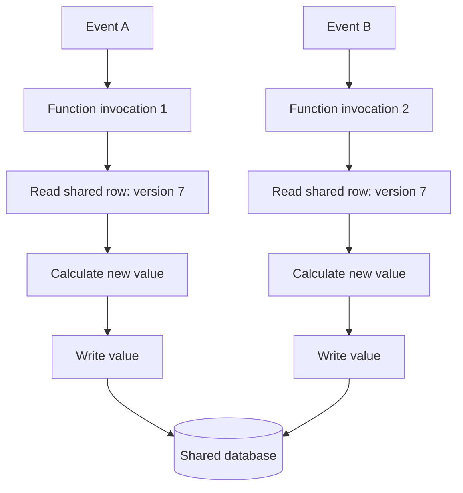
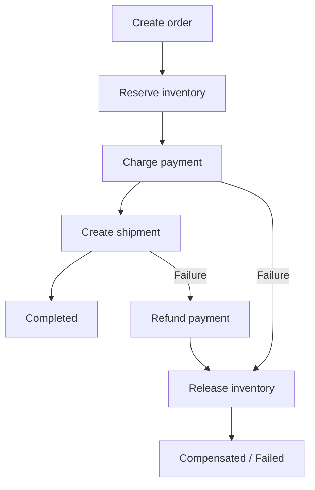

# Xử lý cạnh tranh dữ liệu và lost update giữa các function

Trong môi trường serverless, nhiều invocation của cùng một Java function có thể chạy đồng thời trên các execution environment khác nhau. Các invocation có thể cùng đọc một giá trị, cùng tính toán rồi ghi kết quả trở lại. Nếu thao tác đọc-sửa-ghi không được bảo vệ, lần ghi sau có thể ghi đè kết quả của lần ghi trước. Dữ liệu cuối cùng khi đó không phản ánh tất cả thao tác đã được chấp nhận.

Hiện tượng này thường được gọi là **lost update**. Nó là một dạng race condition: kết quả phụ thuộc vào thứ tự xen kẽ của các thao tác đồng thời. Trong serverless, tăng concurrency, retry, queue redelivery và nhiều function khác nhau cùng cập nhật một aggregate làm rủi ro này xuất hiện thường xuyên hơn.

Bài này giải thích cách nhận diện và xử lý cạnh tranh dữ liệu giữa các function. Các kỹ thuật chính gồm atomic update, transaction, optimistic locking, pessimistic locking, version/CAS, unique constraint và conditional write. Ta cũng xem xét event ordering, idempotency, distributed lock, giới hạn của state trong JVM và cách kiểm thử race condition bằng Java.

## 1. Vì sao serverless dễ gặp cạnh tranh dữ liệu?

### 1.1. Một function có thể có nhiều invocation đồng thời

Function là đơn vị thực thi, không phải một tiến trình duy nhất được đảm bảo chạy tuần tự. Khi traffic tăng, nền tảng có thể tạo nhiều execution environment. Hai invocation của cùng một handler có thể chạy cùng lúc trên hai JVM khác nhau và cùng truy cập một database row hoặc một document.



Hai invocation không chia sẻ heap, monitor hay `synchronized` lock. Dữ liệu dùng chung thường nằm ở database, object storage, cache, queue hoặc dịch vụ bên ngoài. Vì vậy, đồng bộ hóa chỉ trong một JVM không bảo vệ được dữ liệu trước các invocation khác.

### 1.2. Những nguồn concurrency thường gặp

- Hai HTTP request cập nhật cùng một tài khoản hoặc đơn hàng.
- Hai message consumer nhận event cho cùng một aggregate.
- Queue giao lại message khi invocation trước đã ghi database nhưng chưa acknowledge.
- Hai function khác nhau cùng cập nhật một record: một function xử lý thanh toán, function khác xử lý hoàn tiền.
- Một workflow chạy hai nhánh song song rồi ghi về cùng một trạng thái.
- Scheduled function và request-driven function cùng chạy tác vụ đối soát.
- Client gửi request lặp trong khi request đầu tiên vẫn đang xử lý.

Không chỉ function giống nhau mới gây race. Bất kỳ producer/consumer nào ghi vào cùng dữ liệu đều có thể cạnh tranh.

### 1.3. Ví dụ lost update

Giả sử số dư tài khoản là 100. Hai invocation cùng thực hiện thao tác cộng 10:

| Thời điểm | Invocation A | Invocation B | Số dư trong DB |
| --- | --- | --- | ---: |
| T1 | Đọc 100 |  | 100 |
| T2 |  | Đọc 100 | 100 |
| T3 | Tính 100 + 10 = 110 |  | 100 |
| T4 |  | Tính 100 + 10 = 110 | 100 |
| T5 | Ghi 110 |  | 110 |
| T6 |  | Ghi 110 | 110 |

Kết quả đúng phải là 120 nhưng database còn 110. Một lần cập nhật đã bị mất.

Code dễ gây lỗi:

```java
Account account = repository.findById(accountId);
account.setBalance(account.getBalance() + amount);
repository.save(account);
```

Đoạn code có thể đúng trong một request đơn lẻ, nhưng không an toàn khi nhiều invocation chạy đồng thời nếu repository thực hiện read và write riêng biệt mà không có transaction/locking phù hợp.

### 1.4. Lost update không phải duplicate delivery

Hai khái niệm cần tách biệt:

- **Duplicate delivery:** cùng một event/request được giao nhiều lần.
- **Lost update:** hai thao tác hợp lệ, có thể có event ID khác nhau, cùng đọc và ghi đè dữ liệu dựa trên một trạng thái cũ.

Idempotency giúp một operation lặp không tạo side effect lặp. Nó không tự giải quyết hai operation khác nhau cùng cập nhật một giá trị. Ngược lại, optimistic locking có thể phát hiện xung đột nhưng không tự nhận diện cùng một event bị giao lại. Hệ thống thường cần cả hai.

## 2. Các anomaly dữ liệu liên quan

### 2.1. Dirty read

Một transaction đọc dữ liệu mà transaction khác đã ghi nhưng chưa commit. Nếu transaction ghi sau đó rollback, transaction đọc có thể đã sử dụng dữ liệu không bao giờ trở thành trạng thái chính thức.

### 2.2. Non-repeatable read

Một transaction đọc cùng một row hai lần nhưng nhận giá trị khác nhau vì transaction khác đã commit update giữa hai lần đọc.

### 2.3. Phantom read

Một transaction chạy cùng điều kiện truy vấn hai lần nhưng lần sau thấy thêm hoặc mất các row do transaction khác insert/delete phù hợp điều kiện.

### 2.4. Write skew

Hai transaction đọc cùng một tập dữ liệu và cập nhật các row khác nhau. Mỗi transaction riêng lẻ có thể hợp lệ, nhưng kết quả kết hợp vi phạm invariant. Ví dụ hệ thống cần luôn có ít nhất một bác sĩ trực: hai transaction cùng đọc thấy hai bác sĩ đang trực, rồi mỗi transaction tắt trạng thái của một người khác nhau. Cả hai commit có thể khiến không còn ai trực.

### 2.5. Tổng hợp các lỗi

| Anomaly | Mô tả | Biện pháp thường dùng |
| --- | --- | --- |
| Lost update | Ghi mới dựa trên giá trị cũ làm mất cập nhật khác | Atomic update, version/CAS, lock hoặc isolation phù hợp |
| Dirty read | Đọc dữ liệu chưa commit | Isolation level ngăn dirty read |
| Non-repeatable read | Cùng row cho kết quả khác trong một transaction | Repeatable read hoặc snapshot semantics phù hợp |
| Phantom read | Tập row thỏa điều kiện thay đổi | Serializable, predicate/range locking tùy DB |
| Write skew | Nhiều row thay đổi riêng nhưng phá invariant chung | Serializable hoặc khóa/constraint bảo vệ invariant |
| Duplicate side effect | Một logical operation được thực hiện nhiều lần | Idempotency key, inbox/deduplication, unique constraint |

Tên isolation level giống nhau không bảo đảm mọi database có semantics hoàn toàn giống nhau. Cần xem tài liệu của engine và kiểm tra bằng integration test trên database production sử dụng.

## 3. Chọn chiến lược bảo vệ dữ liệu

### 3.1. Ưu tiên thao tác atomic khi nghiệp vụ đơn giản

Nếu cần cộng/trừ một giá trị, dùng một câu lệnh atomic ở database thay vì đọc rồi ghi từ Java:

```sql
UPDATE account
SET balance = balance + :amount
WHERE account_id = :accountId;
```

Database thực hiện phép cập nhật như một thao tác có kiểm soát concurrency. Hai lệnh cộng 10 sẽ cho tổng 120 nếu cả hai thành công.

Nếu cùng row còn được cập nhật qua optimistic locking, mọi đường ghi khác cũng phải tăng version atomically. Nếu một câu SQL atomic thay đổi dữ liệu nhưng không tăng version, transaction đang giữ snapshot cũ có thể vẫn cập nhật với version cũ và ghi đè kết quả mới.

### 3.2. Dùng conditional update để bảo vệ invariant

Nếu số dư không được âm:

```sql
UPDATE account
SET balance = balance - :amount,
    version = version + 1
WHERE account_id = :accountId
  AND balance >= :amount;
```

Kiểm tra số row được cập nhật. Nếu là 1, thao tác thành công; nếu là 0, tài khoản không tồn tại hoặc không đủ số dư theo trạng thái tại thời điểm update. Trong production, phân biệt hai trường hợp bằng cách phù hợp với yêu cầu nghiệp vụ, tránh read-then-write không được bảo vệ.

### 3.3. Optimistic locking

Dùng version để phát hiện row đã thay đổi kể từ lúc đọc. Update chỉ thành công nếu version vẫn bằng giá trị đã đọc. Nếu có invocation khác commit trước, update hiện tại ảnh hưởng 0 row và phải xử lý conflict.

Phù hợp khi xung đột không thường xuyên, transaction ngắn và có thể retry nghiệp vụ sau khi đọc trạng thái mới.

### 3.4. Pessimistic locking

Khóa row/resource trước khi đọc và sửa để transaction khác phải chờ hoặc thất bại khi lock timeout. Phù hợp khi xung đột thường xuyên và critical section ngắn, nhưng có thể làm giảm throughput, gây deadlock hoặc giữ connection trong thời gian dài.

### 3.5. Constraint và transaction

Unique constraint, foreign key, check constraint và transaction giúp bảo vệ invariant ngay tại persistence boundary. Kiểm tra ở Java là hữu ích cho thông báo sớm, nhưng không thay thế constraint khi nhiều invocation có thể chạy đồng thời.

### 3.6. Bảng lựa chọn

| Tình huống | Chiến lược khởi đầu |
| --- | --- |
| Cộng counter đơn giản | Atomic increment hoặc sharded counter nếu một row quá nóng |
| Chỉnh sửa document theo version | Optimistic locking/CAS |
| Trừ tồn kho/số dư với điều kiện | Conditional atomic update trong transaction |
| Nhiều bước cần đọc và cập nhật một nhóm row | Transaction với isolation/locking phù hợp |
| Tạo resource không được trùng | Unique constraint + xử lý conflict/idempotency |
| Xung đột rất thường xuyên trên một aggregate | Single-writer, queue theo key hoặc pessimistic lock có giới hạn |
| Nhiều service cập nhật một quy trình dài | State machine/Saga, không giữ DB transaction qua network |

## 4. Atomic update trong SQL

### 4.1. Cộng/trừ trực tiếp ở database

Đối với counter, dùng phép toán tại database:

```sql
UPDATE product_counter
SET view_count = view_count + 1
WHERE product_id = :productId;
```

Database tránh việc ứng dụng đọc một giá trị cũ rồi ghi lại. Tuy nhiên, một row rất nóng vẫn có thể trở thành điểm tranh chấp/serialization. Atomic không có nghĩa throughput vô hạn.

### 4.2. Conditional update cho tồn kho

```sql
UPDATE inventory
SET available_quantity = available_quantity - :quantity,
    version = version + 1
WHERE sku = :sku
  AND available_quantity >= :quantity;
```

Nếu hai đơn hàng cùng mua 4 sản phẩm khi còn 5, chỉ một update có thể thành công. Update còn lại thấy điều kiện `available_quantity >= 4` không còn đúng sau khi transaction đầu commit.

### 4.3. Tạo mới với unique constraint

Không dùng mẫu:

```text
if record does not exist:
    insert record
```

như một bảo đảm duy nhất khi check và insert là hai thao tác riêng. Hai invocation có thể cùng thấy chưa tồn tại rồi cùng insert.

Đặt unique constraint:

```sql
CREATE UNIQUE INDEX uq_payment_provider_ref
ON payment(provider_reference);
```

Sau đó insert và xử lý unique violation như một kết quả cạnh tranh bình thường. Nếu đây là duplicate của cùng operation, trả lại kết quả trước; nếu là xung đột nghiệp vụ khác, trả lỗi phù hợp.

### 4.4. Upsert không tự động giải quyết mọi race

`INSERT ... ON CONFLICT DO UPDATE` hoặc upsert tương tự có thể bảo vệ thao tác tạo/cập nhật một row. Nhưng biểu thức update vẫn phải giữ invariant. Ví dụ upsert ghi đè `balance = excluded.balance` có thể gây lost update nếu `excluded.balance` được tính từ snapshot cũ. Dùng phép cộng atomic hoặc điều kiện version khi phù hợp.

## 5. Optimistic locking với version/CAS

### 5.1. Compare-and-set

CAS (compare-and-set) cập nhật giá trị chỉ khi trạng thái hiện tại còn bằng giá trị/version mong đợi:

```sql
UPDATE orders
SET status = :newStatus,
    version = version + 1
WHERE order_id = :orderId
  AND version = :expectedVersion;
```

Nếu update count là 1, caller đã thắng cuộc đua. Nếu bằng 0, dữ liệu đã đổi hoặc record không tồn tại. Caller phải đọc lại và quyết định có thể áp dụng command trên trạng thái mới hay không.

### 5.2. Java repository với version

```java
import java.util.ConcurrentModificationException;

public record VersionedAccount(
        String accountId,
        long balance,
        long version) {
}

public interface AccountRepository {
    VersionedAccount find(String accountId);

    boolean updateBalance(
            String accountId,
            long expectedVersion,
            long newBalance);
}

public final class AccountService {
    private final AccountRepository repository;

    public AccountService(AccountRepository repository) {
        this.repository = repository;
    }

    public void deposit(String accountId, long amount) {
        if (amount <= 0) {
            throw new IllegalArgumentException("amount must be positive");
        }

        VersionedAccount current = repository.find(accountId);
        long nextBalance = Math.addExact(current.balance(), amount);

        boolean updated = repository.updateBalance(
                accountId,
                current.version(),
                nextBalance);

        if (!updated) {
            throw new ConcurrentModificationException(
                    "Account changed; reload and retry the operation");
        }
    }
}
```

Repository implementation cần thực hiện một conditional SQL update và tăng version atomically. Không được triển khai `updateBalance` bằng cách đọc version rồi ghi riêng hai câu lệnh không có điều kiện.

### 5.3. Xử lý conflict

Khi version mismatch:

1. Không tiếp tục ghi giá trị đã tính từ snapshot cũ.
2. Đọc trạng thái mới trong transaction mới.
3. Xác nhận command còn hợp lệ với trạng thái mới.
4. Tính lại kết quả.
5. Thử lại với giới hạn và backoff nếu nghiệp vụ cho phép.
6. Nếu conflict liên tục, trả conflict hoặc chuyển sang queue/single-writer.

Không retry mù quáng cùng câu `UPDATE ... WHERE version = oldVersion`; nó sẽ tiếp tục ảnh hưởng 0 row.

### 5.4. Retry phải tạo transaction mới

Trong nhiều ORM/database, transaction đã gặp optimistic locking exception có thể ở trạng thái rollback-only. Không bắt exception rồi tiếp tục query/update trong cùng transaction như thể transaction vẫn hợp lệ. Hãy rollback và bắt đầu transaction mới, đọc lại dữ liệu rồi áp dụng lại command.

### 5.5. JPA `@Version`

JPA hỗ trợ optimistic locking qua field `@Version`:

```java
import jakarta.persistence.Entity;
import jakarta.persistence.Id;
import jakarta.persistence.Version;

@Entity
public class InventoryItem {
    @Id
    private String sku;

    private int availableQuantity;

    @Version
    private long version;

    protected InventoryItem() {}

    public void reserve(int quantity) {
        if (quantity <= 0 || availableQuantity < quantity) {
            throw new InsufficientInventoryException(sku);
        }
        availableQuantity -= quantity;
    }
}
```

Khi ORM flush/update, nó dùng version cũ trong điều kiện update và tăng version. Nếu row đã được transaction khác cập nhật, ORM ném optimistic locking exception (tên exception cụ thể phụ thuộc JPA provider/framework).

`@Version` chỉ có tác dụng nếu mọi đường ghi liên quan tôn trọng version. Native SQL, bulk update hoặc một service khác bỏ qua version có thể phá cơ chế. Khi dùng bulk update, hãy tự thêm điều kiện version và tăng version đúng cách.

## 6. Pessimistic locking và transaction

### 6.1. `SELECT ... FOR UPDATE`

Khi cần tuần tự hóa cập nhật trên một row, có thể khóa row trong transaction:

```sql
BEGIN;

SELECT available_quantity
FROM inventory
WHERE sku = :sku
FOR UPDATE;

UPDATE inventory
SET available_quantity = available_quantity - :quantity
WHERE sku = :sku;

COMMIT;
```

Transaction khác cần khóa cùng row sẽ chờ hoặc nhận lock timeout/deadlock tùy database và cấu hình. Câu lệnh và semantics của `FOR UPDATE` khác nhau giữa các engine; hãy xác minh trên database thực tế.

### 6.2. Giữ critical section ngắn

Không giữ row lock trong lúc:

- gọi payment provider;
- gọi HTTP service khác;
- chờ queue hoặc workflow;
- upload/download object;
- thực hiện tính toán lâu;
- sleep để retry.

Giữ transaction ngắn, chỉ đọc/ghi phần dữ liệu cần thiết rồi commit. Nếu quy trình gồm nhiều service, dùng state machine/Saga và compensation thay vì giữ một database lock xuyên network.

### 6.3. Deadlock

Deadlock có thể xảy ra khi transaction A khóa row 1 rồi chờ row 2, còn transaction B khóa row 2 rồi chờ row 1. Giảm rủi ro bằng cách khóa theo thứ tự nhất quán, transaction ngắn, index phù hợp và retry toàn transaction sau deadlock với giới hạn.

Không retry chỉ một câu lệnh giữa transaction đã bị rollback. Phải thực hiện lại toàn bộ đơn vị công việc trong transaction mới và bảo đảm side effect bên ngoài chưa bị lặp.

### 6.4. Connection pool trong serverless

Nhiều execution environment có thể tạo nhiều connection pool. Nếu mỗi instance giữ pool lớn, tổng connection đến database có thể vượt giới hạn dù pool từng instance nhỏ.

Tính tổng connection theo maximum concurrency, pool size mỗi instance, background job và headroom. Cân nhắc proxy/pooling service, giới hạn concurrency và giảm pool size cho function. Pessimistic lock cộng với invocation concurrency cao có thể làm connection bị giữ lâu và cạn pool.

## 7. Isolation level và transaction boundary

### 7.1. Các mức isolation thường gặp

| Isolation level | Ý nghĩa khái quát | Lưu ý |
| --- | --- | --- |
| Read Uncommitted | Có thể thấy dữ liệu chưa commit ở engine hỗ trợ | Nhiều engine không thực sự triển khai theo cách này |
| Read Committed | Mỗi statement đọc dữ liệu đã commit | Hai lần đọc trong transaction có thể khác nhau |
| Repeatable Read | Giữ snapshot/khả năng đọc lặp tùy engine | Cách xử lý phantom/write skew khác nhau giữa DB |
| Serializable | Kết quả tương đương một thứ tự tuần tự hợp lệ | Có thể abort transaction và cần retry toàn transaction |

Đừng chọn isolation level chỉ dựa vào tên. PostgreSQL, MySQL/InnoDB, SQL Server và các database khác có chi tiết triển khai riêng. Xem tài liệu engine, isolation anomaly thực tế và test concurrent transaction.

### 7.2. Transaction phải bao trùm invariant

Nếu invariant phụ thuộc hai row, transaction phải bảo vệ cả hai. Ví dụ chuyển tiền cần debit và credit trong cùng transaction hoặc một workflow có ledger/compensation được thiết kế rõ. Chỉ khóa row debit mà không bảo vệ credit có thể để lại trạng thái không cân bằng.

### 7.3. Không kéo transaction qua invocation

Không giữ database transaction mở giữa hai lần invocation hoặc trong khi chờ event. Function có thể bị freeze/terminate; transaction dài giữ lock và connection, đồng thời không bảo đảm workflow sẽ quay lại đúng execution environment.

Với quy trình dài:

- lưu state transition bền vững;
- commit từng bước ngắn;
- dùng outbox để phát command/event;
- dùng Saga/workflow orchestrator;
- có compensation/reconciliation cho bước không thể rollback.

## 8. Conditional write trong NoSQL

### 8.1. Version condition

NoSQL database thường cung cấp conditional write hoặc compare-and-set. Ví dụ tổng quát:

```text
Update item:
  SET value = :newValue,
      version = version + 1
  CONDITION version = :expectedVersion
```

Nếu condition thất bại, ứng dụng biết một writer khác đã cập nhật item. Đọc lại và quyết định áp dụng lại command.

### 8.2. Atomic counter

Nếu chỉ cần tăng counter, dùng atomic increment/update expression của database thay vì read-modify-write trong Java. Một atomic update trên item vẫn có giới hạn throughput của item/partition; counter quá nóng có thể cần sharding.

### 8.3. Transaction nhiều item

Khi invariant trải qua nhiều item, dùng transaction API nếu database hỗ trợ và transaction có giới hạn kích thước/độ dài. Đừng giả định hai conditional write riêng biệt là atomic cùng nhau.

### 8.4. DynamoDB-style conditional update

Ví dụ pseudo-code Java SDK v2:

```java
UpdateItemRequest request = UpdateItemRequest.builder()
        .tableName("Inventory")
        .key(Map.of("sku", AttributeValue.fromS("SKU-42")))
        .updateExpression("SET available = available - :qty, version = version + :one")
        .conditionExpression("available >= :qty AND version = :expected")
        .expressionAttributeValues(Map.of(
                ":qty", AttributeValue.fromN("2"),
                ":one", AttributeValue.fromN("1"),
                ":expected", AttributeValue.fromN("7")))
        .build();

dynamoDb.updateItem(request);
```

Đây là ví dụ minh họa AWS SDK for Java v2; cần import model/client tương ứng và xử lý conditional-check failure. Nếu không cần version check nhưng chỉ cần trừ tồn kho không âm, điều kiện `available >= :qty` kết hợp update expression đã bảo vệ invariant cho thao tác này. Nếu cần phát hiện stale read hoặc kiểm soát transition, thêm version condition.

### 8.5. Single-document atomicity không đồng nghĩa multi-document transaction

Một số document database bảo đảm atomic update trên một document nhưng không mặc định bảo đảm nhiều document cùng commit. Nếu invariant trải qua nhiều document, dùng transaction được hỗ trợ hoặc thay đổi data model để aggregate nằm trong một consistency boundary.

## 9. Event ordering và nhiều function cùng cập nhật aggregate

### 9.1. Ordering không tự động toàn cục

Queue/stream thường chỉ bảo đảm ordering trong một scope nhất định, ví dụ message group hoặc partition. Hai event cho cùng order có thể được xử lý song song nếu producer chọn partition key khác nhau hoặc nhiều consumer cùng cập nhật database.

Nếu business rule cần tuần tự theo aggregate:

- partition/group key theo aggregate ID;
- chỉ có một consumer xử lý tuần tự trong scope đó;
- dùng sequence number/version trong event;
- từ chối hoặc defer event cũ đến sau;
- vẫn bảo vệ database bằng conditional update vì retry và nhiều producer có thể phá giả định ordering.

### 9.2. Version guard cho event

Event có thể mang `aggregateVersion` hoặc sequence number. Consumer chỉ áp dụng event tiếp theo khi version đúng:

```sql
UPDATE orders
SET status = :newStatus,
    version = :eventVersion
WHERE order_id = :orderId
  AND version = :eventVersion - 1;
```

Nếu update count bằng 0, event có thể là duplicate, stale hoặc đến trước event trước đó. Phải phân biệt các trường hợp: đọc version hiện tại, kiểm tra event ID đã xử lý, và đưa event out-of-order vào retry/defer/reconciliation path.

Không chỉ bỏ qua mọi event cũ; có thể còn event hợp lệ bị thiếu. Dùng inbox/sequence tracking để phát hiện gap.

### 9.3. Idempotency và concurrency control bổ sung cho nhau

| Cơ chế | Giải quyết | Không tự giải quyết |
| --- | --- | --- |
| Idempotency key | Cùng logical operation được giao lại | Hai operation khác nhau cùng cập nhật stale state |
| Optimistic version | Phát hiện writer khác đã thay đổi row | Duplicate event nếu operation không có identity |
| Atomic increment | Lost update của phép cộng đơn giản | Business invariant phức tạp trên nhiều row |
| Pessimistic lock | Tuần tự hóa critical section được khóa | Side effect ngoài transaction và lock trên nhiều service |
| Queue ordering | Giữ thứ tự trong một group/partition | Writer khác hoặc request HTTP cập nhật trực tiếp cùng row |

Thường cần kết hợp event ID/inbox, version guard và transaction.

## 10. Idempotency khi có nhiều invocation đồng thời

### 10.1. Check-then-act không an toàn

Mẫu sau có race:

```java
if (!repository.exists(eventId)) {
    repository.save(eventId);
    applyBusinessChange(event);
}
```

Hai invocation có thể cùng thấy `exists=false` trước khi một bên insert. Cần unique constraint/atomic insert-if-absent và áp dụng business change trong cùng transaction.

### 10.2. Inbox với unique key

Schema có thể dùng khóa kép:

```sql
CREATE TABLE processed_event (
    consumer_name VARCHAR(120) NOT NULL,
    event_id VARCHAR(200) NOT NULL,
    processed_at TIMESTAMP NOT NULL,
    PRIMARY KEY (consumer_name, event_id)
);
```

Transaction insert event ID; chỉ invocation insert thành công mới thực hiện side effect trong cùng transaction. Invocation thua unique constraint nhận biết duplicate và kết thúc thành công theo contract.

### 10.3. Idempotency record và trạng thái đang xử lý

Với side effect kéo dài hoặc ngoài database, có thể cần state machine:

```text
ABSENT → IN_PROGRESS → SUCCEEDED
                   ↘ FAILED_RETRYABLE
                   ↘ UNKNOWN → RECONCILING
```

Claim `IN_PROGRESS` cần lease/expiry và owner token để phục hồi khi worker chết. Nhưng lease hết hạn không chứng minh worker cũ đã dừng; fencing/version token cần ngăn worker cũ ghi đè sau khi quyền lease đã chuyển cho owner mới.

## 11. Distributed lock: dùng đúng và thận trọng

### 11.1. Khi nào cần lock phân tán?

Một distributed lock có thể hữu ích khi nhiều worker cần chọn một leader hoặc thực hiện một tác vụ độc quyền. Tuy nhiên, nếu mục tiêu chỉ là bảo vệ một row, conditional update/transaction tại database thường đơn giản và chắc chắn hơn.

### 11.2. Lease có thể hết khi worker vẫn đang chạy

Giả sử worker A lấy lock lease 30 giây nhưng bị pause 40 giây. Lease hết và worker B lấy lock mới. A tiếp tục chạy sau pause; lúc này cả A và B có thể cùng ghi dữ liệu.

Vì vậy, distributed lock dựa trên TTL không đủ nếu resource không kiểm tra fencing token.

### 11.3. Fencing token

Lock service cấp token tăng đơn điệu mỗi lần lock được cấp. Resource đích chỉ chấp nhận thao tác có token lớn hơn token đã thấy trước đó. Worker cũ có token nhỏ hơn bị từ chối dù nó tỉnh lại sau khi lease hết.

Fencing token cần được kiểm tra ở nơi dữ liệu được ghi. Chỉ lưu token trong Redis nhưng database không kiểm tra thì không ngăn stale owner ghi.

### 11.4. Những điều không nên làm

- Dùng `synchronized` hoặc `ReentrantLock` trong function để bảo vệ toàn hệ thống.
- Dùng local cache/flag như distributed lock.
- Giữ lock trong khi gọi HTTP service lâu.
- Dùng TTL ngắn nhưng không có fencing token.
- Giả định lock giải quyết duplicate event hoặc idempotency.
- Không có cơ chế release/recovery khi function bị terminate.

## 12. Giới hạn của state trong Java FaaS

### 12.1. Static field không phải shared state

Static field chỉ tồn tại trong một JVM execution environment. Các invocation chạy trên environment khác không nhìn thấy thay đổi. Environment có thể bị freeze, scale down hoặc thay thế bất kỳ lúc nào.

### 12.2. Local synchronization chỉ bảo vệ một instance

```java
public synchronized void updateBalance(...) {
    // This lock protects only callers using this object in this JVM.
}
```

Ngay cả khi tất cả invocation trong một JVM đi qua method synchronized, invocation ở JVM khác vẫn có thể cập nhật cùng row. Cơ chế đúng phải nằm tại shared persistence boundary hoặc một single-writer service/queue được thiết kế rõ.

### 12.3. Warm environment không phải hợp đồng

Không dựa vào việc function thường được gọi tuần tự trên một environment. Khi burst, nền tảng tạo thêm instance; khi idle, instance có thể bị hủy. Local cache có thể tăng hiệu năng nhưng không được dùng để bảo đảm correctness, lock toàn cục hoặc idempotency.

### 12.4. Connection pool và transaction scope

Tạo pool quá lớn trong mỗi JVM có thể làm tổng connection vượt capacity database. Transaction nên ngắn và không vượt qua invocation boundary. Dùng proxy/pooler và concurrency control nếu workload có nhiều execution environment.

## 13. Nhiều service và quy trình dài: Saga thay cho distributed transaction

### 13.1. Vì sao không giữ transaction qua nhiều function?

Một workflow có thể gồm reserve inventory, charge payment và create shipment. Mỗi bước chạy trong function khác nhau, có timeout/retry độc lập. Không thể giữ một JDBC transaction mở xuyên qua các invocation và chờ event nhiều phút.

### 13.2. Saga

Saga chia quy trình thành các transaction cục bộ và định nghĩa compensation khi bước sau thất bại:



Compensation không phải rollback vật lý. Ví dụ refund là một giao dịch mới, có thể thất bại và cần retry/đối soát riêng. Mỗi bước cần idempotency key và trạng thái bền vững.

### 13.3. State machine và conditional transition

Mỗi transition nên có điều kiện trạng thái/version:

```sql
UPDATE orders
SET status = 'PAYMENT_PENDING', version = version + 1
WHERE order_id = :id
  AND status = 'INVENTORY_RESERVED'
  AND version = :expectedVersion;
```

Nếu transition không thành công, workflow đọc trạng thái mới và quyết định resume, compensate hoặc kết thúc. Không để hai nhánh workflow cùng chuyển một order từ trạng thái cũ theo cách không xác định.

## 14. Read replica, cache và stale read

### 14.1. Read-after-write

Một function ghi vào primary rồi function khác đọc từ replica có độ trễ có thể thấy dữ liệu cũ. Nếu function dùng giá trị cũ để ghi lại, có thể tạo lost update hoặc quyết định nghiệp vụ sai.

Với thao tác cần correctness mạnh:

- đọc và conditional update trên primary/consistency boundary phù hợp;
- dùng version/ETag để phát hiện stale state;
- không dùng cache làm nguồn quyết định cho invariant quan trọng;
- chỉ chấp nhận eventual consistency khi nghiệp vụ cho phép.

### 14.2. ETag và If-Match

HTTP API có thể trả ETag đại diện version. Client gửi `If-Match` khi update; server chỉ cập nhật nếu version vẫn khớp. Nếu khác, trả `412 Precondition Failed` hoặc `409 Conflict` theo API contract.

Đây là optimistic concurrency control ở API boundary. Database vẫn phải thực hiện conditional update atomically; không chỉ so sánh ETag trong Java rồi ghi không điều kiện.

## 15. Kiểm thử cạnh tranh dữ liệu

### 15.1. Unit test không đủ

Mock repository có thể kiểm tra service xử lý conflict, nhưng không chứng minh database thật áp dụng atomic update, unique constraint, isolation hoặc lock như mong muốn. Cần integration test trên cùng loại database/engine với production.

### 15.2. Tạo concurrency test có kiểm soát

Dùng `CountDownLatch`, `CyclicBarrier` hoặc executor để nhiều worker cùng bắt đầu từ một trạng thái. Kiểm tra invariant sau khi tất cả hoàn tất.

Ví dụ khung test cho atomic increment:

```java
import static org.junit.jupiter.api.Assertions.assertEquals;

import java.util.concurrent.CountDownLatch;
import java.util.concurrent.ExecutorService;
import java.util.concurrent.Executors;
import java.util.concurrent.Future;
import java.util.concurrent.TimeUnit;
import java.util.ArrayList;
import java.util.List;
import org.junit.jupiter.api.Test;

class ConcurrentCounterIT {
    private final CounterRepository repository = createRealTestRepository();

    @Test
    void concurrentIncrementsAreNotLost() throws Exception {
        int workers = 20;
        int incrementsPerWorker = 100;
        CountDownLatch ready = new CountDownLatch(workers);
        CountDownLatch start = new CountDownLatch(1);
        ExecutorService pool = Executors.newFixedThreadPool(workers);
        List<Future<?>> tasks = new ArrayList<>();

        repository.reset("counter-1", 0);

        try {
            for (int worker = 0; worker < workers; worker++) {
                tasks.add(pool.submit(() -> {
                    ready.countDown();
                    start.await();
                    for (int i = 0; i < incrementsPerWorker; i++) {
                        repository.atomicIncrement("counter-1", 1);
                    }
                    return null;
                }));
            }

            assertEquals(true, ready.await(10, TimeUnit.SECONDS));
            start.countDown();
            pool.shutdown();
            assertEquals(true, pool.awaitTermination(30, TimeUnit.SECONDS));
            for (Future<?> task : tasks) {
                task.get(); // Propagate worker exceptions to the test thread.
            }

            assertEquals((long) workers * incrementsPerWorker,
                    repository.read("counter-1"));
        } finally {
            pool.shutdownNow();
        }
    }
}
```

`createRealTestRepository()` là fixture kết nối database test thật, ví dụ qua Testcontainers; `CounterRepository` cần gọi atomic SQL update. Trong test production-grade, lấy và kiểm tra `Future` của từng task để exception trong worker không bị bỏ qua; ví dụ trên là khung minh họa đồng bộ start barrier. Không chạy test này trên database production.

### 15.3. Test lost update có chủ đích

Tạo repository test có hai bước read và write riêng biệt, dùng barrier để buộc hai worker cùng đọc version trước khi ghi. Test phải chứng minh implementation read-modify-write không bảo vệ sẽ làm mất update, sau đó chạy lại với atomic update hoặc version/CAS và xác nhận invariant được giữ.

### 15.4. Test optimistic conflict

Kiểm tra:

- hai transaction cùng đọc version N;
- transaction A commit version N+1;
- transaction B update với version N bị từ chối;
- transaction B rollback, đọc lại và tính lại trong transaction mới;
- không có side effect bên ngoài bị lặp trong lúc retry.

### 15.5. Test lock và deadlock

Kiểm tra lock timeout, transaction rollback, deadlock victim và retry toàn transaction. Xác nhận function không giữ connection vô hạn khi lock chờ và tổng retry không vượt deadline.

### 15.6. Test event ordering và duplicate

Gửi event version N+1 trước N, duplicate event N và hai event khác nhau cùng cập nhật aggregate. Xác nhận consumer xử lý gap/stale/duplicate theo policy và invariant cuối cùng vẫn đúng.

## 16. Monitoring và vận hành

### 16.1. Metrics

Theo dõi:

- optimistic lock/version conflict rate;
- conditional write failure rate;
- unique constraint violation theo constraint;
- row lock wait và deadlock count;
- transaction retry/rollback rate;
- database connection pool saturation;
- stale event/version gap count;
- duplicate event/idempotency hit rate;
- transaction duration và query latency;
- business invariant violation/reconciliation discrepancy.

Không dùng account ID/order ID làm metric label vì cardinality cao và có thể chứa dữ liệu nhạy cảm. Dùng log/trace có kiểm soát để điều tra từng aggregate.

### 16.2. Log có cấu trúc

Các trường hữu ích:

- `operationId`, `eventId`, `correlationId`;
- `aggregateType`, định danh đã được redact/hash nếu cần;
- `expectedVersion`, `actualVersion`;
- `conflictType`, `retryAttempt`;
- `transactionDuration`, `lockWaitMs`;
- `functionVersion`, `requestId`, `traceId`;
- `result` và error category.

Không log toàn bộ payload tài chính hoặc dữ liệu cá nhân. Ghi đủ thông tin để phân biệt conflict bình thường do concurrency với lỗi cấu hình hoặc bug.

### 16.3. Alert

Alert khi:

- optimistic conflict rate tăng đột ngột;
- deadlock/lock wait vượt baseline;
- connection pool gần cạn;
- conditional update thất bại bất thường;
- version gap/stale event tăng;
- reconciliation phát hiện mất cân bằng;
- retry sau conflict tăng làm latency vượt SLA.

Conflict không nhất thiết là lỗi hệ thống; một tỷ lệ nhỏ có thể là bình thường. Alert nên dựa trên baseline, duration và business impact.

## 17. Quy trình chọn giải pháp

1. Xác định invariant nghiệp vụ: điều gì tuyệt đối không được sai?
2. Tìm tất cả writer: function, API, scheduled job, admin tool và consumer.
3. Xác định consistency boundary: một row, nhiều row, một aggregate hay nhiều service.
4. Nếu là phép toán đơn giản, ưu tiên atomic update.
5. Nếu cần phát hiện stale state, dùng version/CAS hoặc ETag.
6. Nếu critical section ngắn và contention cao, cân nhắc pessimistic lock/single-writer.
7. Nếu invariant trải nhiều row, chọn transaction/isolation/constraint phù hợp.
8. Nếu quy trình đi qua nhiều service, dùng Saga/state machine và compensation.
9. Bảo vệ duplicate delivery bằng inbox/idempotency độc lập với concurrency control.
10. Kiểm thử với database thật và nhiều invocation đồng thời.
11. Theo dõi conflict, lock wait, retries và business reconciliation sau deploy.

## 18. Checklist production

- [ ] Mọi shared state quan trọng nằm trong hệ thống lưu trữ bền vững có consistency semantics rõ.
- [ ] Không dùng static field, local cache hoặc `synchronized` làm khóa toàn hệ thống.
- [ ] Các thao tác read-modify-write đã được thay bằng atomic update, CAS hoặc transaction/lock phù hợp.
- [ ] Invariant nghiệp vụ được bảo vệ tại database bằng condition/constraint khi có thể.
- [ ] Có version column/ETag cho dữ liệu cần optimistic concurrency.
- [ ] Conflict được xử lý bằng đọc lại và tính lại, không ghi stale value.
- [ ] Retry optimistic conflict tạo transaction mới và có giới hạn.
- [ ] Pessimistic lock có timeout, transaction ngắn và thứ tự khóa nhất quán.
- [ ] Deadlock retry thực hiện lại toàn transaction, không retry một statement riêng lẻ.
- [ ] Isolation level được chọn theo semantics của database thực tế.
- [ ] Unique constraint bảo vệ thao tác create-if-absent.
- [ ] NoSQL conditional write/transaction được dùng đúng consistency boundary.
- [ ] Event ordering được xác định theo aggregate/partition/group và có sequence/version guard.
- [ ] Idempotency key/inbox xử lý duplicate độc lập với optimistic locking.
- [ ] Side effect ngoài database có provider idempotency, outbox hoặc reconciliation.
- [ ] Distributed lock nếu dùng có lease, fencing token và resource-side validation.
- [ ] Function concurrency và connection pool nằm trong downstream capacity budget.
- [ ] Không giữ transaction/lock qua network call hoặc invocation boundary.
- [ ] Có concurrency integration test trên engine tương thích production.
- [ ] Metrics/alerts theo dõi conflict, deadlock, lock wait, retry và invariant discrepancy.

## Kết luận

Lost update xảy ra khi nhiều invocation đọc cùng trạng thái cũ rồi ghi đè kết quả của nhau. Serverless làm tình huống này phổ biến vì cùng một function có thể chạy đồng thời trên nhiều execution environment; local lock hoặc static state không bảo vệ được database dùng chung.

Hãy ưu tiên atomic update cho phép toán đơn giản, conditional write/version/CAS khi cần phát hiện stale state, và transaction/locking/constraint khi invariant phức tạp hơn. Optimistic locking cần đọc lại và tính lại trong transaction mới; pessimistic locking cần critical section ngắn, timeout và kiểm soát deadlock. Với NoSQL, dùng conditional expression/atomic update theo consistency boundary mà database thực sự cung cấp.

Idempotency, event ordering và concurrency control giải quyết các vấn đề khác nhau nên thường phải kết hợp. Với workflow qua nhiều service, dùng state machine/Saga và compensation thay vì cố giữ transaction xuyên function. Cuối cùng, kiểm thử bằng nhiều invocation đồng thời trên database thật và theo dõi conflict/lock/retry metrics để chứng minh invariant vẫn được giữ khi tải tăng.
