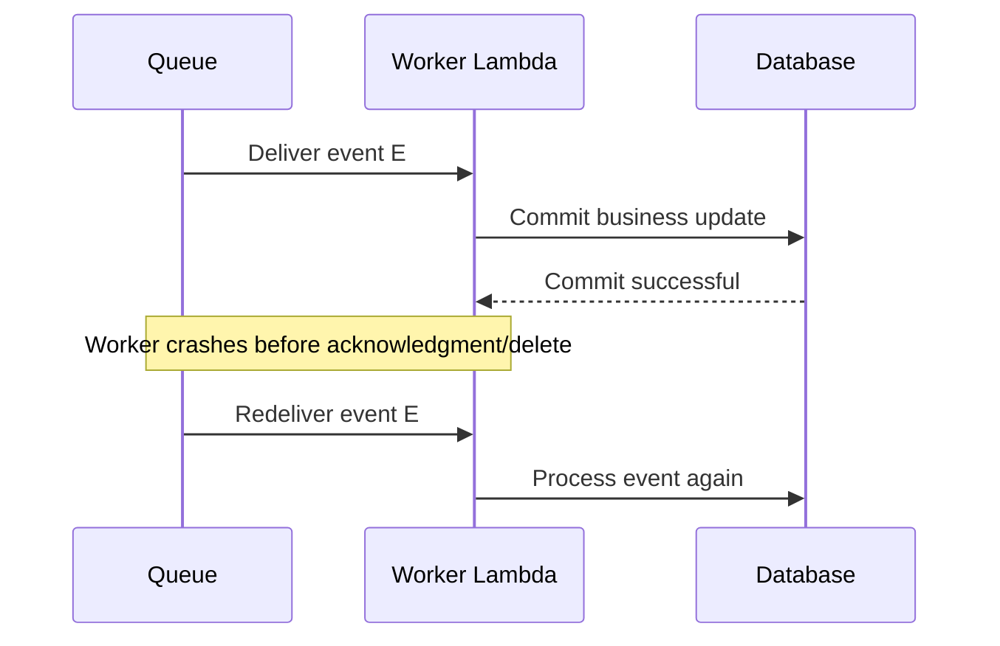
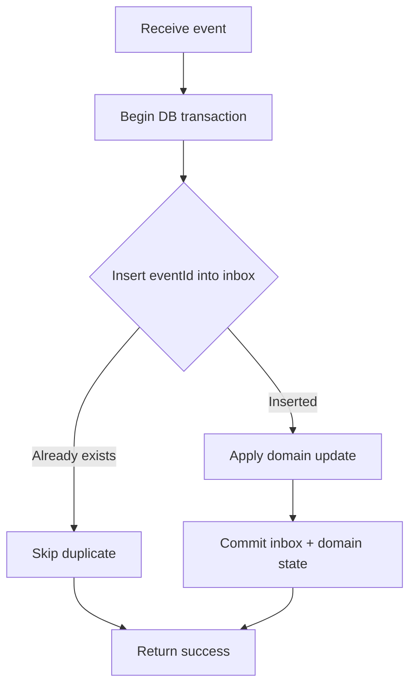
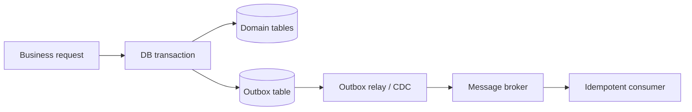

# Nhận diện giới hạn bảo đảm exactly-once trong toàn luồng

## 1. Vì sao “exactly-once” dễ bị hiểu sai?

Trong ứng dụng serverless, một event có thể đi qua API Gateway, Java Lambda, SQS, worker Lambda, database và API của nhà cung cấp bên ngoài. Mỗi thành phần có cơ chế retry, timeout, acknowledgment và lưu trạng thái riêng. Một message có thể được giao nhiều lần dù producer chỉ gửi một lần; một function có thể chạy lại sau khi đã ghi dữ liệu; một API thanh toán có thể đã thực hiện giao dịch nhưng response bị mất trên đường về.

Vì vậy, câu “hệ thống xử lý exactly-once” chỉ có ý nghĩa khi nói rõ **exactly-once ở phạm vi nào, đối với thao tác nào, trong khoảng thời gian nào và dưới những giả định lỗi nào**. Một queue có deduplication không tự bảo đảm database chỉ cập nhật một lần. Một workflow engine ghi nhận một state transition không tự bảo đảm email hoặc payment bên ngoài chỉ xảy ra một lần.

Trong module CLOUD_SERVERLESS, cần hiểu rõ trigger HTTP/message/event, delivery semantics, retry, idempotency, state và side effect. Mục tiêu thực tế thường là tạo **một hiệu ứng nghiệp vụ duy nhất có thể quan sát được** dù event có thể được giao hoặc function có thể chạy nhiều lần.

## 2. Tách các khái niệm: delivery, invocation, processing và effect

“Một lần” có thể chỉ nhiều việc khác nhau. Hãy phân biệt:

| Khái niệm | Câu hỏi | Ví dụ |
|---|---|---|
| Delivery | Broker giao message cho consumer bao nhiêu lần? | SQS giao lại message sau visibility timeout |
| Invocation | Platform gọi function bao nhiêu lần? | Lambda retry một asynchronous event |
| Processing attempt | Handler bắt đầu xử lý bao nhiêu lần? | Worker đọc lại cùng `eventId` sau crash |
| State transition | Dữ liệu nghiệp vụ được chuyển trạng thái bao nhiêu lần? | Đơn hàng từ `PENDING` sang `PAID` |
| Side effect | Hành động bên ngoài xảy ra bao nhiêu lần? | Gửi email, trừ tiền hoặc tạo shipment |
| Observation | Client/producer nhìn thấy kết quả bao nhiêu lần? | Client retry `POST` vì response đầu bị mất |

Một hệ thống có thể giao message nhiều lần, invoke function nhiều lần, nhưng chỉ commit một state transition. Đây là mục tiêu phổ biến và khả thi nếu idempotency được thiết kế đúng.

Ngược lại, platform có thể chỉ invoke function một lần nhưng handler thực hiện hai lần side effect do code gọi API lặp, hoặc producer gửi hai event khác nhau cho cùng một nghiệp vụ. Đếm invocation không đủ để chứng minh tính đúng đắn dữ liệu.

## 3. Vì sao không thể mặc định exactly-once end-to-end?

Giả sử worker nhận một message, ghi đơn hàng vào database rồi xác nhận message đã xử lý. Có một khoảng thời gian giữa commit và acknowledgment.



Nếu worker commit database xong nhưng chết trước khi xóa message, broker không biết transaction đã thành công và sẽ giao lại. Nếu worker xác nhận message trước khi commit database, worker có thể chết sau acknowledgment và dữ liệu sẽ không bao giờ được ghi.

Đây là hai failure window cơ bản:

- **Commit trước, acknowledge sau:** có thể xử lý lặp nếu crash ở giữa.
- **Acknowledge trước, commit sau:** có thể mất xử lý nếu crash ở giữa.

Khi database và broker không cùng tham gia một transaction phân tán được hỗ trợ, không thể ghép hai thao tác thành một commit nguyên tử chỉ bằng cách đổi thứ tự gọi. Timeout cũng không giải quyết được sự không chắc chắn: caller không nhận response không có nghĩa remote operation chưa commit.

Do đó, nhiều hệ thống chọn at-least-once delivery kết hợp idempotent consumer, hoặc dùng transactional mechanism trong một phạm vi hẹp để đạt exactly-once effect ở state store cụ thể.

## 4. Ba delivery semantics thường gặp

| Semantics | Ý nghĩa | Đánh đổi |
|---|---|---|
| At-most-once | Event được giao/xử lý tối đa một lần; có thể mất | Không retry hoặc loại bỏ khi lỗi |
| At-least-once | Event được giao lại cho đến khi được xác nhận hoặc hết policy; có thể trùng | Cần idempotency/deduplication |
| Exactly-once | Một hiệu ứng được commit đúng một lần trong phạm vi được bảo đảm | Cần transaction/deduplication và định nghĩa rõ boundary |

At-least-once không có nghĩa chắc chắn mọi event sẽ được xử lý thành công. Message có thể hết retention, bị chuyển DLQ, bị xóa thủ công hoặc hết retry policy. At-most-once không có nghĩa function không thể chạy hai lần do producer gửi hai event riêng biệt; nó chỉ mô tả semantics của đường delivery cụ thể.

Exactly-once thường được dùng cho **effect trong một transaction boundary** hoặc cho một pipeline có thể atomically commit output và tiến độ đọc. Không nên mở rộng tuyên bố đó thành “mọi side effect trong toàn hệ thống chỉ xảy ra một lần”.

## 5. Những tình huống tạo duplicate trong serverless

Duplicate có thể đến từ nhiều nơi:

- Producer gửi lại vì không nhận được response xác nhận.
- Lambda asynchronous invocation retry sau lỗi function hoặc runtime.
- SQS message được giao lại sau visibility timeout hoặc function error.
- Event source mapping đọc lại record sau khi checkpoint chưa được cập nhật.
- Consumer commit thành công nhưng crash trước khi acknowledgment/checkpoint.
- Client retry HTTP request khi gateway hoặc mạng timeout.
- DLQ redrive đưa message cũ trở lại luồng chính.
- Operator replay event để phục hồi dữ liệu.
- Hai producer độc lập phát event cho cùng một hành động nghiệp vụ.
- Scheduler chạy lại một lịch hoặc workflow được khởi động nhiều lần.

Duplicate là đặc tính cần dự đoán của hệ thống phân tán. Thiết kế tốt phải chịu được việc cùng một event đến lại, kể cả sau vài giờ hoặc vài ngày nếu replay được cho phép.

## 6. Semantics của các trigger AWS thường dùng

Các dịch vụ AWS có đặc tính khác nhau. Cần đọc đúng contract của trigger, không áp dụng một khái niệm exactly-once cho mọi dịch vụ.

| Nguồn/trigger | Hành vi cần lưu ý | Thiết kế consumer |
|---|---|---|
| API Gateway → Lambda synchronous | Caller chờ kết quả; client hoặc upstream proxy có thể retry khi response không rõ | Idempotency key cho thao tác có side effect |
| Lambda asynchronous invocation | Event được queue nội bộ và retry theo policy khi function lỗi; duplicate có thể xảy ra | Idempotent handler, failure destination/DLQ và replay policy |
| SQS Standard → Lambda | At-least-once; message có thể được giao nhiều lần | Idempotent consumer, visibility timeout, partial batch response |
| SQS FIFO | Deduplication ID và ordering theo message group; deduplication send có cửa sổ hữu hạn | Vẫn xử lý redelivery và idempotency của side effect |
| EventBridge → target | Delivery có retry và có thể duplicate; event có thể được gửi lại theo policy | Dùng event ID ổn định, consumer idempotent và DLQ |
| Kinesis/DynamoDB Streams → Lambda | Event source mapping có thể xử lý lại record/batch khi lỗi hoặc checkpoint chưa tiến | Idempotent record processing, checkpoint/partial failure đúng cách |
| SNS Standard → SQS/Lambda | Delivery at-least-once trong mô hình standard; duplicate có thể xuất hiện | Deduplicate theo event identity ở consumer |
| Kafka consumer | Offset commit và xử lý output có failure window; Kafka transactions có guarantee trong Kafka boundary | Phân biệt Kafka-to-Kafka EOS với database/API side effect |

Chi tiết retry, retention, batch và failure destination phụ thuộc cấu hình. Bảng này là bản đồ tư duy, không thay thế tài liệu trigger cụ thể.

## 7. SQS Standard: at-least-once và visibility timeout

SQS Standard được thiết kế để mở rộng và có thể giao một message nhiều lần. Một consumer có thể nhận message, xử lý lâu hơn visibility timeout, rồi message trở lại trạng thái có thể nhận. Một consumer khác có thể xử lý cùng message trong lúc invocation trước vẫn đang chạy.

Các biện pháp:

- Đặt visibility timeout phù hợp với thời gian xử lý và Lambda timeout.
- Dùng idempotency key ổn định trong message.
- Cập nhật business state và processed-event marker trong cùng transaction nếu có thể.
- Bật partial batch response khi phù hợp để chỉ báo các record lỗi.
- Đặt DLQ/redrive policy và theo dõi `ApproximateAgeOfOldestMessage`.
- Không coi việc message biến mất khỏi queue là bằng chứng duy nhất của side effect exactly-once.

Nếu handler xử lý batch 10 record, 9 record thành công nhưng 1 record lỗi, cấu hình batch failure không phù hợp có thể khiến cả 10 record được giao lại. Consumer cần chịu được duplicate của 9 record đã commit.

## 8. SQS FIFO: deduplication không phải exactly-once toàn hệ thống

SQS FIFO hỗ trợ ordering theo `MessageGroupId` và deduplication theo `MessageDeduplicationId` hoặc content-based deduplication. Deduplication ID được theo dõi trong một khoảng thời gian hữu hạn (hiện là 5 phút theo tài liệu SQS). Gửi lại cùng ID trong cửa sổ này giúp tránh tạo message trùng ở queue.

Nhưng điều đó không chứng minh consumer chỉ tạo side effect một lần:

- Consumer có thể nhận message, commit database rồi crash trước khi message được xóa.
- Message có thể được redeliver sau visibility timeout.
- Cùng một nghiệp vụ có thể được producer phát với hai deduplication ID khác nhau.
- DLQ redrive hoặc replay sau cửa sổ deduplication có thể đưa event cũ trở lại.
- Database và queue không cùng transaction chỉ vì queue là FIFO.

FIFO giải quyết một phần vấn đề duplicate ở bước enqueue và ordering trong message group. Business state vẫn cần idempotency bền vững.

## 9. Lambda asynchronous invocation

Khi gọi Lambda asynchronous, producer nhận xác nhận Lambda đã nhận event, không phải xác nhận business operation đã hoàn tất. Lambda lưu event để xử lý sau. Nếu function lỗi, platform retry theo cấu hình; event cũng có thể được gửi lại trong một số tình huống delivery.

Phải phân biệt:

- API invoke trả thành công: event đã được chấp nhận vào cơ chế asynchronous invocation.
- Handler trả thành công: invocation hoàn tất theo góc nhìn runtime.
- Business transaction commit: trạng thái nghiệp vụ đã được lưu.
- External side effect hoàn tất: hệ thống bên ngoài đã thực hiện hành động.

Các mốc này không đồng nghĩa. Dùng `MaximumRetryAttempts`, `MaximumEventAgeInSeconds`, on-failure destination hoặc DLQ theo nhu cầu; theo dõi event age và failure. Handler cần idempotent vì retry có thể gọi lại cùng event.

## 10. EventBridge, streams và Kafka

### EventBridge

EventBridge định tuyến event đến target và có retry policy cho delivery. Target có thể nhận event nhiều lần, đặc biệt khi response/ack bị mất hoặc delivery retry. EventBridge event ID hữu ích cho correlation nhưng consumer nên dùng một business event ID ổn định do producer tạo nếu cần dedupe xuyên qua nhiều lần publish/replay.

### Kinesis và DynamoDB Streams

Lambda event source mapping đọc record theo shard/batch. Khi function thất bại, record hoặc batch có thể được xử lý lại tùy checkpoint và cấu hình retry/partial batch response. Consumer không nên giả định một record chỉ được handler nhìn thấy một lần. Dùng event identity, conditional writes và idempotent state transition.

### Kafka

Kafka có thể cung cấp exactly-once semantics cho một số pipeline đọc topic, xử lý và ghi output topic khi dùng producer transaction và commit offset trong cùng Kafka transaction. Guarantee này nằm trong Kafka transactional boundary. Nếu consumer gọi payment API hoặc ghi database bên ngoài Kafka, side effect đó không tự tham gia Kafka transaction.

Ví dụ: consumer đọc `orders`, ghi kết quả vào `order-enriched` và commit offset trong một transaction Kafka có thể tránh output trùng trong mô hình được Kafka hỗ trợ. Nếu cùng consumer gọi Stripe rồi commit Kafka offset, crash sau payment nhưng trước offset commit có thể khiến payment call lặp.

## 11. Exactly-once trong một transaction boundary

Exactly-once effect khả thi khi dữ liệu quyết định “đã xử lý” và business update được commit nguyên tử trong cùng transaction.

Ví dụ trong một relational database:

```sql
BEGIN;

WITH claimed AS (
    INSERT INTO processed_events(event_id, processed_at)
    VALUES (:event_id, CURRENT_TIMESTAMP)
    ON CONFLICT (event_id) DO NOTHING
    RETURNING event_id
), updated AS (
    UPDATE accounts
    SET balance = balance - :amount
    WHERE account_id = :account_id
      AND EXISTS (SELECT 1 FROM claimed)
    RETURNING account_id
)
SELECT
    (SELECT COUNT(*) FROM claimed) AS claimed_count,
    (SELECT COUNT(*) FROM updated) AS updated_count;

COMMIT;
```

Trong ví dụ PostgreSQL, CTE chỉ cho phép business update khi insert marker tạo được row mới. Ứng dụng đọc hai số đếm trước khi quyết định commit: `claimed_count=0` nghĩa event đã được claim trước đó (duplicate); `claimed_count=1` và `updated_count=1` nghĩa cả hai thao tác thành công; `claimed_count=1` và `updated_count=0` là lỗi nghiệp vụ (ví dụ account không tồn tại hoặc điều kiện số dư không đạt) và phải `ROLLBACK`, không commit marker. Hai thao tác phải nằm trong cùng transaction. Nếu marker được commit riêng trước hoặc sau business update, failure window quay lại.

Trong transaction boundary đó, database có thể đảm bảo một event ID chỉ tạo một business transition. Nhưng guarantee không tự bao gồm gửi email, publish message ra broker khác hoặc gọi API bên ngoài.

## 12. Idempotency: biến xử lý lặp thành cùng một kết quả

Một operation là idempotent nếu thực hiện một lần hay nhiều lần với cùng identity/input vẫn cho cùng trạng thái cuối và không nhân bản side effect.

Ví dụ:

- `PUT /orders/123/status = PAID` có thể idempotent nếu cập nhật trạng thái theo điều kiện.
- `POST /payments` thường không idempotent nếu mỗi lần gọi tạo một charge mới.
- `increment balance by 100` không idempotent nếu lặp lại.
- `set balance to 500` có thể idempotent nếu ngữ cảnh/version được kiểm soát.

Idempotency không có nghĩa handler không chạy lại. Nó có nghĩa lần chạy lại được nhận diện và không tạo thêm hiệu ứng nghiệp vụ.

Một idempotency record thường lưu:

| Field | Ý nghĩa |
|---|---|
| `idempotencyKey` | Khóa duy nhất của thao tác nghiệp vụ |
| `payloadHash` | Phát hiện cùng key nhưng payload khác |
| `status` | `IN_PROGRESS`, `SUCCEEDED`, `FAILED` hoặc trạng thái domain phù hợp |
| `resultRef` | ID/kết quả có thể trả lại cho caller |
| `createdAt`, `updatedAt` | Audit và xử lý lease |
| `expiresAt` | Thời điểm hết hạn deduplication record theo policy |

Nếu cùng key nhưng payload khác, trả conflict thay vì coi là duplicate hợp lệ. Nếu record đang `IN_PROGRESS`, caller có thể nhận trạng thái đang xử lý hoặc chờ theo deadline; không khởi chạy side effect song song.

## 13. Chọn idempotency key ổn định

Key cần đại diện cho cùng một ý định nghiệp vụ qua các lần retry, không đại diện cho một lần vận chuyển message.

Ví dụ key:

```text
tenant-42:order-created:order-9381:v1
payment:merchant-7:checkout-5519:capture
shipment:order-9381:fulfillment-request:v2
```

Các key không nên dùng:

- Lambda `awsRequestId`: thay đổi giữa invocation.
- SQS receipt handle: thay đổi khi message được nhận lại.
- Thời điểm hiện tại hoặc random UUID được tạo mới ở mỗi retry.
- Raw payload hash duy nhất khi hai nghiệp vụ hợp lệ có thể có payload giống nhau.

Một key tốt cần:

- Ổn định qua retry, redrive và replay của cùng thao tác.
- Phân biệt tenant, loại nghiệp vụ và operation khi cần.
- Không va chạm giữa các domain khác nhau.
- Có version nếu semantics của event thay đổi.
- Không chứa secret hoặc dữ liệu cá nhân không cần thiết.

Nếu producer không thể cung cấp business ID, hãy tạo event ID trước lần publish đầu tiên và lưu nó bền vững cùng producer state. Đừng tạo ID mới mỗi lần gửi lại cùng một event.

## 14. Inbox pattern cho consumer

Inbox pattern lưu dấu event đã nhận/xử lý ở cùng database với business state. Consumer thực hiện trong một transaction:

1. Insert `eventId` vào bảng `inbox` có unique constraint.
2. Nếu key đã tồn tại, coi event là duplicate và không chạy business update.
3. Nếu insert mới, cập nhật domain tables.
4. Commit cả inbox marker và business state cùng lúc.
5. Sau commit, trả thành công để broker có thể acknowledge/delete message.



Nếu process crash trước commit, transaction rollback và broker giao lại; lần sau consumer thử lại từ đầu. Nếu crash sau commit nhưng trước acknowledgment, broker giao lại nhưng inbox unique key chặn business update lặp. Đây là cách tạo một hiệu ứng duy nhất trong database boundary, dù delivery vẫn at-least-once.

Inbox record phải được giữ đủ lâu so với retry, retention, DLQ và replay policy. Nếu xóa marker quá sớm, event cũ có thể tạo side effect lần nữa.

## 15. Outbox pattern cho producer

Một producer thường cần vừa cập nhật database vừa publish event. Nếu ghi database xong rồi publish thất bại, hệ thống có state mới nhưng không có event. Nếu publish thành công rồi transaction database rollback, consumer nhận event cho thay đổi chưa tồn tại.

Outbox pattern giải quyết dual-write bằng cách ghi business state và outbox record trong cùng database transaction:



Relay đọc outbox và publish event. Relay có thể publish trùng nếu broker đã nhận nhưng relay chết trước khi đánh dấu record đã gửi. Consumer vẫn cần inbox/idempotency. Outbox bảo đảm business state và ý định phát event được lưu nguyên tử; nó không biến network delivery thành exactly-once.

Outbox record nên có event ID ổn định, aggregate ID, event type, schema version, created time và payload. Relay cần retry, backoff, ordering strategy và metric cho outbox age/backlog.

## 16. Java và DynamoDB: transaction cho inbox marker và business update

Với DynamoDB, có thể dùng `TransactWriteItems` để ghi processed-event marker và cập nhật business item trong cùng transaction. Conditional expression ngăn hai consumer đồng thời commit cùng event ID.

Ví dụ rút gọn với AWS SDK for Java 2.x:

```java
import software.amazon.awssdk.services.dynamodb.DynamoDbClient;
import software.amazon.awssdk.services.dynamodb.model.*;

import java.util.Map;

public final class OrderEventConsumer {
    private final DynamoDbClient dynamo;

    public OrderEventConsumer(DynamoDbClient dynamo) {
        this.dynamo = dynamo;
    }

    public void markPaidOnce(String eventId, String orderId) {
        Map<String, AttributeValue> inboxItem = Map.of(
                "eventId", AttributeValue.fromS(eventId),
                "status", AttributeValue.fromS("PROCESSED"));

        Map<String, AttributeValue> orderKey = Map.of(
                "orderId", AttributeValue.fromS(orderId));

        TransactWriteItemsRequest request = TransactWriteItemsRequest.builder()
                .transactItems(
                        TransactWriteItem.builder()
                                .put(Put.builder()
                                        .tableName("ProcessedEvents")
                                        .item(inboxItem)
                                        .conditionExpression("attribute_not_exists(eventId)")
                                        .build())
                                .build(),
                        TransactWriteItem.builder()
                                .update(Update.builder()
                                        .tableName("Orders")
                                        .key(orderKey)
                                        .updateExpression("SET #status = :paid")
                                        .conditionExpression("attribute_exists(orderId)")
                                        .expressionAttributeNames(Map.of("#status", "status"))
                                        .expressionAttributeValues(Map.of(
                                                ":paid", AttributeValue.fromS("PAID")))
                                        .build())
                                .build())
                .build();

        dynamo.transactWriteItems(request);
    }
}
```

Đây là ví dụ về transaction boundary trong cùng DynamoDB Region/account. Bảng `ProcessedEvents` cần partition key tương ứng với `eventId`; schema thực tế có thể dùng composite key và thêm TTL. Business update và marker cùng commit hoặc cùng rollback.

Nếu `transactWriteItems` trả lỗi do condition conflict, có thể là event đã được xử lý. Đọc inbox item bằng strongly consistent read để xác nhận trạng thái trước khi trả success. Nếu request bị timeout và kết quả transaction không rõ, cũng không được đoán là thất bại: retry với cùng event ID, sau đó đọc marker để xác định commit trước đã thành công hay chưa.

Trong production, phân biệt conditional failure do duplicate với lỗi khác như throttling, validation, transaction conflict hoặc access denied. Không nuốt mọi `TransactionCanceledException` rồi trả success. Thêm payload hash nếu cần phát hiện cùng `eventId` nhưng payload khác; kiểm tra domain transition hợp lệ và lưu result/reference để replay trả đúng kết quả.

## 17. External side effect: payment, email và API bên thứ ba

Đây là ranh giới khó nhất của exactly-once. Database transaction của ứng dụng không thể atomically commit cùng payment provider, email provider hoặc API của một hệ thống khác nếu hai bên không có protocol giao dịch chung.

Ví dụ:

1. Worker gửi lệnh capture payment với key `payment:order-9381:capture`.
2. Provider thực hiện charge.
3. Provider trả response thành công nhưng mạng bị ngắt trước khi worker nhận response.
4. Worker không biết charge đã thành công hay chưa.
5. Nếu gọi lại với key mới, khách hàng có thể bị charge hai lần.

Các biện pháp:

- Gửi stable idempotency key nếu provider hỗ trợ.
- Dùng cùng key cho mọi retry của cùng một operation.
- Lưu trạng thái `PENDING` trước khi gọi provider và cập nhật `SUCCEEDED` sau khi xác nhận.
- Nếu timeout/unknown outcome, query provider bằng operation ID/idempotency key trước khi tạo thao tác mới.
- Xử lý webhook callback của provider như event có thể duplicate và đến sai thứ tự.
- Dùng reconciliation job để đối chiếu trạng thái provider và database nội bộ.
- Có compensation/manual review cho trường hợp provider không hỗ trợ idempotency hoặc truy vấn trạng thái.

Idempotency của provider thường có scope và retention riêng. Kiểm tra key được áp dụng theo account, endpoint hay operation nào; thời gian giữ key bao lâu; cùng key với payload khác được xử lý ra sao. Không mặc định provider giữ key vô thời hạn.

Email/SMS cũng có thể bị gửi trùng nếu provider đã nhận request nhưng response bị mất. Nếu provider không có idempotency API, chỉ có thể giảm xác suất duplicate bằng outbox, trạng thái gửi và reconciliation; không tuyên bố exactly-once delivery.

## 18. Saga và compensation không phải rollback toàn cục

Khi một nghiệp vụ đi qua nhiều service và database, distributed transaction thường không phù hợp. Saga chia quy trình thành các local transaction; nếu bước sau thất bại, hệ thống chạy compensation cho các bước đã thành công.

Ví dụ đặt hàng:

1. Tạo order `PENDING`.
2. Reserve inventory.
3. Authorize payment.
4. Confirm order.
5. Nếu payment thất bại, release inventory và đánh dấu order `CANCELLED`.

Compensation là một hành động nghiệp vụ mới, không phải rollback thời gian về trạng thái chưa từng xảy ra. Một khoản refund có thể thất bại hoặc cần retry; release inventory có thể bị trì hoãn. Mỗi bước và compensation đều cần idempotency key riêng, state transition có điều kiện và timeout/retry policy.

Step Functions có thể điều phối các bước, Retry và Catch, nhưng state machine không tự đảm bảo external side effect exactly-once. Task có thể được retry hoặc workflow có thể được redrive; task handler phải idempotent.

## 19. Ordering không đồng nghĩa exactly-once

Một queue FIFO hoặc Kafka partition có thể giữ thứ tự trong một phạm vi nhất định. Ordering không ngăn duplicate và không bảo đảm side effect chỉ xảy ra một lần.

Ví dụ consumer nhận `OrderCreated` rồi `OrderCancelled`, nhưng retry khiến `OrderCreated` đến lại sau khi order đã cancelled. Nếu consumer chỉ áp dụng event theo thứ tự nhận mà không kiểm tra version/state, trạng thái có thể quay ngược.

Biện pháp:

- Gắn aggregate ID và sequence/version vào event.
- Dùng conditional update: chỉ áp dụng event nếu version hiện tại khớp expected version.
- Bỏ qua event cũ đã được áp dụng hoặc chuyển vào reconciliation.
- Phân vùng message theo aggregate ID khi cần ordering.
- Xử lý out-of-order event theo state machine nghiệp vụ.

FIFO ordering chỉ có hiệu lực trong message group; Kafka ordering nằm trong partition; không có thứ tự toàn cục tự động giữa mọi consumer và mọi partition.

## 20. DLQ, redrive và replay có thể phá deduplication ngắn hạn

Dead-letter queue giữ message thất bại để điều tra hoặc xử lý lại. Khi redrive, event cũ có thể quay lại sau nhiều giờ/ngày. Nếu deduplication record chỉ tồn tại 5 phút hoặc TTL đã xóa marker, event có thể được xử lý như mới.

Trước khi replay:

- Xác định event ID và nghiệp vụ đã được áp dụng hay chưa.
- Giữ nguyên idempotency key qua DLQ/redrive.
- Kiểm tra schema version và compatibility.
- Xác định replay có cần chạy side effect lại hay chỉ sửa projection/read model.
- Chọn time range/partition và giới hạn tốc độ replay.
- Theo dõi duplicate suppressed, replay count và trạng thái cuối.
- Có quy trình xử lý event đã hết hạn hoặc không còn hợp lệ.

Không tạo event ID mới chỉ vì message được đưa từ DLQ trở lại queue chính. Nếu cần tạo một thao tác nghiệp vụ mới, phải có operation ID mới có chủ đích và audit trail.

## 21. Retention của idempotency record và deduplication window

TTL cần dài hơn mọi cửa sổ mà hệ thống có thể retry/replay cùng event. Hãy tính:

- Retry của producer và SDK.
- Retry của Lambda/event source mapping.
- Queue retention và DLQ retention.
- Thời gian operator có thể redrive/replay.
- Thời gian provider giữ idempotency key.
- Thời gian reconciliation có thể phát lại operation.

Ví dụ, nếu message có thể nằm trong DLQ 14 ngày và được replay trong 30 ngày, inbox marker không nên tự hết hạn sau một ngày. Với dữ liệu nghiệp vụ tài chính, có thể cần lưu idempotency/audit record theo retention compliance thay vì TTL ngắn.

TTL expiration thường là cơ chế dọn dữ liệu bất đồng bộ, không phải đồng hồ chính xác đến từng giây. Đừng dùng TTL item làm khóa đồng bộ tức thời mà không xét thời điểm record thực sự bị xóa.

## 22. Trạng thái IN_PROGRESS, lease và xử lý crash

Với operation kéo dài, chỉ có marker `PROCESSED` là chưa đủ. Hai worker có thể cùng nhận event trước khi một worker ghi marker. Một worker cũng có thể chết khi record đang `IN_PROGRESS`.

Một state model thường dùng:

```text
ABSENT
  └── conditional create ──> IN_PROGRESS
                               ├── commit effect ──> SUCCEEDED
                               ├── permanent error ─> FAILED_FINAL
                               └── lease expires ───> RECOVERABLE
```

Record `IN_PROGRESS` có thể lưu owner token, lease expiry và attempt. Worker khác chỉ được takeover khi lease hết và dùng conditional update/fencing token để worker cũ không ghi đè kết quả sau đó.

Lease không tự bảo đảm exactly-once. Worker cũ có thể vẫn chạy sau khi lease hết; fencing token/version cần được kiểm tra ở nơi commit side effect. Nếu side effect ở hệ thống ngoài không kiểm tra token, vẫn cần provider idempotency hoặc reconciliation.

Không đặt lease ngắn hơn thời gian xử lý bình thường nếu không có heartbeat/renewal. Lease quá dài làm recovery chậm; lease quá ngắn tạo concurrent duplicate.

## 23. Java HTTP API: idempotency cho request retry

Với `POST` có side effect, API có thể yêu cầu `Idempotency-Key`. Server chuẩn hóa key theo tenant/operation, lưu payload hash và trạng thái. Request lặp cùng key và cùng payload nhận lại kết quả cũ; cùng key nhưng payload khác trả `409 Conflict`.

Một contract có thể như sau:

```http
POST /payments
Idempotency-Key: payment:order-9381:capture
Content-Type: application/json

{"orderId":"order-9381","amount":12500,"currency":"VND"}
```

Response đầu:

```http
HTTP/1.1 201 Created
Idempotency-Replayed: false
Content-Type: application/json

{"paymentId":"pay-771","status":"CAPTURED"}
```

Response retry cùng key có thể trả cùng `paymentId` và status, kèm `Idempotency-Replayed: true`. Nếu operation còn `IN_PROGRESS`, API có thể trả `202 Accepted` cùng operation URL hoặc `409/425` theo contract; điều quan trọng là không tạo payment thứ hai.

Không tiết lộ kết quả của tenant khác chỉ vì caller đoán được key. Idempotency lookup phải gắn với authenticated principal/tenant và operation scope.

## 24. Kiểm tra cùng key nhưng payload khác

Key đại diện cho một ý định. Nếu client tái sử dụng key cho payload khác, server không nên trả kết quả cũ một cách âm thầm.

Quy trình:

1. Canonicalize các trường có ý nghĩa nghiệp vụ.
2. Tạo payload hash (ví dụ SHA-256) trên canonical representation.
3. Conditional create idempotency record gồm key và hash.
4. Nếu record đã tồn tại, đọc record.
5. So sánh hash: giống thì trả kết quả/trạng thái đã lưu; khác thì trả conflict.
6. Không lưu raw secret hoặc dữ liệu nhạy cảm trong idempotency record nếu không cần.

Canonicalization cần ổn định: thứ tự field JSON, số thập phân, Unicode và default value có thể làm hash khác dù payload có ý nghĩa giống nhau. Định nghĩa rõ trường nào tham gia hash và version của thuật toán.

## 25. Exactly-once và transaction của Kafka

Kafka hỗ trợ producer idempotence và transactions để ghi nhiều output records cùng commit consumer offsets trong một transaction. Khi dùng đúng cấu hình `read_committed`, downstream consumer chỉ thấy transactional records đã commit.

Tuy nhiên, transaction Kafka không bao trùm một database bên ngoài hoặc HTTP API. Nếu cần ghi database, có thể dùng inbox/outbox hoặc connector có semantics và transaction boundary được tài liệu hóa. Không được suy luận rằng bật `enable.idempotence=true` đồng nghĩa toàn bộ nghiệp vụ bên ngoài chỉ chạy một lần.

Khi đọc Kafka, phải hiểu thời điểm commit offset. Commit trước business write có thể làm mất xử lý; business write trước commit có thể gây duplicate sau crash. Dùng transactional consume-transform-produce nếu cả input/output nằm trong Kafka boundary, hoặc idempotent sink/inbox nếu ghi ra database.

## 26. Quan sát và đo duplicate

Không chỉ ghi log “duplicate ignored”. Hãy đo duplicate theo nguồn và biết chúng có bị chặn an toàn không.

Metrics gợi ý:

- `consumer_events_received_total` theo service/event type.
- `consumer_duplicate_suppressed_total` theo consumer/event type.
- `idempotency_conflict_total` theo operation.
- `idempotency_in_progress_age` dạng histogram.
- `event_processing_attempts` theo source và outcome.
- `outbox_oldest_event_age` và `outbox_publish_failures`.
- `dlq_messages_visible` và `redrive_count`.
- `external_operation_unknown_outcome_total` theo provider/operation.

Log/trace có thể giữ `eventId`, `idempotencyKey` đã được bảo vệ, `attempt`, `deliverySource`, `correlationId` và state transition. Không dùng event ID, order ID hoặc idempotency key làm metric label vì cardinality cao.

Alert khi duplicate tăng bất thường, inbox/outbox backlog già đi, `IN_PROGRESS` quá lease, DLQ tăng hoặc external operation có unknown outcome kéo dài.

## 27. Kiểm thử failure window

Để chứng minh idempotency, cần kiểm thử các điểm crash và retry, không chỉ gửi một event hai lần liên tiếp.

| Failure point | Kịch bản | Kết quả mong đợi |
|---|---|---|
| Trước transaction | Worker chết trước khi ghi marker | Event được retry và xử lý bình thường |
| Trong transaction | Transaction rollback | Không có business update hoặc inbox marker một phần |
| Sau commit, trước ack | Worker chết sau database commit | Redelivery bị inbox/unique key chặn |
| Sau publish, trước đánh dấu outbox | Relay chết sau broker nhận event | Publish có thể lặp; consumer dedupe |
| Sau provider effect, trước response | Payment/email provider đã thực hiện nhưng response mất | Retry cùng provider idempotency key hoặc reconciliation |
| Trong lease | Worker A chậm, worker B takeover | Fencing/version ngăn worker cũ ghi đè |
| Sau TTL expiry | Replay event cũ | Chính sách retention ngăn side effect không mong muốn |
| DLQ redrive | Event được đưa lại queue chính | Giữ nguyên event identity và dedupe |
| Concurrent duplicate | Hai worker nhận cùng event gần đồng thời | Chỉ một transaction conditional commit thành công |
| Payload mismatch | Cùng key, nội dung khác | Từ chối conflict và ghi audit |

Test nên kiểm tra business state cuối, số ledger/payment/email thật ở sandbox, inbox marker và retry behavior. Đếm số lần Lambda invocation không phải assertion đủ.

## 28. Những lời hứa exactly-once cần tránh

| Tuyên bố thiếu chính xác | Cách diễn đạt có phạm vi |
|---|---|
| “SQS FIFO bảo đảm hệ thống xử lý đúng một lần.” | “SQS FIFO deduplicate send theo ID trong cửa sổ hữu hạn và giữ ordering theo message group; consumer vẫn cần idempotency cho side effect.” |
| “Lambda chỉ chạy một lần cho mỗi event.” | “Trigger có thể retry/redeliver; handler phải chịu được invocation trùng theo delivery contract.” |
| “Kafka exactly-once nên database không bao giờ duplicate.” | “Kafka transaction có thể bảo đảm consume-transform-produce trong Kafka boundary; database sink cần transaction/idempotency riêng.” |
| “Workflow Step Functions không retry task.” | “Workflow có thể retry/redrive task; side effect trong task cần idempotency.” |
| “Đã nhận HTTP 200 nghĩa là nghiệp vụ chỉ chạy một lần.” | “HTTP response xác nhận theo contract của endpoint; idempotency key và durable state mới kiểm soát request retry.” |
| “Có deduplication cache là đủ.” | “Deduplication cần retention phù hợp, concurrency control, payload validation và xử lý crash.” |

Một guarantee đáng tin phải nêu rõ: identity key, transaction boundary, store được bảo vệ, retention window, replay policy và hành vi khi kết quả không xác định.

## 29. Quy trình thiết kế data correctness cho event-driven flow

1. **Xác định business effect:** trạng thái hoặc hành động nào không được lặp?
2. **Chọn event identity:** tạo ID ổn định ở producer và giữ qua retry/replay.
3. **Xác định delivery semantics:** at-most-once, at-least-once hoặc transaction boundary cụ thể.
4. **Chọn nơi lưu idempotency:** inbox table, DynamoDB item, unique constraint hoặc provider key.
5. **Ghép marker và business update:** cùng transaction nếu cùng data store hỗ trợ.
6. **Xử lý producer dual-write:** dùng outbox/CDC khi cần ghi DB và publish event.
7. **Xử lý external side effect:** provider idempotency key, status query, reconciliation hoặc compensation.
8. **Đặt retention:** dài hơn retry, queue, DLQ và replay window.
9. **Xử lý concurrency:** conditional write, unique constraint, lease và fencing token.
10. **Xử lý ordering/version:** không để event cũ ghi đè state mới.
11. **Thiết kế DLQ/replay:** giữ nguyên identity và có kiểm soát tốc độ.
12. **Đo lường:** duplicate suppressed, unknown outcome, outbox age và DLQ.
13. **Kiểm thử crash point:** sau commit, trước ack, sau provider effect và trước response.
14. **Viết guarantee chính xác:** nêu boundary và giả định thay vì tuyên bố exactly-once chung chung.

## 30. Checklist trước production

- [ ] Đã phân biệt delivery, invocation, processing, state transition và side effect.
- [ ] Delivery semantics của từng trigger được xác minh từ tài liệu dịch vụ.
- [ ] Consumer chịu được duplicate và retry.
- [ ] Event ID/idempotency key ổn định qua retry, redrive và replay.
- [ ] Cùng key với payload khác được phát hiện và từ chối.
- [ ] Business update và inbox marker nằm trong cùng transaction khi có thể.
- [ ] Producer dùng outbox/CDC nếu cần dual-write database và broker.
- [ ] External provider idempotency được kiểm tra scope/retention.
- [ ] Unknown outcome có status query, reconciliation hoặc manual review.
- [ ] Inbox/idempotency retention dài hơn retry và replay window.
- [ ] Concurrent duplicate được xử lý bằng conditional write/unique constraint.
- [ ] Lease có fencing/version nếu có takeover.
- [ ] Ordering/version của aggregate được kiểm tra.
- [ ] DLQ redrive giữ nguyên event identity và có giới hạn.
- [ ] Kafka exactly-once chỉ được tuyên bố trong boundary được hỗ trợ.
- [ ] Metrics theo dõi duplicate suppression, outbox, DLQ và unknown outcome.
- [ ] Đã test crash sau commit nhưng trước acknowledgment.
- [ ] Đã test provider thực hiện side effect nhưng response bị mất.
- [ ] Tài liệu guarantee ghi rõ boundary, retention, replay và failure assumptions.

## Tài liệu tham khảo

- [Amazon SQS at-least-once delivery](https://docs.aws.amazon.com/AWSSimpleQueueService/latest/SQSDeveloperGuide/standard-queues-at-least-once-delivery.html)
- [Amazon SQS FIFO deduplication](https://docs.aws.amazon.com/AWSSimpleQueueService/latest/SQSDeveloperGuide/FIFO-queues-exactly-once-processing.html)
- [Using Lambda with Amazon SQS](https://docs.aws.amazon.com/lambda/latest/dg/with-sqs.html)
- [Lambda asynchronous invocation](https://docs.aws.amazon.com/lambda/latest/dg/invocation-async.html)
- [Lambda asynchronous error handling](https://docs.aws.amazon.com/lambda/latest/dg/invocation-async-error-handling.html)
- [EventBridge retry policy and DLQ](https://docs.aws.amazon.com/eventbridge/latest/userguide/eb-rule-retry-policy.html)
- [DynamoDB transactions](https://docs.aws.amazon.com/amazondynamodb/latest/developerguide/transaction-apis.html)
- [Transactional outbox pattern](https://microservices.io/patterns/data/transactional-outbox.html)
- [Idempotent consumer pattern](https://microservices.io/post/microservices/patterns/2020/10/16/idempotent-consumer.html)
- [Apache Kafka delivery semantics](https://kafka.apache.org/documentation/#semantics)
- [AWS Step Functions error handling](https://docs.aws.amazon.com/step-functions/latest/dg/concepts-error-handling.html)

## Kết luận

Exactly-once không phải một thuộc tính tự động của toàn bộ chuỗi serverless. Broker có thể giao lại, Lambda có thể retry, worker có thể crash sau commit và external provider có thể hoàn tất side effect dù response bị mất. Hãy xác định rõ delivery semantics và transaction boundary; dùng stable event identity, inbox/outbox, conditional write và idempotency để tạo một business effect duy nhất trong phạm vi có thể kiểm soát. Với side effect bên ngoài, cần provider idempotency, status query và reconciliation. Guarantee chỉ đáng tin khi nêu rõ scope, retention, replay policy và failure assumptions.
