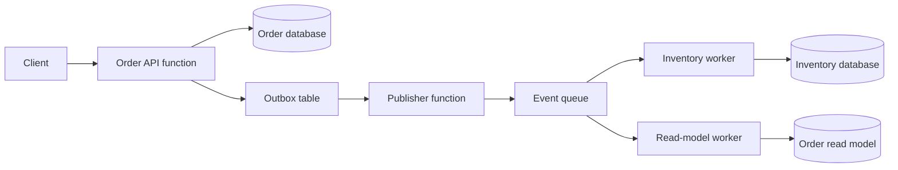
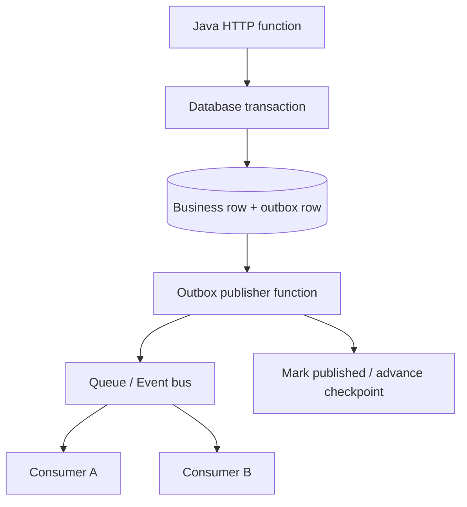
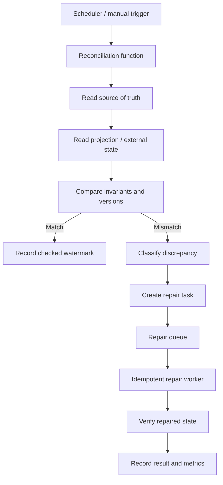
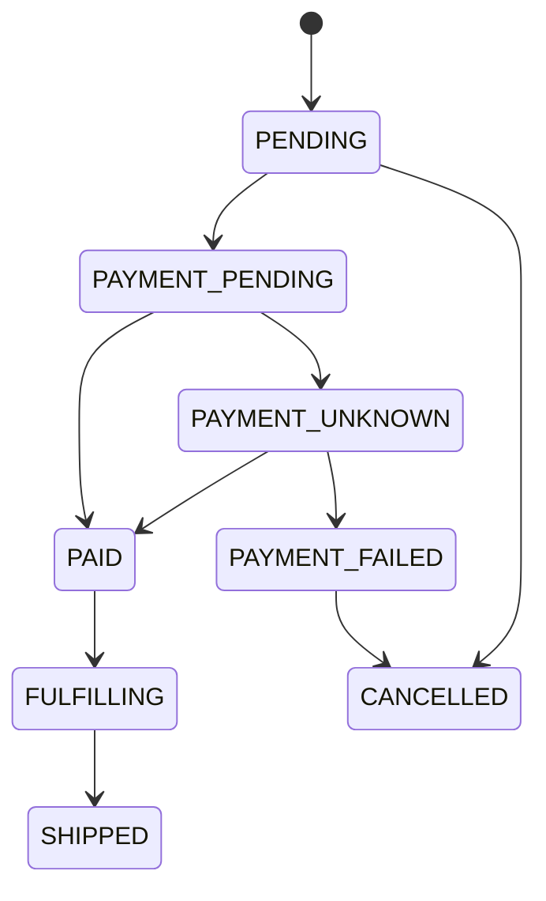

# Thiết kế eventual consistency và đối soát trạng thái

Trong ứng dụng serverless, một thao tác nghiệp vụ thường đi qua nhiều function và dịch vụ: HTTP function ghi đơn hàng, phát event vào queue, worker cập nhật tồn kho, function khác gửi thông báo và một consumer xây dựng read model cho màn hình. Các bước này không nhất thiết hoàn tất trong cùng một transaction. Vì vậy, trong một khoảng thời gian, các hệ thống có thể hiển thị những trạng thái khác nhau dù cuối cùng chúng cần hội tụ về cùng một kết quả nghiệp vụ.

**Eventual consistency** là mô hình trong đó các bản sao hoặc projection có thể tạm thời khác nhau, nhưng nếu không có thêm cập nhật và các thay đổi được truyền, xử lý và sửa lỗi thành công, chúng sẽ hội tụ về trạng thái nhất quán. Nó phù hợp với nhiều luồng bất đồng bộ, nhưng không có nghĩa là có thể bỏ qua lỗi, duplicate, event đến sai thứ tự hoặc dữ liệu bị mất.

**Đối soát trạng thái (reconciliation)** là quá trình so sánh trạng thái thực tế với nguồn dữ liệu chuẩn hoặc các invariant nghiệp vụ, phát hiện sai lệch và đưa hệ thống về trạng thái đúng. Trong serverless, reconciliation thường chạy định kỳ bằng scheduler/queue-triggered function, xử lý theo lô nhỏ và có thể chạy lại an toàn.

Bài học này trình bày cách xác định consistency boundary, thiết kế event và projection, xử lý thứ tự/version, xây dựng reconciliation và anti-entropy, triển khai các pattern Java, cũng như đo lường và kiểm thử khả năng hội tụ của hệ thống.

## 1. Eventual consistency là gì?

Một hệ thống eventually consistent cho phép các bản sao dữ liệu hoặc read model cập nhật trễ so với nguồn ghi. Nếu một service ghi trạng thái đơn hàng `PAID`, event được đưa vào queue và consumer cập nhật màn hình tra cứu sau vài giây, trong khoảng đó API đọc có thể vẫn trả `PENDING`.

Điều này không nhất thiết là lỗi. Nó chỉ hợp lệ nếu nghiệp vụ chấp nhận độ trễ đó, người dùng hiểu trạng thái tạm thời và hệ thống có cơ chế đảm bảo event cuối cùng được xử lý hoặc được đối soát để sửa sai.

### Ví dụ luồng đơn hàng



Sau khi API ghi đơn hàng, database nguồn có thể đã lưu trạng thái mới nhưng inventory/read model chưa cập nhật. Hệ thống cần xác định rõ đâu là nguồn sự thật cho từng dữ liệu, đâu là projection có thể tái tạo và trạng thái nào được phép hiển thị tạm thời.

### Eventual consistency không phải “dữ liệu sẽ tự đúng”

Để hội tụ, cần có các điều kiện:

- Thay đổi được ghi bền vững trước khi xác nhận thành công cho caller.
- Event được publish hoặc có cơ chế phát hiện để publish lại.
- Consumer có thể xử lý lại an toàn khi duplicate.
- Event cũ hoặc đến sai thứ tự không ghi đè trạng thái mới hơn.
- Lỗi tạm thời được retry có giới hạn; lỗi lâu dài được đưa vào DLQ hoặc hàng đợi sửa chữa.
- Có reconciliation để phát hiện event bị mất, projection bị lệch hoặc side effect chưa hoàn tất.
- Hệ thống có capacity để xử lý backlog và phục hồi sau outage.

Nếu event bị xóa, consumer dừng vĩnh viễn hoặc lỗi bị bỏ qua mà không có repair path, hệ thống có thể không bao giờ hội tụ. Eventual consistency là một đặc tính cần được thiết kế và vận hành, không phải bảo đảm tự nhiên của queue.

## 2. Chọn consistency model theo yêu cầu nghiệp vụ

Không phải mọi dữ liệu đều cần consistency giống nhau. Một ứng dụng có thể dùng transaction mạnh cho số dư tài khoản, nhưng chấp nhận read model tìm kiếm cập nhật chậm vài giây.

| Mô hình/thuộc tính | Ý nghĩa | Ví dụ sử dụng |
|---|---|---|
| Strong consistency | Sau khi ghi thành công, lần đọc phù hợp tiếp theo nhìn thấy giá trị mới theo semantics của store | Kiểm tra số dư trước khi ghi nợ |
| Eventual consistency | Các replica/projection có thể trễ nhưng hội tụ khi cập nhật được xử lý đầy đủ | Search index, dashboard, email notification state |
| Read-your-writes | Người dùng đọc lại thấy được thay đổi mà chính họ vừa ghi | Màn hình vừa tạo đơn hàng |
| Monotonic reads | Một reader không bị lùi về phiên bản cũ hơn phiên bản đã thấy trước đó | Theo dõi trạng thái đơn hàng |
| Causal consistency | Các thao tác có quan hệ nhân quả được quan sát theo thứ tự phù hợp | Tạo đơn trước rồi cập nhật trạng thái thanh toán |
| Bounded staleness | Chấp nhận dữ liệu trễ nhưng có giới hạn thời gian/phiên bản | Catalog hoặc báo cáo gần thời gian thực |

Các thuộc tính trên có thể được hỗ trợ khác nhau tùy database, cache, replica và API. Đừng suy ra một hệ thống có read-your-writes chỉ vì database nguồn hỗ trợ strong consistency; request tiếp theo có thể được route tới một read replica hoặc projection khác.

### Phân loại dữ liệu trước khi chọn mô hình

Hãy phân loại theo tác động khi dữ liệu cũ hoặc mâu thuẫn:

- **Dữ liệu quyết định giao dịch:** số dư, hạn mức, trạng thái thanh toán, quyền sở hữu. Thường cần transaction/conditional write/strong consistency tại điểm quyết định.
- **Dữ liệu điều khiển workflow:** trạng thái xử lý, lease, retry count, checkpoint. Cần version, state transition hợp lệ và atomic update.
- **Read model:** màn hình tổng hợp, search index, dashboard. Có thể eventual nếu có chỉ báo độ trễ và cách refresh.
- **Thông báo/analytics:** email, metric, báo cáo. Có thể xử lý bất đồng bộ, nhưng phải tránh duplicate side effect hoặc có cách đối soát.
- **Cache:** dữ liệu có thể stale trong TTL xác định; cần invalidation hoặc chấp nhận refresh trễ.

Một quy tắc hữu ích: đặt consistency mạnh ở nơi quyết định nghiệp vụ không thể đảo ngược; cho phép eventual consistency ở nơi tổng hợp hoặc trình bày dữ liệu, miễn là người dùng và downstream hiểu semantics đó.

## 3. Xác định source of truth và consistency boundary

Khi nhiều service lưu bản sao của cùng một thông tin, cần chỉ rõ service/database nào có quyền quyết định trạng thái chuẩn. Nếu không, mỗi service có thể cập nhật bản sao của mình và không có quy tắc giải quyết xung đột.

Ví dụ với order service:

- Order database là nguồn chuẩn cho trạng thái đơn hàng.
- Inventory service sở hữu số lượng tồn kho và reservation.
- Payment service sở hữu kết quả authorize/capture/refund.
- Search index và dashboard là projection có thể tái tạo.
- Notification log là trạng thái gửi thông báo, không phải nguồn chuẩn cho trạng thái đơn hàng.

### Bản đồ quyền sở hữu dữ liệu

| Dữ liệu | Owner/source of truth | Consumer/projection | Quyền cập nhật |
|---|---|---|---|
| Order status | Order service | Read model, notification | Chỉ order workflow cập nhật theo state machine |
| Inventory quantity | Inventory service | Product page, availability cache | Inventory service quản lý reservation/commit/release |
| Payment status | Payment service/provider ledger | Order projection, finance report | Payment workflow xác minh provider result |
| Search document | Search projection | Search API | Có thể xóa và dựng lại từ source/events |
| Customer notification status | Notification service | Support dashboard | Notification worker và reconciliation cập nhật |

Không nên cho nhiều service ghi trực tiếp vào cùng một bảng chỉ vì chúng cần cập nhật nhanh. Giao tiếp qua command/event và để owner kiểm tra invariant sẽ giữ quyền sở hữu rõ ràng hơn.

### Consistency boundary

Consistency boundary là phạm vi mà trong đó hệ thống có thể bảo đảm một invariant bằng transaction hoặc atomic operation. Ví dụ, order status và outbox record có thể được ghi trong cùng một transaction database. Nhưng publish queue và cập nhật inventory thường nằm ngoài transaction đó.

Hãy ghi rõ:

1. Invariant nào phải đúng ngay trong một transaction?
2. Những thay đổi nào được phép bất đồng bộ?
3. Dữ liệu nào là nguồn chuẩn và dữ liệu nào là projection?
4. Nếu một bước bất đồng bộ thất bại, ai chịu trách nhiệm retry/compensate?
5. Khi nào hệ thống được phép báo caller rằng operation đã hoàn tất?

## 4. Thiết kế event để các service có thể hội tụ

Event là thông báo rằng một sự kiện nghiệp vụ đã xảy ra. Event nên mô tả điều đã xảy ra (`OrderPlaced`, `PaymentCaptured`) thay vì yêu cầu consumer thực hiện một hành động không rõ trạng thái (`DoSomething`). Command và event có ý nghĩa khác nhau: command yêu cầu một service thực hiện việc gì; event thông báo một thay đổi đã được ghi nhận.

Một event envelope thường có:

| Trường | Mục đích |
|---|---|
| `eventId` | ID duy nhất để nhận diện event và chống xử lý trùng |
| `eventType` | Loại sự kiện nghiệp vụ |
| `schemaVersion` | Phiên bản schema payload |
| `aggregateId` | ID entity/aggregate mà event mô tả |
| `aggregateVersion` | Version tăng đơn điệu của aggregate |
| `occurredAt` | Thời điểm nghiệp vụ xảy ra theo nguồn phát |
| `publishedAt` | Thời điểm event được publish nếu có |
| `correlationId` | Liên kết các bước của một workflow/request |
| `causationId` | Event/command trực tiếp gây ra event này |
| `payload` | Dữ liệu cần thiết cho consumer |

Ví dụ JSON:

```json
{
  "eventId": "evt-01J8ORDER42",
  "eventType": "OrderPlaced",
  "schemaVersion": 2,
  "aggregateType": "Order",
  "aggregateId": "ord-4821",
  "aggregateVersion": 7,
  "occurredAt": "2026-11-17T10:15:30Z",
  "correlationId": "workflow-8f2c",
  "causationId": "cmd-place-order-31",
  "payload": {
    "orderId": "ord-4821",
    "customerRef": "cust-104",
    "totalMinor": 259900,
    "currency": "VND"
  }
}
```

ID và giá trị trong ví dụ là dữ liệu giả. Không đưa token, password, payment card data hoặc PII không cần thiết vào event. Event có thể được lưu lâu trong queue/archive và được nhiều consumer truy cập.

### Event phải có ý nghĩa bất biến

Một event đã publish không nên bị sửa ngược nội dung. Nếu thông tin thay đổi, phát event mới có version mới. Consumer cần biết event mô tả snapshot đầy đủ hay delta:

- **Snapshot event:** chứa trạng thái đủ để consumer cập nhật projection trực tiếp.
- **Delta event:** chứa thay đổi, ví dụ `quantityReserved=2`; consumer cần áp dụng theo đúng thứ tự/version.

Snapshot dễ xử lý khi event đến muộn vì có thể so version và thay bằng trạng thái mới hơn. Delta thường tiết kiệm payload nhưng nhạy cảm với mất event, duplicate và sai thứ tự. Nếu dùng delta, cần sequence gap detection và cơ chế replay/rebuild.

## 5. Transactional outbox: không để mất event giữa database và queue

Một lỗi thường gặp là function ghi database rồi publish event qua queue trong hai thao tác độc lập:

1. Database commit thành công.
2. Function bị timeout trước khi gửi event.

Kết quả là trạng thái nguồn đã đổi nhưng consumer không nhận được event. Đảo thứ tự cũng có rủi ro: event được publish nhưng transaction database rollback, consumer xử lý một thay đổi chưa tồn tại.

Transactional outbox giải quyết khoảng trống này bằng cách ghi business data và outbox record trong cùng một transaction database. Một publisher riêng đọc outbox và gửi event tới broker.



Publisher có thể gửi một event nhiều lần nếu publish thành công nhưng crash trước khi đánh dấu outbox đã gửi. Vì vậy consumer vẫn phải idempotent. Outbox bảo đảm event có thể được publish lại từ dữ liệu bền vững; nó không tự bảo đảm exactly-once delivery.

### Ví dụ schema outbox

```sql
CREATE TABLE outbox_event (
    event_id          VARCHAR(128) PRIMARY KEY,
    aggregate_type    VARCHAR(80) NOT NULL,
    aggregate_id      VARCHAR(128) NOT NULL,
    aggregate_version BIGINT NOT NULL,
    event_type        VARCHAR(120) NOT NULL,
    schema_version    INTEGER NOT NULL,
    payload           JSON NOT NULL,
    occurred_at       TIMESTAMP NOT NULL,
    created_at        TIMESTAMP NOT NULL DEFAULT CURRENT_TIMESTAMP,
    published_at      TIMESTAMP NULL,
    publish_attempts INTEGER NOT NULL DEFAULT 0
);

CREATE INDEX idx_outbox_unpublished
    ON outbox_event (created_at)
    WHERE published_at IS NULL;
```

Cú pháp `JSON`, partial index và timestamp phụ thuộc database; ví dụ trên dùng kiểu JSON tổng quát, còn PostgreSQL thường dùng `JSONB`. Với nhiều publisher, cần cơ chế claim row an toàn như `FOR UPDATE SKIP LOCKED`, lease hoặc partitioning để tránh hai publisher cùng xử lý một row. Không giữ transaction database mở trong lúc gọi broker qua mạng.

### Thứ tự publish từ outbox

`ORDER BY created_at` một mình không bảo đảm thứ tự nghiệp vụ khi nhiều publisher claim các row song song. Nếu consumer cần thứ tự theo aggregate, cần:

- Ghi `aggregate_version` trong outbox cùng transaction với aggregate update.
- Chia publisher theo `aggregate_id` hoặc partition key ổn định.
- Đảm bảo một aggregate chỉ có một luồng publish đang hoạt động tại một thời điểm, hoặc để consumer kiểm tra version/gap.
- Dùng broker ordering theo partition/message group nếu có, nhưng không giả định ordering toàn cục.

Ngay cả khi publisher giữ thứ tự, retry của một event cũ vẫn có thể đến sau event mới. Consumer version guard vẫn cần thiết.

### Ghi business row và outbox trong cùng transaction

```java
public Order placeOrder(PlaceOrderCommand command) {
    return transactionTemplate.execute(status -> {
        Order order = orderRepository.create(command);

        OrderPlaced event = new OrderPlaced(
                eventIdGenerator.next(),
                order.id(),
                order.version(),
                order.customerRef(),
                order.totalMinor(),
                order.currency());

        outboxRepository.insert(event);
        return order;
    });
}
```

`orderRepository.create` và `outboxRepository.insert` phải dùng cùng transaction manager/connection. Không gọi queue publisher trực tiếp bên trong transaction. Publisher đọc row đã commit, gửi event và cập nhật `published_at` theo một quy trình retry có thể lặp.

## 6. Xử lý event duplicate và sai thứ tự

Hầu hết queue/event integration trong serverless nên được thiết kế với giả định một event có thể được giao nhiều lần. Duplicate có thể xảy ra khi consumer đã thực hiện side effect nhưng acknowledgement bị mất, function timeout hoặc publisher retry.

Event cũng có thể đến sai thứ tự khi:

- Nhiều publisher xử lý song song.
- Queue không bảo đảm ordering toàn cục.
- Retry của event cũ hoàn tất sau event mới.
- Nhiều region hoặc partition phát event đồng thời.
- Consumer xử lý batch với thời gian xử lý khác nhau.

### Idempotent consumer

Consumer lưu event ID đã xử lý bằng unique constraint hoặc thao tác atomic. Nếu event được giao lại, consumer nhận ra và không lặp side effect.

```sql
CREATE TABLE consumer_inbox (
    consumer_name VARCHAR(120) NOT NULL,
    event_id       VARCHAR(128) NOT NULL,
    processed_at   TIMESTAMP NOT NULL,
    PRIMARY KEY (consumer_name, event_id)
);
```

Khóa chính gồm consumer name và event ID vì mỗi consumer độc lập có thể cần xử lý cùng event. Insert inbox record và cập nhật projection nên nằm trong cùng transaction.

```java
public void consume(OrderPlaced event) {
    transactionTemplate.executeWithoutResult(status -> {
        boolean firstDelivery = inboxRepository.insertIfAbsent(
                "order-read-model", event.eventId());

        if (!firstDelivery) {
            return;
        }

        projectionRepository.apply(event);
    });
}
```

`insertIfAbsent` phải dựa trên unique constraint/atomic insert; không dùng mẫu `SELECT` rồi `INSERT` riêng mà không xử lý race. Nếu projection update thất bại, transaction cần rollback cả inbox record để event có thể được thử lại.

### Version guard

Với mỗi aggregate, producer nên cấp version tăng đơn điệu khi trạng thái được cập nhật. Consumer chỉ áp dụng event mới hơn phiên bản hiện tại.

```sql
UPDATE order_projection
SET status = :new_status,
    aggregate_version = :incoming_version,
    updated_at = :occurred_at
WHERE order_id = :order_id
  AND aggregate_version < :incoming_version;
```

Nếu update ảnh hưởng 0 row, cần phân biệt event duplicate/cũ với record chưa tồn tại hoặc version gap. Không tự coi mọi trường hợp 0 row là thành công.

### Phát hiện version gap

Nếu projection đang ở version 7 nhưng nhận delta event version 9, có thể thiếu version 8. Không nên áp dụng delta 9 như thể đã có đầy đủ lịch sử. Các lựa chọn:

- Buffer event 9 và yêu cầu replay version 8.
- Đọc snapshot mới nhất từ source of truth rồi cập nhật projection.
- Đưa event vào hàng đợi repair và tiếp tục các aggregate khác.
- Dùng snapshot event đầy đủ nếu contract cho phép thay thế trạng thái.

Với FIFO queue hoặc partitioned stream, ordering thường chỉ được bảo đảm trong phạm vi message group/partition, không phải toàn hệ thống. Chọn partition key theo aggregate ID nếu cần giữ thứ tự cho từng entity.

## 7. Thiết kế read model và hiển thị trạng thái tạm thời

Trong CQRS, command model là nơi xử lý thay đổi nghiệp vụ; query model là bản chiếu tối ưu cho truy vấn. Read model có thể được cập nhật bất đồng bộ từ event nên cần biểu diễn rõ độ trễ.

Ví dụ API tạo đơn hàng:

```http
POST /orders
Idempotency-Key: create-order-4b92
Content-Type: application/json

{ "items": [{ "sku": "BOOK-01", "quantity": 2 }] }
```

API có thể trả:

```http
HTTP/1.1 202 Accepted
Location: /operations/op-8231
Retry-After: 2
```

Client hiểu rằng yêu cầu đã được tiếp nhận, nhưng các projection hoặc side effect chưa chắc hoàn tất. Client có thể truy vấn operation status hoặc dùng notification/callback. Nếu API trả `201 Created`, cần định nghĩa rõ điều kiện nào đã hoàn tất: chỉ ghi order vào source of truth hay cả reserve inventory/capture payment?

### Read-your-writes

Nếu người dùng vừa tạo đơn rồi đọc lại, hệ thống có thể:

- Trả snapshot từ command response để UI hiển thị ngay.
- Route lần đọc tiếp theo tới source of truth cho tới khi projection bắt kịp.
- Trả `aggregateVersion`/consistency token để query service đợi tới version đó.
- Hiển thị trạng thái `PROCESSING` hoặc `UPDATING` thay vì trả dữ liệu cũ mà không giải thích.

Không giữ request HTTP mở trong thời gian dài chỉ để chờ toàn bộ workflow nếu API có thể trả 202 và cung cấp operation resource. Đặt timeout rõ cho eventual completion và cho người dùng biết khi workflow cần hành động thủ công.

### Monotonic reads và stale replica

Một client có thể đọc version 8 rồi request tiếp theo bị route tới replica đang ở version 6. Điều này làm UI “lùi trạng thái”. Có thể tránh bằng session consistency token, sticky routing trong thời gian ngắn, query source hoặc từ chối trả phiên bản thấp hơn version client đã thấy.

Không giả định sticky session luôn tồn tại trong serverless. Token/version nên được gửi trong request hoặc lưu ở client/session store phù hợp.

## 8. Reconciliation là gì và vì sao cần?

Reconciliation so sánh trạng thái được kỳ vọng với trạng thái đang có, phát hiện chênh lệch và thực hiện hành động sửa chữa có kiểm soát. Nó bổ sung cho event-driven processing vì event path vẫn có thể gặp lỗi dài hạn, misconfiguration, bug hoặc dữ liệu cũ từ trước khi instrumentation được triển khai.

Ví dụ:

- Order đã `PAID` nhưng read model vẫn `PENDING` sau 15 phút.
- Payment provider đã capture nhưng database nội bộ chưa ghi nhận do timeout.
- Inventory reservation tồn tại nhưng order đã bị hủy.
- Notification được gửi hai lần hoặc chưa gửi dù trạng thái order đã hoàn tất.
- Projection thiếu một số aggregate do consumer lỗi trong thời gian dài.

Reconciliation không nên chỉ chạy câu lệnh “copy dữ liệu A sang B”. Trước tiên phải xác định nguồn chuẩn, invariant, cách phân loại mismatch và hành động sửa phù hợp.

### Reconciliation loop



Reconciliation function nên chia nhỏ công việc theo page/partition/time window, lưu checkpoint và có thể tiếp tục sau timeout. Không quét toàn bộ bảng trong một invocation dài nếu dữ liệu lớn.

## 9. Xác định invariant để đối soát

Invariant là điều kiện phải đúng trong một trạng thái hợp lệ. Ví dụ:

- Tổng số lượng reservation đang hoạt động của SKU không vượt quantity có thể bán.
- Một payment capture reference chỉ gắn với một order và không được capture hai lần.
- Một order có `status=SHIPPED` phải có shipment reference hợp lệ.
- Một projection không được có aggregate version lớn hơn source version nếu source là nơi cấp version.
- Mọi outbox event đã commit cuối cùng phải ở trạng thái published hoặc có repair task.
- Một operation terminal không được quay về trạng thái processing do event cũ.

Invariant nên được viết có thể kiểm tra bằng query/code, không chỉ mô tả chung chung như “dữ liệu phải đúng”.

### Phân biệt invariant cứng và consistency expectation

| Loại | Ví dụ | Cách xử lý |
|---|---|---|
| Invariant cứng | Không capture payment quá một lần cho cùng operation | Enforce bằng unique constraint/idempotency ở điểm ghi |
| Invariant eventual | Projection phải bắt kịp source trong 2 phút | Monitor lag, reconcile và repair |
| Business SLA | Notification cần được gửi trong 5 phút | Theo dõi age, retry, DLQ và escalation |
| Heuristic | Cache thường cập nhật trong vài giây | Đo freshness, refresh/invalidate khi cần |

Không đợi reconciliation định kỳ để bảo vệ invariant tài chính quan trọng. Invariant cứng cần được enforce ngay tại write boundary; reconciliation là lớp phát hiện và sửa sai bổ sung.

## 10. Phân loại sai lệch và chọn repair action

| Loại sai lệch | Ví dụ | Hành động có thể phù hợp |
|---|---|---|
| Missing | Source có order nhưng projection không có | Rebuild projection hoặc phát lại snapshot/event |
| Stale | Projection ở version thấp hơn source | Replay event còn thiếu hoặc refresh từ snapshot |
| Duplicate | Projection có hai bản ghi cho cùng business key | Dedupe theo quy tắc nghiệp vụ, giữ audit trail |
| Divergent | Hai hệ thống có giá trị khác nhau cùng version | Chuyển manual review hoặc áp dụng owner rule; không tự chọn tùy tiện |
| Orphan | Reservation không còn order tương ứng | Kiểm tra workflow rồi release/compensate nếu hợp lệ |
| Out of order | Event version 9 tới trước version 8 | Buffer/replay hoặc refresh snapshot |
| Invalid transition | Order đã `CANCELLED` nhưng event cũ đổi về `PAID` | State machine/version guard và review payment evidence |
| Missing side effect | Payment provider đã capture nhưng order chưa cập nhật | Query provider theo idempotency/reference và reconcile |

Repair action cần có owner, reason code, correlation ID, run ID và kết quả. Nếu không thể tự động sửa an toàn, đưa discrepancy vào manual review thay vì đoán giá trị đúng.

## 11. Xây dựng reconciliation theo page và checkpoint

Một reconciliation job nên:

1. Chọn một phạm vi có giới hạn, ví dụ `updated_at` trong một khoảng hoặc một hash partition.
2. Lấy dữ liệu nguồn theo keyset pagination, tránh offset lớn.
3. Lấy projection tương ứng theo danh sách key hoặc batch query.
4. So version/invariant và phân loại mismatch.
5. Ghi repair task idempotently.
6. Lưu checkpoint sau khi một page đã được xử lý bền vững.
7. Tiếp tục từ checkpoint ở invocation sau.

### Checkpoint không được vượt qua công việc chưa lưu

Nếu function ghi checkpoint trước khi ghi repair task, crash có thể khiến page bị bỏ qua vĩnh viễn. Hãy ghi discrepancy/repair task và checkpoint trong cùng transaction nếu cùng database; nếu khác hệ thống, dùng outbox hoặc trạng thái page có thể replay. Khi replay một page, thao tác phải idempotent.

### Ví dụ bảng repair task

```sql
CREATE TABLE reconciliation_task (
    task_id          VARCHAR(128) PRIMARY KEY,
    check_type       VARCHAR(80) NOT NULL,
    aggregate_id     VARCHAR(128) NOT NULL,
    source_version   BIGINT NOT NULL,
    observed_version BIGINT,
    reason_code      VARCHAR(80) NOT NULL,
    status           VARCHAR(24) NOT NULL,
    attempts         INTEGER NOT NULL DEFAULT 0,
    next_attempt_at  TIMESTAMP,
    created_at       TIMESTAMP NOT NULL,
    updated_at       TIMESTAMP NOT NULL,
    UNIQUE (check_type, aggregate_id, reason_code, source_version)
);
```

Unique key là ví dụ; thiết kế thật cần xác định một discrepancy có thể mở lại khi source version thay đổi hay không. `source_version` bắt buộc vì mỗi task đại diện cho một phiên bản nguồn đã quan sát; `observed_version` có thể dùng sentinel hoặc nullable theo schema. Có thể dùng task ID xác định từ check type + aggregate + version hoặc lưu lịch sử task riêng và một bảng trạng thái hiện hành.

## 12. Ví dụ Java: phát hiện projection bị stale

Giả sử order database là source of truth và search/read model lưu `aggregateVersion`. Reconciliation có thể tìm các order có version mới hơn projection.

```java
public record OrderSnapshot(
        String orderId,
        long version,
        String status,
        Instant updatedAt) {}

public record ProjectionSnapshot(
        String orderId,
        long version,
        String status) {}

public record Discrepancy(
        String orderId,
        long sourceVersion,
        long projectionVersion,
        String reason) {}
```

Service so sánh theo batch:

```java
public final class OrderReconciliationService {
    private final OrderSourceRepository source;
    private final OrderProjectionRepository projection;
    private final RepairTaskRepository repairs;

    public OrderReconciliationService(
            OrderSourceRepository source,
            OrderProjectionRepository projection,
            RepairTaskRepository repairs) {
        this.source = source;
        this.projection = projection;
        this.repairs = repairs;
    }

    public ReconciliationPageResult reconcilePage(PageCursor cursor, int pageSize) {
        List<OrderSnapshot> orders = source.findPage(cursor, pageSize);
        if (orders.isEmpty()) {
            return ReconciliationPageResult.completed(cursor);
        }

        Map<String, ProjectionSnapshot> projections = projection.findByOrderIds(
                orders.stream().map(OrderSnapshot::orderId).toList());

        List<Discrepancy> discrepancies = new ArrayList<>();
        for (OrderSnapshot order : orders) {
            ProjectionSnapshot view = projections.get(order.orderId());
            if (view == null) {
                discrepancies.add(new Discrepancy(
                        order.orderId(), order.version(), -1, "PROJECTION_MISSING"));
            } else if (view.version() < order.version()) {
                discrepancies.add(new Discrepancy(
                        order.orderId(), order.version(), view.version(), "PROJECTION_STALE"));
            } else if (view.version() > order.version()) {
                discrepancies.add(new Discrepancy(
                        order.orderId(), order.version(), view.version(), "VERSION_AHEAD_OF_SOURCE"));
            } else if (!Objects.equals(view.status(), order.status())) {
                discrepancies.add(new Discrepancy(
                        order.orderId(), order.version(), view.version(), "VALUE_DIVERGENCE"));
            }
        }

        repairs.insertIfAbsent(discrepancies);
        PageCursor next = PageCursor.after(orders.get(orders.size() - 1));
        return ReconciliationPageResult.processed(next, orders.size(), discrepancies.size());
    }
}
```

Đây là skeleton để minh họa compare/version. `findPage` nên dùng keyset cursor ổn định; `insertIfAbsent` phải idempotent. Việc ghi repair task và checkpoint cần được điều phối bền vững như mô tả ở phần trước. Trường hợp projection version lớn hơn source không nên tự động ghi đè; có thể là source replica đang trễ, sai owner hoặc dữ liệu bị ghi sai, cần điều tra trước khi repair.

### Repair worker cập nhật projection có điều kiện

Nếu discrepancy chỉ là projection stale/missing, có thể đọc snapshot mới nhất từ source và upsert theo version:

```sql
INSERT INTO order_projection (order_id, status, aggregate_version, updated_at)
VALUES (:order_id, :status, :version, :updated_at)
ON CONFLICT (order_id) DO UPDATE
SET status = EXCLUDED.status,
    aggregate_version = EXCLUDED.aggregate_version,
    updated_at = EXCLUDED.updated_at
WHERE order_projection.aggregate_version < EXCLUDED.aggregate_version;
```

Cú pháp trên theo PostgreSQL. Conditional upsert ngăn một repair task cũ ghi đè projection đã tiến tới version mới hơn. Nếu version bằng nhau nhưng payload khác, không âm thầm overwrite; ghi discrepancy `VALUE_DIVERGENCE` để kiểm tra schema mapping hoặc lỗi logic.

## 13. Đối soát với hệ thống bên ngoài

Một số dữ liệu chuẩn nằm ngoài hệ thống, ví dụ payment provider, shipping provider hoặc identity service. Khi HTTP call timeout, client không biết phía đối tác đã thực hiện side effect hay chưa.

Ví dụ:

1. Payment function gửi lệnh capture.
2. Provider capture thành công.
3. Response bị mất trước khi function nhận.
4. Function timeout và order vẫn ở trạng thái `PAYMENT_PENDING`.

Không gửi một lệnh capture mới với ID khác. Reconciliation cần tra cứu provider bằng idempotency key/reference của operation ban đầu, sau đó cập nhật order theo kết quả đã xác minh.

### Đối soát payment

Một quy trình có thể:

- Lấy các payment operation ở trạng thái `PENDING/UNKNOWN` quá thời gian SLA.
- Query provider bằng merchant reference/idempotency key.
- So sánh amount, currency, merchant account và trạng thái.
- Nếu provider xác nhận captured, cập nhật trạng thái nội bộ bằng conditional transition.
- Nếu provider xác nhận chưa xử lý, retry cùng idempotency key theo policy.
- Nếu provider không xác định được, giữ `UNKNOWN` và đưa vào manual review sau ngưỡng.
- Ghi audit record cho mỗi lần query/repair.

Không suy ra thanh toán thành công chỉ từ HTTP timeout hoặc từ một log cũ. Phải đối chiếu bằng reference và dữ liệu provider có thẩm quyền.

### State machine và transition hợp lệ

Ví dụ order workflow:



State machine cần quy định rõ transition hợp lệ, điều kiện và side effect. Không cho phép event cũ đưa order từ `SHIPPED` về `PENDING`. Nếu nghiệp vụ cho phép refund sau `PAID`, đó là transition mới (`REFUND_PENDING`, `REFUNDED`), không phải sửa ngược lịch sử.

## 14. Anti-entropy và cách phát hiện event bị mất

Anti-entropy là quá trình định kỳ so sánh các bản sao/trạng thái để phát hiện và sửa khác biệt, kể cả khi event propagation không phát hiện được lỗi. Reconciliation là một cách triển khai anti-entropy ở mức ứng dụng.

Các kỹ thuật thường dùng:

- So sánh `aggregateVersion` giữa source và projection.
- Quét theo `updated_at` window có overlap để không bỏ sót cập nhật sát ranh giới.
- Lưu high-watermark/checkpoint và chạy lại một khoảng an toàn.
- So sánh count/checksum theo partition hoặc time bucket.
- Dùng event archive/CDC để rebuild projection.
- Đối soát record theo business key với provider bên ngoài.
- Tạo repair task thay vì sửa trực tiếp trong query job.

### Watermark và cửa sổ overlap

Nếu reconciliation quét record theo `updated_at > last_checked_at`, record có thể bị bỏ qua khi timestamp bằng nhau, đồng hồ lệch hoặc transaction commit muộn. Có thể dùng cursor ghép `(updated_at, primary_key)` và overlap một khoảng thời gian, sau đó dedupe bằng task key.

Ví dụ cursor:

```sql
SELECT order_id, status, version, updated_at
FROM orders
WHERE (updated_at, order_id) > (:last_updated_at, :last_order_id)
  AND updated_at <= :upper_bound
ORDER BY updated_at, order_id
LIMIT :page_size;
```

Với database hỗ trợ row comparison như PostgreSQL, câu query này tạo keyset pagination ổn định khi sort key không đổi. Nếu `updated_at` có thể thay đổi trong lúc quét, cần chọn upper bound, overlap hoặc snapshot isolation phù hợp để tránh bỏ sót. Không dựa hoàn toàn vào wall-clock giữa các region; version/sequence do source cấp thường đáng tin cậy hơn cho thứ tự nghiệp vụ.

### Checksum theo partition

Với tập dữ liệu lớn, có thể so count hoặc checksum theo partition trước để tìm vùng khác biệt, sau đó mới so từng record. Checksum cần canonicalization ổn định: cùng encoding, field order, null semantics và normalization. Không dùng hash của JSON serialization không ổn định nếu field order hoặc định dạng số thay đổi.

Checksum chỉ phát hiện khác biệt; nó không chỉ ra bản nào đúng. Source of truth và owner rule vẫn quyết định repair direction.

## 15. Repair workflow an toàn

Repair là thay đổi dữ liệu thật nên cần kiểm soát tương tự một command nghiệp vụ. Một repair worker nên:

1. Đọc repair task và claim bằng lease/atomic status transition.
2. Đọc lại source of truth mới nhất, không chỉ dùng snapshot cũ trong task.
3. Kiểm tra version/state transition và quyền sửa.
4. Chọn action: replay, refresh snapshot, recompute, compensate hoặc manual review.
5. Thực hiện conditional write/idempotent operation.
6. Đọc lại trạng thái sau repair để xác minh invariant.
7. Ghi outcome, attempt count, reason và audit trail.
8. Đánh dấu completed hoặc schedule retry với backoff.

### Tránh repair ghi đè dữ liệu mới

Giữa lúc discrepancy được phát hiện và lúc repair chạy, source có thể đã thay đổi. Vì vậy task nên lưu version quan sát được, nhưng worker phải đọc version mới nhất trước khi cập nhật. Dùng optimistic locking hoặc conditional update:

```sql
UPDATE order_projection
SET status = :status,
    aggregate_version = :new_version
WHERE order_id = :order_id
  AND aggregate_version = :expected_projection_version;
```

Nếu update không thành công, dữ liệu đã thay đổi kể từ lúc đọc; worker cần đọc lại và đánh giá lại, không retry cùng một câu lệnh với giá trị cũ vô hạn.

### Manual review là kết quả hợp lệ

Không phải discrepancy nào cũng có thể tự động sửa. Nếu payment provider và ledger nội bộ có hai trạng thái không thể hòa giải, hoặc hai region có conflicting writes, hãy đưa task sang `MANUAL_REVIEW` với đầy đủ bằng chứng. Tự chọn giá trị “mới nhất theo timestamp” có thể gây sai lệch nghiêm trọng.

## 16. Retry, DLQ và poison event

Consumer cần phân biệt lỗi tạm thời với lỗi dữ liệu/schema/logic:

| Loại lỗi | Xử lý gợi ý |
|---|---|
| Network timeout, throttling tạm thời | Retry có backoff/jitter và giới hạn attempt |
| Database unavailable | Retry theo budget; giữ event bền vững và giới hạn concurrency |
| Schema không hỗ trợ | Đưa vào quarantine/DLQ, cảnh báo và xử lý tương thích |
| Validation/business rule fail | Không retry vô hạn; ghi reason và manual/compensation path |
| Version gap | Buffer, replay missing event hoặc refresh snapshot |
| Poison event lặp lại | DLQ sau ngưỡng, giữ payload/audit an toàn và không chặn toàn partition nếu semantics cho phép |

DLQ không phải nơi kết thúc trách nhiệm. Cần alarm, owner, retention, công cụ xem/giải mã payload theo quyền, cách sửa schema/dữ liệu và quy trình replay. Khi redrive, giữ event ID gốc và idempotency semantics; không tạo event ID mới chỉ vì gửi lại.

## 17. Schema evolution và tương thích consumer

Event thường tồn tại lâu hơn một phiên bản code. Consumer mới có thể nhận event cũ từ queue/archive; consumer cũ có thể nhận event mới sau deploy. Vì vậy schema cần được version và thay đổi theo nguyên tắc tương thích.

Các nguyên tắc thường dùng:

- Thêm field optional có default hợp lý thường dễ tương thích hơn đổi nghĩa field hiện có.
- Không đổi đơn vị hoặc ý nghĩa một field mà giữ nguyên tên.
- Không tái sử dụng enum value đã có nghĩa cũ.
- Consumer bỏ qua field không biết nếu contract cho phép.
- Producer không xóa field ngay khi consumer cũ còn cần.
- Dùng schema registry/contract tests nếu hệ thống có nhiều producer/consumer.
- Lưu schema version trong event envelope và giữ decoder cho event còn trong retention.

Khi thay đổi breaking, có thể phát event type/version mới, chạy dual-publish trong giai đoạn chuyển tiếp hoặc triển khai consumer hỗ trợ cả schema cũ và mới. Không để replay event cũ thất bại chỉ vì schema đã bị xóa khỏi code.

## 18. Đo lường consistency và reconciliation

Nếu không đo độ trễ và sai lệch, đội vận hành không biết eventual consistency đang nằm trong giới hạn hay đã trở thành data correctness incident.

Các metric hữu ích:

| Metric | Ý nghĩa |
|---|---|
| `event_processing_lag_seconds` | Thời gian từ event occurred/published tới consumer xử lý |
| `projection_version_lag` | Chênh lệch version giữa source và projection |
| `oldest_unpublished_outbox_age_seconds` | Tuổi của outbox event chưa publish |
| `consumer_backlog` | Số event đang chờ xử lý |
| `reconciliation_mismatch_total` | Số discrepancy theo reason type |
| `reconciliation_last_success_timestamp` | Lần reconciliation hoàn tất gần nhất |
| `repair_task_age_seconds` | Tuổi task chưa sửa xong |
| `repair_success_total` / `repair_failure_total` | Kết quả repair |
| `duplicate_event_total` | Số duplicate bị nhận diện |
| `dlq_message_count` | Số event cần điều tra |

Không đưa `eventId`, `aggregateId`, `orderId` hoặc tenant ID không giới hạn vào metric labels vì cardinality tăng rất nhanh. Dùng metric dimension hữu hạn như `consumer_name`, `event_type`, `reason_code`, `region` và môi trường. ID cụ thể có thể xuất hiện trong log/traces có quyền truy cập và retention phù hợp.

### Định nghĩa freshness SLO

Ví dụ SLO cho order read model:

- 99% event `OrderStatusChanged` được phản ánh vào projection trong 30 giây.
- 99.9% projection có version bằng source trong 5 phút.
- Không có repair task mức critical tồn tại quá 10 phút mà không có owner.

Các ngưỡng cần được chọn theo nghiệp vụ. Theo dõi p50/p95/p99 của event lag và age của event cũ nhất, không chỉ average. Một backlog nhỏ nhưng có một event cũ nhiều giờ có thể ảnh hưởng một giao dịch quan trọng.

### Alert theo symptom

Alert nên phản ánh tác động:

- Projection lag vượt freshness SLO trong nhiều cửa sổ liên tiếp.
- Outbox age tăng và publisher không tiến checkpoint.
- DLQ có message mới hoặc tăng bất thường.
- Reconciliation mismatch rate tăng.
- Repair queue có task critical quá hạn.
- Payment/order invariant bị vi phạm.

Tránh alert chỉ vì một metric tăng nhẹ trong vài giây. Dùng duration, rate và severity phù hợp để tránh alert fatigue.

## 19. Kiểm thử eventual consistency

Unit test của một handler không đủ để chứng minh hệ thống hội tụ. Cần test integration với queue/database và mô phỏng các tình huống event delivery không hoàn hảo.

### Các kịch bản cần kiểm thử

1. Consumer xử lý event bình thường và projection đạt version source.
2. Cùng event được giao hai lần; side effect chỉ xảy ra một lần.
3. Event version 9 tới trước version 8; projection không bị lùi.
4. Delta event bị thiếu; hệ thống phát hiện version gap và repair.
5. Publisher crash sau khi gửi event nhưng trước khi đánh dấu outbox.
6. Consumer crash sau database commit nhưng trước acknowledgement.
7. Projection update rollback; inbox record cũng rollback để event có thể retry.
8. Reconciliation function timeout giữa các page; checkpoint không bỏ qua dữ liệu.
9. Source thay đổi trong lúc repair; conditional write không ghi đè version mới.
10. Payment provider đã xử lý nhưng HTTP response bị mất; reconciliation tìm đúng operation.
11. DLQ redrive giữ event ID và không tạo side effect trùng.
12. Schema cũ được consumer mới đọc và schema mới được consumer tương thích đọc.
13. Hai region cùng nhận event; fencing/idempotency ngăn duplicate write.
14. Reconciliation chạy đồng thời ở hai worker; repair task được claim an toàn.
15. Backlog tăng rồi giảm; freshness SLO được khôi phục.

### Test hội tụ bằng property

Thay vì chỉ assert một kết quả sau một thời gian cố định, có thể kiểm tra property:

- Sau khi dừng producer và xử lý hết backlog, projection version cuối cùng bằng source version.
- Giao event cùng ID nhiều lần không làm thay đổi kết quả nghiệp vụ sau lần đầu.
- Áp dụng event cũ sau event mới không làm projection lùi version.
- Reconciliation chạy lại nhiều lần không tạo thêm side effect.
- Repair task hoàn tất thì invariant được xác minh lại.

Test nên có deadline rõ và poll theo điều kiện, không dùng `sleep(30s)` cố định rồi giả định eventual consistency đã hoàn tất. Nếu quá deadline, báo failure kèm lag/backlog và task status để điều tra.

## 20. Vận hành reconciliation trong serverless

Serverless scheduler và queue-trigger phù hợp với reconciliation vì công việc có thể chia thành nhiều invocation ngắn. Tuy nhiên, cần kiểm soát concurrency, checkpoint và chi phí.

Một kiến trúc thường dùng:

- Scheduler tạo `reconciliation_run` theo lịch hoặc yêu cầu thủ công.
- Dispatcher chia phạm vi thành partition/time window.
- Queue phân phối partition cho worker.
- Worker scan một page, tạo repair task và lưu checkpoint.
- Repair worker thực hiện action idempotent.
- Summary function tổng hợp kết quả và phát alert.

### Tránh chạy reconciliation quá dày

Quét toàn bộ dữ liệu mỗi phút có thể làm database chịu tải lớn hơn chính workload nghiệp vụ. Chọn incremental scan theo watermark, overlap window và periodic full audit ở tần suất thấp hơn. Giới hạn concurrency và query rate; ưu tiên replica/read endpoint nếu phù hợp, nhưng phải hiểu replica lag khi đối soát.

### Lease và xử lý invocation timeout

Nếu một worker claim partition rồi timeout, lease cần hết hạn để worker khác tiếp tục. Lease nên có owner token/generation để worker cũ không thể ghi checkpoint sau khi lease đã được cấp cho worker mới. Đây là fencing: mỗi lần claim có generation tăng, mọi update phải kiểm tra generation hiện tại.

Không chỉ dùng cờ `locked=true` vĩnh viễn; crash có thể khiến partition bị kẹt. Dùng lease expiry, heartbeat khi cần và recovery logic có thể quan sát.

## 21. Những lỗi thường gặp

| Lỗi | Hệ quả | Cách khắc phục |
|---|---|---|
| Không xác định source of truth | Các service ghi đè dữ liệu của nhau | Phân quyền owner và consistency boundary |
| Coi eventual consistency là tự động hội tụ | Event mất hoặc lỗi bị bỏ qua mãi | Outbox, retry, DLQ, reconciliation và repair |
| Publish event ngoài transaction mà không outbox | Database commit nhưng event không được gửi | Transactional outbox hoặc CDC có bảo đảm tương đương |
| Consumer không idempotent | Duplicate delivery tạo side effect trùng | Inbox/unique constraint và idempotency key |
| Không có aggregate version | Event cũ ghi đè trạng thái mới | Version guard và sequence/gap detection |
| Dùng timestamp để quyết định thứ tự | Clock skew làm thứ tự sai | Version/sequence do source cấp |
| Dùng delta event nhưng không kiểm tra gap | Projection sai khi thiếu event | Buffer/replay hoặc refresh snapshot |
| Reconciliation chỉ so count | Hai tập dữ liệu khác nhau vẫn có cùng count | So business key, version, checksum và invariant |
| Checkpoint trước repair task | Crash làm bỏ qua discrepancy | Ghi task và checkpoint an toàn/idempotent |
| Repair dùng snapshot cũ | Ghi đè dữ liệu vừa cập nhật | Đọc source mới nhất và conditional write |
| Tự sửa mọi mismatch | Gây hỏng dữ liệu khi owner không rõ | Phân loại và manual review cho conflict |
| Metric dùng ID duy nhất làm label | Cardinality và chi phí tăng | Dimension hữu hạn; ID để trong log/trace |
| Không kiểm tra DLQ | Event lỗi bị bỏ quên | Alarm, owner, retention và redrive runbook |
| Replay toàn bộ không giới hạn | Duplicate side effect và quá tải | Replay theo checkpoint, rate limit và idempotency |

## 22. Quy trình thiết kế eventual consistency và đối soát

1. **Phân loại dữ liệu.** Xác định dữ liệu nào cần strong consistency và dữ liệu nào chấp nhận eventual.
2. **Chọn source of truth.** Giao owner rõ cho từng aggregate và trạng thái nghiệp vụ.
3. **Định nghĩa invariant.** Viết điều kiện có thể kiểm tra và chỉ ra nơi enforce.
4. **Thiết kế event contract.** Có event ID, aggregate ID/version, schema version, causation/correlation và payload tối thiểu.
5. **Bảo đảm publish.** Ghi business state và outbox trong cùng transaction.
6. **Thiết kế consumer.** Idempotency, version guard, ordering/gap handling và retry/DLQ.
7. **Thiết kế read model.** Xác định freshness SLO, read-your-writes và cách hiển thị trạng thái pending.
8. **Xây reconciliation.** Incremental scan, checkpoint, mismatch classification và repair queue.
9. **Bảo vệ repair.** Đọc source mới nhất, conditional update, lease/fencing và audit.
10. **Đo lường.** Event lag, outbox age, projection version lag, mismatch, repair age và DLQ.
11. **Kiểm thử lỗi.** Duplicate, out-of-order, lost event, timeout, schema change, split-brain và replay.
12. **Vận hành theo SLO.** Alert, manual review, capacity/backlog management và báo cáo freshness.

## 23. Checklist trước production

- [ ] Source of truth và owner được xác định cho từng dữ liệu.
- [ ] Invariant cứng được enforce ở transaction/write boundary.
- [ ] Event có event ID, aggregate version và schema version.
- [ ] Business update và outbox record được ghi cùng transaction.
- [ ] Publisher có retry/checkpoint và có thể gửi duplicate an toàn.
- [ ] Consumer có inbox/idempotency và atomic update.
- [ ] Event cũ không ghi đè version mới; version gap được phát hiện.
- [ ] Read model có freshness SLO và cách hỗ trợ read-your-writes.
- [ ] Reconciliation chia page/partition và có checkpoint bền vững.
- [ ] Repair task idempotent, conditional và có audit.
- [ ] Conflict không thể tự giải quyết được đưa vào manual review.
- [ ] DLQ có alarm, owner, retention và quy trình redrive.
- [ ] Schema evolution tương thích với event còn trong retention.
- [ ] Metrics không dùng ID duy nhất làm label và có alert theo symptom.
- [ ] Đã test duplicate, reorder, lost event, timeout, replay và concurrent repair.
- [ ] Backlog có thể drain trong thời gian freshness/SLA cho phép.

## Kết luận

Eventual consistency cho phép Java serverless chia nhỏ workflow thành các bước bất đồng bộ, nhưng cần có source of truth, consistency boundary, event contract và version rõ ràng. Transactional outbox giúp không mất event sau khi business transaction commit; consumer idempotent và version guard xử lý duplicate/sai thứ tự; read model cần freshness SLO và semantics read-your-writes. Reconciliation/anti-entropy phát hiện những sai lệch mà event path không xử lý được, còn repair worker đưa trạng thái về đúng bằng conditional update, checkpoint và audit. Hệ thống chỉ thực sự eventually consistent khi có thể chứng minh backlog được xử lý, mismatch được phát hiện và dữ liệu hội tụ trong giới hạn nghiệp vụ đã cam kết.
