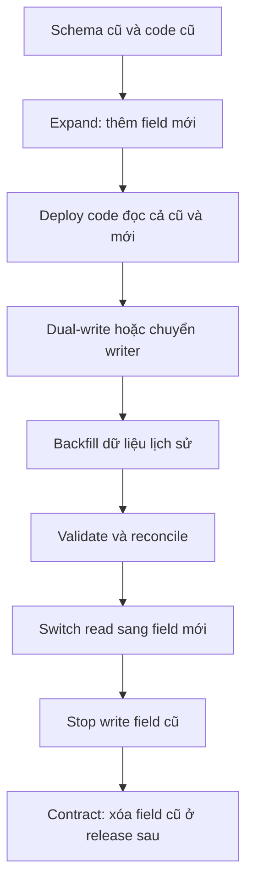

# Backfill, replay và tương thích với dữ liệu lịch sử

Một Java serverless function có thể xử lý dữ liệu mới rất tốt nhưng vẫn gặp lỗi khi phải đọc record được tạo từ nhiều năm trước, chạy lại event cũ hoặc chuyển đổi hàng triệu dòng dữ liệu sang schema mới. Dữ liệu lịch sử thường không đồng nhất: field từng bị thiếu, enum đã đổi tên, timestamp từng dùng timezone khác, giá trị tiền từng lưu theo đơn vị khác hoặc event được phát ra bởi phiên bản ứng dụng cũ.

**Backfill** là quá trình bổ sung hoặc tính lại dữ liệu cho các record đã tồn tại. **Replay** là phát lại request, message hoặc event đã được lưu để xử lý lại bằng consumer hiện tại. Cả hai đều có thể tạo side effect, tiêu thụ nhiều tài nguyên và chạy đồng thời với traffic mới. Do đó, cần có kế hoạch tương thích schema, checkpoint bền vững, xử lý idempotent, giới hạn tốc độ, đối soát kết quả và phương án dừng/tiếp tục.

Bài học tập trung vào cách thực hiện backfill và replay an toàn cho Java serverless được kích hoạt bởi HTTP, queue hoặc event. Mục tiêu là cập nhật dữ liệu lịch sử mà không làm mất giao dịch mới, không tạo side effect trùng và không khiến hệ thống phía sau quá tải.

## 1. Phân biệt backfill, replay, reprocessing và migration

Các thuật ngữ này có liên quan nhưng không cùng một thao tác:

| Khái niệm | Đầu vào | Công việc | Ví dụ |
| --- | --- | --- | --- |
| Backfill | Record đã tồn tại trong database/object store | Bổ sung field, tính lại giá trị hoặc chuẩn hóa dữ liệu | Tính `normalizedEmail` cho user cũ |
| Replay | Event/message đã lưu trong queue, archive hoặc event log | Gửi lại event qua consumer để tái thực hiện xử lý | Phát lại `OrderCreated` trong một khoảng thời gian |
| Reprocessing | Dữ liệu hoặc event đã xử lý trước đó | Chạy lại logic với code/model mới | Chạy lại bộ phân loại fraud trên giao dịch cũ |
| Schema migration | Cấu trúc lưu trữ hiện tại | Thay đổi schema hoặc biểu diễn dữ liệu | Chuyển `amount` từ số thực sang số nguyên đơn vị nhỏ nhất |
| Reconciliation | Nhiều nguồn trạng thái | So sánh và sửa sai lệch | Đối chiếu payment database với provider |
| Restore | Backup/recovery point | Khôi phục dữ liệu về một trạng thái trước đó | PITR database trước một lần ghi nhầm |

Backfill thường cập nhật record trực tiếp. Replay thường đi qua logic consumer và có thể tạo side effect mới. Reconciliation so sánh kết quả thực tế với nguồn chuẩn. Restore quay về recovery point và có thể làm mất thay đổi hợp lệ sau thời điểm đó. Chọn sai cơ chế có thể khiến dữ liệu bị nhân đôi hoặc ghi đè.

### Ví dụ chọn đúng thao tác

- Một cột `search_key` mới cần được tính cho 5 triệu user cũ: dùng backfill.
- Một event `InvoiceIssued` đã được archive nhưng consumer gặp bug: replay event sau khi sửa consumer.
- Một payment provider đã charge tiền nhưng response bị timeout: reconciliation với provider, không replay mù lệnh charge.
- Một deployment đã ghi sai giá trị cho một khoảng thời gian: tìm tập record bị ảnh hưởng, restore bản tham chiếu hoặc repair có chọn lọc.

## 2. Vì sao dữ liệu lịch sử khác dữ liệu mới?

Dữ liệu không tự động trở nên đồng nhất khi schema hoặc code thay đổi. Một hệ thống tồn tại lâu có thể có nhiều dạng dữ liệu hợp lệ theo thời điểm tạo:

- Field mới chưa tồn tại trong record cũ.
- Field từng là `null`, chuỗi rỗng hoặc giá trị mặc định khác nhau.
- Enum mới không có trong consumer cũ.
- Timestamp được lưu dưới UTC, local time hoặc không có timezone.
- Giá trị tiền từng lưu theo major unit, minor unit hoặc kiểu floating point.
- JSON event có schema/version khác nhau.
- ID từng dùng format cũ hoặc không có tenant prefix.
- Record đã bị xóa mềm, ẩn danh hoặc hết thời hạn lưu giữ.
- Quan hệ giữa database và object storage không còn đầy đủ.

Một function mới cần hiểu được những biến thể còn được phép tồn tại. Không nên giả định mọi record trong database đều được tạo bởi phiên bản code đang chạy.

### Tương thích ngược và tương thích xuôi

- **Backward compatibility:** code mới có thể đọc dữ liệu được tạo bởi schema/code cũ.
- **Forward compatibility:** consumer cũ có thể bỏ qua hoặc xử lý an toàn field/enum mới từ producer mới, trong phạm vi contract cho phép.
- **Replay compatibility:** consumer hiện tại có thể xử lý event lịch sử, hoặc có adapter/upcaster chuyển event cũ sang model nội bộ mới.

Một rollout an toàn thường cần code mới đọc được cả dữ liệu cũ lẫn dữ liệu mới trong giai đoạn chuyển đổi.

## 3. Thiết kế schema evolution theo expand-and-contract

Không nên thay đổi schema theo cách khiến code cũ hoặc event cũ không còn đọc được ngay lập tức. Dùng quy trình expand-and-contract:

1. **Expand:** thêm field/table/index mới theo cách tương thích; field mới thường nullable hoặc có default an toàn.
2. **Deploy reader-compatible code:** code mới đọc được cả field cũ và field mới.
3. **Dual-write hoặc chuyển writer:** ghi dữ liệu mới vào field mới, có thể đồng thời duy trì field cũ trong giai đoạn chuyển tiếp.
4. **Backfill:** bổ sung field mới cho record lịch sử theo batch.
5. **Validate:** đo tỷ lệ record đã chuyển, kiểm tra invariant và sai lệch.
6. **Switch reads:** chuyển dần logic đọc sang field mới sau khi dữ liệu đủ đầy.
7. **Stop old writes:** ngừng ghi field cũ khi mọi producer/consumer đã tương thích.
8. **Contract:** xóa field cũ trong release sau, khi không còn code hoặc message cần nó.



Trong thời gian dual-write, hai field có thể lệch nhau nếu một lần ghi thành công một field nhưng thất bại ở field còn lại. Nếu cùng một database transaction, cập nhật cả hai trong một transaction. Nếu dữ liệu nằm ở nhiều hệ thống, dùng outbox/CDC hoặc quy trình reconciliation; không giả định hai lần gọi HTTP độc lập là nguyên tử.

### Tránh migration phá vỡ trong một lần deploy

Ví dụ muốn đổi `customer_name` thành `display_name`:

- Release A thêm `display_name` nullable và code đọc `display_name` nếu có, nếu không dùng `customer_name`.
- Release B ghi cả hai field trong transaction.
- Backfill `display_name` từ `customer_name` cho record cũ.
- Kiểm tra mọi record có giá trị hợp lệ.
- Release C chỉ đọc/ghi `display_name`.
- Release D mới xóa `customer_name` sau khi xác nhận consumer cũ đã hết vòng đời.

Không xóa cột cũ ngay khi deploy code mới. Trong serverless, nhiều revision có thể cùng chạy, queue có thể giữ message cũ và retry có thể gọi lại code cũ sau một khoảng thời gian.

## 4. Lập kế hoạch backfill trước khi chạy

Trước khi chạy một job cập nhật dữ liệu lịch sử, hãy trả lời:

1. Tập record nào nằm trong phạm vi? Có filter tenant, thời gian, trạng thái hoặc version không?
2. Nguồn dữ liệu nào là nguồn chuẩn để tính lại giá trị?
3. Transformation có deterministic và idempotent không?
4. Record mới phát sinh trong lúc backfill được xử lý bằng dual-write hay một lượt backfill bổ sung?
5. Nếu record bị cập nhật đồng thời, làm sao tránh ghi đè dữ liệu mới?
6. Batch size, concurrency và rate limit được chọn theo capacity nào?
7. Checkpoint lưu ở đâu và được commit cùng dữ liệu bằng cách nào?
8. Có thể pause/resume/cancel mà không mất tiến độ không?
9. Làm sao đo completeness, correctness và business impact?
10. Có cách rollback hoặc repair nếu transformation sai không?

Không chạy backfill production ngay sau khi viết một câu `UPDATE` nếu chưa có dry-run, sample validation và giới hạn phạm vi.

### Xác định tập dữ liệu

Một job nên có phạm vi xác định, ví dụ:

- Tenant hoặc partition cụ thể.
- ID range hoặc high-water mark.
- Thời gian tạo record.
- `schema_version` thấp hơn version đích.
- Record chưa có field mới hoặc có trạng thái cần sửa.
- Chỉ record chưa bị xóa/ẩn danh theo policy.

Ghi lại số record dự kiến trước khi bắt đầu. Nếu không thể ước lượng count hoặc phạm vi, cần tạo truy vấn inventory trước khi ghi.

## 5. Backfill theo batch, không nạp toàn bộ dữ liệu vào heap

Một Java function có giới hạn thời gian, memory và concurrency. Không đọc hàng triệu record vào `List` rồi xử lý trong một invocation. Hãy chia công việc thành chunk nhỏ và lưu checkpoint bền vững.

Các pattern phổ biến:

- Một scheduler tạo job manifest và enqueue các partition/range.
- Mỗi invocation xử lý một batch giới hạn theo số record hoặc thời gian.
- Sau khi batch commit thành công, lưu checkpoint tiếp theo.
- Khi gần timeout, dừng nhận batch mới và kết thúc invocation sạch.
- Một orchestrator hoặc queue kích hoạt batch kế tiếp.
- Có thể chạy nhiều partition song song nếu không phá ordering/consistency và downstream còn capacity.

### Keyset pagination thay cho OFFSET lớn

Với bảng lớn, `OFFSET 5000000 LIMIT 1000` có thể ngày càng chậm vì database phải đi qua nhiều row trước khi trả kết quả. Keyset pagination dùng khóa sắp xếp ổn định:

```sql
SELECT id, legacy_value, schema_version, row_version
FROM customer
WHERE id > :last_id
  AND id <= :high_water_id
ORDER BY id
LIMIT :batch_size;
```

Sau khi xử lý thành công batch, `last_id` được cập nhật bằng ID cuối cùng đã commit. `high_water_id` là mốc trên được chụp khi bắt đầu job để xác định tập record của lượt chạy. Record mới có ID lớn hơn sẽ được xử lý bởi dual-write hoặc một lượt backfill tiếp theo.

Keyset yêu cầu cột sort ổn định, có index và thứ tự duy nhất. Nếu ID không đơn điệu hoặc dữ liệu được partition, dùng composite cursor như `(partition_key, id)` hoặc một snapshot/CDC offset phù hợp.

### Vì sao OFFSET dễ gây vấn đề?

Khi record bị thêm/xóa trong lúc phân trang, vị trí offset có thể dịch chuyển, dẫn đến bỏ sót hoặc xử lý lặp. Keyset pagination dựa trên khóa cuối cùng đã xử lý nên ổn định hơn. Tuy vậy, keyset không tự giải quyết cập nhật đồng thời; vẫn cần optimistic locking hoặc điều kiện version khi ghi.

## 6. Checkpoint phải bền vững và nhất quán với batch

Checkpoint cho biết job đã xử lý đến đâu. Không lưu checkpoint chỉ trong biến Java hoặc `/tmp`; instance có thể kết thúc và job sẽ không biết phải tiếp tục từ vị trí nào.

Một checkpoint record có thể chứa:

| Field | Ý nghĩa |
| --- | --- |
| `job_id` | ID của lần backfill/replay |
| `partition_id` | Phân vùng hoặc range được giao |
| `last_cursor` | Khóa cuối cùng đã xử lý thành công |
| `high_water_mark` | Mốc trên của tập dữ liệu |
| `status` | PENDING, RUNNING, PAUSED, COMPLETED, FAILED |
| `attempt` | Số lần chạy lại batch/job |
| `lease_owner` / `lease_until` | Worker đang giữ quyền xử lý và thời hạn lease |
| `updated_at` | Thời điểm checkpoint được cập nhật |
| `version` | Optimistic lock/fencing generation |

Nếu dữ liệu và checkpoint nằm trong cùng database, cập nhật chúng trong cùng transaction:

1. Đọc batch sau cursor.
2. Transform và cập nhật record.
3. Cập nhật checkpoint tới cursor cuối batch.
4. Commit một transaction.

Nếu transaction thất bại, cả dữ liệu và checkpoint rollback; batch có thể chạy lại. Nếu checkpoint commit trước dữ liệu, job có thể bỏ qua record chưa được cập nhật. Nếu dữ liệu commit trước checkpoint, batch có thể chạy lại; do đó transformation phải idempotent.

Khi dữ liệu và checkpoint nằm ở hai hệ thống khác nhau, không có transaction nguyên tử. Thiết kế theo hướng at-least-once: ghi dữ liệu idempotent, cập nhật checkpoint sau khi xác nhận kết quả và chấp nhận batch được chạy lại.

## 7. Tránh ghi đè thay đổi mới trong lúc backfill

Backfill có thể chạy đồng thời với request mới. Nếu job đọc record lúc 10:00, user cập nhật record lúc 10:01 và job ghi giá trị cũ lúc 10:02, dữ liệu mới có thể bị mất.

Các biện pháp:

- Chỉ cập nhật field do backfill sở hữu; không ghi lại toàn bộ entity từ object cũ.
- Dùng optimistic locking với `row_version`/`updated_at`.
- Thêm điều kiện `WHERE schema_version < :target_version` hoặc `WHERE new_field IS NULL`.
- Khi update không khớp row version, đọc lại và tính lại hoặc đưa record vào conflict queue.
- Dùng transaction với isolation phù hợp và tránh giữ lock lâu cho batch lớn.
- Nếu có thể, dùng source-of-truth event/CDC để cập nhật thay đổi phát sinh trong khi scan.

Ví dụ update có điều kiện:

```sql
UPDATE customer
SET normalized_email = :normalized_email,
    schema_version = :target_schema_version,
    row_version = row_version + 1
WHERE id = :id
  AND row_version = :observed_row_version
  AND schema_version < :target_schema_version;
```

Nếu số row update bằng 0, record đã thay đổi hoặc đã được xử lý bởi một worker khác. Không coi đó là success vô điều kiện; đọc lại và phân loại thành already-completed, concurrent-update hoặc conflict.

## 8. Java example: backfill theo keyset và checkpoint

Ví dụ sau minh họa cấu trúc một batch processor. Repository chịu trách nhiệm chạy query/update/checkpoint trong cùng transaction; `transform` là hàm deterministic và chỉ tính field dẫn xuất.

```java
public record CustomerRow(
        long id,
        String email,
        long rowVersion,
        int schemaVersion
) {}

public record BackfillBatchResult(
        long lastProcessedId,
        int processed,
        int conflicts,
        boolean hasMore
) {}

public final class CustomerBackfillService {
    private static final int TARGET_SCHEMA_VERSION = 3;
    private final CustomerBackfillRepository repository;

    public CustomerBackfillService(CustomerBackfillRepository repository) {
        this.repository = repository;
    }

    public BackfillBatchResult processBatch(
            String jobId,
            long lastId,
            long highWaterId,
            int batchSize
    ) {
        if (batchSize < 1 || batchSize > 500) {
            throw new IllegalArgumentException("Invalid batch size");
        }

        return repository.inTransaction(tx -> {
            var rows = tx.findNextBatch(
                    lastId, highWaterId, batchSize);
            if (rows.isEmpty()) {
                tx.markCompleted(jobId);
                return new BackfillBatchResult(lastId, 0, 0, false);
            }

            int processed = 0;
            int conflicts = 0;
            long cursor = lastId;

            for (CustomerRow row : rows) {
                String normalized = normalizeEmail(row.email());
                boolean updated = tx.updateIfVersionMatches(
                        row.id(),
                        row.rowVersion(),
                        normalized,
                        TARGET_SCHEMA_VERSION);

                if (updated) {
                    processed++;
                } else {
                    conflicts++;
                }
                cursor = row.id();
            }

            tx.saveCheckpoint(jobId, cursor);
            return new BackfillBatchResult(
                    cursor, processed, conflicts, rows.size() == batchSize);
        });
    }

    private static String normalizeEmail(String email) {
        return email == null ? null : email.trim().toLowerCase(java.util.Locale.ROOT);
    }
}
```

Đây là ví dụ về cấu trúc, không phải repository implementation hoàn chỉnh. Cần xác định rõ conflict policy: ví dụ record conflict được đưa vào lượt kiểm tra tiếp theo thay vì cursor bỏ qua vĩnh viễn. Nếu `saveCheckpoint` và `updateIfVersionMatches` không nằm trong cùng transaction, cần thiết kế lại theo at-least-once và idempotency. `normalizeEmail` chỉ là phép biến đổi minh họa; chuẩn hóa email thực tế phải theo business rule, không tự ý đổi semantics của địa chỉ.

### Điều phối batch trong serverless

Một invocation chỉ nên xử lý một số batch hoặc một khoảng thời gian ngắn. Khi còn việc, ghi task kế tiếp vào queue hoặc workflow. Job manifest và checkpoint cho phép resume khi invocation timeout, bị throttle hoặc runtime bị dừng.

Không enqueue batch kế tiếp trước khi batch hiện tại commit nếu thứ tự dữ liệu là bắt buộc. Nếu các partition độc lập, có thể enqueue song song với lease riêng cho từng partition.

## 9. Backfill có thể chạy nhiều worker: lease và fencing

Nếu hai invocation cùng xử lý một partition, cả hai có thể đọc cùng cursor và thực hiện cùng công việc. Idempotent update giúp giảm side effect nhưng vẫn gây tốn tài nguyên hoặc conflict.

Có thể dùng lease:

1. Worker claim partition bằng conditional update nếu chưa có lease hoặc lease đã hết hạn.
2. Lease lưu owner ID và expiry.
3. Worker renew lease khi còn xử lý.
4. Khi commit checkpoint, kiểm tra owner/generation vẫn hợp lệ.
5. Worker cũ không được phép ghi sau khi lease đã được cấp cho worker mới.

Fencing token/generation tăng mỗi lần lease được cấp. Mọi checkpoint/write quan trọng cần kiểm tra generation để worker cũ không ghi đè kết quả của worker mới sau một pause dài hoặc network partition.

Lease không thay thế idempotency. Worker có thể mất lease sau khi đã thực hiện side effect nhưng trước khi ghi checkpoint; worker khác sẽ chạy lại batch. Cần deterministic transformation và deduplication cho thao tác không thể lặp an toàn.

## 10. Backfill dữ liệu lớn và phân vùng công việc

Với hàng chục triệu record, một job đơn lẻ dễ vượt timeout hoặc tạo bottleneck. Chia thành partition có phạm vi rõ:

- ID range: `1–1.000.000`, `1.000.001–2.000.000`.
- Tenant range hoặc hash partition.
- Ngày/tháng tạo record.
- Shard/partition key của database.
- Object prefix hoặc manifest file.

Mỗi partition có checkpoint riêng và có thể retry độc lập. Tuy nhiên, tránh partition theo khóa không có index hoặc phân phối dữ liệu lệch. Một tenant lớn có thể tạo hot partition trong khi các partition khác hoàn tất nhanh.

### Chọn batch size

Batch size lớn giảm overhead invocation/query nhưng tăng memory, transaction duration, lock contention và blast radius khi lỗi. Batch size nhỏ dễ resume và giới hạn thời gian nhưng tăng số lần gọi database/queue.

Bắt đầu với batch nhỏ, đo:

- Thời gian xử lý batch p50/p95.
- Rows/sec và bytes/sec.
- Database CPU, IOPS, lock wait và connection pool.
- Function memory, duration, throttle và timeout.
- Conflict count và retry count.

Tăng batch/concurrency từng bước khi downstream còn headroom. Không chọn batch size chỉ dựa trên số record; record có thể có payload rất khác nhau.

## 11. Backpressure và giới hạn tốc độ backfill

Backfill cạnh tranh tài nguyên với traffic production. Cần có rate limit và khả năng pause:

- Giới hạn record/giây hoặc batch/phút.
- Giới hạn số worker/partition đồng thời.
- Dành connection pool hoặc workload quota riêng.
- Giảm tốc khi database latency, CPU hoặc replication lag tăng.
- Pause khi error rate hoặc conflict vượt ngưỡng.
- Chạy vào thời gian tải thấp nếu nghiệp vụ cho phép.
- Có kill switch để dừng enqueue batch mới.
- Ưu tiên traffic tương tác hơn batch best-effort.

Một backfill hoàn tất trong 3 giờ nhưng làm API p99 tăng gấp 10 có thể là một migration thất bại về vận hành. Hãy đặt SLO production và giới hạn tài nguyên trước khi tối ưu tốc độ job.

## 12. Dry-run, canary và rollout backfill

Trước khi update toàn bộ dữ liệu:

1. **Inventory-only:** đếm record và phân loại trạng thái, không ghi.
2. **Dry-run:** chạy transformation trên sample, lưu giá trị trước/sau và không commit.
3. **Canary:** cập nhật một partition hoặc tỷ lệ nhỏ, kiểm tra business invariant.
4. **Ramp-up:** tăng số partition/batch theo từng bước.
5. **Full run:** tiếp tục theo checkpoint, theo dõi metric và alert.
6. **Verification:** chạy query đối soát toàn bộ phạm vi.
7. **Cleanup:** chỉ xóa field/logic cũ sau khi xác nhận đủ dữ liệu và không còn consumer cũ.

Dry-run phải dùng cùng transformation code với production path nếu có thể. Nếu viết hai logic khác nhau, kết quả dry-run có thể không đại diện cho update thật.

### Manifest của backfill

Mỗi lần chạy nên có manifest:

| Field | Ví dụ |
| --- | --- |
| `job_id` | `customer-email-normalize-v3-20261117` |
| `target_schema_version` | `3` |
| `source_commit` | Commit chứa transformation |
| `scope` | Tenant/range/time window |
| `high_water_mark` | ID cuối của tập dữ liệu ban đầu |
| `batch_size` | `250` |
| `max_concurrency` | `4` |
| `started_at` | Thời điểm bắt đầu |
| `status` | DRY_RUN, RUNNING, PAUSED, COMPLETED |
| `expected_count` | Số record dự kiến |

Manifest cần có version và owner. Không sửa phạm vi job đang chạy âm thầm; nếu cần thay đổi, dừng job và tạo manifest/version mới để giữ audit trail.

## 13. Replay event: giữ nguyên danh tính event gốc

Replay thường xảy ra khi:

- Consumer có bug và cần chạy lại event sau khi sửa.
- Một downstream service phục hồi và cần phát lại event đã lưu.
- Thêm một projection/search index mới từ event history.
- Chuyển event sang schema/model mới.
- Khôi phục queue hoặc stream từ archive/checkpoint.

Event envelope nên chứa thông tin đủ để consumer hiểu nguồn và phiên bản:

```json
{
  "eventId": "evt-01J8...",
  "eventType": "OrderCreated",
  "schemaVersion": 2,
  "aggregateId": "order-8451",
  "sequence": 18,
  "occurredAt": "2026-05-12T09:30:00Z",
  "producer": "orders-api",
  "correlationId": "req-9a2...",
  "data": {
    "orderId": "order-8451",
    "currency": "VND",
    "amountMinor": 12500000
  }
}
```

Trong replay, giữ nguyên `eventId`, `aggregateId`, `sequence` và `occurredAt` của event gốc. Có thể thêm metadata riêng cho lần replay như `replayRunId`, `replayedAt` và `replayReason`, nhưng không ghi đè thời điểm nghiệp vụ gốc. Nếu tạo event ID mới mỗi lần replay, consumer deduplication có thể coi đó là event mới và thực hiện side effect lần nữa.

### Replay không phải phát event mới

Một event mới mô tả điều vừa xảy ra. Replay là đưa lại một event cũ để consumer xử lý lại. Giữ nguyên danh tính event giúp trace và deduplication nhận biết đó là cùng một sự kiện. Nếu muốn tạo một hành động nghiệp vụ mới, hãy phát command/event mới có ID và ý nghĩa mới.

## 14. Tương thích schema event lịch sử

Producer và consumer có thể được deploy ở thời điểm khác nhau. Event archive có thể chứa schema từ nhiều năm trước. Có ba cách xử lý chính:

1. **Consumer hỗ trợ nhiều version:** parse envelope và chọn DTO/parser theo `schemaVersion`.
2. **Upcaster/adapter:** chuyển event cũ sang canonical internal model trước khi chạy business logic.
3. **Versioned topic/contract:** giữ schema cũ cho consumer cũ, phát schema mới theo topic/version riêng trong giai đoạn migration.

Không nên chỉ dựa vào tên class Java hoặc thứ tự field trong JSON để suy ra schema version. Đặt `schemaVersion` rõ ràng và định nghĩa quy tắc tương thích.

### Ví dụ DTO theo version

```java
public sealed interface OrderCreatedEvent
        permits OrderCreatedV1, OrderCreatedV2 {}

public record OrderCreatedV1(
        String orderId,
        long amount
) implements OrderCreatedEvent {}

public record OrderCreatedV2(
        String orderId,
        long amountMinor,
        String currency
) implements OrderCreatedEvent {}

public record CanonicalOrderCreated(
        String orderId,
        long amountMinor,
        String currency
) {}
```

Adapter có thể chuyển V1 và V2 sang `CanonicalOrderCreated`. Tuy nhiên, không thể suy ra chính xác currency hoặc đơn vị tiền của V1 nếu event cũ không lưu thông tin đó. Cần dùng quy ước được ghi nhận tại thời điểm tạo event, metadata của producer hoặc reconciliation với nguồn chuẩn; không tự mặc định một currency chỉ để parser chạy qua.

## 15. Upcasting và normalization trước business logic

Upcaster là một lớp chuyển đổi event/schema cũ sang model nội bộ hiện tại. Nên giữ upcaster deterministic, có version và test bằng fixture lịch sử.

Ví dụ:

```java
public final class OrderEventUpcaster {
    public CanonicalOrderCreated upcastV1(OrderCreatedV1 oldEvent) {
        // Chỉ đúng nếu contract V1 quy định amount dùng minor unit
        // và currency mặc định được xác định rõ trong metadata.
        return new CanonicalOrderCreated(
                oldEvent.orderId(),
                oldEvent.amount(),
                "VND");
    }

    public CanonicalOrderCreated upcastV2(OrderCreatedV2 event) {
        return new CanonicalOrderCreated(
                event.orderId(),
                event.amountMinor(),
                event.currency());
    }
}
```

Đoạn V1 chỉ hợp lệ nếu schema contract cũ xác nhận rõ đơn vị và currency. Nếu không, upcaster phải trả trạng thái `UNKNOWN/NEEDS_RECONCILIATION` hoặc route event sang quarantine thay vì tạo dữ liệu có vẻ hợp lệ nhưng sai nghĩa.

Không sửa event gốc trong archive khi upcast. Lưu raw payload để audit và chạy lại với upcaster mới nếu phát hiện mapping sai.

## 16. Replay có thứ tự và xử lý event trùng

Một số nghiệp vụ cần ordering theo aggregate, ví dụ `OrderCreated` phải đến trước `OrderPaid`, hoặc số dư tài khoản phải áp dụng theo sequence. Replay nhiều partition song song có thể làm event đến sai thứ tự.

Các cách bảo vệ:

- Partition theo `aggregateId` để event của cùng aggregate đi cùng lane.
- Giữ `sequence`/version trên event và kiểm tra sequence khi áp dụng.
- Consumer từ chối hoặc buffer event có sequence vượt trước khoảng đang chờ.
- Replay theo từng aggregate hoặc từng partition với concurrency giới hạn.
- Chọn snapshot/checkpoint tương ứng với event offset.

Nếu event sequence 18 đến trước sequence 17, consumer có thể tạm giữ event 18 và đợi event 17, hoặc yêu cầu replay theo thứ tự. Không bỏ qua gap chỉ vì handler có thể parse event.

### Idempotency khi replay

Consumer nên lưu `eventId` hoặc business key đã xử lý trong một inbox/processed-event table có unique constraint. Việc ghi side effect và đánh dấu event hoàn tất nên nằm trong cùng transaction nếu chúng ở cùng database.

Nếu side effect ở hệ thống ngoài, dùng provider idempotency key, outbox/reconciliation hoặc state machine để xử lý unknown outcome. Replay không được coi là an toàn chỉ vì code handler có `try/catch`.

## 17. Replay có kiểm soát theo khoảng thời gian/offset

Không phát lại toàn bộ archive nếu chỉ một khoảng event bị ảnh hưởng. Xác định phạm vi bằng:

- Timestamp nghiệp vụ (`occurredAt`) hoặc timestamp nhận (`receivedAt`).
- Partition và offset/sequence.
- Event type/schema version.
- Aggregate ID hoặc tenant.
- Event ID range hoặc manifest.
- Kết quả xử lý trước đó và trạng thái nghiệp vụ.

Phân biệt event time và processing time. Một event được tạo lúc 09:00 nhưng tới consumer lúc 09:15; nếu cần replay theo thời điểm nghiệp vụ, dùng `occurredAt`; nếu điều tra delivery delay, dùng `receivedAt`/broker timestamp.

### Replay vào môi trường riêng trước

Trước khi phát lại vào production:

1. Copy một tập event vào replay topic/queue riêng.
2. Chạy consumer ở chế độ dry-run hoặc chỉ ghi projection thử nghiệm.
3. So sánh output với dữ liệu hiện tại/expected result.
4. Xác minh ordering, deduplication, schema upcasting và throughput.
5. Chọn tập event production và tốc độ replay có giới hạn.

Không replay vào topic production nếu producer/consumer đang cùng subscribe và có thể tạo vòng lặp event. Đảm bảo event phát sinh từ replay không bị archive/replay lại như event nguồn mới nếu đó không phải mục tiêu.

## 18. Java example: replay consumer có schema adapter và deduplication

Ví dụ sau cho thấy cấu trúc handler: parse envelope, upcast payload, kiểm tra event đã xử lý và áp dụng trong transaction. Repository cần enforce unique constraint trên event ID.

```java
public final class OrderReplayHandler {
    private final EventParser parser;
    private final OrderEventUpcaster upcaster;
    private final OrderEventRepository repository;

    public OrderReplayHandler(
            EventParser parser,
            OrderEventUpcaster upcaster,
            OrderEventRepository repository
    ) {
        this.parser = parser;
        this.upcaster = upcaster;
        this.repository = repository;
    }

    public void handle(byte[] rawMessage) {
        EventEnvelope envelope = parser.parseEnvelope(rawMessage);
        CanonicalOrderCreated event = switch (envelope.schemaVersion()) {
            case 1 -> upcaster.upcastV1(parser.parseV1(envelope.data()));
            case 2 -> upcaster.upcastV2(parser.parseV2(envelope.data()));
            default -> throw new UnsupportedEventVersionException(
                    envelope.schemaVersion());
        };

        repository.inTransaction(tx -> {
            if (tx.wasProcessed(envelope.eventId())) {
                return;
            }
            tx.applyOrderCreated(event, envelope.sequence());
            tx.markProcessed(envelope.eventId(), envelope.aggregateId());
        });
    }
}
```

Đây là pseudocode gần với Java; `EventEnvelope`, parser, transaction API và repository cần được triển khai theo framework/database. Unique constraint phải là lớp bảo vệ cuối cùng để hai invocation đồng thời không cùng xử lý một event. Nếu `applyOrderCreated` gọi API bên ngoài, transaction database không thể bao trùm HTTP call; cần outbox/provider idempotency hoặc workflow state riêng.

## 19. Backfill và replay khi có dữ liệu mới đồng thời

Một thách thức lớn là dữ liệu mới tiếp tục được ghi trong lúc backfill/replay. Nếu chỉ scan từ ID đầu đến ID cuối, record tạo sau high-water mark có thể bị bỏ sót. Nếu dual-write không đúng, record mới có thể ở schema cũ trong khi backfill đã đi qua.

Các chiến lược:

### Dual-write

Producer ghi cả field/schema cũ và mới trong cùng transaction khi cùng database. Backfill chỉ xử lý record lịch sử còn thiếu. Sau khi validation đạt, ngừng ghi field cũ.

### Capture changes/CDC

Chụp snapshot/high-water mark rồi theo dõi thay đổi mới bằng Change Data Capture (CDC) hoặc outbox. Quy trình áp dụng snapshot và stream changes phải có watermark/offset để không có khoảng trống hoặc xử lý sai thứ tự.

### Overlapping backfill

Backfill một phạm vi có overlap với dữ liệu mới và dùng update idempotent/version condition để xử lý lại an toàn. Cách này đơn giản hơn khi transformation deterministic và không có side effect.

### Re-run verification pass

Sau lượt chính, chạy một pass tìm record còn thiếu/không hợp lệ. Pass thứ hai thường giúp bắt các record conflict hoặc insert trong lúc chạy, nhưng không thay thế CDC nếu yêu cầu consistency cao.

## 20. CDC và transactional outbox cho thay đổi liên tục

CDC đọc thay đổi từ transaction log của database hoặc cơ chế change stream. Nó giúp đồng bộ dữ liệu mới phát sinh trong lúc backfill. Tuy nhiên, cần xử lý:

- Snapshot bắt đầu ở vị trí log/offset nào.
- Cách nối snapshot với stream để không bỏ sót thay đổi.
- Ordering theo table/partition/key.
- Duplicate event và checkpoint.
- Schema change của nguồn.
- Delete/tombstone và soft delete.
- Lag và khả năng replay từ offset cũ.

Transactional outbox là pattern ứng dụng ghi business change và outbox event trong cùng transaction database. Một relay/CDC publisher gửi event sau commit. Điều này tránh dual-write không nguyên tử giữa database và broker.

Khi backfill tạo event cho dữ liệu lịch sử, phân biệt event loại `HistoricalProjectionRebuilt` với event nghiệp vụ gốc. Không giả vờ rằng event cũ vừa xảy ra ở thời điểm hiện tại; giữ `occurredAt` gốc và thêm `replayRunId`/`backfillJobId`.

## 21. Reconciliation sau backfill/replay

Không kết thúc job chỉ vì mọi batch trả success. Cần xác minh dữ liệu sau chuyển đổi:

- Tổng số record trong phạm vi.
- Số record đã xử lý, bỏ qua, conflict và lỗi.
- Số record còn thiếu field/version đích.
- Số record có giá trị ngoài miền hợp lệ.
- Tổng hợp nghiệp vụ trước/sau như tổng tiền, số order, số user.
- Checksum/hash hoặc sample so sánh với nguồn chuẩn.
- Quan hệ giữa database và object/event reference.
- Event đã xử lý và side effect tương ứng.

### Reconciliation theo invariant

Ví dụ sau backfill giá trị tiền:

- Không có `amountMinor` âm nếu nghiệp vụ không cho phép.
- `currency` thuộc tập currency được hỗ trợ.
- Tổng số invoice theo trạng thái khớp với nguồn chuẩn.
- Tổng amount theo currency khớp trong sai số/rounding policy.
- Mỗi invoice ID duy nhất và tenant ownership không thay đổi.

Đối chiếu aggregate có thể phát hiện sai lệch tổng thể nhưng không chứng minh mọi row đều đúng. Kết hợp count, invariant, sample chi tiết và truy vấn record ngoại lệ.

## 22. Xử lý record lỗi hoặc không thể chuyển đổi

Không để một record lỗi làm cả job lặp đi lặp lại cùng batch vô hạn. Phân loại lỗi:

| Loại | Hành động |
| --- | --- |
| Transient DB/network | Retry có backoff và giới hạn |
| Concurrent update | Đọc lại, tính lại hoặc đưa vào conflict queue |
| Invalid historical value | Quarantine, lưu reason code và yêu cầu business decision |
| Missing source data | Đối chiếu nguồn khác hoặc đánh dấu unresolved |
| Unsupported schema version | Route sang compatibility handler hoặc quarantine |
| Permission/config error | Dừng job và sửa cấu hình; không retry vô hạn |
| Data retention/legal delete | Tôn trọng deletion/retention policy; không phục hồi dữ liệu đã phải xóa |

Quarantine record cần lưu ID, job ID, schema version, error code và vị trí tham chiếu; không sao chép payload nhạy cảm vào log nếu không cần. Có quy trình review, sửa dữ liệu và retry record riêng.

## 23. Những chi tiết lịch sử dễ gây sai dữ liệu

### Timestamp và timezone

Lưu timestamp chuẩn theo UTC hoặc epoch với đơn vị rõ ràng. Khi đọc dữ liệu lịch sử, xác minh giá trị là UTC hay local time; đừng tự gắn `Z` cho timestamp không có timezone. Phân biệt:

- `occurredAt`: thời điểm nghiệp vụ xảy ra.
- `createdAt`: thời điểm record được tạo.
- `receivedAt`: thời điểm broker/service nhận event.
- `processedAt`: thời điểm consumer xử lý.
- `updatedAt`: thời điểm record thay đổi.

Không thay `occurredAt` thành thời điểm replay. Giữ thời gian gốc để tính báo cáo, SLA và thứ tự nghiệp vụ.

### Tiền tệ và số thập phân

Không dùng `double` để lưu tiền. Xác định currency, scale và rounding rule. Nếu đổi từ major unit sang minor unit, kiểm tra currency có số chữ số thập phân khác nhau và dữ liệu cũ có được làm tròn hay không. Dùng `BigDecimal` hoặc integer minor unit theo contract rõ.

### Enum và unknown values

Enum mới có thể xuất hiện trong event cũ hoặc từ producer mới. Parser nên xử lý unknown value theo policy: giữ raw value, map sang `UNKNOWN` hoặc quarantine. Không mặc định mọi unknown đều là lỗi retryable; retry không thể làm enum mới tự biến mất.

### Null, missing và empty

JSON `null`, field không xuất hiện và chuỗi rỗng có thể mang ý nghĩa khác nhau. Schema adapter cần phân biệt chúng. Không tự động thay mọi missing field bằng 0/false nếu 0/false là giá trị nghiệp vụ hợp lệ.

### Deleted/anonymized records

Backfill phải tôn trọng tombstone, soft delete, privacy deletion và retention policy. Không tái tạo dữ liệu cá nhân đã được xóa/ẩn danh chỉ vì bản backup hoặc event archive còn chứa giá trị cũ. Áp dụng suppression list hoặc deletion marker để replay/backfill không hồi sinh dữ liệu đã phải xóa.

## 24. Rebuild projection và materialized view

Một use case phổ biến của replay là xây dựng lại search index, read model hoặc materialized view từ event history. Vì projection có thể tái tạo, thường có thể:

1. Tạo projection/index mới song song với bản hiện tại.
2. Replay event history vào projection mới theo partition/offset.
3. Theo dõi lag và kiểm tra count/aggregate.
4. Tiếp tục nhận event mới qua CDC/dual subscription.
5. Bắt kịp tới watermark hiện tại.
6. Chuyển read traffic sang projection mới.
7. Giữ projection cũ trong cửa sổ rollback rồi mới xóa.

Không rebuild trực tiếp lên projection đang phục vụ nếu việc xóa/recreate làm người dùng thấy dữ liệu trống hoặc không nhất quán. Dùng blue/green projection hoặc versioned index khi có thể.

## 25. Tương thích với nhiều phiên bản consumer

Trong serverless, nhiều revision có thể cùng chạy trong thời gian rollout. Event queue có thể chứa message từ producer cũ trong khi consumer mới đã được deploy.

Một số nguyên tắc:

- Consumer mới nên đọc được schema cũ trong retention/replay window.
- Producer mới chỉ phát field bắt buộc sau khi consumer đã sẵn sàng.
- Thêm field optional trước, dùng default có ý nghĩa và không thay đổi semantics cũ.
- Không đổi kiểu dữ liệu/đơn vị của field hiện có mà không version hóa.
- Unknown enum và unknown field có policy rõ.
- Giữ adapter/upcaster cho các schema còn nằm trong event archive.
- Xác định thời điểm có thể ngừng hỗ trợ schema cũ dựa trên queue retention, archive retention và khả năng replay.

Không xóa parser V1 chỉ vì producer V1 đã ngừng deploy. Nếu event V1 vẫn nằm trong archive 3 năm và có thể replay, consumer hoặc migration tool vẫn cần đọc được nó.

## 26. Rollback khi backfill hoặc replay sai

Không phải transformation nào cũng có thể đảo ngược. Trước khi chạy, phân loại:

- **Reversible:** có thể khôi phục giá trị cũ từ backup/old field.
- **Compensatable:** không thể đảo ngược trực tiếp nhưng có thể tạo hành động bù.
- **Irreversible:** mất thông tin hoặc gây side effect không thể hoàn tác.

Ví dụ thêm `normalized_email` là reversible nếu giữ email gốc. Gửi email hoặc charge payment là side effect; không thể “rollback” bằng cách xóa row. Cần compensation/reconciliation.

Biện pháp bảo vệ:

- Giữ old field hoặc snapshot trong thời gian migration.
- Lưu manifest, transformation version và job checkpoint.
- Chạy canary trước full rollout.
- Tách projection/index mới khỏi bản đang phục vụ.
- Dùng transaction/unique constraint và idempotency.
- Có kill switch để dừng batch/replay.
- Định nghĩa repair script và điều kiện rollback trước khi chạy.

Nếu phát hiện sai, dừng job, bảo toàn manifest/checkpoint/log, xác định tập record đã thay đổi và sửa có chọn lọc. Không chạy lại transformation ngược trên toàn bộ dữ liệu nếu một số record đã được người dùng cập nhật sau backfill.

## 27. Bảo mật và quyền riêng tư trong backfill/replay

Job lịch sử thường có quyền đọc nhiều dữ liệu hơn một request thông thường. Hãy giới hạn quyền:

- Dùng workload identity riêng cho backfill/replay job.
- Chỉ cấp quyền đọc/ghi trên table, bucket, queue và partition cần thiết.
- Tách quyền tạo job, chạy job và xóa/restore dữ liệu.
- Không ghi payload/PII vào log hoặc DLQ ngoài chính sách.
- Mã hóa file export, manifest và archive.
- Kiểm soát ai được yêu cầu replay một tenant hoặc event range.
- Audit job ID, operator, reason, scope và thời gian.
- Tôn trọng retention, legal hold và deletion request.

Một replay có thể đưa PII cũ trở lại hệ thống downstream đã xóa dữ liệu. Trước khi replay, kiểm tra suppression/deletion ledger và áp dụng redaction/skip policy. Backup có thể được giữ theo legal retention nhưng không có nghĩa dữ liệu được phép tái sử dụng cho nghiệp vụ.

## 28. Điều phối backfill/replay bằng serverless workflow

Không nên giữ một invocation sống hàng giờ để xử lý toàn bộ dataset. Chia job thành bước ngắn và có trạng thái durable:

1. API/admin request tạo `jobId` và manifest.
2. Orchestrator chia phạm vi thành partition/range.
3. Queue gửi từng batch tới Java worker.
4. Worker claim lease, xử lý batch, commit dữ liệu/checkpoint.
5. Worker phát completion event hoặc enqueue batch kế tiếp.
6. Orchestrator tổng hợp count/error/conflict và điều tiết concurrency.
7. Khi tất cả partition hoàn tất, chạy reconciliation.
8. Chỉ đánh dấu job `COMPLETED` sau khi validation đạt.

Có thể dùng AWS Step Functions, Azure Durable Functions, Google Workflows hoặc một workflow engine tương đương. Workflow engine điều phối trạng thái; dữ liệu lớn vẫn nên nằm trong database/object storage, không nhét toàn bộ payload vào execution history.

### Pause/resume/cancel

Job cần có trạng thái và semantics rõ:

- `PAUSE_REQUESTED`: không enqueue batch mới; batch đang chạy có thể hoàn tất.
- `PAUSED`: mọi worker đã dừng ở checkpoint an toàn.
- `RESUME`: tiếp tục từ checkpoint đã commit.
- `CANCEL_REQUESTED`: dừng nhận batch mới và hoàn tất/abort batch đang chạy theo policy.
- `CANCELLED`: không còn worker giữ lease; ghi nhận phạm vi đã xử lý.
- `FAILED`: lỗi cần operator xử lý; giữ checkpoint để resume sau khi sửa.

Không đánh dấu `CANCELLED` chỉ vì API yêu cầu cancel; cần xác nhận worker đã dừng và không còn batch đang commit.

## 29. Quan sát tiến độ và chất lượng dữ liệu

Theo dõi cả metric vận hành và metric correctness:

| Metric | Ý nghĩa |
| --- | --- |
| `backfill.records.scanned` | Record đã đọc |
| `backfill.records.updated` | Record được cập nhật thành công |
| `backfill.records.skipped` | Record đã ở version đích hoặc không thuộc scope |
| `backfill.records.conflict` | Record thay đổi đồng thời hoặc version mismatch |
| `backfill.records.failed` | Record không xử lý được |
| `backfill.records.per_second` | Throughput xử lý |
| `backfill.checkpoint.age` | Thời gian từ checkpoint gần nhất |
| `replay.events.published` | Event được đưa vào replay stream/queue |
| `replay.events.applied` | Event được consumer áp dụng |
| `replay.events.duplicate` | Event bị bỏ qua do đã xử lý |
| `replay.events.quarantined` | Event bị cách ly do schema/data issue |
| `replay.event.age` | Tuổi event khi được xử lý |
| `reconciliation.mismatch` | Sai lệch giữa nguồn và đích |

Dashboard nên filter theo `jobId`, partition, schema version, environment và tenant group nếu an toàn. Không dùng record ID hoặc customer ID làm metric label vì cardinality cao; dùng log/trace có kiểm soát để drill-down.

Alert khi:

- Job không tiến triển hoặc checkpoint quá cũ.
- Conflict/failure/quarantine vượt ngưỡng.
- Database latency/replication lag hoặc API 429 tăng.
- Queue age/DLQ tăng trong replay.
- Tỷ lệ record đạt schema version đích không tăng.
- Reconciliation mismatch vượt tolerance.
- Job vượt deadline/cost budget.

## 30. Ví dụ quy trình: thêm field mới cho 20 triệu customer

Giả sử ứng dụng muốn thêm `normalized_email` để phục vụ tìm kiếm. Bảng customer có 20 triệu record, API vẫn nhận update liên tục.

1. Thêm cột nullable `normalized_email` và `schema_version`.
2. Deploy code mới đọc `normalized_email` nếu có; nếu chưa có, fallback sang `email`.
3. Update API ghi `email` và `normalized_email` trong cùng transaction.
4. Chụp `high_water_id` và tạo manifest cho backfill.
5. Chia ID range thành các partition; mỗi Java invocation xử lý batch 250 record.
6. Dùng keyset pagination và optimistic version check để tránh ghi đè update mới.
7. Lưu checkpoint cùng transaction với record update.
8. Giới hạn worker concurrency để không ảnh hưởng API production.
9. Đếm record còn thiếu `normalized_email`, conflict và giá trị invalid.
10. Chạy pass thứ hai cho conflict và record được tạo trong lúc migration.
11. So sánh kết quả tìm kiếm cũ/mới trên sample và business metric.
12. Chuyển dần read path sang field mới.
13. Sau thời gian ổn định, ngừng ghi field cũ và chỉ xóa fallback trong release sau.

Không cần dừng API trong suốt 20 triệu record. Điều kiện là dual-write/CDC bao phủ dữ liệu mới, backfill có checkpoint và conflict policy rõ ràng.

## 31. Ví dụ quy trình: replay event để rebuild read model

Một service order có event archive 18 tháng. Search index bị hỏng và cần tạo lại:

1. Tạo index mới `orders-v2`, không xóa index hiện tại.
2. Chọn event range và offset/partition trong archive.
3. Dùng upcaster để đọc event schema V1/V2 và chuyển sang canonical model.
4. Replay theo aggregate partition, giữ sequence order.
5. Consumer ghi projection theo `eventId`/aggregate sequence để chống duplicate.
6. Giới hạn tốc độ theo database/index capacity.
7. Theo dõi event age, failed/quarantined count và projection lag.
8. Đồng bộ event mới qua CDC/dual subscription trong lúc replay.
9. So sánh document count, aggregate và query result với nguồn chuẩn.
10. Khi index mới bắt kịp watermark, chuyển read traffic.
11. Giữ index cũ trong cửa sổ rollback rồi mới cleanup.

Nếu replay event `OrderPaid` gửi email hoặc charge payment lần nữa, đó là thiết kế sai. Consumer projection nên tái tạo read model; side effect nghiệp vụ phải có deduplication và phân biệt loại consumer.

## 32. Test dữ liệu lịch sử và migration

Unit test với object mới tạo không đủ để kiểm tra schema cũ. Cần fixture lịch sử và test theo version:

- JSON event V1/V2/V3 được lưu từ production-like data đã masking.
- Record thiếu field, `null`, empty string và enum unknown.
- Timestamp có timezone khác nhau và daylight saving boundary nếu liên quan.
- Giá trị tiền lớn, rounding, currency khác nhau và số âm/zero.
- Record đã soft-delete/anonymize.
- Record được cập nhật đồng thời trong lúc backfill.
- Duplicate event, event out-of-order và sequence gap.
- Batch bị timeout giữa chừng, checkpoint commit/rollback.
- Worker lease hết hạn và worker cũ quay lại.
- Replay bị rate limit, DLQ và resume sau outage.

### Test invariant

Không chỉ kiểm tra code không ném exception. Kiểm tra invariant:

- Tổng số record trước/sau theo scope.
- Không mất tenant ownership.
- ID và unique constraint không đổi.
- Tổng tiền/đơn vị tiền khớp.
- Event sequence không có gap ngoài dự kiến.
- Một event chỉ tạo một side effect nghiệp vụ.
- Record đã bị xóa theo privacy policy không được hồi sinh.
- Backfill chạy lần hai không làm thay đổi kết quả đã đúng.

## 33. Các lỗi thường gặp

1. **Chạy một invocation cho toàn bộ dữ liệu.** Có thể vượt timeout/memory và không resume được.
2. **Dùng OFFSET lớn trên bảng đang thay đổi.** Có thể chậm, bỏ sót hoặc xử lý lặp.
3. **Checkpoint commit trước dữ liệu.** Job có thể bỏ qua record chưa được cập nhật.
4. **Backfill ghi đè update mới.** Không dùng row version/conditional update.
5. **Không đặt high-water mark.** Phạm vi job thay đổi khi dữ liệu mới liên tục được thêm.
6. **Dual-write không nguyên tử.** Hai schema có thể lệch nhau sau lỗi giữa hai lần ghi.
7. **Replay tạo event ID mới.** Deduplication không nhận ra event cũ.
8. **Replay không giữ ordering.** Event của cùng aggregate có thể áp dụng sai thứ tự.
9. **Không hỗ trợ schema cũ.** Consumer mới không đọc được archive lịch sử.
10. **Dùng default tùy tiện cho field thiếu.** Dữ liệu có vẻ hợp lệ nhưng sai nghĩa nghiệp vụ.
11. **Replay side effect không idempotent.** Email/payment/notification bị thực hiện lặp.
12. **Không giới hạn tốc độ.** Backfill làm database hoặc downstream quá tải.
13. **Bỏ qua tombstone/deletion request.** Replay làm hồi sinh dữ liệu đã xóa.
14. **Đánh dấu job completed khi batch hết nhưng chưa reconciliation.** Dữ liệu vẫn có thể thiếu hoặc sai.
15. **Xóa schema cũ quá sớm.** Consumer/replay window vẫn cần field/parser cũ.

## 34. Quy trình thiết kế backfill và replay

1. **Classify:** xác định đây là backfill, replay, reprocessing, reconciliation hay restore.
2. **Define scope:** xác định tenant/range/time/schema/event version và high-water mark.
3. **Design compatibility:** expand-and-contract, upcaster và cách đọc schema lịch sử.
4. **Guarantee safety:** deterministic transformation, idempotency, optimistic locking và ordering.
5. **Plan execution:** partition, batch size, checkpoint, lease, concurrency và retry budget.
6. **Protect production:** rate limit, backpressure, pause/cancel và load shedding.
7. **Dry-run/canary:** kiểm tra sample, expected count và business invariant.
8. **Execute:** chạy theo batch, ghi progress và audit metadata.
9. **Reconcile:** so sánh count, aggregate, checksum, event outcome và record conflict.
10. **Cut over:** chuyển read path/consumer/index khi validation đạt.
11. **Retain compatibility:** giữ parser/field cũ trong thời gian queue/archive/replay còn cần.
12. **Cleanup:** contract schema và cleanup artifact cũ sau khi hết rollback window.

## 35. Checklist trước production

- [ ] Đã phân biệt backfill, replay, reprocessing, reconciliation và restore chưa?
- [ ] Đã lập inventory schema/version và các biến thể dữ liệu lịch sử chưa?
- [ ] Có expand-and-contract plan để code cũ/mới cùng chạy được không?
- [ ] Transformation deterministic và idempotent không?
- [ ] Có scope rõ, high-water mark và expected count không?
- [ ] Batch dùng keyset/partition thay vì load toàn bộ dữ liệu vào heap không?
- [ ] Checkpoint bền vững và commit nhất quán với dữ liệu không?
- [ ] Có optimistic locking/conditional update để tránh ghi đè concurrent changes không?
- [ ] Có lease/fencing nếu nhiều worker có thể claim cùng partition không?
- [ ] Có rate limit, concurrency cap, timeout và pause/cancel không?
- [ ] Replay giữ nguyên event ID, occurredAt, aggregate sequence và schema version không?
- [ ] Consumer có deduplication/idempotency và ordering policy không?
- [ ] Event schema cũ có parser/upcaster/fixture test không?
- [ ] Có xử lý null, missing, enum unknown, timezone, money, tombstone và privacy deletion không?
- [ ] Có quarantine cho record/event không thể chuyển đổi không?
- [ ] Có dry-run, canary và rollback/repair plan không?
- [ ] Có reconciliation theo count, checksum và business invariant không?
- [ ] Có theo dõi checkpoint age, throughput, conflict, DLQ và downstream saturation không?
- [ ] Có lưu manifest, job ID, source commit, operator và audit reason không?
- [ ] Chỉ contract/xóa schema cũ sau khi mọi consumer và replay window đã tương thích không?

Backfill và replay là các thao tác thay đổi dữ liệu có phạm vi lớn, vì vậy cần được vận hành như một release có kiểm soát. Schema evolution phải cho phép code cũ và mới cùng tồn tại trong thời gian chuyển đổi; batch cần checkpoint bền vững và optimistic locking; replay phải giữ event identity, ordering và idempotency; tốc độ cần được giới hạn theo capacity production. Sau khi hoàn tất, reconciliation theo business invariant mới xác nhận dữ liệu lịch sử đã đúng. Khi kết hợp những nguyên tắc này, Java serverless có thể cập nhật hàng triệu record hoặc phát lại event trong thời gian dài mà vẫn bảo vệ request mới và giữ được khả năng resume/điều tra.

## Tài liệu tham khảo chính thức

- [AWS Database Blog – Backfill and migration patterns](https://aws.amazon.com/blogs/database/)
- [AWS Lambda – Using Lambda with Amazon SQS](https://docs.aws.amazon.com/lambda/latest/dg/with-sqs.html)
- [AWS Lambda – Partial batch response](https://docs.aws.amazon.com/lambda/latest/dg/services-sqs-errorhandling.html)
- [Amazon EventBridge – Archive and replay events](https://docs.aws.amazon.com/eventbridge/latest/userguide/eb-archive.html)
- [Amazon DynamoDB – Streams and change data capture](https://docs.aws.amazon.com/amazondynamodb/latest/developerguide/Streams.html)
- [Azure Functions – Queue trigger](https://learn.microsoft.com/azure/azure-functions/functions-bindings-storage-queue-trigger)
- [Azure Event Hubs – Capture and replay patterns](https://learn.microsoft.com/azure/event-hubs/event-hubs-capture-overview)
- [Azure Service Bus – Message settlement and dead-letter queues](https://learn.microsoft.com/azure/service-bus-messaging/message-transfers-locks-settlement)
- [Google Cloud Pub/Sub – Replay and seek](https://cloud.google.com/pubsub/docs/replay-message)
- [Google Cloud Pub/Sub – Subscriber flow control](https://cloud.google.com/pubsub/docs/flow-control)
- [Google Cloud Datastream – Change data capture](https://cloud.google.com/datastream/docs/overview)
- [Martin Fowler – Parallel Change](https://martinfowler.com/bliki/ParallelChange.html)
- [Debezium documentation](https://debezium.io/documentation/reference/stable/)
