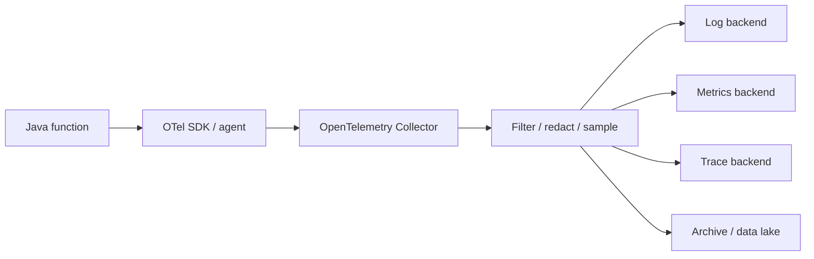

# Đánh giá chi phí log, metric và distributed tracing

Observability giúp đội phát triển biết Java function đang xử lý request/event ra sao, dependency nào gây chậm và nghiệp vụ có hoàn tất hay không. Nhưng log, metric và distributed trace đều tạo ra dữ liệu cần thu thập, truyền, lưu trữ, lập chỉ mục và truy vấn. Trong hệ thống serverless có traffic biến động, chi phí telemetry có thể tăng nhanh theo số invocation, số span, cardinality của metric và thời gian lưu giữ.

Đánh giá chi phí observability không có nghĩa là giảm telemetry đến mức không thể điều tra sự cố. Mục tiêu là thu thập đúng dữ liệu cho quyết định vận hành, giữ bằng chứng cần thiết cho bảo mật/audit và giới hạn dữ liệu trùng lặp hoặc ít giá trị. Cần xem telemetry như một phần chi phí của mỗi request hoặc business operation, đồng thời bảo đảm các giới hạn chi phí không làm mất tín hiệu quan trọng.

Trong phạm vi **CLOUD_SERVERLESS**, bài học tập trung vào phát triển và triển khai ứng dụng theo mô hình serverless, đặc biệt là Java function kích hoạt bởi HTTP, thông điệp hoặc sự kiện. Người học xử lý trigger, trạng thái, quyền truy cập, retry, idempotency, cold start, mở rộng và chi phí. Bài này hướng dẫn phân tích chi phí log, metric và distributed tracing, thiết kế retention/sampling, phân bổ chi phí và tối ưu telemetry cho workload serverless.

## 1. Vì sao telemetry có thể trở thành khoản chi đáng kể?

Một invocation có thể tạo nhiều log record, metric sample và trace span. Khi function scale-out, telemetry tăng theo traffic; khi có retry hoặc lỗi, số record có thể còn tăng nhanh hơn vì mỗi attempt đều được ghi nhận. Một log statement nhỏ trong code có thể tạo hàng tỷ record mỗi tháng nếu nằm trong đường xử lý nóng.

Chi phí phụ thuộc nhà cung cấp và cấu hình, nhưng thường có các nhóm sau:

| Nhóm | Nguồn phát sinh chi phí |
|---|---|
| Logs | Ingestion/collection, indexing, lưu trữ, truy vấn, export và retention |
| Metrics | Số time series, sample volume, custom metric/API ingestion, retention và query |
| Traces | Số span được ingest, lưu trữ, index/search, query và export |
| Pipeline | Collector/agent compute, network transfer, buffering và retry |
| Cross-region/export | Egress, inter-region transfer và hệ thống lưu trữ đích |
| Vận hành | Dashboard/query frequency, alert evaluation và data processing |

Không phải nhà cung cấp nào cũng tính phí theo cùng một đơn vị. Có dịch vụ tính theo GB ingest, số metric series, sample, span, API request, retention tier hoặc query scan. Vì vậy cần kiểm tra pricing model của đúng dịch vụ, region, edition và hợp đồng đang dùng trước khi lập ngân sách; không thể lấy một đơn giá chung cho mọi nền tảng.

## 2. Xây dựng mô hình chi phí tổng thể

Có thể bắt đầu bằng công thức khái niệm:

\[
C_{telemetry} = C_{logs} + C_{metrics} + C_{traces} + C_{pipeline} + C_{transfer} + C_{query}
\]

Trong đó mỗi thành phần có thể bao gồm ingestion, storage, indexing, retention và truy vấn. Nếu dùng nhiều nền tảng hoặc export sang data lake/SIEM, cần tránh tính thiếu chi phí ở hệ thống đích.

Nên theo dõi hai góc nhìn:

- **Tổng chi phí theo thời gian:** chi phí telemetry mỗi ngày/tháng, theo service, environment, region và team.
- **Chi phí đơn vị:** chi phí telemetry trên mỗi request thành công, message được xử lý hoặc giao dịch nghiệp vụ hoàn tất.

Ví dụ:

\[
Cost\ per\ completed\ order = \frac{Telemetry\ cost\ allocated\ to\ orders}{Orders\ confirmed}
\]

Chi phí đơn vị giúp nhận ra một release mới tạo nhiều log hoặc span hơn dù tổng traffic không đổi. Tổng chi phí vẫn cần thiết để lập ngân sách và phát hiện tăng trưởng tuyệt đối.

## 3. Các yếu tố quyết định chi phí log

Chi phí log thường chịu ảnh hưởng bởi:

- Số log event trên mỗi invocation.
- Kích thước trung bình của mỗi event sau khi serialize.
- Tần suất invocation và retry.
- Mức độ indexing, parsing và enrichment.
- Thời gian giữ log ở hot storage và archive.
- Số lần truy vấn, phạm vi thời gian và lượng dữ liệu scan.
- Số bản sao được gửi đến nhiều hệ thống.

Ước lượng volume ingest:

\[
Log\ volume/day \approx Events/sec \times AvgBytes/event \times 86,400
\]

Ví dụ minh họa: một workload phát 250 log event/giây, mỗi event trung bình 1.2 KB. Volume thô xấp xỉ 25.9 GB/ngày theo đơn vị thập phân, trước compression, filtering hoặc overhead của nền tảng. Đây không phải báo giá; nó cho thấy log ở đường xử lý nóng có thể tạo lượng dữ liệu lớn ngay cả khi mỗi record nhỏ.

Khi tính ngân sách, đo kích thước log thực tế sau serialization và số event thực tế trên mỗi request. Không chỉ đếm số dòng log trong source code vì một dòng có thể được gọi nhiều lần trong loop hoặc retry.

## 4. Thiết kế log có cấu trúc và có mục đích

Log JSON/structured fields giúp lọc và phân tích hiệu quả hơn log tự do, nhưng không nên ghi mọi field có thể lấy được. Một event vận hành nên tập trung vào thông tin cần để hiểu outcome, latency và dependency.

Ví dụ:

```json
{
  "timestamp": "2026-11-17T10:15:00Z",
  "severity": "INFO",
  "service": "orders-worker",
  "function": "processOrder",
  "release": "orders-2026.11.17.3",
  "correlation_id": "order-7812",
  "event_id": "evt-90017",
  "operation": "confirm-order",
  "outcome": "success",
  "duration_ms": 182
}
```

Các field thường hữu ích là `service`, `function`, `environment`, `release`, `operation`, `outcome`, `duration_ms`, `correlation_id` và `event_id`. Không ghi toàn bộ request body, response body hoặc object domain ở mọi log level.

Một log event cần có mục đích rõ ràng:

- `INFO`: sự kiện nghiệp vụ quan trọng hoặc lifecycle event cần truy vết.
- `WARN`: điều kiện bất thường nhưng hệ thống vẫn xử lý được, ví dụ retry hoặc dùng fallback.
- `ERROR`: operation thất bại và cần điều tra hoặc xử lý.
- `DEBUG/TRACE`: chi tiết phát triển; chỉ bật có kiểm soát và trong thời gian ngắn.

Không dùng `ERROR` cho mọi lỗi validation hoặc business rejection bình thường. Severity không chính xác làm tăng alert noise và khiến người vận hành bỏ qua lỗi thật.

## 5. Giảm log trùng lặp và log vô ích

Các nguồn log phình to thường gặp:

- Ghi `start`, `end` và toàn bộ payload cho mọi hàm nhỏ.
- Log cùng một exception ở mọi tầng rồi log lại ở handler cuối.
- Ghi stack trace cho lỗi nghiệp vụ có thể dự đoán.
- Log mỗi record trong batch, sau đó lại log toàn batch chứa các record đó.
- SDK/HTTP client bật wire logging ở production.
- Health check và readiness probe tạo log với tần suất cao.
- Retry tạo một log ERROR cho từng attempt dù cuối cùng operation thành công.

Thực hành tốt:

1. Ghi một log kết quả ở ranh giới xử lý, kèm attempt count và outcome.
2. Ghi chi tiết exception tại tầng có đủ ngữ cảnh, tránh log lại cùng stack ở nhiều tầng.
3. Dùng metric để đếm sự kiện phổ biến, log cho trường hợp cần điều tra.
4. Tắt payload/wire logging ở production trừ khi đang điều tra có thời hạn.
5. Dùng log level động có expiry hoặc feature flag được kiểm soát.
6. Loại bỏ log health check không có giá trị hoặc route sang sink rẻ hơn.

Không loại bỏ audit log bắt buộc, security event hoặc bằng chứng giao dịch chỉ để giảm bill. Phân biệt operational debug logs với audit/security records có yêu cầu retention riêng.

## 6. Sampling log và giới hạn của nó

Sampling log có thể giảm volume bằng cách chỉ giữ một tỷ lệ record từ nhóm log có tần suất cao. Tuy nhiên, sampling ngẫu nhiên có thể bỏ lỡ lỗi hiếm hoặc sự kiện bảo mật quan trọng.

Có thể áp dụng:

- Giữ 100% log ERROR có giá trị chẩn đoán, nhưng tránh duplicate stack trace.
- Giữ tỷ lệ nhỏ của log INFO lặp lại trên đường xử lý nóng.
- Giữ toàn bộ audit/security events theo policy.
- Giữ log cho một nhóm request được chọn bằng deterministic sampling theo trace ID hoặc operation ID.
- Tăng sampling tạm thời khi có incident, sau đó tự động quay về baseline.

Sampling cần được thực hiện ở nơi có đủ ngữ cảnh. Nếu mỗi function độc lập sample cùng một workflow mà không dùng cùng quyết định, một số bước có thể còn log trong khi bước khác bị loại, khiến khó truy vết. Với distributed trace, dùng trace-based decision nhất quán cho toàn trace.

## 7. Chi phí metric: số time series quan trọng

Metric thường được lưu thành time series. Mỗi tổ hợp tên metric và label/dimension có thể tạo một series riêng. Số series tăng theo tích số các giá trị label.

Ví dụ metric `http_requests_total` có các label:

- `service`: 8 giá trị.
- `route`: 12 giá trị.
- `method`: 4 giá trị.
- `status_class`: 5 giá trị.
- `region`: 3 giá trị.

Cardinality tối đa theo tích là:

\[
8 \times 12 \times 4 \times 5 \times 3 = 5,760\ series
\]

Nếu thêm `customerId` có 100.000 giá trị, metric có thể tạo hàng trăm triệu tổ hợp lý thuyết. Trên thực tế số tổ hợp quan sát được có thể thấp hơn, nhưng vẫn có nguy cơ vượt giới hạn và tăng chi phí rất nhanh.

Không dùng các giá trị có cardinality cao làm metric label:

- `userId`, `customerId`, `orderId`.
- `requestId`, `correlationId`, `traceId`.
- Email, URL đầy đủ chứa query string hoặc raw exception message.
- Tên file, object key hoặc message ID.

Đưa các định danh này vào log/trace có kiểm soát để tìm kiếm từng giao dịch. Metric nên dùng dimension có tập giá trị hữu hạn như service, operation, outcome, region và error category.

## 8. Histogram và bucket cũng làm tăng số series

Histogram lưu các bucket đếm số quan sát theo ngưỡng, thường kèm `_sum` và `_count`. Số series tăng theo số bucket và tổ hợp label. Nếu có 20 bucket và 100 tổ hợp label, một histogram có thể tạo hàng nghìn series tùy backend/representation.

Chỉ chọn bucket phục vụ SLO và latency range thực tế. Ví dụ API có mục tiêu p95 dưới 500 ms thì bucket nên có độ phân giải đủ quanh vùng đó; không cần hàng trăm bucket trải từ microsecond đến nhiều giờ nếu không có use case.

Native histogram, summary hoặc distribution metric có cost/aggregation trade-off khác nhau theo backend. Cần kiểm tra cách hệ thống metrics lưu và tính phí trước khi chọn kiểu. Summary được tính tại client thường không thể aggregate percentile chính xác giữa nhiều instance như histogram có bucket chung.

## 9. Tần suất thu thập và độ phân giải metric

Scrape interval hoặc export interval càng ngắn thì dữ liệu càng chi tiết, nhưng sample volume và chi phí có thể tăng. Chọn interval theo tốc độ biến động và mục đích cảnh báo.

Ví dụ với 2.000 time series:

| Interval | Samples/series/ngày | Tổng samples/ngày |
|---:|---:|---:|
| 60 giây | 1.440 | 2.88 triệu |
| 30 giây | 2.880 | 5.76 triệu |
| 15 giây | 5.760 | 11.52 triệu |

Đây là phép tính mẫu, chưa tính histogram bucket, metadata hoặc overhead. Không phải mọi serverless metric đều dùng scrape; một số nền tảng nhận metric theo push/export. Dù cơ chế nào, tần suất và số series đều ảnh hưởng volume.

Không cần metric độ phân giải 1 giây cho mọi business KPI. Có thể giữ metric hạ tầng chi tiết trong thời gian ngắn và dùng rollup/downsample cho xu hướng dài hạn nếu backend hỗ trợ.

## 10. Chi phí distributed tracing

Trace gồm nhiều span. Một request HTTP có thể tạo span cho gateway, function, database, queue publish, consumer, payment API và notification. Chi phí thường tăng theo:

- Số request/event được trace.
- Số span trung bình trên mỗi trace.
- Kích thước span attributes/events/links.
- Sampling rate.
- Tỷ lệ trace được index để search.
- Retention và query workload.
- Số bản export sang hệ thống khác.

Ước lượng span volume:

\[
Spans/sec \approx Requests/sec \times AvgSpans/trace \times SamplingRate
\]

Ví dụ 250 request/giây, 10 span/request và sampling 10% tạo khoảng 250 span/giây, trước khi tính span bổ sung từ retry hoặc batch. Nếu giữ 100%, volume sẽ khoảng 2.500 span/giây. Sampling 10% không có nghĩa mọi backend tính phí chính xác theo tỷ lệ đó; đây chỉ là ước lượng ingest.

Span attributes nên ngắn, ổn định và có giá trị chẩn đoán. Không đính kèm toàn bộ JSON payload, stack trace dài hoặc dữ liệu cá nhân vào mỗi span.

## 11. Head-based sampling và tail-based sampling

Hai chiến lược phổ biến:

| Chiến lược | Quyết định | Ưu điểm | Đánh đổi |
|---|---|---|---|
| Head-based | Quyết định giữ/bỏ ở đầu trace, trước khi biết kết quả cuối | Đơn giản, giảm dữ liệu sớm, ít tài nguyên collector | Có thể bỏ trace sau đó mới phát sinh lỗi hoặc latency cao |
| Tail-based | Collector giữ trace trong buffer rồi quyết định sau khi thấy các span | Có thể ưu tiên error/slow trace và giữ đủ trace liên quan | Cần buffer, memory, routing theo trace ID và collector capacity |

Head-based sampling phù hợp khi cần kiểm soát volume đơn giản. Tail-based sampling phù hợp khi muốn giữ 100% trace lỗi/chậm và sample thấp hơn cho trace thành công, nhưng collector phải nhận các span của cùng trace để đưa ra quyết định nhất quán.

Một chiến lược thường dùng là parent-based trace ID ratio sampling: trace con kế thừa quyết định sampling từ parent. Điều này giúp tránh trường hợp service A giữ trace nhưng service B bỏ trace một cách độc lập.

## 12. Ví dụ cấu hình sampling cho OpenTelemetry Java

Ví dụ tạo tracer provider với parent-based ratio sampler và batch span processor:

```java
import java.util.concurrent.TimeUnit;
import io.opentelemetry.sdk.trace.SdkTracerProvider;
import io.opentelemetry.sdk.trace.samplers.Sampler;
import io.opentelemetry.sdk.trace.export.BatchSpanProcessor;
import io.opentelemetry.sdk.trace.export.SpanExporter;

SdkTracerProvider tracerProvider = SdkTracerProvider.builder()
        .setSampler(Sampler.parentBased(
                Sampler.traceIdRatioBased(0.10)))
        .addSpanProcessor(
                BatchSpanProcessor.builder(spanExporter)
                        .setMaxQueueSize(2048)
                        .setMaxExportBatchSize(512)
                        .setScheduleDelay(5, TimeUnit.SECONDS)
                        .build())
        .build();
```

Ví dụ này giữ khoảng 10% trace mới theo head-based sampling, còn trace con tuân theo quyết định parent. `spanExporter` là exporter đã được cấu hình trước; cần đóng `tracerProvider` đúng lifecycle và bảo đảm telemetry flush theo hướng dẫn runtime.

Không nên hard-code tỷ lệ sampling giống nhau cho mọi environment. Có thể dùng tỷ lệ thấp hơn ở production baseline, cao hơn ở staging hoặc bật tăng sampling có thời hạn khi incident. Nếu cần giữ toàn bộ error trace, tail-based sampling ở collector hoặc cơ chế giữ trace có điều kiện sẽ phù hợp hơn chỉ dùng ratio sampler ở SDK.

## 13. Tail sampling cần collector có capacity

Tail sampling thường yêu cầu collector nhận các span, giữ trace trong bộ nhớ một khoảng thời gian, đợi đủ span hoặc timeout rồi mới quyết định export. Điều này tạo thêm chi phí và yêu cầu vận hành:

- Route span của cùng trace đến cùng tail-sampling collector/decision point.
- Đặt decision wait phù hợp với thời gian trace hoàn tất.
- Cấu hình memory limiter và giới hạn số trace đang chờ.
- Theo dõi dropped spans, late spans và buffer pressure.
- Scale collector theo throughput và memory footprint.
- Có fallback policy khi collector quá tải hoặc không sẵn sàng.

Nếu collector drop span trước khi quyết định, tail sampler có thể đánh giá sai trace. Nếu decision wait quá ngắn, span đến muộn có thể bị bỏ khỏi trace đã quyết định. Không dùng tail sampling chỉ vì muốn giữ error trace; hãy tính chi phí collector và test với trace dài, batch và asynchronous messaging.

## 14. Sampling không áp dụng giống nhau cho mọi telemetry

Logs, metrics và traces có semantics khác nhau:

- **Logs:** có thể sample log lặp lại, nhưng cần giữ audit/security event và lỗi có giá trị.
- **Metrics:** thường cần giữ aggregate count/rate để phản ánh xu hướng; sampling từng metric point có thể làm sai counter/rate nếu không có cơ chế thống kê phù hợp.
- **Traces:** sampling theo trace có thể giảm tỷ lệ request được mô tả chi tiết trong khi giữ phân phối đại diện hoặc ưu tiên trace lỗi.

Không áp dụng một tỷ lệ 10% cho tất cả telemetry. Ví dụ giữ 100% metric aggregate, sample 10% trace thành công, giữ trace lỗi theo tail policy và lưu audit log theo yêu cầu pháp lý/bảo mật.

## 15. Retention và storage tiering

Không phải dữ liệu nào cũng cần giữ lâu như nhau. Một chính sách retention nên dựa trên mục đích sử dụng, SLO điều tra, yêu cầu audit và quy định dữ liệu.

| Dữ liệu | Hot retention | Lưu trữ dài hạn |
|---|---|---|
| Debug logs | Ngắn, ví dụ vài ngày | Thường không cần nếu không có yêu cầu điều tra |
| Application operational logs | Theo thời gian xử lý incident và xu hướng vận hành | Archive nếu cần audit hoặc phân tích dài hạn |
| Security/audit logs | Theo policy bảo mật và pháp lý | Có thể cần immutable archive, access control và retention riêng |
| High-resolution metrics | Ngắn đến trung hạn | Rollup/downsample cho xu hướng dài hạn |
| Business KPI aggregates | Theo nhu cầu báo cáo | Có thể lưu ở warehouse/analytics store |
| Traces | Thường ngắn hơn logs/metrics do volume lớn | Chỉ archive trace được chọn nếu có nhu cầu |

Các mốc ngày trong bảng retention cần do tổ chức xác định; không có một thời hạn đúng cho mọi hệ thống. Phân biệt retention của telemetry với retention của business data. Không xóa audit record hoặc dữ liệu cần phục vụ điều tra chỉ vì chi phí ingest tăng.

## 16. Dùng tiering và downsampling

Một mô hình lưu trữ có thể gồm:

1. **Hot:** dữ liệu gần thời gian thực, có index để on-call truy vấn nhanh.
2. **Warm:** dữ liệu ít truy vấn hơn, index/compute thấp hơn.
3. **Cold/archive:** dữ liệu phục vụ audit hoặc điều tra hiếm khi cần, chi phí lưu trữ thấp hơn nhưng truy xuất chậm hơn.

Với metrics, downsampling có thể giữ min/max/avg/count hoặc histogram aggregate theo cửa sổ dài hơn. Không chỉ lưu average nếu cần điều tra tail latency; cân nhắc giữ percentile/bucket hoặc distribution phù hợp.

Với logs, có thể chuyển raw logs cũ sang object storage nén, nhưng cần giữ schema, timestamp, partition key và khả năng truy vấn khi restore. Với traces, thường chỉ giữ một tập trace được chọn lâu hơn như error, slow hoặc incident trace.

## 17. Telemetry pipeline và OpenTelemetry Collector

Collector có thể nhận telemetry, batch, filter, enrich, sample và export đến một hoặc nhiều backend. Pipeline có thể giảm dữ liệu gửi đi nhưng collector cũng tiêu thụ CPU, memory và network.



Collector giúp tập trung policy và tránh mỗi function phải biết nhiều exporter. Tuy nhiên, không export cùng một log/trace sang nhiều backend nếu không có use case và ngân sách rõ ràng. Compression và batching có thể giảm overhead network, nhưng queue quá lớn có thể làm tăng memory hoặc mất dữ liệu khi collector restart.

Theo dõi chính collector: accepted/refused/dropped telemetry, export failure, queue size, memory limiter activation, retry và exporter latency. Telemetry pipeline bị nghẽn có thể làm mất dữ liệu đúng lúc xảy ra incident.

## 18. Serverless runtime và vòng đời telemetry

Function instance có thể bị freeze, recycle hoặc kết thúc sau invocation. Exporter chạy nền có thể chưa kịp gửi telemetry trước khi runtime đóng hoặc đóng băng process.

Lưu ý:

- Ưu tiên batch processor/exporter được thiết kế cho runtime và extension tương ứng.
- Không chặn response nghiệp vụ quá lâu chỉ để export telemetry.
- Với synchronous flush ở cuối invocation, đặt timeout ngắn và hiểu tác động lên latency/cost.
- Nếu nền tảng hỗ trợ collector/extension sidecar hoặc agent độc lập, đánh giá cách nó xử lý shutdown và retry.
- Không giả định thread nền sẽ luôn có thời gian chạy sau khi handler trả response.
- Kiểm tra cold start overhead của SDK, exporter và auto-instrumentation.
- Đảm bảo exporter không retry vô hạn khi backend telemetry mất kết nối.

Với Java, khởi tạo SDK/client dùng chung ở cấp instance có thể giảm overhead khởi tạo, nhưng không lưu request context trong global mutable state. Trace context và log fields cần gắn đúng invocation để tránh trộn dữ liệu giữa request đồng thời.

## 19. Chi phí telemetry khi function retry hoặc scale-out

Retry tạo thêm invocation và thường tạo thêm log/trace. Một event thử 5 lần có thể sinh 5 bộ log/span, dù chỉ một lần cuối cùng hoàn tất. Khi dependency outage, retry storm có thể đồng thời làm tăng chi phí function, queue và observability.

Dashboard FinOps nên phân biệt:

- Telemetry trên mỗi invocation.
- Telemetry trên mỗi event gốc.
- Telemetry trên mỗi business operation hoàn tất.
- Số attempt/retry trung bình.
- Log/span volume trong thời gian dependency degraded.
- Chi phí telemetry theo release và environment.

Không giảm sampling một cách mù quáng khi lỗi tăng; lỗi là lúc cần thông tin nhất. Thay vào đó, loại bỏ log lặp, giữ error/slow traces, giới hạn payload và đặt sampling có ưu tiên.

## 20. Phân bổ chi phí theo service và môi trường

FinOps cần biết team hoặc workload nào tạo ra chi phí. Nên chuẩn hóa resource attributes và tags như:

- `service.name`.
- `deployment.environment`.
- `cloud.region`.
- `team` hoặc `owner`.
- `cost_center` hoặc `product` nếu tổ chức dùng.
- `service.version` ở nơi phù hợp.

Dùng cùng quy ước giữa logs, metrics, traces và billing export để đối chiếu. Không đưa customer ID, order ID hoặc trace ID vào cost allocation dimension có cardinality cao.

Với serverless, chi phí telemetry có thể không được gắn trực tiếp vào function bill. Có thể cần phân bổ theo resource tag, project/account, log group, metric namespace, collector pipeline hoặc tỷ lệ volume theo service. Ghi rõ phần nào là direct cost, phần nào là shared platform allocation.

## 21. Đo unit economics của observability

Một số chỉ số đơn vị hữu ích:

| Chỉ số | Công thức | Ý nghĩa |
|---|---|---|
| Log bytes/request | Ingested log bytes / request count | Request tạo bao nhiêu log |
| Spans/trace | Span count / sampled trace count | Trace có độ chi tiết thế nào |
| Metric series/service | Active series / service | Cardinality của service |
| Telemetry cost/request | Telemetry cost / request count | Chi phí quan sát trên mỗi request |
| Telemetry cost/completed operation | Telemetry cost / completed business operations | Chi phí quan sát trên kết quả thực |
| Query cost/incident | Query/scan cost / incident investigation | Chi phí điều tra |

Theo dõi các chỉ số này theo release giúp phát hiện instrumentation mới làm volume tăng bất thường. Khi traffic tăng gấp đôi nhưng cost/request không đổi, tổng chi phí tăng là điều dự kiến. Khi cost/request tăng nhanh hơn traffic, cần tìm log/metric/span mới hoặc retry bất thường.

## 22. Quy tắc kiểm soát cardinality và kích thước payload

Để giữ telemetry có thể vận hành và dự báo được:

- Đặt giới hạn kích thước log event và span attribute.
- Không log toàn bộ HTTP body hoặc message payload theo mặc định.
- Redact token, password, secret, PII và payment data trước khi export.
- Chuẩn hóa route thành template như `/orders/{id}`, không dùng URL chứa ID.
- Dùng error category thay cho exception message tự do làm label.
- Giới hạn số metric label và số giá trị mỗi label.
- Đặt giới hạn event/span attributes và links theo SDK/collector policy.
- Tránh tạo metric mới theo từng tenant hoặc từng release nếu không cần.

Cardinality cao không chỉ tăng chi phí; nó còn làm query chậm, vượt quota và khiến dashboard khó sử dụng. Định danh chi tiết nên được lưu trong log/trace có access control và retention phù hợp.

## 23. Bảo mật, quyền truy cập và tuân thủ

Telemetry có thể chứa dữ liệu nhạy cảm dù mục đích ban đầu chỉ là debug. Một log body hoặc span attribute có thể vô tình lưu token, email, địa chỉ hoặc thông tin thanh toán.

Các kiểm soát cần có:

- Data classification cho từng loại telemetry.
- Redaction/masking trước khi dữ liệu rời function hoặc tại collector có kiểm soát.
- RBAC/SSO cho log, metric, trace và archive.
- Audit truy cập và export dữ liệu.
- Retention/deletion policy theo yêu cầu pháp lý và hợp đồng.
- Encryption in transit và at rest.
- Tách audit/security telemetry khỏi debug telemetry.
- Không dùng log làm nơi lưu secret hoặc dữ liệu nghiệp vụ đầy đủ.

Không gửi dữ liệu nhạy cảm sang vendor hoặc region khác chỉ để thuận tiện truy vấn. Data residency và quyền truy cập cần được xét cùng chi phí.

## 24. Các nền tảng cloud và mô hình tính phí

Tên dịch vụ và đơn vị tính có thể thay đổi theo region, tier, edition và thời điểm. Hãy dùng pricing calculator/billing export chính thức cho workload thực tế; bảng dưới đây chỉ nêu các thành phần cần kiểm tra.

| Nền tảng | Logs | Metrics | Traces |
|---|---|---|---|
| AWS | CloudWatch Logs ingestion, storage, query và export; xem thêm log class/tier đang dùng | CloudWatch metrics, custom metrics, dimensions và API/query usage | AWS X-Ray trace ingestion/retrieval hoặc backend tracing đang tích hợp |
| Google Cloud | Cloud Logging ingestion, retention, routing và query | Cloud Monitoring metric ingestion/series và API/query usage | Cloud Trace ingestion, retention và query theo cấu hình hiện hành |
| Azure | Azure Monitor Logs/Log Analytics ingestion, retention, search và workspace tier | Azure Monitor Metrics/custom metrics và dimensions | Application Insights distributed tracing/transaction data và sampling |
| Self-managed | Collector/agent compute, storage, indexing, replication và backup | TSDB storage, cardinality, compaction và query compute | Trace backend storage/indexing, collector và query compute |

Không so sánh các nền tảng chỉ bằng giá ingest/GB. Cần tính retention, index, query, egress, API, archive retrieval và operational overhead. Một lựa chọn có ingestion rẻ hơn có thể đắt hơn nếu cần index mọi field hoặc giữ dữ liệu hot lâu.

## 25. Worked example: ước lượng volume trước khi triển khai

Giả sử một Java worker nhận trung bình 250 message/giây trong giờ cao điểm, mỗi message tạo 4 log event, mỗi event 1 KB. Nếu chạy liên tục ở tốc độ này:

\[
250 \times 4 \times 1\ KB \times 86,400 = 86.4\ GB/day
\]

Đây là volume thô minh họa, trước compression, sampling hoặc filtering. Nếu chỉ giữ 1 log summary cho mỗi message ở mức 1 KB, volume sẽ khoảng 21.6 GB/ngày. Nếu 3 log còn lại là debug lặp lại, loại bỏ chúng có thể giảm khoảng 75% volume log thô mà vẫn giữ record kết quả chính.

Với tracing, giả sử 250 message/giây, trung bình 8 span/message và sample 5%:

\[
250 \times 8 \times 0.05 = 100\ spans/sec
\]

Nếu tăng lên 100% sampling, span rate thành 2.000/giây. Trước khi chọn tỷ lệ, cần xác định có giữ toàn bộ trace lỗi/chậm không và các span producer/consumer có được liên kết nhất quán.

Với metrics, giả sử 3.000 series ở interval 30 giây, lượng sample là 8.64 triệu/ngày. Nếu một histogram tạo nhiều series do bucket và labels, số thực tế có thể cao hơn nhiều. Các con số này dùng để lập mô hình volume; cần đo bằng telemetry thật và đối chiếu với billing report.

## 26. Quy trình đánh giá và tối ưu chi phí telemetry

1. **Đo baseline:** thu thập log bytes, active metric series, samples, spans, retention và query volume theo service.
2. **Tính unit economics:** log bytes/request, spans/trace, series/service và cost/completed operation.
3. **Tìm nguồn tăng:** phân tích top log event, metric name/labels, span operation và service tạo volume lớn.
4. **Phân loại dữ liệu:** operational, debug, audit/security và business analytics.
5. **Đặt retention:** hot/warm/archive theo mục đích và yêu cầu tuân thủ.
6. **Giảm duplicate/noise:** sửa log lặp, payload quá lớn, SDK wire log và health-check noise.
7. **Kiểm soát cardinality:** loại bỏ ID duy nhất khỏi metric label, giới hạn histogram bucket.
8. **Thiết kế sampling:** giữ error/slow trace và audit event; sample thành công theo trace-level policy.
9. **Tối ưu pipeline:** batch, compression, filter/redact và chỉ export đến backend cần thiết.
10. **Theo dõi sau thay đổi:** so sánh volume, cost, incident diagnostic quality và SLO.

Không triển khai thay đổi sampling/retention lớn mà không kiểm tra khả năng điều tra. Chạy thử ở staging hoặc một phần workload, xác nhận trace context và audit requirements vẫn đáp ứng rồi mới mở rộng.

## 27. Dashboard FinOps cho observability

Dashboard nên có các panel:

| Panel | Metric cần hiển thị |
|---|---|
| Telemetry spend | Chi phí logs, metrics, traces, collector và export theo ngày/tháng |
| Ingestion volume | GB log, samples/metric, spans theo service/environment |
| Cardinality | Active series, top metric theo series count, churn |
| Log efficiency | Bytes/request, events/invocation, top log templates |
| Trace efficiency | Spans/trace, sampling rate, error/slow trace retention |
| Retention | Dữ liệu hot/warm/archive theo tuổi và loại |
| Query usage | Query count, bytes scanned, expensive dashboards/queries |
| Unit cost | Telemetry cost/request và cost/completed operation |
| Data loss | Dropped logs/spans/metrics, exporter failures và collector queue |

Đặt alert khi ingestion tăng bất thường, active series vượt budget, collector drop data, query scan tăng hoặc cost/unit vượt baseline. Alert chi phí cần phân biệt tăng do traffic hợp lệ với tăng do instrumentation/retry bất thường.

## 28. Những lỗi thường gặp

| Lỗi | Hậu quả | Cách khắc phục |
|---|---|---|
| Log toàn bộ payload mỗi invocation | Ingestion, storage và rủi ro PII tăng | Log summary, chọn field cần thiết và redact |
| Dùng request/customer ID làm metric label | Cardinality bùng nổ | Chuyển ID sang log/trace |
| Histogram có quá nhiều bucket | Tăng series và query cost | Chọn bucket theo SLO |
| Sample trace độc lập ở từng service | Trace bị đứt đoạn | Parent-based hoặc trace-level sampling nhất quán |
| Sample lỗi như sample success | Mất bằng chứng incident | Giữ error/slow trace bằng tail policy hoặc ưu tiên |
| Giữ mọi dữ liệu hot quá lâu | Storage/index cost cao | Retention tiering và archive |
| Export cùng telemetry đến nhiều backend | Tính phí trùng và khó quản trị | Chỉ export theo use case, kiểm tra routing |
| Collector queue không giới hạn | Memory pressure và mất telemetry khi restart | Queue/memory limiter, retry cap và alert |
| Tắt telemetry để giảm bill | Mất khả năng phát hiện/điều tra | Tối ưu có mục tiêu và đo chất lượng chẩn đoán |
| Không tính cost theo business outcome | Không biết telemetry có hiệu quả không | Cost/request và cost/completed operation |

## 29. Checklist production

| Câu hỏi | Bằng chứng cần có |
|---|---|
| Đã biết cost driver của từng backend? | Pricing model, billing export và cost breakdown |
| Log có cấu trúc và mục đích? | Schema ổn định, log level và không ghi payload thừa |
| Audit/security log được bảo toàn? | Retention và access policy riêng |
| Metric cardinality có giới hạn? | Label allowlist và series budget |
| Histogram bucket phù hợp SLO? | Bucket design và series estimate |
| Trace sampling nhất quán? | Parent-based/head policy hoặc tail collector được kiểm thử |
| Error/slow trace có được giữ? | Sampling policy và test incident |
| Retention có tiering? | Hot/warm/archive theo data class |
| Collector có giới hạn? | Memory limiter, batch, queue cap và dropped-data alert |
| Serverless flush/lifecycle được xử lý? | Export test khi invocation kết thúc và instance recycle |
| Telemetry được phân bổ theo owner? | Resource attributes/tags và cost center |
| Có unit economics? | Cost per request/message/completed operation |
| Dữ liệu nhạy cảm được bảo vệ? | Redaction, RBAC, encryption và audit |
| Query và dashboard có kiểm soát? | Query budget, retention và owner |
| Có kiểm tra sau tối ưu? | So sánh cost, data loss, SLO và khả năng điều tra |

Đánh giá chi phí log, metric và distributed tracing cần cân bằng ba yếu tố: khả năng quan sát, ngân sách và yêu cầu bảo mật/tuân thủ. Log nên ghi sự kiện có ý nghĩa, metric nên dùng dimension có cardinality giới hạn, trace nên được sample nhất quán theo toàn hành trình. Retention tiering, collector policy và phân bổ theo business outcome giúp đội FinOps hiểu telemetry đang tiêu tốn bao nhiêu cho mỗi kết quả nghiệp vụ. Với Java serverless, hãy đo volume theo invocation và retry thực tế, vì scale-out và sự cố dependency có thể làm telemetry tăng nhanh hơn dự kiến.
