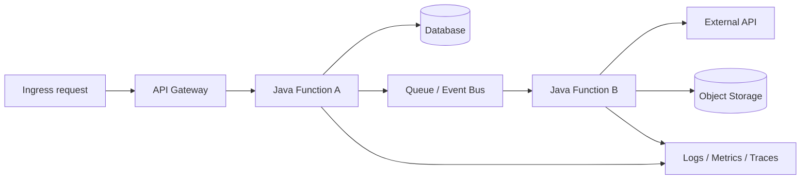

# Đo chi phí trên mỗi request và mỗi giao dịch nghiệp vụ

Serverless loại bỏ phần lớn công việc quản lý máy chủ, nhưng không làm cho chi phí tự động thấp hoặc dễ hiểu. Một request HTTP có thể kích hoạt nhiều function, publish nhiều message, đọc/ghi database, gọi dịch vụ bên ngoài và tạo log/trace. Một giao dịch nghiệp vụ có thể gồm nhiều request, retry và bước bất đồng bộ. Nếu chỉ lấy hóa đơn function chia cho số invocation, ta có thể bỏ sót phần lớn chi phí thực sự.

FinOps cần nối dữ liệu billing/usage với telemetry và kết quả nghiệp vụ để trả lời hai câu hỏi: **một request tiêu tốn bao nhiêu chi phí** và **một giao dịch nghiệp vụ thành công tiêu tốn bao nhiêu chi phí**. Hai chỉ số có mẫu số khác nhau và phục vụ các quyết định khác nhau.

Bài này trình bày cách xây dựng unit economics cho Java serverless: xác định cost boundary, đo request/invocation/event/business transaction, phân bổ shared cost, tính chi phí đầy đủ, đối soát với billing và dùng kết quả để cải thiện kiến trúc mà vẫn giữ SLA, độ tin cậy và tính đúng đắn.

## 1. Phân biệt request, invocation và giao dịch nghiệp vụ

### 1.1. Một request không đồng nghĩa một invocation

Với HTTP function, một request có thể gọi một function đúng một lần trong luồng đơn giản. Nhưng thực tế có thể có:

- API Gateway/proxy xử lý request;
- function gọi function khác;
- SDK retry một dependency;
- workflow chạy nhiều task;
- function publish message và consumer chạy sau đó;
- một timeout khiến caller gửi lại request;
- một request bị duplicate hoặc bị từ chối trước khi đến function.

Vì vậy, cần phân biệt các đơn vị đo:

| Đơn vị | Ý nghĩa | Ví dụ |
| --- | --- | --- |
| Ingress request | Một request đến API/edge | Một HTTP POST `/orders` |
| Function invocation | Một lần runtime thực thi handler | Một lần chạy Java Lambda/function |
| Attempt | Một lần thử gọi dependency hoặc xử lý event | HTTP retry lần 2 |
| Message/event delivery | Một lần broker giao event cho consumer | Message được redeliver |
| Workflow execution | Một lần chạy quy trình nhiều bước | Checkout workflow |
| Business transaction | Một đơn vị nghiệp vụ có identity ổn định | Một order/payment/claim |
| Successful business transaction | Một business transaction đạt trạng thái hoàn tất theo định nghĩa | Order chuyển `COMPLETED` |

Không dùng invocation count làm proxy cho số giao dịch nghiệp vụ. Một giao dịch có thể tạo nhiều invocation; một invocation batch có thể xử lý nhiều giao dịch.

### 1.2. Định nghĩa rõ business transaction

Trước khi tính unit cost, hãy thống nhất “một giao dịch thành công” là gì. Ví dụ với đặt hàng:

- Request được nhận vào API chưa có nghĩa là đơn hàng thành công.
- Ghi bản nháp order chưa có nghĩa là thanh toán thành công.
- Publish `OrderCreated` chưa có nghĩa các bước fulfillment đã hoàn tất.
- Chỉ khi order đạt trạng thái `COMPLETED` theo state machine mới được tính vào mẫu số successful order.

Với payment, có thể định nghĩa thành công là provider đã xác nhận capture và ledger đã ghi nhận. Định nghĩa này phải nhất quán giữa dashboard, billing allocation và báo cáo tài chính.

### 1.3. Identity phải ổn định qua retry

Dùng `businessTransactionId`, `orderId`, `paymentId` hoặc operation ID ổn định để nối các bước. Không dùng invocation ID, trace ID hoặc request ID làm business identity vì retry có thể tạo request/invocation/trace mới cho cùng một giao dịch.

Một business transaction có thể mang nhiều request ID, invocation ID và trace ID. Log/trace nên ghi correlation/causation để truy vết; metric không nên dùng transaction ID làm label vì cardinality sẽ tăng rất nhanh.

## 2. Cost boundary: tính những chi phí nào?

### 2.1. Chi phí trực tiếp của function

Tùy nền tảng và cấu hình, chi phí function có thể phụ thuộc vào:

- số invocation/request;
- thời gian thực thi được tính phí;
- memory/CPU hoặc cấu hình tài nguyên;
- kiến trúc CPU/runtime;
- concurrency/provisioned capacity;
- phần compute được tính riêng cho initialization hoặc execution;
- số lần retry, timeout và invocation thất bại.

Một công thức khái niệm cho compute kiểu GB-second:

\[
ComputeCost = \sum_{i=1}^{N} MemoryGB_i \times BilledDurationSeconds_i \times Rate
\]

Chi phí request có thể được tính riêng:

\[
InvocationCost = InvocationCount \times RequestRate
\]

Đây là mô hình khái niệm; đơn vị làm tròn, mức miễn phí, cách tính memory/CPU, kiến trúc, provisioned concurrency và giá cụ thể phụ thuộc nhà cung cấp, region và thời điểm. Dùng usage/billing export thực tế để tính, không suy ra hóa đơn chỉ từ duration trong log.

### 2.2. Chi phí của các dịch vụ đi kèm

Một Java function thường sử dụng nhiều dịch vụ khác:

| Nhóm chi phí | Ví dụ yếu tố tính phí |
| --- | --- |
| API/edge | Request count, data processing, cache, gateway tier |
| Queue/event bus/stream | API request, message size, throughput unit, partition/shard, retention |
| Database | Read/write request unit, IOPS, storage, backup, provisioned capacity, connection proxy |
| Object storage | Stored GB-month, PUT/GET, lifecycle, replication |
| Network | Egress, cross-zone/region transfer, NAT processing, private endpoint |
| Observability | Log ingestion/retention, metric series, trace ingest/indexing, alerting |
| Workflow/orchestration | State transition, task execution, workflow duration |
| Security/configuration | Secret access, key operations, audit events, certificate services |
| Shared platform | Monitoring cluster, registry, CI/CD, networking, support allocation |

Nếu chỉ tính function compute, unit cost có thể thấp giả tạo. Với workload database-heavy, chi phí database có thể lớn hơn nhiều lần chi phí function.

### 2.3. Chi phí cố định, biến đổi và shared cost

Phân loại chi phí thành:

- **Direct variable cost:** tăng gần theo request/usage, như invocation, message request hoặc data transfer.
- **Capacity/reserved cost:** trả cho capacity giữ sẵn, như provisioned concurrency, provisioned database capacity hoặc worker luôn chạy.
- **Shared overhead:** dùng chung cho nhiều service/tenant, như NAT gateway, log platform, cluster hoặc support.
- **One-time/change cost:** migration, data transfer ban đầu, build/release hoặc triển khai thay đổi lớn.

Báo cáo nên phân biệt marginal cost (chi phí tăng thêm khi xử lý một đơn vị) và fully-loaded cost (bao gồm phần chi phí capacity/shared được phân bổ). Hai chỉ số trả lời hai câu hỏi khác nhau.

## 3. Định nghĩa các chỉ số unit economics

### 3.1. Cost per request

Một cách tính phổ biến:

\[
CostPerRequest = \frac{AllocatedCost}{IngressRequestCount}
\]

Phải nêu rõ request count gồm những gì: tất cả request đến gateway, request hợp lệ, request được function nhận hay chỉ request thành công. Với vận hành API, nên theo dõi ít nhất:

- cost per ingress request;
- cost per accepted request;
- cost per successful HTTP response;
- cost per failed/rejected request.

Nếu mẫu số chỉ gồm request thành công, cần đặt tên rõ `CostPerSuccessfulRequest`. Không trộn các định nghĩa trong dashboard.

### 3.2. Cost per successful business transaction

Chỉ số chính để hiểu hiệu quả nghiệp vụ:

\[
CostPerSuccessfulTransaction =
\frac{AllocatedEndToEndCost}{UniqueCompletedBusinessTransactions}
\]

`UniqueCompletedBusinessTransactions` là số business transaction ID duy nhất đạt trạng thái hoàn tất trong kỳ. Tất cả chi phí của lần thử thất bại, retry, duplicate, workflow và dependency liên quan vẫn nằm trong tử số nếu chúng thuộc cùng cost boundary.

Nếu hệ thống nhận 100.000 order request nhưng chỉ hoàn thành 92.000 order, không chia tổng chi phí cho 100.000 rồi gọi đó là cost per successful order. Làm vậy che giấu chi phí của 8.000 order chưa hoàn tất.

### 3.3. Cost per attempt và cost per failure

Các chỉ số bổ sung:

\[
CostPerAttempt = \frac{AllocatedCost}{TotalAttempts}
\]

\[
CostPerFailedTransaction =
\frac{CostAllocatedToFailedTransactions}{UniqueFailedTransactions}
\]

Cost per attempt giúp hiểu chi phí thực thi/retry. Cost per failed transaction cho thấy mức chi phí bị tiêu hao vào các operation không hoàn tất. Cần định nghĩa failure terminal và kỳ đo; một transaction đang `PENDING` chưa chắc là failure.

### 3.4. Success rate và retry amplification

\[
SuccessRate = \frac{CompletedTransactions}{AcceptedTransactions}
\]

\[
RetryAmplification = \frac{TotalAttempts}{OriginalOperations}
\]

Nếu success rate giảm trong khi retry amplification tăng, cost per successful transaction thường tăng nhanh. Đây có thể là dấu hiệu dependency không ổn định, retry storm hoặc dữ liệu đầu vào có chất lượng kém.

### 3.5. Đừng so sánh các mẫu số không tương đương

So sánh cost per request giữa hai service chỉ có ý nghĩa khi định nghĩa request, phạm vi chi phí, kỳ đo và chất lượng kết quả tương đương. API tra cứu đơn giản và workflow thanh toán nhiều bước có cost/request rất khác nhau vì chúng tạo giá trị nghiệp vụ khác nhau.

## 4. Phân bổ chi phí cho một request hoặc business transaction

### 4.1. Direct attribution

Nếu usage có thể gắn trực tiếp với service hoặc operation, gán chi phí trực tiếp:

- function invocation thuộc service nào;
- queue/topic được service nào sở hữu;
- bucket/table dành riêng cho workload nào;
- API route thuộc sản phẩm nào;
- log group/resource nào thuộc service nào.

Direct attribution có độ tin cậy cao hơn phân bổ theo tỷ lệ tổng thể.

### 4.2. Shared cost allocation

Một số resource được nhiều service dùng chung. Chọn driver phản ánh mức tiêu thụ thực:

| Shared resource | Driver phân bổ gợi ý |
| --- | --- |
| Log platform | Bytes ingest hoặc GB-month theo service |
| Trace backend | Span/trace bytes hoặc ingest volume |
| Shared database | Query units, CPU time, I/O, bytes hoặc connection-time theo workload |
| NAT/network gateway | Bytes/GB processed theo source workload |
| Shared queue/event bus | Message count có trọng số theo kích thước hoặc throughput |
| Provisioned capacity | Peak/concurrency reservation hoặc capacity share đã cam kết |
| Cluster/platform overhead | Resource request/CPU/memory time hoặc tỷ lệ ownership có công bố |

Không phải lúc nào cũng có metric đủ chính xác. Nếu phải dùng proxy như request count, hãy ghi rõ giả định và xem đây là estimate, không phải direct metering.

### 4.3. Công thức phân bổ

Với một shared pool:

\[
AllocatedCost_s = SharedPoolCost \times
\frac{UsageWeight_s}{\sum_j UsageWeight_j}
\]

Trong đó `UsageWeight_s` là usage driver của service `s` trong cùng kỳ. Tổng chi phí được phân bổ phải bằng shared pool cost, ngoại trừ phần được giữ lại làm unallocated overhead và được báo cáo riêng.

### 4.4. Ví dụ phân bổ database

Giả sử database dùng chung có chi phí tháng 4.000 USD. Workload A tạo 60% query units, B tạo 30%, C tạo 10%. Nếu query units là driver đã được chấp nhận:

| Workload | Tỷ trọng usage | Chi phí phân bổ |
| --- | ---: | ---: |
| A | 60% | 2.400 USD |
| B | 30% | 1.200 USD |
| C | 10% | 400 USD |
| **Tổng** | **100%** | **4.000 USD** |

Nếu A tạo query nhẹ nhưng B tạo query scan nặng, query count đơn thuần có thể phân bổ sai. Khi có thể, dùng I/O/compute units hoặc driver có trọng số phản ánh resource consumption.

### 4.5. Phân bổ theo tenant

Để đo cost per tenant, không nhất thiết tạo một cloud resource cho từng tenant. Có thể ghi usage dimension ở application telemetry hoặc usage ledger với các trường tenant đã được bảo vệ. Tổng hợp theo tenant trong hệ thống analytics riêng.

Tránh đưa raw tenant ID vào metric labels nếu số tenant lớn. Dùng log/event hoặc bảng usage có kiểm soát; metric dùng nhóm tier/plan/region hoặc dimension cardinality thấp.

## 5. Nối billing data với telemetry

### 5.1. Billing là nguồn chi phí, telemetry là nguồn nguyên nhân

Billing export cho biết resource/usage/cost theo dimensions mà nhà cung cấp cung cấp. Application telemetry cho biết request nào, operation nào, retry bao nhiêu lần và business transaction có hoàn tất hay không.

Không nên coi trace duration là billing duration chính xác. Runtime có thể làm tròn duration, tính initialization, memory hoặc provisioned capacity theo quy tắc riêng. Billing export/usage API là nguồn chuẩn để đối soát chi phí.

### 5.2. Các chiều dữ liệu nên thống nhất

Ở resource/billing layer, chuẩn hóa các dimension:

- account/subscription/project;
- service/application;
- environment;
- owner/team/cost center;
- region;
- resource type;
- product/workload.

Ở application layer, chuẩn hóa:

- service và operation name;
- business transaction type;
- outcome (`SUCCEEDED`, `FAILED`, `REJECTED`, `PENDING`);
- attempt/retry count;
- event source/trigger;
- deployment version;
- tenant tier hoặc customer segment nếu policy cho phép.

Tên service/environment phải khớp hoặc có mapping rõ giữa cloud tags, deployment metadata và application telemetry.

### 5.3. Tagging strategy

Gắn tags/labels cho resource theo quy ước tổ chức, ví dụ:

```text
service       = orders-api
environment   = production
team          = commerce
cost-center   = CC-042
owner         = platform-orders
managed-by    = terraform
```

Không đưa secret, email, customer ID hoặc dữ liệu nhạy cảm vào resource tags. Tag coverage cần được kiểm tra tự động trong CI/IaC policy. Resource thiếu tag nên được đưa vào nhóm `unallocated` thay vì bị bỏ khỏi báo cáo.

### 5.4. Đối soát theo kỳ

Billing có thể được điều chỉnh do credit, discount, tax, reservation, commitment hoặc correction. Application telemetry thường đến theo thời gian thực. Vì vậy:

1. Thu thập usage/billing export theo kỳ và timezone thống nhất.
2. Chuẩn hóa currency, region, service và resource ID.
3. Tổng hợp telemetry theo cùng time window.
4. Join direct cost theo resource/service.
5. Phân bổ shared cost bằng driver đã thống nhất.
6. Đối chiếu tổng allocated + unallocated với invoice/export.
7. Ghi lại version của allocation rule để có thể tái lập báo cáo.

Không yêu cầu tổng application-level estimate khớp tuyệt đối từng ngày với invoice; hãy giải thích độ trễ, rounding và adjustment. Monthly close cần dùng billing source chính thức.

## 6. Mô hình tính chi phí end-to-end

### 6.1. Tổng chi phí của một business transaction

Một business transaction có thể bao gồm:



Chi phí end-to-end phải tính phần resource tiêu thụ bởi cả chuỗi. Không cộng toàn bộ monthly database cost vào từng request; trước hết phân bổ database cost cho workload/service, sau đó chia theo số business transaction hoặc usage weight trong service đó.

### 6.2. Cost ledger theo operation

Một usage ledger nội bộ có thể lưu:

| Field | Mục đích |
| --- | --- |
| `period` | Kỳ tổng hợp |
| `service` | Service owner |
| `operation` | Loại operation |
| `transaction_type` | Order/payment/report... |
| `ingress_request_count` | Số request đến ranh giới API đã chọn |
| `accepted_count` | Số operation được nhận |
| `completed_count` | Số operation hoàn tất duy nhất |
| `failed_count` | Số operation thất bại terminal |
| `invocation_count` | Tổng function invocation |
| `attempt_count` | Tổng attempt |
| `direct_cost` | Chi phí gắn trực tiếp |
| `allocated_shared_cost` | Shared cost được phân bổ |
| `currency` | Đơn vị tiền |
| `allocation_version` | Phiên bản quy tắc phân bổ |

Không cần ghi một row cho mọi request nếu volume lớn. Có thể aggregate theo time bucket/service/operation và lưu transaction-level event ở nơi khác cho điều tra.

### 6.3. Tính unit cost từ ledger

```sql
SELECT
    service,
    operation,
    SUM(direct_cost + allocated_shared_cost)
        / NULLIF(SUM(ingress_request_count), 0) AS cost_per_request,
    SUM(direct_cost + allocated_shared_cost)
        / NULLIF(SUM(completed_transaction_count), 0)
        AS cost_per_successful_transaction
FROM service_cost_daily
WHERE period >= :fromDate
  AND period < :toDate
GROUP BY service, operation;
```

`NULLIF` tránh chia cho 0. Nếu chưa có completed transaction trong kỳ, unit cost phải hiển thị `N/A` hoặc không xác định; không hiển thị 0 vì có chi phí nhưng chưa tạo thành công giao dịch nào.

## 7. Ví dụ tính cost per request và cost per transaction

### 7.1. Số liệu giả định trong một tháng

Giả sử workload `orders` có các số liệu sau. Tất cả con số tiền dưới đây chỉ để minh họa phép tính, không phải bảng giá của cloud provider.

| Thành phần | Chi phí tháng |
| --- | ---: |
| Java function compute + invocation | 720 USD |
| API Gateway/edge | 300 USD |
| Queue/event bus | 180 USD |
| Database | 4.800 USD |
| Object storage | 600 USD |
| Network/data transfer | 900 USD |
| Logs/metrics/traces | 1.500 USD |
| Shared platform allocation | 3.000 USD |
| **Tổng allocated cost** | **12.000 USD** |

Usage trong tháng:

- 2.000.000 ingress request;
- 2.800.000 function invocation;
- 150.000 business transaction hoàn tất duy nhất;
- 10.000 business transaction thất bại terminal.

### 7.2. Cost per request

\[
\frac{12.000}{2.000.000} = 0,006\ USD/request
\]

Tức 0,6 cent cho mỗi ingress request. Chỉ số này bao gồm cả request không tạo ra giao dịch hoàn tất.

### 7.3. Cost per successful transaction

\[
\frac{12.000}{150.000} = 0,08\ USD/transaction
\]

Tức 8 cent cho mỗi giao dịch hoàn tất. Đây là chỉ số phản ánh chi phí để tạo ra kết quả nghiệp vụ theo định nghĩa đã chọn.

### 7.4. Vì sao hai con số khác nhau?

Một transaction có thể tạo nhiều request/invocation và có một phần operation thất bại. Nếu chỉ nhìn cost per request, ta có thể nghĩ workload rất rẻ, trong khi cost per successful transaction cao vì:

- nhiều request không tạo ra kết quả nghiệp vụ;
- retry làm tăng invocation và dependency usage;
- workflow nhiều bước sử dụng database/queue/network;
- shared overhead được tính đầy đủ vào service.

### 7.5. Phân tích độ nhạy

Nếu giữ tổng chi phí 12.000 USD nhưng chỉ hoàn tất 120.000 transaction, cost per successful transaction tăng lên 0,10 USD. Nếu tối ưu retry/DB và tổng chi phí giảm còn 10.800 USD, đồng thời hoàn tất 150.000 transaction, unit cost giảm còn 0,072 USD.

```text
Scenario A: 12,000 / 150,000 = $0.080 per success
Scenario B: 12,000 / 120,000 = $0.100 per success
Scenario C: 10,800 / 150,000 = $0.072 per success
```

Đừng đánh giá tối ưu chỉ qua tổng bill. Cần xem unit cost, success rate, latency, error rate và chất lượng dịch vụ cùng lúc.

## 8. Đo business outcome trong Java

### 8.1. Đặt metric ở ranh giới nghiệp vụ

Function invocation metric do nền tảng cung cấp không cho biết order đã hoàn tất hay chưa. Ứng dụng cần phát metric khi business state transition thành công hoặc thất bại terminal.

Các metric gợi ý:

- `business_transactions_accepted_total`;
- `business_transactions_completed_total`;
- `business_transactions_failed_total`;
- `business_transaction_duration`;
- `business_operation_attempts_total`;
- `business_operation_retries_total`.

Metric name cụ thể có thể theo naming convention của hệ thống. Quan trọng là định nghĩa event phát metric chỉ một lần cho mỗi state transition hợp lệ, tránh increment completed counter mỗi khi duplicate message được giao lại.

### 8.2. Java với Micrometer

Ví dụ dùng Micrometer `MeterRegistry`:

```java
import io.micrometer.core.instrument.MeterRegistry;
import io.micrometer.core.instrument.Timer;

import java.util.concurrent.TimeUnit;

public final class BusinessMetrics {
    private final MeterRegistry registry;

    public BusinessMetrics(MeterRegistry registry) {
        this.registry = registry;
    }

    public void accepted(String operation) {
        registry.counter("business.transactions.accepted",
                "operation", operation).increment();
    }

    public void completed(String operation) {
        registry.counter("business.transactions.completed",
                "operation", operation).increment();
    }

    public void failed(String operation, String category) {
        registry.counter("business.transactions.failed",
                "operation", operation,
                "category", category).increment();
    }

    public void recordDuration(String operation, long nanos) {
        Timer.builder("business.transaction.duration")
                .tag("operation", operation)
                .register(registry)
                .record(nanos, TimeUnit.NANOSECONDS);
    }
}
```

Chỉ dùng tag có cardinality thấp như operation, outcome, region hoặc tier. Không gắn `orderId`, `paymentId`, email, request ID hoặc trace ID vào metric tag. Các ID cụ thể thuộc structured log/trace hoặc usage ledger có kiểm soát.

### 8.3. Metric phải gắn với commit thành công

Nếu increment `completed` trước khi transaction database commit, metric có thể ghi nhận thành công dù transaction rollback. Nếu increment sau commit nhưng function crash trước khi export metric, metric có thể bị thiếu.

Với số liệu cần đối soát chính xác, ghi business outcome vào bảng/outbox cùng transaction, sau đó aggregate thành metric/report. Metrics streaming có thể phục vụ dashboard gần thời gian thực nhưng không nhất thiết là ledger tài chính chính thức.

### 8.4. Ghi attempt và retry

Đếm attempt ở dependency boundary hoặc middleware có retry policy. Mỗi lần retry tăng attempt counter; event/message ID và operation ID nên nằm trong log/trace để nối attempt với transaction. Đừng phát business transaction completed lần nữa khi consumer chỉ đang acknowledge duplicate.

## 9. Gắn cost dimension với trace và log

### 9.1. Span attributes hữu ích

Có thể ghi các thuộc tính ít nhạy cảm lên span:

- `service.name`, `deployment.environment`;
- `business.operation`;
- `business.transaction.type`;
- `business.outcome`;
- `retry.attempt`;
- `messaging.destination` hoặc trigger type;
- resource class/tier.

Trace giúp tìm chuỗi invocation và dependency của một giao dịch. Nhưng không nên dùng trace backend làm hệ thống tính hóa đơn duy nhất vì sampling có thể bỏ span và retention/indexing có thể không phù hợp với đối soát.

### 9.2. Correlation ID và privacy

Dùng correlation/transaction ID để nối log của một workflow. Kiểm soát quyền truy cập và retention; không ghi payload nhạy cảm hoặc PII vào trace attributes. Nếu cần phân tích tenant, dùng tenant tier/segment hoặc mã pseudonymous theo policy.

### 9.3. Sampling không được làm sai business denominator

Không tính số successful transaction bằng cách đếm trace sampled. Trace sampling chỉ phục vụ quan sát. Mẫu số phải đến từ business outcome ledger hoặc metric không sample với semantics rõ.

## 10. Chi phí của retry, failure và duplicate

### 10.1. Retry có chi phí ở nhiều tầng

Một retry có thể phát sinh:

- thêm invocation compute;
- thêm API/DB request;
- thêm queue receive/delete hoặc stream processing;
- thêm network transfer;
- thêm log/trace;
- kéo dài workflow và giữ capacity;
- tăng DLQ storage/retention.

Chi phí retry nên được tính vào transaction đã tạo ra retry. Nếu retry cuối cùng thành công, cost per successful transaction vẫn bao gồm toàn bộ lần thử trước đó.

### 10.2. Failed request vẫn tiêu tốn chi phí

Validation failure có thể rẻ nếu bị chặn ở gateway; timeout sau khi chạy function 20 giây và gọi ba dependency có chi phí lớn hơn. Phân loại failure theo stage và category để xác định nơi tiêu tốn.

Đo:

- rejected before compute;
- function validation failure;
- dependency failure;
- timeout;
- retry exhausted/DLQ;
- business rejection sau khi đã dùng tài nguyên.

### 10.3. Duplicate delivery

Duplicate event có thể không tạo business side effect nếu idempotency hoạt động, nhưng vẫn tốn compute, queue request và database read/dedup check. Theo dõi duplicate delivery rate và cost overhead; không coi duplicate được xử lý an toàn là miễn phí.

### 10.4. Retry storm làm unit cost tăng phi tuyến

Khi dependency chậm, retry tăng tải lên dependency và kéo dài execution. Khi throughput thành công giảm, tử số tăng trong khi mẫu số successful transaction không tăng tương ứng. Cost per success vì vậy có thể tăng mạnh hơn cost per invocation.

## 11. Chi phí async workflow và batch processing

### 11.1. Một transaction có nhiều event

Một order có thể tạo `OrderCreated`, `InventoryReserved`, `PaymentCaptured` và `ShipmentRequested`. Mỗi event có producer, queue và consumer cost. Nối chúng bằng correlation/causation ID để phân tích end-to-end.

### 11.2. Batch làm thay đổi denominator

Một invocation batch có thể xử lý 100 message. Nếu chia function cost cho invocation count, cost/invocation có thể cao; cost/message lại thấp hơn. Nếu batch có 10 message lỗi và retry cả batch, cần tính số attempt và số unique business transaction thực sự hoàn tất.

Đo riêng:

- messages received;
- unique messages processed;
- records succeeded/failed per batch;
- batch retry count;
- partial batch failure count;
- business transactions completed.

### 11.3. Workflow state transition

Workflow orchestrator có thể tính phí theo state transition/task execution. Một workflow nhiều bước hoặc retry loop có thể tạo nhiều transition cho một business transaction. Theo dõi transition count per completed transaction và thời gian chờ giữa các bước.

## 12. Chi phí capacity, idle và provisioned concurrency

### 12.1. On-demand và provisioned capacity

On-demand compute thường phù hợp với workload bursty hoặc ít sử dụng. Provisioned concurrency/capacity có thể giảm cold start và cải thiện latency nhưng tạo chi phí giữ sẵn capacity, kể cả khi không có request.

Khi so sánh, tính:

- compute/request on-demand;
- capacity reservation/provisioned concurrency;
- utilization theo giờ;
- peak concurrency và headroom;
- latency/SLO benefit;
- cost per successful transaction trong giờ thấp điểm và cao điểm.

Không chỉ so giá mỗi invocation. Một cấu hình provisioned có thể đắt hơn theo tháng nhưng giảm timeout/retry và tăng success rate; hoặc ngược lại, capacity giữ sẵn có thể bị lãng phí phần lớn thời gian.

### 12.2. Java memory sizing

Tăng memory có thể tăng CPU/network throughput ở một số FaaS platform. Function chạy nhanh hơn có thể bù một phần mức giá tài nguyên cao hơn. Benchmark nhiều memory size bằng cùng workload và so sánh:

- p50/p95/p99 duration;
- billed duration;
- timeout/error rate;
- cold start/init duration;
- cost per invocation;
- cost per successful transaction.

Chọn điểm tối ưu theo SLO và unit economics, không chọn memory nhỏ nhất theo thói quen.

### 12.3. Scale-to-zero và baseline services

Function có thể scale về zero, nhưng database provisioned, NAT gateway, cache cluster, provisioned stream capacity hoặc observability platform vẫn có thể tính phí khi idle. Đo baseline cost trong giờ không có traffic để tìm phần chi phí cố định.

### 12.4. Connection pool và concurrency

Tăng function concurrency có thể làm database connection, proxy capacity, NAT, downstream API và log volume tăng theo. Cost model cần có giới hạn downstream; scale-out vô hạn có thể làm bill tăng trong khi success rate giảm.

## 13. Chi phí observability

### 13.1. Log volume

Log mỗi request với payload lớn có thể tạo chi phí ingest và retention đáng kể. Dùng structured log, log level theo environment, sampling cho debug detail và không log cùng một exception ở mọi tầng.

Không bỏ audit/business record cần thiết chỉ để giảm log cost. Tách audit log có retention/immutability phù hợp khỏi diagnostic log có thể sampling/TTL ngắn hơn.

### 13.2. Trace volume và sampling

Trace sampling giảm ingest/index cost nhưng làm mất một phần trace. Có thể ưu tiên giữ error/slow trace bằng tail sampling nếu pipeline hỗ trợ. Không dùng trace sampled để tính transaction count hoặc chargeback.

### 13.3. Metric cardinality

Metric label theo order ID, user ID hoặc request ID tạo time series mới liên tục, tăng cost và làm query chậm. Chỉ dùng dimensions có cardinality giới hạn; dùng log/trace/warehouse cho phân tích chi tiết.

### 13.4. Retention tier

Chọn retention theo mục đích:

- diagnostic log ngắn hạn;
- security/audit log theo policy;
- billing export và usage ledger theo thời hạn tài chính;
- trace theo thời gian đủ điều tra;
- aggregate metric lâu hơn raw high-cardinality data.

Lifecycle policy cần được kiểm thử để tránh xóa nhầm dữ liệu phục vụ audit hoặc đối soát.

## 14. Cost dashboard và FinOps operating model

### 14.1. Dashboard tối thiểu

Theo dõi theo service, environment, operation và kỳ:

| Chỉ số | Câu hỏi trả lời |
| --- | --- |
| Total cost | Service tiêu bao nhiêu? |
| Cost per ingress request | Request trung bình tốn bao nhiêu? |
| Cost per successful transaction | Tạo một kết quả nghiệp vụ tốn bao nhiêu? |
| Success rate | Bao nhiêu operation được hoàn tất? |
| Retry amplification | Mỗi operation tạo bao nhiêu attempt? |
| Cost by component | Function, DB, queue, network hay observability chiếm phần lớn? |
| Idle/baseline cost | Bao nhiêu chi phí tồn tại khi traffic thấp? |
| Forecast vs budget | Chi phí có vượt kế hoạch không? |
| Unallocated cost | Bao nhiêu chi phí chưa có owner/driver? |

Hiển thị trend theo ngày/tuần/tháng và annotate release/incident để thấy thay đổi sau deploy.

### 14.2. Showback và chargeback

- **Showback:** báo cáo chi phí cho team/service owner để họ hiểu mức sử dụng.
- **Chargeback:** phân bổ chi phí vào cost center hoặc đơn vị chịu ngân sách.

Nên bắt đầu bằng showback với allocation rule minh bạch. Chỉ chargeback khi ownership, driver, currency, adjustment và quy trình dispute đã rõ. Không tạo động lực sai bằng cách tính mọi chi phí shared theo request count nếu workload tiêu thụ tài nguyên rất khác nhau.

### 14.3. Budget và anomaly alert

Đặt budget theo service/environment và alert theo:

- actual vs forecast;
- daily spend spike;
- cost per successful transaction vượt baseline;
- retry amplification tăng;
- log/trace ingest bất thường;
- resource không có owner/tag;
- idle capacity kéo dài.

Alert chi phí nên đi cùng metric reliability. Một đợt tăng cost có thể là traffic tăng tốt; cũng có thể là retry storm hoặc event loop. Cần phân tích nguyên nhân trước khi giảm capacity.

### 14.4. Forecast

Forecast đơn giản có thể dùng:

\[
ForecastCost = ForecastVolume \times ExpectedUnitCost + FixedCapacityCost
\]

Unit cost phải dựa trên workload gần đây và giả định về success rate, retry, payload, region và service mix. Với scale tiers/discounts, dùng mô hình bậc thang thay vì giả định cost tuyến tính.

## 15. Tối ưu cost per successful transaction

### 15.1. Tối ưu đúng bottleneck

Ưu tiên theo cost breakdown:

- Function compute chiếm cao: benchmark memory/runtime, giảm initialization và thời gian chờ.
- Database chiếm cao: tối ưu query/index, batch, cache read, giảm scan và connection churn.
- Queue/workflow chiếm cao: batch hợp lý, bỏ event không cần thiết, giảm state transition thừa.
- Network/NAT chiếm cao: giảm cross-zone/region traffic, gom request và chọn topology phù hợp.
- Observability chiếm cao: giảm log volume/cardinality, điều chỉnh retention/sampling.
- Retry chiếm cao: phân loại lỗi, backoff+jitter, idempotency, circuit breaker và sửa dependency.

### 15.2. Batch và coalescing

Batch nhiều thao tác tương tự có thể giảm request overhead, nhưng batch quá lớn làm tăng latency, memory, retry blast radius và partial failure complexity. Đo cost per record và cost per completed transaction trước/sau.

Request coalescing/caching có thể giảm read load cho hot key. Tính thêm chi phí cache, stale data, invalidation và correctness.

### 15.3. Giảm retry thay vì chỉ giảm memory

Nếu 30% invocation là retry do database throttling, giảm memory function có thể giảm cost compute trên attempt nhưng không xử lý nguyên nhân. Tối ưu concurrency, connection pool, backoff và database capacity có thể giảm cả retry và cost per success.

### 15.4. Tối ưu Java startup và dependency

Giảm classpath, tránh khởi tạo client không cần thiết, reuse thread-safe client trong warm environment và chọn runtime phù hợp có thể giảm init duration. Nhưng đo billed behavior của platform: cold start/init có thể được tính khác nhau tùy runtime và dịch vụ.

### 15.5. Cân nhắc FaaS hay container/worker luôn chạy

Với workload liên tục, concurrency ổn định và utilization cao, service/container luôn chạy có thể rẻ hơn function on-demand cộng với nhiều overhead. Với workload bursty, không đều hoặc event-driven, FaaS có thể phù hợp hơn. So sánh cùng SLO, redundancy, operations, idle capacity và fully-loaded cost.

Không quyết định chỉ từ một con số invocation price; tính cost per successful business transaction end-to-end.

## 16. Java: ghi nhận business outcome và attempt

Ví dụ service ghi nhận outcome sau khi persistence layer xác nhận transition. `BusinessMetrics` chỉ là telemetry; nếu cần denominator tài chính chính xác, hãy ghi outcome event vào transactional outbox/ledger rồi aggregate.

```java
public final class OrderApplicationService {
    private final OrderRepository orders;
    private final BusinessMetrics metrics;

    public OrderApplicationService(
            OrderRepository orders,
            BusinessMetrics metrics) {
        this.orders = orders;
        this.metrics = metrics;
    }

    public OrderResult complete(String orderId) {
        long startedNanos = System.nanoTime();

        try {
            // Repository performs an idempotent, conditional state transition.
            boolean transitioned = orders.markCompletedIfEligible(orderId);
            if (transitioned) {
                metrics.completed("complete_order");
            }
            return transitioned
                    ? OrderResult.completed(orderId)
                    : OrderResult.alreadyCompletedOrNotEligible(orderId);
        } catch (PermanentBusinessException error) {
            metrics.failed("complete_order", "business_rejected");
            throw error;
        } finally {
            metrics.recordDuration("complete_order",
                    Math.max(0, System.nanoTime() - startedNanos));
        }
    }
}
```

Đây là ví dụ về vị trí instrumentation, không phải một implementation ledger hoàn chỉnh. Trong code thực tế:

- `accepted` nên phát tại đúng ranh giới accepted và tránh đếm lại khi retry nội bộ;
- `completed` chỉ phát khi transition thành công lần đầu;
- duplicate/already-completed không tăng completed count;
- failure metric chỉ tăng cho failure category được định nghĩa;
- dùng monotonic clock (`System.nanoTime()` hoặc abstraction tương ứng) để đo duration;
- nếu metric bị mất khi process kết thúc, dùng outbox/usage ledger để làm nguồn số liệu đối soát.

## 17. Data quality và kiểm soát sai lệch

### 17.1. Các lỗi thường gặp

- Đếm invocation thay cho business transaction.
- Đếm duplicate event nhiều lần là transaction mới.
- Bỏ chi phí retry/failure khỏi tử số.
- Dùng trace sampled làm mẫu số.
- Phân bổ database/network theo request count dù workload khác nhau nhiều.
- Quên provisioned capacity hoặc idle baseline.
- Gộp staging/test traffic với production.
- Không tính credit/discount/tax/commitment nhất quán.
- Dùng timezone khác nhau giữa billing và telemetry.

### 17.2. Reconciliation checks

Định kỳ kiểm tra:

- tổng cost theo resource/service khớp billing export sau adjustment;
- tổng allocated shared cost không vượt shared pool;
- allocated + unallocated = total cost trong allocation model;
- completed business transaction không lớn hơn accepted transaction nếu semantics không cho phép;
- event/outbox completion count khớp ledger;
- invocation/attempt count giải thích được chênh lệch so với request count;
- không có transaction bị đếm completed nhiều lần.

### 17.3. Version hóa allocation rules

Khi thay đổi driver phân bổ shared cost, lưu allocation rule version và ngày hiệu lực. Không âm thầm tính lại lịch sử theo quy tắc mới mà không ghi chú; nếu cần restatement, phát hành báo cáo điều chỉnh có thể truy vết.

## 18. Quy trình triển khai FinOps cho một Java serverless service

1. Xác định service owner, cost center, environment và cost boundary.
2. Định nghĩa request, invocation, attempt và business transaction.
3. Chọn business success state và identity ổn định.
4. Bật billing/usage export và chuẩn hóa resource tags.
5. Thu thập request, invocation, message, retry và business outcome metrics.
6. Phân bổ direct cost; chọn driver cho shared cost và công bố giả định.
7. Tính cost per request, cost per successful transaction, cost per failure và retry amplification.
8. Đối soát tổng với billing theo kỳ và lưu allocation version.
9. Tạo dashboard theo service/operation/environment và alert anomaly.
10. Xếp hạng cost driver theo tỷ trọng và tác động lên unit cost.
11. Thử một thay đổi tối ưu trong staging/canary; đo lại cost cùng SLO.
12. Theo dõi trend sau release và cập nhật forecast/budget.

## 19. Checklist production và FinOps

- [ ] Đã định nghĩa rõ ingress request, invocation, attempt và business transaction.
- [ ] Business transaction có ID ổn định xuyên retry/workflow.
- [ ] Đã định nghĩa trạng thái nào được tính là successful transaction.
- [ ] Cost boundary bao gồm function, API, queue, DB, storage, network và observability.
- [ ] Phân biệt direct, variable, reserved/capacity và shared overhead.
- [ ] Cost per request nêu rõ mẫu số và phạm vi request.
- [ ] Cost per successful transaction dùng số transaction hoàn tất duy nhất.
- [ ] Retry, duplicate, failure và workflow step được tính trong tử số.
- [ ] Shared cost có allocation driver và phần unallocated được công bố.
- [ ] Resource tags/labels có service, environment, owner và cost center.
- [ ] Billing export là nguồn chi phí chính thức; telemetry là nguồn nguyên nhân/outcome.
- [ ] Không dùng sampled trace hoặc high-cardinality metric làm financial ledger.
- [ ] Business outcome được ghi sau commit hoặc qua transactional outbox.
- [ ] Dashboard có success rate, retry amplification và unit cost.
- [ ] Provisioned/idle capacity và cold start được tính trong mô hình.
- [ ] Database/network/logging/queue được kiểm tra như cost driver riêng.
- [ ] Budget, forecast và anomaly alert có owner/runbook.
- [ ] Tối ưu cost không làm vi phạm SLO, security hoặc data correctness.
- [ ] Allocation rule có version và reconciliation với billing.

## Kết luận

Cost per request đo hiệu quả của một đơn vị traffic ở ranh giới đã chọn. Cost per successful business transaction đo chi phí để tạo ra một kết quả nghiệp vụ hoàn tất. Trong serverless, hai chỉ số có thể khác xa vì một giao dịch thường tạo nhiều invocation, message, workflow step, dependency call và retry.

Để tính đúng, hãy kết hợp billing/usage export với application telemetry và business outcome ledger. Phân bổ shared cost bằng driver minh bạch, tính cả failed/retried work vào tử số và chỉ đếm mỗi business transaction hoàn tất một lần ở mẫu số. Dùng metric cardinality thấp cho dashboard, log/trace cho điều tra và outbox/ledger cho số liệu cần đối soát.

FinOps hiệu quả tối ưu cost per successful transaction cùng success rate, latency, reliability và correctness. Khi hiểu cost breakdown, nhóm có thể chọn đúng hành động: giảm retry, tối ưu database, batch hợp lý, điều chỉnh memory/concurrency, kiểm soát idle capacity hoặc giảm observability noise. Mọi thay đổi cần được đo lại trên cùng workload và SLO để chứng minh unit economics thực sự tốt hơn.
