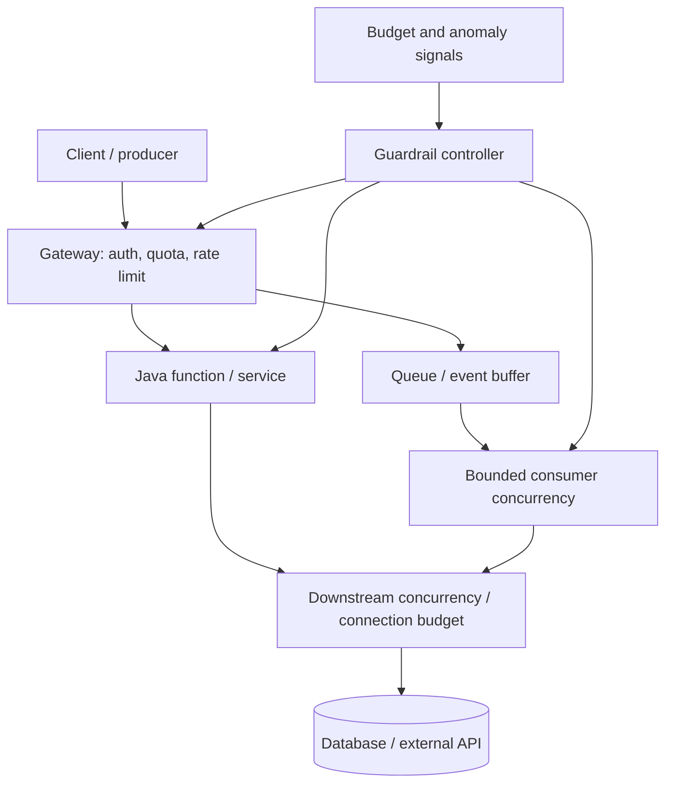

# Thiết lập ngân sách, cảnh báo bất thường và hạn mức bảo vệ

## 1. Mục tiêu FinOps cho ứng dụng serverless

Serverless giúp đội phát triển không phải tự quản lý máy chủ, nhưng không có nghĩa chi phí tự động thấp hoặc tự động nằm trong ngân sách. Function có thể scale nhanh theo traffic, queue backlog, retry hoặc lỗi cấu hình. Một vòng lặp event, một endpoint public bị lạm dụng hoặc một lần bật log quá chi tiết có thể làm chi phí tăng trước khi nhóm kịp nhận ra.

FinOps kết hợp tài chính, kỹ thuật và vận hành để đưa ra quyết định chi phí dựa trên dữ liệu. Với ứng dụng Java serverless, mục tiêu không chỉ là giảm hóa đơn cuối tháng. Nhóm cần biết:

- Workload nào tạo ra chi phí và team nào chịu trách nhiệm.
- Một request hoặc một kết quả nghiệp vụ thành công tiêu tốn bao nhiêu.
- Chi phí thực tế đang đi đúng ngân sách và forecast hay không.
- Mức tăng là do tăng trưởng hợp lệ, thay đổi kiến trúc hay sự cố.
- Hạn mức nào có thể ngăn workload gây thiệt hại quá lớn.
- Hành động giảm chi phí có làm vi phạm SLO, mất dữ liệu hoặc gián đoạn nghiệp vụ không.

Một chương trình FinOps tốt cần ba khả năng bổ trợ nhau:

1. **Plan and allocate:** lập ngân sách, forecast và phân bổ chi phí đến service/team/tenant.
2. **Detect and explain:** theo dõi actual spend, dự báo và bất thường; tìm nguyên nhân theo workload.
3. **Protect and optimize:** giới hạn mức tiêu thụ, tự động phản ứng có kiểm soát và tối ưu cost per business outcome.

Ngân sách là mục tiêu quản trị. Quota, concurrency, rate limit và spend cap là các cơ chế kiểm soát tiêu thụ. Cảnh báo chi phí giúp phát hiện sai lệch; nó không thay thế giới hạn runtime.

## 2. Hiểu đầy đủ cost model của serverless

### 2.1. Không chỉ có tiền chạy function

Một request HTTP hoặc một message có thể tạo ra nhiều khoản phí ở các dịch vụ khác nhau. Tổng chi phí nên được nhìn theo toàn bộ đường đi của workload:

\[
C_{total} = C_{compute} + C_{requests} + C_{warm} + C_{network} + C_{observability} + C_{storage} + C_{events} + C_{dependencies}
\]

Các thành phần thường gặp:

| Thành phần | Ví dụ chi phí |
| --- | --- |
| Function compute | Thời gian chạy nhân với memory/CPU được cấp phát |
| Invocation/request | Số lần function được gọi hoặc request được xử lý |
| Warm/provisioned capacity | Provisioned concurrency, always-ready/min instances, instance idle theo billing mode |
| Network | Internet egress, cross-region transfer, NAT, VPC connector, private endpoint hoặc load balancer |
| Observability | Log ingestion/retention, metrics, traces, alerting và export dữ liệu |
| Messaging/event | Queue operations, event delivery, stream throughput, retries, DLQ và polling |
| Storage | Object, database, cache, backup, snapshot và request đọc/ghi |
| Workflow/orchestration | State transition, activity, history, polling và durable storage |
| Build/release | Artifact registry, image storage, build minutes và môi trường preview |
| Dependency | Database, API gateway, identity provider, payment API hoặc dịch vụ SaaS |

Nếu chỉ xem dòng “Lambda” hoặc “Functions” trên hóa đơn, nhóm có thể bỏ sót phần lớn chi phí do function gây ra ở database, log, network và message broker.

### 2.2. Các driver chi phí của Java function

Chi phí compute thường phụ thuộc vào:

- Số invocation.
- Memory/CPU được cấp phát.
- Thời gian thực thi được tính phí.
- Region và kiến trúc CPU.
- Billing mode và loại hosting plan.
- Provisioned/warm instances và thời gian giữ chúng.
- Retry, timeout và invocation bị gọi lặp.

Với function Java, runtime startup, class loading, dependency injection, JIT warm-up và kết nối dependency có thể kéo dài duration. Cold start không phải lúc nào cũng là khoản phí riêng, nhưng phần thời gian tính phí khi khởi tạo có thể tác động đến duration và trải nghiệm người dùng tùy nền tảng/billing model.

Memory cao hơn không nhất thiết luôn đắt hơn trên mỗi kết quả. Nếu tăng memory đồng thời tăng CPU và làm function chạy nhanh hơn đáng kể, tổng GB-second có thể giảm. Phải benchmark bằng workload đại diện thay vì chọn memory nhỏ nhất theo cảm tính.

### 2.3. Chi phí có thể khuếch đại bởi retry và fan-out

Một message lỗi có thể được retry nhiều lần. Một event có thể kích hoạt nhiều function; mỗi function lại gọi database, log và publish event tiếp. Nếu không có idempotency, retry policy và giới hạn fan-out, một lỗi nhỏ có thể tạo ra lượng invocation lớn.

Các chỉ số cần phân biệt:

- **Logical operations:** số thao tác nghiệp vụ thực sự được gửi.
- **Attempts:** tổng số lần thực thi, gồm retry và redelivery.
- **Successful outcomes:** số kết quả nghiệp vụ thành công.
- **Wasted executions:** execution không tạo ra kết quả hữu ích, ví dụ retry lặp, timeout hoặc xử lý trùng.

Tỷ lệ khuếch đại do retry có thể ước lượng:

\[
Retry\ amplification = \frac{Total\ attempts}{Logical\ operations}
\]

Nếu 10.000 event tạo ra 14.000 invocation attempt, hệ thống có hệ số 1,4. Đây không tự động là lỗi vì một số retry là cần thiết, nhưng xu hướng tăng nhanh cần được điều tra.

## 3. Đo unit economics thay vì chỉ nhìn tổng hóa đơn

### 3.1. Cost per successful outcome

Tổng chi phí tháng có thể tăng vì sản phẩm tăng trưởng. Chỉ nhìn tổng hóa đơn sẽ không phân biệt tăng trưởng tốt với hiệu suất xấu. Hãy đo chi phí theo kết quả nghiệp vụ:

\[
Cost\ per\ outcome = \frac{Total\ allocated\ cost}{Successful\ business\ outcomes}
\]

Ví dụ:

| Chỉ số | Tháng A | Tháng B |
| --- | ---: | ---: |
| Chi phí được phân bổ cho order service | 1.000 USD | 1.200 USD |
| Đơn hàng tạo thành công | 100.000 | 150.000 |
| Cost/order | 0,010 USD | 0,008 USD |

Tổng chi phí tăng 20%, nhưng cost/order giảm 20%. Đây có thể là tăng trưởng hiệu quả. Nếu chi phí tăng 20% trong khi số đơn hàng không đổi, nhóm cần tìm nguyên nhân.

### 3.2. Các unit metric phù hợp

| Workload | Đơn vị đo chi phí |
| --- | --- |
| HTTP API | Cost per 1.000 request thành công, hoặc cost per transaction |
| Payment webhook | Cost per webhook được xử lý đúng một lần |
| Queue consumer | Cost per 1.000 message hoàn tất |
| Workflow | Cost per workflow hoàn tất trong SLA |
| Image/document processing | Cost per file/page được xử lý thành công |
| Report/export | Cost per report hoàn tất hoặc mỗi GB dữ liệu xuất |
| Notification | Cost per notification delivered |
| Multi-tenant SaaS | Cost per tenant/seat/usage unit theo tier |

Không dùng invocation count làm mẫu số duy nhất nếu nhiều invocation thất bại hoặc xử lý trùng. Với workflow nhiều bước, có thể tính cost theo toàn bộ workflow thay vì cộng riêng từng function rồi bỏ sót orchestration/storage.

### 3.3. Đo trade-off cost, latency và reliability

Tối ưu chi phí không phải luôn giảm memory, concurrency hoặc warm capacity. Nếu giảm memory khiến function chạy lâu gấp đôi, GB-second và timeout/retry có thể tăng. Nếu tắt provisioned/warm capacity, chi phí nền giảm nhưng cold start có thể vi phạm latency SLO.

Một thay đổi chỉ được xem là tối ưu khi so sánh ít nhất:

- Cost per successful outcome.
- p50/p95/p99 latency.
- Error/timeout rate.
- Retry và DLQ rate.
- Queue age hoặc workflow completion time.
- Capacity headroom và dependency load.

## 4. Ví dụ tính chi phí theo mô hình tiêu thụ

### 4.1. Công thức tổng quát cho function

Với một mô hình tính phí theo request và compute duration:

\[
C_{function} = N_{billable\ requests} \times P_{request} + GBs \times P_{GBs}
\]

Trong đó:

\[
GBs = Memory_{GB} \times BillableDuration_{seconds}
\]

Đây là công thức khái niệm. Provider có thể làm tròn duration, áp dụng free grant, kiến trúc CPU, tier region, billing mode, provisioned/warm capacity, ephemeral storage hoặc các meter khác. Luôn dùng pricing calculator và invoice export cho region/plan thực tế.

### 4.2. Ví dụ số giả định

Giả sử một Java function:

- Có 2.000.000 invocation tính phí trong tháng.
- Cấp phát 1 GB memory cho mỗi execution.
- Billable duration trung bình 0,4 giây.
- Chưa tính free grant, discount, request fee, log và network.

Compute usage ước tính:

\[
2.000.000 \times 1\ GB \times 0,4\ s = 800.000\ GBs
\]

Nếu benchmark một cấu hình khác dùng 2 GB nhưng chạy trong 0,15 giây:

\[
2.000.000 \times 2\ GB \times 0,15\ s = 600.000\ GBs
\]

Cấu hình 2 GB có memory cao hơn nhưng compute usage thấp hơn trong ví dụ này. Chưa thể kết luận tổng hóa đơn thấp hơn cho đến khi cộng request fee, warm capacity và các khoản khác. Cần đo latency và error rate song song.

### 4.3. AWS Lambda

Chi phí Lambda thường gồm request và duration; các meter bổ sung có thể áp dụng cho provisioned concurrency, ephemeral storage và những dịch vụ tích hợp. Duration phụ thuộc memory cấu hình và thời gian thực thi. Các free tier/discount và mức giá thay đổi theo region, kiến trúc và thời điểm.

Khi lập cost model, tách:

- Requests/invocations.
- GB-second theo memory và billed duration.
- Provisioned concurrency baseline và execution duration.
- Ephemeral storage vượt mức bao gồm.
- Data transfer, NAT và các dịch vụ gọi từ function.
- CloudWatch Logs, metrics, tracing và retention.
- SQS/SNS/EventBridge, Step Functions và database.

### 4.4. Azure Functions

Consumption và Flex Consumption có meter execution và resource consumption; Flex Consumption còn phân biệt On Demand và Always Ready. Premium plan tính theo tài nguyên instance được cấp phát, có baseline capacity và không tính execution theo cùng cách Consumption. Storage account, network và dịch vụ binding có thể phát sinh phí riêng.

Đừng dùng một công thức duy nhất cho mọi hosting plan. Khi chuyển từ Consumption sang Premium/Always Ready, so sánh phần baseline idle với phần compute tiết kiệm được, latency SLO và mức traffic ổn định.

### 4.5. Google Cloud Run và Cloud Run functions

Cloud Run có request-based và instance-based billing. Request-based phù hợp hơn với traffic rời rạc; instance-based có thể phù hợp với tải ổn định hoặc công việc nền liên tục. Minimum instances, CPU/memory allocation, request count, instance lifetime, egress và region đều ảnh hưởng hóa đơn.

Concurrency cao hơn có thể cho nhiều request chia sẻ CPU/memory của instance và giảm số instance cần thiết, nhưng nếu request CPU-bound hoặc giữ connection lâu thì throughput/latency có thể xấu đi. Phải benchmark theo workload thực tế.

### 4.6. Tránh hard-code giá trong ứng dụng

Không nhúng giá USD/GB-second hoặc giá request vào business code. Giá phụ thuộc region, plan, discount, currency, free tier và thời điểm. Ứng dụng nên phát telemetry về usage; FinOps pipeline lấy giá từ pricing catalog, billing export hoặc invoice để tính chi phí.

## 5. Lập ngân sách có thể vận hành

### 5.1. Xác định phạm vi ngân sách

Một ngân sách cần có owner, phạm vi và chu kỳ. Có thể lập theo:

- Billing account hoặc organization.
- Subscription/project/account.
- Product/service hoặc workload.
- Environment: production, staging, development.
- Team/cost center.
- Tenant tier hoặc data product nếu có cơ sở phân bổ đáng tin cậy.

Nên có ngân sách tổng và ngân sách con. Ngân sách tổng bảo vệ tổ chức; ngân sách theo service/team giúp xác định người cần hành động. Tránh tạo quá nhiều budget nhỏ không có owner hoặc không có hành động khi vượt.

### 5.2. Phân biệt budget, forecast, quota và spend cap

| Cơ chế | Trả lời câu hỏi | Tác động |
| --- | --- | --- |
| Budget | Chúng ta dự định chi bao nhiêu? | Mục tiêu tài chính theo kỳ |
| Forecast | Nếu xu hướng hiện tại tiếp tục, cuối kỳ sẽ chi bao nhiêu? | Cảnh báo sớm trước khi actual vượt |
| Quota | Workload được phép dùng tối đa bao nhiêu tài nguyên? | Chặn hoặc giới hạn mức sử dụng một loại tài nguyên |
| Rate limit | Workload được phép gửi bao nhiêu request/operation trong thời gian? | Hạn chế tốc độ tiêu thụ |
| Concurrency/instance cap | Có bao nhiêu execution được chạy cùng lúc? | Giới hạn compute scale-out và áp lực dependency |
| Spend cap | Khi chạm ngưỡng, dịch vụ nào bị tạm dừng? | Guardrail tài chính có thể tác động trực tiếp đến availability |

Budget thường không phải hard cap. Quota cũng không phải ngân sách tiền: một workload có thể tiêu thụ nhiều CPU time hoặc egress trong khi chưa chạm invocation quota. Cần kết hợp nhiều lớp.

### 5.3. Thiết lập baseline và forecast

Baseline nên dựa trên usage lịch sử, kế hoạch phát hành và dự báo tăng trưởng. Phân biệt:

- Fixed/committed cost: mức tài nguyên luôn bật, support, commitment.
- Variable cost: invocation, duration, message, storage operations, egress.
- One-off cost: migration, backfill, load test, data import.
- Seasonal cost: campaign, cuối tháng, mùa cao điểm.

Forecast cần ghi rõ giả định: số request, conversion rate, payload size, duration, memory, retry rate, retention, traffic growth và discount. Nếu thay đổi giả định, forecast cũng phải cập nhật.

### 5.4. Ví dụ budget theo service

| Scope | Ngân sách tháng giả định | Owner | Mục đích |
| --- | ---: | --- | --- |
| Production checkout | 2.500 USD | Commerce team | Luồng giao dịch chính |
| Payment integration | 1.200 USD | Payments team | Webhook và payment workflow |
| Background processing | 800 USD | Platform team | Invoice, email, event consumers |
| Analytics/export | 500 USD | Data team | Batch và report |
| Non-production | 400 USD | Engineering leads | Dev/test/staging có TTL |
| Shared platform/observability | 600 USD | Platform/FinOps | Gateway, logs, traces, shared services |

Các con số trên chỉ là ví dụ minh họa cách phân bổ, không phải giá tham khảo của cloud provider. Ngân sách phải được xây dựng từ usage và giá thực tế của tổ chức.

## 6. Cost allocation: biết ai tạo ra chi phí

### 6.1. Chuẩn hóa tag/label

Mỗi resource có thể được gắn metadata chuẩn hóa:

| Tag/label | Ví dụ | Mục đích |
| --- | --- | --- |
| `service` | `order-api` | Phân tích theo service |
| `team` | `commerce-platform` | Xác định owner |
| `cost_center` | `CC-042` | Hạch toán tài chính |
| `environment` | `production` | Phân biệt môi trường |
| `workload` | `http`, `queue`, `batch` | Phân loại pattern tiêu thụ |
| `product` | `checkout` | Phân bổ theo sản phẩm |
| `criticality` | `tier-1` | Liên hệ cost với SLO/priority |

Không đưa email, user ID, payment token hoặc thông tin cá nhân vào tag. Tag phải có vocabulary được quản lý; nếu mỗi team tự đặt tên, báo cáo sẽ có nhiều giá trị gần giống nhau và khó tổng hợp.

### 6.2. Tag policy và kiểm tra tự động

Quy định tag bắt buộc trong template/IaC và kiểm tra ở CI. Resource thiếu `service`, `team` hoặc `environment` có thể bị chặn ở non-production hoặc yêu cầu exception có owner/expiry. Không nên tự động xóa resource production chỉ vì thiếu tag.

Tag/label phải được bật làm cost allocation dimension nếu provider yêu cầu thao tác kích hoạt riêng. Việc kích hoạt có thể không hồi tố cho toàn bộ dữ liệu lịch sử; hãy xác minh dữ liệu bắt đầu xuất hiện từ thời điểm nào.

### 6.3. Phân bổ chi phí shared resources

Một API Gateway, NAT Gateway, log workspace hoặc database có thể phục vụ nhiều function. Có ba cách phân bổ:

1. **Direct attribution:** gắn resource với một service duy nhất.
2. **Measured allocation:** phân bổ theo request count, GB-second, bytes, query units hoặc message count.
3. **Shared pool:** giữ thành khoản shared platform rồi phân bổ theo tỷ lệ đã thống nhất.

Ví dụ, log ingestion được phân bổ theo byte log của từng service; database shared cost có thể chia theo storage và query workload; platform fixed cost có thể chia theo tỷ lệ usage hoặc số tenant. Phải ghi rõ phương pháp để người nhận hiểu con số.

Không ép mọi shared cost vào một service theo tỷ lệ tùy tiện. Giữ mục `unallocated` để lộ ra khoảng trống dữ liệu và ưu tiên cải thiện attribution.

### 6.4. Phân bổ chi phí theo invocation

Billing export thường không cung cấp một hóa đơn riêng cho từng invocation. Có thể ước lượng cost allocation bằng telemetry:

- Service/function/version.
- Memory và billable duration hoặc execution units.
- Request/event type và số lượng message.
- Region và environment.
- Retry attempt và outcome.
- Tenant tier hoặc product category nếu được phép.

Sau đó ghép usage với bảng giá theo thời gian và region. Kết quả là ước lượng/showback; invoice vẫn là nguồn cuối cùng để đối soát. Không khẳng định cost per invocation là chính xác tuyệt đối nếu shared overhead, free grants và discount được phân bổ ở cấp khác.

## 7. Cảnh báo budget và forecast

### 7.1. Threshold theo giai đoạn

Một budget có thể dùng nhiều ngưỡng:

| Ngưỡng minh họa | Ý nghĩa | Hành động |
| --- | --- | --- |
| 50% actual | Kiểm tra spend pace sớm | Gửi owner/FinOps channel |
| 75% actual | Đánh giá xu hướng và workload tăng | Ticket nếu forecast vượt budget |
| 90% forecast | Có nguy cơ vượt cuối kỳ | Review capacity, deployment và batch schedule |
| 100% actual | Ngân sách đã chạm ngưỡng | Escalate và kích hoạt policy đã phê duyệt |
| Anomaly vượt delta tuyệt đối | Mức tăng có tác động đáng kể | Điều tra ngay theo service/region/usage type |

Các ngưỡng cần điều chỉnh theo chu kỳ, độ trễ billing và mức độ quan trọng. Không page on-call cho mọi lần chạm 50% budget nếu đó là mức tiêu thụ bình thường giữa tháng.

### 7.2. Actual và forecast là hai tín hiệu khác nhau

Actual cho biết chi phí đã được ghi nhận trong hệ thống billing. Forecast ước tính chi phí đến cuối kỳ nếu xu hướng hiện tại tiếp tục. Nếu đến ngày thứ 10 của tháng đã tiêu thụ 80% ngân sách, forecast có thể vượt budget dù actual chưa chạm 100%.

Không dùng phép chia đơn giản `actual / số ngày đã qua` trong mọi trường hợp. Traffic có mùa vụ, chiến dịch, ngày nghỉ và workload batch. Nên dùng forecast của provider hoặc mô hình nội bộ có seasonality và giả định rõ ràng.

### 7.3. Độ trễ dữ liệu billing

Cost data thường không phải realtime. Usage phải đi qua pipeline đo đạc, rating, aggregation và export. AWS Cost Anomaly Detection có thể nhận dữ liệu Cost Explorer trễ đến 24 giờ và chạy phân tích nhiều lần mỗi ngày. Google Cloud budget dùng estimated billing data và số liệu có thể thay đổi trước khi invoice được finalize. Azure cũng nhận usage theo cadence khác nhau giữa dịch vụ.

Do đó, budget alert là tín hiệu tài chính có độ trễ. Đối với runaway loop hoặc traffic abuse, hãy dùng runtime metrics và guardrail tức thời như max concurrency, rate limit, max instances và retry cap.

## 8. Cost anomaly detection

### 8.1. Budget threshold và anomaly detection khác nhau

Budget alert trả lời: “Chi phí đã vượt một ngưỡng đã định chưa?” Anomaly detection trả lời: “Chi phí có lệch bất thường so với hành vi thường thấy không?”

| Tình huống | Budget alert | Anomaly detection |
| --- | --- | --- |
| Tăng trưởng đều, dự báo vượt budget | Phát hiện tốt | Có thể không coi là anomaly |
| Một function tạo loop trong vài giờ | Có thể phát hiện khi spend đủ lớn/đủ dữ liệu | Có thể phát hiện nếu lệch baseline |
| Traffic tăng theo campaign đã dự kiến | Có thể tăng actual/forecast | Cần baseline mùa vụ để tránh false positive |
| Một dịch vụ mới tăng từ 0 | Có thể chạm budget | Có thể thiếu lịch sử để học baseline |
| Chi phí tăng nhỏ nhưng kéo dài | Forecast có thể cảnh báo | Có thể bị bỏ qua nếu delta thấp |

Nên dùng cả hai. Budget giúp quản lý cam kết; anomaly detection giúp tìm sự kiện bất thường ngoài dự đoán.

### 8.2. Các chiều phân tích anomaly

Phân tích theo:

- Cloud service/function và usage type.
- Account/subscription/project.
- Region và environment.
- Cost allocation tag/cost category.
- Request/invocation count.
- Duration, memory, concurrency và retry.
- Network egress, log ingestion và storage operation.
- Tenant tier hoặc product nếu attribution cho phép.

Một anomaly ở `CloudWatch Logs` hoặc Log Analytics có thể do debug logging bật sau release, không phải do compute function tăng. Một anomaly ở NAT/network có thể do function tải dữ liệu lặp hoặc gọi endpoint sai region.

### 8.3. Quy tắc phát hiện bổ sung ở tầng ứng dụng

Ngoài anomaly detection của cloud provider, có thể tạo rule theo workload:

- Cost estimate per 1.000 successful requests tăng hơn baseline.
- Attempts/logical events tăng vượt retry budget.
- Duration p95 tăng sau deployment.
- Log bytes per invocation tăng đột biến.
- Một tenant tiêu thụ phần lớn shared capacity.
- Queue depth và age tăng cùng retry count.
- Invocation tăng nhưng business outcome không tăng tương ứng.

Ví dụ, nếu invocation count tăng gấp đôi nhưng số đơn hàng thành công không tăng, hãy kiểm tra retry loop, duplicate delivery, health check, bot traffic hoặc function bị gọi đệ quy.

## 9. Tích hợp FinOps trên AWS

### 9.1. AWS Budgets

AWS Budgets hỗ trợ theo dõi chi phí/usage và ngưỡng actual/forecast. Có thể gửi notification đến email hoặc SNS để tích hợp hệ thống cảnh báo. Tạo budget theo linked account, service, cost allocation tag hoặc cost category để gắn với owner.

Cost allocation tag cần được kích hoạt trước khi dùng làm dimension trong báo cáo/budget phù hợp. Chuẩn hóa tag trong IaC và xác minh dữ liệu Cost Explorer/Cost and Usage Report đã xuất hiện.

### 9.2. AWS Cost Anomaly Detection

Cost Anomaly Detection dùng mô hình machine learning để tìm pattern chi phí bất thường. Có thể tạo monitor theo AWS service, linked account, cost allocation tag hoặc cost category và gửi alert qua email/SNS.

Lưu ý độ trễ: phân tích chạy khoảng ba lần mỗi ngày sau khi billing data được xử lý; Cost Explorer có thể trễ đến 24 giờ. Với service mới, hệ thống có thể cần lịch sử usage trước khi phát hiện anomaly. Không dùng tính năng này làm công tắc realtime để dừng một Lambda loop.

### 9.3. AWS Budgets Actions và giới hạn

AWS Budgets Actions có thể tự động hoặc sau phê duyệt áp dụng IAM policy/SCP; các action có thể nhắm đến EC2 hoặc RDS instance cụ thể. Điều đó không có nghĩa AWS Budgets trực tiếp đặt hard spend cap cho mọi Lambda function.

Để bảo vệ serverless workload, thiết kế guardrail riêng:

- Reserved concurrency để giữ/giới hạn concurrency function.
- Event source mapping maximum concurrency để giới hạn queue consumer.
- API Gateway usage plan/throttling hoặc WAF/rate limit cho HTTP ingress.
- Tắt/pause trigger hoặc giảm consumer concurrency bằng automation có phê duyệt.
- Kiểm soát quyền deploy và quyền tăng quota bằng IAM/SCP.
- Dùng SNS/EventBridge/automation function để nhận alert và thực thi action đã kiểm thử.

Automation cần idempotent, có allowlist service, dry-run, audit log, owner và rollback. Không tự động xóa queue, database hoặc dữ liệu chỉ vì budget threshold bị chạm.

### 9.4. Chi phí Lambda cần đối soát

Theo dõi Lambda requests/duration, provisioned concurrency, ephemeral storage, throttles, retries, async event age/dropped events và các dịch vụ phụ trợ. Đưa CloudWatch Logs, X-Ray/telemetry, SQS, EventBridge, Step Functions, API Gateway, NAT và database vào cost model.

## 10. Tích hợp FinOps trên Azure

### 10.1. Cost Management budgets

Azure Cost Management hỗ trợ budgets theo các scope như subscription và resource group; budget alert có thể theo actual hoặc forecast. Có thể gửi notification đến contact email/role và, ở các scope được hỗ trợ, Action Group để kích hoạt automation.

Cost Management còn có anomaly alerts, scheduled alerts, tag inheritance và cost allocation rules để phân bổ shared cost. Usage data của các dịch vụ có cadence khác nhau; chi phí hiển thị có thể thay đổi khi billing pipeline áp dụng rating, discount và credit.

### 10.2. Action Group và automated response

Budget ở subscription/resource group có thể được cấu hình để thông báo đến Action Group. Action Group có thể gọi webhook/automation để giảm hoặc dừng một số hoạt động phát sinh chi phí. Phải xác minh action hỗ trợ ở scope, quyền RBAC và resource cụ thể.

Với Azure Functions, guardrail có thể bao gồm:

- Giới hạn plan/instance scale theo hosting model.
- Điều chỉnh trigger concurrency trong `host.json` khi phù hợp.
- Giới hạn Service Bus/Storage Queue consumer concurrency.
- Rate limit tại API Management/Front Door hoặc ingress layer.
- Tạm dừng trigger/background worker theo policy.
- Dùng separate Function App/plan cho workload critical và batch.

Không tắt toàn bộ Function App khi chỉ một background job vượt budget nếu app còn xử lý webhook hoặc luồng giao dịch quan trọng. Hãy tách scope để action chỉ tác động workload đã xác định.

### 10.3. Cost model theo hosting plan

Consumption/Flex Consumption cần tính execution count, execution units/GB-s và Always Ready baseline nếu bật. Premium/Dedicated cần tính instance/CPU/memory được cấp phát trong thời gian giữ. Storage account, Application Insights, network và binding services được tính riêng.

## 11. Tích hợp FinOps trên Google Cloud

### 11.1. Cloud Billing budgets và Pub/Sub

Cloud Billing budgets có thể gửi email và Pub/Sub notifications. Pub/Sub cho phép một Cloud Run function hoặc service nhận budget updates rồi thực hiện logic nội bộ, ví dụ gửi thông báo đến chat, giảm consumer capacity hoặc khởi chạy quy trình phê duyệt.

Budget notification dùng estimated cost data và có thể được gửi nhiều lần trong ngày. Đây là tín hiệu để điều phối hành động, không phải một con số hóa đơn realtime.

### 11.2. Alerts-only budget và spend cap

Alerts-only budget chỉ thông báo khi threshold bị vượt; nó không tự động giới hạn mức dùng hoặc chi phí.

Google Cloud đưa spend cap budgets cho một tập dịch vụ đủ điều kiện lên General Availability ngày 12/10/2026. Theo tài liệu hiện hành, nhóm dịch vụ đủ điều kiện gồm Gemini API, Agent Platform, Cloud Run và Cloud Run functions. Spend cap được cấu hình cho một project và một service đủ điều kiện; khi đạt ngưỡng, usage mới của service được tạm dừng trong kỳ budget.

Với Cloud Run, khi cap được enforce, service có thể trả `5xx`, job mới không chạy và worker pool ngừng xử lý. In-flight request được xử lý theo semantics của dịch vụ; chi phí vượt ngưỡng do độ trễ reporting vẫn có thể phát sinh. Spend cap không dừng mọi fixed cost của persistent resource. Đây là biện pháp bảo vệ tài chính có tác động availability rất lớn, cần có owner, cảnh báo sớm và quy trình lift cap.

### 11.3. Cloud Run runtime guardrails

Ngay cả khi có spend cap, vẫn nên đặt maximum instances ở service level, chọn request-based/instance-based billing theo traffic, cấu hình concurrency hợp lý, xác thực ingress và theo dõi egress/logging. Maximum instances giúp tạo baseline an toàn trước traffic spike hoặc misconfiguration.

## 12. Runtime guardrails cho Java serverless

### 12.1. Lớp bảo vệ theo đường đi request



Budget controller có thể yêu cầu giảm tải, nhưng runtime guardrail phải tồn tại độc lập để bảo vệ hệ thống khi billing data chưa cập nhật.

### 12.2. Những giới hạn nên đặt

| Lớp | Guardrail | Tác dụng |
| --- | --- | --- |
| API ingress | Authentication, per-client quota, rate limit | Chặn request không hợp lệ hoặc vượt quota |
| Function | Reserved/max concurrency, timeout, memory ceiling | Giới hạn compute và thời gian tiêu thụ |
| Queue | Max consumer concurrency, batch size, retry limit, DLQ | Ngăn backlog tạo retry/scale storm |
| Workflow | Max parallel branches, state transition budget, execution timeout | Hạn chế fan-out và workflow kéo dài |
| JVM | Bounded thread pool, connection pool, semaphore | Bảo vệ dependency trong từng instance |
| Service | Max instances, min/warm instances | Giới hạn scale và chi phí idle |
| Observability | Log level, sampling, retention, metric cardinality | Kiểm soát chi phí telemetry |
| Network | Egress policy, region locality, endpoint strategy | Hạn chế truyền dữ liệu đắt tiền |

Local semaphore trong JVM chỉ giới hạn một instance. Nếu function scale lên nhiều instance, tổng concurrency là tổng của tất cả instance. Phải kết hợp platform-level cap hoặc distributed limiter nếu cần giới hạn toàn fleet.

### 12.3. Java admission control theo budget state

Ứng dụng có thể nhận một policy đã được FinOps/platform publish qua config service hoặc control plane. Policy có thể cho biết workload đang `NORMAL`, `THROTTLED` hoặc `PAUSED`. Ví dụ sau chỉ minh họa cách áp dụng policy cho background task; policy phải được cập nhật từ hệ thống control plane có audit, không tự suy ra từ hóa đơn trong từng request.

```java
import java.util.Optional;
import java.util.concurrent.atomic.AtomicBoolean;
import java.util.concurrent.atomic.AtomicInteger;

public final class BackgroundAdmissionController {
    public enum WorkloadMode { NORMAL, THROTTLED, PAUSED }

    public record WorkloadPolicy(
            WorkloadMode mode,
            int maxConcurrent,
            int throttledMaxConcurrent,
            int maxBatchSize) { }

    @FunctionalInterface
    public interface PolicyProvider {
        WorkloadPolicy current();
    }

    private final PolicyProvider policies;
    private final AtomicInteger active = new AtomicInteger();

    public BackgroundAdmissionController(
            PolicyProvider policies) {
        this.policies = policies;
    }

    public Optional<Permit> tryStartBatch(int batchSize) {
        WorkloadPolicy policy = policies.current();
        if (policy.mode() == WorkloadMode.PAUSED) {
            return Optional.empty();
        }
        if (batchSize > policy.maxBatchSize()) {
            return Optional.empty();
        }
        int limit = policy.mode() == WorkloadMode.NORMAL
                ? policy.maxConcurrent()
                : Math.min(policy.maxConcurrent(), policy.throttledMaxConcurrent());
        if (!tryAcquire(limit)) {
            return Optional.empty();
        }
        return Optional.of(new Permit(this));
    }

    private boolean tryAcquire(int limit) {
        if (limit <= 0) {
            return false;
        }
        while (true) {
            int current = active.get();
            if (current >= limit) {
                return false;
            }
            if (active.compareAndSet(current, current + 1)) {
                return true;
            }
        }
    }

    private void release() {
        active.decrementAndGet();
    }

    public static final class Permit implements AutoCloseable {
        private final BackgroundAdmissionController controller;
        private final AtomicBoolean closed = new AtomicBoolean();

        private Permit(BackgroundAdmissionController controller) {
            this.controller = controller;
        }

        @Override
        public void close() {
            if (closed.compareAndSet(false, true)) {
                controller.release();
            }
        }
    }
}
```

Đoạn code là skeleton; `PolicyProvider` cần cung cấp policy đã được validate. Caller nên dùng permit trong `try-with-resources` để luôn nhả slot:

```java
Optional<BackgroundAdmissionController.Permit> permit =
        controller.tryStartBatch(messages.size());
if (permit.isEmpty()) {
    return; // Không acknowledge batch; để broker giữ/retry theo semantics.
}
try (BackgroundAdmissionController.Permit ignored = permit.get()) {
    process(messages);
}
```

Atomic counter ở ví dụ chỉ giới hạn một JVM/instance. Khi policy thay đổi, lần acquire tiếp theo áp dụng limit mới; số công việc đang chạy có thể tạm thời cao hơn limit mới cho đến khi chúng hoàn tất. Để giới hạn toàn fleet, vẫn cần platform-level cap hoặc distributed limiter. Không tạo counter/limiter mới cho từng request vì khi đó giới hạn không còn được chia sẻ trong instance.

## 13. Quy trình phản ứng khi có cảnh báo chi phí

### 13.1. Xác minh tín hiệu

Khi budget/anomaly alert đến:

1. Xác nhận account/project/subscription, service, region và time window.
2. Kiểm tra actual, forecast, estimated cost và độ trễ dữ liệu.
3. Xác định mức tăng tuyệt đối và tỷ lệ so với baseline.
4. Xem release, traffic, campaign hoặc batch job gần thời điểm bắt đầu.
5. Phân rã theo compute, requests, logs, network, storage và dependency.
6. So sánh invocation với successful business outcomes.

Không dừng workload chỉ vì một cảnh báo chưa xác minh nếu mức độ chưa đòi hỏi hành động khẩn cấp. Nhưng nếu phát hiện runaway loop hoặc abuse, dùng guardrail runtime ngay trong khi đối soát billing.

### 13.2. Điều tra các nguyên nhân thường gặp

| Dấu hiệu | Nguyên nhân có thể | Kiểm tra |
| --- | --- | --- |
| Invocation tăng đột biến | Bot, retry loop, recursive trigger, client retry sai | Gateway logs, event graph, invocation source |
| Duration tăng | Cold start, dependency chậm, connection pool wait, lock contention | p95/p99, traces, JVM/DB metrics |
| Logs tăng mạnh | Debug logging, stack trace lặp, payload lớn | Log bytes, deployment config, sampling |
| Egress/NAT tăng | Cross-region calls, tải file lặp, endpoint routing sai | Network flow, destination, bytes per request |
| Queue operations tăng | Redelivery, visibility timeout, batch failure | Retry count, DLQ, consumer duration |
| Storage/database tăng | Query scan, polling, index thiếu, retention dài | Read/write units, query plans, storage growth |
| Provisioned/warm cost tăng | Min instances/concurrency để quá cao | Idle duration, utilization, traffic pattern |
| Cost/outcome tăng | Nhiều execution không tạo business result | Error rate, duplicate count, success counter |

### 13.3. Hành động giảm thiểu theo mức độ

Ưu tiên hành động có thể đảo ngược và giữ dữ liệu:

- Giảm rate limit hoặc concurrency của background consumer.
- Tạm dừng batch/export không khẩn cấp.
- Rollback release gây retry/latency regression.
- Tắt debug log và điều chỉnh sampling/retention.
- Chặn client/tenant gây abuse bằng policy có owner.
- Tắt trigger cụ thể nếu có bằng chứng recursive event loop.
- Giảm max instances hoặc provisioned/warm capacity không cần thiết.
- Dừng tạo resource mới bằng policy/permission đã phê duyệt.

Không xóa queue/DLQ, database, log phục vụ điều tra hoặc object dữ liệu để giảm hóa đơn tức thời. Không tắt toàn bộ account billing nếu các service khác cần hoạt động. Hành động có thể làm mất giao dịch phải có phê duyệt và kế hoạch phục hồi.

### 13.4. Xác minh sau khi containment

- Chi phí/usage rate mới có giảm không?
- Critical API có còn đáp ứng SLO không?
- Queue age/backlog có còn trong SLA không?
- Có message/event nào bị mất hoặc hết retention không?
- Có side effect trùng cần đối soát không?
- Guardrail có thể được nới lại theo từng bước không?
- Budget/forecast và anomaly alert đã trở về trạng thái phù hợp chưa?

## 14. Cost guardrails trong CI/CD và môi trường non-production

### 14.1. Kiểm tra cost-sensitive configuration

Pipeline có thể kiểm tra trước deploy:

- Memory, CPU và timeout có thay đổi lớn không?
- Max instances, concurrency và provisioned/warm capacity có tăng không?
- Retry count, batch size và event fan-out có thay đổi không?
- Log level/retention/sampling có bị tăng không?
- Network egress hoặc cross-region dependency mới có xuất hiện không?
- Resource mới có owner, cost center và TTL không?
- Dự báo cost per successful outcome có vượt ngưỡng review không?

Không nhất thiết block mọi thay đổi tăng chi phí. Pipeline nên yêu cầu estimate và approval cho thay đổi vượt guardrail, kèm lý do về availability/latency hoặc tăng trưởng sản phẩm.

### 14.2. Tự động dọn non-production

Development, preview và test environment cần:

- TTL/expiry cho resource tạm.
- Auto-shutdown hoặc scale-to-zero khi không dùng.
- Budget riêng theo team/project.
- Giới hạn log retention và data volume.
- Không dùng production-sized provisioned capacity mặc định.
- Tự động dọn artifact, snapshot và test data theo retention.

Giữ exception có owner và expiry cho performance test, migration hoặc release rehearsal. Không để preview environment tồn tại vô thời hạn.

### 14.3. Cost regression test

Chạy load test với profile đại diện và đo:

- Cost estimate per 1.000 successful operations.
- GB-second hoặc instance-seconds per outcome.
- Message attempts per completed event.
- Log bytes per invocation.
- Egress bytes per operation.
- p95/p99 và error rate.

So sánh với baseline của stable version. Nếu cost giảm nhưng latency/error tăng vượt SLO, không xem đó là regression fix thành công.

## 15. Ví dụ policy ngân sách dạng cấu hình

Đây là pseudoconfiguration độc lập với provider. Các trường `budget` phục vụ giám sát; `runtimeGuardrails` là giới hạn thực thi; `actions` mô tả phản ứng đã được review.

```yaml
service: order-api
owner: commerce-platform
environment: production
costCenter: CC-042
period: monthly
budget:
  amount: 2500
  currency: USD
  thresholds:
    - type: actual
      percent: 50
      severity: info
      route: finops-channel
    - type: forecast
      percent: 90
      severity: warning
      route: service-owner
    - type: actual
      percent: 100
      severity: high
      route: finops-and-owner
  anomaly:
    enabled: true
    minAbsoluteDelta: 100
    route: on-call-if-runtime-impact
runtimeGuardrails:
  maxInstances: 20
  maxConcurrentRequestsPerInstance: 8
  maxBackgroundConcurrency: 10
  maxRetryAttempts: 3
  maxBatchSize: 10
  requestRatePerTenant: 50
actions:
  forecast90:
    - createReviewTicket
    - pauseNonCriticalBatchSchedule
  actual100:
    - notifyFinOps
    - requireApprovalForCapacityIncrease
  anomaly:
    - inspectInvocationAndLogMetrics
    - reduceBackgroundConcurrencyIfRunawayConfirmed
```

Các số trong ví dụ chỉ minh họa. `maxInstances` và concurrency phải được ánh xạ sang cấu hình thực của provider; budget threshold không tự áp dụng runtimeGuardrails. Hệ thống policy cần validate schema, xác thực owner và audit mọi thay đổi.

## 16. Mẫu alert chi phí có thể hành động

```text
[COST-ANOMALY] order-api / production / asia-southeast1

Signal: estimated daily spend is 2.4x the weekday baseline.
Impact: cost estimate increased by 180 USD; successful orders are flat.
Likely drivers: invocation attempts +95%, log ingestion +140%.
First checks: retry rate, recursive event source, recent deployment, log level.
Guardrail: background concurrency is capped at 10; do not pause checkout traffic.
Owner: commerce-platform
Cost view: ${COST_ANALYSIS_URL}
Runbook: ${COST_ANOMALY_RUNBOOK_URL}
```

Alert tốt cần nêu scope, mức tăng tuyệt đối/tương đối, business outcome, driver nghi ngờ, owner, dashboard và runbook. Tránh chỉ gửi “Budget exceeded” mà không cho biết service nào và bước tiếp theo.

## 17. Đo hiệu quả FinOps

Theo dõi một bộ chỉ số ngắn gọn theo service:

| Metric | Ý nghĩa |
| --- | --- |
| Actual vs budget | Mức chi so với kế hoạch |
| Forecast vs budget | Nguy cơ vượt ngân sách cuối kỳ |
| Cost per successful outcome | Hiệu quả kinh tế của workload |
| Retry amplification | Chi phí do retry/redelivery |
| Wasted execution ratio | Execution không tạo ra kết quả hữu ích |
| Unallocated cost share | Tỷ lệ chi phí chưa gắn được owner |
| Anomaly time to detect | Thời gian từ lúc tăng bất thường đến khi phát hiện |
| Anomaly time to contain | Thời gian giảm được mức tiêu thụ |
| Guardrail action success | Tỷ lệ automation thực thi đúng và có thể rollback |
| SLO during cost containment | Availability/latency trong lúc giảm tải |

Đừng khuyến khích team giảm cost bằng cách bỏ qua log cần thiết, giảm redundancy hoặc từ chối khách hàng có giá trị. Cost optimization phải được cân bằng với SLO, data correctness, security và trải nghiệm người dùng.

## 18. Kiểm thử budget alerts và guardrails

Trước production, kiểm thử:

1. Budget alert ở actual và forecast gửi đúng owner/kênh.
2. Anomaly alert phân biệt spike thật với traffic mùa vụ.
3. Billing delay được thể hiện rõ trong dashboard/runbook.
4. Pub/Sub/SNS/Action Group notification được nhận và xử lý idempotent.
5. Guardrail giảm concurrency mà không làm mất message.
6. Pause batch không dừng critical function.
7. Rate limit trả response đúng contract và client có thể retry an toàn.
8. Automation không xóa resource hoặc dữ liệu ngoài allowlist.
9. Manual approval/escalation hoạt động khi action có rủi ro cao.
10. Có rollback/lift-cap procedure và người chịu trách nhiệm.
11. Load test xác minh SLO khi guardrail hoạt động.
12. Cost allocation có thể đối soát với billing export/invoice.

Có thể dùng game day để mô phỏng recursive trigger, retry storm, log flood và burst traffic. Hãy xác minh cả đường đi alert → owner → containment → recovery, không chỉ kiểm tra rule được tạo.

## 19. Checklist triển khai FinOps

- [ ] Có owner cho từng budget và workload quan trọng.
- [ ] Cost model bao gồm compute, request, warm capacity, network, logs, storage, events và dependencies.
- [ ] Đo cost per successful business outcome.
- [ ] Phân biệt logical operation, attempt và successful outcome.
- [ ] Tag/label thống nhất theo service, team, environment và cost center.
- [ ] Shared costs có phương pháp phân bổ và bucket unallocated.
- [ ] Có actual budget và forecast theo scope phù hợp.
- [ ] Có anomaly detection ngoài threshold budget.
- [ ] Alert ghi rõ owner, scope, delta và hành động tiếp theo.
- [ ] Runbook nêu rõ cách phân tích compute/log/network/retry.
- [ ] Runtime guardrails tồn tại độc lập với billing alert.
- [ ] Max concurrency, max instances, retry, batch size và rate limit có giới hạn.
- [ ] Guardrail action có allowlist, audit, approval và rollback khi cần.
- [ ] Không xóa queue/DLQ/data để giảm chi phí một cách mù quáng.
- [ ] Non-production resource có TTL và auto-cleanup.
- [ ] CI/CD kiểm tra thay đổi cấu hình có tác động chi phí.
- [ ] Load test đo cost, latency, reliability và retry amplification.
- [ ] Budget alert và automation được kiểm thử định kỳ.
- [ ] Billing data delay và giới hạn spend cap được ghi rõ trong runbook.

## 20. Kết luận

FinOps cho serverless bắt đầu từ khả năng nhìn thấy toàn bộ cost model và gắn chi phí với kết quả nghiệp vụ. Lập ngân sách theo service/team, chuẩn hóa tag/label, đo cost per successful outcome và kết hợp budget threshold với anomaly detection để phát hiện cả vượt kế hoạch lẫn hành vi bất thường.

Budget alert thường có độ trễ và không tự ngăn function chạy tiếp. Hãy bảo vệ workload bằng runtime guardrails: rate limit, concurrency, max instances, retry budget, queue controls và giới hạn telemetry. Provider có các cơ chế riêng như AWS Budgets/Cost Anomaly Detection, Azure Cost Management/Action Groups và Google Cloud Billing notifications/spend caps; mỗi cơ chế có scope và tác động khác nhau nên cần kiểm tra trước khi tự động hóa.

Khi có anomaly, xác minh cost driver, bảo vệ luồng critical, giảm tải workload nền theo cách có thể đảo ngược và đối soát dữ liệu sau containment. Mục tiêu là giữ cost per outcome bền vững mà vẫn đáp ứng SLO, bảo toàn dữ liệu và duy trì trải nghiệm người dùng.

## Tài liệu tham khảo

- [AWS Well-Architected – Monitor cost proactively](https://docs.aws.amazon.com/wellarchitected/latest/framework/cost02-bp03.html)
- [AWS Budgets – Configuring budget actions](https://docs.aws.amazon.com/cost-management/latest/userguide/budgets-controls.html)
- [AWS Cost Anomaly Detection](https://docs.aws.amazon.com/cost-management/latest/userguide/manage-ad.html)
- [AWS Lambda pricing](https://aws.amazon.com/lambda/pricing/)
- [Microsoft Cost Management overview](https://learn.microsoft.com/en-us/azure/cost-management-billing/costs/overview-cost-management)
- [Azure Cost Management alerts](https://learn.microsoft.com/en-us/azure/cost-management-billing/costs/cost-mgt-alerts-monitor-usage-spending)
- [Azure Functions pricing](https://learn.microsoft.com/en-us/azure/azure-functions/pricing)
- [Google Cloud – Programmatic budget notifications](https://docs.cloud.google.com/billing/docs/how-to/budgets-programmatic-notifications)
- [Google Cloud – Manage spend cap budgets](https://docs.cloud.google.com/billing/docs/how-to/budgets-spend-caps)
- [Cloud Run billing settings](https://docs.cloud.google.com/run/docs/configuring/billing-settings)
- [Cloud Run cost optimization](https://docs.cloud.google.com/run/docs/tips/services-cost-optimization)
