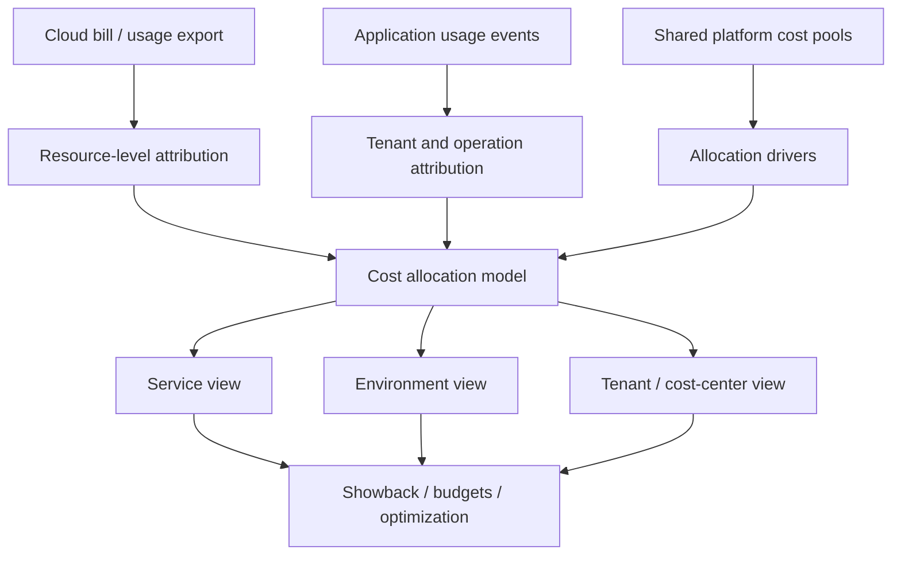
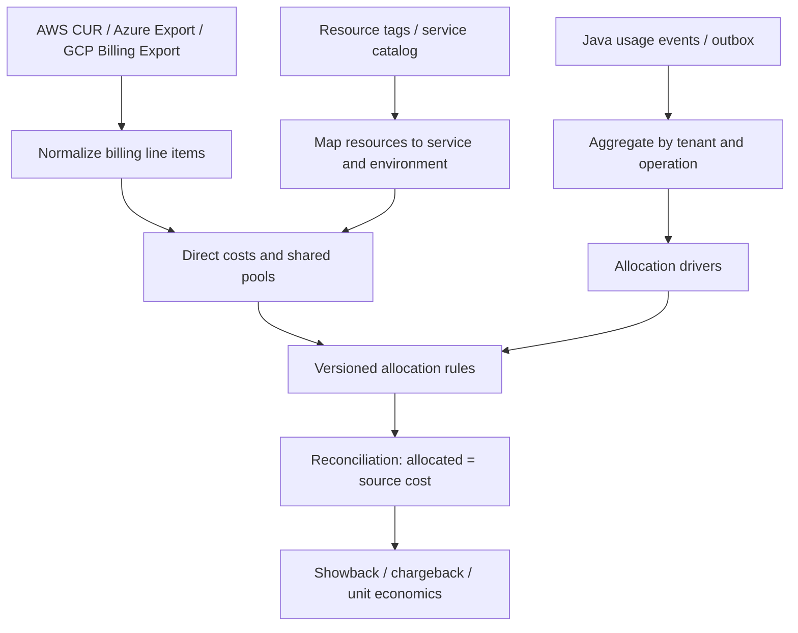

# Phân bổ chi phí theo service, môi trường và tenant

Serverless giúp nhóm phát triển không phải quản lý máy chủ liên tục, nhưng không có nghĩa chi phí tự động minh bạch. Một Java function có thể tạo chi phí ở nhiều nơi: request và thời gian compute, memory/CPU, provisioned hoặc minimum instances, API gateway, queue/event bus, database, object storage, network egress, NAT, log, metric, trace và artifact build. Khi nhiều service hoặc tenant dùng chung các tài nguyên này, hóa đơn cloud thường không cho biết chính xác tenant nào đã tiêu thụ bao nhiêu.

**Cost allocation** là quá trình gắn chi phí cloud với service, môi trường, team, cost center hoặc tenant chịu trách nhiệm. Mục tiêu là biết chi phí phát sinh ở đâu, ai sử dụng, đơn vị nghiệp vụ nào tạo ra chi phí và cách phân bổ có công bằng, nhất quán hay không. Cost allocation là nền tảng cho showback, chargeback, budgeting và tối ưu unit economics.

Bài học này tập trung vào cách thiết kế phân bổ chi phí cho Java serverless theo ba chiều chính: **service**, **environment** và **tenant**. Nội dung phân biệt chi phí trực tiếp với chi phí dùng chung, resource tags/labels với application usage metering, billing export của AWS/Azure/Google Cloud, cách xây dựng allocation driver và quy trình kiểm soát phần chi phí chưa phân bổ.

## 1. Vì sao cần phân bổ chi phí?

Một hóa đơn cloud tổng hợp chỉ cho biết tổ chức đã chi bao nhiêu tiền. Để quản lý sản phẩm, cần trả lời thêm:

- Service nào đang tạo phần lớn chi phí?
- Production và non-production tiêu tốn bao nhiêu?
- Team hoặc cost center nào chịu trách nhiệm?
- Tenant nào sử dụng nhiều compute, storage, request hoặc network?
- Chi phí tăng do traffic, retry, cold start, log volume hay thay đổi cấu hình?
- Một đơn hàng, giao dịch hoặc workflow đang có cost-to-serve bao nhiêu?
- Tài nguyên dùng chung nên chia theo driver nào?

Ví dụ, ba Java function có thể cùng dùng một database serverless, một API gateway và một log workspace. Hóa đơn có thể tách được một phần chi phí theo resource/function, nhưng không tự động phân bổ chính xác database capacity hoặc log ingestion cho từng function. Nếu các function phục vụ nhiều tenant, cloud provider cũng không nhất thiết biết tenant ID ở tầng billing.

Cost allocation biến chi phí tổng thành thông tin có thể hành động. Team sở hữu service có thể tối ưu code/config; platform team có thể tối ưu shared infrastructure; product team có thể điều chỉnh pricing hoặc quota tenant.

## 2. Ba chiều phân bổ cơ bản

### Theo service

Service là đơn vị nghiệp vụ hoặc kỹ thuật có owner và mục tiêu rõ ràng, ví dụ `orders-api`, `invoice-worker`, `notification-service` hoặc `reporting-job`. Một service có thể gồm nhiều function, queue, database, bucket và dashboard.

### Theo environment

Environment phân biệt nơi workload chạy:

- `production`: phục vụ traffic thật.
- `staging`: kiểm thử trước production.
- `development`: phát triển và tích hợp.
- `test` hoặc `qa`: automated/manual test.
- `sandbox`: thử nghiệm hoặc proof of concept.

Environment giúp nhận ra chi phí non-production, tài nguyên quên xóa, test chạy liên tục và cấu hình staging quá lớn.

### Theo tenant

Tenant là khách hàng, tổ chức hoặc đơn vị sử dụng chung một service multi-tenant. Chi phí tenant có thể gồm request, compute, storage, database operation, network, event và các tài nguyên riêng. Tenant allocation thường cần application-level metering vì cloud billing không biết business tenant nào nằm trong một invocation dùng chung.



Không phải mọi chi phí đều có thể gắn trực tiếp tới cả ba chiều. Cần ghi rõ mức độ chính xác: direct attribution, measured usage, estimated allocation hoặc unallocated.

## 3. Thiết kế taxonomy và tag schema thống nhất

Trước khi bật billing export, tổ chức cần thống nhất cách đặt tên service, environment, owner và cost center. Nếu mỗi team tự đặt tag khác nhau, báo cáo sẽ có nhiều nhóm trùng nghĩa như `prod`, `production`, `prd` hoặc `live`.

Một taxonomy cơ bản:

| Key chuẩn hóa | Ý nghĩa | Ví dụ |
| --- | --- | --- |
| `service` | Tên service chịu trách nhiệm | `orders-api` |
| `environment` | Môi trường chạy | `production` |
| `team` | Team kỹ thuật sở hữu | `commerce-platform` |
| `owner` | Alias hoặc nhóm liên hệ | `team-orders` |
| `cost_center` | Mã kế toán/cost center | `CC-042` |
| `product` | Sản phẩm hoặc business domain | `commerce` |
| `criticality` | Mức độ quan trọng | `tier-1` |
| `data_classification` | Phân loại dữ liệu | `confidential` |
| `managed_by` | Cách quản lý resource | `terraform` |

Các key trên là ví dụ. Hãy chọn tập key nhỏ, có owner, quy tắc allowed value và quy trình thay đổi. Chuẩn hóa chữ thường và dấu gạch ngang/gạch dưới nếu cần hỗ trợ nhiều cloud; lưu ý từng provider có quy tắc tag/label riêng.

### Tag không phải metadata tùy ý

Một tag chỉ hữu ích nếu:

- Có định nghĩa rõ và một owner chịu trách nhiệm.
- Giá trị nằm trong tập hợp hợp lệ hoặc được kiểm tra tự động.
- Được gắn ở thời điểm tạo resource, không đợi người vận hành nhớ thêm sau.
- Có quy trình kế thừa/lan truyền khi resource con được tạo.
- Được đưa vào billing export hoặc báo cáo chi phí.
- Có kiểm tra tag coverage và cảnh báo resource thiếu tag.

Không đưa email, tên cá nhân, token, customer name hoặc PII vào tag. Tag thường xuất hiện trong billing export, inventory và công cụ nội bộ; coi chúng là metadata có thể được nhiều người xem.

## 4. Tag resource và tenant metadata là hai việc khác nhau

Resource tag/label mô tả tài nguyên cloud. Một Lambda function có thể được gắn `service=orders-api`, `environment=production`; một Cloud Run service có thể mang nhãn tương tự. Nhưng nếu một function duy nhất phục vụ 10.000 tenant, tag của function không thể đồng thời ghi tenant ID của từng request.

Phân biệt:

| Metadata | Gắn ở đâu? | Dùng để |
| --- | --- | --- |
| Resource tag/label | Function, service, database, bucket, queue, gateway | Phân bổ chi phí ở mức resource/service/environment/team |
| Deployment metadata | Release, revision, alias, IaC stack | So sánh chi phí giữa version và lần deploy |
| Application usage event | Invocation/operation/tenant ở tầng ứng dụng | Phân bổ usage cho tenant và nghiệp vụ |
| Billing line item | Provider billing export | Chi phí thực tế/discount/credit theo resource, SKU, project/account và thời gian |

Không tạo một resource riêng cho mỗi tenant chỉ để gắn tag nếu kiến trúc không cần isolation như vậy. Điều đó có thể làm tăng số resource, deployment complexity và chi phí vận hành. Với shared function, đo usage ở application layer rồi phân bổ chi phí compute/shared cost theo driver.

## 5. Chi phí serverless gồm nhiều thành phần

Đừng chỉ lấy chi phí Lambda/Functions/Cloud Run làm toàn bộ cost của service. Một request có thể đi qua nhiều dịch vụ:

| Thành phần | Driver thường ảnh hưởng chi phí |
| --- | --- |
| Function compute | Số request/invocation, duration, memory/CPU, architecture |
| Provisioned/minimum capacity | Thời gian giữ execution environment/instance sẵn sàng |
| API gateway/ingress | Số request, payload size, data processing, tier/features |
| Queue/topic/event bus | Request/operation count, payload size, delivery/fan-out, retention |
| Database | Compute capacity, request units/operations, storage, I/O, backup, replication |
| Object storage | GB-month, PUT/GET/LIST, retrieval, replication, lifecycle và egress |
| Network | Internet egress, inter-region/inter-zone transfer, NAT gateway, private connectivity |
| Observability | Log ingestion/retention, metrics, traces, query/analytics |
| Build/release | CI minutes, build workers, artifact registry, image storage và vulnerability scan |
| Security/shared platform | KMS/key operations, secret access, policy scanning, shared gateways |

Một service có ít invocation nhưng giữ provisioned capacity, database hoặc NAT gateway chạy liên tục vẫn có thể tạo chi phí nền lớn. Ngược lại, function có nhiều invocation ngắn và ít dependency có thể có chi phí thấp hơn.

### Direct và indirect cost

- **Direct cost:** có thể gắn rõ với service/resource/environment, ví dụ một Lambda function hoặc bucket riêng của service.
- **Shared/indirect cost:** nhiều service cùng dùng, ví dụ NAT gateway, shared database, log workspace, API gateway chung, monitoring platform hoặc network transit.
- **Unallocated cost:** chưa có metadata/usage đủ tin cậy để phân bổ.

Giữ một nhóm `unallocated` có chủ đích tốt hơn phân bổ tùy tiện rồi tạo cảm giác chính xác giả.

## 6. Direct attribution và shared cost allocation

### Direct attribution

Nếu resource chỉ phục vụ một service/environment, gán toàn bộ chi phí cho service đó. Ví dụ:

- Một function chỉ thuộc `invoice-worker`.
- Một bucket riêng cho `invoice-worker`.
- Một database instance riêng của production service.
- Một queue riêng cho `notification-service`.

Đây là cách dễ kiểm tra và thường có độ chính xác cao nhất nếu resource tag/billing data đầy đủ.

### Shared cost allocation

Nếu resource phục vụ nhiều service, chọn allocation driver phản ánh mức sử dụng. Một số driver:

| Shared resource | Driver có thể dùng |
| --- | --- |
| Shared API gateway | Request count, request size hoặc weighted route units |
| Shared database | Query/transaction count, DB CPU time, I/O, storage hoặc connection time |
| Shared object storage | Byte-hours, object count, operation count và egress bytes |
| Shared log workspace | Ingested bytes theo service/source hoặc log category |
| Shared NAT/network | Bytes transferred theo workload/route nếu đo được |
| Shared queue/event bus | Published/delivered message count, payload bytes, fan-out |
| Shared monitoring platform | Metrics/traces/log volume hoặc agreed fixed share |

Không phải driver nào cũng đo được trực tiếp. Nếu chỉ có request count, dùng nó làm proxy và ghi rõ giả định. Request có payload lớn hoặc xử lý nặng có thể tiêu tốn nhiều hơn request đơn giản.

### Công thức phân bổ shared cost

Với pool chi phí dùng chung (C_s), usage driver của service (i) là (u_i), tổng usage là Σu:

\[
\text{AllocatedCost}_i = C_s \times \frac{u_i}{\sum_j u_j}
\]

Ví dụ một log workspace dùng chung có chi phí 12.000 USD/tháng. Ba service ingest lần lượt 60.000, 30.000 và 10.000 GB:

| Service | Usage | Tỷ trọng | Chi phí phân bổ |
| --- | ---: | ---: | ---: |
| `orders-api` | 60.000 GB | 60% | 7.200 USD |
| `invoice-worker` | 30.000 GB | 30% | 3.600 USD |
| `notification-service` | 10.000 GB | 10% | 1.200 USD |
| **Tổng** | **100.000 GB** | **100%** | **12.000 USD** |

Chi phí phân bổ phải cộng lại bằng shared pool trước khi cộng vào tổng chi phí. Không cộng đồng thời toàn bộ shared pool vào platform team và phần phân bổ cho service, nếu không sẽ double count.

## 7. Phân bổ theo service

Service là chiều chính để team biết cost-to-serve của một capability. Để phân bổ đúng:

1. Xác định ranh giới service: function nào, queue nào, database nào, bucket nào.
2. Gắn `service` tag/label cho resource có thể gắn trực tiếp.
3. Gắn `team`, `owner`, `cost_center` để biết trách nhiệm.
4. Đưa shared resource vào pool riêng và chọn allocation driver.
5. Liên kết billing resource ID với service catalog/IaC stack.
6. Đưa resource không map được vào `unallocated` và xử lý theo thời hạn.

Một service có thể gồm nhiều cloud resource, vì vậy không nên chỉ dựa vào tên function. Ví dụ `orders-api` có API gateway, Lambda, DynamoDB, SQS, S3, CloudWatch Logs và KMS. Báo cáo service cần cộng tất cả thành phần liên quan, đồng thời phân bổ phần shared gateway/log/network theo driver.

### Service catalog mapping

Nên có bảng mapping giữa cloud resource và service:

| Resource ID | Resource type | Service | Environment | Owner | Allocation type |
| --- | --- | --- | --- | --- | --- |
| `function/orders-prod` | Function | `orders-api` | production | `team-orders` | Direct |
| `queue/orders-events` | Queue | `orders-api` | production | `team-orders` | Direct |
| `db/shared-prod` | Database | `platform-data` | production | `team-data` | Shared pool |
| `logs/prod-workspace` | Log workspace | `platform-observability` | production | `team-platform` | Shared pool |

Mapping cần version hóa vì resource có thể đổi tên, chuyển account/project hoặc được thay bằng resource mới. Dùng resource ID/ARN/full name thay cho display name không ổn định.

## 8. Phân bổ theo environment

Environment giúp phân biệt chi phí phục vụ khách hàng với chi phí phát triển, kiểm thử và thử nghiệm. Đây là chiều hữu ích để tìm:

- Staging có cấu hình giống production nhưng traffic thấp.
- Dev function hoặc database không scale-to-zero khi không dùng.
- CI integration test tạo nhiều queue, log group, bucket hoặc database tạm.
- Preview environment không có TTL và bị bỏ quên.
- Test load chạy quá lâu hoặc dùng dữ liệu lớn.
- Non-production log retention cao không cần thiết.

### Quy tắc environment

- Dùng allowed values cố định như `production`, `staging`, `development`, `test`, `sandbox`.
- Gắn tag/label ngay từ IaC/deployment pipeline.
- Dùng account/subscription/project riêng cho production nếu mô hình quản trị cho phép.
- Đặt budget riêng cho non-production.
- Tự động dọn preview resource theo TTL/owner.
- Dùng schedule scale-down hoặc scale-to-zero cho môi trường không cần chạy liên tục.
- Đặt retention thấp hơn cho log/test data nếu chính sách cho phép.
- Không dùng environment tag để thay thế phân loại data/security.

### So sánh chi phí giữa môi trường

So sánh staging với production theo traffic/throughput, không chỉ tổng USD. Nếu production xử lý 1 triệu order với 1.000 USD còn staging xử lý 10.000 order với 200 USD, staging có cost per order cao hơn nhiều. Điều đó có thể bình thường do minimum capacity hoặc fixed infrastructure; cần tách fixed cost và variable cost.

## 9. Phân bổ theo tenant trong kiến trúc multi-tenant

Một Java function có thể nhận request từ nhiều tenant trong cùng một execution environment. Billing provider thường thấy resource/function và usage tổng, không biết tenant ID của request. Vì vậy, tenant cost allocation cần application-level metering.

Các nguyên tắc:

- Xác định tenant từ principal đã xác thực, không tin `tenantId` tùy ý trong request body.
- Đo usage ở business operation hoặc handler boundary.
- Ghi service, environment, tenant, operation, quantity, unit và timestamp.
- Không đưa PII hoặc credential vào metering event.
- Gửi metering event bền vững hoặc tổng hợp định kỳ để không làm hỏng request path.
- Dùng cùng định nghĩa unit giữa billing, product analytics và quota.
- Tách tenant-specific resource cost khỏi phần shared cost.

### Metering event minh họa

```json
{
  "eventId": "usage-01JQ...",
  "occurredAt": "2026-11-17T10:15:30Z",
  "service": "orders-api",
  "environment": "production",
  "tenantId": "tenant-4821",
  "operation": "create-order",
  "quantity": 1,
  "unit": "order",
  "requestClass": "standard",
  "region": "ap-southeast-1"
}
```

Đây là event usage, không phải cloud billing line item. Nó cần được liên kết với billing period và allocation model để tính cost. `tenantId` nên là ID nội bộ không chứa tên hoặc thông tin cá nhân.

### Đừng tạo metric time series cho mọi tenant

Tenant ID có cardinality cao. Nếu đưa mỗi tenant thành metric label/tag cho mọi metric, số time series có thể tăng rất lớn và làm chi phí observability tăng. Thay vào đó:

- Dùng usage event/table hoặc data warehouse cho phân tích tenant-level.
- Aggregate theo tenant/time/operation ở batch.
- Giữ metric realtime với label có cardinality thấp như service, environment, operation class, result.
- Chỉ dùng tenant-level metric cho tập tenant nhỏ hoặc hệ thống có cardinality control rõ.
- Sampling log/trace theo policy và không log payload nhạy cảm.

## 10. Chọn allocation driver cho tenant

Không có một driver phù hợp cho mọi loại workload. Chọn driver gần với tài nguyên mà tenant tiêu thụ:

| Workload/cost | Driver gợi ý | Hạn chế |
| --- | --- | --- |
| HTTP API | Request count theo route/operation | Request đơn giản và request nặng không cùng chi phí |
| Java function compute | Invocation duration × allocated memory/CPU hoặc measured CPU time | Shared/batched invocation cần chia usage theo tenant |
| Queue worker | Record processed, payload bytes hoặc processing time | Một record có thể có độ phức tạp rất khác nhau |
| Database | Query count/weighted query units, rows/bytes, CPU/IO nếu đo được | Query count đơn thuần không phản ánh query cost |
| Object storage | Byte-hours, object count, PUT/GET và egress bytes | Một object có thể được nhiều tenant dùng chung |
| Network | Egress bytes theo tenant/operation | Khó đo chính xác nếu traffic multiplexed hoặc qua shared NAT |
| Logs/traces | Ingested bytes hoặc event volume theo service/tenant class | Không nên gắn tenant ID vào mọi log label |
| Workflow | Step count, execution time hoặc weighted task units | Các step có cost khác nhau |

### Weighted usage units

Nếu operation có chi phí khác nhau, định nghĩa weighted unit:

- `read-small` = 1 unit.
- `create-order` = 3 units.
- `generate-report` = 20 units.
- `bulk-export` = 50 units.

Các trọng số cần được hiệu chỉnh từ measured resource usage hoặc cost model, không đặt chỉ theo cảm tính. Nếu dùng cho billing khách hàng, phải công khai/định nghĩa rõ contract và kiểm tra với pháp lý/tài chính.

### Compute allocation cho một invocation có nhiều tenant

Nếu mỗi invocation chỉ xử lý một tenant, duration và memory của invocation có thể được gắn trực tiếp cho tenant đó. Nếu một invocation xử lý batch chứa nhiều tenant, có thể phân bổ theo:

- Thời gian xử lý đo riêng từng record/tenant.
- CPU time hoặc weighted processing units.
- Payload bytes/record count khi workload tương đối đồng nhất.
- Một driver hỗn hợp đã được kiểm chứng.

Không chia đều chi phí invocation cho mọi tenant trong batch nếu mỗi record có kích thước hoặc độ phức tạp rất khác nhau. Nếu không đo được chính xác, ghi rõ đây là ước lượng.

## 11. Phân bổ shared cost cho tenant

Sau khi phân bổ direct cost, tenant vẫn sử dụng tài nguyên chung như gateway, database cluster, logging, support và control plane.

Một công thức tổng quát:

\[
\text{TenantCost}_t = \text{DirectCost}_t + \sum_k \left(C_k \times \frac{u_{t,k}}{\sum_j u_{j,k}}\right)
\]

Trong đó:

- `DirectCost_t` là chi phí resource dành riêng cho tenant.
- `C_k` là shared cost pool thứ k.
- `u_{t,k}` là usage driver của tenant t đối với pool k.

Ví dụ tenant A dùng 5.000 query units trong tổng 10.000 query units của database shared có chi phí 2.000 USD. Tenant A nhận 1.000 USD của pool database. Nếu tenant A còn có bucket riêng trị giá 150 USD, tổng cost được phân bổ là 1.150 USD trước các pool khác.

### Khi usage driver bằng 0

Nếu một tenant không có usage trong kỳ nhưng vẫn giữ tài nguyên dành riêng, có thể phát sinh fixed cost. Cần phân biệt:

- Dedicated resource reservation/minimum capacity: tenant chịu chi phí cố định theo hợp đồng.
- Shared platform baseline: phân bổ theo active tenant, subscription tier hoặc một quy tắc cố định.
- Usage-based cost: chỉ phân bổ khi có usage đo được.

Không chia một shared pool cho tập tenant có usage bằng 0 theo công thức tỷ lệ. Đưa pool vào fixed allocation hoặc cost center platform theo policy đã công bố.

## 12. Showback và chargeback

**Showback** cung cấp báo cáo chi phí cho service/team/tenant để họ hiểu mức sử dụng; chưa nhất thiết chuyển chi phí vào ngân sách/kế toán của họ.

**Chargeback** phân bổ chi phí chính thức vào cost center, business unit hoặc hóa đơn tenant. Chargeback đòi hỏi định nghĩa, độ chính xác, kỳ chốt, xử lý credit/discount/tax và quy trình tranh chấp rõ ràng.

| Khía cạnh | Showback | Chargeback |
| --- | --- | --- |
| Mục tiêu | Minh bạch và thay đổi hành vi | Ghi nhận trách nhiệm tài chính |
| Độ chính xác | Có thể dùng ước lượng có chú thích | Cần kiểm soát/reconcile chặt |
| Shared cost | Có thể hiển thị pool riêng | Cần quy tắc phân bổ được phê duyệt |
| Thay đổi model | Có thể thử nghiệm | Cần version, kỳ hiệu lực và phê duyệt |
| Đối tượng | Team/service owner | Cost center, finance, customer billing |

Nên bắt đầu bằng showback, đo coverage và kiểm chứng driver trước khi dùng dữ liệu làm chargeback. Nếu tenant bị tính tiền theo usage, cần đảm bảo metering event đáng tin cậy, có audit, chống duplicate và có quy tắc xử lý late event.

## 13. AWS: cost allocation tags và billing export

AWS cung cấp resource tags và cost allocation tags để nhóm chi phí. Quy trình tổng quát:

1. Gắn tag như `service`, `environment`, `team`, `cost_center` lên resource được hỗ trợ.
2. Kích hoạt user-defined cost allocation tags trong Billing and Cost Management.
3. Chờ dữ liệu tag được xử lý trong billing pipeline.
4. Dùng Cost Explorer, Cost and Usage Report (CUR) hoặc AWS Data Exports để nhóm chi phí.
5. Dùng Cost Categories để gom account, tag hoặc charge type theo cấu trúc nội bộ.
6. Đối chiếu resource ID/usage type với service catalog và allocation model.

Một tag có trên resource không đồng nghĩa tự động xuất hiện trong báo cáo chi phí ngay lập tức. Cần kích hoạt tag trong billing console và kiểm tra loại resource/usage có hỗ trợ tag allocation hay không. Tag không áp dụng ngược cho mọi chi phí cũ và billing data có độ trễ.

### Lambda và các chi phí liên quan

Với Lambda, cần xem các line item liên quan invocation/request, duration/compute, architecture, provisioned concurrency hoặc các feature được bật. Ngoài Lambda, service có thể tạo chi phí ở API Gateway, SQS, SNS, EventBridge, DynamoDB, S3, CloudWatch Logs, X-Ray, NAT và data transfer.

Resource tag trên Lambda giúp nhận diện function thuộc service/environment. Nhưng database, API gateway hoặc log group dùng chung cần tag/mapping riêng hoặc được đưa vào shared pool. Tenant-level cost vẫn cần application metering nếu function phục vụ nhiều tenant.

### Cost Explorer và CUR/Data Exports

- Cost Explorer hữu ích cho phân tích nhanh theo service, linked account, region, usage type và tag đã kích hoạt.
- CUR/Data Exports cung cấp dữ liệu chi tiết hơn để lưu vào S3 và phân tích bằng Athena/warehouse.
- Cost Categories giúp gom nhiều account/tag thành nhóm nghiệp vụ.
- Resource-level detail có thể cần bật và có giới hạn/điều kiện theo loại dữ liệu.

Chọn rõ cost basis: unblended, amortized hoặc net amortized tùy câu hỏi. Reservation/Savings Plans/discount/credit có thể làm chi phí nhìn khác nhau. Báo cáo showback cần thống nhất cách tính và không trộn nhiều cost basis trong cùng kỳ.

## 14. Azure: resource tags, Cost Management và exports

Azure hỗ trợ tags trên nhiều resource, resource group và subscription. Cost Management có thể phân tích chi phí theo subscription, resource group, resource, service, meter và tag khi dữ liệu hỗ trợ.

Quy trình tổng quát:

1. Định nghĩa tag schema `service`, `environment`, `team`, `cost_center`.
2. Áp dụng tag trong Bicep/ARM/Terraform hoặc deployment pipeline.
3. Dùng Azure Policy để audit/deny resource thiếu tag theo policy của tổ chức.
4. Bật Cost Management exports để lưu cost/usage data theo lịch.
5. Phân tích dữ liệu trong Storage/Power BI/warehouse.
6. Kiểm tra tag inheritance nếu tổ chức bật tính năng kế thừa tag; không giả định mọi resource hoặc mọi loại charge đều kế thừa như nhau.

### Azure Functions và chi phí liên quan

Chi phí Azure Functions phụ thuộc hosting plan và cách dùng: Consumption, Flex Consumption, Premium hoặc Dedicated có cách tính khác nhau. Ngoài function execution, cần tính App Service plan/minimum instances, Storage account, Application Insights/Log Analytics, API Management, Service Bus/Event Hubs, database, network và egress.

Một Function App có thể chứa nhiều function cùng dùng plan và telemetry resource. Nếu billing line item ở mức plan/resource group, cần allocation driver theo execution count, execution duration, memory/CPU usage hoặc app-level usage event. Không chia đều chi phí plan cho từng function nếu tải khác nhau.

### Cost allocation rules

Azure Cost Management có khả năng hỗ trợ phân bổ một số shared cost theo rule giữa scope phù hợp. Hãy xác minh availability, scope và billing agreement của tenant/subscription đang dùng. Nếu không hỗ trợ hoặc cần driver riêng, thực hiện phân bổ ở data warehouse và giữ cả chi phí gốc lẫn allocated cost để audit.

## 15. Google Cloud: labels, billing export và cost allocation

Google Cloud dùng labels để phân loại nhiều resource; Resource Manager tags có vai trò quản trị/chính sách khác với labels. Labels thường hữu ích cho cost reporting trên resource được hỗ trợ. Không phải mọi SKU/charge hoặc resource đều có label đầy đủ.

Quy trình:

1. Chuẩn hóa label key/value chữ thường, ví dụ `service=orders-api`, `environment=production`.
2. Gắn labels qua Terraform/gcloud/deployment pipeline vào resource hỗ trợ.
3. Bật Cloud Billing export sang BigQuery (standard hoặc detailed usage cost export phù hợp).
4. Kiểm tra trường project, service/SKU, resource, labels, system labels, cost, credits và usage.
5. Dùng BigQuery/Looker Studio hoặc FinOps tool để group theo label.
6. Đưa chi phí thiếu label và shared resource vào nhóm unallocated/shared pool.

### Cloud Run/Functions và chi phí liên quan

Cloud Run có thể phát sinh chi phí theo request, CPU/memory allocation và instance time theo cấu hình billing/instance; minimum instances hoặc instance-based billing có thể tạo cost nền. Cloud Functions thế hệ khác nhau có mô hình tính phí và metric khác nhau. Ngoài compute, cần tính API Gateway/Load Balancing, Pub/Sub/Eventarc, Cloud SQL/Firestore, Cloud Storage, Cloud Logging/Monitoring, Artifact Registry, Cloud Build, VPC connector/NAT và egress.

Cloud Billing export cho phép phân tích theo project, service, SKU và labels khi resource/usage hỗ trợ. Một shared VPC hoặc log bucket có thể không có tenant label; dùng mapping/usage metering để phân bổ.

### Ví dụ truy vấn BigQuery

Schema của billing export có thể thay đổi theo loại export và version. Ví dụ dưới đây chỉ minh họa cách nhóm theo labels; cần điều chỉnh tên dataset/table và field theo schema thực tế:

```sql
SELECT
  service.description AS cloud_service,
  sku.description AS sku,
  (SELECT value FROM UNNEST(labels) WHERE key = 'service') AS service_tag,
  (SELECT value FROM UNNEST(labels) WHERE key = 'environment') AS environment,
  SUM(cost) AS gross_cost
FROM `billing_project.billing_dataset.gcp_billing_export_v1_*`
WHERE usage_start_time >= TIMESTAMP('2026-11-01')
  AND usage_start_time < TIMESTAMP('2026-12-01')
GROUP BY cloud_service, sku, service_tag, environment
ORDER BY gross_cost DESC;
```

Nếu dùng detailed export hoặc có credits, hãy xử lý credits/adjustments theo cost basis đã thống nhất. Không coi `SUM(cost)` trong ví dụ là net payable invoice amount nếu chưa tính credits, taxes, adjustments và billing account rules.

## 16. Xây dựng application-level usage metering trong Java

Billing export cung cấp cost thực tế theo resource/SKU. Application metering cung cấp usage theo tenant/operation. Hai nguồn được kết hợp trong data warehouse hoặc allocation service.

Một Java service có thể phát usage event sau khi operation hoàn tất:

```java
public record UsageEvent(
        String eventId,
        String service,
        String environment,
        String tenantId,
        String operation,
        long quantity,
        String unit,
        java.time.Instant occurredAt
) {}

public interface UsageEventPublisher {
    void publish(UsageEvent event);
}

public final class UsageMeter {
    private final UsageEventPublisher publisher;

    public UsageMeter(UsageEventPublisher publisher) {
        this.publisher = publisher;
    }

    public void recordOrderCreated(
            String authenticatedTenantId,
            String environment
    ) {
        var event = new UsageEvent(
                java.util.UUID.randomUUID().toString(),
                "orders-api",
                environment,
                authenticatedTenantId,
                "create-order",
                1,
                "order",
                java.time.Instant.now());
        publisher.publish(event);
    }
}
```

Đây là ví dụ đơn giản. Trong production, không nên để lỗi telemetry làm giao dịch nghiệp vụ thất bại hoặc ghi nhận usage hai lần. Có thể ghi usage event vào transactional outbox trong cùng transaction với business change rồi relay bất đồng bộ. Event cần unique ID, schema version, tenant identity đã xác thực và retry/deduplication.

### Không đo usage bằng log message tự do

Log text khó tổng hợp, dễ thay đổi format và có thể chứa PII. Dùng event schema có version và field chuẩn. Log chỉ phục vụ điều tra; metering event phục vụ tính usage/cost. Hai luồng có thể dùng cùng broker nhưng cần retention, access và schema governance phù hợp.

## 17. Liên kết billing data và usage metering

Một pipeline phân bổ chi phí có thể gồm:

1. Export billing line item từ cloud provider theo ngày/giờ.
2. Ingest application usage event từ function/worker.
3. Chuẩn hóa resource ID, service, environment, region, currency và thời gian.
4. Map billing resource vào service catalog.
5. Tách direct cost và shared pool.
6. Tính tenant usage driver theo cùng billing period.
7. Áp dụng allocation rule có version.
8. Reconcile tổng allocated cost với billing cost.
9. Xuất báo cáo service/environment/tenant.
10. Lưu snapshot của rule và dữ liệu để có thể tái tạo báo cáo kỳ trước.



Billing export thường có độ trễ và có thể được điều chỉnh lại do credit/refund/tax hoặc late usage. Không coi số liệu hôm nay là hóa đơn cuối cùng. Định nghĩa close window, late adjustment policy và cách tái mở kỳ khi dữ liệu thay đổi.

## 18. Unit economics: chi phí trên một đơn vị nghiệp vụ

Tổng chi phí cho biết quy mô chi tiêu; unit economics cho biết hiệu quả. Ví dụ:

\[
\text{Cost per order} = \frac{\text{Total allocated orders-service cost}}{\text{Successful orders}}
\]

\[
\text{Cost per 1,000 invocations} = \frac{\text{Function cost}}{\text{Invocations}} \times 1.000
\]

\[
\text{Cost per active tenant} = \frac{\text{Tenant-attributed cost}}{\text{Active tenants in period}}
\]

Định nghĩa mẫu số phải rõ. `Successful orders` khác `orders received`; invocation retry có thể tăng compute nhưng không tăng số order hoàn tất. Một function batch có thể xử lý 100 record trong một invocation, do đó cost per invocation không phản ánh cost per record.

### Ví dụ unit economics

Giả sử `orders-api` có chi phí phân bổ 3.000 USD/tháng và hoàn tất 150.000 order:

\[
\text{Cost per order} = \frac{3.000}{150.000} = 0,02\text{ USD}
\]

Nếu tháng sau chi phí tăng lên 3.600 USD nhưng order tăng lên 240.000:

\[
\frac{3.600}{240.000} = 0,015\text{ USD/order}
\]

Tổng cost tăng 20%, nhưng cost per order giảm 25%. Cần đọc tổng cost và unit cost cùng nhau; tăng tổng chi phí có thể phản ánh tăng trưởng hiệu quả.

## 19. Chi phí retry, fan-out và traffic không tạo giá trị

Serverless có thể tính tiền theo mỗi lần gọi hoặc mỗi đơn vị xử lý. Retry, duplicate event, polling, webhook redelivery và fan-out có thể tạo cost mà không tạo thêm business outcome.

Theo dõi:

- Invocation attempts so với unique business request/event.
- Retry count theo error class.
- Duplicate message/event rate.
- Batch partial failure và số record bị retry.
- Event fan-out delivery count.
- Queue poll/receive operations và empty poll nếu tính phí.
- DLQ/redrive volume.
- Function duration do downstream timeout.

Cost attribution nên phân biệt usage cần thiết với waste do retry storm, duplicate hoặc lỗi. Không tự động tính toàn bộ retry cho tenant nếu lỗi do platform/service provider; quy tắc chargeback cần công bằng và minh bạch.

## 20. Shared infrastructure và phần chi phí nền

Một số resource tạo chi phí ngay cả khi traffic thấp:

- Provisioned concurrency hoặc minimum instances.
- Dedicated/Premium hosting plan hoặc database capacity tối thiểu.
- NAT gateway, private endpoint hoặc network appliance.
- Shared database, cache cluster và message broker.
- Log workspace/monitoring retention.
- Backup storage và cross-region replication.
- Shared API gateway/load balancer.

Chia chúng theo usage có thể không hợp lý nếu một phần là capacity reserved để đảm bảo availability. Có thể tách pool:

1. **Baseline platform cost:** chia theo fixed share, active service hoặc tenant tier.
2. **Variable usage cost:** chia theo measured requests/bytes/compute/IO.
3. **Dedicated capacity cost:** gán trực tiếp cho service/tenant đã yêu cầu capacity.
4. **Unallocated investment:** giữ ở platform/product cost center nếu chưa có driver phù hợp.

Không ép mọi shared cost vào một tỷ lệ request duy nhất. Driver nên tương ứng với nguyên nhân tạo chi phí.

## 21. Cost allocation cho môi trường non-production

Non-production thường cần cách quản trị riêng:

- Gắn owner và TTL cho preview/test environment.
- Tự động scale-to-zero hoặc stop resource ngoài giờ nếu dịch vụ hỗ trợ.
- Dùng database nhỏ hơn và dữ liệu synthetic/masked.
- Đặt log retention và sampling thấp hơn theo policy.
- Hạn chế provisioned/minimum capacity nếu không cần test cold start.
- Tự động xóa queue, bucket, image tag và resource tạm sau test.
- Đặt budget và alert riêng cho dev/staging/sandbox.
- Tách chi phí load test khỏi chi phí vận hành thông thường.

Không nên giảm capacity staging tới mức không còn đại diện production nếu mục tiêu là performance/capacity test. Hãy phân loại test theo mục tiêu và ghi nhận khi staging cố ý dùng cấu hình gần production.

## 22. Budget, forecast và cost anomaly

Sau khi phân bổ, thiết lập budget theo service/environment/team hoặc cost center. Budget có thể là:

- Monthly budget tổng.
- Budget production và non-production riêng.
- Budget cho shared platform.
- Budget cho từng project/tenant tier nếu có hợp đồng.
- Unit cost target như cost per order hoặc cost per 1.000 invocation.

Cost anomaly detection giúp phát hiện thay đổi bất thường so với baseline, ví dụ log ingestion tăng 5 lần, retry storm, egress tăng hoặc function provisioned capacity bị bật ngoài dự kiến.

### Ngưỡng cảnh báo

Một quy trình có thể dùng:

- 50% budget: thông báo cho owner.
- 80% budget: cảnh báo team và kiểm tra forecast.
- 100% budget: escalation theo policy.
- Anomaly vượt mức tuyệt đối/tỷ lệ: tạo incident hoặc ticket.

Các ngưỡng chỉ là ví dụ. Với service critical, không tự động tắt function khi vượt budget nếu điều đó gây gián đoạn nghiệp vụ hoặc mất dữ liệu. Budget alert là tín hiệu quản trị; hành động cần dựa trên runbook và business priority.

## 23. Governance: tag coverage và unallocated spend

Một báo cáo phân bổ chỉ đáng tin nếu phần lớn chi phí được map đúng. Theo dõi:

- Tỷ lệ spend có service tag/label.
- Tỷ lệ spend có environment.
- Tỷ lệ spend có owner/cost center.
- Phần shared pool có allocation driver.
- Phần unallocated spend theo cloud service/SKU.
- Resource không có owner hoặc không còn tồn tại trong service catalog.
- Tỷ lệ usage event thiếu tenant/service/environment.
- Chênh lệch giữa billing total và allocated total.

Ví dụ mục tiêu quản trị có thể là 95% chi phí trực tiếp có service/environment mapping và 100% shared pool có rule hoặc owner. Đặt mục tiêu theo maturity; không gắn tag giả để đạt coverage.

### Tag enforcement

Có thể kiểm tra tag trong IaC/CI trước khi deploy và dùng policy của cloud để audit/deny resource thiếu tag. Cần có exception cho resource/provider không hỗ trợ tags và quy trình xử lý charge không tag được. Không nên block mọi deployment production nếu một provider-managed resource không hỗ trợ tag; hãy dùng mapping table thay thế.

## 24. Data quality và reconciliation

Billing export và application metering là hai nguồn khác nhau. Cần reconcile:

- Billing total theo invoice/cost basis.
- Direct cost mapped to service/environment.
- Shared pools trước và sau allocation.
- Allocated cost theo tenant.
- Unallocated cost.
- Credit/refund/tax/discount/commitment adjustments.
- Late-arriving usage events và duplicate event.

Một kiểm tra cơ bản:

\[
\text{Source cloud cost} = \text{Direct allocated} + \text{Shared allocated} + \text{Unallocated} + \text{Adjustments}
\]

Định nghĩa các nhóm sao cho không đếm trùng. Nếu một shared pool đã được phân bổ hết, không cộng thêm toàn bộ pool vào một service khác. Nếu có discount/credit, quyết định phân bổ theo gross usage hay net cost và áp dụng nhất quán.

### Late data và kỳ kế toán

Billing export có thể cập nhật sau khi usage xảy ra. Application usage event cũng có thể đến muộn do retry hoặc offline buffer. Nên có:

- Event ID và deduplication.
- Event time và ingestion time.
- Billing period và allocation rule version.
- Close window (ví dụ chờ vài ngày sau tháng kết thúc).
- Cách xử lý adjustment sau khi kỳ đã đóng.
- Snapshot báo cáo đã chốt để có thể audit.

Không ghi đè báo cáo tháng cũ mà không lưu lịch sử thay đổi. Khi điều chỉnh, ghi lý do, nguồn và người phê duyệt.

## 25. Bảo mật và quyền riêng tư trong tenant metering

Tenant usage data có thể tiết lộ mức độ sử dụng sản phẩm, hành vi và quy mô kinh doanh. Hãy:

- Dùng tenant ID nội bộ/pseudonymous thay cho tên công ty hoặc email.
- Không đưa payload, request body hoặc credential vào usage event.
- Giới hạn quyền truy cập tenant cost report theo tenant/finance role.
- Tách metering data khỏi log công khai hoặc dashboard có audience rộng.
- Mã hóa usage store và billing warehouse.
- Audit truy vấn/export dữ liệu tenant-level.
- Xác định retention và deletion policy.
- Chỉ hiển thị cost của tenant khác nếu có mục đích và quyền hợp lệ.

Nếu dùng metering cho hóa đơn khách hàng, cần bảo vệ tính toàn vẹn: event có ID duy nhất, nguồn xác thực, outbox/retry, deduplication, audit và reconciliation với usage summary.

## 26. Ví dụ allocation model trong data warehouse

Một data warehouse có thể giữ ba bảng logic:

| Bảng | Nội dung |
| --- | --- |
| `cloud_cost_line_items` | Billing line item gốc, resource, SKU, cost, credit, usage và tag/label |
| `application_usage` | Service/environment/tenant/operation, quantity, unit và event time |
| `allocation_rules` | Pool, driver, scope, effective date, version và owner |

Sau đó tạo bảng kết quả `allocated_cost` với dimensions `billing_period`, `service`, `environment`, `tenant`, `cost_category`, `allocation_type`, `rule_version`.

Ví dụ pseudo SQL phân bổ một shared pool theo usage units:

```sql
WITH tenant_usage AS (
  SELECT
    service,
    environment,
    tenant_id,
    SUM(weighted_units) AS units
  FROM application_usage
  WHERE event_date >= DATE '2026-11-01'
    AND event_date < DATE '2026-12-01'
  GROUP BY service, environment, tenant_id
),
usage_totals AS (
  SELECT
    service,
    environment,
    SUM(units) AS total_units
  FROM tenant_usage
  GROUP BY service, environment
)
SELECT
  u.service,
  u.environment,
  u.tenant_id,
  p.shared_cost * SAFE_DIVIDE(u.units, t.total_units) AS allocated_cost
FROM tenant_usage u
JOIN usage_totals t
  USING (service, environment)
JOIN shared_cost_pools p
  USING (service, environment);
```

Đây là ví dụ minh họa, cần bổ sung currency, cost category, zero-usage policy, effective dates, credits, direct cost và rule version. Nếu pool dùng chung giữa nhiều service, aggregation phải tính trên toàn bộ scope của pool trước khi phân bổ. Không group sai scope khiến tổng allocated cost vượt shared pool.

## 27. Ví dụ end-to-end: phân bổ chi phí cho ba tenant

Giả sử `orders-api` production có tổng chi phí 6.000 USD/tháng:

- Function/API trực tiếp: 2.400 USD.
- Database shared pool: 2.000 USD.
- Logs/monitoring shared pool: 600 USD.
- Network/shared gateway pool: 1.000 USD.

Usage driver trong tháng:

| Tenant | Order units | DB query units | Log GB | Network GB |
| --- | ---: | ---: | ---: | ---: |
| A | 5.000 | 5.000 | 300 | 500 |
| B | 3.000 | 3.000 | 200 | 300 |
| C | 2.000 | 2.000 | 100 | 200 |
| **Tổng** | **10.000** | **10.000** | **600** | **1.000** |

Nếu direct function/API cost chia theo order units, DB theo query units, log theo GB và network theo GB:

| Tenant | Direct 2.400 | DB 2.000 | Logs 600 | Network 1.000 | Tổng |
| --- | ---: | ---: | ---: | ---: | ---: |
| A | 1.200 | 1.000 | 300 | 500 | 3.000 USD |
| B | 720 | 600 | 200 | 300 | 1.820 USD |
| C | 480 | 400 | 100 | 200 | 1.180 USD |
| **Tổng** | **2.400** | **2.000** | **600** | **1.000** | **6.000 USD** |

Mô hình này giả định driver đại diện đủ tốt cho từng pool. Nếu tenant A tạo order rất nặng, order count có thể đánh giá thấp cost; cần weighted units hoặc measured duration. Báo cáo phải ghi giả định và cho phép cập nhật rule trong kỳ tương lai có version.

## 28. Phân biệt cost allocation và pricing

Cost allocation cho biết chi phí nội bộ hoặc chi phí phục vụ tenant. Pricing quyết định giá bán. Hai khái niệm có liên quan nhưng không giống nhau:

- Cost allocation có thể phân bổ shared infrastructure theo driver kế toán.
- Pricing có thể dựa trên gói subscription, tier, minimum commitment hoặc usage unit.
- Margin cần tính thêm support, sales, tax, discount, payment fee và overhead ngoài cloud.
- Một tenant có cost cao không nhất thiết phải bị tính giá cao hơn nếu hợp đồng là fixed subscription.

Nếu metering dùng cho customer billing, cần có product/legal/finance approval, định nghĩa unit rõ, quy tắc rounding, dispute handling và audit trail. Không dùng một allocation estimate nội bộ như invoice truth nếu chưa được kiểm chứng.

## 29. FinOps workflow cho Java serverless

Một chu trình quản trị chi phí có thể thực hiện hàng tháng hoặc theo sprint:

1. **Plan:** xác định budget, unit economics target và owner theo service/environment.
2. **Tag:** gắn resource tags/labels qua IaC và kiểm tra coverage.
3. **Measure:** ingest billing export và application usage metering.
4. **Allocate:** tách direct/shared/unallocated và áp dụng rule có version.
5. **Reconcile:** so sánh allocated total với billing source và xử lý late adjustment.
6. **Report:** showback cho team/service/tenant theo quyền.
7. **Explain:** phân tích biến động theo traffic, duration, retry, storage, network, logs và capacity.
8. **Optimize:** giảm waste, điều chỉnh memory/concurrency, batch, retention, min instances và architecture.
9. **Govern:** cập nhật taxonomy, budget, policy và owner.
10. **Learn:** đo lại cost per business unit sau tối ưu.

## 30. Những lỗi thường gặp

1. **Chỉ phân bổ chi phí function.** Bỏ sót gateway, queue, database, logs, NAT và egress.
2. **Cho rằng resource tag tự động phân bổ tới tenant.** Shared function không mang tenant dimension trong billing.
3. **Dùng tenant ID làm metric label cho mọi metric.** Cardinality và telemetry cost có thể tăng mạnh.
4. **Dùng một driver request count cho mọi shared pool.** Database/log/network có cost driver khác nhau.
5. **Chia đều shared cost cho mọi service.** Không phản ánh usage và có thể tạo hành vi sai.
6. **Không có unallocated bucket.** Báo cáo trông đủ 100% nhưng mapping sai.
7. **Double count shared cost.** Cộng cả pool gốc và phần đã phân bổ.
8. **Trộn gross, net, amortized và invoice cost.** Báo cáo không thể đối chiếu.
9. **Không tính retry/duplicate/fan-out.** Traffic không tạo business outcome vẫn tiêu tốn tiền.
10. **Không phân biệt fixed cost và variable cost.** Cost per unit bị hiểu sai khi traffic thay đổi.
11. **Coi showback estimate là invoice.** Chargeback cần dữ liệu, rule và governance chặt hơn.
12. **Tag bằng PII hoặc customer name.** Metadata có thể xuất hiện trong billing export và công cụ nội bộ.
13. **Không lưu rule version.** Không thể tái tạo báo cáo tháng trước sau khi thay đổi driver.
14. **Không xử lý late billing/usage data.** Số liệu tháng chưa chốt có thể bị hiểu là final.
15. **Không có owner cho shared resource.** Không ai chịu trách nhiệm khi chi phí nền tăng.

## 31. Checklist triển khai cost allocation

- [ ] Đã định nghĩa taxonomy `service`, `environment`, `team`, `owner`, `cost_center` chưa?
- [ ] Tag/label được gắn tự động từ IaC/deployment pipeline chưa?
- [ ] Đã kiểm tra provider có hỗ trợ tag/label cho từng resource/SKU không?
- [ ] Có service catalog mapping resource ID tới service/environment/owner không?
- [ ] Direct cost, shared pool và unallocated cost được tách riêng chưa?
- [ ] Mỗi shared pool có allocation driver, owner và rule version chưa?
- [ ] Đã bật AWS CUR/Data Exports, Azure Cost Management exports hoặc GCP Billing export phù hợp chưa?
- [ ] Cost basis, currency, discount/credit/tax và close window được thống nhất chưa?
- [ ] Application usage metering lấy tenant từ authenticated identity chưa?
- [ ] Usage event có event ID, schema, deduplication và outbox/retry không?
- [ ] Tenant metering không chứa PII/secret và không tạo metric cardinality quá lớn chứ?
- [ ] Batch invocation có phân bổ theo processing time/weighted units thay vì chia đều không?
- [ ] Có unit economics như cost per order/transaction/1.000 invocation không?
- [ ] Có budget và anomaly alert theo service/environment/team không?
- [ ] Tag coverage và unallocated spend được theo dõi không?
- [ ] Allocated cost reconcile với billing source, không double count không?
- [ ] Showback và chargeback có quy tắc khác nhau, được phê duyệt phù hợp không?
- [ ] Có retention/audit và versioned snapshot cho allocation report không?
- [ ] Có quy trình xử lý late adjustment, credit và dispute không?

## 32. Quy trình triển khai theo từng giai đoạn

1. **Chuẩn hóa dimensions:** thống nhất service/environment/team/cost center và tenant ID nội bộ.
2. **Gắn resource metadata:** áp dụng tags/labels tự động và kiểm tra coverage.
3. **Bật billing export:** cấu hình export chi phí chi tiết theo cloud và lưu vào warehouse.
4. **Map resource:** liên kết resource ID, SKU, account/project/subscription với service catalog.
5. **Tách direct/shared:** xác định resource dành riêng và shared cost pool.
6. **Đo tenant usage:** phát usage event theo operation/tenant bằng outbox hoặc metering pipeline.
7. **Chọn driver:** gắn driver với nguyên nhân tạo cost và ghi rõ giả định.
8. **Chạy showback:** thử phân bổ vài kỳ, so sánh với owner và kiểm tra chênh lệch.
9. **Reconcile:** bảo đảm tổng direct + shared + unallocated + adjustments khớp billing source.
10. **Govern:** đặt budget, anomaly alert, rule owner và quy trình close kỳ.
11. **Chargeback khi sẵn sàng:** chỉ dùng model đã được finance/product/legal phê duyệt.
12. **Tối ưu:** theo dõi unit economics và điều chỉnh kiến trúc/cấu hình theo dữ liệu.

Phân bổ chi phí theo service, môi trường và tenant cần kết hợp hai nguồn dữ liệu: billing export cho chi phí cloud thực tế và application metering cho mức sử dụng nghiệp vụ. Resource tags/labels giúp gắn service/environment/owner; allocation driver chia shared pool; tenant usage event bổ sung chiều tenant mà billing provider không nhìn thấy. Khi tách direct/shared/unallocated, thống nhất cost basis, lưu rule version và reconcile tổng phân bổ với billing source, tổ chức có thể xây dựng showback/chargeback đáng tin cậy và đo unit economics cho Java serverless.

## Tài liệu tham khảo chính thức

- [AWS Cost allocation tags](https://docs.aws.amazon.com/awsaccountbilling/latest/aboutv2/cost-alloc-tags.html)
- [AWS Cost and Usage Reports](https://docs.aws.amazon.com/cur/latest/userguide/what-is-cur.html)
- [AWS Data Exports](https://docs.aws.amazon.com/cur/latest/userguide/dataexports.html)
- [AWS Cost Categories](https://docs.aws.amazon.com/awsaccountbilling/latest/aboutv2/manage-cost-categories.html)
- [AWS Lambda pricing](https://aws.amazon.com/lambda/pricing/)
- [Azure Cost Management and billing](https://learn.microsoft.com/azure/cost-management-billing/costs/overview-cost-management)
- [Azure Cost Management exports](https://learn.microsoft.com/azure/cost-management-billing/costs/tutorial-export-acm-data)
- [Azure resource tags](https://learn.microsoft.com/azure/azure-resource-manager/management/tag-resources)
- [Azure Functions pricing](https://azure.microsoft.com/pricing/details/functions/)
- [Google Cloud Billing export to BigQuery](https://cloud.google.com/billing/docs/how-to/export-data-bigquery)
- [Google Cloud labels](https://cloud.google.com/resource-manager/docs/creating-managing-labels)
- [Google Cloud Run pricing](https://cloud.google.com/run/pricing)
- [Google Cloud FinOps](https://cloud.google.com/architecture/framework/cost-optimization)
- [FinOps Foundation – FinOps Framework](https://www.finops.org/framework/)
