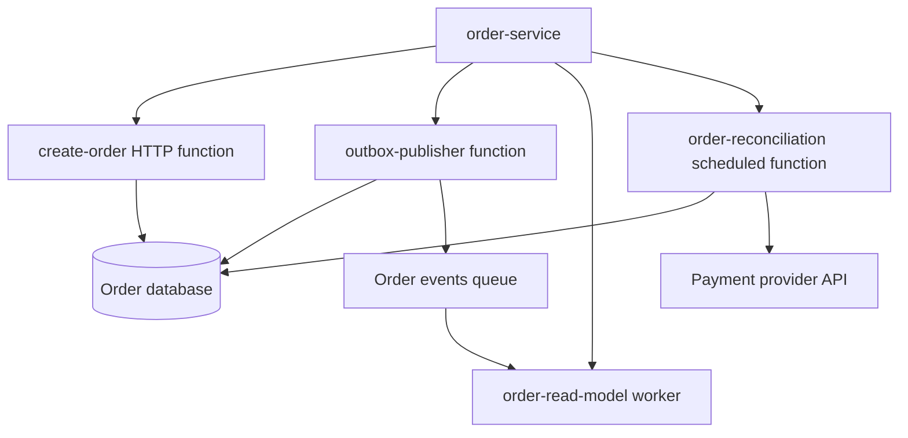
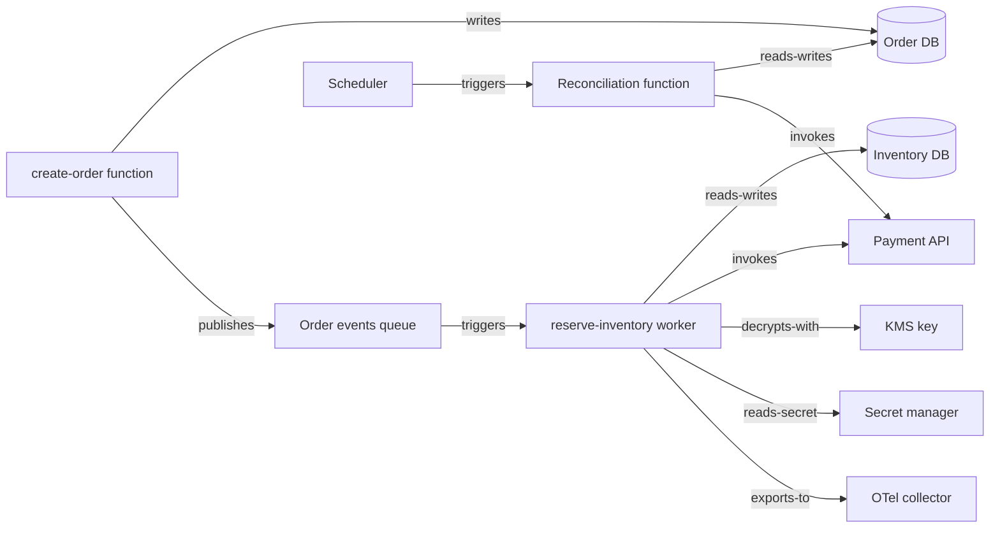
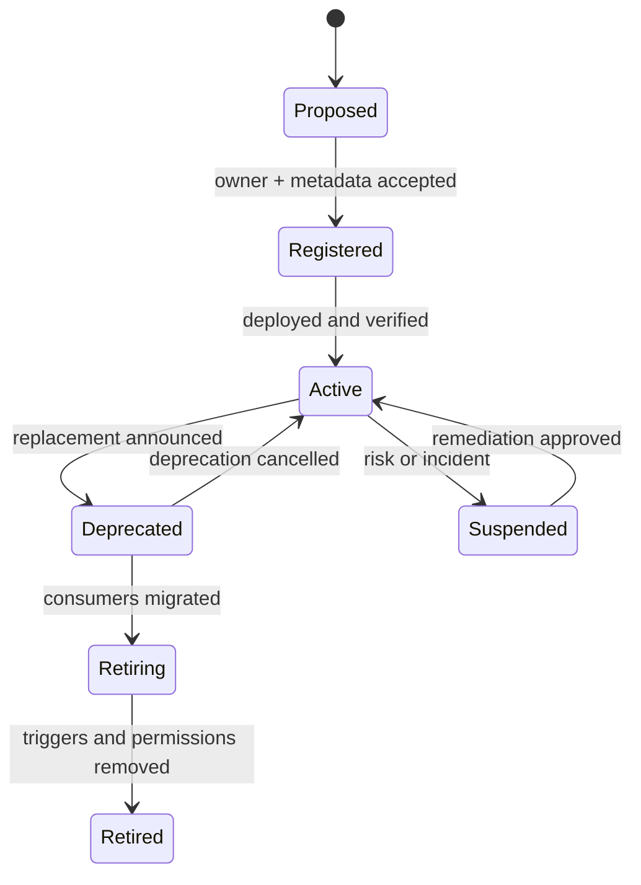

# Xây dựng danh mục function, owner và phụ thuộc dịch vụ

Trong một nền tảng serverless, số lượng function có thể tăng nhanh vì mỗi API route, queue consumer, scheduled job hoặc event handler thường được triển khai độc lập. Sau một thời gian, tổ chức có thể không còn trả lời được những câu hỏi cơ bản: function nào đang chạy trong production, ai chịu trách nhiệm khi nó lỗi, dữ liệu nào đi qua nó, nó gọi dịch vụ nào và điều gì sẽ bị ảnh hưởng nếu một dependency ngừng hoạt động.

Danh mục function và service (function/service catalog) là nguồn thông tin có cấu trúc về các workload đang được triển khai. Danh mục kết nối **function với owner, mục đích nghiệp vụ, môi trường, trigger, dữ liệu, dependency, mức độ quan trọng và trạng thái vòng đời**. Nó giúp đội kỹ thuật vận hành, bảo mật, kiến trúc và tuân thủ cùng nhìn vào một bức tranh nhất quán.

Danh mục chỉ hữu ích khi được cập nhật theo vòng đời triển khai. Một spreadsheet nhập thủ công có thể nhanh chóng lỗi thời; vì vậy nên kết hợp metadata khai báo trong repository/IaC, thông tin từ cloud inventory và quy trình xác nhận owner. Bài học này trình bày cách thiết kế catalog cho Java serverless, mô hình ownership, dependency graph, governance metadata, tự động hóa và cách dùng catalog trong vận hành.

## 1. Vì sao cần function catalog?

Một ứng dụng serverless thường không phải một function đơn lẻ. Một luồng đặt hàng có thể gồm:

- HTTP function nhận yêu cầu tạo đơn.
- Function publisher đọc transactional outbox và gửi event.
- Queue worker giữ chỗ tồn kho.
- Function xử lý kết quả thanh toán từ webhook.
- Scheduled function đối soát giao dịch chưa hoàn tất.
- Function xây dựng read model cho màn hình tra cứu.
- Function gửi thông báo hoặc ghi dữ liệu phân tích.

Các function có thể nằm ở nhiều repository, account/project, region và team khác nhau. Khi một API key sắp hết hạn, một dependency thay đổi schema hoặc một region gặp sự cố, nhóm cần biết chính xác workload nào bị ảnh hưởng và ai có quyền xử lý.

### Những câu hỏi catalog phải trả lời

| Câu hỏi | Metadata cần có |
|---|---|
| Function này làm gì? | Tên, mô tả nghiệp vụ, capability/domain, link tài liệu |
| Ai chịu trách nhiệm? | Business owner, technical owner, team, contact/on-call |
| Nó chạy ở đâu? | Cloud account/project, region, environment, runtime, resource identifier |
| Điều gì kích hoạt nó? | HTTP route, queue/topic, event rule, schedule, stream |
| Nó phụ thuộc vào đâu? | Database, queue, API, secret, KMS key, identity provider, network |
| Nó xử lý dữ liệu gì? | Data classification, residency, retention, PII/sensitive-data flags |
| Quan trọng đến mức nào? | Criticality tier, RTO/RPO, SLO, impact khi ngừng hoạt động |
| Nó đang ở giai đoạn nào? | Proposed, active, deprecated, retiring, retired |
| Có bằng chứng kiểm soát không? | IaC, CI/CD, scan, access review, backup/DR test, audit record |

Catalog không thay thế source code, IaC, IAM policy hay CMDB. Nó là lớp liên kết và khám phá giúp tìm đúng nguồn chi tiết, đúng owner và đúng dependency.

## 2. Phân biệt service, function và deployment instance

Một sai lầm phổ biến là coi tên function cloud là tên service. Trong thực tế, một service nghiệp vụ có thể gồm nhiều function; cùng một function definition có thể được triển khai thành nhiều instance theo region hoặc environment.

| Thực thể | Ý nghĩa | Ví dụ |
|---|---|---|
| Business capability | Năng lực nghiệp vụ mà tổ chức cung cấp | Order management |
| Service | Ranh giới sở hữu API, dữ liệu và contract | `order-service` |
| Function/workload | Đơn vị xử lý có trigger và runtime riêng | `create-order`, `reserve-inventory-worker` |
| Deployment | Một lần triển khai function vào environment/region/account cụ thể | `reserve-inventory-worker` ở `prod/ap-southeast-1` |
| Dependency | Tài nguyên hoặc service mà workload cần dùng | SQS queue, PostgreSQL, Payment API |

Ví dụ một service có nhiều function:



Catalog nên có ID ổn định cho service và function, sau đó liên kết deployment instance. Không dùng tên hiển thị làm khóa duy nhất vì tên cloud resource có thể thay đổi khi đổi account, region hoặc framework.

### ID ổn định

Một quy ước có thể là:

- Service ID: `orders`.
- Function ID: `orders.create-http`, `orders.outbox-publisher`.
- Deployment ID: `orders.create-http/prod/ap-southeast-1`.

ID cần ổn định qua lần deploy và có namespace để tránh trùng giữa các team. Cloud ARN/resource ID nên được lưu như định danh triển khai, không thay thế ID logic trong catalog.

## 3. Thiết kế schema cho function catalog

Một catalog cần đủ metadata để điều hành nhưng không nên bắt developer nhập hàng trăm trường trùng với IaC hoặc cloud API. Hãy chia thành các nhóm: identity, ownership, deployment, trigger, dependency, data/compliance, reliability và lifecycle.

### Nhóm trường cơ bản

| Nhóm | Trường gợi ý | Mục đích |
|---|---|---|
| Identity | `service_id`, `function_id`, `name`, `description`, `domain` | Định danh và mô tả |
| Ownership | `business_owner`, `technical_owner`, `team`, `on_call` | Xác định người chịu trách nhiệm |
| Source | `repository`, `path`, `codeowners`, `runbook` | Truy về nơi quản lý code và hướng dẫn |
| Deployment | `provider`, `account`, `region`, `environment`, `resource_id` | Xác định workload đang chạy |
| Runtime | `language`, `runtime_version`, `architecture`, `memory`, `timeout` | Quản lý runtime/configuration |
| Trigger | `trigger_type`, `source_id`, `route_or_event`, `auth_mode` | Hiểu cách workload được gọi |
| Dependency | `dependency_id`, `dependency_type`, `relationship`, `criticality` | Xây dựng dependency graph |
| Data | `classification`, `data_categories`, `residency`, `retention` | Đánh giá dữ liệu và tuân thủ |
| Reliability | `criticality_tier`, `slo`, `rto`, `rpo`, `dr_strategy` | Kết nối với vận hành/DR |
| Security | `execution_role`, `secret_refs`, `kms_key_refs`, `network_zone` | Kiểm soát truy cập và bí mật |
| Lifecycle | `status`, `created_at`, `last_deployed_at`, `reviewed_at`, `sunset_date` | Quản lý vòng đời |

Một số trường có thể được sinh tự động từ deployment; trường khác do owner khai báo. Cần ghi rõ nguồn dữ liệu, thời điểm đồng bộ và trường nào có thẩm quyền khi có xung đột.

### Ví dụ catalog entry dạng YAML

```yaml
apiVersion: platform.example/v1
kind: ServerlessFunction
metadata:
  id: orders.reserve-inventory
  name: reserve-inventory-worker
  description: Reserve stock after an order has been accepted
  domain: commerce.orders
  tags:
    environment: production
    criticality: tier-2
    data-classification: confidential
    managed-by: terraform
spec:
  serviceId: orders
  owner:
    business: commerce-operations
    technical: team-orders-platform
    onCall: orders-oncall
  source:
    repository: https://git.example.internal/commerce/orders
    path: functions/reserve-inventory
    runbook: https://docs.example.internal/runbooks/orders
  runtime:
    language: java
    version: "21"
    architecture: arm64
  trigger:
    type: queue
    sourceId: order-events
    delivery: at-least-once
  deployment:
    provider: aws
    environment: production
    accountRef: commerce-production
    region: ap-southeast-1
    resourceRef: arn:aws:lambda:ap-southeast-1:111122223333:function:reserve-inventory
  data:
    categories: [order-reference, sku, quantity]
    classification: confidential
    residency: vn
    retentionPolicy: order-processing-7y
  dependencies:
    - id: order-events
      type: queue
      relationship: consumes
      criticality: required
    - id: inventory-db
      type: database
      relationship: reads-writes
      criticality: required
  reliability:
    tier: 2
    slo: orders-worker-availability
    rto: 60m
    rpo: 5m
  lifecycle:
    status: active
    reviewedAt: "2026-10-15"
```

Các URL, ARN, owner và chính sách trong ví dụ chỉ là giá trị minh họa. Không đưa credential, secret value hoặc dữ liệu khách hàng vào catalog. Catalog nên lưu reference tới secret manager, không lưu nội dung bí mật.

Trong ví dụ, `spec.deployment.environment` và `spec.data.classification` là các trường chuẩn để policy kiểm tra; `metadata.tags` là bản sao tiện cho tìm kiếm/inventory. Pipeline nên kiểm tra hai nơi không mâu thuẫn hoặc chỉ sinh tags từ spec để tránh drift.

### Schema version và validation

Catalog cần có `apiVersion` hoặc schema version để có thể thêm trường mà không làm hỏng công cụ đọc cũ. Validation nên kiểm tra:

- Trường bắt buộc không rỗng.
- ID tuân theo pattern và không trùng.
- Owner/team tồn tại trong danh mục tổ chức.
- Dependency ID tham chiếu tới resource/service đã đăng ký hoặc được đánh dấu external.
- Region/environment hợp lệ theo policy.
- Runtime version còn được hỗ trợ.
- Data classification và retention policy có giá trị được công nhận.
- Production function có runbook, on-call và criticality.

Nếu catalog dùng YAML/JSON trong repository, kiểm tra schema trong CI. Không đợi tới lúc deploy production mới phát hiện thiếu owner hoặc dependency.

## 4. Xác định owner và trách nhiệm vận hành

Mỗi function production phải có owner chịu trách nhiệm cho tính đúng đắn, bảo mật, độ tin cậy và vòng đời của nó. Owner không nhất thiết là một cá nhân; thường là team có lịch trực và có quyền thay đổi workload.

### Các vai trò nên phân biệt

| Vai trò | Trách nhiệm |
|---|---|
| Business owner | Xác định mục tiêu nghiệp vụ, mức ảnh hưởng và ưu tiên phục hồi |
| Technical/service owner | Chịu trách nhiệm kiến trúc, code, SLO và dependency của service |
| Function maintainer | Bảo trì implementation, runtime, test và deploy function |
| On-call team | Tiếp nhận alert, điều tra và khôi phục sự cố |
| Data owner/steward | Phân loại dữ liệu, retention, access và chất lượng dữ liệu |
| Security/compliance | Định nghĩa control, đánh giá rủi ro và kiểm tra bằng chứng |
| Platform team | Cung cấp runtime, deployment, catalog automation và guardrail dùng chung |

Một team có thể đảm nhiệm nhiều vai trò, nhưng phải rõ ai quyết định và ai được liên hệ khi có sự cố. Tránh trường `owner: platform-team` chung chung cho mọi function nếu platform team không thực sự chịu trách nhiệm nghiệp vụ.

### RACI cho thay đổi quan trọng

RACI giúp phân biệt người thực hiện (Responsible), người chịu trách nhiệm cuối cùng (Accountable), người được tham vấn (Consulted) và người được thông báo (Informed).

| Hoạt động | Business owner | Service owner | Platform | Security/Data owner |
|---|---|---|---|---|
| Đăng ký function mới | C | A/R | C | C |
| Đặt SLO và criticality | A | R | C | C |
| Thay đổi IAM/runtime | I | A/R | C | C |
| Thay đổi data classification | C | R | I | A |
| Xử lý incident | I | A/R | R khi liên quan nền tảng | C |
| Retire function | A | R | C | C |

RACI phải được điều chỉnh theo tổ chức. Mỗi hoạt động chỉ nên có một accountable role để tránh quyết định bị bỏ ngỏ.

### Owner phải có khả năng hành động

Một owner record chỉ có giá trị khi team đó có:

- Quyền truy cập repository, deployment pipeline và telemetry cần thiết.
- Runbook và hướng dẫn rollback.
- On-call/contact được duy trì.
- Quyền yêu cầu thay đổi quota, secret, IAM hoặc dependency qua quy trình phù hợp.
- Hiểu biết về business impact và recovery priority.

Nếu team giải thể hoặc chuyển quyền sở hữu, catalog cần có quy trình handover trước khi xóa team hoặc repository.

## 5. Lập dependency inventory

Dependency là bất kỳ resource, service, API, identity system hoặc control plane nào mà function cần để thực hiện công việc. Chỉ liệt kê database và HTTP API là chưa đủ; serverless function còn phụ thuộc trigger, queue, secret, KMS key, network và observability.

### Các nhóm dependency

| Nhóm | Ví dụ | Câu hỏi cần trả lời |
|---|---|---|
| Trigger/source | API Gateway, SQS, Pub/Sub, EventBridge, scheduler | Ai có thể invoke? Event có thể mất/duplicate không? |
| Data store | PostgreSQL, DynamoDB, S3, Blob Storage | Ai sở hữu dữ liệu? Backup/replication ra sao? |
| External API | Payment, shipping, identity provider | Quota, SLA, auth, timeout và fallback thế nào? |
| Identity/security | IAM role, service account, KMS, secret manager | Function được phép làm gì và lấy secret từ đâu? |
| Network | VPC, subnet, NAT, private endpoint, DNS | Có đường kết nối nào bắt buộc? |
| Platform/runtime | Java runtime, layer, extension, container registry | Runtime version và lifecycle được quản lý ra sao? |
| Observability | Log, metric, trace backend, alert route | Ai nhận cảnh báo? Telemetry có phụ thuộc cùng region không? |
| Delivery/control plane | CI/CD, artifact registry, IaC backend | Có thể deploy/restore khi region chính lỗi không? |

### Kiểu quan hệ giữa function và dependency

Không chỉ ghi “depends on”. Dùng loại quan hệ rõ ràng:

- `invokes`: function gọi API/service khác.
- `consumes`: function nhận message/event từ queue/topic.
- `publishes`: function phát message/event.
- `reads`: đọc dữ liệu.
- `writes`: ghi dữ liệu.
- `authenticates-with`: phụ thuộc identity provider.
- `decrypts-with`: dùng KMS key để giải mã.
- `exports-to`: gửi telemetry tới collector/backend.
- `scheduled-by`: được scheduler kích hoạt.
- `deployed-by`: được pipeline/platform triển khai.

Quan hệ có hướng giúp truy vấn impact. Nếu `inventory-db` ngừng hoạt động, catalog có thể tìm các function có cạnh `reads-writes` tới database đó, rồi lần ngược tới API/queue mà chúng phục vụ.

### Dependency graph



Graph nên lưu edge riêng biệt với node để có thể thêm relationship attributes như `criticality`, `timeout`, `data_flow`, `protocol`, `owner` và `last_verified_at`.

## 6. Phân loại dependency theo mức độ quan trọng

Không phải dependency nào cũng có cùng tác động. Một function có thể tiếp tục phục vụ read-only khi analytics backend lỗi, nhưng không thể nhận đơn mới nếu database chính không khả dụng.

Phân loại gợi ý:

- **Required:** thiếu dependency thì function không thể thực hiện đúng nghiệp vụ.
- **Degraded:** function có thể chạy với tính năng hoặc chất lượng giảm.
- **Optional:** lỗi dependency không ảnh hưởng kết quả chính.
- **Build/deploy-time:** cần để triển khai nhưng không cần trong runtime.
- **Recovery-only:** chỉ cần khi backup restore, failover hoặc điều tra sự cố.

Ví dụ:

| Function | Dependency | Criticality | Fallback/degraded mode |
|---|---|---|---|
| `create-order` | Order DB | Required | Từ chối tạo đơn khi không ghi bền vững được |
| `create-order` | Product cache | Degraded | Đọc catalog source với timeout và rate cap |
| `order-worker` | Payment API | Required cho bước thanh toán | Giữ operation pending và retry/reconcile |
| `order-worker` | Analytics endpoint | Optional | Ghi event analytics vào queue riêng hoặc bỏ qua theo policy |
| `reconcile-payments` | Payment API | Required | Tạm dừng run và retry sau; không tự suy diễn kết quả |

Fallback phải được định nghĩa theo nghiệp vụ. Không dùng `catch (Exception) { return success; }` để biến dependency failure thành thành công giả.

## 7. Data flow và phân loại dữ liệu

Catalog cần mô tả loại dữ liệu function đọc, ghi hoặc truyền qua event. Điều này giúp đánh giá quyền truy cập, data residency, retention, encryption, logging và khả năng chia sẻ với bên thứ ba.

Một taxonomy đơn giản có thể gồm:

| Mức | Ví dụ khái niệm | Kiểm soát thường cần xem xét |
|---|---|---|
| Public | Nội dung đã được phép công khai | Integrity, availability và kiểm soát thay đổi |
| Internal | Metadata vận hành nội bộ | Authentication, access theo vai trò, retention |
| Confidential | Đơn hàng, thông tin khách hàng nội bộ, hợp đồng | Least privilege, encryption, audit, retention và hạn chế export |
| Restricted | Bí mật xác thực, dữ liệu tài chính/định danh đặc biệt theo policy tổ chức | Secret manager, access approval, masking, key control và audit tăng cường |

Tên phân loại phải khớp policy thực tế của tổ chức. Bảng trên chỉ là ví dụ taxonomy, không thay thế phân loại pháp lý hoặc đánh giá của data owner.

### Mô tả data flow

Với mỗi function, ghi:

- Data category được nhận từ trigger.
- Trường nào được lưu, biến đổi hoặc loại bỏ.
- Data store/region nào nhận dữ liệu.
- Event nào mang dữ liệu sang service khác.
- Có gửi dữ liệu cho external provider không.
- Log/trace có thể chứa dữ liệu gì.
- Retention và deletion policy áp dụng ở đâu.

Không chỉ gắn nhãn `PII=true`. Hãy xác định dữ liệu nào, đi qua thành phần nào, có được lưu trong DLQ/archive/log hay không và ai có quyền đọc.

### Data lineage

Data lineage mô tả nguồn gốc và đường đi của dữ liệu. Ví dụ `customerRef` từ API request được lưu vào order DB, đưa vào `OrderPlaced` event, đọc bởi inventory worker và cuối cùng xuất hiện trong analytics. Catalog có thể liên kết data field/category với service/edge để tìm phạm vi ảnh hưởng khi thay đổi retention hoặc access policy.

## 8. Security ownership và quyền truy cập

Function catalog nên cho biết runtime identity nào được dùng và phạm vi quyền ở mức khái quát. Chi tiết policy vẫn nằm trong IAM/IaC, nhưng catalog giúp tìm owner và dependency khi cần access review.

Các trường cần theo dõi:

- Execution role/service account ID.
- Các resource group hoặc permission profile được cấp.
- Secret reference và owner của secret.
- KMS key reference và purpose.
- Network zone/private endpoint.
- Trigger authorization mode và principal có thể invoke.
- Last access review và reviewer.

### Tách owner của code và owner của dữ liệu

Team phát triển function không mặc nhiên là owner của dữ liệu mà function đọc. Data owner quyết định classification, purpose, retention và access policy. Service owner chịu trách nhiệm bảo đảm implementation tuân thủ policy.

Ví dụ, `order-worker` có thể thuộc team Orders nhưng đọc payment result do Payment service sở hữu. Thay đổi field hoặc quyền truy cập cần tham vấn cả hai owner.

### Dependency permission review

Một access review có thể kiểm tra:

1. Function có thật sự cần dependency này không?
2. Quyền là read, write, invoke hay administer?
3. Có thể giới hạn theo resource ARN, queue, bucket, table hoặc key cụ thể không?
4. Có quyền quản trị như delete, policy update hoặc key rotation bị cấp nhầm cho runtime role không?
5. Secret/KMS reference còn được sử dụng không?
6. Trigger có cho phép principal ngoài dự kiến invoke không?
7. Quyền có được cấp tự động từ IaC và có audit không?

Catalog hỗ trợ xác định scope review; quyết định cuối cùng phải dựa trên policy thực tế và log sử dụng, không chỉ metadata khai báo.

## 9. Criticality, SLO và recovery mapping

Criticality tier giúp tổ chức quyết định mức đầu tư reliability, on-call, backup và DR. Không nên dùng một tier duy nhất cho cả service nếu các function có tác động khác nhau.

Ví dụ phân tầng:

| Tier | Ý nghĩa | Kỳ vọng vận hành ví dụ |
|---|---|---|
| Tier 0 | Quy trình cốt lõi, tác động nghiêm trọng | On-call 24/7, DR đã diễn tập, kiểm soát thay đổi chặt |
| Tier 1 | Dịch vụ quan trọng với hoạt động chính | SLO rõ, alert, backup/restore được kiểm thử |
| Tier 2 | Có thể gián đoạn ngắn hoặc degrade | Hỗ trợ theo giờ phù hợp, recovery runbook |
| Tier 3 | Tác động thấp, có thể tái tạo | Best-effort recovery, backup theo nhu cầu |

Tier chỉ là nhãn. Cần liên kết với SLO, RTO/RPO, support hours, change approval và test frequency. Một function scheduled reconciliation có thể không nhận traffic trực tiếp nhưng lại quan trọng để phát hiện sai lệch thanh toán; đừng đánh giá criticality chỉ dựa trên RPS.

### Function-level criticality

Catalog nên cho phép function có criticality khác service cha nếu vai trò khác nhau. Ví dụ API read-only có thể tier thấp hơn payment authorization worker, dù cùng thuộc `commerce-service`.

### Dependency criticality

Với mỗi dependency, lưu tác động nếu nó lỗi:

- Required và không có fallback.
- Required nhưng có thể retry/queue.
- Degraded với dữ liệu cache/stale có giới hạn.
- Optional và có thể bỏ qua.

Thông tin này giúp xác định blast radius và thứ tự phục hồi trong incident/DR.

## 10. Lifecycle governance: từ tạo mới tới retirement

Catalog phải theo dõi vòng đời của function, không chỉ thời điểm deploy đầu tiên.



### Proposed/Registered

Trước khi triển khai, developer khai báo service/function ID, owner, trigger, dependency, data classification và criticality. CI kiểm tra schema và policy cơ bản.

### Active

Function đã deploy và xác minh. Catalog nhận deployment metadata từ pipeline/cloud inventory: resource ID, runtime version, region, artifact version, last deployed time và link telemetry.

### Deprecated/Retiring

Khi thay thế function, owner công bố sunset date, consumer cần chuyển đổi, route/event trigger được cập nhật và dependency cũ được đánh giá. Không xóa function chỉ vì không thấy invocation trong vài ngày; có thể là job định kỳ hoặc emergency path ít dùng.

### Retired

Retirement cần xác minh:

- Không còn trigger/route/schedule gọi function.
- Không còn producer/consumer phụ thuộc contract cũ.
- Không còn permission, secret, KMS grant hoặc network rule chỉ dùng cho function.
- Dữ liệu/log/archive cần retention vẫn được giữ theo policy.
- Dashboard/alert/runbook được cập nhật.
- Cloud resource đã xóa hoặc được đánh dấu retained với lý do.
- Catalog lưu trạng thái retired và thời điểm kết thúc.

Retire một function mà không xóa event mapping hoặc IAM permission có thể để lại bề mặt tấn công và chi phí không cần thiết.

## 11. Thu thập catalog metadata tự động

Một catalog tốt kết hợp ba nguồn:

1. **Declared metadata:** file YAML/JSON trong repository hoặc annotation trong IaC, do team sở hữu khai báo.
2. **Deployment metadata:** pipeline cung cấp artifact version, deployment ID, environment, commit và timestamp.
3. **Observed cloud inventory:** cloud API phát hiện function, trigger, role, queue, database và resource thực tế.

Ba nguồn bổ sung nhau. Declared metadata hiểu mục đích/owner; deployment metadata hiểu phiên bản được phát hành; cloud inventory cho biết tài nguyên thật đang tồn tại.

### Quy tắc hợp nhất

| Trường | Nguồn ưu tiên gợi ý |
|---|---|
| Business description/domain | Repository/catalog owner |
| Technical owner/on-call | Catalog với xác nhận team |
| Runtime/resource ID/region | Cloud inventory/deployment pipeline |
| Artifact version/commit | CI/CD pipeline |
| Trigger mapping | Cloud inventory, đối chiếu IaC |
| Declared dependencies | Repository/IaC |
| Observed dependencies | Tracing/network inventory nếu có và được phép |
| Data classification/retention | Data owner/policy registry |
| Last deployed time | Deployment pipeline/cloud metadata |

Không tự động ghi đè owner hoặc data classification từ một nguồn suy đoán. Khi hai nguồn mâu thuẫn, đánh dấu `needs_review` và yêu cầu owner xác nhận.

### Phát hiện drift

So sánh declared catalog với cloud inventory để phát hiện:

- Function production không có catalog entry.
- Catalog entry trỏ tới resource không còn tồn tại.
- Trigger thực tế khác cấu hình đã khai báo.
- Function runtime version đã hết hỗ trợ.
- Resource được tạo thủ công ngoài IaC.
- Owner/team không còn tồn tại.
- Dependency mới xuất hiện mà chưa được đánh giá.

Drift report cần có severity, owner, evidence, first-seen/last-seen và due date. Không tự xóa resource chỉ vì catalog không nhận diện; trước tiên phải xác định owner và tác động.

## 12. Governance trong CI/CD

Catalog nên được kiểm tra trong pull request và cập nhật cùng deployment để metadata không tách khỏi code.

Một pipeline có thể gồm:

1. Validate catalog schema và ID.
2. Kiểm tra owner, on-call và repository link.
3. Kiểm tra trigger/dependency declaration.
4. Kiểm tra data classification, region và retention policy.
5. Kiểm tra runtime version, memory, timeout và concurrency theo guardrail.
6. Kiểm tra IaC policy, IAM least privilege và secret reference.
7. Build/test/scan artifact.
8. Deploy vào environment.
9. Gửi deployment metadata vào catalog.
10. Đối chiếu cloud inventory sau deploy và tạo drift finding nếu cần.

### Policy-as-code

Guardrail có thể được thực hiện bằng schema validation, OPA/Rego, Conftest hoặc công cụ policy của cloud. Ví dụ rule khái niệm:

```rego
package serverless.catalog

deny[msg] {
  input.spec.deployment.environment == "production"
  not input.spec.owner.technical
  msg := "Production function must declare a technical owner"
}

deny[msg] {
  input.spec.deployment.environment == "production"
  not input.spec.source.runbook
  msg := "Production function must link an operational runbook"
}

deny[msg] {
  input.spec.data.classification == "restricted"
  not input.spec.data.retentionPolicy
  msg := "Restricted data must declare a retention policy"
}
```

Đây là ví dụ policy logic; schema path cần khớp catalog thực tế. Policy production nên có exception workflow với owner, lý do, thời hạn và approver. Không biến mọi cảnh báo thành hard block nếu tổ chức cần rollout dần; phân biệt `deny`, `warn` và `needs_review`.

### Không lưu secret trong metadata

Catalog và pipeline artifact thường có phạm vi đọc rộng hơn secret store. Chỉ lưu reference như `secretRef: payment-api-key`; giá trị secret phải nằm trong Secrets Manager, Key Vault hoặc Secret Manager. CI log không được in environment variable chứa credential.

## 13. Catalog hỗ trợ incident management

Khi có incident, catalog giúp trả lời nhanh:

- Function/service nào bị ảnh hưởng trực tiếp?
- Dependency nào đang lỗi và các consumer nào phụ thuộc vào nó?
- Team/on-call nào chịu trách nhiệm?
- Function nào có thể chuyển sang degraded mode?
- SLO/RTO/RPO và runbook của service là gì?
- Data nào có thể bị ảnh hưởng hoặc lộ?
- Có thể tắt trigger/giới hạn concurrency mà không làm mất dữ liệu không?

### Blast radius analysis

Với dependency graph có hướng, có thể truy vấn tất cả workload đi tới một node. Nếu `payment-api` lỗi, tìm function có cạnh `invokes` tới API đó, service cha, queue liên quan và business capability bị ảnh hưởng.

Graph nên phân biệt direct dependency và transitive dependency. Một function không gọi trực tiếp database nhưng phụ thuộc service khác đang dùng database vẫn chịu ảnh hưởng gián tiếp.

### Ví dụ incident workflow

1. Alert từ `payment-api` hoặc error rate của consumer.
2. Tìm dependency node và các function/service liên quan trong catalog.
3. Xác định technical owner/on-call và runbook.
4. Kiểm tra criticality, SLO và degraded behavior.
5. Quyết định pause consumer, giảm concurrency hoặc đưa operation về pending.
6. Theo dõi backlog/DLQ và trạng thái giao dịch.
7. Khi dependency phục hồi, replay/reconcile theo policy.
8. Cập nhật incident finding và dependency metadata nếu graph thiếu.

Catalog giúp khám phá, nhưng quyết định xử lý vẫn cần dựa trên telemetry và trạng thái runtime thực tế.

## 14. Catalog hỗ trợ change management

Thay đổi một dependency có thể ảnh hưởng nhiều function. Trước khi nâng version database, đổi schema event, rotate KMS key hoặc thay endpoint API, cần truy vấn consumer/producer và owner liên quan.

Một change record nên chứa:

- Dependency/resource bị thay đổi.
- Function/service trực tiếp và gián tiếp bị ảnh hưởng.
- Contract/schema version và compatibility window.
- Data classification và region/residency impact.
- Owner được tham vấn.
- Test, rollout, rollback và monitoring plan.
- Ngày hiệu lực và thời điểm xóa compatibility cũ.

### Dependency contract

Với HTTP API, lưu OpenAPI/contract version và authentication method. Với event, lưu schema registry reference, event type và delivery semantics. Với database, lưu logical database/table group và access mode, không nhất thiết đưa toàn bộ schema nhạy cảm vào catalog.

Contract giúp nhận diện breaking change. Một consumer có thể vẫn chạy nhưng parse sai event field sau khi producer đổi semantics; catalog liên kết producer-consumer để xác định ai cần phối hợp.

## 15. Governance và tuân thủ

Catalog hỗ trợ chứng minh tổ chức biết workload nào xử lý dữ liệu gì, ai chịu trách nhiệm và dependency nào được sử dụng. Tuy nhiên, có catalog không tự động đồng nghĩa tuân thủ. Cần kết hợp metadata với evidence thực tế.

Các chủ đề governance thường gặp:

- Data classification, purpose và retention.
- Data residency và cross-region/cross-border flow.
- Encryption at rest/in transit và key ownership.
- IAM least privilege và access review.
- Secret rotation và certificate expiry.
- Vulnerability/SBOM và runtime support lifecycle.
- Audit log, deployment record và change approval.
- Backup, DR, RTO/RPO và recovery exercise.
- Third-party dependency, vendor/SLA và exit plan.

### Bằng chứng kiểm soát

Mỗi control nên liên kết tới evidence có thể kiểm tra:

| Control | Evidence có thể lưu/reference |
|---|---|
| Owner assignment | Catalog approval, team directory, on-call rotation |
| Least privilege | IAM policy/IaC plan, access review result |
| Encryption | Storage/KMS configuration, key policy reference |
| Secret management | Secret reference, rotation timestamp, access log |
| Vulnerability management | SBOM, dependency scan, image/JAR scan report |
| Change management | Pull request, approval, deployment ID, rollback record |
| Backup/DR | Backup job evidence, restore test, DR drill report |
| Data retention | Policy ID, lifecycle configuration, deletion evidence |
| Observability | Dashboard, alert route, SLO report |

Không copy toàn bộ audit evidence vào catalog. Lưu link/reference, timestamp, status và owner; evidence gốc vẫn nằm ở hệ thống quản lý phù hợp với access control/retention.

### Review định kỳ

Tần suất review nên theo criticality và rủi ro. Function xử lý dữ liệu restricted hoặc thanh toán cần review thường xuyên hơn một job tạo báo cáo có thể tái tạo. Review có thể kiểm tra owner, dependency, permission, data classification, runtime support, SLO và retirement status.

## 16. Quản lý third-party dependency

Serverless function có thể gọi API SaaS hoặc thư viện bên ngoài. Catalog nên ghi nhà cung cấp, purpose, data shared, auth method, quota, SLA/support contact và phương án khi vendor ngừng hoạt động.

Với thư viện Java, SBOM (Software Bill of Materials) và dependency scan giúp biết package/version nào được dùng. Catalog có thể liên kết tới SBOM theo artifact version thay vì lưu toàn bộ dependency tree trong metadata chính.

Các câu hỏi:

- Function gửi dữ liệu gì cho vendor?
- Vendor lưu dữ liệu ở region nào và retention ra sao?
- Có SLA/quota/maintenance window không?
- API có idempotency, retry và webhook contract không?
- Có thể thay thế vendor hoặc export dữ liệu khi chấm dứt hợp đồng không?
- Ai nhận cảnh báo khi certificate/API key hết hạn?

Không đưa secret vendor vào catalog. Chỉ lưu secret reference và owner của credential.

## 17. Java serverless: metadata gắn với code và deployment

Có thể lưu catalog descriptor cạnh source code để developer review cùng thay đổi implementation.

Ví dụ descriptor:

```yaml
service:
  id: orders
  owner: team-orders-platform
  domain: commerce

function:
  id: orders.create-http
  entrypoint: com.example.orders.CreateOrderHandler
  runtime: java21
  trigger:
    type: http
    route: POST /orders
    auth: jwt-authorizer
  data:
    classification: confidential
    categories: [customer-reference, order-items]
  dependencies:
    - id: orders-db
      relationship: reads-writes
    - id: inventory-reservation-api
      relationship: invokes
    - id: orders-events
      relationship: publishes
  operations:
    runbook: docs/runbooks/create-order.md
    slo: orders-api-availability
    onCall: orders-oncall
```

Pipeline có thể đọc descriptor, validate rồi publish metadata vào catalog API. Resource ARN, deployed version và timestamp được thêm từ deployment result, không cần developer hard-code từng ARN trong source.

### Gắn metadata qua IaC

Với Terraform, tags/labels có thể mang ID catalog, owner, environment, data classification và cost center:

```hcl
locals {
  common_tags = {
    service_id          = "orders"
    function_id         = "orders.reserve-inventory"
    owner_team          = "team-orders-platform"
    environment         = var.environment
    data_classification = "confidential"
    managed_by          = "terraform"
  }
}

resource "aws_lambda_function" "reserve_inventory" {
  function_name = "reserve-inventory-${var.environment}"
  role          = aws_iam_role.lambda_execution.arn
  runtime       = "java21"
  handler       = "com.example.orders.ReserveInventoryHandler::handleRequest"
  filename      = var.artifact_path

  tags = local.common_tags
}
```

Ví dụ minh họa; provider/resource version và runtime availability cần khớp môi trường triển khai. Tags là metadata hỗ trợ inventory/cost/governance, nhưng không thay thế catalog entry hoặc policy validation. Một resource có tag `owner_team` chưa chứng minh team đó đã nhận ownership.

### Correlate function với telemetry

Đưa các resource attributes ổn định như `service.name`, `service.version`, `deployment.environment`, `cloud.region` và `catalog.function_id` vào logs/traces/metrics khi backend hỗ trợ. Nhờ đó, từ alert có thể mở catalog entry và tìm owner/runbook.

Không đưa invocation ID, request ID hoặc customer ID vào resource attribute vì chúng thay đổi theo invocation và làm tăng cardinality. Dùng span/log context cho thông tin theo request với redaction phù hợp.

## 18. Catalog API và công cụ discovery

Khi số lượng workload lớn, catalog có thể cung cấp API/search UI để tìm service theo owner, domain, region, data classification, dependency hoặc criticality.

Các truy vấn hữu ích:

- Tất cả function production chưa có owner/on-call.
- Function Java đang dùng runtime sắp hết hỗ trợ.
- Workload xử lý dữ liệu confidential ở region cụ thể.
- Consumer phụ thuộc vào event schema version sắp thay đổi.
- Function gọi một vendor/API đang có incident.
- Resource có cloud tag nhưng không có catalog entry.
- Function active không có deployment trong khoảng thời gian dài.
- Secret/KMS key có reference từ workload nào.
- Service tier-0 chưa có DR test gần đây.

### Search không thay thế authorization

Catalog có thể hiển thị tên resource và dependency nhưng không nên vô tình tiết lộ secret reference nhạy cảm hoặc data lineage restricted cho người không có quyền. Áp dụng RBAC/ABAC cho catalog, giới hạn trường hiển thị và audit truy vấn nhạy cảm nếu cần.

## 19. Các lỗi thường gặp khi xây dựng catalog

| Lỗi | Hệ quả | Cách khắc phục |
|---|---|---|
| Chỉ ghi tên cloud function | Không biết mục đích/owner/dependency | Dùng service/function/deployment ID và metadata nghiệp vụ |
| Một owner chung cho mọi function | Incident không có team chịu trách nhiệm | Gán technical owner và on-call cụ thể |
| Owner là cá nhân duy nhất | Ownership mất khi người đó nghỉ/chuyển team | Dùng team owner, contact role và backup contact |
| Chỉ khai báo dependency thủ công | Catalog không phản ánh resource thực tế | Đối chiếu IaC, pipeline và cloud inventory |
| Chỉ dựa cloud inventory | Không biết business purpose/data classification | Bổ sung metadata do owner khai báo |
| Không phân biệt direct/transitive dependency | Impact analysis thiếu hoặc sai | Dùng graph có hướng và traversal |
| Không ghi trigger semantics | Không hiểu retry, ordering và invoke principal | Lưu trigger type, delivery/auth/consumer mapping |
| Lưu secret value trong catalog | Rò credential | Chỉ lưu secret reference |
| Không cập nhật khi retire | Resource/permission mồ côi và chi phí tăng | Lifecycle state và retirement checklist |
| Tags được coi là bằng chứng ownership | Team chưa nhận nhưng resource vẫn có tag | Yêu cầu owner approval và on-call confirmation |
| Metadata không có schema version | Tooling bị hỏng khi đổi field | Version schema và migration |
| Policy chỉ chạy thủ công | Drift kéo dài | Tích hợp validation vào CI/CD và inventory scan |
| Catalog thành nơi lưu mọi dữ liệu | Dữ liệu trùng lặp, nhạy cảm và khó bảo trì | Lưu reference tới source of truth/evidence |

## 20. Quy trình xây dựng và vận hành function catalog

1. **Xác định mô hình entity.** Phân biệt capability, service, function, deployment và dependency.
2. **Định nghĩa schema.** Chọn field bắt buộc, schema version, ID và taxonomy dùng chung.
3. **Thiết lập ownership.** Gán business owner, technical owner, team và on-call.
4. **Khai báo trigger/data/dependency.** Mô tả quan hệ và criticality của từng dependency.
5. **Gắn lifecycle và criticality.** Định nghĩa status, SLO, RTO/RPO và review frequency.
6. **Lưu metadata cạnh code/IaC.** Cho phép owner review cùng pull request.
7. **Validate trong CI.** Kiểm tra schema, owner, region, classification, runbook và policy.
8. **Đồng bộ deployment.** Thêm resource ID, artifact version, region và timestamp sau deploy.
9. **Đối chiếu cloud inventory.** Phát hiện resource không đăng ký, dependency drift và owner không hợp lệ.
10. **Dùng catalog trong incident/change/DR.** Truy vấn blast radius, owner, runbook và evidence.
11. **Review định kỳ.** Xác nhận metadata, permission, runtime, data flow và dependency.
12. **Retire có kiểm soát.** Gỡ trigger, permission và resource sau khi consumer được chuyển đổi.

## 21. Checklist trước production

- [ ] Service, function và deployment có ID ổn định, không phụ thuộc tên cloud resource.
- [ ] Function có mô tả nghiệp vụ, domain và repository/path.
- [ ] Có business owner, technical owner, team và on-call.
- [ ] Có runbook và đường dẫn telemetry/dashboard.
- [ ] Trigger, invoke principal và delivery semantics được khai báo.
- [ ] Dependency có ID, loại quan hệ, owner và criticality.
- [ ] Data classification, categories, region/residency và retention được xác nhận.
- [ ] Runtime, version, architecture và deployment resource được đồng bộ.
- [ ] IAM role, secret reference, KMS key và network dependency được liên kết.
- [ ] Criticality, SLO, RTO/RPO và DR strategy có giá trị phù hợp.
- [ ] Catalog schema được version và validate trong CI/CD.
- [ ] Cloud inventory được đối chiếu để phát hiện drift/unregistered resource.
- [ ] Metadata không chứa secret hoặc payload nhạy cảm.
- [ ] Access review và evidence có owner/timestamp.
- [ ] Lifecycle retirement có checklist gỡ trigger, permission và dependency.
- [ ] Incident/change process dùng catalog để tìm blast radius và owner.

## Kết luận

Function catalog biến tập hợp Java serverless function rời rạc thành một hệ thống workload có thể khám phá và quản trị. Mỗi function cần ID ổn định, mục đích, owner, trigger, deployment, data classification, dependency, criticality và lifecycle. Dependency graph cho biết blast radius; ownership/RACI xác định ai hành động; metadata và evidence hỗ trợ security/compliance; CI/CD cùng cloud inventory giúp catalog bám sát trạng thái thực tế. Hãy coi catalog là một phần của vòng đời phát triển và vận hành: được khai báo cùng code/IaC, cập nhật khi deploy, đối chiếu định kỳ và retire cùng resource. Khi catalog phản ánh đúng hệ thống đang chạy, tổ chức có thể điều tra incident, đánh giá thay đổi và chứng minh trách nhiệm rõ ràng hơn.
