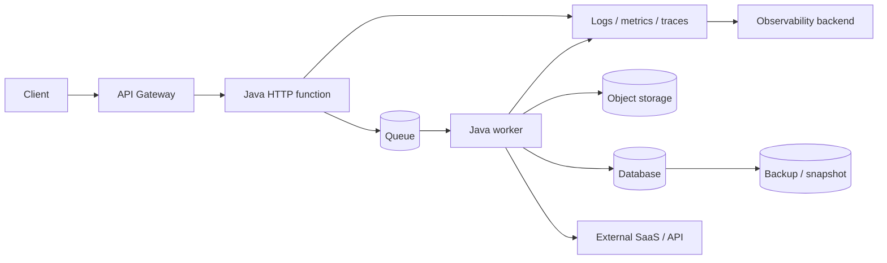
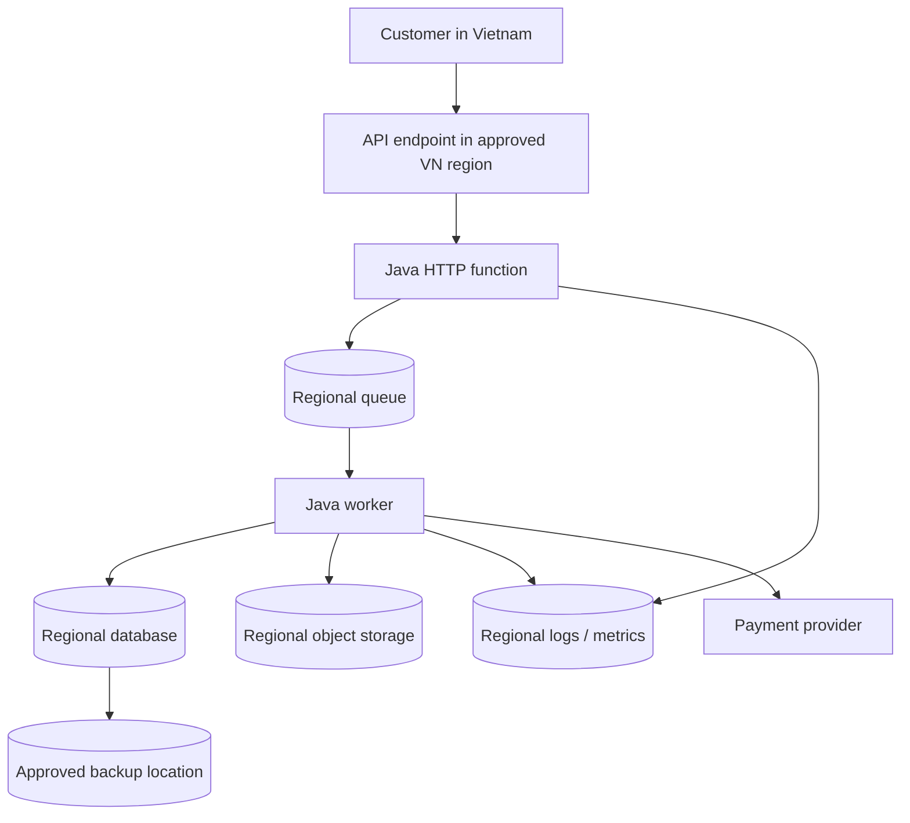

# Quy định region và vị trí lưu dữ liệu

Chọn region khi triển khai Java function serverless là một quyết định về kiến trúc, độ trễ, khả năng phục hồi và tuân thủ. Một function có thể chạy ở region này nhưng database, queue, object storage, backup, log hoặc hệ thống tracing lại nằm ở region khác. Vì vậy, nhìn vào region của function hoặc chọn một vùng có tên gần quốc gia của người dùng chưa đủ để kết luận dữ liệu được lưu và xử lý đúng vị trí.

**Data residency** mô tả dữ liệu được lưu hoặc xử lý ở đâu. **Data sovereignty** liên quan đến luật và thẩm quyền có thể áp dụng đối với dữ liệu, nhà cung cấp và hoạt động xử lý. **Data localization** là yêu cầu pháp lý hoặc hợp đồng buộc một loại dữ liệu nhất định phải được lưu tại một quốc gia/khu vực. Ba khái niệm này liên quan nhưng không đồng nghĩa.

Trong phạm vi **CLOUD_SERVERLESS**, bài học tập trung vào phát triển và triển khai ứng dụng theo mô hình serverless, đặc biệt là Java function kích hoạt bởi HTTP, thông điệp hoặc sự kiện. Người học xử lý trigger, trạng thái, quyền truy cập, retry, idempotency, cold start, mở rộng và chi phí. Bài này hướng dẫn xác định dữ liệu đi qua những region nào, đánh giá nghĩa vụ pháp lý và cấu hình kiến trúc serverless để kiểm soát nơi dữ liệu được lưu, xử lý, sao lưu và truy cập.

> **Phạm vi pháp lý:** Phần pháp luật Việt Nam dưới đây được biên soạn theo các văn bản được ban hành và có hiệu lực đến ngày 17/11/2026. Đây là tài liệu học kỹ thuật, không phải ý kiến tư vấn pháp lý. Nghĩa vụ cụ thể phụ thuộc loại dữ liệu, vai trò của tổ chức, ngành nghề, dịch vụ, đối tượng dữ liệu, hợp đồng và văn bản hướng dẫn đang có hiệu lực; cần được bộ phận pháp chế/tuân thủ xác nhận trước khi đưa hệ thống vào production.

## 1. Region, availability zone và vị trí pháp lý

Region là một khu vực địa lý do nhà cung cấp cloud xác định để triển khai tài nguyên. Một region thường có nhiều availability zone hoặc vùng lỗi độc lập. Availability zone giúp tăng khả năng sẵn sàng trong region; nó không tự động tạo ra một biên giới pháp lý mới.

| Khái niệm | Ý nghĩa | Câu hỏi cần trả lời |
|---|---|---|
| Region | Khu vực cloud nơi tài nguyên được triển khai | Dịch vụ và dữ liệu đang ở region nào? |
| Availability zone | Vùng lỗi độc lập trong một region | Có thể chịu lỗi một zone mà vẫn hoạt động không? |
| Data residency | Nơi dữ liệu được lưu/xử lý theo thiết kế hoặc cam kết | Bản chính, replica, backup và telemetry ở đâu? |
| Data sovereignty | Luật/thẩm quyền có thể áp dụng lên dữ liệu hoặc nhà cung cấp | Ai có thể yêu cầu truy cập và theo luật nào? |
| Data localization | Nghĩa vụ lưu một số dữ liệu tại một quốc gia/khu vực | Loại dữ liệu nào bắt buộc lưu nội địa và trong điều kiện nào? |
| Cross-border transfer | Chuyển hoặc xử lý dữ liệu qua biên giới theo định nghĩa pháp luật áp dụng | Có hoạt động nào gửi, lưu hoặc xử lý dữ liệu ở nước ngoài? |

Không nên suy luận rằng một region có tên quốc gia tương ứng sẽ đáp ứng mọi yêu cầu. Cần kiểm tra region thực tế, dịch vụ có hỗ trợ tại region đó, vị trí lưu trữ phụ, điều khoản dịch vụ và nghĩa vụ pháp lý.

## 2. Phân biệt lưu trữ, xử lý và quyền truy cập

Một hệ thống có thể lưu dữ liệu ở Việt Nam nhưng vẫn gửi bản sao hoặc cho phép xử lý dữ liệu ở nước ngoài. Ngược lại, một dịch vụ có thể chạy compute ở nước ngoài nhưng chỉ nhận dữ liệu đã được khử nhận dạng hoặc dữ liệu không thuộc phạm vi hạn chế. Việc đánh giá phải dựa trên luồng dữ liệu thực tế và định nghĩa của luật áp dụng.

Ba câu hỏi cần tách riêng:

1. **Lưu ở đâu?** Database, object, queue, cache, snapshot, backup và archive đặt ở đâu?
2. **Xử lý ở đâu?** Function, analytics, search, fraud detection, APM, support tooling hoặc nền tảng SaaS xử lý dữ liệu ở đâu?
3. **Ai có thể truy cập từ đâu?** Nhân sự nhà cung cấp, support engineer, subprocessor, quản trị viên và hệ thống tự động có quyền truy cập dữ liệu ở khu vực nào?

Mã hóa khi truyền và khi lưu là biện pháp bảo vệ quan trọng, nhưng không tự động làm cho một hoạt động xử lý xuyên biên giới trở thành không có chuyển dữ liệu. Pseudonymization cũng không mặc nhiên biến dữ liệu thành dữ liệu vô danh. Cần đánh giá theo khả năng nhận diện lại, dữ liệu kèm theo và quy định liên quan.

## 3. Lập inventory và phân loại dữ liệu trước khi chọn region

Không nên bắt đầu bằng câu hỏi “đặt ứng dụng ở region nào?”. Hãy bắt đầu bằng việc xác định dữ liệu nào được thu thập, mục đích xử lý, ai sở hữu/kiểm soát, ai xử lý và mức độ nhạy cảm.

Một data inventory có thể gồm:

| Nhóm dữ liệu | Ví dụ trong ứng dụng serverless | Điều cần xem xét |
|---|---|---|
| Dữ liệu cá nhân cơ bản | Tên, email, số điện thoại, định danh tài khoản | Mục đích, căn cứ xử lý, nơi lưu và bên nhận |
| Dữ liệu cá nhân nhạy cảm | Dữ liệu sức khỏe, sinh trắc học hoặc nhóm nhạy cảm theo danh mục pháp luật | Kiểm soát truy cập, mã hóa, retention và transfer assessment |
| Dữ liệu tài chính | Giao dịch, thông tin thanh toán, lịch sử hóa đơn | Quy định ngành, hợp đồng với payment provider và phạm vi PCI nếu áp dụng |
| Dữ liệu nghiệp vụ | Đơn hàng, tồn kho, workflow state | Phân loại theo mức độ quan trọng và yêu cầu hợp đồng |
| Dữ liệu cốt lõi/dữ liệu quan trọng | Dữ liệu thuộc tiêu chí phân loại theo pháp luật về dữ liệu | Đánh giá theo Luật Dữ liệu và văn bản hướng dẫn |
| Bí mật kinh doanh | Giá, thuật toán, hợp đồng, kế hoạch | Quyền truy cập, vị trí xử lý, bảo mật và nghĩa vụ hợp đồng |
| Nhật ký và telemetry | IP, user ID, request ID, trace attributes, exception payload | Có thể chứa dữ liệu cá nhân hoặc bí mật; cần phân loại riêng |
| Metadata và cấu hình | Resource ID, key metadata, tenant mapping, secret reference | Có thể tiết lộ cấu trúc hệ thống hoặc định danh |

Phân loại dữ liệu không chỉ dựa vào tên cột. Một trace chứa email, IP hoặc nội dung request vẫn có thể chứa dữ liệu cá nhân dù được lưu trong hệ thống observability thay vì database nghiệp vụ.

## 4. Lập bản đồ toàn bộ luồng dữ liệu serverless

Một HTTP request có thể đi qua API Gateway, Java function, queue, worker, database, object storage và hệ thống telemetry. Với mỗi bước, hãy ghi rõ region, loại dữ liệu, mục đích, bên xử lý và đường truyền ra ngoài.



Với mỗi mũi tên, hãy hỏi:

- Payload có chứa dữ liệu cá nhân, dữ liệu quan trọng hoặc bí mật không?
- Dữ liệu được truyền đến region, quốc gia hoặc nhà cung cấp nào?
- Có lưu bản sao, retry message, dead-letter message hoặc trace attribute không?
- Có subprocessor hoặc support team ở nước khác truy cập được không?
- Có hợp đồng xử lý dữ liệu và cơ chế chuyển dữ liệu phù hợp không?

Sơ đồ này cần được cập nhật khi thêm function, trigger, SaaS, region DR, log exporter hoặc dịch vụ mới.

## 5. Những nơi dữ liệu có thể rời khỏi region chính

Trong serverless, rủi ro thường nằm ở tài nguyên phụ hoặc luồng tự động được bật sẵn:

| Thành phần | Ví dụ dữ liệu | Kiểm tra vị trí |
|---|---|---|
| Function runtime | Request/event payload, biến môi trường, memory snapshot nếu nền tảng có tính năng liên quan | Region triển khai, nơi runtime thực thi và quyền support |
| API Gateway / CDN / WAF | URL, header, IP, cookie, cache object | Edge location, log destination và cache policy |
| Queue / topic / event bus | Message body, attributes, event metadata | Region của broker, subscription, replication và DLQ |
| Database | Record, index, transaction log | Primary, read replica, backup và snapshot |
| Object storage | File upload, export, archive | Bucket/container, versioning, replication và archive tier |
| Cache / search | Session, profile, index document | Cluster region, snapshot và backup |
| Logs | Request metadata, exception, payload trích xuất | Log group/workspace, archive, export và query service |
| Metrics / tracing | Label, span, baggage, event attributes | Telemetry backend, collector, tail sampler và export |
| Secrets / KMS | Secret value, key metadata, cryptographic operation | Region của secret/key và quyền truy cập từ xa |
| CI/CD và artifact registry | Build log, test fixture, package, deployment manifest | Runner, registry, cache và log retention |
| Support / ticketing | Diagnostic bundle, screenshot, incident payload | SaaS support platform, người nhận và subprocessor |

Không phải mọi metadata đều là dữ liệu cá nhân, nhưng vẫn cần phân loại. Một deployment manifest có thể tiết lộ tên khách hàng, tài khoản, endpoint nội bộ hoặc cấu trúc bảo mật.

## 6. Nghĩa vụ pháp lý có thể phát sinh theo nhiều căn cứ

Một hệ thống có thể đồng thời chịu nhiều bộ quy định:

- Luật bảo vệ dữ liệu cá nhân theo nơi chủ thể dữ liệu sinh sống, nơi tổ chức hoạt động hoặc phạm vi áp dụng của luật.
- Luật dữ liệu và yêu cầu về dữ liệu cốt lõi/dữ liệu quan trọng.
- Luật an ninh mạng và văn bản hướng dẫn về loại dịch vụ, loại dữ liệu và lưu trữ nội địa.
- Quy định chuyên ngành như tài chính, ngân hàng, bảo hiểm, y tế hoặc khu vực công.
- Hợp đồng với khách hàng, đối tác, nhà cung cấp và điều khoản data processing agreement.
- Nghĩa vụ theo tiêu chuẩn/chứng nhận hoặc chính sách nội bộ của tổ chức.

Một region đáp ứng yêu cầu hợp đồng không có nghĩa đã đáp ứng mọi luật áp dụng. Ngược lại, một luật không yêu cầu localization chung cho mọi dữ liệu không có nghĩa tổ chức được tự do chuyển mọi loại dữ liệu ra nước ngoài.

## 7. Khung pháp lý Việt Nam cần đưa vào đánh giá

Các văn bản dưới đây đặc biệt liên quan đến hệ thống serverless xử lý dữ liệu tại Việt Nam. Khi triển khai thật, phải kiểm tra văn bản hợp nhất, sửa đổi, nghị định hướng dẫn và các quy định chuyên ngành mới nhất.

### Luật Bảo vệ dữ liệu cá nhân 91/2025/QH15 và Nghị định 356/2025/NĐ-CP

Luật Bảo vệ dữ liệu cá nhân 91/2025/QH15 có hiệu lực từ ngày 01/01/2026. Nghị định 356/2025/NĐ-CP cũng có hiệu lực từ ngày 01/01/2026 và thay thế Nghị định 13/2023/NĐ-CP từ thời điểm đó. Luật xác định dữ liệu cá nhân bao gồm dữ liệu cơ bản và dữ liệu nhạy cảm, đồng thời quy định nguyên tắc xử lý đúng mục đích, phạm vi cần thiết và thời gian lưu trữ phù hợp.

Điều 20 của Luật quy định các trường hợp chuyển dữ liệu cá nhân xuyên biên giới, trong đó có:

1. Chuyển dữ liệu cá nhân đang lưu trữ tại Việt Nam đến hệ thống lưu trữ đặt ngoài Việt Nam.
2. Tổ chức/cá nhân tại Việt Nam chuyển dữ liệu cá nhân cho tổ chức/cá nhân ở nước ngoài.
3. Sử dụng nền tảng đặt ngoài Việt Nam để xử lý dữ liệu cá nhân được thu thập tại Việt Nam.

Theo Điều 20, tổ chức/cá nhân thuộc trường hợp áp dụng phải lập hồ sơ đánh giá tác động chuyển dữ liệu cá nhân xuyên biên giới và gửi cơ quan chuyên trách trong 60 ngày kể từ lần chuyển đầu tiên, trừ các trường hợp được miễn theo luật. Điều 22 quy định việc cập nhật hồ sơ khi có thay đổi theo các điều kiện và thời điểm luật định. Nghị định 356/2025/NĐ-CP quy định chi tiết thành phần hồ sơ, quy trình và các trường hợp liên quan.

Điều này có ý nghĩa trực tiếp với cloud: dùng APM, log analytics, customer support SaaS hoặc nền tảng xử lý ở nước ngoài có thể cần được đánh giá như một hoạt động chuyển/xử lý xuyên biên giới, ngay cả khi database chính vẫn ở Việt Nam. Luật có ngoại lệ cụ thể, ví dụ trường hợp lưu trữ dữ liệu cá nhân của người lao động thuộc tổ chức trên dịch vụ điện toán đám mây; ngoại lệ này không nên được hiểu là miễn toàn bộ nghĩa vụ bảo vệ dữ liệu cá nhân.

### Luật Dữ liệu 60/2024/QH15 và văn bản hướng dẫn

Luật Dữ liệu 60/2024/QH15 có hiệu lực từ ngày 01/07/2025. Luật yêu cầu phân loại dữ liệu theo tính chất quan trọng, trong đó có dữ liệu cốt lõi, dữ liệu quan trọng và dữ liệu khác. Điều 14 quy định về lưu trữ dữ liệu; chủ sở hữu dữ liệu ngoài khu vực nhà nước có quyền quyết định việc lưu trữ dữ liệu mình thu thập/tạo lập/sở hữu, nhưng dữ liệu cốt lõi và dữ liệu quan trọng phải tuân thủ yêu cầu bảo vệ tương ứng.

Điều 23 quy định chuyển và xử lý dữ liệu xuyên biên giới, trong đó bao gồm chuyển dữ liệu cốt lõi/dữ liệu quan trọng đang lưu tại Việt Nam ra hệ thống nước ngoài, chuyển cho tổ chức/cá nhân nước ngoài hoặc sử dụng nền tảng ngoài Việt Nam để xử lý. Nghị định 165/2025/NĐ-CP quy định chi tiết đánh giá tác động cho các hoạt động này và đã có sửa đổi liên quan; cần sử dụng phiên bản hiện hành khi đánh giá.

Không tự gắn nhãn mọi dữ liệu doanh nghiệp là “dữ liệu quan trọng”. Việc phân loại phải theo tiêu chí và hướng dẫn pháp luật, ngành nghề và bối cảnh dữ liệu.

### Luật An ninh mạng 116/2025/QH15 và Nghị định 333/2026/NĐ-CP

Luật An ninh mạng 116/2025/QH15 có hiệu lực từ ngày 01/07/2026. Điều 25 quy định trách nhiệm của doanh nghiệp cung cấp một số dịch vụ trên mạng viễn thông, Internet và dịch vụ gia tăng trên không gian mạng, bao gồm lưu trữ một số thông tin cá nhân của người sử dụng và dữ liệu do người sử dụng tạo ra theo phạm vi pháp luật quy định.

Nghị định 333/2026/NĐ-CP có hiệu lực từ ngày 19/08/2026 và quy định chi tiết về nhóm dữ liệu, phạm vi doanh nghiệp, điều kiện và thủ tục lưu trữ tại Việt Nam. Dữ liệu được nêu tại Điều 19 gồm thông tin cá nhân của người sử dụng dịch vụ tại Việt Nam và một số dữ liệu do người dùng tạo ra, chẳng hạn tên tài khoản, thời gian sử dụng, thông tin thẻ thanh toán, email, IP đăng nhập/đăng xuất gần nhất và số điện thoại gắn với tài khoản. Theo Điều 19, doanh nghiệp trong nước thuộc phạm vi điều chỉnh lưu trữ nhóm dữ liệu này tại Việt Nam. Quy định có phân biệt doanh nghiệp trong nước và doanh nghiệp nước ngoài. Đối với doanh nghiệp nước ngoài thuộc các nhóm dịch vụ được liệt kê, yêu cầu lưu trữ dữ liệu và đặt chi nhánh/văn phòng đại diện gắn với điều kiện cụ thể tại Điều 19, bao gồm trường hợp dịch vụ bị lợi dụng để thực hiện hành vi vi phạm, cơ quan chuyên trách đã có yêu cầu phối hợp bằng văn bản sau 03 lần và trong thời gian tối đa 06 tháng nhưng doanh nghiệp không khắc phục, không chấp hành đầy đủ hoặc cản trở biện pháp bảo vệ an ninh mạng. Điều 20 quy định thời gian lưu trữ theo yêu cầu bắt đầu từ khi doanh nghiệp nhận yêu cầu và có thời hạn tối thiểu 24 tháng; thời gian cụ thể cần áp dụng theo nội dung yêu cầu và nghị định. Không nên diễn giải thành mọi nhà cung cấp SaaS nước ngoài hoặc mọi ứng dụng dùng cloud đều tự động chịu cùng một nghĩa vụ localization.

Khi đánh giá, phải xác định tổ chức có thuộc loại doanh nghiệp/dịch vụ trong phạm vi điều chỉnh không, dữ liệu nào thuộc danh mục, điều kiện áp dụng nào đã phát sinh và thời hạn lưu trữ cụ thể theo nghị định.

## 8. Bảng kiểm tra pháp lý theo loại dữ liệu và hoạt động

| Tình huống | Câu hỏi pháp lý/kỹ thuật cần trả lời |
|---|---|
| Dữ liệu cá nhân Việt Nam lưu trong database tại Việt Nam | Có mục đích, căn cứ xử lý, retention và quyền truy cập phù hợp không? |
| Dữ liệu cá nhân gửi sang log/APM ở nước ngoài | Có phải hoạt động chuyển/xử lý xuyên biên giới theo Luật 91 không? Có hồ sơ đánh giá/ngoại lệ nào áp dụng? |
| Database replica ở region nước ngoài | Có hoạt động chuyển dữ liệu đang lưu tại Việt Nam ra nước ngoài không? |
| Backup snapshot đặt ở nước ngoài | Có chứa dữ liệu thuộc phạm vi điều chỉnh? Có transfer/processing assessment và hợp đồng phù hợp không? |
| Dữ liệu cốt lõi/dữ liệu quan trọng xử lý trên nền tảng nước ngoài | Đã phân loại đúng và thực hiện yêu cầu theo Luật Dữ liệu/Nghị định 165 chưa? |
| Dịch vụ trực tuyến thuộc phạm vi Luật An ninh mạng | Điều 25 và Nghị định 333 áp dụng thế nào với loại dịch vụ và loại dữ liệu cụ thể? |
| Support engineer ở nước ngoài xem production record | Có truy cập/chuyển dữ liệu xuyên biên giới hoặc disclosure cho bên nhận nước ngoài không? |
| Dữ liệu EU chuyển ra ngoài EEA | Có cơ chế hợp lệ theo GDPR Chapter V như adequacy hoặc SCC và biện pháp bổ sung khi cần không? |

Bảng này là công cụ sàng lọc ban đầu. Kết luận cuối cùng cần dựa trên toàn bộ luật áp dụng và hồ sơ của tổ chức.

## 9. GDPR và chuyển dữ liệu ra ngoài EEA

Nếu hệ thống xử lý dữ liệu cá nhân thuộc phạm vi GDPR, việc chuyển dữ liệu sang quốc gia thứ ba phải đáp ứng Chapter V. Một số cơ chế thường gặp:

- Adequacy decision của European Commission cho quốc gia/lãnh thổ hoặc khu vực được đánh giá có mức bảo vệ phù hợp.
- Standard Contractual Clauses (SCC) theo quyết định của Commission.
- Binding Corporate Rules hoặc cơ chế khác được GDPR cho phép khi đáp ứng điều kiện.
- Biện pháp bổ sung về kỹ thuật/tổ chức khi đánh giá cho thấy cần thiết.

SCC không phải chỉ là thêm một phụ lục hợp đồng rồi bỏ qua đánh giá thực tế. Các bên cần xác định vai trò controller/processor, loại dữ liệu, nước nhận, onward transfer, quyền của chủ thể dữ liệu và khả năng thực thi các biện pháp bảo vệ.

Một hệ thống đặt database ở EU vẫn có thể phát sinh transfer nếu nhân sự hoặc subprocessor ở nước thứ ba truy cập dữ liệu, hoặc log/trace được export sang một dịch vụ ở ngoài EEA. Cần phân tích cả remote access và các luồng phụ theo định nghĩa pháp lý áp dụng.

## 10. Xác định region cho từng thành phần serverless

Không nhất thiết mọi thành phần phải dùng cùng một region, nhưng mỗi khác biệt cần có lý do, luồng dữ liệu và phê duyệt.

| Thành phần | Cấu hình cần kiểm tra |
|---|---|
| Java function/Lambda/Function App/Cloud Run | Deployment region, runtime execution, environment, revision và quyền support |
| API Gateway / HTTP ingress | Region endpoint, edge routing, access log, request inspection và cache |
| Queue / topic / event bus | Region broker, message retention, DLQ, replication và replay |
| Database | Primary, replica, read endpoint, transaction log và export |
| Object storage | Bucket/container region, versioning, lifecycle, replication và archive |
| Cache/search | Cluster region, snapshot, index và query log |
| Secrets / KMS | Region key, secret replica, key export và quyền decrypt |
| Logs / metrics / traces | Collector, backend, workspace, archive, query và support access |
| Backup / DR | Region đích, encryption key, retention, restore procedure và test |
| CI/CD | Runner, build cache, artifact registry, deployment logs và test data |

Kiểm tra cả resource được tạo tự động bởi platform. Một function đặt ở region A có thể gửi log đến workspace mặc định ở region B nếu cấu hình tổ chức hoặc project đang dùng workspace đó.

## 11. Ví dụ kiến trúc serverless ưu tiên lưu trữ tại Việt Nam

Giả sử một ứng dụng nhận đơn hàng của khách hàng tại Việt Nam. Kiến trúc có thể đặt API ingress, Java function, queue, database, object storage, KMS và log backend trong một region được tổ chức phê duyệt tại Việt Nam, nếu nhà cung cấp có đủ dịch vụ cần thiết ở đó.



Điểm cần đánh giá:

- `Payment provider` có thể ở nước ngoài; chỉ gửi dữ liệu cần thiết và đánh giá cơ chế chuyển dữ liệu/contract.
- Backup có thể được sao chép sang region khác; cần phê duyệt trước khi bật cross-region replication.
- Telemetry phải kiểm soát payload, IP, identifiers và trace attributes.
- Support access cần có approval, audit, masking và giới hạn dữ liệu được xem.
- Nếu DR region ở nước ngoài, phải đánh giá hoạt động replication/failover như một luồng dữ liệu riêng.

Sơ đồ chỉ minh họa nguyên tắc; không khẳng định một nhà cung cấp cụ thể có đủ mọi dịch vụ tại mọi region trong nước.

## 12. Region của function không quyết định region của mọi dịch vụ

Trong Java, SDK thường chọn region mặc định từ environment hoặc cấu hình runtime. Một ứng dụng có thể vô tình tạo client trỏ đến region khác nếu code, profile hoặc environment variable không thống nhất.

Ví dụ AWS SDK for Java 2.x:

```java
import java.util.Set;
import software.amazon.awssdk.regions.Region;
import software.amazon.awssdk.services.dynamodb.DynamoDbClient;
import software.amazon.awssdk.services.s3.S3Client;
import software.amazon.awssdk.services.sqs.SqsClient;

public final class RegionalClients {
    private final Region dataRegion;
    private final DynamoDbClient dynamoDb;
    private final S3Client s3;
    private final SqsClient sqs;

    public RegionalClients(String configuredRegion, Set<String> approvedRegions) {
        if (!approvedRegions.contains(configuredRegion)) {
            throw new IllegalStateException(
                    "Configured data region is not approved: " + configuredRegion);
        }

        this.dataRegion = Region.of(configuredRegion);
        this.dynamoDb = DynamoDbClient.builder().region(dataRegion).build();
        this.s3 = S3Client.builder().region(dataRegion).build();
        this.sqs = SqsClient.builder().region(dataRegion).build();
    }

    public Region dataRegion() {
        return dataRegion;
    }

    public DynamoDbClient dynamoDb() { return dynamoDb; }
    public S3Client s3() { return s3; }
    public SqsClient sqs() { return sqs; }
}
```

`configuredRegion` và `approvedRegions` phải đến từ cấu hình triển khai đã được kiểm soát, chẳng hạn IaC/policy pipeline. Danh sách region minh họa không được tự ý mở rộng. Khi cần nhiều region, tạo cấu hình riêng theo data class và use case, thay vì để từng developer chọn tùy ý.

Đoạn code chỉ ghim region cho các client này. Nó không ngăn API gateway, KMS, logging, backup, support tooling hoặc dịch vụ bên ngoài chuyển dữ liệu sang nơi khác. Cần kiểm tra toàn bộ kiến trúc và policy ở tầng cloud.

## 13. Externalize region configuration và kiểm tra khi khởi động

Không hard-code region trong nhiều lớp nghiệp vụ. Dùng cấu hình có kiểm soát và xác thực trước khi function nhận traffic.

Một cấu hình có thể gồm:

```yaml
app:
  data-location:
    primary-region: ${APP_DATA_REGION}
    allowed-regions: ${APP_ALLOWED_DATA_REGIONS}
    allow-cross-region-replication: false
    telemetry-region: ${APP_TELEMETRY_REGION}
```

Khi khởi động:

1. Đọc region đã được triển khai.
2. Kiểm tra region nằm trong allowlist được phê duyệt.
3. Xác minh region của các SDK client chính.
4. Kiểm tra feature replication/export có bị bật trái policy không.
5. Ghi log cấu hình region không chứa dữ liệu nhạy cảm.
6. Fail startup hoặc chặn deployment nếu cấu hình không hợp lệ.

Với function runtime có cold start, validation nên nhẹ và không tạo một dependency network mới ở mỗi invocation. Kiểm tra sâu hơn có thể nằm trong CI/CD và policy-as-code.

## 14. Kiểm soát region bằng Infrastructure as Code

IaC là lớp kiểm soát quan trọng vì tài nguyên được tạo qua nhiều pipeline và team. Một policy có thể:

- Chỉ cho phép resource nhạy cảm được tạo trong allowlist region.
- Chặn tạo database, bucket, queue hoặc log workspace ở region chưa được phê duyệt.
- Từ chối bật cross-region replication nếu chưa có approval.
- Bắt buộc tag `data-classification`, `data-owner`, `approved-region` và `retention`.
- Yêu cầu encryption key và backup policy phù hợp.
- Kiểm tra region của function, trigger, database, storage và telemetry backend trong một deployment.
- Phát hiện drift khi cấu hình thủ công thay đổi sau deployment.

Policy không nên chỉ kiểm tra region của compute. Cần kiểm tra resource có lưu hoặc xử lý dữ liệu và các liên kết replication/export.

## 15. Backup, snapshot và disaster recovery

Backup là bản sao dữ liệu và có thể tạo ra một luồng lưu trữ xuyên biên giới riêng. Khi bật backup cross-region để chống thảm họa, cần đánh giá:

- Dữ liệu nào được sao lưu và có dữ liệu cá nhân/nhạy cảm không.
- Region đích, nhà cung cấp và subprocessor.
- Encryption key ở region nào và ai có thể giải mã.
- Thời gian lưu, lifecycle, immutable retention và quyền xóa.
- Ai có quyền restore và restore sang region nào.
- Failover có tự động chuyển traffic hoặc ghi dữ liệu sang nước khác không.
- Quy trình kiểm tra dữ liệu sau restore và xóa bản sao hết hạn.

Không nên bật replication mặc định rồi mới làm hồ sơ tuân thủ sau. DR design phải được đánh giá trước khi dữ liệu thật được sao chép.

Một số tổ chức chọn DR trong cùng quốc gia nhưng khác region/zone. Nếu không có lựa chọn đáp ứng RTO/RPO trong cùng khu vực pháp lý, cần cân nhắc các biện pháp khác như backup mã hóa, bản sao offline, export định kỳ, hoặc xin phê duyệt cho phương án ngoài lãnh thổ theo luật áp dụng.

## 16. Log, metric và distributed tracing cũng là dữ liệu cần quản trị

Telemetry thường bị bỏ sót trong data flow assessment. Log có thể chứa IP, email, request body, user ID hoặc thông tin thanh toán. Trace có thể chứa HTTP header, baggage, database statement hoặc span attribute. Metric label có thể tiết lộ tenant hoặc định danh.

Thực hành:

- Tắt log payload mặc định; chỉ ghi field cần thiết.
- Redact token, secret, PII và dữ liệu thanh toán trước khi export.
- Không gắn user/order/request ID vào metric label có cardinality cao.
- Kiểm tra region của log workspace, trace backend, collector và archive.
- Kiểm tra support access và subprocessor của APM/SIEM.
- Dùng synthetic/test data đã được kiểm soát trong staging.
- Có retention và deletion policy riêng cho telemetry.

Đặt database trong nước nhưng export trace có đầy đủ dữ liệu cá nhân ra nước ngoài vẫn có thể tạo vấn đề về vị trí xử lý và chuyển dữ liệu.

## 17. Secrets, KMS và quyền truy cập quản trị

Encryption at rest giúp bảo vệ dữ liệu khi lưu, nhưng không thay thế kiểm soát region hoặc transfer. Cần xác định:

- Secret value được lưu ở secret manager region nào.
- Encryption key được tạo và quản lý ở đâu.
- Có key replica hoặc cross-region key store không.
- Ai có quyền decrypt, export hoặc rotate key.
- Support engineer có thể truy cập plaintext hay chỉ metadata.
- Audit log của thao tác key/secret được lưu ở đâu.

Nếu dùng customer-managed key, cần phân biệt key material, key metadata và nơi thực hiện cryptographic operation. Một số dịch vụ có thể gọi KMS ở region riêng; phải kiểm tra kiến trúc cụ thể của provider.

## 18. CDN, edge và cache

CDN/WAF/edge compute có thể xử lý request tại điểm gần người dùng, không nhất thiết cùng region với backend. Cần xác định dữ liệu nào được cache, log hoặc xử lý ở edge.

- Không cache response chứa dữ liệu cá nhân hoặc tenant-specific nếu cache key và policy chưa bảo đảm isolation.
- Không ghi toàn bộ cookie, authorization header hoặc query string vào edge log.
- Kiểm tra vị trí lưu access log và request sample.
- Kiểm tra edge function có gọi API bên ngoài hoặc chuyển payload sang region khác không.
- Đặt TTL, purge và retention phù hợp cho dữ liệu có thể thay đổi hoặc cần xóa.

Edge location thường phục vụ latency và routing; không nên mặc định nó là nơi lưu dữ liệu bền vững. Tuy vậy, request inspection, cache, logs và telemetry ở edge vẫn cần được đưa vào data map.

## 19. Queue, event replay và dead-letter queue

Message broker có thể giữ payload lâu hơn function invocation. Khi message được redrive, replay hoặc chuyển sang DLQ, dữ liệu tiếp tục tồn tại và có thể được đọc bởi worker khác.

Kiểm tra:

- Region của queue, topic, subscription và event bus.
- Message retention và DLQ retention.
- Replication/fan-out giữa region hoặc project.
- Payload có dữ liệu cá nhân hoặc thông tin nhạy cảm không.
- Replay tool có xuất dữ liệu ra laptop, notebook hoặc SaaS không.
- Xóa dữ liệu trong database có kéo theo message/archive liên quan không.
- Message schema có cho phép giảm payload và chỉ gửi reference không.

Nếu payload lớn, có thể lưu object trong storage được phê duyệt và gửi reference bất biến trong message. Reference cần có quyền truy cập ngắn hạn/least privilege và version ID để worker không đọc nhầm object đã thay đổi.

## 20. Vendor, subprocessor và quyền support

Cloud provider không phải bên thứ ba duy nhất. APM, error tracking, email, payment, customer support, analytics, crash reporting, feature flag và ticketing SaaS đều có thể xử lý dữ liệu.

Một vendor review cần xác định:

- Pháp nhân ký hợp đồng và vai trò controller/processor/subprocessor.
- Region lưu trữ chính, backup và disaster recovery.
- Nơi thực hiện support, vận hành và truy cập từ xa.
- Subprocessor và quốc gia của họ.
- Cơ chế thông báo khi thay đổi subprocessor hoặc region.
- Data Processing Agreement, transfer mechanism và nghĩa vụ bảo mật.
- Quyền audit, xóa/trả dữ liệu khi chấm dứt hợp đồng.
- Incident notification và hỗ trợ thực hiện quyền của chủ thể dữ liệu.

Không chỉ dựa vào marketing statement như “data hosted in region X”. Hãy xem service-specific terms, DPA, subprocessor list, support model và điều khoản backup.

## 21. Mô hình quyền truy cập và quản trị dữ liệu

Quyền truy cập có thể làm thay đổi đánh giá data sovereignty/residency. Cần áp dụng:

- Least privilege cho function execution role/service account.
- Tách role đọc dữ liệu production khỏi role vận hành hạ tầng.
- Just-in-time access và approval cho support/incident.
- Mask dữ liệu trong ticket, screenshot và diagnostic bundle.
- Audit truy cập theo principal, thời gian, resource và lý do.
- Quy định rõ quyền của cloud provider/subprocessor trong hợp đồng.
- Giới hạn export và download dữ liệu ra thiết bị cá nhân.

Mã hóa bằng customer-managed key có thể giảm khả năng truy cập của một số bên, nhưng không tự giải quyết yêu cầu về chuyển dữ liệu hoặc quyền truy cập theo luật. Phải đánh giá cả khả năng decrypt, key custody và nghĩa vụ disclosure.

## 22. Multi-region và active-active architecture

Multi-region tăng khả năng sẵn sàng nhưng có thể tạo replication liên tục. Với active-active, cùng một bản ghi có thể được ghi/đọc ở nhiều khu vực, vì vậy cần xử lý cả consistency và vị trí dữ liệu.

Các lựa chọn:

| Mô hình | Ưu điểm | Rủi ro vị trí dữ liệu |
|---|---|---|
| Single-region + multi-AZ | Đơn giản, giữ dữ liệu trong một region | Không chịu được outage toàn region |
| Active-passive cùng quốc gia | DR tách region, có thể giữ biên giới quốc gia | Cần kiểm tra dịch vụ/backup và failover thực tế |
| Active-passive khác quốc gia | Có thể tăng lựa chọn DR | Replication/failover có thể là chuyển dữ liệu xuyên biên giới |
| Active-active nhiều quốc gia | Latency thấp và availability cao | Phức tạp về luật, replication, conflict và quyền truy cập |

Không bật global database replication hoặc multi-region bucket chỉ để giảm latency mà chưa đánh giá loại dữ liệu. Cần ghi rõ dữ liệu nào được replicate, chiều replicate, thời gian lưu và cách dừng/xóa bản sao.

## 23. Quy trình đánh giá chuyển dữ liệu xuyên biên giới

Khi một luồng có thể đưa dữ liệu ra ngoài quốc gia, thực hiện quy trình có thể kiểm chứng:

1. Xác định tổ chức và vai trò: controller, processor, joint controller hoặc bên thứ ba theo luật áp dụng.
2. Phân loại dữ liệu: cá nhân cơ bản/nhạy cảm, dữ liệu cốt lõi/quan trọng, dữ liệu ngành hoặc dữ liệu khác.
3. Xác định hoạt động: lưu trữ, truy cập từ xa, xử lý, sao lưu, support, telemetry hoặc chuyển cho bên nhận.
4. Xác định quốc gia, region, vendor và subprocessor nhận dữ liệu.
5. Xác định mục đích, căn cứ xử lý, loại dữ liệu, thời hạn và người nhận tiếp theo.
6. Kiểm tra ngoại lệ và điều kiện theo luật cụ thể; không tự suy ra miễn trừ.
7. Lập hồ sơ đánh giá tác động/chuyển dữ liệu nếu thuộc trường hợp phải thực hiện.
8. Áp dụng biện pháp kỹ thuật, tổ chức và hợp đồng phù hợp.
9. Thiết lập quy trình cập nhật hồ sơ khi thay đổi vendor, region, purpose hoặc data flow.
10. Lưu bằng chứng phê duyệt và rà soát định kỳ.

Với GDPR, bổ sung transfer mechanism theo Chapter V như adequacy hoặc SCC và đánh giá biện pháp bổ sung khi cần. Với Việt Nam, áp dụng Luật 91/Nghị định 356, Luật Dữ liệu/Nghị định 165 và Luật An ninh mạng/Nghị định 333 theo phạm vi tương ứng.

## 24. Ví dụ data flow register

Một register đơn giản giúp kỹ thuật và pháp chế cùng kiểm tra:

| Data flow | Data class | Nơi nguồn | Nơi đích | Mục đích | Kiểm soát/đánh giá |
|---|---|---|---|---|---|
| HTTP request → Java function | Dữ liệu cá nhân có thể có | Client tại VN | Function region được duyệt | Tiếp nhận đơn hàng | TLS, auth, log redaction |
| Function → database | Dữ liệu cá nhân/nghiệp vụ | Function | Database region được duyệt | Lưu order | Encryption, IAM, retention |
| Function → queue | Event chứa order ID | Function | Queue region được duyệt | Async processing | Payload minimization, DLQ policy |
| Database → backup | Dữ liệu nghiệp vụ | Primary DB | Backup region | DR | Phê duyệt region, encryption, restore test |
| Function → APM vendor | Trace metadata | Runtime | Vendor backend | Debug/performance | Redaction, DPA, transfer assessment nếu áp dụng |
| Support → production record | Dữ liệu được cấp quyền | Database | Support tool/person | Incident response | JIT access, masking, audit |

Mỗi dòng nên có owner, ngày rà soát, contract reference, retention, transfer basis/assessment reference và trạng thái phê duyệt. Không cần ghi raw payload vào register.

## 25. Kiểm soát bằng policy-as-code và CI/CD

Đưa region compliance vào pipeline để phát hiện sớm:

- IaC policy kiểm tra region của database, storage, queue, log workspace và KMS.
- CI kiểm tra manifest khai báo `data-classification` và `approved-region`.
- Deployment pipeline so sánh region của function với region của trigger/dependency.
- Policy chặn replication/export ngoài allowlist nếu không có approval.
- IaC plan được review khi có resource replacement hoặc đổi location.
- Inventory tự động đối chiếu resource thực tế với data flow register.
- Alert khi resource drift hoặc có service mới được bật ở region chưa duyệt.

Ví dụ manifest triển khai:

```yaml
service: orders-api
dataClassification:
  - personal-basic
  - business-confidential
dataResidency:
  primaryCountry: VN
  approvedRegions:
    - REGION_APPROVED_BY_POLICY
  crossBorderProcessing: false
  backupPolicy: approved-in-country
telemetry:
  payloadLogging: false
  backend: APPROVED_OBSERVABILITY_BACKEND
```

Đây là manifest minh họa cho policy nội bộ, không phải schema chuẩn của cloud provider. CI cần xác minh giá trị với allowlist thực tế và tài nguyên được tạo.

## 26. Kiểm thử và diễn tập vị trí dữ liệu

Tuân thủ không chỉ được kiểm tra lúc thiết kế. Cần test:

- Resource được tạo đúng region qua IaC.
- Function không tự tạo client đến region khác.
- Queue, DLQ, database replica và object replication đúng policy.
- Logs/traces không chứa payload nhạy cảm và đi đúng backend.
- Backup được tạo, lưu, restore ở vị trí được duyệt.
- Failover không tự động bật replication ngoài phê duyệt.
- Support access có approval và audit.
- Xóa/retention được áp dụng cho bản chính, replica, queue, archive và telemetry.
- CI chặn một deployment thử nghiệm có region không được phê duyệt.

Diễn tập DR phải bao gồm cả khía cạnh pháp lý: khi failover, dữ liệu nào được copy, nơi nào nhận, ai phê duyệt và khi nào có thể chuyển về region ban đầu.

## 27. Các lỗi thường gặp

| Lỗi | Hậu quả | Cách xử lý |
|---|---|---|
| Chỉ kiểm tra region của function | Database/log/backup có thể ở nơi khác | Lập data flow map cho toàn hệ thống |
| Cho rằng encryption loại bỏ transfer | Đánh giá thiếu hoạt động xử lý xuyên biên giới | Phân tích nơi lưu, nơi xử lý và bên truy cập |
| Bỏ qua APM/logging SaaS | Trace/log có thể chứa dữ liệu cá nhân | Phân loại telemetry và kiểm tra vendor/region |
| Bật cross-region backup mặc định | Tạo bản sao ngoài khu vực được duyệt | Review DR location trước khi bật |
| Cho support truy cập trực tiếp production | Không kiểm soát vị trí truy cập và dữ liệu được xem | JIT access, masking, audit và DPA |
| Dùng một nhãn “data local” cho toàn bộ dữ liệu | Không phân biệt ngoại lệ và nghĩa vụ theo loại dữ liệu | Phân loại theo luật và mục đích |
| Giả định mọi foreign SaaS đều phải localization như nhau | Áp dụng sai phạm vi pháp luật | Xác định service type, data category và điều kiện cụ thể |
| Không cập nhật hồ sơ khi thêm region/vendor | Hồ sơ không còn phản ánh hệ thống thực tế | Change management gắn với data flow register |
| Dùng region DR ngoài nước mà không đánh giá | Failover có thể vi phạm transfer requirements | Đánh giá DR như data flow riêng |

## 28. Checklist production

| Câu hỏi | Bằng chứng cần có |
|---|---|
| Dữ liệu đã được inventory và phân loại? | Data catalog, owner và classification |
| Region của mọi thành phần đã rõ? | Function, API, queue, DB, storage, KMS, logs, traces, backup |
| Có data flow map? | Sơ đồ source, destination, purpose và recipient |
| Đã xác định luật áp dụng? | Phân tích vai trò, loại dữ liệu, ngành và phạm vi dịch vụ |
| Đã xem xét transfer ngoài lãnh thổ? | Assessment, exception hoặc transfer mechanism phù hợp |
| Có xem xét dữ liệu cốt lõi/quan trọng? | Phân loại và đánh giá theo Luật Dữ liệu/Nghị định 165 |
| Có xem xét localization theo Luật An ninh mạng? | Scope, service category, data type và điều kiện theo Nghị định 333 |
| Vendor/subprocessor đã được rà soát? | DPA, subprocessor list, support location và retention |
| Backup/DR đã được phê duyệt? | Region, key, RTO/RPO và restore test |
| Telemetry đã được phân loại? | Redaction, backend region, retention và access control |
| IaC/CI có guardrail? | Region allowlist, policy-as-code và drift detection |
| Quyền truy cập được kiểm soát? | Least privilege, JIT, audit và masking |
| Có quy trình thay đổi? | Review khi thêm region, vendor, trigger hoặc data flow |
| Đã diễn tập failover? | Runbook kỹ thuật và đánh giá data transfer |

## 29. Tài liệu pháp lý tham khảo

Các liên kết dưới đây là nguồn để tra cứu văn bản; cần đọc bản tiếng Việt chính thức và các văn bản sửa đổi/hướng dẫn có hiệu lực tại thời điểm triển khai:

- [Luật Bảo vệ dữ liệu cá nhân 91/2025/QH15 — bản PDF trên Cổng Chính phủ](https://datafiles.chinhphu.vn/cpp/files/vbpq/2025/7/91qh.signed.pdf) — Điều 20 về chuyển dữ liệu cá nhân xuyên biên giới, Điều 21–22 về đánh giá tác động và cập nhật hồ sơ.
- [Nghị định 356/2025/NĐ-CP — Cổng văn bản Chính phủ](https://vanban.chinhphu.vn/?docid=216387&pageid=27160) — hướng dẫn Luật Bảo vệ dữ liệu cá nhân, hiệu lực 01/01/2026.
- [Văn bản hợp nhất 42/VBHN-VPQH — Luật Dữ liệu](https://congbao.chinhphu.vn/van-ban/van-ban-hop-nhat-so-42-vbhn-vpqh-469127.htm) — văn bản hợp nhất ban hành 16/03/2026; xem Điều 13, 14 và 23 cùng các sửa đổi có hiệu lực.
- [Luật An ninh mạng 116/2025/QH15 — Cổng văn bản Chính phủ](https://vanban.chinhphu.vn/?classid=1&docid=216499&pageid=27160&typegroupid=3) — hiệu lực 01/07/2026; xem Điều 25 và các quy định liên quan.
- [Nghị định 333/2026/NĐ-CP — Cổng văn bản Chính phủ](https://vanban.chinhphu.vn/?docid=219244&pageid=27160) — quy định chi tiết một số điều của Luật An ninh mạng, hiệu lực 19/08/2026.
- [GDPR — Regulation (EU) 2016/679, EUR-Lex](https://eur-lex.europa.eu/eli/reg/2016/679/oj/) — Chapter V về chuyển dữ liệu cá nhân ra nước thứ ba.
- [European Commission — Standard Contractual Clauses](https://commission.europa.eu/law/law-topic/data-protection/international-dimension-data-protection/standard-contractual-clauses-scc_sw) — cơ chế SCC cho chuyển dữ liệu theo GDPR.

Việc chọn region đúng là kết quả của data inventory, legal assessment, kiến trúc và kiểm soát vận hành. Với Java serverless, cần theo dõi nơi function chạy cùng toàn bộ database, queue, object, backup, secret, telemetry, CI/CD và support access. Hãy đưa region allowlist và data flow review vào IaC/CI, xem replication và observability như các hoạt động xử lý dữ liệu riêng, và đánh giá lại mỗi khi thêm vendor hoặc thay đổi kiến trúc. Cách làm này giúp hệ thống đáp ứng yêu cầu về vị trí dữ liệu mà vẫn duy trì được latency, availability và khả năng phục hồi.
