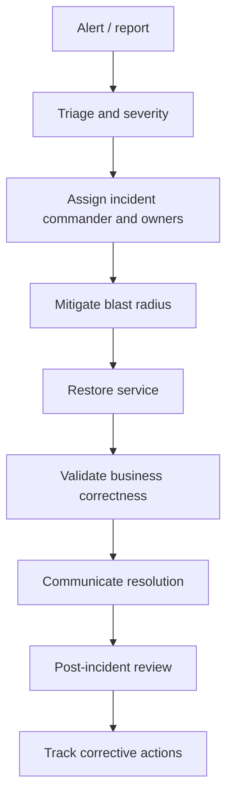

# Chuẩn hóa quy trình bàn giao và trách nhiệm vận hành

Một Java function có thể được viết, kiểm thử và triển khai bởi một nhóm, nhưng sau khi đưa vào production, nhiều nhóm cùng tham gia giữ dịch vụ hoạt động: product team, platform team, security, database, network, support và nhà cung cấp cloud. Nếu không xác định rõ ai sở hữu service, ai xử lý cảnh báo, ai được phép thay đổi cấu hình và ai chịu trách nhiệm phục hồi, sự cố dễ bị chuyển qua lại giữa các nhóm.

**Bàn giao vận hành** là quá trình chuyển một service từ giai đoạn phát triển sang trạng thái production-ready với ownership, quyền truy cập, tài liệu, telemetry, quy trình thay đổi, hỗ trợ và bằng chứng kiểm soát đã được xác định. Bàn giao không chỉ là gửi source code hoặc hướng dẫn deploy. Đội nhận vận hành phải biết cách phát hiện vấn đề, giới hạn tác động, phục hồi và liên hệ đúng người.

Bài này trình bày cách chuẩn hóa service ownership và operational handoff cho Java serverless. Nội dung bao gồm RACI, service catalog, SLI/SLO, on-call/escalation, runbook, incident/change/release, IAM và secret ownership, audit evidence, shared responsibility với cloud provider, FinOps ownership và checklist sẵn sàng production.

## 1. Vì sao cần chuẩn hóa bàn giao?

### 1.1. Serverless vẫn cần người chịu trách nhiệm

FaaS giúp đội phát triển không phải quản lý trực tiếp máy chủ vật lý hoặc hệ điều hành của function runtime. Tuy nhiên, đội sở hữu ứng dụng vẫn chịu trách nhiệm với:

- business logic, input validation và API/event contract;
- IAM role, resource policy, secret reference và cấu hình runtime;
- timeout, memory, concurrency, retry và failure destination;
- dữ liệu, schema, idempotency và phục hồi nghiệp vụ;
- logging, metrics, tracing, alert và dashboard;
- deployment, rollback, compatibility và incident response;
- chi phí, quota, retention và yêu cầu tuân thủ.

Cloud provider vận hành phần hạ tầng dịch vụ theo mô hình shared responsibility. Điều đó không làm mất trách nhiệm của application owner đối với cách function được cấu hình và sử dụng.

### 1.2. Điều gì xảy ra khi ownership không rõ?

Ví dụ một queue backlog tăng và đơn hàng bị xử lý trễ:

- Developer nghĩ platform team quản lý event source mapping.
- Platform team nghĩ product team sở hữu queue và consumer logic.
- Support không biết ai được phép redrive DLQ.
- Security không biết ai phê duyệt quyền đọc dữ liệu production.
- Không ai có runbook xác định có nên tăng concurrency hay không.

Trong lúc các nhóm xác định trách nhiệm, backlog tiếp tục tăng và có thể gây vi phạm SLA. Handoff tốt phải trả lời trước các câu hỏi này, khi chưa có sự cố.

### 1.3. Kết quả mong đợi

Sau bàn giao, người nhận vận hành có thể:

1. Xác định service owner và nhóm hỗ trợ theo từng lớp.
2. Tìm dashboard, alert, runbook và deployment record.
3. Đánh giá mức độ nghiêm trọng và gọi đúng escalation path.
4. Thực hiện thao tác vận hành đã được phê duyệt.
5. Khôi phục service hoặc chuyển sang phương án giảm tác động.
6. Xác định rủi ro dữ liệu, security và compliance trong quá trình xử lý.
7. Biết những thao tác cần application owner, platform team hoặc cloud provider thực hiện.

## 2. Service ownership và service catalog

### 2.1. Mỗi service cần một owner rõ ràng

Một service production nên có một nhóm chịu trách nhiệm cuối cùng về kết quả nghiệp vụ và vận hành. Có thể có nhiều contributor, nhưng không để trách nhiệm bị chia đều đến mức không ai quyết định.

Service owner thường chịu trách nhiệm:

- service đạt business outcome và SLO đã cam kết;
- backlog kỹ thuật, dependency và lifecycle;
- production readiness và operational documentation;
- phân loại incident và điều phối sửa lỗi ứng dụng;
- review cost, capacity và security posture;
- duy trì owner/contact/escalation information.

Một cá nhân có thể là technical owner hoặc primary contact, nhưng ownership nên gắn với team để không mất hiệu lực khi nhân sự thay đổi.

### 2.2. Service catalog tối thiểu

Service catalog là nơi tra cứu thông tin vận hành chuẩn. Một record cho Java FaaS có thể gồm:

| Trường | Nội dung |
| --- | --- |
| Service name | Tên service duy nhất |
| Business purpose | Service phục vụ nghiệp vụ nào |
| Owner team | Nhóm chịu trách nhiệm cuối cùng |
| Technical owner | Người/nhóm phụ trách kỹ thuật |
| On-call route | Pager/team alias hoặc lịch trực |
| Criticality | Mức độ quan trọng theo business impact |
| Environments | Dev, staging, production và region |
| Entry points | HTTP routes, event sources, schedules |
| Dependencies | Database, queue, topic, API, secret, network |
| Data classification | Loại dữ liệu và yêu cầu xử lý |
| SLO/dashboard | Link hoặc tên dashboard và SLO |
| Runbooks | Hướng dẫn xử lý tình huống chính |
| Deployment | Pipeline, IaC repository, release process |
| Recovery | RTO/RPO hoặc mục tiêu phục hồi phù hợp |
| Cost ownership | Cost center, budget owner và tags |
| Support boundary | Những gì team sở hữu và những gì do platform/provider sở hữu |

Không lưu password, access token hoặc secret value trong catalog. Chỉ lưu reference đến hệ thống quản lý bí mật và hướng dẫn xin quyền.

### 2.3. Metadata dạng file

Ví dụ service metadata minh họa:

```yaml
service:
  name: order-events
  purpose: Process order lifecycle events
  ownerTeam: commerce-platform
  technicalContact: order-events-oncall
  criticality: high

runtime:
  language: Java
  javaVersion: "21"
  deploymentType: function
  environments:
    - staging
    - production

operations:
  dashboard: observability/order-events
  runbook: runbooks/order-events.md
  deploymentPipeline: ci/order-events-release
  onCallRoute: commerce-platform-primary

governance:
  dataClassification: confidential
  costCenter: CC-042
  recoveryTier: tier-2
```

Đây là ví dụ cấu trúc nội bộ, không phải schema chuẩn của cloud provider. Catalog thực tế nên có owner cho từng field, quy trình review và cơ chế kiểm tra link còn hoạt động.

### 2.4. Owner phải được rà soát định kỳ

Khi team đổi tên, service chuyển nhóm hoặc dependency thay đổi, catalog và alert route phải được cập nhật. Đặt lịch review định kỳ và kiểm tra tự động các service thiếu owner, runbook hoặc on-call route.

## 3. RACI: ai chịu trách nhiệm việc gì?

### 3.1. Ý nghĩa RACI

- **R — Responsible:** trực tiếp thực hiện công việc.
- **A — Accountable:** chịu trách nhiệm cuối cùng và quyết định kết quả.
- **C — Consulted:** được tham vấn trước khi quyết định.
- **I — Informed:** được thông báo.

Mỗi hoạt động nên có một Accountable rõ ràng. Có thể có nhiều Responsible hoặc Consulted tùy phạm vi.

### 3.2. Ví dụ ma trận RACI

Các vai trò trong ví dụ:

- Product/Application team: sở hữu business logic và service.
- Platform team: sở hữu nền tảng triển khai, networking và shared runtime tooling.
- Security/Compliance: đặt policy, review và giám sát kiểm soát.
- SRE/Operations: vận hành on-call, reliability practice và incident coordination.
- Cloud provider: vận hành dịch vụ cloud theo hợp đồng và shared responsibility model.

| Hoạt động | App team | Platform | Security | SRE/Ops | Cloud provider |
| --- | --- | --- | --- | --- | --- |
| Business behavior/API contract | A/R | I | C | C | I |
| Function code và dependency | A/R | C | C | I | I |
| Runtime service availability | C | R | I | C | A/R theo dịch vụ cloud |
| IAM policy của application | A/R | C | C | I | I |
| Organization-wide guardrail | C | R | A | C | I |
| SLO và business alert | A/R | C | I | R/C | I |
| Shared observability platform | C | A/R | C | R | I |
| Application incident | A/R | C | C | R/C | I/C |
| Cloud service incident | C | R/C | I | R/C | A/R theo support contract |
| Release application | A/R | C | C | I | I |
| Shared infrastructure change | C | A/R | C | R/C | I |
| Data classification/retention policy | R | C | A | I | I/C |
| Cost allocation của service | A/R | C | I | C | I |

RACI phải được điều chỉnh theo tổ chức. Không gán cloud provider làm owner cho application code, data correctness hoặc IAM policy do khách hàng cấu hình. Với một số dịch vụ managed, provider có thể chịu trách nhiệm phần control plane/runtime, còn customer vẫn chịu trách nhiệm cấu hình và workload.

### 3.3. Tránh khoảng trống và chồng chéo

Kiểm tra ma trận bằng các câu hỏi:

- Có hoạt động nào không có A?
- Có nhiều A khiến quyết định bị tranh chấp?
- Có alert nhưng không có team nhận?
- Có quyền production nhưng không có owner phê duyệt?
- Có dependency mà không biết team sở hữu?
- Có thao tác incident cần provider support nhưng không biết ai mở case?

Nếu có nhiều nhóm tham gia, xác định rõ ai điều phối và ai có quyền quyết định trong incident.

## 4. Shared responsibility trong cloud serverless

### 4.1. Provider quản lý gì?

Tùy dịch vụ FaaS và hợp đồng, cloud provider thường quản lý một phần hoặc phần lớn:

- cơ sở hạ tầng vật lý, datacenter và phần cứng;
- mạng và control plane của dịch vụ managed;
- host operating system/hypervisor hoặc runtime infrastructure theo mô hình dịch vụ;
- tính sẵn sàng của control plane/data plane theo SLA;
- vá lỗi và vận hành thành phần managed mà khách hàng không truy cập trực tiếp;
- công cụ billing, logging và service health do provider cung cấp.

Ranh giới chính xác khác nhau giữa FaaS, container platform, database managed, queue và các gói hỗ trợ. Cần xem service-specific responsibility documentation và SLA của nhà cung cấp.

### 4.2. Customer/application owner quản lý gì?

Thông thường application owner chịu trách nhiệm:

- code, package, dependency và runtime configuration;
- function timeout, memory, concurrency, retry và event source mapping;
- API authentication/authorization và input validation;
- IAM execution role, resource policy và network access;
- dữ liệu, encryption configuration, retention và backup policy;
- secret usage và rotation integration;
- observability, alert, SLO và incident runbook;
- deployment, rollback, compatibility và business recovery;
- chi phí phát sinh từ cách sử dụng dịch vụ.

### 4.3. Ma trận shared responsibility ví dụ

| Control area | Provider thường phụ trách | Customer/application owner thường phụ trách |
| --- | --- | --- |
| Physical security | Datacenter, physical access | Chọn region/service phù hợp và cấu hình data controls |
| Host/runtime infrastructure | Managed host/runtime platform | Runtime version, application package và configuration |
| Identity | Identity service availability | Principal, role, trust policy, least privilege |
| Data | Hạ tầng storage theo dịch vụ | Classification, access, encryption settings, retention, backup/recovery |
| Network | Cloud backbone/control plane | VPC/subnet/security group/endpoint và egress policy |
| Application security | Nền tảng service | Input validation, authz, dependency patching, secure coding |
| Availability | Service SLA/control plane | Architecture, quotas, retry, fallback, SLO và DR |
| Compliance evidence | Provider attestation cho phạm vi của họ | Workload evidence, access review, data flow và operational records |

Không coi chứng nhận của cloud provider là bằng chứng tự động rằng ứng dụng của tổ chức đã tuân thủ. Phạm vi chứng nhận phải bao gồm service, region và control liên quan; customer vẫn phải cung cấp evidence cho phần mình sở hữu.

## 5. Operational handoff: chuyển từ development sang production

### 5.1. Handoff là một cổng readiness

Không nên bàn giao chỉ vì pipeline deploy thành công. Trước production, application team cần chứng minh service có thể được quan sát, hỗ trợ và phục hồi.

Các nhóm nội dung cần bàn giao:

1. Service description và ownership.
2. Architecture, trigger và dependency map.
3. SLO/SLI, dashboard và alert.
4. Runbook và escalation path.
5. Deployment, rollback và configuration management.
6. IAM, secret, data classification và access review.
7. Backup, restore, replay và disaster recovery.
8. Cost owner, budget và FinOps metrics.
9. Known risks, limitations và technical debt.
10. Contact/support boundary của platform và provider.

### 5.2. Architecture và dependency map

Sơ đồ bàn giao phải thể hiện:

- HTTP ingress/API Gateway và authentication boundary;
- event source, queue/topic/stream và retry/DLQ;
- function, version/alias/revision và runtime;
- database, object storage, cache và external API;
- IAM principal/role và trust boundary;
- network path, private endpoint và egress;
- telemetry collector/exporter và alert route.

Ghi rõ dependency critical, timeout, quota, owner team và failure mode. Sơ đồ cần đủ cụ thể để responder xác định blast radius khi một dependency hỏng.

### 5.3. Deployment handoff

Bàn giao deployment cần chỉ ra:

- repository và branch/tag release;
- CI/CD pipeline và artifact identity/digest;
- IaC source of truth;
- môi trường và approval gates;
- cách promote cùng artifact giữa môi trường;
- rollback target và điều kiện rollback;
- migration/schema compatibility;
- ai có quyền deploy và ai phê duyệt production.

Không chia sẻ credential deploy trong tài liệu. Dùng workload identity/short-lived credentials và quyền tối thiểu.

### 5.4. Handoff meeting và sign-off

Một buổi bàn giao hiệu quả nên có:

- walkthrough architecture và data flow;
- demo dashboard, alert và log/trace;
- diễn tập một tình huống lỗi thường gặp;
- thử deploy/rollback trong môi trường phù hợp;
- xác nhận quyền truy cập và escalation route;
- ghi lại câu hỏi chưa giải quyết, owner và due date.

Sign-off là xác nhận các tiêu chí readiness đã được đáp ứng hoặc ngoại lệ đã có người chấp thuận. Nó không thay thế trách nhiệm liên tục của service owner.

## 6. SLI, SLO và SLA trong vận hành

### 6.1. Phân biệt SLI, SLO và SLA

- **SLI (Service Level Indicator):** phép đo chất lượng dịch vụ, ví dụ tỷ lệ request thành công hoặc latency p95.
- **SLO (Service Level Objective):** mục tiêu nội bộ cho SLI trong một cửa sổ thời gian.
- **SLA (Service Level Agreement):** cam kết chính thức với khách hàng/đối tác, có thể kèm điều khoản hỗ trợ hoặc service credit.

SLO thường nên chặt hơn SLA để đội vận hành có thời gian phát hiện và xử lý trước khi vi phạm cam kết bên ngoài.

### 6.2. SLI cho HTTP function

Ví dụ SLI:

- availability: tỷ lệ request hợp lệ nhận response thành công theo contract;
- latency: tỷ lệ request hoàn thành dưới ngưỡng;
- correctness: tỷ lệ kết quả đáp ứng invariant nghiệp vụ;
- freshness: độ trễ từ event phát sinh đến khi được xử lý;
- durability: tỷ lệ event đã được chấp nhận bền vững và không bị mất.

Không tính mọi 4xx do caller gửi sai là lỗi service nếu đó là business rejection hợp lệ. Định nghĩa numerator/denominator rõ để tránh SLI bị thao túng.

### 6.3. SLI cho queue/event consumer

Các chỉ số phù hợp:

- tỷ lệ event được xử lý thành công;
- oldest message age;
- consumer lag theo partition/shard;
- tỷ lệ message vào DLQ;
- event processing duration;
- tỷ lệ duplicate/failed processing;
- độ trễ end-to-end theo event timestamp.

Một queue có depth lớn chưa chắc vi phạm SLO nếu consumer vẫn xử lý trong freshness target. Ngược lại, queue depth thấp nhưng oldest message age cao có thể chỉ ra poison message hoặc partition bị kẹt.

### 6.4. Error budget

Nếu SLO availability là 99,9% trong 30 ngày, error budget xấp xỉ 0,1% thời gian hoặc request count theo cách đo SLI. Với request-based SLI và 10 triệu request hợp lệ, budget lỗi là khoảng 10.000 request.

Error budget giúp cân bằng tốc độ release và reliability. Khi budget bị tiêu thụ nhanh, team có thể giảm tốc độ thay đổi, tăng kiểm thử hoặc ưu tiên reliability work. Cách áp dụng cần phù hợp criticality và hợp đồng khách hàng.

### 6.5. Không chỉ đo function status

Function có thể trả HTTP 200 nhưng business transaction chưa hoàn tất, event chưa được ghi bền vững hoặc side effect bị lặp. SLO nên đo outcome ở mức API/workflow phù hợp, không chỉ invocation success.

## 7. On-call, escalation và incident response

### 7.1. On-call ownership

Service catalog cần nêu:

- primary on-call team/route;
- secondary/escalation team;
- thời gian hỗ trợ (24x7 hay business hours);
- cách liên hệ platform/security/database owner;
- provider support plan và cách mở support case;
- người có quyền quyết định giảm tải, disable trigger hoặc rollback.

Không dùng tên cá nhân duy nhất làm contact lâu dài. Cần team route và backup khi người trực vắng mặt.

### 7.2. Severity và escalation

Ví dụ severity model:

| Mức | Tác động | Phản ứng |
| --- | --- | --- |
| SEV-1 | Mất service diện rộng, dữ liệu sai/mất hoặc ảnh hưởng nghiêm trọng | Kích hoạt incident command, gọi owner và executive escalation theo policy |
| SEV-2 | Chức năng quan trọng suy giảm, backlog hoặc lỗi ảnh hưởng nhiều khách hàng | On-call phản hồi ngay theo SLA nội bộ, phối hợp dependency owner |
| SEV-3 | Ảnh hưởng giới hạn, có workaround | Team owner xử lý theo giờ hỗ trợ đã công bố |
| SEV-4 | Vấn đề nhỏ, không có tác động production đáng kể | Ghi backlog và xử lý theo kế hoạch |

Thời gian phản hồi và tiêu chí severity phải được tổ chức thống nhất. Bảng trên chỉ là ví dụ; không thay thế incident policy chính thức.

### 7.3. Vai trò trong incident

Với incident lớn, có thể phân vai:

- Incident commander: điều phối và quyết định ưu tiên.
- Technical lead: điều tra và đề xuất biện pháp kỹ thuật.
- Communications lead: cập nhật stakeholder/customer theo policy.
- Scribe: ghi timeline, quyết định và action.
- Service owner: xác nhận business impact và chấp thuận workaround liên quan nghiệp vụ.

Một người có thể giữ nhiều vai trò trong incident nhỏ, nhưng cần xác định rõ người ra quyết định.

### 7.4. Incident lifecycle



Ưu tiên giảm tác động và khôi phục service an toàn. Không xóa backlog hoặc redrive toàn bộ DLQ chỉ để dashboard xanh nếu chưa xác định dữ liệu có thể được xử lý lại an toàn.

## 8. Runbook: hướng dẫn hành động có kiểm soát

### 8.1. Runbook khác tài liệu kiến trúc

Architecture document giải thích hệ thống được thiết kế thế nào. Runbook hướng dẫn responder làm gì khi một triệu chứng cụ thể xuất hiện.

Một runbook nên có:

1. Tên và triệu chứng.
2. Phạm vi/impact và severity gợi ý.
3. Dashboard, log query và metric cần kiểm tra.
4. Nguyên nhân thường gặp.
5. Các bước chẩn đoán theo thứ tự.
6. Hành động giảm tác động có giới hạn.
7. Điều kiện rollback/escalate.
8. Kiểm tra phục hồi và business correctness.
9. Những thao tác bị cấm hoặc cần approval.
10. Owner và ngày review gần nhất.

### 8.2. Ví dụ runbook: queue backlog tăng

**Triệu chứng:** oldest message age hoặc consumer lag vượt SLO.

**Kiểm tra:**

- enqueue/dequeue rate;
- function concurrency, duration, throttle và error rate;
- database/API latency và throttling;
- DLQ depth và receive count;
- partition/group nào đang bị kẹt;
- release gần nhất và thay đổi config.

**Giảm tác động:**

1. Xác định dependency có đang quá tải không.
2. Nếu downstream khỏe và có headroom, tăng concurrency trong giới hạn đã kiểm thử.
3. Nếu downstream quá tải, giảm consumer concurrency và điều tiết producer.
4. Cô lập poison message theo policy, không bỏ qua record quan trọng.
5. Chỉ redrive sau khi nguyên nhân đã được xử lý và idempotency đã xác minh.

**Phục hồi:**

- oldest message age giảm về trong SLO;
- backlog có xu hướng giảm ổn định;
- DLQ không tăng bất thường;
- business completion rate và data reconciliation đạt yêu cầu.

**Escalate:** gọi database/platform owner nếu throttling hoặc service health vượt quyền xử lý của application team.

### 8.3. Ví dụ runbook: function error rate tăng sau release

**Kiểm tra:** version/alias/revision đang nhận traffic, error type, init duration, dependency, config revision, IAM change và schema compatibility.

**Hành động:**

1. Xác định lỗi có tập trung ở version mới hay mọi version.
2. Kiểm tra health gate và business metric.
3. Nếu lỗi do release và rollback an toàn, chuyển traffic về version tốt gần nhất.
4. Nếu database/event schema đã thay đổi không tương thích, dừng rollback tự động và gọi owner migration.
5. Xác nhận request/event sau rollback được xử lý đúng, không duplicate side effect.

### 8.4. Ví dụ runbook: access denied

**Kiểm tra:** execution role/principal, resource policy, secret reference, region/account, deployment change và audit log.

**Hành động:**

- xác định chính xác action/resource bị từ chối;
- kiểm tra policy change gần nhất;
- khôi phục policy đã được review nếu release gây lỗi;
- yêu cầu security/platform owner review nếu cần cấp quyền mới;
- không cấp wildcard permission để xử lý nhanh;
- kiểm tra lại access bằng principal của runtime sau khi sửa.

### 8.5. Runbook phải được thử

Một tài liệu chưa được diễn tập có thể thiếu quyền, sai command hoặc phụ thuộc vào dashboard không còn tồn tại. Định kỳ chạy game day/tabletop exercise và cập nhật sau incident.

## 9. Change management và release governance

### 9.1. Phân loại thay đổi

Không phải thay đổi nào cũng cần cùng mức approval. Có thể phân loại:

- **Standard change:** lặp lại, rủi ro thấp, có quy trình và rollback đã kiểm chứng.
- **Normal change:** cần review/approval theo change policy.
- **Emergency change:** cần xử lý khẩn cấp để khôi phục hoặc giảm rủi ro; vẫn phải ghi audit và review sau đó.

Phân loại phải theo policy của tổ chức. Không dùng emergency để bỏ qua kiểm soát thường xuyên.

### 9.2. Change record

Một change record nên có:

- mục đích và phạm vi;
- service/environment/resource bị ảnh hưởng;
- artifact digest và IaC/config revision;
- risk/impact assessment;
- dependency/schema/event compatibility;
- test và approval evidence;
- deployment window nếu cần;
- rollback/compensation plan;
- owner, approver và thời gian;
- post-change validation.

### 9.3. Separation of duties

Với production critical, người tạo thay đổi không nhất thiết là người phê duyệt cuối cùng. CI/CD có thể enforce branch protection, required review, signed artifact và environment approval. Quyền deploy nên cấp cho pipeline identity, không cấp credential dài hạn cho mọi developer.

### 9.4. Emergency access

Break-glass access cần:

- lý do và incident/change ID;
- thời hạn ngắn;
- quyền tối thiểu cho tình huống;
- phê duyệt hoặc cơ chế hậu kiểm theo policy;
- audit đầy đủ;
- thu hồi tự động hoặc xác nhận thu hồi sau khi hết hạn.

Không chia sẻ tài khoản admin dùng chung. Emergency access phải có owner và review sau incident.

### 9.5. Rollback không chỉ là đổi code

Rollback có thể bị ảnh hưởng bởi:

- database migration;
- event schema đã publish;
- secret/config rotation;
- IAM policy thay đổi;
- resource mới đã nhận dữ liệu;
- side effect không thể đảo ngược.

Release plan cần ghi rõ binary rollback, config rollback, infrastructure rollback và business compensation là những thao tác riêng. Không xóa resource mới nếu còn dữ liệu hoặc consumer phụ thuộc.

## 10. IAM, secrets và quyền vận hành

### 10.1. Tách runtime identity và human identity

Java function nên dùng execution role/service account riêng với quyền đúng nhu cầu. Người vận hành truy cập qua identity cá nhân/federated identity, MFA và role được cấp theo thời hạn. Không dùng runtime role như tài khoản người dùng hoặc chia sẻ access key.

### 10.2. Least privilege

Policy cần giới hạn:

- action cụ thể;
- resource ARN/ID cụ thể;
- environment/account/region;
- điều kiện network/tag nếu phù hợp;
- secret/resource cần thiết;
- thời hạn hoặc session context khi hỗ trợ.

Tránh `*` cho mọi action/resource chỉ để giải quyết lỗi permission. Nếu phải dùng wildcard do service semantics, ghi lý do và giảm scope bằng condition.

### 10.3. Access review

Định kỳ rà soát:

- ai có quyền deploy production;
- ai có quyền đọc dữ liệu nhạy cảm;
- function nào có quyền invoke function khác;
- role nào đọc secret hoặc decrypt key;
- policy nào có quyền sửa event source mapping/queue/DLQ;
- quyền provider support hoặc cross-account role.

Thu hồi quyền không còn cần khi nhân sự/team đổi vai trò hoặc service ngừng hoạt động.

### 10.4. Secret ownership và rotation

Secret có owner, purpose, consumer, rotation policy và cách xác minh rotation. Runtime nên đọc secret qua secret manager/identity, không nhúng vào code, environment artifact hoặc log. Rotation cần kiểm thử tương thích với connection pool/cache và có kế hoạch nếu function đang chạy với credential cũ.

### 10.5. Quyền thao tác DLQ và replay

Redrive có thể tạo side effect và tải lớn. Chỉ nhóm được chỉ định mới được quyền replay production; yêu cầu change/incident reference, rate limit, idempotency check và audit. Support không nên có quyền redrive tùy ý nếu chưa hiểu business semantics.

## 11. Data governance, retention và evidence

### 11.1. Data classification

Service catalog nên ghi loại dữ liệu function nhận, xử lý và phát ra. Phân loại có thể gồm public, internal, confidential và restricted theo policy tổ chức. Xác định:

- data owner/steward;
- mục đích xử lý;
- data residency/region;
- encryption at rest/in transit;
- access role;
- retention/deletion;
- backup/restore;
- downstream processor và external provider.

### 11.2. Event payload và log

Không mặc định toàn bộ event payload được phép ghi vào log. Log nên dùng metadata cần thiết như event ID, type, schema version và correlation ID. PII, payment data, token hoặc secret phải được loại bỏ/mask theo policy.

Nếu DLQ lưu payload đầy đủ, áp dụng encryption, access control và retention giống hoặc nghiêm ngặt hơn nguồn dữ liệu. DLQ là nơi chứa dữ liệu thật, không phải kho debug vô hại.

### 11.3. Evidence cần lưu

Tùy compliance scope, evidence có thể gồm:

- access review và IAM policy approval;
- deployment/release/change record;
- artifact digest, signature/provenance và scan result;
- backup/restore test;
- incident timeline và post-incident action;
- SLO report và alert review;
- data retention/deletion evidence;
- provider assurance report/contract reference;
- vulnerability remediation/exception record.

Evidence cần có timestamp, owner, source và retention. Link đến hệ thống chính thức thay vì copy nhiều bản rời rạc.

### 11.4. Audit trail

Các thao tác nhạy cảm nên có audit event:

- deploy/rollback;
- policy/role change;
- secret access/rotation;
- queue redrive/purge;
- data export/delete;
- emergency access;
- configuration change ảnh hưởng security/reliability.

Audit log cần chống sửa/xóa trái phép theo policy. Không để application owner tự chỉnh sửa bằng chứng kiểm soát mà không có audit.

## 12. Backup, recovery và continuity ownership

### 12.1. RTO và RPO

- **RTO (Recovery Time Objective):** thời gian mục tiêu để khôi phục service sau gián đoạn.
- **RPO (Recovery Point Objective):** mức mất dữ liệu tối đa có thể chấp nhận theo thời gian hoặc điểm khôi phục.

RTO/RPO phải dựa trên business impact, không chỉ dựa trên khả năng của cloud service. Một database có backup tự động không đồng nghĩa ứng dụng có thể khôi phục workflow trong RTO.

### 12.2. Ai sở hữu recovery?

Xác định owner cho:

- backup policy và encryption;
- restore execution;
- queue/event replay;
- DLQ triage;
- schema/data reconciliation;
- failover region/dependency;
- business validation sau restore.

Platform team có thể cung cấp công cụ backup/restore; application owner phải xác nhận dữ liệu khôi phục tạo ra trạng thái nghiệp vụ đúng.

### 12.3. Recovery test

Thử nghiệm định kỳ:

- restore database vào môi trường cô lập;
- khôi phục object theo version/retention;
- replay event theo time window;
- chạy consumer idempotent với duplicate;
- xác minh sequence/order và aggregate totals;
- đo thời gian thực tế so với RTO/RPO.

Chỉ có backup job xanh không chứng minh restore thành công. Recovery test phải có evidence và action khi mục tiêu không đạt.

### 12.4. Business continuity khi dependency lỗi

Runbook cần nêu:

- dependency nào có fallback;
- thao tác nào có thể queue/defer;
- thao tác nào phải fail closed;
- dữ liệu nào có thể stale;
- khi nào dừng producer;
- ai chấp thuận chế độ degraded operation;
- cách reconcile khi dependency phục hồi.

Không dùng fallback để bỏ qua security hoặc ghi nhận nghiệp vụ sai. Ví dụ payment authorization không nên được giả định thành công chỉ vì provider timeout.

## 13. Cost ownership và FinOps responsibility

### 13.1. Ai chịu trách nhiệm chi phí?

Service owner cần biết budget, cost center, cost per request và cost per successful business transaction. Platform team có thể quản lý shared infrastructure, nhưng application team cần hiểu tác động của invocation, retry, log volume, data transfer và database usage.

### 13.2. Cost allocation

Đặt tags/labels chuẩn cho service, environment, team, owner và cost center. Shared cost như NAT, observability hoặc database cluster cần allocation driver và owner của quy tắc phân bổ.

### 13.3. Cost anomaly runbook

Khi chi phí tăng bất thường:

1. Xác định resource/service/region tăng.
2. Đối chiếu với request, invocation, retry, event rate và deployment gần nhất.
3. Kiểm tra event loop, retry storm, log cardinality và data transfer.
4. Xác định tăng trưởng nghiệp vụ hợp lệ hay usage bất thường.
5. Chọn biện pháp như rate limit, fix loop, giảm log noise hoặc điều chỉnh capacity.
6. Không giảm capacity nếu điều đó làm SLO hoặc recovery xấu hơn.
7. Ghi nhận owner, savings estimate và kết quả sau thay đổi.

## 14. Vendor và cloud provider support

### 14.1. Xác định support boundary

Service catalog nên ghi:

- cloud service/region đang sử dụng;
- SLA và support plan;
- cách kiểm tra provider service health;
- ai được mở support case;
- thông tin cần cung cấp (request ID, region, timestamp, resource ID);
- dữ liệu nào không được gửi cho provider;
- quy trình escalation khi provider không phản hồi.

### 14.2. Chuẩn bị evidence khi mở case

Thu thập tối thiểu:

- thời điểm UTC và region;
- service/resource identifier;
- request/invocation ID đã được phép chia sẻ;
- error code và symptom;
- ảnh hưởng và thời gian xảy ra;
- các bước đã thử;
- liên kết status/metrics liên quan.

Không gửi secret, raw customer payload hoặc PII không cần thiết. Dùng kênh hỗ trợ được tổ chức phê duyệt.

### 14.3. Provider incident không miễn trừ application recovery

Khi provider có outage, application owner vẫn phải thực hiện quyết định như pause producer, queue work, failover, communicate impact và reconcile sau khi phục hồi. Trách nhiệm provider đối với availability không thay thế business continuity của ứng dụng.

## 15. Knowledge transfer và tài liệu vận hành

### 15.1. Tài liệu cần có

- service overview và owner;
- architecture/data flow;
- API/event contract và schema version;
- deployment/configuration guide;
- IAM/secret reference và access request path;
- dashboard/SLI/SLO;
- runbook/incident playbook;
- backup/restore/replay;
- cost dashboard và budget owner;
- known limitations, dependency risk và technical debt.

### 15.2. Tài liệu phải có owner và review date

Mỗi tài liệu quan trọng nên có owner, last reviewed, next review và version. Link hỏng hoặc dashboard đổi tên cần được phát hiện qua kiểm tra định kỳ.

### 15.3. Knowledge transfer bằng thao tác thực tế

Đội nhận vận hành nên tự thực hiện một số thao tác dưới giám sát:

- tìm trace/log từ request ID;
- phân loại alert và mở runbook;
- kiểm tra queue age/DLQ;
- triển khai release staging;
- rollback trong môi trường test;
- xác minh backup/restore evidence;
- mở incident và escalation route.

Việc đọc slide không chứng minh khả năng vận hành. Hãy dùng tabletop hoặc game day để phát hiện thiếu quyền và thiếu thông tin.

## 16. Operational readiness review (ORR)

### 16.1. Nhóm tiêu chí

ORR là review trước khi đưa service vào production hoặc trước thay đổi rủi ro cao. Các nhóm tiêu chí có thể gồm:

| Nhóm | Câu hỏi kiểm tra |
| --- | --- |
| Ownership | Có service owner, backup và on-call route? |
| Architecture | Có dependency map và failure boundary? |
| Reliability | Có SLI/SLO, timeout, retry, DLQ và recovery plan? |
| Observability | Có dashboard, alert, log/trace và correlation? |
| Security | IAM least privilege, secret handling và access review đã rõ? |
| Data | Classification, retention, encryption và backup đã xác định? |
| Change | CI/CD, approval, artifact identity và rollback đã kiểm chứng? |
| Operations | Runbook, escalation, support boundary và game day? |
| FinOps | Budget, tags, cost owner và unit cost? |
| Compliance | Evidence, audit trail và control owner? |

### 16.2. Quyết định ORR

Kết quả có thể là:

- **Ready:** tiêu chí bắt buộc đạt.
- **Ready with accepted risks:** có ngoại lệ, owner, mitigation và expiry/review date.
- **Not ready:** thiếu control bắt buộc hoặc rủi ro không được chấp nhận.

Không biến ORR thành checklist hình thức. Một mục “đã có runbook” chỉ đạt khi runbook dùng được và người trực biết cách tìm nó.

### 16.3. Ví dụ handoff checklist

- [ ] Service catalog có owner team và escalation route.
- [ ] RACI đã xác định A/R cho application, platform, security và operations.
- [ ] Architecture/dependency map được cập nhật.
- [ ] HTTP/event trigger và retry/DLQ semantics được ghi rõ.
- [ ] SLI/SLO và business success definition đã được thống nhất.
- [ ] Dashboard và alert route đã được thử.
- [ ] Runbook cho queue backlog, function error, access denied và dependency outage.
- [ ] CI/CD, immutable artifact, approval và rollback đã được thử.
- [ ] IAM runtime/human identity và emergency access đã được review.
- [ ] Secret owner, rotation và recovery path đã rõ.
- [ ] Data classification, encryption, retention và audit evidence đã rõ.
- [ ] Backup/restore/replay đã được diễn tập.
- [ ] Cost tags, budget, cost owner và unit economics đã có.
- [ ] Provider support plan và escalation route đã được ghi.
- [ ] Known risks và accepted exceptions có owner/date.
- [ ] Đội nhận vận hành đã hoàn thành knowledge transfer.

## 17. Mẫu handoff record

Mẫu rút gọn có thể lưu trong service catalog hoặc change system:

```yaml
handoff:
  service: order-events
  release:
    version: 2.4.0
    artifactDigest: sha256:REPLACE_WITH_REAL_DIGEST
    infrastructureRevision: infra-7c21a
    configRevision: prod-config-18

  ownership:
    accountableTeam: commerce-platform
    primaryOnCall: commerce-platform-primary
    secondaryOnCall: platform-runtime-secondary
    securityContact: security-operations

  readiness:
    sloReviewed: true
    dashboardVerified: true
    runbookExercised: true
    rollbackTested: true
    restoreTested: true
    accessReviewed: true

  exceptions:
    - id: RISK-204
      owner: commerce-platform
      mitigation: Limit consumer concurrency until database index rollout
      reviewDate: 2026-12-01

  signoff:
    applicationOwner: approved
    operations: approved
    security: approved
```

Giá trị trên là ví dụ. Không dùng `true` chỉ vì tài liệu tồn tại; phải có link/evidence của test hoặc approval. Không lưu token, secret hoặc dữ liệu cá nhân trong handoff record.

## 18. Các anti-pattern trong bàn giao

### 18.1. “Platform team owns everything”

Platform team thường sở hữu paved road, runtime platform và shared infrastructure. Họ không tự động sở hữu business logic, event correctness, data retention hay customer impact của từng service.

### 18.2. “Developer đã deploy nên developer trực production mãi mãi”

Không có nghĩa mọi developer phải trực 24x7. Team ownership, on-call rotation và escalation phải được thiết kế theo criticality và support model. Nếu product team không trực, cần một operations model có quyền và năng lực xử lý, cùng escalation đến application owner.

### 18.3. Runbook chỉ ghi “restart function”

Function không phải server luôn bật để restart. Với FaaS, cần xác định đúng thao tác: disable/enable event source, đổi alias/revision, giảm concurrency, rollback config, redrive message hoặc mở support case. Mỗi thao tác có side effect khác nhau.

### 18.4. Quyền production dùng chung

Shared admin account làm mất attribution và audit. Dùng identity cá nhân, role tạm thời, MFA và pipeline identity.

### 18.5. Bàn giao không có diễn tập

Tài liệu có thể lỗi thời hoặc người nhận thiếu quyền. Game day và thao tác thực tế giúp xác nhận quy trình có thể thực hiện.

### 18.6. Sign-off nhưng không có owner cho ngoại lệ

Rủi ro chưa xử lý phải có owner, mitigation, ngày review và điều kiện đóng. “Known issue” không có owner là một khoản nợ vận hành không kiểm soát.

## 19. Checklist vận hành định kỳ

### Hàng tuần hoặc theo criticality

- Kiểm tra SLO/error budget, queue age, DLQ và dependency health.
- Xem alert noise, alert không có owner và runbook link.
- Kiểm tra deployment gần nhất và rollback readiness.
- Theo dõi cost anomaly, retry amplification và resource quota.

### Hàng tháng hoặc theo policy

- Review service catalog, RACI và on-call contacts.
- Review IAM access, emergency role và secret rotation status.
- Đối soát cost allocation và unallocated resource.
- Kiểm tra vulnerability, dependency patch và exception expiry.
- Review backup/restore/replay evidence theo recovery tier.

### Theo quý hoặc khi có thay đổi lớn

- Thực hiện tabletop/game day.
- Review RTO/RPO và business continuity.
- Xác nhận provider support/SLA và data residency.
- Review data classification, retention và audit evidence.
- Kiểm tra service owner và dependency ownership sau thay đổi tổ chức.

Cadence cần điều chỉnh theo criticality, regulation và policy nội bộ. Các mục có rủi ro cao cần kiểm tra thường xuyên hơn.

## Kết luận

Chuẩn hóa bàn giao giúp Java serverless có một mô hình ownership rõ từ code, runtime, dữ liệu, security đến incident và chi phí. Service catalog và RACI cho biết ai quyết định; SLI/SLO và dashboard cho biết service đang hoạt động ra sao; runbook, on-call và escalation cho biết phải làm gì khi có sự cố; change governance và audit evidence giúp mọi thay đổi có thể truy vết.

Cloud provider quản lý các lớp hạ tầng thuộc dịch vụ managed, còn application owner vẫn chịu trách nhiệm với code, cấu hình, dữ liệu, IAM, retry, event semantics và business recovery trong phạm vi của mình. Handoff chỉ thực sự hoàn tất khi đội nhận vận hành có quyền phù hợp, hiểu dependency, tìm được tài liệu và đã diễn tập các thao tác quan trọng.

Hãy duy trì ownership và tài liệu như một phần của vòng đời service. Mỗi release, incident, thay đổi dependency hoặc thay đổi tổ chức đều có thể làm thông tin vận hành cũ đi. Review định kỳ, game day và evidence có owner giúp dịch vụ duy trì trạng thái production-ready sau lần bàn giao đầu tiên.
