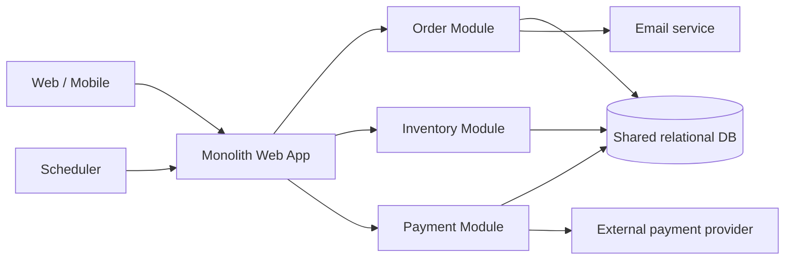
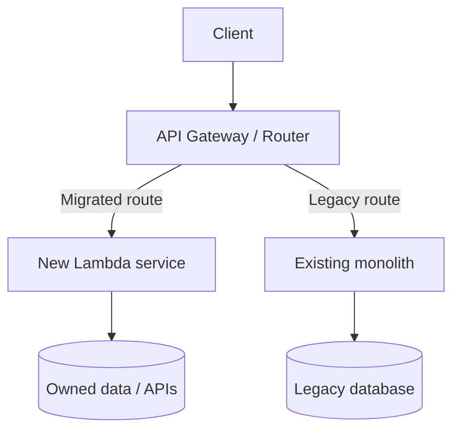
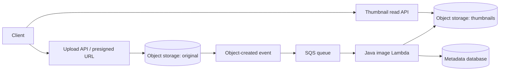

# Đánh giá ứng dụng hiện tại và chọn phần việc di chuyển trước

## 1. Vì sao không nên chuyển toàn bộ ứng dụng cùng lúc?

Di chuyển sang serverless không đơn giản là đóng gói mọi module thành Lambda function. Ứng dụng hiện tại thường có nhiều loại workload: HTTP API, scheduled job, batch, xử lý message, truy cập database, tác vụ chạy dài và thành phần giữ session trong bộ nhớ. Mỗi loại có mức phù hợp với FaaS khác nhau.

Nếu chuyển tất cả cùng một lúc, nhóm có thể đồng thời phải thay đổi runtime, cách quản lý state, network, IAM, data flow, deployment, monitoring và quy trình vận hành. Phạm vi lớn khiến khó xác định nguyên nhân khi có lỗi, rollback phức tạp và thời gian chuyển đổi kéo dài.

Một chiến lược an toàn hơn là đánh giá ứng dụng hiện tại, chọn một workload có ranh giới rõ và ít rủi ro để làm trước, sau đó dùng kinh nghiệm thực tế để mở rộng. Phần việc đầu tiên nên chứng minh được cách build/deploy, security, observability, data correctness, retry, cost và rollback trên nền tảng đích.

Trong module CLOUD_SERVERLESS, mục tiêu là tìm ra phần nghiệp vụ phù hợp để chạy bằng Java function kích hoạt bởi HTTP, message hoặc event; xác định phần cần giữ nguyên; và lập thứ tự di chuyển dựa trên lợi ích, độ phức tạp và rủi ro.

## 2. Bắt đầu bằng inventory hiện trạng

Trước khi chọn workload, cần biết ứng dụng đang làm gì và phụ thuộc vào đâu. Thu thập thông tin từ code, cấu hình triển khai, log, metric, tracing, database và trao đổi với nhóm vận hành.

Một inventory tối thiểu nên có:

| Nhóm thông tin | Cần thu thập | Vì sao quan trọng |
|---|---|---|
| Business capability | Chức năng, owner, mức độ quan trọng, SLA/SLO | Xác định giá trị và mức rủi ro khi chuyển |
| Runtime | Java version, framework, JVM flags, native library | Kiểm tra tương thích Lambda/runtime đích |
| Workload | HTTP, queue, event, schedule, batch, stream | Xác định trigger và mô hình thực thi |
| Traffic | RPS, burst, concurrency, batch size, mùa vụ | Sizing memory, concurrency và chi phí |
| Duration | p50/p95/p99, thời gian chạy dài nhất, cold path | Kiểm tra giới hạn thời gian và latency |
| State | Session, cache, local file, in-memory lock, transaction | Tìm state phải chuyển ra ngoài process |
| Data | Database, schema, volume, growth, consistency, backup | Xác định data migration và ownership |
| Dependencies | API nội bộ/bên ngoài, queue, file share, DNS | Phát hiện coupling và network constraints |
| Security | IAM/service account, secrets, PII, encryption, audit | Xác định quyền và yêu cầu compliance |
| Operations | Deploy, rollback, alert, incident, on-call | Tính chi phí thay đổi vận hành |
| Cost | Compute, license, database, network, support | So sánh TCO hiện tại và serverless |

Không chỉ đọc source code. Một endpoint có thể trông đơn giản nhưng phụ thuộc vào shared database, session store, filesystem hoặc một API nội bộ chỉ truy cập được từ subnet cụ thể. Dữ liệu runtime và production telemetry thường cho thấy workload thật khác với giả định của nhóm phát triển.

## 3. Vẽ dependency map và ranh giới nghiệp vụ

Vẽ sơ đồ thành phần và luồng dữ liệu trước khi chia function. Mỗi khối nên biểu diễn một capability hoặc trách nhiệm nghiệp vụ, không chỉ một class Java.



Sơ đồ cho thấy Order, Inventory và Payment là các module nghiệp vụ khác nhau nhưng cùng ghi vào một database. Nếu tách chúng thành function ngay lập tức, nhóm có thể tạo ra distributed transaction và coupling qua schema. Cần xác định module nào sở hữu từng bảng, quy tắc consistency và cách trao đổi event trước khi tách runtime.

Đánh giá mỗi dependency theo các câu hỏi:

- Dependency có thể được gọi qua API/event ổn định không?
- Có thể thay đổi schema mà không làm hỏng consumer cũ không?
- Có transaction xuyên nhiều module không?
- Có phụ thuộc shared memory, filesystem hoặc local cache không?
- Có thể giới hạn quyền truy cập theo function/resource không?
- Nếu dependency chậm hoặc unavailable, workload có thể retry hay queue lại không?

Một ranh giới tốt có input/output contract rõ, state ownership rõ, ít shared mutable data và có thể deploy/rollback độc lập.

## 4. Phân loại workload theo mô hình thực thi

Không nên bắt đầu từ câu hỏi “module nào viết bằng Java?”. Hãy bắt đầu từ cách workload được kích hoạt và thời gian nó cần chạy.

| Loại workload hiện tại | Dấu hiệu | Khả năng chuyển sang serverless |
|---|---|---|
| HTTP endpoint stateless | Nhận request, xác thực, xử lý ngắn và trả response | Thường phù hợp với Lambda + API Gateway hoặc Function URL |
| Scheduled task | Chạy theo giờ/ngày, không cần process sống liên tục | Thường phù hợp với EventBridge Scheduler + Lambda |
| Queue consumer | Xử lý message độc lập, có retry và idempotency | Thường phù hợp với SQS/EventBridge + Lambda |
| Event handler | Phản ứng với object upload, domain event hoặc stream | Phù hợp nếu event contract và duplicate handling rõ |
| Batch ngắn | Chia được thành chunk, có checkpoint và retry | Có thể dùng Lambda; batch dài/lớn có thể cần Step Functions, Batch hoặc container |
| Long-running process | Chạy hàng chục phút/giờ, giữ state trong RAM | Không phù hợp với một Lambda đơn lẻ; xem workflow/container/job service |
| Stateful session service | Giữ session/lock/local state trong process | Cần externalize state hoặc giữ trên nền tảng phù hợp hơn |
| WebSocket/connection dài | Giữ kết nối và trạng thái phiên | Cần dịch vụ chuyên dụng; không ánh xạ trực tiếp mỗi connection thành Lambda chạy liên tục |
| CPU/GPU intensive | Tính toán dài, cần tài nguyên đặc biệt | Đánh giá Lambda giới hạn tài nguyên hoặc container/compute chuyên dụng |

Một workload có thể được chia thành phần synchronous ngắn và phần asynchronous dài. Ví dụ API nhận đơn hàng chỉ xác thực, lưu trạng thái `PENDING` và gửi message; worker xử lý thanh toán/fulfillment sau đó.

## 5. Dùng mô hình 6R để phân loại ứng dụng

6R là một cách phân loại chiến lược di chuyển. Nó giúp quyết định phần nào giữ nguyên, phần nào thay nền tảng và phần nào cần thiết kế lại.

| Chiến lược | Ý nghĩa | Ví dụ trong ứng dụng Java |
|---|---|---|
| Rehost | Chuyển workload gần như nguyên trạng sang hạ tầng khác | Chuyển VM Java sang VM cloud |
| Replatform | Thay đổi ít để dùng dịch vụ quản lý tốt hơn | Chuyển database sang managed database, giữ nguyên ứng dụng |
| Refactor / Re-architect | Thay đổi kiến trúc hoặc code để tận dụng cloud-native/serverless | Tách HTTP handler và queue worker thành Lambda |
| Repurchase | Thay bằng sản phẩm SaaS | Thay hệ thống email nội bộ bằng dịch vụ SaaS |
| Retire | Ngừng thành phần không còn giá trị | Tắt báo cáo hoặc job không còn người dùng |
| Retain | Giữ lại vì chưa phù hợp hoặc phụ thuộc chưa thể thay đổi | Giữ hệ thống legacy cần thiết trên môi trường hiện tại |

Di chuyển sang serverless thường cần refactor một phần. Không phải tất cả thành phần đều cần refactor: database có thể replatform trước, một batch có thể giữ ở container, một module không còn sử dụng có thể retire.

Không dùng 6R như một nhãn cố định cho toàn bộ ứng dụng. Một hệ thống có thể có nhiều quyết định khác nhau theo từng capability hoặc workload.

## 6. Tiêu chí chọn phần việc đầu tiên

Workload đầu tiên nên vừa có giá trị học hỏi vừa có phạm vi kiểm soát. Các đặc điểm thuận lợi:

- Có business boundary rõ và owner chịu trách nhiệm.
- Được kích hoạt bởi HTTP, schedule, queue hoặc event có contract ổn định.
- Xử lý ngắn hoặc có thể chia thành bước nhỏ.
- Ít phụ thuộc shared state và local filesystem.
- Có thể externalize state sang database/object storage/cache.
- Có thể thiết kế idempotency và retry.
- Không cần transaction nguyên tử xuyên nhiều hệ thống.
- Có test và telemetry để đo trước/sau.
- Có thể chạy song song với hệ thống cũ trong giai đoạn chuyển tiếp.
- Có rollback hoặc fallback rõ ràng.

Ví dụ thường phù hợp để làm trước:

1. Scheduled report hoặc cleanup job có thể chạy độc lập.
2. Webhook receiver xác thực request, lưu event và enqueue xử lý.
3. Queue worker xử lý từng message độc lập.
4. Image/document processing sau khi object được upload.
5. Một HTTP endpoint stateless có traffic burst và thời gian xử lý ngắn.

Những thành phần thường không nên làm đầu tiên:

- Core transaction ghi nhiều bảng shared database với consistency phức tạp.
- Module giữ session/lock trong memory và không có state store thay thế.
- Process dài cần giữ socket hoặc thread liên tục.
- Workload phụ thuộc native library chưa có binary/runtime tương thích.
- Thành phần chưa có owner, test hoặc telemetry.
- Hệ thống có yêu cầu compliance/network chưa được xác định.

Đây không phải danh sách cấm. Các workload khó vẫn có thể chuyển, nhưng cần giải quyết rủi ro nền tảng trước khi chọn làm pilot.

## 7. Chấm điểm mức độ phù hợp

Một scorecard giúp nhóm so sánh các ứng viên trên cùng tiêu chí. Điểm số là công cụ ra quyết định, không phải thuật toán thay thế review kỹ thuật.

Ví dụ thang điểm 1–5:

| Tiêu chí | Trọng số | Điểm cao có nghĩa |
|---|---:|---|
| Business value / urgency | 15% | Có lợi ích rõ và cần cải thiện |
| Event/HTTP boundary clarity | 15% | Trigger và contract độc lập |
| Statelessness / data isolation | 15% | Ít state cục bộ, data ownership rõ |
| Runtime compatibility | 10% | Java/dependency phù hợp runtime đích |
| Operational readiness | 10% | Có test, telemetry, owner và rollback |
| Scalability/elasticity benefit | 10% | Traffic burst hoặc scale theo event có lợi |
| Cost opportunity | 10% | Có cơ hội giảm TCO hoặc trả theo usage |
| Migration risk (inverse score) | 15% | Điểm cao nghĩa rủi ro thấp, dễ cô lập |

Tính điểm có trọng số:

```text
Weighted score = Σ (criterion score / 5 × criterion weight)
```

Ví dụ, workload đạt điểm 4 ở business value, 5 ở boundary, 4 ở statelessness, 5 ở compatibility, 3 ở operations, 4 ở elasticity, 4 ở cost và 4 ở risk. Điểm tổng sẽ là tổng từng điểm chuẩn hóa nhân trọng số. Nhóm nên ghi rõ bằng chứng cho từng điểm và mức độ tin cậy.

Có thể dùng các ngưỡng nội bộ như:

- 80–100: ứng viên pilot tốt nếu không có blocker bắt buộc.
- 60–79: cần xử lý dependency hoặc rủi ro trước.
- Dưới 60: giữ lại, replatform hoặc chọn ứng viên khác trước.

Không để điểm tổng che giấu blocker. Ví dụ một workload có điểm cao nhưng yêu cầu transaction xuyên database và payment provider chưa có idempotency vẫn cần giải quyết trước.

## 8. Ví dụ so sánh ba ứng viên migration

Giả sử một hệ thống thương mại điện tử có ba workload:

| Ứng viên | Hiện trạng | Serverless target | Rủi ro chính | Ưu tiên sơ bộ |
|---|---|---|---|---|
| Daily inventory reconciliation | Scheduled Java job, đọc dữ liệu và xuất report | EventBridge Scheduler → Lambda/Step Functions → S3 | Thời gian xử lý, pagination, database load | Cao nếu có thể chia chunk |
| Order payment core | Ghi order, reserve stock, gọi payment và cập nhật nhiều bảng | Có thể tách orchestration + worker | Distributed transaction, idempotency, compensation | Thấp hơn cho pilot đầu |
| Product image resize | Nhận file upload và tạo thumbnail | S3 event → SQS → Lambda | File lớn, duplicate event, memory và timeout | Cao nếu kích thước nằm trong giới hạn |

Image resize thường là pilot tốt vì trigger/event boundary rõ, output có thể ghi vào prefix riêng và xử lý lại có thể idempotent theo object version/key. Payment core có giá trị lớn nhưng failure mode phức tạp; nên tách sau khi nhóm đã có inbox/outbox, idempotency, observability và reconciliation.

## 9. Kiểm tra tính phù hợp của Java runtime và framework

Đánh giá Java code trước khi chọn runtime:

- Java version có được runtime đích hỗ trợ và còn trong vòng đời hỗ trợ không?
- Framework có startup time và memory phù hợp không?
- Có dùng reflection, dynamic class loading hoặc classpath scanning lớn không?
- Có JNI/JNA, native executable hoặc Lambda layer phụ thuộc architecture không?
- Có dùng thread nền, scheduler nội bộ hoặc connection pool sống lâu không?
- Có giả định filesystem local tồn tại lâu dài không?
- Có giữ state trong static field giữa các request không?
- Có dùng shutdown hook hoặc cleanup dựa vào process termination không?

Java Lambda thường chạy trong execution environment có thể được tái sử dụng, nhưng không nên dùng static field để lưu business state giữa invocation. Static field phù hợp cho immutable configuration hoặc client có thể reuse an toàn; mọi dữ liệu nghiệp vụ cần lưu ở dịch vụ bền vững.

Framework lớn như Spring có thể hoạt động trên Lambda, nhưng cần đo cold start, memory và packaging. Với workload nhỏ, framework nhẹ hoặc handler Java thuần có thể giảm initialization. GraalVM Native Image, SnapStart và Provisioned Concurrency là lựa chọn tối ưu riêng; không cần áp dụng ngay trong bước migration đầu tiên nếu chưa có số liệu.

## 10. Kiểm tra state và session trước khi tách

Một ứng dụng chạy trên VM thường dựa vào state cục bộ mà nhóm không nhận ra:

- HTTP session trong memory.
- Local cache chứa dữ liệu có tính nhất quán.
- File tạm dùng chung giữa các request.
- Lock trong JVM để đồng bộ nhiều thread.
- Scheduler nội bộ chạy trong process.
- Connection pool hoặc client khởi tạo theo lifecycle của ứng dụng.
- File upload lưu vào local disk rồi xử lý ở bước sau.

Trong serverless, nhiều execution environment có thể chạy đồng thời và bị tạo/hủy bất kỳ lúc nào. Thay state bằng:

| State hiện tại | Phương án xem xét |
|---|---|
| Session trong memory | Token stateless hoặc managed session store |
| Local file | Object storage như S3 |
| Shared cache | Managed cache với TTL và consistency rõ |
| In-memory lock | Conditional write, database lock hoặc distributed coordination |
| Scheduler nội bộ | EventBridge Scheduler hoặc workflow scheduler |
| Process queue | SQS, EventBridge, Kinesis hoặc managed broker |
| JVM static business state | Database/cache/object store có ownership rõ |

Không chuyển state chỉ bằng cách đổi nơi lưu. Cần xác định consistency, TTL, transaction, concurrency và failure behavior của store mới.

## 11. Kiểm tra data ownership và transaction boundary

Chia một monolith thành nhiều Lambda nhưng để mọi function cùng đọc/ghi mọi bảng sẽ tạo distributed monolith. Deployment tách rời nhưng data coupling vẫn nguyên vẹn.

Trước khi tách module:

1. Liệt kê bảng/collection và owner nghiệp vụ.
2. Xác định module nào được phép ghi từng loại dữ liệu.
3. Tìm transaction bao trùm nhiều module.
4. Xác định read model nào có thể eventual consistent.
5. Thiết kế event schema và versioning.
6. Dùng outbox/CDC để phát event tin cậy khi database update thành công.
7. Dùng inbox/idempotency ở consumer.
8. Có reconciliation cho trạng thái không rõ sau timeout.

Nếu nghiệp vụ cần transaction ACID nhiều bước trên cùng database, có thể giữ phần đó trong một service trước, rồi tách các side effect bất đồng bộ bằng outbox. Không cần chuyển tất cả logic thành nhiều function nhỏ.

## 12. Chọn trigger và contract cho workload mới

Chọn trigger theo cách nghiệp vụ được yêu cầu:

| Nhu cầu | Trigger phù hợp | Contract cần xác định |
|---|---|---|
| Người dùng cần response ngay | HTTP/API Gateway | Method, path, auth, request/response schema, timeout |
| Chạy theo lịch | EventBridge Scheduler | Schedule, timezone, retry, missed invocation và idempotency |
| Phản ứng với domain event | EventBridge hoặc broker | Event ID, schema version, ordering, retry, DLQ |
| Xử lý backlog | SQS | Message identity, visibility timeout, batch, partial failure |
| Xử lý stream liên tục | Kinesis/Kafka | Partition/shard, checkpoint, ordering và replay |
| Phản ứng với file | Object storage event → queue/worker | Object key/version, duplicate notification và file size |

Với HTTP endpoint nhận công việc dài, nên lưu operation và trả `202 Accepted` cùng `operationId`; client truy vấn trạng thái qua endpoint khác. Không giữ kết nối HTTP mở trong khi worker xử lý hàng phút nếu không có yêu cầu synchronous thực sự.

## 13. Chọn cách chia function

Một function nên có một trách nhiệm có thể giải thích rõ, nhưng không cần một function cho mỗi method hoặc mỗi class.

Các dấu hiệu nên tách function:

- Trigger khác nhau (HTTP so với queue/event).
- Security boundary khác nhau hoặc IAM permissions khác nhau.
- Scaling profile khác nhau.
- Runtime/memory/timeout khác nhau.
- Ownership và release cadence khác nhau.
- Failure/retry policy khác nhau.

Các dấu hiệu nên giữ cùng một function/service:

- Các bước cần transaction đồng bộ và có cùng owner.
- Tách ra làm tăng network hop mà không có lợi ích rõ.
- Logic nhỏ, coupling cao và luôn thay đổi cùng nhau.
- Việc tách tạo nhiều deployment/resource nhưng không tạo ranh giới dữ liệu.

Tránh cả hai cực: một Lambda khổng lồ thay monolith nguyên trạng, hoặc hàng trăm function quá nhỏ khiến trace, permission và deployment khó quản lý.

## 14. Chọn chiến lược migration theo từng capability

Một số đường đi phổ biến:

### Extract một worker trước

Tách một scheduled/batch/queue worker khỏi monolith. Worker nhận event từ queue, xử lý state có ownership rõ và ghi kết quả vào store. Đây thường là bước tốt để kiểm chứng retry, idempotency, deployment và observability.

### Strangler pattern cho HTTP API

Đặt API Gateway hoặc routing layer trước hệ thống. Một số route chuyển sang Lambda mới, route còn lại tiếp tục đi vào monolith. Dần dần thay thế route theo capability.



Không để cả monolith và Lambda cùng ghi một business record nếu chưa có cơ chế ownership/consistency rõ. Strangler routing giải quyết traffic path; nó không tự giải quyết data migration.

### Event-driven extraction

Monolith ghi business state và outbox event trong cùng transaction. Relay publish event; Lambda consumer xử lý capability mới. Sau khi consumer ổn định, có thể chuyển dần trách nhiệm ghi hoặc read model.

### Replatform database trước

Nếu ứng dụng chủ yếu bị giới hạn bởi database vận hành, chuyển database sang managed database có thể mang lại lợi ích mà chưa cần tách code. Tuy nhiên, Lambda scale-out có thể tạo connection storm; cần connection proxy, pool limit và concurrency cap.

## 15. Coexistence và quản lý dữ liệu trong giai đoạn chuyển tiếp

Trong một khoảng thời gian, monolith và serverless service có thể cùng tồn tại. Cần xác định hệ thống nào là source of truth cho mỗi loại dữ liệu.

Các mẫu thường dùng:

- **Single writer:** chỉ một service được phép ghi aggregate; service khác gọi API hoặc gửi command.
- **Outbox/CDC:** phát thay đổi từ transaction database để consumer cập nhật read model.
- **Read replica/projection:** service mới đọc model riêng được cập nhật bất đồng bộ.
- **Dual read:** đọc từ hệ thống mới và so sánh kết quả với hệ thống cũ trong giai đoạn kiểm chứng.
- **Dual write có kiểm soát:** chỉ dùng khi có protocol idempotency/reconciliation rõ; tránh ghi trực tiếp hai database độc lập trong cùng request.

Dual write đơn giản kiểu “ghi database A rồi ghi database B” có failure window: A thành công, B thất bại; hoặc ngược lại. Nếu cần đồng bộ, dùng outbox/CDC, saga hoặc quy trình reconciliation.

## 16. Data migration và cutover

Data migration có thể gồm copy dữ liệu ban đầu, đồng bộ thay đổi mới, kiểm tra sai lệch và chuyển quyền đọc/ghi.

Một kế hoạch cutover thường có:

1. Backup và xác minh khả năng restore.
2. Copy snapshot/baseline data.
3. Đồng bộ thay đổi trong lúc hệ thống cũ vẫn hoạt động (CDC hoặc log-based replication nếu phù hợp).
4. So sánh row count, checksum, aggregate và business invariant.
5. Tạm dừng hoặc điều tiết write trong cửa sổ cutover nếu cần.
6. Đồng bộ phần delta cuối.
7. Chuyển writer/traffic theo một bước có thể quan sát.
8. Theo dõi error, latency và data consistency.
9. Giữ phương án rollback và xác định cách xử lý write phát sinh sau cutover.

Rollback dữ liệu khó hơn rollback code. Nếu hệ thống mới đã nhận write, không thể đơn giản chuyển traffic về hệ thống cũ nếu dữ liệu mới chưa được đồng bộ ngược. Cần xác định rollback window, reverse replication hoặc quy trình forward-fix trước khi cutover.

## 17. Đánh giá network và security boundary

Ứng dụng cũ có thể chạy trong cùng subnet với database, file server và service nội bộ. Lambda/serverless service có thể cần VPC configuration, private endpoint, DNS, route, security group và NAT để truy cập các dependency đó.

Đánh giá:

- Function có cần truy cập resource private không?
- Có thể dùng managed service endpoint thay vì public internet không?
- DNS và routing có hoạt động từ subnet của Lambda không?
- NAT Gateway/data transfer có làm tăng cost không?
- Security group có giới hạn đúng nguồn/đích/port không?
- Execution role có least privilege theo function không?
- Secrets có được lấy từ secret manager và rotation đúng cách không?
- KMS key/resource policy có cho phép principal mới không?
- Có audit log và trace để điều tra request xuyên hệ thống không?

Không đưa database hoặc admin endpoint ra Internet chỉ để Lambda dễ kết nối. Thiết kế network/security là một phần của migration scope và phải được test trong môi trường gần production.

## 18. Đánh giá reliability và operational readiness

Trước khi chuyển workload, xác minh:

- Handler có thể chạy lại an toàn không?
- Retry có giới hạn và backoff không?
- Có idempotency key/event ID ổn định không?
- Có DLQ hoặc failure destination không?
- Timeout budget có xuyên suốt dependency không?
- Có metric error, duration, concurrency, throttling và queue age không?
- Có trace/correlation ID xuyên qua HTTP/message không?
- Có alert, runbook, dashboard và owner không?
- Có integration test trong cloud sandbox không?
- Có rollback/canary và dữ liệu phục hồi được không?

Một function có thể deploy thành công nhưng chưa sẵn sàng production nếu chưa có retry, idempotency, observability và quy trình xử lý DLQ.

## 19. Đánh giá chi phí và TCO

Không so sánh VM monthly bill với Lambda request cost một cách đơn giản. TCO cần bao gồm:

- Compute: VM/container baseline, Lambda request/duration, Provisioned Concurrency.
- Storage/database: capacity, IOPS, backup, replication, managed service cost.
- Network: NAT Gateway, data transfer, private endpoint và cross-AZ traffic.
- Observability: log ingestion, retention, metrics cardinality, trace sampling.
- Operations: patching, on-call, deployment, incident và platform engineering.
- Licensing: commercial Java library, middleware, database hoặc OS license.
- Migration: refactor, data transfer, dual-run, test và training.
- Risk: downtime, duplicate side effect, compliance và vendor dependency.

Serverless có thể rẻ hơn với workload bursty/không liên tục; workload ổn định, chạy liên tục ở utilization cao có thể phù hợp với container/VM hoặc managed compute khác. Provisioned Concurrency và database luôn chạy có thể chiếm phần lớn chi phí dù function được gọi ít.

Tính cost per successful business operation, không chỉ cost per invocation. Bao gồm retry, failed invocation, downstream, queue, network và observability.

## 20. Lập thứ tự migration theo wave

Chia migration thành wave có mục tiêu rõ:

| Wave | Phạm vi | Mục tiêu học hỏi |
|---|---|---|
| 0 — Foundation | Account, IAM, CI/CD, IaC, logging, tracing, test sandbox | Có nền tảng an toàn để deploy và quan sát |
| 1 — Low-risk pilot | Scheduled task hoặc webhook/worker độc lập | Kiểm chứng trigger, retry, idempotency và cleanup |
| 2 — Bounded capability | Một HTTP API hoặc event consumer có data owner rõ | Kiểm chứng API contract, state và integration |
| 3 — Core workflow | Nghiệp vụ nhiều bước, payment/order orchestration | Saga, outbox/inbox, reconciliation và SLO |
| 4 — Optimize/retire legacy | Tối ưu cost, tắt hạ tầng cũ, giảm shared dependency | Hoàn tất TCO và giảm operational footprint |

Không chuyển sang wave tiếp theo chỉ vì wave trước deploy được. Cần đạt exit criteria: reliability, security, observability, data correctness, cost và runbook.

## 21. Ví dụ kế hoạch pilot: image processing

Giả sử monolith Java hiện nhận upload ảnh, resize và lưu thumbnail trong cùng HTTP request. Người dùng phải chờ xử lý xong; traffic upload tăng theo chiến dịch.

### Hiện trạng

- Web application nhận multipart upload.
- Ảnh tạm lưu trên local disk.
- Image library chạy trong JVM.
- Thumbnail được lưu trên shared file system.
- Request timeout khi ảnh lớn hoặc traffic tăng.

### Thiết kế đích



### Vì sao là ứng viên tốt?

- Trigger file-created rõ.
- Mỗi object có key/version identity.
- Worker có thể xử lý độc lập.
- Có thể retry theo object version và ghi output vào key xác định.
- Không cần giữ HTTP request mở trong khi resize.
- Queue hấp thụ burst upload.

### Rủi ro cần xử lý

- Event object-created có thể duplicate; worker phải idempotent.
- File lớn có thể vượt memory/time; cần giới hạn kích thước hoặc dùng container/job.
- Native image library phải tương thích Linux architecture/runtime.
- S3 event notification và SQS có thể tạo vòng lặp nếu output cùng bucket/prefix; dùng prefix filter hoặc bucket riêng.
- Metadata update và thumbnail write có failure window; dùng trạng thái `PROCESSING/COMPLETED/FAILED` và reconciliation.

### Pilot exit criteria

- Upload API không còn giữ request trong suốt quá trình resize.
- Worker xử lý được kích thước ảnh mục tiêu trong timeout/memory.
- Duplicate event không tạo thumbnail/metadata sai.
- DLQ và replay được kiểm thử.
- Queue age, processing duration, error và cost được dashboard.
- Có fallback/rollback về đường xử lý cũ trong thời gian pilot.

## 22. Ví dụ kế hoạch pilot: scheduled reconciliation job

Một Java batch hiện chạy trên VM mỗi đêm để đối chiếu inventory và order. Nếu job có thể chia theo partition hoặc time window, có thể chuyển dần:

1. EventBridge Scheduler phát sự kiện bắt đầu.
2. Lambda coordinator tạo `runId` và các task partition.
3. SQS hoặc Step Functions phân phối task.
4. Java worker xử lý từng partition với checkpoint/idempotency key.
5. Kết quả được ghi vào object storage/database.
6. Coordinator tổng hợp trạng thái và phát cảnh báo khi hoàn tất.

Trước khi chuyển, cần đo thời gian job, số record, query pattern, transaction, database load và thời hạn hoàn thành. Nếu một partition vượt giới hạn thời gian Lambda hoặc cần tài nguyên lớn, dùng AWS Batch, ECS/Fargate hoặc compute phù hợp hơn thay vì ép thành một function.

## 23. Shadow traffic, canary và rollback

Shadow traffic gửi bản sao request/event đến implementation mới để so sánh kết quả mà không cho implementation mới thực hiện side effect thật. Nếu shadow gọi payment/email hoặc ghi dữ liệu production, nó có thể tạo duplicate; cần mock side effect hoặc dùng sandbox.

Canary chuyển một tỷ lệ traffic thật sang service mới và theo dõi:

- Error rate, latency p95/p99 và timeout.
- Data mismatch và business invariant.
- Retry, duplicate suppressed, DLQ và queue age.
- Throttles, concurrency và downstream pressure.
- Cost per successful operation.

Rollback cần được thiết kế trước:

- Có thể chuyển route/alias về version cũ không?
- Write phát sinh ở service mới được đồng bộ ngược thế nào?
- Event đã enqueue nhưng worker mới chưa xử lý sẽ được ai nhận?
- Schema mới có tương thích với consumer cũ không?
- Có thể dừng producer mà không mất event không?

Rollback code không tự rollback dữ liệu. Nếu schema/event đã thay đổi không tương thích, có thể cần forward-fix hoặc migration ngược có kiểm soát.

## 24. Những anti-pattern khi migration

| Anti-pattern | Hậu quả | Hướng xử lý |
|---|---|---|
| Chuyển nguyên monolith thành một Lambda lớn | Cold start, timeout, state và deploy vẫn như cũ | Chọn capability/trigger có boundary rõ |
| Chia function theo từng method | Nhiều network hop, permission và deployment | Chia theo business responsibility và scaling boundary |
| Mọi function ghi chung mọi bảng | Distributed monolith và schema coupling | Xác định data owner, API/event contract |
| Dual write trực tiếp hai database | Mất đồng bộ khi một write thất bại | Outbox/CDC, saga và reconciliation |
| Không tính concurrency đến database | Connection storm và outage | RC, pool limit, proxy và load test |
| Chỉ kiểm thử local emulator | Bỏ sót IAM, VPC, trigger và service semantics | Cloud integration test cô lập |
| Dùng warmer thay capacity strategy | Không bảo đảm environment được giữ | PC/SnapStart/on-demand theo SLO |
| Bỏ qua observability trong pilot | Không xác định được lỗi/chi phí | Logging, metrics, traces và alert ngay từ đầu |
| Cutover một lần không có rollback | Rủi ro downtime và data divergence | Canary, dual-run và cutover criteria |
| Chọn serverless chỉ vì giá invocation thấp | TCO có thể cao do network, DB, PC và telemetry | Tính cost per successful operation |

## 25. Quy trình đánh giá và chọn workload đầu tiên

1. **Lập inventory:** chức năng, owner, runtime, trigger, traffic, state, data và dependency.
2. **Vẽ dependency map:** xác định coupling, shared database và transaction boundary.
3. **Phân loại workload:** HTTP, schedule, queue, event, stream, batch hoặc long-running.
4. **Kiểm tra phù hợp FaaS:** thời gian chạy, memory, CPU, concurrency, local state và native dependency.
5. **Đánh giá data correctness:** event identity, idempotency, outbox/inbox và consistency.
6. **Đánh giá security/network:** IAM, secrets, VPC, DNS, encryption và audit.
7. **Tính TCO:** compute, database, network, observability, license và migration cost.
8. **Chấm điểm ứng viên:** lợi ích, boundary clarity, readiness và risk.
9. **Chọn pilot nhỏ:** có thể chạy độc lập, đo kết quả và rollback.
10. **Xác định exit criteria:** SLO, error, data correctness, cost, security và runbook.
11. **Chạy shadow/canary:** so sánh kết quả trước khi chuyển toàn bộ traffic.
12. **Mở rộng theo wave:** chỉ chuyển workload tiếp theo sau khi pilot đạt tiêu chí.

## 26. Checklist trước khi bắt đầu migration

- [ ] Có inventory ứng dụng và owner cho từng capability.
- [ ] Có dependency map và data ownership.
- [ ] Workload được phân loại theo trigger và duration.
- [ ] Đã kiểm tra Java runtime, framework và native dependencies.
- [ ] Đã xác định state/session/local file cần externalize.
- [ ] Đã kiểm tra database transaction và shared schema.
- [ ] Có event/API contract, versioning và idempotency plan.
- [ ] Đã đánh giá IAM, secrets, VPC, DNS và compliance.
- [ ] Có traffic profile, SLO, timeout và concurrency estimate.
- [ ] Có TCO bao gồm network, database, logs/traces và capacity dự phòng.
- [ ] Đã chọn migration strategy theo từng capability (6R).
- [ ] Pilot có phạm vi nhỏ, owner và business value rõ.
- [ ] Có IaC, CI/CD, cloud integration test và observability.
- [ ] Có canary/shadow strategy và rollback/data recovery plan.
- [ ] Có DLQ, replay, reconciliation và runbook cho failure.
- [ ] Đã xác định exit criteria trước khi bắt đầu pilot.

## Tài liệu tham khảo

- [AWS Cloud Adoption Framework](https://aws.amazon.com/cloud-adoption-framework/)
- [AWS Prescriptive Guidance: Migration strategies](https://docs.aws.amazon.com/prescriptive-guidance/latest/migration-retiring-applications/strategies.html)
- [AWS Serverless Land](https://serverlessland.com/)
- [AWS Lambda best practices](https://docs.aws.amazon.com/lambda/latest/dg/best-practices.html)
- [AWS Lambda event source mappings](https://docs.aws.amazon.com/lambda/latest/dg/invocation-eventsourcemapping.html)
- [AWS Prescriptive Guidance: Strangler Fig pattern](https://docs.aws.amazon.com/prescriptive-guidance/latest/modernization-decomposing-monoliths/strangler-fig.html)
- [AWS Database Migration Service](https://docs.aws.amazon.com/dms/latest/userguide/Welcome.html)
- [Transactional outbox pattern](https://microservices.io/patterns/data/transactional-outbox.html)

## Kết luận

Di chuyển sang serverless nên bắt đầu bằng việc hiểu workload và dependency thực tế, sau đó chọn một capability có trigger rõ, state có thể quản lý và failure mode có thể kiểm thử. Scheduled job, webhook receiver, queue worker hoặc xử lý file thường là ứng viên pilot tốt hơn core transaction có nhiều shared state. Dùng inventory, dependency map, 6R và scorecard để xếp thứ tự; giải quyết data ownership, idempotency, security, network và TCO trước cutover. Strangler, event-driven extraction, shadow traffic và canary giúp chuyển đổi theo từng wave, trong khi rollback và reconciliation bảo vệ dữ liệu khi monolith và serverless cùng tồn tại.
