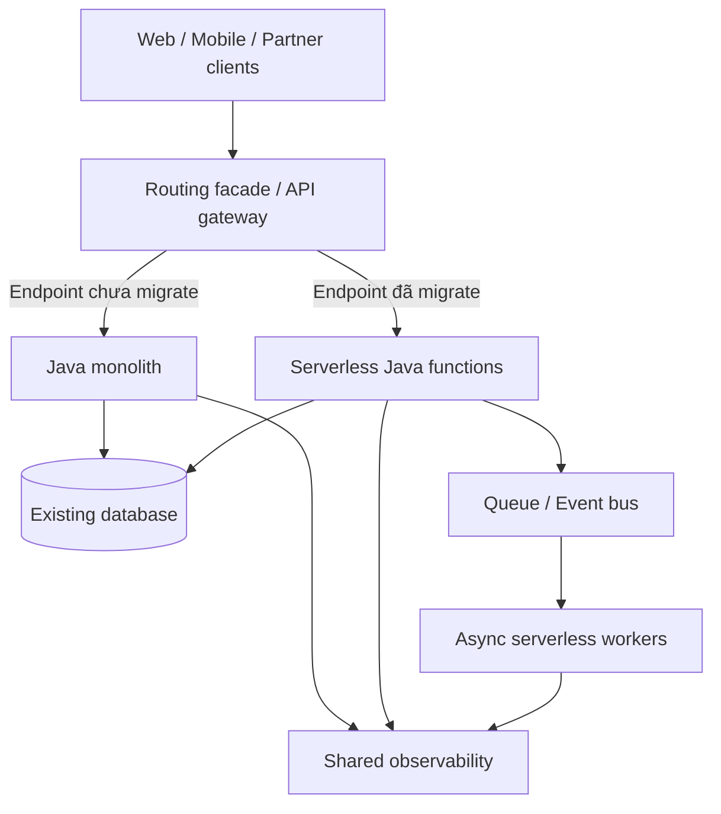
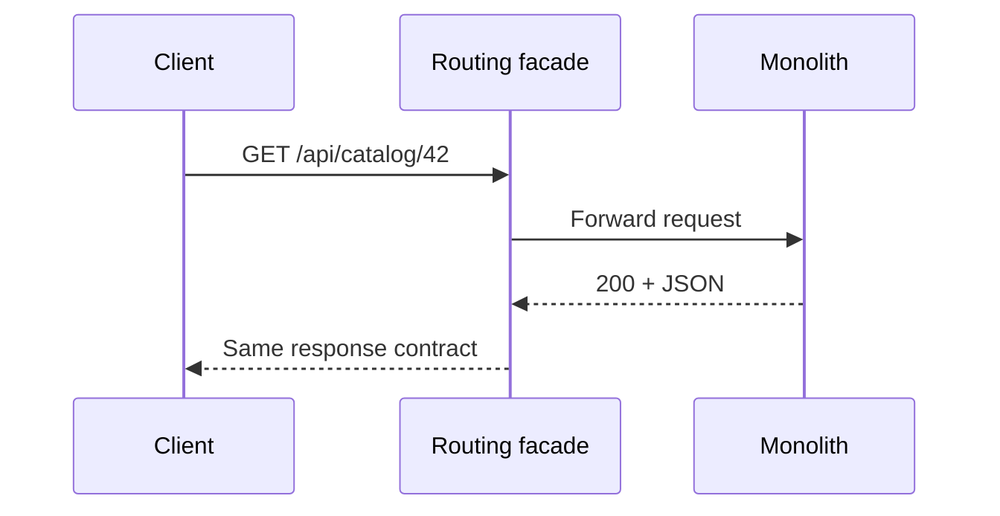
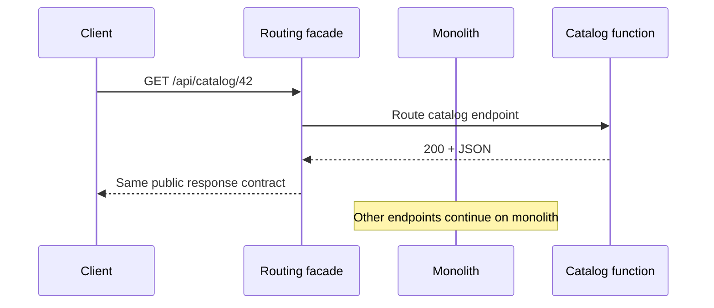
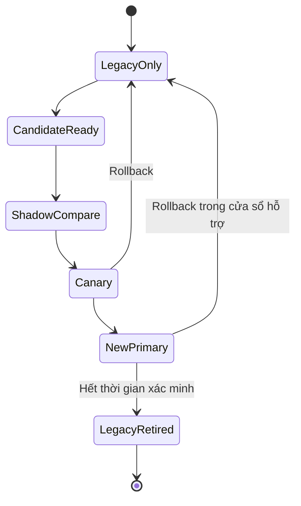

# Áp dụng strangler pattern để thay thế từng endpoint

Khi chuyển một ứng dụng Java monolith sang serverless, việc viết lại toàn bộ hệ thống trong một lần thường có rủi ro cao. Monolith có thể đang phục vụ nhiều luồng nghiệp vụ, chia sẻ database, session, transaction và thư viện nội bộ. Nếu thay tất cả cùng lúc, lỗi ở một phần mới có thể ảnh hưởng toàn bộ người dùng và việc quay lại phiên bản cũ trở nên khó khăn.

**Strangler pattern** là cách chuyển đổi từng phần: đặt một lớp định tuyến trước hệ thống hiện tại, sau đó chuyển từng endpoint hoặc nhóm chức năng sang implementation mới. Endpoint chưa di chuyển tiếp tục chạy trên monolith; endpoint đã di chuyển được route sang serverless function. Khi chức năng mới ổn định, phần code tương ứng trong monolith có thể được loại bỏ.

Tên gọi xuất phát từ hình ảnh một cây mới phát triển dần quanh cây cũ. Trong migration, lớp mới dần tiếp nhận trách nhiệm của hệ thống cũ mà không yêu cầu thay thế toàn bộ trong một đợt phát hành.

## 1. Kiến trúc strangler pattern

Thành phần quan trọng là **routing facade** (lớp định tuyến). Facade nhận request từ client và quyết định gửi request đến monolith hay serverless implementation. Facade có thể là API Gateway, API Management, reverse proxy, ingress, load balancer hoặc một gateway service do nhóm tự vận hành.



Ở giai đoạn đầu, facade có thể chỉ chuyển tiếp toàn bộ traffic đến monolith. Khi một endpoint mới sẵn sàng, thêm route tương ứng để request đi đến function. Các endpoint còn lại không cần thay đổi URL công khai hoặc client contract.

### 1.1. Vai trò của từng thành phần

| Thành phần | Trách nhiệm |
|---|---|
| Client | Gọi API công khai như trước; không cần biết implementation đang ở monolith hay function |
| Routing facade | Định tuyến theo path, method, header, version hoặc rule rollout; áp dụng auth/rate limit nếu được thiết kế ở đây |
| Monolith | Tiếp tục xử lý endpoint chưa chuyển đổi và các nghiệp vụ vẫn phụ thuộc vào nó |
| Serverless function | Sở hữu và xử lý endpoint đã được chuyển đổi |
| Data layer | Duy trì nguồn dữ liệu có thẩm quyền và ranh giới ghi trong thời gian coexistence |
| Queue/event bus | Tách công việc nền hoặc phát domain event giữa các thành phần |
| Observability | Theo dõi request xuyên facade, monolith, function và dependency |

Facade là một điểm kiểm soát quan trọng. Nếu cấu hình route sai, request có thể đến nhầm implementation hoặc không đến được backend nào. Vì vậy facade cần có deployment riêng, health/metrics, access log, timeout và quy trình rollback.

## 2. Chọn endpoint nào để di chuyển trước?

Không nên chọn endpoint chỉ vì nó nhỏ hoặc có ít dòng code. Hãy đánh giá mức độ độc lập của nghiệp vụ, dữ liệu, transaction, traffic và khả năng kiểm thử.

Endpoint phù hợp để bắt đầu thường có một số đặc điểm:

- Có contract HTTP rõ ràng và ít thay đổi.
- Có trách nhiệm nghiệp vụ tương đối độc lập.
- Không phụ thuộc sâu vào session hoặc state trong bộ nhớ của monolith.
- Có thể truy cập dữ liệu qua API/repository rõ ràng.
- Có thể kiểm thử độc lập bằng fixture và integration test.
- Có SLO, log và metric để so sánh trước/sau migration.
- Có thể rollback bằng cách đổi route về monolith.

Ví dụ phân loại:

| Endpoint | Đặc điểm | Ưu tiên migration gợi ý |
|---|---|---|
| `GET /catalog/{id}` | Đọc dữ liệu, ít side effect, có thể cache | Cao nếu data access rõ |
| `GET /profile/{id}` | Phụ thuộc tenant/authorization và dữ liệu cá nhân | Trung bình; cần kiểm tra identity và isolation |
| `POST /orders` | Tạo giao dịch, transaction và idempotency quan trọng | Sau khi data ownership và recovery đã rõ |
| `POST /payments` | Side effect tài chính, phụ thuộc provider và trạng thái giao dịch | Thấp cho lần chuyển đầu; cần thiết kế rất kỹ |
| `GET /reports/monthly` | Query nặng, có thể xử lý bất đồng bộ | Có thể phù hợp nếu tách được workload và dữ liệu |
| `POST /send-email` | Công việc nền, có thể dùng queue và retry | Phù hợp nếu có idempotency và DLQ |

Đây chỉ là gợi ý. Một endpoint đọc có thể vẫn nhạy cảm nếu trả dữ liệu đa tenant; một endpoint ghi có thể chuyển đổi tốt nếu đã có transaction boundary và idempotency rõ ràng.

### 2.1. Lập inventory endpoint

Trước khi thay đổi route, lập danh sách endpoint với các thuộc tính:

- HTTP method, path, request/response schema và version.
- Caller: web app, mobile app, partner, internal service hay scheduled job.
- Authentication, authorization, tenant và rate limit.
- Dữ liệu đọc/ghi, bảng/schema và owner của dữ liệu.
- Transaction, side effect và dependency ngoài.
- Traffic, p95/p99 latency, error rate và peak concurrency.
- Retry behavior, idempotency và yêu cầu ordering.
- Consumer khác đang gọi logic nội bộ tương ứng trong monolith.

Inventory giúp phát hiện endpoint tưởng như độc lập nhưng thực tế gọi chung service hoặc transaction với nhiều chức năng khác. Khi dependency chưa rõ, hãy làm rõ trước khi cắt route.

## 3. Đặt routing facade trước monolith

Nếu client hiện gọi trực tiếp monolith, bước đầu là đưa facade vào trước mà vẫn route 100% traffic về backend cũ. Giai đoạn này xác minh facade không làm thay đổi contract.



Khi facade đã ổn định, có thể chuyển một endpoint:



### 3.1. Định tuyến theo path và method

Thông thường, rule nên dựa trên method + path cụ thể, tránh rule wildcard quá rộng. Ví dụ:

| Method + path | Backend | Trạng thái |
|---|---|---|
| `GET /api/catalog/*` | Catalog function | Đã migrate |
| `GET /api/orders/*` | Monolith | Legacy |
| `POST /api/orders` | Monolith | Legacy |
| `POST /api/notifications` | Notification function | Đã migrate |
| `GET /api/reports/*` | Monolith | Legacy |

Nếu chỉ chuyển `GET /api/orders/{id}` nhưng giữ `POST /api/orders` ở monolith, cần xác định cả hai implementation đọc cùng trạng thái và cùng authorization rules. Đừng route theo path chung khiến `POST` vô tình chuyển sang function chưa hỗ trợ.

### 3.2. Giữ nguyên public contract

Trong giai đoạn migration, client thường nên tiếp tục dùng cùng URL và schema. Cố gắng giữ ổn định:

- HTTP method, path, query parameter và header.
- Request/response JSON field, kiểu dữ liệu và nullability.
- HTTP status code và error format.
- Authentication, authorization, tenant resolution và CORS.
- Pagination, sorting, filtering và rate limit.
- Correlation ID và quy tắc idempotency.

Nếu cần thay đổi contract, version hóa API hoặc thực hiện một thay đổi tương thích ngược riêng. Không gộp việc chuyển runtime với việc thay đổi schema và hành vi nghiệp vụ lớn trong cùng một release nếu có thể tránh.

### 3.3. Forward headers và request context

Facade cần chuyển tiếp các header có ý nghĩa như `Authorization` (nếu backend cần xác minh token), `X-Correlation-ID`, trace context (`traceparent`), locale hoặc idempotency key. Chỉ tin các header do facade kiểm soát hoặc đã được xác thực; không để client tự gửi một header đặc quyền như `X-User-Role: admin` rồi backend tin trực tiếp.

Nếu facade kết thúc TLS hoặc xác thực JWT, hãy xác định backend nhận token gốc hay claims đã được gateway xác minh. Không để monolith và function áp dụng hai quy tắc authorization khác nhau.

## 4. Chuyển đổi từng endpoint theo một vòng lặp có kiểm soát

Một endpoint có thể đi qua các trạng thái sau:

1. **Legacy-only:** tất cả request được route đến monolith.
2. **Candidate-ready:** function mới đã deploy, có test và có thể gọi nội bộ.
3. **Shadow/compare (nếu an toàn):** request được quan sát hoặc so sánh kết quả mà không tạo side effect trùng.
4. **Canary:** một phần traffic được route đến function mới.
5. **New-primary:** toàn bộ traffic endpoint đi đến function; monolith vẫn được giữ để rollback trong thời gian theo dõi.
6. **Legacy-retired:** code và dependency cũ được gỡ sau khi xác nhận không còn caller.



Không phải endpoint nào cũng cần shadow hoặc canary. Với traffic thấp, có thể dùng internal smoke test rồi chuyển toàn bộ route trong một đợt nhỏ. Với endpoint quan trọng hoặc tải cao, canary và metric gate giúp giới hạn blast radius.

## 5. Ví dụ định tuyến tại API Gateway hoặc API Management

Routing facade có thể được triển khai bằng nhiều công nghệ:

- AWS API Gateway có thể route một số path đến Lambda integration và các path khác đến HTTP integration của monolith.
- Azure API Management có thể dùng operation, policy hoặc backend selection để gửi request đến Function App hay monolith.
- NGINX, Envoy, Spring Cloud Gateway hoặc ingress có thể làm reverse proxy và áp dụng routing rule.

Ví dụ rule dạng khái niệm:

```yaml
routes:
  - id: catalog-serverless
    match:
      methods: [GET]
      path: /api/catalog/**
    backend: catalog-function

  - id: orders-legacy
    match:
      path: /api/orders/**
    backend: java-monolith

  - id: notifications-serverless
    match:
      methods: [POST]
      path: /api/notifications
    backend: notification-function
```

Đây là pseudoconfiguration để minh họa ý tưởng, không phải file cấu hình dùng trực tiếp cho một gateway cụ thể. Cú pháp và thứ tự ưu tiên route phụ thuộc sản phẩm. Hãy kiểm tra rule cụ thể hơn được đánh giá trước wildcard, và có test xác nhận method/path không bị route nhầm.

### 5.1. Canary theo tỷ lệ traffic

Một số gateway hỗ trợ weighted routing. Ví dụ, 5% request của một endpoint được chuyển đến function mới và 95% còn lại vẫn đến monolith. Cần đo kết quả theo backend/version và tăng tỷ lệ từng bước.

Weighted routing phù hợp nhất khi:

- Request độc lập và không phụ thuộc session state trong bộ nhớ.
- Cả hai backend đọc/ghi dữ liệu tương thích.
- Hai implementation có cùng semantics và authorization.
- Request có thể được xử lý đúng dù đi đến backend nào.

Không chia ngẫu nhiên traffic cho một workflow nhiều bước cần giữ cùng một backend hoặc session affinity nếu state chưa được externalize. Cũng không gửi cùng một lệnh ghi đến cả hai backend chỉ để “so sánh kết quả”; điều đó có thể tạo hai đơn hàng hoặc hai lần thanh toán.

## 6. Shadow traffic và so sánh kết quả an toàn

Shadow traffic gửi bản sao request đến implementation mới để quan sát kết quả, nhưng response của bản sao không được trả cho client. Nó hữu ích để so sánh latency, schema và logic trên cùng input.

Tuy nhiên, shadow chỉ an toàn nếu request không tạo side effect hoặc các side effect đã được vô hiệu hóa/đưa vào sandbox. Không nhân đôi `POST /payments`, `POST /orders`, email hoặc thao tác ghi dữ liệu thật. Với endpoint đọc, cần bảo đảm request shadow không gây query quá tải hoặc lộ dữ liệu ra môi trường test.

Có thể dùng các cách sau:

- Chỉ shadow GET/HEAD hoặc endpoint read-only.
- Chạy function mới ở chế độ compare-only, không commit thay đổi.
- Dùng database replica/snapshot và credential chỉ đọc.
- Mask dữ liệu nhạy cảm trước khi chuyển đến môi trường kiểm thử.
- So sánh response đã chuẩn hóa, bỏ timestamp, ID ngẫu nhiên hoặc field không ổn định.
- Giới hạn sample rate và concurrency để tránh làm tăng tải monolith.

Nếu không thể loại bỏ side effect, bỏ qua shadow và dùng canary request thật với idempotency key cùng test tenant có kiểm soát.

## 7. Chiến lược dữ liệu trong giai đoạn coexistence

Routing từng endpoint không tự giải quyết việc monolith và function cùng đọc/ghi dữ liệu. Đây thường là phần khó nhất của strangler migration.

### 7.1. Dùng chung database trong giai đoạn chuyển tiếp

Một lựa chọn ban đầu là function mới truy cập cùng database với monolith. Cách này giảm chi phí sao chép dữ liệu và tránh phải chuyển data ngay lập tức, nhưng tạo coupling giữa hai implementation.

Nếu dùng chung database:

- Xác định source of truth cho từng entity/table.
- Chỉ định service nào sở hữu quyền ghi và migration schema.
- Không để function mới phụ thuộc trực tiếp vào bảng nội bộ của monolith nếu có thể tạo repository/API boundary rõ ràng.
- Kiểm tra transaction isolation, connection pool và query load khi scale-out.
- Đảm bảo migration schema tương thích với cả code cũ và mới trong thời gian coexistence.
- Theo dõi mọi consumer còn truy cập bảng trước khi chuyển ownership.

Không nhất thiết phải tách database ngay ở bước đầu. Nhưng cần tránh để cả monolith và function cùng trở thành hai writer không có quy tắc cho cùng một dữ liệu.

### 7.2. Một owner ghi, nhiều consumer đọc

Trong giai đoạn đầu, có thể giữ monolith là owner ghi cho một entity; function mới gọi API nội bộ hoặc đọc read model được kiểm soát. Sau đó chuyển quyền ghi sang function/service mới theo một cutover rõ ràng.

Một quy tắc hữu ích là **mỗi entity có một owner ghi tại một thời điểm**. Nếu hai implementation cùng nhận lệnh ghi, phải có cơ chế transaction/idempotency/optimistic concurrency rõ ràng. Chỉ chia traffic ở gateway không đảm bảo write ownership vì request cũ, background job và internal call vẫn có thể ghi vào cùng bảng.

### 7.3. Tránh dual-write không có giao thức phục hồi

Ví dụ một request cập nhật đơn hàng, ghi database monolith rồi ghi Redis/event bus từ function. Nếu database commit thành công nhưng publish event thất bại, trạng thái hai bên lệch. Nếu retry toàn bộ request, có thể ghi trùng.

Khi cần phát event theo transaction, dùng transactional outbox: ghi thay đổi nghiệp vụ và outbox record trong cùng transaction; publisher gửi event sau đó. Consumer idempotent theo event ID. Khi cần đồng bộ dữ liệu giữa hai store, dùng CDC hoặc pipeline có checkpoint/replay và theo dõi replication lag.

Không dùng dual-write trực tiếp như sau nếu không có recovery protocol:

```java
// Anti-pattern: hai thao tác độc lập không có transaction chung
legacyRepository.update(order);
eventBus.publish(new OrderUpdated(order.id()));
```

Nếu thao tác thứ hai lỗi, database đã thay đổi nhưng consumer không biết. Outbox hoặc một workflow có trạng thái bền vững giúp giải quyết tình huống này.

### 7.4. Expand-and-contract cho schema

Trong migration từng endpoint, version cũ và mới có thể chạy song song. Schema phải tương thích với cả hai trong thời gian đó:

1. **Expand:** thêm cột/bảng/index mới, giữ trường cũ.
2. Deploy code có thể đọc cấu trúc cũ và mới.
3. Chuyển endpoint hoặc writer sang implementation mới.
4. Backfill/đối chiếu dữ liệu và xác nhận không còn consumer dùng trường cũ.
5. **Contract:** ngừng ghi trường cũ rồi mới xóa trong một release riêng.

Không xóa hoặc đổi nghĩa cột ngay khi function mới đã deploy. Monolith vẫn có thể cần cột đó cho endpoint chưa migrate hoặc background job.

## 8. Ví dụ: thay endpoint catalog bằng Java Lambda

Giả sử monolith hiện có `GET /api/catalog/{id}`. Endpoint trả thông tin sản phẩm từ database. Ta chuyển riêng endpoint này sang Java Lambda; các route order và payment tiếp tục ở monolith.

### 8.1. Giữ response contract

Response cũ:

```json
{
  "id": "p-102",
  "name": "Mechanical Keyboard",
  "price": 89.5,
  "currency": "USD"
}
```

Function mới phải giữ cùng schema, semantics của `price`, quy tắc currency và status code. Nếu implementation mới trả `price` theo cents hoặc đổi field thành `amount`, client sẽ bị ảnh hưởng dù route đã chuyển thành công.

### 8.2. Java Lambda handler minh họa

Ví dụ dưới dùng AWS Lambda Java events cho API Gateway HTTP API payload format 2.0:

```java
package com.example.catalog;

import com.amazonaws.services.lambda.runtime.Context;
import com.amazonaws.services.lambda.runtime.RequestHandler;
import com.amazonaws.services.lambda.runtime.events.APIGatewayV2HTTPEvent;
import com.amazonaws.services.lambda.runtime.events.APIGatewayV2HTTPResponse;
import com.fasterxml.jackson.databind.ObjectMapper;
import java.util.Map;

public final class CatalogHandler implements
        RequestHandler<APIGatewayV2HTTPEvent, APIGatewayV2HTTPResponse> {

    private static final ObjectMapper JSON = new ObjectMapper();
    private final CatalogService catalogService;

    public CatalogHandler() {
        this(new DefaultCatalogService());
    }

    CatalogHandler(CatalogService catalogService) {
        this.catalogService = catalogService;
    }

    @Override
    public APIGatewayV2HTTPResponse handleRequest(
            APIGatewayV2HTTPEvent event,
            Context context) {

        String productId = event.getPathParameters() == null
                ? null
                : event.getPathParameters().get("id");

        if (productId == null || productId.isBlank()) {
            return response(400, Map.of("error", "product id is required"));
        }

        return catalogService.find(productId)
                .map(product -> response(200, product))
                .orElseGet(() -> response(404, Map.of("error", "not found")));
    }

    private APIGatewayV2HTTPResponse response(int status, Object body) {
        try {
            return APIGatewayV2HTTPResponse.builder()
                    .withStatusCode(status)
                    .withHeaders(Map.of("content-type", "application/json"))
                    .withBody(JSON.writeValueAsString(body))
                    .build();
        } catch (Exception e) {
            return APIGatewayV2HTTPResponse.builder()
                    .withStatusCode(500)
                    .withHeaders(Map.of("content-type", "application/json"))
                    .withBody("{\"error\":\"internal error\"}")
                    .build();
        }
    }
}
```

Đoạn code minh họa handler; `CatalogService`, `DefaultCatalogService` và kiểu `ProductView` là thành phần ứng dụng cần triển khai. Trong production, cần phân biệt lỗi dependency với not-found, log exception có correlation ID, xác minh authorization/tenant, và không nuốt mọi exception thành một response 500 thiếu thông tin vận hành. Dependency AWS Lambda events phải được thêm vào build, và handler signature phải khớp payload format của API Gateway.

### 8.3. Cutover route

Sau khi function đã deploy và test nội bộ:

1. Thêm route `GET /api/catalog/{id}` đến Lambda integration.
2. Giữ các route `/api/orders/*`, `/api/payments/*` đến monolith.
3. Chạy smoke test với product ID thuộc test dataset.
4. So sánh status, response schema và latency với baseline monolith.
5. Bật canary nếu gateway hỗ trợ và quan sát error/latency theo backend.
6. Khi ổn định, chuyển toàn bộ traffic catalog sang function.
7. Gỡ controller/repository catalog khỏi monolith khi không còn internal caller.

Nếu endpoint mới lỗi, đổi route về monolith. Không cần rollback toàn bộ hệ thống hoặc redeploy các endpoint khác.

## 9. Java monolith và function giao tiếp trong thời gian chuyển đổi

Trong giai đoạn coexistence, có thể có các lời gọi qua lại:

- Monolith gọi function mới qua HTTP/API Gateway.
- Function gọi API nội bộ của monolith cho capability chưa tách.
- Cả hai cùng publish/consume domain event.
- Gateway route client request đến một trong hai backend.

Giữ các lời gọi qua boundary có contract rõ. Tránh function mới import trực tiếp class nội bộ từ monolith hoặc truy cập static singleton/session của monolith. Nếu cần dùng lại business logic, tách phần logic thuần Java thành module thư viện độc lập chỉ khi dependency và lifecycle phù hợp; không kéo cả container/application context của monolith vào function chỉ để tái sử dụng một method.

### 9.1. Tránh vòng gọi qua lại

Một kiến trúc tạm thời có thể tạo vòng: monolith gọi function A, function A gọi lại monolith B, monolith B lại gọi function A. Vòng gọi làm tăng latency, gây recursion hoặc retry amplification và khó truy vết.

Với mỗi capability, xác định owner xử lý cuối cùng. Ghi rõ hướng gọi được phép và không để hai bên cùng sở hữu một nghiệp vụ. Khi một capability đã chuyển hoàn toàn, cập nhật dependency graph và xóa đường gọi cũ.

### 9.2. Session và state

Monolith có thể lưu session trong HTTP session, local memory hoặc sticky session theo node. Function serverless không nên phụ thuộc vào state trong process. Trước khi chuyển endpoint cần:

- Dùng token/stateless session nếu phù hợp.
- Externalize session vào shared store nếu cần session state.
- Không giả định hai request liên tiếp đi đến cùng instance.
- Kiểm tra cookie, CSRF, CORS và session invalidation.
- Không để facade route các request của một user đến hai backend có session format không tương thích.

## 10. Bảo mật và identity trong giai đoạn coexistence

Khi có hai backend, bề mặt bảo mật tăng lên. Cần bảo đảm cả monolith và function áp dụng cùng chính sách ở ranh giới công khai.

- Xác thực caller tại facade hoặc backend theo một mô hình được xác định rõ.
- Không tin các header user/role do client tự gửi.
- Chuyển tiếp JWT/claims an toàn và kiểm tra issuer, audience, expiry, scope/role.
- Cấp execution identity riêng cho function và quyền tối thiểu đến database, queue, secret.
- Giới hạn network ingress để backend không bị truy cập vòng ngoài facade nếu kiến trúc yêu cầu gateway-only.
- Giữ rate limit, WAF, CORS và request size policy tương đương trong quá trình chuyển đổi.
- Không log token, session cookie hoặc dữ liệu cá nhân trong facade access log.
- Kiểm tra audit trail để xác định request đã được xử lý bởi backend/version nào.

Nếu monolith dùng database credential rộng, không sao chép credential đó cho mọi function. Cấp quyền theo capability hoặc schema và thu hẹp quyền khi ownership dữ liệu chuyển sang service mới.

## 11. Canary, metric gate và rollback

Sau khi chuyển route, so sánh backend mới với baseline monolith. Chỉ nhìn tỷ lệ HTTP 2xx là chưa đủ; response có thể hợp lệ về HTTP nhưng sai dữ liệu hoặc side effect.

Các metric nên theo dõi:

| Nhóm | Metric | Mục đích |
|---|---|---|
| Reliability | 5xx, exception, timeout, retry | Phát hiện lỗi implementation hoặc dependency |
| Latency | p50/p95/p99, gateway integration latency | So sánh trải nghiệm trước và sau migration |
| Capacity | concurrency, throttles, memory, connection count | Phát hiện scale-out gây áp lực downstream |
| Data correctness | Response diff, reconciliation mismatch, duplicate operation | Phát hiện khác biệt nghiệp vụ |
| Async | Queue age, consumer lag, DLQ, event publish failure | Kiểm tra luồng xử lý nền |
| Business | Order accepted, payment state, catalog availability | Đảm bảo nghiệp vụ thật sự hoàn tất |
| Cost | Cost per request/successful operation | Xác định serverless có đạt mục tiêu chi phí không |

### 11.1. Điều kiện rollback

Định nghĩa trước threshold và thời gian đánh giá, ví dụ:

- Error rate của function mới vượt baseline/SLO trong nhiều cửa sổ liên tiếp.
- p95/p99 tăng vượt giới hạn đã thống nhất.
- Có mismatch dữ liệu hoặc response contract nghiêm trọng.
- Queue age hoặc DLQ tăng liên tục.
- Dependency saturation ảnh hưởng cả backend cũ.
- Authentication/authorization có dấu hiệu bypass hoặc sai tenant.

Khi gate fail, dừng tăng traffic và route endpoint về monolith. Thu thập correlation ID, log, trace, metric snapshot và version trước khi rollback. Không tự động retry thao tác ghi sang monolith khi không biết function mới đã commit hay chưa; kiểm tra idempotency key hoặc trạng thái operation trước.

### 11.2. Rollback không hoàn tác dữ liệu

Đổi route chỉ thay nơi nhận request tiếp theo. Nó không đảo ngược database write, message đã publish, email đã gửi hoặc payment đã tạo. Vì vậy:

- Dùng idempotency key cho command có side effect.
- Giữ schema tương thích với cả code cũ và mới.
- Ghi operation/event ID để đối chiếu.
- Có reconciliation hoặc compensation cho nghiệp vụ không thể rollback trực tiếp.
- Không xóa code legacy trước khi hết cửa sổ rollback và xác nhận dữ liệu ổn định.

## 12. Kiểm thử trước khi chuyển traffic

Một endpoint mới cần test cả logic và boundary tích hợp:

1. **Unit test:** validation, mapping, business rules và error handling.
2. **Contract test:** request/response schema, status code, header, error format và API version.
3. **Integration test:** database, queue, secret, identity và external dependency.
4. **Routing test:** method/path đúng backend; route wildcard không bắt nhầm endpoint.
5. **Authorization test:** cùng một principal/tenant có kết quả quyền tương đương với monolith.
6. **Shadow/compare test:** chỉ dùng khi không tạo side effect và dữ liệu được bảo vệ.
7. **Canary test:** một phần traffic thật, có metric gate và rollback.
8. **Load test:** concurrency, cold start, connection pool và downstream capacity.
9. **Failure test:** timeout, dependency outage, duplicate request và message retry.
10. **Rollback rehearsal:** route lại monolith và xác nhận dữ liệu vẫn đọc/ghi đúng.

Test route có thể dùng bảng case:

| Request | Backend mong đợi | Điều cần xác minh |
|---|---|---|
| `GET /api/catalog/42` | Catalog function | Route cụ thể được ưu tiên |
| `POST /api/catalog` | Monolith hoặc 404 theo contract | Không bị wildcard GET bắt nhầm |
| `GET /api/orders/42` | Monolith | Endpoint chưa migrate vẫn hoạt động |
| `POST /api/notifications` | Notification function | Auth và payload đúng |
| `GET /api/unknown` | Gateway 404 hoặc monolith theo policy | Không route nhầm sang function bất kỳ |

## 13. Khi nào gỡ endpoint cũ khỏi monolith?

Không nên xóa controller hoặc bảng cũ ngay sau khi chuyển 100% traffic. Trước khi retire, xác minh:

- Gateway không còn route đến endpoint cũ.
- Không có internal service, batch job hoặc scheduled task gọi trực tiếp monolith method.
- Không có client gọi bypass facade vào host monolith.
- Metrics/access logs không còn request đến implementation cũ trong khoảng thời gian đủ dài theo traffic pattern.
- Data owner và migration đã chuyển rõ ràng.
- Backup, retention, audit và rollback window đáp ứng yêu cầu.
- Runbook và ownership của service mới đã được bàn giao.

Sau đó mới gỡ code, config, IAM permission và dependency cũ. Nếu monolith còn dùng chung module hoặc bảng với capability khác, chỉ xóa phần thực sự không còn được tham chiếu.

## 14. Lộ trình migration theo từng endpoint

Một lộ trình thực tế có thể chia thành các đợt:

### Đợt 1: Tạo đường định tuyến

- Đặt API Gateway/API Management/reverse proxy trước monolith.
- Route 100% traffic về monolith.
- Giữ nguyên URL, auth, response và logging.
- Đo baseline latency, error rate và traffic.

### Đợt 2: Chuyển endpoint ít rủi ro

- Chọn endpoint độc lập, thường là read-only hoặc side effect có thể kiểm soát.
- Xác định contract, data owner và dependency.
- Xây dựng Java function và test độc lập.
- Route nội bộ/candidate, chạy smoke test và canary.
- Rollback bằng route nếu metric không đạt.

### Đợt 3: Tách nghiệp vụ và dữ liệu

- Chuyển từng capability có ownership rõ.
- Externalize session/state.
- Tạo event contract và transactional outbox nếu cần.
- Chuyển write ownership theo từng entity.
- Dùng expand-and-contract cho schema.

### Đợt 4: Chuyển luồng giao dịch và công việc nền

- Chuyển command có side effect sau khi có idempotency, retry và reconciliation.
- Tách queue/consumer cho workload bất đồng bộ.
- Kiểm tra ordering, DLQ, replay và RTO/RPO.
- Theo dõi business metrics, không chỉ HTTP status.

### Đợt 5: Thu hồi phần legacy

- Xác minh không còn caller và dữ liệu đã ổn định.
- Gỡ route, code, permission và resource không dùng.
- Cập nhật architecture/dependency graph, runbook và ownership.
- Đánh giá chi phí và SLO sau khi migration hoàn tất.

## 15. Những lỗi thường gặp khi áp dụng strangler pattern

| Sai lầm | Hậu quả | Cách khắc phục |
|---|---|---|
| Chuyển nhiều endpoint cùng lúc | Khó cô lập lỗi và rollback | Chuyển từng capability có metric gate |
| Đặt facade nhưng không có observability | Không biết backend nào xử lý request | Log route target, version và correlation ID |
| Route wildcard quá rộng | Request chưa migrate đi nhầm function | Rule method/path cụ thể và routing tests |
| Shadow request ghi dữ liệu thật | Duplicate order/payment/email | Chỉ shadow read-only hoặc dùng sandbox/compare-only |
| Monolith và function cùng ghi không có owner | Race condition và dữ liệu lệch | Một write owner, idempotency và transaction/outbox |
| Thay API contract cùng lúc thay backend | Client lỗi khó xác định nguyên nhân | Giữ contract ổn định hoặc version hóa riêng |
| Function gọi ngược monolith theo vòng lặp | Latency, retry amplification và coupling | Xác định capability owner và hướng gọi rõ |
| Chuyển endpoint nhưng bỏ qua session | User bị mất trạng thái hoặc xác thực sai | Externalize session và kiểm tra cookie/token |
| Rollback route rồi cho rằng dữ liệu đã quay lại | Side effect vẫn tồn tại ở hệ thống mới | Reconciliation, compensation và idempotency |
| Gỡ code cũ quá sớm | Không còn đường rollback | Giữ legacy trong cửa sổ xác minh, retire có kiểm chứng |

## 16. Checklist trước khi chuyển một endpoint

1. Endpoint có owner và business capability rõ ràng không?
2. Request/response contract và status/error semantics đã được ghi lại chưa?
3. Caller, auth, tenant, session và rate limit có được giữ tương đương không?
4. Dependency và data owner đã được xác định chưa?
5. Có transaction hoặc side effect cần idempotency không?
6. Monolith và function có thể cùng chạy trong thời gian coexistence không?
7. Schema/event contract có tương thích ngược không?
8. Facade route có test cho method/path cụ thể và wildcard không?
9. Có smoke test, canary threshold và rollback route không?
10. Metrics có tách theo backend/version để so sánh không?
11. Có kiểm tra queue, DLQ, retry và downstream capacity nếu endpoint phát event không?
12. Có runbook xử lý dữ liệu lệch, duplicate và replay không?
13. Đã xác minh không còn internal caller trước khi xóa code cũ chưa?
14. Có owner vận hành function mới và kế hoạch retire monolith không?

## Kết luận

Strangler pattern cho phép chuyển monolith sang serverless theo từng endpoint mà vẫn duy trì API công khai và hoạt động của phần legacy. Routing facade là điểm kiểm soát để phân luồng giữa monolith và Java functions; mỗi lần chuyển đổi cần có contract ổn định, data ownership rõ, kiểm thử, metric gate và đường rollback. Khó khăn lớn nhất thường nằm ở dữ liệu, transaction, session và side effect trong thời gian hai implementation cùng tồn tại. Hãy chuyển từ endpoint độc lập đến capability phức tạp hơn, tránh dual-write không có recovery protocol, giữ schema tương thích và chỉ gỡ code cũ sau khi xác minh không còn caller. Cách làm từng bước giúp giảm blast radius và tạo lộ trình di chuyển có thể đo lường, kiểm soát và đảo ngược.
