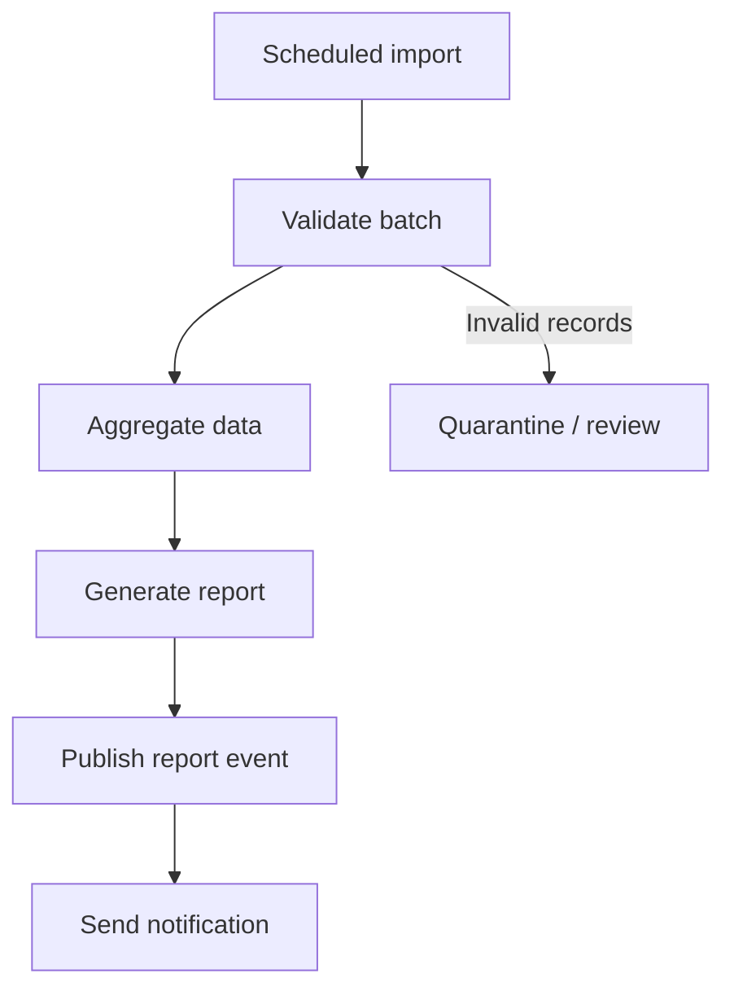

# Chuyển cron job và tác vụ nền sang function hoặc serverless job

Cron job và tác vụ nền thường bắt đầu từ một lệnh chạy trên máy chủ: đọc dữ liệu, tạo báo cáo, đồng bộ hệ thống, gửi thông báo, dọn dữ liệu hết hạn hoặc tổng hợp số liệu cuối ngày. Khi chuyển ứng dụng Java sang serverless, nhóm phát triển có thể thay scheduler/worker cố định bằng function được kích hoạt theo lịch, queue hoặc event; với công việc dài hơn, có thể dùng serverless job chạy container hoặc workflow có điều phối.

Việc chuyển đổi không chỉ là đổi biểu thức cron thành một trigger mới. Cần bảo toàn ý nghĩa lịch chạy, timezone, hành vi khi bỏ lỡ lịch, chống chạy trùng, xử lý job kéo dài, checkpoint, retry, giới hạn concurrency và khả năng quan sát. Scheduler có thể gửi cùng một lần kích hoạt nhiều hơn một lần; job có thể bị dừng giữa chừng; nhiều invocation có thể chạy đồng thời nếu lần trước chưa kết thúc. Vì vậy, thiết kế phải dựa trên **logical run**, trạng thái bền vững và idempotency.

Bài học này hướng dẫn chuyển cron job và tác vụ nền Java sang function hoặc serverless job trên AWS, Azure và Google Cloud. Trọng tâm là chọn đúng mô hình thực thi, giữ semantics của lịch, tổ chức xử lý theo batch/checkpoint và triển khai migration có thể kiểm chứng, tạm dừng hoặc rollback.

## 1. Phân loại cron job và tác vụ nền hiện tại

Trước khi chọn dịch vụ serverless, hãy phân loại công việc theo thời gian chạy, trạng thái, mức độ quan trọng và cách kích hoạt.

| Loại công việc | Ví dụ | Đặc điểm cần xem xét |
| --- | --- | --- |
| Short periodic task | Làm mới cache, đồng bộ vài trăm record | Chạy ngắn, có thể hoàn tất trong một invocation |
| Scheduled batch | Tổng hợp doanh thu ngày, tạo invoice | Nhiều record, cần batch và checkpoint |
| Long-running job | Export hàng triệu dòng, xử lý media | Có thể vượt function timeout, cần job/container hoặc chia bước |
| Event-driven background task | Gửi email sau khi order tạo | Không nhất thiết cần cron; có thể kích hoạt trực tiếp bởi event |
| Polling task | Kiểm tra API đối tác mỗi 5 phút | Cần rate limit, cursor và xử lý dữ liệu mới |
| Maintenance task | Xóa dữ liệu hết hạn, cleanup object | Cần retention policy, dry-run và giới hạn phạm vi |
| Workflow nhiều bước | Đối soát, thanh toán, xuất báo cáo | Cần orchestration, retry theo bước và trạng thái durable |
| Singleton/coordination job | Chốt sổ, rotate key, tạo snapshot | Cần khóa phân tán hoặc cơ chế single-writer rõ ràng |

Không phải cron job nào cũng nên trở thành function. Một tác vụ chỉ chạy mỗi tháng nhưng cần 4 giờ CPU liên tục có thể phù hợp với serverless container job hoặc batch service hơn là một function có timeout ngắn. Một tác vụ nền được kích hoạt ngay sau event có thể bỏ hẳn lịch polling nếu nguồn event đáng tin cậy.

### Inventory job trước migration

Với mỗi job, ghi lại:

- Tên job, owner, business purpose và mức độ quan trọng.
- Lịch chạy, timezone, lịch đặc biệt/ngày nghỉ và thời gian cho phép trễ.
- Thời gian chạy p50/p95/max và khối lượng dữ liệu.
- Tài nguyên CPU, memory, disk, network và dependency.
- Input/output, source of truth, side effect và dữ liệu nhạy cảm.
- Có chạy đồng thời hoặc phụ thuộc job khác không.
- Hành vi retry, timeout, alert và cách operator chạy lại thủ công.
- Trạng thái đang lưu ở đâu: database, file, process memory hay scheduler.
- Quy tắc catch-up khi job bị bỏ lỡ hoặc hệ thống ngừng hoạt động.

Hãy đo ít nhất một chu kỳ nghiệp vụ đại diện. Job cuối tháng có thể khác xa job chạy mỗi 5 phút; không suy ra capacity từ một lần chạy với dữ liệu nhỏ.

## 2. Chọn function, serverless job hay workflow

Ba lựa chọn thường được kết hợp:

| Mô hình | Phù hợp khi | Ví dụ |
| --- | --- | --- |
| Scheduled function | Công việc ngắn, stateless hoặc có state bên ngoài, một handler hoàn tất trong timeout | Kiểm tra subscription sắp hết hạn, gửi digest nhỏ |
| Serverless container/job | Công việc dài, cần thư viện hệ thống, xử lý file lớn hoặc nhiều CPU/memory | Export dữ liệu lớn, batch ETL, xử lý media |
| Workflow orchestration | Công việc gồm nhiều bước, chờ lâu, cần retry/branch/approval/checkpoint theo từng bước | Đối soát, onboarding tenant, đóng kỳ kế toán |

Có thể dùng scheduler để khởi chạy workflow, workflow chia việc thành các function/job, rồi worker xử lý từng partition. Không nên giữ một invocation duy nhất chạy hàng giờ nếu nền tảng có giới hạn thời gian hoặc việc có thể chia nhỏ.

### Ma trận lựa chọn nhanh

- Job chạy vài giây/phút, khối lượng nhỏ và ít dependency: scheduled function.
- Job có thể chạy lâu hơn timeout function, cần executable/container tùy chỉnh: serverless job.
- Job có nhiều bước, chờ external approval hoặc retry độc lập: workflow engine.
- Job cần xử lý ngay khi dữ liệu tới: queue/event trigger thay vì đợi cron kế tiếp.
- Job cần daemon liên tục, giữ kết nối lâu dài hoặc xử lý stream vô hạn: xem xét worker/service chạy liên tục thay vì ép thành scheduled invocation.

## 3. Bảo toàn semantics của cron

Biểu thức cron không thống nhất hoàn toàn giữa các scheduler. Trước khi chuyển, cần xác định rõ lịch cũ có nghĩa gì rồi mới ánh xạ sang cú pháp mới.

| Hệ thống/cú pháp | Số trường thường gặp | Thứ tự phổ biến |
| --- | ---: | --- |
| Unix cron | 5 | phút, giờ, ngày trong tháng, tháng, ngày trong tuần |
| Azure Functions NCRONTAB | 6 | giây, phút, giờ, ngày trong tháng, tháng, ngày trong tuần |
| AWS EventBridge Scheduler cron | 6 | phút, giờ, ngày trong tháng, tháng, ngày trong tuần, năm |
| Quartz cron | 6 hoặc 7 | giây, phút, giờ, ngày trong tháng, tháng, ngày trong tuần, năm tùy chọn |

Ví dụ `0 2 * * *` trong Unix cron thường có nghĩa 02:00 mỗi ngày. Không thể copy nguyên chuỗi này vào Azure NCRONTAB vì Azure có trường giây ở đầu. AWS EventBridge cron có trường năm và quy tắc riêng cho ngày trong tháng/ngày trong tuần; một số vị trí dùng `?` để biểu thị không chỉ định.

### Lập bảng ánh xạ lịch

| Ý định nghiệp vụ | Unix cron minh họa | Azure NCRONTAB minh họa | Lưu ý |
| --- | --- | --- | --- |
| Mỗi 5 phút | `*/5 * * * *` | `0 */5 * * * *` | Azure thêm giây `0` |
| Mỗi ngày lúc 02:00 | `0 2 * * *` | `0 0 2 * * *` | Phải xác định timezone |
| Thứ Hai lúc 08:30 | `30 8 * * 1` | `0 30 8 * * 1` | Kiểm tra quy ước số ngày trong tuần |
| Ngày đầu tháng lúc 00:15 | `15 0 1 * *` | `0 15 0 1 * *` | Kiểm tra lịch tháng và timezone |

Các chuỗi trên chỉ minh họa hai cú pháp; hãy kiểm thử bằng scheduler parser hoặc cấu hình staging của provider. Không chuyển đổi bằng cách thêm/xóa một trường mà không xác minh ý nghĩa của `day-of-month`, `day-of-week`, dấu `?`, `L`, `W` hoặc ký hiệu mở rộng.

### `rate` và `cron` có nghĩa khác nhau

- `rate(5 minutes)` thường biểu diễn khoảng thời gian định kỳ kể từ mốc dịch vụ định nghĩa.
- `cron(0 2 * * ? *)` biểu diễn thời điểm theo lịch, ví dụ 02:00 mỗi ngày theo timezone/cấu hình của scheduler.

Nếu yêu cầu là “mỗi ngày lúc 02:00 giờ địa phương”, dùng calendar schedule với timezone rõ ràng. Nếu yêu cầu là “mỗi 5 phút”, rate schedule có thể phù hợp hơn. Không thay lịch calendar bằng delay cố định 24 giờ nếu thời điểm địa phương phải giữ nguyên qua thay đổi DST.

## 4. Timezone và daylight saving time (DST)

Một cron job có thể được định nghĩa theo UTC hoặc giờ địa phương. Khi chuyển sang serverless, phải ghi rõ timezone bằng tên IANA như `Asia/Ho_Chi_Minh`, `America/New_York` hoặc `Europe/London` nếu scheduler hỗ trợ. Tránh dựa vào timezone mặc định của máy chủ.

Các vấn đề DST:

- Khi đồng hồ tiến lên, một thời điểm địa phương có thể không tồn tại, ví dụ 02:30.
- Khi đồng hồ lùi lại, một thời điểm địa phương có thể xuất hiện hai lần.
- Một lịch chạy “mỗi ngày lúc 02:30” có thể bị bỏ qua hoặc được xử lý theo quy tắc riêng của scheduler trong ngày chuyển DST.
- `rate(24 hours)` không đồng nghĩa với “mỗi ngày cùng giờ địa phương”.

Nếu nghiệp vụ không phụ thuộc giờ địa phương, UTC thường dễ vận hành hơn. Nếu phải chốt sổ theo giờ địa phương, dùng timezone IANA và ghi rõ chính sách cho thời điểm không tồn tại/trùng lặp. Hãy kiểm tra hành vi thực tế của provider, không tự giả định mọi scheduler xử lý DST giống nhau.

### Lưu scheduled time trong job record

Nên lưu cả:

- `scheduledFor`: thời điểm logic mà job đáng lẽ chạy.
- `startedAt`: thời điểm worker thực sự bắt đầu.
- `completedAt`: thời điểm hoàn tất.
- `timezone`: timezone đã dùng để tính lịch nếu có.
- `scheduleVersion`: phiên bản cấu hình lịch.

Không dùng `Instant.now()` làm business period nếu job cần xử lý đúng kỳ. Ví dụ job chốt doanh thu ngày 16 phải dùng ngày nghiệp vụ được scheduler truyền vào hoặc tính từ calendar rule, không dùng ngày lúc invocation retry.

## 5. Xử lý missed schedule, catch-up và misfire

Scheduler có thể không gửi trigger đúng giờ do outage, quota, cấu hình retry hoặc sự cố nền tảng. Khi phục hồi, cần xác định job:

- Chạy bù tất cả kỳ bị bỏ lỡ.
- Chỉ chạy kỳ mới nhất.
- Gộp nhiều kỳ thành một lần tổng hợp.
- Bỏ qua kỳ cũ nếu dữ liệu đã hết hạn.
- Tạo incident/manual approval trước khi catch-up.

Không có một chính sách đúng cho mọi job. Ví dụ:

| Job | Chính sách catch-up có thể phù hợp |
| --- | --- |
| Gửi nhắc subscription mỗi ngày | Có thể bỏ qua reminder quá cũ, chỉ gửi kỳ mới nhất |
| Tổng hợp giao dịch theo ngày | Chạy bù từng ngày còn thiếu để không mất báo cáo |
| Đồng bộ inventory | Chạy một lần lấy snapshot mới nhất nếu API hỗ trợ |
| Tính lãi theo kỳ | Phải xử lý đủ từng kỳ theo business rule, có đối soát |
| Xóa dữ liệu hết hạn | Chạy bù theo phạm vi nhưng giới hạn tốc độ và kiểm tra retention |

### Job key theo kỳ logic

Tạo một khóa duy nhất dựa trên job và kỳ lịch, ví dụ:

```text
daily-revenue:2026-11-17
subscription-reminder:tenant-4821:2026-11-17
month-close:2026-10
```

Khóa này giúp phân biệt hai invocation cùng kích hoạt một logical run. Nếu scheduler gửi trùng, database unique constraint có thể ngăn tạo hai job run cho cùng key. Nếu chạy bù, mỗi kỳ cần key riêng; không dùng thời điểm thực thi làm key.

## 6. Ngăn job chạy trùng và chạy chồng lấn

Một job chạy mỗi 5 phút nhưng đôi khi mất 8 phút sẽ có nguy cơ overlap. Hai invocation cùng đọc dữ liệu hoặc gửi cùng thông báo có thể gây duplicate side effect.

Các biện pháp:

- Unique constraint trên `(job_name, logical_run_key)` để chỉ tạo một logical run.
- Distributed lease/lock để một worker giữ quyền thực thi tại một thời điểm khi cần singleton.
- Lease có thời hạn và heartbeat/renewal; tránh lock vĩnh viễn khi worker chết.
- Fencing token/generation để worker cũ không thể ghi sau khi lease đã chuyển cho worker mới.
- Idempotency key cho từng record/side effect.
- Conditional update/version check khi cập nhật trạng thái.
- Tách “job đã được kích hoạt” khỏi “job đã hoàn tất”.

Không dùng `synchronized`, `static boolean running` hoặc `ReentrantLock` trong Java để chống chạy trùng toàn hệ thống. Những cơ chế đó chỉ có hiệu lực trong một JVM; serverless có nhiều instance/process độc lập.

### Chọn overlap policy

Với từng job, định nghĩa một trong các hành vi:

- **Forbid:** không cho logical run mới bắt đầu khi run trước còn hoạt động.
- **Queue:** giữ run mới trong hàng đợi và chạy sau.
- **Allow:** cho phép chạy song song vì các partition độc lập.
- **Replace/coalesce:** hủy hoặc gộp run cũ khi chỉ cần trạng thái mới nhất.

Ví dụ đồng bộ cache có thể dùng coalesce; chốt sổ tháng thường cần forbid; xử lý từng tenant độc lập có thể allow với concurrency limit.

## 7. Mô hình trạng thái cho một job run

Một job run cần trạng thái durable để operator biết công việc đang ở đâu và có thể tiếp tục sau lỗi.

| Trạng thái | Ý nghĩa |
| --- | --- |
| `SCHEDULED` | Logical run đã được ghi nhận |
| `PENDING` | Đang chờ worker nhận |
| `RUNNING` | Worker đang thực hiện |
| `RETRY_WAIT` | Chờ lần thử tiếp theo |
| `PAUSE_REQUESTED` | Yêu cầu dừng nhận batch mới |
| `PAUSED` | Đã dừng ở checkpoint an toàn |
| `COMPLETED` | Tất cả bước và validation cần thiết đã xong |
| `FAILED` | Lỗi cần can thiệp hoặc đã hết retry |
| `CANCELLED` | Đã hủy theo policy và xác nhận worker dừng |

Job record có thể gồm:

```text
job_name
logical_run_key
scheduled_for
status
attempt
started_at
heartbeat_at
lease_owner
lease_until
fencing_token
checkpoint
records_processed
records_failed
last_error_code
completed_at
```

Không lưu secret hoặc payload nhạy cảm trong job record nếu chỉ cần tham chiếu. Trạng thái nên được cập nhật bằng transaction/conditional update để hai worker không cùng chuyển job từ `PENDING` sang `RUNNING`.

## 8. Idempotency cho scheduled task

Scheduler thường đảm bảo việc phát trigger theo lịch, không đảm bảo business side effect chỉ xảy ra đúng một lần. Job có thể được gọi lại vì timeout, retry, duplicate delivery hoặc operator chạy thủ công.

Thiết kế idempotent:

1. Xác định logical run key ổn định.
2. Ghi nhận run key với unique constraint.
3. Mỗi record được xử lý có business key/idempotency key riêng.
4. Ghi kết quả và trạng thái processed trong cùng transaction khi có thể.
5. Với external API, truyền idempotency key nếu provider hỗ trợ.
6. Nếu kết quả external call không rõ do timeout, reconcile trước khi gọi lại.

Ví dụ job gửi invoice email có thể dùng key `invoice-email:{invoiceId}:{templateVersion}`. Nếu worker chạy lại, hệ thống kiểm tra key đã gửi thành công hay chưa. Không dùng một key chung cho toàn bộ job nếu mỗi invoice cần được theo dõi độc lập.

### Exactly-once và thực tế vận hành

Scheduler/queue thường có semantics delivery/retry khác nhau; không nên giả định “exactly once” cho toàn bộ business workflow. Thiết kế phổ biến là at-least-once delivery kết hợp idempotent processing và deduplication. Nếu nền tảng có tính năng deduplication, vẫn cần bảo vệ side effect ở database hoặc downstream vì phạm vi deduplication và thời gian lưu có giới hạn.

## 9. Chia job dài thành batch và checkpoint

Một function có timeout hữu hạn. Nếu cron job cũ chạy 45 phút, đừng chỉ tăng timeout hoặc chuyển nguyên logic vào một function mà không có checkpoint.

Pattern chia batch:

1. Scheduler tạo job run với logical period và input snapshot.
2. Orchestrator/queue chia công việc thành partition hoặc cursor range.
3. Worker nhận một batch có giới hạn.
4. Worker xử lý và commit kết quả.
5. Worker cập nhật checkpoint sau commit.
6. Nếu còn việc, enqueue batch tiếp theo.
7. Khi tất cả partition hoàn tất, chạy reconciliation và đánh dấu job `COMPLETED`.

Checkpoint nên là cursor bền vững như last processed ID, object key, page token, stream offset hoặc partition number. Không chỉ lưu số batch nếu dữ liệu có thể thay đổi giữa các lần chạy.

### Keyset pagination

Với database lớn, dùng cursor ổn định thay vì offset lớn:

```sql
SELECT id, status, created_at
FROM invoice
WHERE id > :last_id
  AND id <= :high_water_id
ORDER BY id
LIMIT :batch_size;
```

Lưu `high_water_id` khi bắt đầu logical run để xác định tập dữ liệu. Record mới phát sinh sau mốc này được xử lý bởi run tiếp theo hoặc cơ chế change capture. Nếu có update đồng thời, dùng optimistic locking/conditional update để tránh ghi đè dữ liệu mới.

## 10. Retry, timeout và failure policy

Phải phân biệt hai lớp lỗi:

1. **Trigger delivery failure:** scheduler không gọi được function/job target.
2. **Job execution failure:** target đã nhận trigger nhưng code xử lý lỗi hoặc timeout.

Retry ở lớp scheduler có thể chỉ thử gửi trigger lại; nó không tự động biết business job đã hoàn tất hay chưa. Job execution cần trạng thái và attempt riêng.

Thiết kế retry:

- Retry lỗi transient như network timeout hoặc service unavailable.
- Không retry lỗi input/schema cố định nếu không thay đổi dữ liệu/code.
- Dùng exponential backoff và jitter.
- Đặt maximum attempts và retry deadline.
- Đưa job thất bại vào trạng thái `FAILED`/DLQ hoặc yêu cầu operator.
- Có manual rerun với cùng logical run key hoặc một repair run key được ghi audit.
- Không retry toàn bộ job nếu chỉ một partition/record lỗi và có thể retry riêng.

### Timeout budget

Đặt timeout theo thời gian xử lý dự kiến và deadline nghiệp vụ. Nếu scheduler gửi trigger lúc 02:00 nhưng báo cáo phải sẵn sàng trước 03:00, cần dành thời gian cho retry, reconciliation và alert. Job timeout 55 phút không phù hợp nếu run tiếp theo bắt đầu sau 30 phút và overlap bị cấm.

Nếu một job dài hơn function timeout, chia nhỏ thành batch hoặc dùng serverless job/container có giới hạn thực thi phù hợp. Không giữ invocation sống chỉ để chờ một dependency trong nhiều phút nếu có thể chuyển sang event/callback.

## 11. Điều tiết tải và bảo vệ downstream

Nhiều cron job cùng chạy lúc đầu giờ có thể tạo burst lên database/API. Đây là vấn đề “thundering herd”.

Các biện pháp:

- Rải lịch chạy bằng jitter hoặc flexible window khi nghiệp vụ cho phép.
- Giới hạn concurrency toàn job và theo dependency.
- Dùng queue để tách scheduler khỏi worker và hấp thụ burst.
- Giới hạn batch size, connection pool và request rate.
- Tạm dừng/giảm tốc khi downstream latency hoặc error tăng.
- Ưu tiên job critical, trì hoãn maintenance/best-effort.
- Không cho phép nhiều job độc lập cùng dùng toàn bộ connection pool.

Nếu 20 job cùng chạy 02:00, có thể phân bố lịch thành 02:00–02:20 hoặc dùng scheduler flexible window. Nếu thời điểm chính xác là yêu cầu kế toán, hãy giữ lịch chính xác nhưng điều tiết worker/concurrency bên trong.

## 12. Chọn trigger: schedule, queue hay event

Một số cron job thực chất là polling vì hệ thống chưa có event notification. Khi chuyển, hãy đánh giá có thể loại bỏ polling hay không.

| Hiện trạng | Hướng chuyển đổi |
| --- | --- |
| Mỗi 1 phút kiểm tra queue có message không | Dùng queue trigger/event source mapping |
| Mỗi 5 phút hỏi API xem có record mới | Dùng webhook/CDC/event nếu đối tác hỗ trợ; nếu không, giữ scheduled poll với cursor/rate limit |
| Mỗi tối tổng hợp giao dịch | Scheduled function/job với logical business date |
| Sau khi order tạo thì gửi email | Event-driven function, không cần chờ cron |
| Mỗi giờ dọn file hết hạn | Scheduled job với retention filter và batch |
| Chạy quy trình nhiều bước theo lịch | Scheduler khởi chạy workflow orchestration |

Event-driven thường giảm độ trễ và polling cost, nhưng phụ thuộc chất lượng event source, schema, retry và ordering. Scheduled polling vẫn phù hợp khi upstream không có event hoặc nghiệp vụ cần snapshot theo kỳ.

## 13. Java: tách business logic khỏi scheduler adapter

Không để logic nghiệp vụ phụ thuộc trực tiếp vào cron expression hoặc payload riêng của một cloud provider. Tách ba phần:

- **Scheduler adapter:** nhận trigger, xác định scheduled time và gọi application service.
- **Application service:** thực hiện nghiệp vụ, kiểm tra logical run, lease, checkpoint và idempotency.
- **Repository/ports:** lưu job state, dữ liệu và kết quả ở dịch vụ bền vững.

Ví dụ interface trung lập:

```java
import java.time.Instant;

public record ScheduledInvocation(
        String jobName,
        String logicalRunKey,
        Instant scheduledFor,
        String scheduleVersion
) {}

public interface JobApplicationService {
    void execute(ScheduledInvocation invocation);
}
```

Adapter của AWS/Azure/GCP chỉ cần chuyển payload trigger sang `ScheduledInvocation`. Business service có thể được test bằng unit/integration test mà không cần chạy scheduler thật.

### Không tạo scheduler cục bộ trong function

Không dùng `@Scheduled`, `Timer`, `ScheduledExecutorService` hoặc một thread nền để thay thế cloud scheduler bên trong function serverless. Runtime có thể scale-to-zero, freeze hoặc kết thúc process; mỗi instance có thể tạo một scheduler riêng và gây chạy trùng. Dùng dịch vụ schedule bên ngoài để kích hoạt function/job.

## 14. Java: idempotent job run với unique key

Ví dụ application service dùng repository để claim logical run:

```java
import java.time.Instant;

public final class DailyRevenueJob {
    private final JobRunRepository runs;
    private final RevenueRepository revenue;

    public DailyRevenueJob(
            JobRunRepository runs,
            RevenueRepository revenue
    ) {
        this.runs = runs;
        this.revenue = revenue;
    }

    public void execute(ScheduledInvocation invocation) {
        boolean claimed = runs.tryCreateOrClaim(
                invocation.jobName(),
                invocation.logicalRunKey(),
                invocation.scheduledFor(),
                Instant.now());

        if (!claimed) {
            return; // logical run đã được claim hoặc hoàn tất
        }

        try {
            revenue.aggregateForBusinessDate(invocation.scheduledFor());
            runs.markCompleted(
                    invocation.jobName(), invocation.logicalRunKey(), Instant.now());
        } catch (RuntimeException ex) {
            runs.markFailed(
                    invocation.jobName(), invocation.logicalRunKey(), ex.getClass().getSimpleName());
            throw ex;
        }
    }
}
```

Đây là skeleton minh họa. `tryCreateOrClaim` phải được triển khai bằng unique constraint/conditional write hoặc lease transaction; không thể dùng thao tác “select rồi insert” không nguyên tử vì hai invocation có thể cùng đọc “chưa tồn tại”. Nếu job có nhiều batch, trạng thái `RUNNING` và checkpoint cần được renew/commit theo từng batch; không chỉ đánh dấu hoàn tất sau một lần xử lý toàn bộ dữ liệu.

Ví dụ SQL tạo unique key:

```sql
CREATE TABLE job_run (
    job_name          VARCHAR(120) NOT NULL,
    logical_run_key   VARCHAR(200) NOT NULL,
    scheduled_for     TIMESTAMP NOT NULL,
    status            VARCHAR(24) NOT NULL,
    attempt           INTEGER NOT NULL DEFAULT 0,
    lease_owner       VARCHAR(120),
    lease_until       TIMESTAMP,
    checkpoint        VARCHAR(500),
    started_at        TIMESTAMP,
    completed_at      TIMESTAMP,
    PRIMARY KEY (job_name, logical_run_key)
);
```

Database engine có cú pháp timestamp/identity khác nhau; schema trên chỉ mô tả cấu trúc. Cần thêm optimistic version/fencing token, error metadata và index phục vụ truy vấn vận hành theo nhu cầu.

## 15. Java: Azure Functions Timer Trigger

Azure Functions Java hỗ trợ timer trigger bằng annotation. NCRONTAB có trường giây ở đầu. Ví dụ chạy mỗi 5 phút:

```java
import com.microsoft.azure.functions.ExecutionContext;
import com.microsoft.azure.functions.annotation.FunctionName;
import com.microsoft.azure.functions.annotation.TimerTrigger;

public final class CleanupTimerFunction {
    @FunctionName("CleanupTimer")
    public void run(
            @TimerTrigger(
                    name = "timerInfo",
                    schedule = "0 */5 * * * *") String timerInfo,
            final ExecutionContext context) {
        context.getLogger().info("Cleanup timer triggered");
        // Gọi application service; job phải idempotent.
    }
}
```

Ví dụ chỉ minh họa adapter. Trong production, inject application service theo cơ chế dependency injection phù hợp với project, truyền logical scheduled time nếu trigger cung cấp metadata, ghi job run state và bắt lỗi theo retry/monitoring policy. Không chỉ log “triggered” rồi xem đó là job thành công.

Timer trigger sử dụng cơ chế lưu trạng thái/lock của host để điều phối giữa các instance trong Function App. Cần cấu hình host storage đúng, hiểu hành vi khi scale/restart và kiểm tra `host.json`/runtime extension version. Timer trigger không thay thế idempotency cho side effect của ứng dụng.

## 16. AWS: EventBridge Scheduler kích hoạt Lambda hoặc job

AWS EventBridge Scheduler có thể tạo lịch theo `rate`, `cron` hoặc thời điểm một lần, hỗ trợ timezone và target như Lambda, Step Functions hoặc một số AWS API thông qua universal target. Với Java workload:

- Job ngắn: Scheduler gọi Lambda Java handler.
- Job nhiều bước: Scheduler khởi chạy Step Functions state machine.
- Job container/dài: Scheduler có thể gọi API khởi chạy ECS task hoặc Batch job theo cấu hình target phù hợp.
- Công việc dựa trên message: Scheduler phát vào SQS/SNS/EventBridge bus để worker xử lý theo tốc độ được giới hạn.

Các điểm cần cấu hình:

- Execution role của Scheduler chỉ có quyền gọi đúng target.
- Retry policy và dead-letter queue cho lỗi delivery.
- Flexible time window nếu không cần chạy đúng một giây.
- Timezone cho calendar schedule.
- Input payload chứa job name, scheduled period, schedule version và correlation ID.
- CloudWatch alarm cho target failure, Lambda error/throttle hoặc workflow failure.

Phân biệt Scheduler delivery success với Lambda business success. Scheduler có thể gửi trigger thành công nhưng handler vẫn thất bại sau đó. Cần metric/job state riêng và retry ở lớp thực thi theo policy.

### Lambda timeout và job dài

Lambda phù hợp khi mỗi invocation có thể hoàn tất trong giới hạn timeout của function. Với công việc dài hơn, chia batch, dùng Step Functions để điều phối hoặc chuyển sang ECS/Fargate/AWS Batch tùy yêu cầu. Không kéo dài một Lambda invocation để xử lý hàng triệu record nếu checkpoint/batch sẽ dễ kiểm soát hơn.

## 17. Azure: Timer Trigger, Durable Functions và Container Apps Jobs

Azure có một số lựa chọn:

- **Timer Trigger:** lịch định kỳ kích hoạt function; phù hợp với task ngắn hoặc điều phối bước đầu.
- **Durable Functions:** orchestration/activity cho workflow dài, fan-out/fan-in, timer, retry và checkpoint.
- **Azure Container Apps Jobs:** chạy container theo schedule, event hoặc manual trigger; phù hợp với batch/job cần custom runtime và thời gian dài hơn function.
- **Logic Apps:** phù hợp với workflow tích hợp dịch vụ và connector khi không cần tự viết toàn bộ orchestration.

Khi dùng Timer Trigger:

- NCRONTAB có 6 trường, bao gồm giây.
- Host storage và timer monitor state cần được cấu hình đúng.
- Kiểm tra timezone theo hosting plan/OS và cấu hình được hỗ trợ; không dựa vào timezone local mặc định của máy phát triển.
- Hiểu `UseMonitor` và schedule status để xử lý restart/missed schedule.
- Job phải idempotent vì operator, retry hoặc sự cố vẫn có thể tạo lần chạy lại.

Với job dài, Durable Functions có thể chia thành orchestrator và activity; activity cần idempotent vì orchestrator replay lịch sử để khôi phục trạng thái. Không đặt I/O tùy ý hoặc thao tác không deterministic trong orchestrator code; đặt side effect trong activity.

Container Apps Jobs cho phép schedule job container, đặt replica/retry/parallelism theo cấu hình. Đây là lựa chọn khi code hiện tại phụ thuộc thư viện hệ thống hoặc cần chạy lâu hơn function, nhưng vẫn muốn execution theo job thay vì quản lý VM thường trực.

## 18. Google Cloud: Cloud Scheduler, Cloud Run Jobs và Workflows

Google Cloud cung cấp các thành phần có thể kết hợp:

- **Cloud Scheduler:** tạo cron schedule và gọi HTTP endpoint, Pub/Sub hoặc target được hỗ trợ.
- **Cloud Run service/function:** nhận HTTP request hoặc event và thực hiện công việc ngắn.
- **Cloud Run Jobs:** chạy container task đến khi hoàn tất, hỗ trợ task count và parallelism.
- **Workflows:** điều phối nhiều bước, gọi API/service và xử lý retry/branch.
- **Pub/Sub/Eventarc:** chuyển công việc thành message/event để worker xử lý bất đồng bộ.

Mẫu kiến trúc:

1. Cloud Scheduler gọi authenticated endpoint hoặc khởi chạy Cloud Run Job.
2. Scheduler dùng service account có quyền invoke đúng service/job.
3. Cloud Run Job nhận tham số kỳ nghiệp vụ và job ID.
4. Job chia dữ liệu theo task/partition, lưu checkpoint bền vững.
5. Job ghi kết quả và trạng thái; Monitoring alert khi execution thất bại hoặc kéo dài.

Cloud Scheduler có timezone trong cấu hình lịch. Cần đặt timezone rõ, xác định retry policy và không coi một lần HTTP delivery là bằng chứng toàn bộ job đã hoàn tất. Cloud Run Jobs có execution/task status riêng; theo dõi execution thay vì chỉ theo dõi request của Scheduler.

## 19. Chuyển job polling thành event-driven khi có thể

Một số cron job tồn tại chỉ vì ứng dụng phải định kỳ kiểm tra nguồn dữ liệu. Nếu upstream có webhook, CDC hoặc event stream, có thể giảm polling:

| Trước | Sau có thể cân nhắc |
| --- | --- |
| Mỗi phút hỏi database xem order mới | Phát `OrderCreated` qua outbox/event bus |
| Mỗi 10 phút kiểm tra file mới trong bucket | Object-created event trigger |
| Mỗi 5 phút gọi API đối tác tìm status mới | Webhook; nếu không có thì polling có cursor/backoff |
| Mỗi giờ tìm subscription sắp hết hạn | Scheduled scan vẫn phù hợp nếu cần tìm theo thời điểm |
| Mỗi tối gửi email cho user đủ điều kiện | Event-driven khi điều kiện xảy ra hoặc scheduled cohort job tùy nghiệp vụ |

Event-driven có thể giảm độ trễ và số lần polling rỗng, nhưng tạo yêu cầu mới về event schema, duplicate, ordering, DLQ và replay. Đừng thay polling bằng event nếu upstream không đảm bảo phát đủ event hoặc không có cơ chế reconciliation.

## 20. Quản lý dependency giữa các cron job

Hệ thống cũ có thể có chuỗi job:

1. Import dữ liệu.
2. Validate dữ liệu.
3. Tính tổng hợp.
4. Tạo report.
5. Gửi email.

Nếu chỉ chuyển từng cron expression riêng, các job có thể chạy sai thứ tự khi bước trước bị chậm. Dùng workflow orchestration hoặc event completion để bước sau chỉ bắt đầu khi bước trước hoàn tất.

Ví dụ dependency graph:



Mỗi bước cần input/output contract, retry policy, timeout và idempotency riêng. Workflow cần có trạng thái để tiếp tục từ bước lỗi thay vì chạy lại toàn bộ chuỗi nếu không cần.

## 21. Xử lý job phụ thuộc filesystem hoặc môi trường máy chủ

Cron job truyền thống thường dựa vào local filesystem, shell, binary hệ thống hoặc biến môi trường trên VM. Khi chuyển sang serverless, rà soát:

- File input/output có cần lưu bền vững không? Dùng object storage thay local disk.
- Binary/native library có tương thích runtime/architecture không? Cân nhắc container job.
- Có ghi file vào thư mục làm việc mặc định không? Dùng temp path có giới hạn và cleanup.
- Có dùng `flock`/PID file để chống chạy trùng không? Thay bằng distributed lease/job key.
- Có đọc crontab environment hoặc shell profile không? Khai báo config tường minh.
- Có gọi lệnh hệ điều hành? Đóng gói dependency hoặc thay bằng Java SDK.
- Có giữ state trong process? Chuyển sang database/object/queue.
- Có cần mount network filesystem? Xác minh serverless runtime hỗ trợ và semantics phù hợp.
- Có cần outbound IP cố định/private network? Thiết kế VPC/VNet/connector và tính chi phí.

Nếu job phụ thuộc nhiều binary và filesystem, container job thường ít thay đổi code hơn function. Tuy vậy, vẫn cần đưa state ra storage bền vững và tránh phụ thuộc local disk giữa các task.

## 22. Quản lý secret và quyền runtime

Job nền thường có quyền đọc nhiều dữ liệu hoặc thực hiện hành động nhạy cảm như gửi tiền, xóa dữ liệu, phát hóa đơn. Hãy:

- Dùng workload identity riêng cho từng job/service.
- Chỉ cấp quyền trên database/table/bucket/API cần thiết.
- Tách quyền trigger/invoke khỏi quyền runtime access.
- Lưu secret trong secret manager; không nhúng vào cron expression hoặc payload.
- Dùng quyền deploy riêng với quyền chạy job.
- Audit operator chạy manual rerun và thay đổi schedule.
- Giới hạn ai được phép đổi target, input hoặc lịch chạy production.

Một scheduler có quyền invoke mọi function trong account có thể trở thành đường tấn công rộng. Chỉ cấp quyền gọi target được chỉ định và kiểm tra payload/authorization ở handler.

## 23. Quan sát job: trigger thành công không có nghĩa job thành công

Dashboard cần phân biệt:

- Schedule expected count: số logical run đáng lẽ xuất hiện.
- Trigger delivery count: số lần scheduler gửi target.
- Job started/completed/failed count.
- Duration p50/p95/max.
- Time since last successful run.
- Schedule lag: `startedAt - scheduledFor`.
- Runtime/queue delay.
- Records scanned/processed/skipped/failed.
- Retry count và attempt number.
- Overlap/duplicate suppression count.
- Checkpoint age và backlog age.

Một scheduler có thể báo delivery thành công trong khi Lambda/Cloud Run Job thất bại sau đó. Cần job status store hoặc execution metric riêng để biết logical run có `COMPLETED` hay không.

### Alert gợi ý

- Không có run thành công trong cửa sổ kỳ vọng.
- Job chưa bắt đầu sau một khoảng trễ cho phép.
- Job chạy lâu hơn p95/budget hoặc vượt deadline nghiệp vụ.
- Hai run cùng logical key bị claim hoặc overlap bất thường.
- Retry/DLQ tăng, checkpoint không tiến triển.
- Record failed/conflict vượt ngưỡng.
- Job hoàn tất nhưng output count/aggregate không hợp lệ.

Không chỉ cảnh báo “function invocation error”. Một job có thể trả success nhưng xử lý 0 record do filter sai; cần business validation.

## 24. Cost và FinOps khi chuyển cron

So sánh chi phí đầy đủ:

- Function invocation, duration, memory/CPU và provisioned capacity.
- Serverless job/container CPU, memory, task count và thời gian chạy.
- Scheduler invocation hoặc schedule count nếu dịch vụ tính phí.
- Workflow state transition/step execution.
- Queue/event operations, retention và DLQ.
- Database compute, query, I/O và storage.
- Object storage, network egress, NAT và private connectivity.
- Log/metric/trace volume và retention.
- Build artifact/image registry và vulnerability scan.

Một cron job chạy mỗi phút có thể tạo 43.200 invocation trong tháng nếu chạy liên tục 30 ngày, ngay cả khi không có việc cần xử lý. Nếu job chỉ polling và phần lớn lần chạy rỗng, event-driven hoặc giảm tần suất có thể tiết kiệm hơn. Ngược lại, job cần chạy 2 giờ với CPU cao có thể phù hợp hơn với serverless container/batch thay vì hàng nghìn function invocation nhỏ.

Đo cost per logical run hoặc cost per record processed, không chỉ cost per invocation. Một invocation xử lý 500 record khác với invocation chỉ xử lý 1 record.

## 25. Quy trình migration từng bước

Một migration an toàn có thể thực hiện theo các giai đoạn:

1. **Inventory:** liệt kê cron job, owner, schedule, dependencies, data và side effects.
2. **Classify:** chọn scheduled function, serverless job, workflow hoặc event-driven replacement.
3. **Capture semantics:** ghi timezone, misfire/catch-up, overlap, retry, timeout và business period.
4. **Externalize state:** chuyển checkpoint, lock và job status ra durable store.
5. **Make idempotent:** thêm logical run key, unique constraint và side-effect deduplication.
6. **Refactor adapter:** tách business logic khỏi cron/shell/VM environment.
7. **Build target:** triển khai scheduler, function/job, IAM, queue, config và observability bằng IaC.
8. **Test:** kiểm thử lịch, DST, duplicate, missed run, overlap, timeout, retry và downstream outage.
9. **Shadow/dry-run:** chạy target mới chỉ đọc hoặc tạo output cách ly để so sánh với job cũ.
10. **Canary:** chuyển một job/tenant/partition hoặc một kỳ lịch có thể đối soát.
11. **Cut over:** disable lịch cũ đúng thời điểm, bật lịch mới và xác minh chỉ một nguồn điều phối chính.
12. **Observe:** theo dõi logical run, business output, lag, retry, cost và alert.
13. **Rollback:** giữ cách bật lại job cũ và xác định cách tránh hai scheduler cùng chạy.
14. **Retire:** xóa VM/crontab/credential cũ sau cửa sổ ổn định và xác nhận không còn dependency.

### Shadow run không được tạo side effect trùng

Khi chạy song song job cũ và mới để so sánh, chỉ một bên nên được quyền ghi production hoặc gửi notification/payment. Bản shadow có thể đọc cùng input nhưng ghi output vào bảng/bucket riêng, hoặc chạy ở dry-run mode. Nếu cả hai cùng gửi email/charge tiền, đó không phải shadow test an toàn.

### Cutover và rollback

Trước cutover, xác định:

- Logical period cuối cùng do job cũ xử lý.
- Logical period đầu tiên do job mới xử lý.
- Ai disable schedule cũ và xác minh trạng thái.
- Cách kiểm tra không có run overlap.
- Job state/checkpoint có được chuyển hoặc khởi tạo đúng không.
- Khi rollback, scheduler nào là nguồn điều phối duy nhất.

Không chỉ deploy target mới rồi để cron cũ tiếp tục chạy. Hai scheduler độc lập có thể cùng tạo một logical run.

## 26. Test strategy cho scheduled job

Kiểm thử các tình huống:

| Tình huống | Kết quả mong đợi |
| --- | --- |
| Trigger đúng giờ | Tạo đúng logical run và xử lý đúng kỳ |
| Trigger duplicate | Một logical run được claim; side effect không lặp |
| Job chạy lâu hơn chu kỳ | Overlap policy được áp dụng |
| Scheduler gửi trễ | Dùng `scheduledFor`, không dùng giờ hiện tại làm kỳ dữ liệu |
| Missed schedule | Catch-up/skip/coalesce theo business rule |
| DST transition | Thời điểm không tồn tại/trùng lặp được xử lý theo policy |
| Function timeout | Batch/checkpoint cho phép resume an toàn |
| Downstream 429/503 | Backoff, jitter và concurrency cap được áp dụng |
| Worker chết khi giữ lock | Lease hết hạn; worker mới claim với fencing token mới |
| Record lỗi | Quarantine/partial retry; không chặn toàn bộ job vô hạn |
| Manual rerun | Audit reason và logical key được xác định rõ |
| Deploy khi job đang chạy | Revision/schema tương thích và checkpoint vẫn dùng được |

Unit test business logic bằng clock/time provider giả lập. Integration test repository/unique constraint/lease. Staging test scheduler thật với lịch ngắn, nhưng tránh để test trigger chạy ngoài ý muốn ở production.

## 27. Ví dụ end-to-end: chuyển báo cáo doanh thu hằng ngày

Giả sử một Java cron job trên VM chạy lúc 02:00 để tổng hợp doanh thu ngày trước và tạo CSV. Job hiện tại chạy 25–40 phút, đôi khi bị chạy lại thủ công và ghi đè file cũ.

Một thiết kế serverless có thể là:

1. Scheduler phát trigger với `businessDate` là ngày cần tổng hợp.
2. Job coordinator tạo logical key `daily-revenue:YYYY-MM-DD` bằng unique constraint.
3. Coordinator tạo manifest gồm high-water mark, input snapshot và output version.
4. Job chia giao dịch theo tenant/date partition.
5. Queue gửi từng partition tới Java worker hoặc serverless container task.
6. Worker xử lý batch, ghi aggregate theo upsert/idempotency key và lưu checkpoint.
7. Khi mọi partition hoàn tất, reconciliation so sánh tổng amount/count với nguồn giao dịch.
8. Job tạo CSV vào object storage với object key version hóa.
9. Job đánh dấu `COMPLETED` và phát `RevenueReportReady`.
10. Notification function gửi link tới người nhận; email có idempotency key theo report version.

Nếu job lỗi ở partition thứ 7/20, chỉ partition đó được retry. Nếu scheduler gửi trigger trùng, unique key ngăn tạo run mới cho cùng business date. Nếu ngày hôm sau job chạy trong khi hôm trước chưa xong, overlap policy có thể xếp hàng hoặc từ chối run mới theo yêu cầu nghiệp vụ.

## 28. Checklist trước production

- [ ] Đã inventory cron job, owner, dependencies, input/output và side effects chưa?
- [ ] Đã chọn đúng scheduled function, serverless job, workflow hoặc event trigger chưa?
- [ ] Cron expression đã được chuyển đổi và kiểm thử theo cú pháp provider chưa?
- [ ] Timezone IANA/UTC và chính sách DST đã rõ chưa?
- [ ] Có `scheduledFor` và logical run key ổn định không?
- [ ] Có policy cho missed schedule, catch-up, skip hoặc coalesce không?
- [ ] Có overlap policy và distributed lock/lease khi cần không?
- [ ] Job idempotent trước duplicate delivery/manual rerun chưa?
- [ ] Job dài đã được chia batch/checkpoint hoặc chuyển sang serverless job phù hợp chưa?
- [ ] Checkpoint và job state được lưu bền vững chưa?
- [ ] Retry, timeout, DLQ và manual recovery có giới hạn rõ không?
- [ ] Có backpressure/concurrency cap để bảo vệ database/API không?
- [ ] Có workload identity và least privilege cho scheduler/worker không?
- [ ] Có metric logical run, duration, lag, record count, retry và last success không?
- [ ] Có business validation để phân biệt trigger success và job success không?
- [ ] Có shadow/dry-run không tạo side effect trùng không?
- [ ] Cutover bảo đảm chỉ một scheduler điều phối production không?
- [ ] Có rollback plan, runbook và cách tiếp tục từ checkpoint không?
- [ ] Đã so sánh tổng cost, cost per run và cost per record chưa?

## 29. Tài liệu tham khảo chính thức

- [AWS EventBridge Scheduler – Schedule types](https://docs.aws.amazon.com/scheduler/latest/UserGuide/schedule-types.html)
- [AWS EventBridge Scheduler – Time zones](https://docs.aws.amazon.com/scheduler/latest/UserGuide/schedule-types.html#schedule-types-time-zones)
- [AWS Lambda – Function timeout](https://docs.aws.amazon.com/lambda/latest/dg/configuration-timeout.html)
- [AWS Step Functions – Standard and Express workflows](https://docs.aws.amazon.com/step-functions/latest/dg/choosing-workflow-type.html)
- [Azure Functions – Timer trigger](https://learn.microsoft.com/azure/azure-functions/functions-bindings-timer)
- [Azure Functions – Timer trigger for Java](https://learn.microsoft.com/azure/azure-functions/functions-create-scheduled-function)
- [Azure Durable Functions overview](https://learn.microsoft.com/azure/azure-functions/durable/durable-functions-overview)
- [Azure Container Apps Jobs](https://learn.microsoft.com/azure/container-apps/jobs)
- [Google Cloud Scheduler – Overview](https://cloud.google.com/scheduler/docs/overview)
- [Google Cloud Run Jobs](https://cloud.google.com/run/docs/create-jobs)
- [Google Cloud Workflows](https://cloud.google.com/workflows/docs/overview)
- [Google Cloud Scheduler – Cron job format and time zones](https://cloud.google.com/scheduler/docs/configuring/cron-job-schedules)
