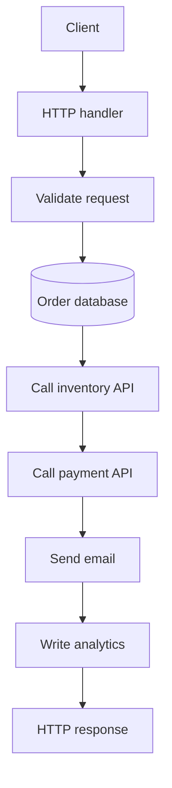
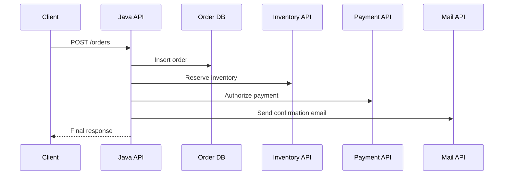
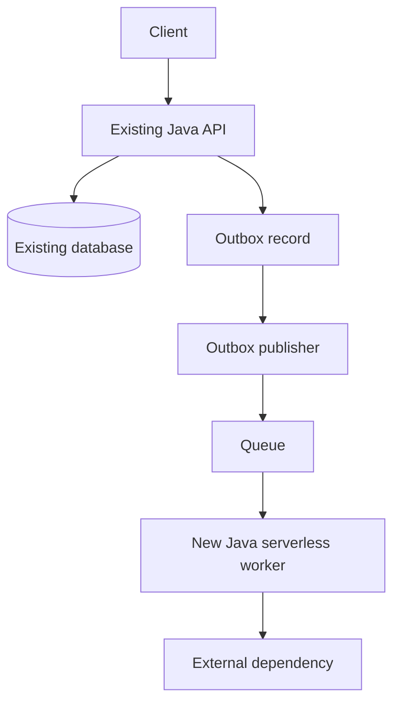
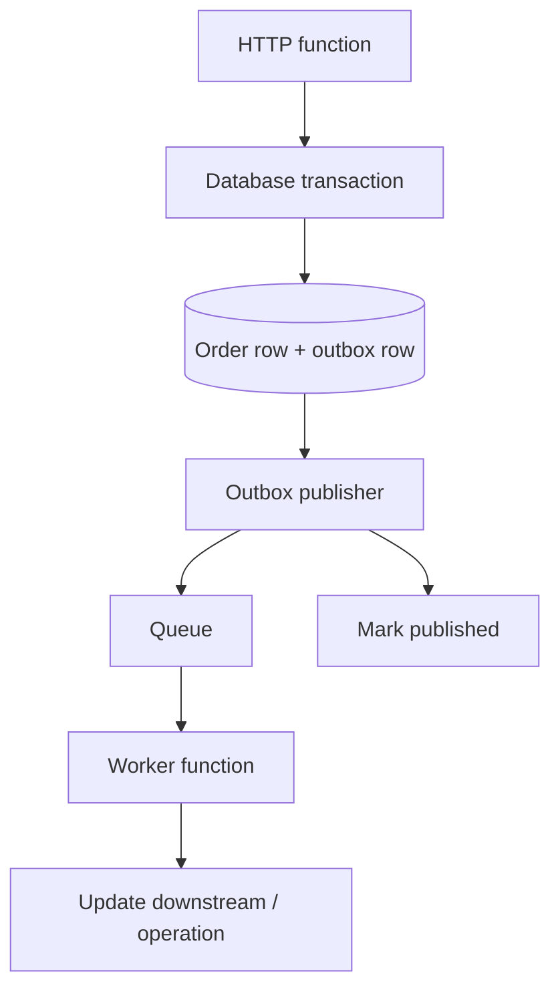
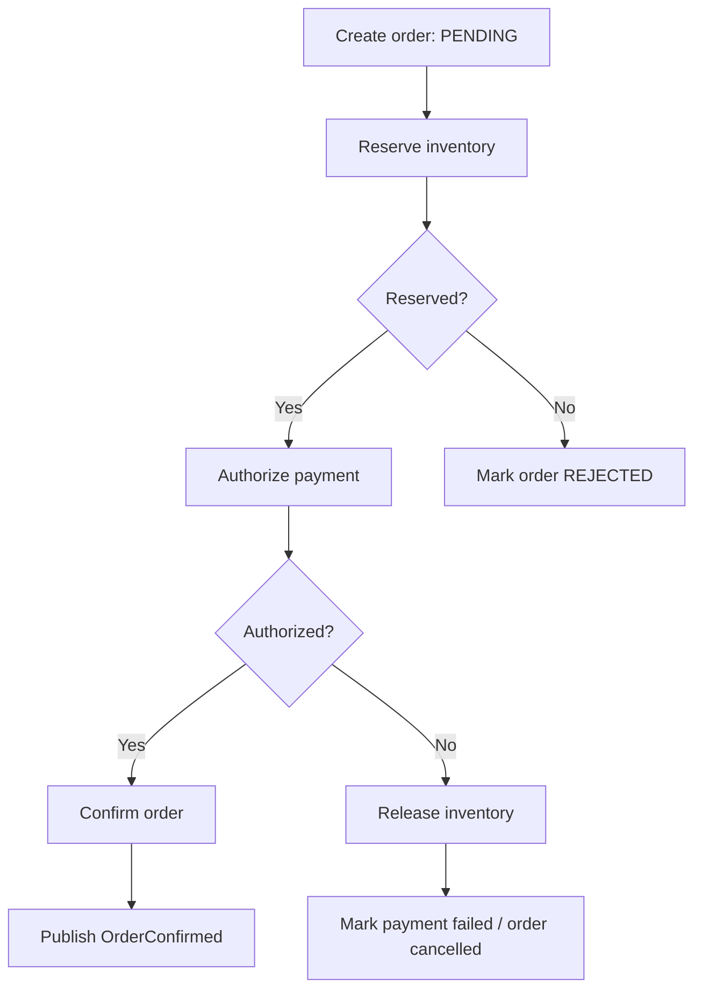

# Chuyển xử lý đồng bộ sang hàng đợi theo từng bước

Một ứng dụng Java hiện hữu thường xử lý toàn bộ nghiệp vụ trong một HTTP request: nhận yêu cầu, ghi database, gọi payment/inventory, gửi email và trả response. Cách làm này dễ hiểu khi hệ thống nhỏ, nhưng request ngày càng dài khi thêm dependency. Một API chậm có thể giữ thread và connection lâu, làm timeout lan truyền, đồng thời buộc người dùng chờ cả những công việc không cần hoàn tất trước khi trả lời.

Chuyển một phần xử lý sang queue giúp tách thời điểm tiếp nhận yêu cầu khỏi thời điểm hoàn tất công việc. HTTP function ghi nhận yêu cầu và phát một message bền vững; Java worker được trigger bởi queue xử lý sau đó, có thể retry độc lập và scale theo backlog. Tuy nhiên, thay đổi này cũng đưa vào eventual consistency, duplicate delivery, ordering, retry, DLQ và nhu cầu theo dõi trạng thái operation.

Chiến lược an toàn là chuyển từng ranh giới xử lý có thể tách độc lập, bắt đầu từ side effect không cần thiết phải hoàn tất trong HTTP response. Giữ transaction và quyết định nghiệp vụ quan trọng ở nơi có thể bảo đảm invariant; dùng outbox để không mất event sau commit; thiết kế consumer idempotent; sau đó mới mở rộng sang workflow dài hoặc saga.

## 1. Vì sao chuyển xử lý đồng bộ sang queue?

Giả sử API tạo đơn hàng thực hiện các bước sau:

1. Xác thực request và kiểm tra mặt hàng.
2. Ghi order vào database.
3. Gọi inventory service để giữ hàng.
4. Gọi payment provider để authorize.
5. Gửi email xác nhận.
6. Ghi analytics event.
7. Trả response cho client.

Nếu các bước đều chạy tuần tự, latency tổng gần bằng tổng thời gian của từng bước. Một email provider chậm có thể làm API timeout dù đơn hàng đã được ghi thành công. Nếu client retry vì không nhận được response, API có thể tạo order hoặc payment attempt trùng nếu không có idempotency.



Một số công việc không cần nằm trên đường phản hồi đồng bộ. Email, analytics, cập nhật search index hoặc tạo báo cáo thường có thể xử lý sau khi order được ghi nhận. Tách chúng ra queue giúp API trả lời sớm hơn và cô lập lỗi của các dependency phụ.

### Lợi ích và trade-off

| Lợi ích | Trade-off cần xử lý |
|---|---|
| HTTP response nhanh hơn | Client cần hiểu trạng thái `ACCEPTED/PROCESSING` |
| Worker scale độc lập theo backlog | Phải kiểm soát concurrency và queue age |
| Retry độc lập với request gốc | Có thể nhận duplicate message |
| Dependency chậm không giữ HTTP thread | Workflow hoàn tất muộn hơn và có thể thất bại sau khi đã trả 202 |
| Dễ cô lập từng bước | Thêm event contract, monitoring, DLQ và vận hành replay |
| Có thể scale từng consumer | Queue có thể che giấu backlog tăng liên tục nếu không có alert |

Queue không làm dependency nhanh hơn và cũng không loại bỏ failure. Nó thay đổi nơi lưu công việc đang chờ và cách hệ thống phản ứng khi một bước chưa thể hoàn tất.

### Đo baseline trước khi thay đổi

Trước migration, ghi lại hành vi hiện tại để phân biệt cải thiện thật với việc chỉ chuyển thời gian chờ từ HTTP request sang queue. Thu thập request rate/burst, concurrency, p50/p95/p99 latency của API và dependency, timeout/retry/error rate, database connections/lock wait, thời gian hoàn tất side effect và chi phí compute/network/database/observability. Ví dụ API latency giảm từ 4 giây xuống 100 ms nhưng queue age tăng lên 20 phút thì business completion có thể xấu đi.



Sơ đồ này giúp tìm dependency chậm và side effect có thể tách. Không chuyển validation, authorization hoặc invariant cần quyết định trước khi nhận lệnh sang worker chỉ để làm response ngắn hơn.

## 2. Chọn phần việc nào để chuyển sang queue

Không nên chuyển toàn bộ request vào queue chỉ vì muốn dùng serverless. Trước tiên hãy phân loại từng bước theo yêu cầu phản hồi và tính nhất quán.

| Loại công việc | Có thể chạy async? | Lý do/điều kiện |
|---|---|---|
| Validate cấu trúc và quyền truy cập request | Thường không | Cần trả lỗi trực tiếp và tránh đưa request không hợp lệ vào queue |
| Kiểm tra invariant trước khi ghi | Thường không | Quyết định nghiệp vụ cần xảy ra tại write boundary |
| Ghi nhận order/operation | Thường không | Cần commit bền vững trước khi xác nhận đã tiếp nhận |
| Gửi email/SMS | Thường có | Có thể hoàn tất sau, có retry và trạng thái gửi riêng |
| Cập nhật search index/read model | Thường có | Projection có thể eventual consistent |
| Analytics/telemetry nghiệp vụ | Thường có | Không nên làm chậm giao dịch chính |
| Payment authorization/capture | Tùy workflow | Có thể async nhưng cần operation state, idempotency và reconciliation |
| Giữ inventory | Tùy nghiệp vụ | Nếu phải bảo đảm có hàng trước khi xác nhận order, cần reservation protocol rõ ràng |
| Tính toán dài hoặc tạo báo cáo | Thường có | Phù hợp job bất đồng bộ và truy vấn trạng thái |

### Câu hỏi quyết định

- Người dùng có cần kết quả cuối cùng ngay trong response không?
- Có thể xác nhận “đã tiếp nhận” trước khi hoàn tất không?
- Bước này có thể retry mà không tạo side effect trùng không?
- Bước này có cần thứ tự so với bước khác không?
- Nếu bước thất bại, có thể retry, bù trừ hay cần người vận hành xử lý?
- Dữ liệu nào phải commit trước khi message được phát?
- Người dùng/đối tác sẽ xem trạng thái công việc ở đâu?

Nếu một thao tác cần phản hồi ngay và không thể chấp nhận trạng thái chưa xác định, giữ nó trong synchronous boundary hoặc thiết kế protocol nghiệp vụ rõ trước khi tách. Đừng trả `200 OK` chỉ vì message đã được đưa vào queue nếu business operation chưa hoàn tất; dùng semantics phù hợp như `202 Accepted`.

## 3. Chuyển từng bước theo Strangler pattern

Strangler pattern cho phép thay đổi một phần hệ thống mà không viết lại toàn bộ ứng dụng. Có thể bắt đầu bằng việc giữ API và database hiện tại, sau đó chuyển một side effect sang queue, rồi từng bước tách worker hoặc domain service.



Với AWS, một target cụ thể có thể là API Gateway → Java Lambda tiếp nhận → Order DB + outbox → relay → SQS → Java Lambda worker → email provider. Client nhận `operationId` để gọi status endpoint. Worker có thể scale độc lập theo backlog; queue và DLQ có IAM, encryption, retention và alarm riêng.

### Lộ trình chuyển đổi gợi ý

1. **Đo baseline:** xác định latency, timeout, lỗi và dependency nào chiếm nhiều thời gian.
2. **Chọn một side effect ít rủi ro:** ví dụ email hoặc cập nhật search index.
3. **Định nghĩa contract:** event ID, schema version, payload, retry và trạng thái.
4. **Ghi outbox cùng transaction:** không để order commit nhưng event biến mất.
5. **Triển khai consumer:** idempotent, timeout hữu hạn, retry và DLQ.
6. **Chạy shadow/limited rollout:** so sánh kết quả trước khi chuyển toàn bộ traffic.
7. **Chuyển ownership:** dừng side effect cũ sau khi worker mới được xác nhận hoạt động.
8. **Mở rộng sang bước tiếp theo:** chỉ khi quan sát và rollback path đã sẵn sàng.

Chuyển email hoặc analytics trước thường ít ảnh hưởng invariant chính. Sau khi quy trình outbox/consumer đã ổn định, có thể xem xét các bước nghiệp vụ dài hơn như inventory reservation hoặc payment orchestration.

### Giữ một owner cho side effect

Trong giai đoạn chuyển đổi, nguy cơ lớn là cả code đồng bộ cũ và worker mới cùng thực hiện side effect. Ví dụ API vẫn gửi email trực tiếp trong khi consumer cũng gửi email từ event. Cần một feature flag hoặc routing rule xác định rõ ai sở hữu side effect ở mỗi giai đoạn. Nếu chạy shadow mode, worker chỉ tính toán/ghi kết quả so sánh, không thực hiện side effect thật.

Feature flag cần có default an toàn, owner, metric theo nhánh và ngày loại bỏ. Nếu bật theo tỷ lệ hoặc tenant, hash theo business ID ổn định để cùng một order luôn đi theo một đường xử lý; tránh random theo từng retry vì cùng operation có thể chuyển qua lại giữa code cũ và worker mới. Thay đổi flag không được xóa hoặc làm mất backlog đã được enqueue.

## 4. Thiết kế API bất đồng bộ và operation resource

Khi HTTP handler chỉ tiếp nhận công việc, response nên nói rõ request đã được nhận và cung cấp một định danh để client theo dõi.

Ví dụ:

```http
POST /orders
Idempotency-Key: create-order-8a21
Content-Type: application/json

{
  "items": [
    { "sku": "BOOK-01", "quantity": 2 }
  ]
}
```

Response:

```http
HTTP/1.1 202 Accepted
Location: /operations/op-7392
Retry-After: 2
Content-Type: application/json

{
  "operationId": "op-7392",
  "status": "ACCEPTED",
  "statusUrl": "/operations/op-7392"
}
```

Client truy vấn operation resource:

```http
GET /operations/op-7392
```

```json
{
  "operationId": "op-7392",
  "status": "PROCESSING",
  "createdAt": "2026-11-17T09:30:00Z",
  "updatedAt": "2026-11-17T09:30:04Z"
}
```

Một operation có thể dùng các trạng thái:

| Trạng thái | Ý nghĩa |
|---|---|
| `ACCEPTED` | Request đã được validate và ghi nhận bền vững; chưa bắt đầu xử lý |
| `PROCESSING` | Worker đang thực hiện |
| `WAITING` | Đang chờ dependency hoặc bước tiếp theo |
| `SUCCEEDED` | Đạt điều kiện hoàn tất nghiệp vụ |
| `FAILED` | Thất bại cuối cùng theo policy |
| `CANCEL_REQUESTED` | Đã nhận yêu cầu hủy; chưa chắc đã dừng được ngay |
| `CANCELLED` | Đã hủy an toàn theo quy tắc nghiệp vụ |
| `MANUAL_REVIEW` | Không thể tự kết luận hoặc tự sửa; cần người xử lý |

Operation record có thể có thêm `businessId`, `progress` (chỉ khi đo được), `resultRef`, `errorCode` an toàn và `expiresAt` theo retention. Không lưu stack trace hoặc secret trong response. State transition phải có version/conditional update để message cũ không đưa operation terminal quay lại `PROCESSING`.

Không đánh dấu `SUCCEEDED` chỉ vì queue publish thành công. Queue publish xác nhận công việc đã được tiếp nhận; operation chỉ thành công khi các điều kiện nghiệp vụ đã được đáp ứng.

### API status cần có semantics rõ

- `202 Accepted`: đã nhận xử lý, kết quả cuối chưa sẵn sàng.
- `200 OK`/`201 Created`: chỉ dùng nếu contract nói rõ phần nghiệp vụ đã hoàn tất hoặc resource đã được tạo.
- `409 Conflict`: idempotency key được dùng lại với request khác hoặc state transition không hợp lệ.
- `404 Not Found`: operation không tồn tại hoặc caller không được phép biết resource đó tồn tại.
- `410 Gone`: operation resource đã hết retention nếu API dùng semantics này.

Status endpoint cần authorization theo owner/tenant. Không để người dùng đoán operation ID và đọc trạng thái của người khác.

## 5. Định nghĩa message contract

Queue chỉ vận chuyển dữ liệu; contract mới quyết định consumer hiểu dữ liệu thế nào. Một message nên có envelope ổn định và payload tối thiểu cần thiết.

| Trường | Mục đích |
|---|---|
| `eventId` | Dedupe và audit delivery |
| `eventType` | Xác định loại sự kiện |
| `schemaVersion` | Giải mã payload theo version |
| `operationId` | Liên kết với operation mà client theo dõi |
| `aggregateId` | Entity nghiệp vụ liên quan |
| `aggregateVersion` | Phát hiện event cũ/sai thứ tự |
| `occurredAt` | Thời điểm nghiệp vụ xảy ra |
| `expiresAt` | Hạn xử lý nghiệp vụ nếu command/event không còn giá trị sau một thời điểm; chỉ dùng khi domain có deadline |
| `correlationId` | Liên kết các bước của workflow |
| `causationId` | Nguyên nhân trực tiếp tạo event |
| `payload` | Dữ liệu cần cho consumer |

Ví dụ:

```json
{
  "eventId": "evt-01J9A6M3",
  "eventType": "OrderAccepted",
  "schemaVersion": 1,
  "operationId": "op-7392",
  "aggregateId": "order-481",
  "aggregateVersion": 1,
  "occurredAt": "2026-11-17T09:30:00Z",
  "correlationId": "req-8a21",
  "causationId": "cmd-create-order-8a21",
  "payload": {
    "orderId": "order-481",
    "customerRef": "customer-93",
    "items": [
      { "sku": "BOOK-01", "quantity": 2 }
    ]
  }
}
```

Giá trị trên là dữ liệu giả. Không đưa access token, password, card data hoặc payload cá nhân không cần thiết vào message. Queue, archive và DLQ có thể giữ dữ liệu lâu hơn HTTP request ban đầu; áp dụng encryption, access control và retention phù hợp.

### Event và command không giống nhau

- `OrderAccepted` là event thông báo order đã được chấp nhận.
- `ReserveInventory` là command yêu cầu inventory service thực hiện reservation.
- `InventoryReserved` là event xác nhận reservation đã hoàn tất.

Đặt tên đúng giúp consumer không hiểu nhầm rằng một yêu cầu đã thành công chỉ vì command được gửi đi. Command có thể bị từ chối; event thường mô tả sự kiện đã xảy ra.

### Chọn queue, event bus hay workflow engine

| Nhu cầu | Lựa chọn thường phù hợp | Đặc điểm |
|---|---|---|
| Một nhóm worker xử lý command/backlog | Queue như Amazon SQS | Consumer cạnh tranh nhận message; có visibility timeout và DLQ |
| Nhiều consumer độc lập phản ứng cùng domain event | Event bus như EventBridge hoặc topic/fan-out như SNS | Một event được định tuyến tới nhiều target/queue riêng |
| Ordering trong một nhóm message | SQS FIFO hoặc stream partition | Ordering trong phạm vi message group/partition, không phải toàn hệ thống |
| Event liên tục, replay theo offset/checkpoint | Kinesis hoặc Kafka | Shard/partition, consumer offset và retention của stream |
| Workflow nhiều bước có state, timeout và nhánh | Workflow engine như Step Functions | Orchestration, retry/catch và execution state |

Không dùng một queue cạnh tranh chung nếu nhiều consumer đều phải nhận cùng một event; consumer này có thể lấy mất message của consumer khác. Dùng fan-out để mỗi consumer group có queue, retry, DLQ và tốc độ riêng.

## 6. Transactional outbox: bảo đảm không mất message sau database commit

Không nên thực hiện hai thao tác độc lập sau trong HTTP handler:

1. Ghi order vào database.
2. Gửi message vào queue.

Nếu database commit thành công nhưng function timeout trước khi publish, order tồn tại nhưng worker không biết. Nếu publish trước rồi database rollback, worker có thể xử lý order chưa được commit.

Transactional outbox ghi business row và outbox row trong cùng transaction. Publisher riêng đọc outbox đã commit và gửi message.



Publisher có thể gửi trùng nếu publish thành công nhưng crash trước khi cập nhật `published_at`. Vì vậy consumer vẫn cần idempotency. Outbox giải quyết tính bền vững của việc phát event, không cung cấp exactly-once end-to-end.

### Ví dụ bảng outbox

```sql
CREATE TABLE outbox_event (
    event_id          VARCHAR(128) PRIMARY KEY,
    aggregate_id      VARCHAR(128) NOT NULL,
    aggregate_version BIGINT NOT NULL,
    event_type        VARCHAR(120) NOT NULL,
    schema_version    INTEGER NOT NULL,
    payload           JSON NOT NULL,
    created_at        TIMESTAMP NOT NULL,
    published_at      TIMESTAMP NULL,
    attempts          INTEGER NOT NULL DEFAULT 0
);

CREATE INDEX idx_outbox_pending
    ON outbox_event (created_at)
    WHERE published_at IS NULL;
```

Cú pháp JSON và partial index tùy database; PostgreSQL thường dùng `JSONB`. Với nhiều publisher, cần atomic claim/lease hoặc `FOR UPDATE SKIP LOCKED` để tránh cùng xử lý một row. Không giữ transaction database mở trong lúc gọi queue qua mạng.

### Ghi order và outbox trong cùng transaction Java

```java
public Order acceptOrder(CreateOrderCommand command) {
    return transactionTemplate.execute(status -> {
        Order order = orderRepository.insert(command);

        OrderAccepted event = new OrderAccepted(
                eventIdGenerator.next(),
                order.id(),
                order.version(),
                command.operationId(),
                order.customerRef(),
                order.items());

        outboxRepository.insert(event);
        operationRepository.markAccepted(command.operationId(), order.id());
        return order;
    });
}
```

Các repository phải dùng cùng transaction manager/connection. Publisher chỉ đọc row đã commit; không gọi queue trong transaction nghiệp vụ. Nếu `transactionTemplate.execute` trả null khi rollback hoặc exception, HTTP handler không được trả `202`.

## 7. Publisher outbox và checkpoint

Publisher có thể chạy theo scheduler, poller hoặc CDC. Với polling:

1. Claim một batch row chưa publish bằng lease/lock có thời hạn.
2. Gửi message tới broker.
3. Khi broker xác nhận, đánh dấu row đã publish và lưu timestamp/message reference.
4. Nếu publish lỗi, tăng attempt và lên lịch retry với backoff.
5. Nếu publisher crash sau bước 2, row có thể được gửi lại; consumer dedupe bằng event ID.

Không đánh dấu outbox published trước khi broker xác nhận. Nếu làm vậy, crash giữa hai bước có thể làm mất event. Ngược lại, gửi trước rồi crash có thể tạo duplicate, vì vậy consumer phải idempotent.

### Thứ tự publish

`ORDER BY created_at` không đủ bảo đảm thứ tự nghiệp vụ khi nhiều publisher chạy song song. Nếu cần ordering theo order/aggregate:

- Ghi `aggregateVersion` cùng transaction.
- Partition publisher theo `aggregateId` hoặc key ổn định.
- Dùng broker ordering/message group phù hợp nếu có.
- Để consumer kiểm tra version và phát hiện gap.

Ordering thường chỉ được bảo đảm trong một partition/message group, không phải toàn queue. Retry cũng có thể khiến event cũ đến sau event mới.

## 8. Java queue consumer: idempotency và trạng thái operation

Queue thường cung cấp delivery at-least-once. Một message có thể được giao lại nếu consumer xử lý xong nhưng acknowledgement bị mất, function timeout hoặc visibility timeout hết trước khi xử lý hoàn tất.

Consumer cần ghi nhận event ID đã xử lý bằng unique constraint. Việc ghi inbox và cập nhật dữ liệu trong cùng transaction giúp tránh trạng thái “đánh dấu đã xử lý nhưng business update chưa commit”.

```sql
CREATE TABLE consumer_inbox (
    consumer_name VARCHAR(120) NOT NULL,
    event_id       VARCHAR(128) NOT NULL,
    processed_at   TIMESTAMP NOT NULL,
    PRIMARY KEY (consumer_name, event_id)
);
```

Với PostgreSQL, thao tác claim có thể dùng atomic insert:

```sql
INSERT INTO consumer_inbox (consumer_name, event_id, processed_at)
VALUES (:consumer_name, :event_id, CURRENT_TIMESTAMP)
ON CONFLICT (consumer_name, event_id) DO NOTHING;
```

Chỉ xử lý business update khi insert tạo được một row. Insert inbox và cập nhật domain state phải cùng transaction; nếu domain update rollback thì inbox marker cũng rollback để broker có thể retry.

Java skeleton:

```java
public void handle(OrderAccepted event) {
    transactionTemplate.executeWithoutResult(status -> {
        boolean firstDelivery = inboxRepository.insertIfAbsent(
                "inventory-reservation", event.eventId());

        if (!firstDelivery) {
            return; // Duplicate delivery: no repeated side effect.
        }

        operationRepository.markProcessing(event.operationId());
        inventoryRepository.reserve(event.orderId(), event.items());
        outboxRepository.insert(InventoryReserved.from(event));
    });
}
```

`insertIfAbsent` phải dùng unique constraint/atomic insert, không dùng `SELECT` rồi `INSERT` riêng mà không xử lý race. Ví dụ giả định reservation và outbox cùng database transaction. Nếu inventory là external API, cần idempotency key phía API hoặc workflow trạng thái riêng; không thể gộp HTTP call ngoài database transaction một cách nguyên tử.

### Không đánh dấu operation thành công quá sớm

Một operation có thể đi qua nhiều bước. Chỉ cập nhật `SUCCEEDED` khi các điều kiện nghiệp vụ cuối cùng đã được thỏa mãn. Nếu inventory thành công nhưng payment đang chờ, operation có thể ở `WAITING_PAYMENT`; nếu payment timeout không rõ kết quả, dùng `PAYMENT_UNKNOWN` và reconciliation thay vì giả định thất bại rồi gửi capture mới.

## 9. Saga cho workflow nhiều bước

Khi chuyển nhiều bước đồng bộ thành các worker bất đồng bộ, không còn một transaction ACID bao trùm toàn workflow. Saga chia workflow thành các local transaction và định nghĩa compensation khi một bước sau thất bại.

Ví dụ đặt hàng:

1. Tạo order ở trạng thái `PENDING`.
2. Reserve inventory.
3. Authorize payment.
4. Confirm order.
5. Gửi notification.

Nếu payment thất bại sau khi inventory đã reserve, saga có thể phát command release reservation. Nếu bước confirm lỗi sau khi payment authorize, có thể void authorization tùy contract của provider.



Compensation không phải rollback vật lý hoàn hảo. Nếu email đã gửi, không thể thu hồi email; có thể gửi thông báo sửa. Nếu payment đã capture, cần refund chứ không xóa giao dịch. Mỗi bước và compensation đều cần idempotency, trạng thái và audit.

### Orchestration và choreography

| Cách tổ chức | Đặc điểm | Phù hợp khi |
|---|---|---|
| Orchestration | Một workflow/state machine điều phối các bước và timeout | Quy trình dài, nhiều nhánh, cần nhìn trạng thái tổng thể |
| Choreography | Service phát/nhận event và tự phản ứng | Luồng ít bước, ranh giới service rõ, coupling thấp |

Choreography có thể khó quan sát khi nhiều consumer phát event lẫn nhau. Orchestration dễ nhìn thứ tự nhưng tạo một workflow owner cần quản lý. Có thể kết hợp: workflow điều phối các bước lớn, event-driven consumer xử lý nội bộ từng bước.

## 10. Retry, backoff và dead-letter queue

Queue consumer cần phân loại lỗi:

| Lỗi | Hành vi gợi ý |
|---|---|
| Network timeout/connection reset | Retry có giới hạn, exponential backoff và jitter |
| HTTP 429 | Tôn trọng `Retry-After`, giảm concurrency/rate |
| HTTP 5xx | Retry nếu operation idempotent và còn retry budget |
| Validation/schema error | Không retry vô hạn; quarantine/DLQ và cảnh báo |
| 401/403 | Không retry liên tục; xử lý credential/permission |
| Business rejection | Ghi trạng thái nghiệp vụ cuối hoặc compensation; không coi là lỗi hạ tầng |
| Version gap | Buffer, replay event thiếu hoặc refresh snapshot |

Retry ở nhiều tầng có thể nhân số lần gọi. Nếu SDK retry 3 lần, application retry 3 lần và queue redelivery 5 lần, một message có thể tạo rất nhiều request. Xác định tầng sở hữu retry, tổng attempt budget và deadline nghiệp vụ.

### DLQ không phải nơi kết thúc trách nhiệm

Message chuyển vào DLQ cần có owner, alarm, retention, reason code và quy trình điều tra. Khi redrive:

- Giữ event ID gốc để consumer nhận diện duplicate.
- Sửa nguyên nhân trước khi gửi lại.
- Giới hạn tốc độ redrive để không làm downstream quá tải.
- Theo dõi số message replay, success, duplicate và failure.
- Không redrive message có side effect đã hoàn tất mà chưa xác minh trạng thái.

### Partial batch failure

Nếu một invocation xử lý nhiều message, cần hiểu semantics batch của trigger. Một số dịch vụ hỗ trợ trả về danh sách item lỗi để chỉ retry record thất bại; nếu không, toàn batch có thể được giao lại. Consumer vẫn phải idempotent vì record thành công có thể xuất hiện lại cùng record lỗi.

### AWS Lambda với SQS: partial batch response

Khi Lambda nhận batch từ SQS, có thể bật `ReportBatchItemFailures` trên event source mapping để handler chỉ ra record cần retry. Ví dụ dùng thư viện `aws-lambda-java-events`:

```xml
<dependency>
    <groupId>com.amazonaws</groupId>
    <artifactId>aws-lambda-java-events</artifactId>
    <version>${aws.lambda.java.events.version}</version>
</dependency>
```

Pin version tương thích với AWS Lambda Java runtime và các dependency của ứng dụng.

```java
import com.amazonaws.services.lambda.runtime.Context;
import com.amazonaws.services.lambda.runtime.RequestHandler;
import com.amazonaws.services.lambda.runtime.events.SQSEvent;
import com.amazonaws.services.lambda.runtime.events.SQSBatchResponse;

import java.util.ArrayList;
import java.util.List;

public final class OrderSqsHandler
        implements RequestHandler<SQSEvent, SQSBatchResponse> {

    @Override
    public SQSBatchResponse handleRequest(SQSEvent event, Context context) {
        List<SQSBatchResponse.BatchItemFailure> failures = new ArrayList<>();

        for (SQSEvent.SQSMessage message : event.getRecords()) {
            try {
                processIdempotently(message.getBody());
            } catch (PermanentMessageException error) {
                // Chỉ acknowledge sau khi đã lưu quarantine/audit bền vững.
                try {
                    quarantine(message.getMessageId(), error);
                } catch (RuntimeException persistenceFailure) {
                    failures.add(new SQSBatchResponse.BatchItemFailure(
                            message.getMessageId()));
                }
            } catch (Exception retryable) {
                failures.add(new SQSBatchResponse.BatchItemFailure(
                        message.getMessageId()));
            }
        }

        return new SQSBatchResponse(failures);
    }

    private void processIdempotently(String body) {
        // Deserialize, validate and commit inbox + business update atomically.
    }

    private void quarantine(String messageId, Exception error) {
        // Persist reason and safe diagnostic metadata; never store secrets.
    }
}
```

Event source mapping phải bật `ReportBatchItemFailures`. `messageId` ở response chỉ xác định record cần retry; idempotency nghiệp vụ vẫn dựa trên `eventId` ổn định trong payload. Nếu function timeout trước khi trả batch response, platform không nhận được danh sách lỗi và có thể giao lại toàn batch, vì vậy record đã commit phải idempotent.

### Visibility timeout và redrive policy trên SQS

Với Lambda + SQS, visibility timeout phải đủ dài cho function xử lý batch và khoảng dự phòng. AWS khuyến nghị đặt queue visibility timeout ít nhất sáu lần Lambda function timeout, cộng maximum batching window nếu có. `maxReceiveCount` trong redrive policy quy định số lần nhận trước khi chuyển message sang DLQ. Cần kiểm tra lại khuyến nghị theo cấu hình event source mapping và tài liệu AWS đang áp dụng cho workload.

## 11. Ordering, concurrency và backpressure

Queue giúp tách producer/consumer nhưng không tự điều tiết đúng tốc độ. Nếu producer tạo 500 message/giây và worker chỉ xử lý 100 message/giây, backlog tăng 400 message/giây. Sau một giờ, queue có thể có lượng công việc lớn dù API vẫn trả response thành công.

### Chọn ordering scope

- Nếu mọi event phải theo thứ tự toàn cục, queue/stream và throughput có thể bị giới hạn mạnh.
- Nếu chỉ cần thứ tự theo order ID, partition/message group theo aggregate ID thường phù hợp hơn.
- Nếu event là snapshot có version, consumer có thể bỏ qua event cũ và áp dụng version mới hơn.
- Nếu event là delta, cần phát hiện sequence gap và replay.

Không dựa vào timestamp client để xác định thứ tự; đồng hồ có thể lệch. Dùng aggregate version hoặc sequence do source of truth cấp.

### Giới hạn concurrency theo downstream

Worker scale nhanh có thể mở quá nhiều kết nối tới database hoặc API đối tác. Hãy tính:

\[
DownstreamConcurrency \approx WorkerConcurrency \times CallsPerInvocation
\]

Nếu mỗi invocation gọi tối đa 3 request song song và worker concurrency là 100, dependency có thể nhận tới 300 request đồng thời. Giới hạn worker concurrency, batch size, connection pool và rate limit theo budget của downstream.

### Backpressure

Các cơ chế phổ biến:

- Giới hạn max concurrency/instance của worker.
- Điều chỉnh batch size và dispatch rate.
- Dùng queue làm buffer nhưng theo dõi age/backlog.
- Đặt timeout và connection pool bounded.
- Dùng circuit breaker/rate limiter cho API ngoài.
- Tạm dừng consumer khi dependency đang lỗi, nếu trigger hỗ trợ.
- Tách queue theo loại workload để job không quan trọng không chặn giao dịch chính.

Với Lambda + SQS, Reserved Concurrency giới hạn tổng invocation của function; `MaximumConcurrency` trên event source mapping có thể giới hạn concurrency riêng cho mapping; batch size quyết định số record trong một invocation. Theo dõi thêm `ApproximateAgeOfOldestMessage`, queue depth, Lambda concurrent executions/throttles, batch failure và downstream connection/transaction rate. Nếu backlog tăng liên tục, tăng concurrency chỉ hợp lý khi database/provider còn capacity.

Backpressure phải đi cùng alert. Giới hạn concurrency quá thấp có thể khiến queue age vượt SLA dù dependency vẫn còn capacity.

## 12. Eventual consistency và trải nghiệm người dùng

Sau khi tách xử lý, dữ liệu ở order database, inventory, payment và read model có thể cập nhật ở các thời điểm khác nhau. UI cần biểu diễn trạng thái trung gian và không suy luận thành công từ việc request đã được nhận.

Một flow có thể là:

- `ACCEPTED`: order và operation đã được commit, outbox đã ghi.
- `RESERVING_INVENTORY`: worker đang giữ hàng.
- `PAYMENT_PENDING`: đang chờ payment provider.
- `CONFIRMED`: các điều kiện xác nhận order đã hoàn tất.
- `FAILED` hoặc `MANUAL_REVIEW`: workflow không thể tiếp tục tự động.

Client có thể poll status endpoint với backoff, nhận webhook/callback hoặc dùng notification channel. Status API cần có `updatedAt`, error code có thể hiển thị an toàn và retry guidance. Không trả stack trace hoặc thông tin dependency nội bộ.

### Read-your-writes

Nếu client vừa tạo order rồi truy vấn ngay, read model có thể chưa cập nhật. Có thể trả snapshot từ command response, route truy vấn ngắn hạn tới source of truth hoặc trả consistency token/version để query service đợi projection đạt version đó. Không giả định mọi replica sẽ cập nhật đồng thời.

## 13. Bảo vệ API khi client retry

Khi HTTP response bị mất, client không biết server đã tiếp nhận request hay chưa. Idempotency key giúp cùng một logical request được xử lý như một operation duy nhất.

Một idempotency record nên lưu:

- Key và caller/tenant scope.
- Hash của request canonicalized.
- Operation ID và trạng thái.
- Response/reference để trả lại cho lần gọi lặp.
- Created/expiry timestamp.

Nếu cùng key nhưng payload khác, trả conflict thay vì âm thầm trả kết quả của request trước. TTL phải đủ dài cho client retry và workflow duration; với side effect tài chính, cần retention theo yêu cầu nghiệp vụ/audit.

Idempotency ở HTTP boundary không thay thế inbox ở consumer. Một request có thể tạo một event, nhưng event vẫn có thể được giao nhiều lần.

## 14. Bảo mật khi chuyển sang queue

Queue mở thêm một ranh giới lưu trữ và truy cập. Khi chuyển payload từ HTTP sang message, hãy kiểm tra:

- Producer chỉ có quyền gửi tới queue/topic cần thiết.
- Consumer chỉ có quyền đọc/ack và truy cập dependency cần thiết.
- Queue/topic được mã hóa và policy giới hạn principal; với SQS có thể dùng SSE-SQS hoặc KMS theo yêu cầu.
- TLS được dùng khi producer/consumer giao tiếp với broker.
- DLQ/archive có cùng hoặc chặt hơn access control và retention.
- Payload không chứa credential hoặc dữ liệu không cần thiết.
- Message authenticity được bảo vệ qua IAM/resource policy hoặc chữ ký phù hợp.
- Secret reference được truyền an toàn; không gửi secret value trong event.
- Trace/correlation metadata không chứa PII/secret.
- Replay/redrive có audit và permission riêng.

Không coi queue là vùng nội bộ đáng tin chỉ vì nó nằm trong cùng cloud account. Producer, consumer, operator và automation có quyền khác nhau.

## 15. Observability cho workflow bất đồng bộ

HTTP request kết thúc sớm, nên trace của request không tự kéo dài tới lúc queue worker hoàn tất. Truyền `correlationId`, `operationId`, `eventId` và W3C trace context qua message attributes để nối producer/consumer. Với workflow dài, có thể tạo trace mới ở consumer và liên kết bằng span link thay vì giữ một trace kéo dài nhiều giờ.

Các metric quan trọng:

| Metric | Ý nghĩa |
|---|---|
| Queue depth/backlog | Số message đang chờ |
| Age of oldest message | Công việc cũ nhất đã chờ bao lâu |
| Publish success/failure | Producer có phát message được không |
| Consumer success/failure | Tỷ lệ xử lý thành công |
| Processing duration | Thời gian worker xử lý |
| Retry count | Số lần giao lại/thử lại |
| DLQ depth | Số message cần điều tra |
| Operation completion time | Từ tiếp nhận tới kết quả cuối |
| Operation terminal failure rate | Tỷ lệ workflow thất bại cuối cùng |
| Cost per successful operation | Chi phí compute, queue, network, database và observability trên mỗi nghiệp vụ hoàn tất |

Không chỉ theo dõi function invocation errors. Một queue có thể nhận message thành công nhưng consumer không tiến triển. Alert theo queue age, backlog growth, DLQ và operation SLA.

## 16. Triển khai migration theo giai đoạn

Một quy trình rollout có thể chia thành các giai đoạn:

### Giai đoạn 1: Chuẩn bị

- Chọn một bước xử lý có thể tách và xác định owner.
- Định nghĩa event contract, schema version và idempotency key.
- Xác định operation status và client contract.
- Thiết kế outbox, consumer, retry, DLQ và backpressure.
- Ghi baseline latency, error rate và dependency load.

### Giai đoạn 2: Xây consumer và đường quan sát

- Triển khai queue, DLQ và worker trong môi trường test.
- Kiểm thử duplicate, out-of-order, timeout và partial failure.
- Thêm metric queue age, operation completion và retry.
- Kiểm tra IAM, encryption và retention.

### Giai đoạn 3: Bật outbox/publisher

- Ghi outbox cùng transaction với business data.
- Chạy publisher ở chế độ giới hạn.
- Xác minh message được phát đủ, không có outbox row bị bỏ qua.
- So sánh event với trạng thái nguồn.

### Giai đoạn 4: Shadow hoặc canary

- Shadow consumer chỉ tính kết quả/ghi bảng so sánh, không thực hiện side effect thật.
- So sánh output với logic đồng bộ cũ.
- Bật một tỷ lệ nhỏ workload hoặc một nhóm tenant có kiểm soát.
- Theo dõi queue age, duplicate, error, downstream load và operation SLA.

### Giai đoạn 5: Chuyển ownership

- Chuyển một nhóm side effect sang worker mới.
- Tắt side effect đồng bộ cũ cho cùng nhóm.
- Giữ rollback path và khả năng pause consumer.
- Xác minh không có hai producer/consumer cùng sở hữu một hành động.

### Giai đoạn 6: Mở rộng và dọn dẹp

- Tăng traffic theo từng nấc.
- Xử lý backlog cũ và DLQ.
- Bỏ code cũ khi đã xác minh không còn caller.
- Cập nhật runbook, dependency map, SLO và catalog.

| Mốc | Exit criteria |
|---|---|
| Baseline | Có số liệu latency, lỗi, side effect, dependency và cost cùng owner |
| Contract | Event schema, event ID và operation status được review/version |
| Queue foundation | Queue, DLQ, IAM, encryption, alarms và runbook đã kiểm thử trong sandbox |
| Consumer shadow/test | Duplicate, retry, DLQ và failure handling đạt yêu cầu |
| Outbox | Inject lỗi không làm mất event sau business commit |
| Limited rollout | Correctness, queue age, error rate và downstream load nằm trong ngưỡng |
| Expand | SLO và cost per successful operation đạt mục tiêu |
| Remove legacy | Backlog đã drain, rollback window kết thúc và không còn caller cũ |

Không xóa đường đồng bộ cũ trước khi biết cách khôi phục. Rollback có thể cần chuyển producer về synchronous path, nhưng phải tránh xử lý lại operation đã được worker hoàn tất.

## 17. Dual-run, shadow traffic và tránh side effect trùng

Dual-run có thể giúp so sánh logic cũ và mới, nhưng chạy cả hai đường có thể gây double charge, double email hoặc double inventory reservation.

Phân biệt:

- **Shadow computation:** chạy logic mới để so sánh kết quả, nhưng không ghi side effect thật.
- **Canary execution:** chỉ một nhóm request/tenant thực sự đi qua worker mới.
- **Dual write:** hai hệ thống cùng ghi; chỉ dùng khi có thiết kế consistency, dedupe và cutover rõ.
- **Backfill/replay:** chạy lại dữ liệu lịch sử; cần checkpoint và idempotency.

Đối với side effect bên ngoài, không gọi cả implementation cũ và mới trong shadow mode. Dùng mock, sandbox hoặc output comparison không gây thay đổi nghiệp vụ.

## 18. Kiểm thử migration và failure scenarios

Các test cần có:

1. Database commit thành công nhưng publisher chưa chạy; event vẫn được publish sau đó.
2. Publisher gửi thành công rồi crash trước khi đánh dấu published; consumer không lặp side effect.
3. Consumer commit business update nhưng acknowledgement bị mất; redelivery an toàn.
4. Message sai schema; vào quarantine/DLQ và có cảnh báo.
5. Downstream trả 429/5xx hoặc timeout; retry có giới hạn và backoff.
6. Worker concurrency tăng; database/API không vượt connection/rate budget.
7. Message đến sai thứ tự; version guard không cho state lùi.
8. Queue backlog tăng; worker drain được trong SLA.
9. Operation timeout nhưng external side effect đã thành công; reconciliation tìm đúng kết quả.
10. Rollback về đường cũ; operation đã hoàn tất không bị xử lý lại.
11. DLQ redrive; event ID và idempotency vẫn được giữ.
12. Client gửi lại cùng idempotency key; nhận cùng operation/result.
13. Worker timeout trước khi trả partial batch response; record đã commit không tạo side effect trùng.
14. Message vượt quá business `expiresAt`; worker từ chối thực hiện side effect đã hết hạn theo policy.
15. Hai invocation cùng claim một event ID; chỉ một transaction được áp dụng business update.
16. Feature flag chuyển trong lúc queue còn backlog; message đã nhận vẫn được consumer tương thích xử lý.

### Tiêu chí pass

- Không mất business event sau khi transaction commit.
- Duplicate delivery không tạo side effect nghiệp vụ trùng.
- Operation status phản ánh đúng trạng thái workflow.
- Queue age và backlog nằm trong giới hạn SLA khi tải mục tiêu.
- Dependency không bị quá tải do worker scale-out/retry.
- Có thể pause, replay và rollback theo runbook.
- Log/trace/metric nối được request, operation và consumer.

## 19. Các lỗi thường gặp

| Lỗi | Hệ quả | Cách khắc phục |
|---|---|---|
| Chuyển toàn bộ flow sang queue ngay lập tức | Khó tìm lỗi và rollback | Tách một bước, đo và mở rộng dần |
| Trả 200 khi chỉ mới enqueue | Client hiểu nhầm nghiệp vụ đã hoàn tất | Dùng 202 và operation status |
| Ghi DB rồi publish trực tiếp không outbox | Có thể mất event giữa hai thao tác | Transactional outbox/CDC có bảo đảm |
| Consumer không idempotent | Duplicate message gây side effect trùng | Inbox/unique constraint và idempotency key |
| Cả code cũ và worker cùng side effect | Double email/payment/reservation | Một owner cho side effect; shadow không ghi thật |
| Retry vô hạn | Poison message và backlog kéo dài | Retry budget, DLQ và manual repair |
| Không giới hạn worker concurrency | Downstream bị quá tải | Concurrency cap, batch, pool và rate limit |
| Không theo dõi queue age | Backlog tăng nhưng API vẫn xanh | Alert oldest-message age và operation SLA |
| Dùng một queue cạnh tranh cho nhiều consumer đều cần cùng event | Một consumer lấy mất message của consumer khác | Fan-out qua event bus/topic tới queue riêng |
| Coi FIFO là exactly-once end-to-end | Consumer vẫn có thể redeliver hoặc lặp side effect | Idempotency tại business boundary |
| Dùng timestamp để ordering | Clock skew làm event cũ ghi đè | Aggregate version/sequence |
| DLQ không có owner | Message lỗi bị bỏ quên | Alarm, runbook, retention và redrive process |
| Không xử lý eventual consistency ở UI | Người dùng thấy trạng thái “lùi” hoặc khó hiểu | Operation resource, version và freshness semantics |
| Rollback không xét operation đã chạy | Side effect bị thực hiện lần hai | Idempotency và migration/cutover ledger |
| Xóa queue khi rollback | Mất công việc đã được chấp nhận | Giữ queue/consumer để drain backlog có kiểm soát |

## 20. Quy trình chuyển một xử lý đồng bộ sang queue

1. **Đo và chọn boundary.** Xác định bước chậm/độc lập, invariant và lý do cần giữ đồng bộ.
2. **Định nghĩa operation contract.** Quy định response 202, operation ID, status, cancellation và retention.
3. **Định nghĩa message contract.** Event ID, schema version, aggregate version, correlation và payload tối thiểu.
4. **Thiết kế outbox.** Commit business state và event record trong cùng transaction.
5. **Triển khai publisher.** Claim/retry/checkpoint và ordering theo aggregate nếu cần.
6. **Triển khai consumer.** Inbox/idempotency, state transition, timeout và side effect an toàn.
7. **Thiết kế workflow.** Dùng saga/compensation khi nhiều local transaction phải phối hợp.
8. **Thiết lập retry/DLQ/backpressure.** Có budget, concurrency cap, queue age alert và redrive owner.
9. **Bảo vệ và quan sát.** IAM, encryption, retention, trace context và operation metrics.
10. **Test failure.** Duplicate, lost acknowledgement, timeout, ordering, poison event và downstream outage.
11. **Canary/rollout.** Shadow computation trước, sau đó chuyển một nhóm traffic và một side effect.
12. **Đo và mở rộng.** So sánh latency, completion time, error, backlog và dependency load; cập nhật runbook/catalog.

## 21. Checklist trước production

- [ ] Chỉ tách những bước có semantics bất đồng bộ rõ ràng.
- [ ] Invariant cần bảo đảm đồng bộ vẫn được enforce ở write boundary.
- [ ] HTTP API phân biệt accepted và completed; có operation status resource.
- [ ] Client retry được bảo vệ bằng idempotency key.
- [ ] Business row và outbox event commit trong cùng transaction.
- [ ] Publisher có claim/lease, retry và không đánh dấu published trước broker ack.
- [ ] Event có ID, schema version, aggregate version và correlation metadata.
- [ ] Consumer có inbox/idempotency và xử lý duplicate an toàn.
- [ ] Ordering scope và version-gap behavior được xác định.
- [ ] Workflow nhiều bước có state machine và compensation khi cần.
- [ ] Retry có backoff/jitter, deadline và retry budget.
- [ ] DLQ có alarm, owner, retention và redrive runbook.
- [ ] Worker concurrency/batch size phù hợp downstream budget.
- [ ] Queue age, backlog, operation completion và failure được theo dõi.
- [ ] Shadow mode không thực hiện side effect thật.
- [ ] Canary, pause, rollback và replay đã được kiểm thử.
- [ ] Payload/queue/DLQ được mã hóa, phân quyền và retention phù hợp.
- [ ] Runbook, dependency map và service catalog được cập nhật.

## Tài liệu tham khảo

- [AWS Prescriptive Guidance: Transactional outbox pattern](https://docs.aws.amazon.com/prescriptive-guidance/latest/cloud-design-patterns/transactional-outbox.html)
- [Using Lambda with Amazon SQS](https://docs.aws.amazon.com/lambda/latest/dg/with-sqs.html)
- [Configuring partial batch response for SQS](https://docs.aws.amazon.com/lambda/latest/dg/services-sqs-errorhandling.html)
- [Amazon SQS visibility timeout](https://docs.aws.amazon.com/AWSSimpleQueueService/latest/SQSDeveloperGuide/sqs-visibility-timeout.html)
- [Amazon SQS dead-letter queues](https://docs.aws.amazon.com/AWSSimpleQueueService/latest/SQSDeveloperGuide/sqs-dead-letter-queues.html)
- [Amazon EventBridge event buses](https://docs.aws.amazon.com/eventbridge/latest/userguide/eb-event-bus.html)
- [AWS Lambda event source mappings](https://docs.aws.amazon.com/lambda/latest/dg/invocation-eventsourcemapping.html)
- [HTTP 202 Accepted — RFC 9110](https://www.rfc-editor.org/rfc/rfc9110.html#name-202-accepted)
- [Transactional outbox pattern — microservices.io](https://microservices.io/patterns/data/transactional-outbox.html)

## Kết luận

Chuyển xử lý đồng bộ sang queue nên diễn ra từng bước, bắt đầu từ công việc có thể hoàn tất sau response và ít ảnh hưởng tới invariant cốt lõi. HTTP function ghi nhận operation bền vững, transactional outbox phát event, Java worker xử lý idempotent và operation resource cho client theo dõi tiến trình. Khi workflow có nhiều bước, saga/state machine quản lý timeout và compensation; retry, DLQ, ordering và backpressure bảo vệ hệ thống khi dependency lỗi hoặc backlog tăng. Rollout bằng shadow/canary với một owner cho mỗi side effect giúp giảm rủi ro chuyển đổi. Migration chỉ hoàn tất khi có thể chứng minh không mất event, không tạo side effect trùng, queue drain trong SLA và có đường rollback/replay rõ ràng.
