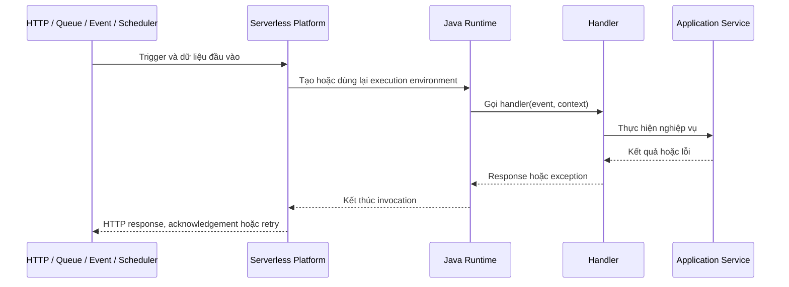

# Anatomy của function: handler, event, context và response

Một Java function trong mô hình FaaS thường có một điểm vào (entry point) do nền tảng gọi. Khi có HTTP request, message hoặc sự kiện theo lịch, nền tảng chuẩn bị dữ liệu đầu vào, tạo thông tin cho lần gọi, chuyển quyền điều khiển cho handler và xử lý kết quả hoặc lỗi mà handler trả về. Bốn khái niệm cần hiểu rõ là **handler**, **event**, **context** và **response**.

Chúng tạo thành hợp đồng giữa mã Java với môi trường thực thi serverless. Hiểu đúng hợp đồng này giúp viết function dễ kiểm thử, tránh nhầm dữ liệu nghiệp vụ với metadata của runtime, và xử lý chính xác kết quả theo từng loại trigger.

## 1. Một lần gọi function diễn ra như thế nào?

Function không tự quyết định lúc nào được chạy. HTTP gateway, message broker, event source hoặc scheduler nhận trigger và yêu cầu nền tảng thực thi function. Runtime chuyển dữ liệu trigger thành đối tượng Java, gọi handler, sau đó chuyển kết quả hoặc lỗi về cơ chế kích hoạt tương ứng.



Đây là luồng khái quát. Chi tiết giải mã event, xác nhận message, định dạng response và retry phụ thuộc nền tảng cùng loại trigger. Với một HTTP request đồng bộ, client thường nhận response. Với một sự kiện bất đồng bộ, bên phát sự kiện thường không nhận giá trị trả về của handler; nền tảng quan tâm invocation thành công hay thất bại để áp dụng chính sách giao nhận.

Một lần gọi function thường được gọi là *invocation*. Mỗi invocation có đầu vào và metadata riêng. Nền tảng có thể tạo execution environment mới hoặc tái sử dụng môi trường đã có. Vì vậy, mã khởi tạo ở cấp class có thể chỉ chạy khi môi trường được tạo, còn handler được gọi lại ở những invocation sau. Không được suy ra rằng một instance chỉ xử lý đúng một request.

## 2. Handler: điểm vào của function

**Handler** là phương thức hoặc lớp mà runtime gọi khi function được kích hoạt. Handler nhận event, có thể nhận thêm context, rồi thực hiện hoặc điều phối logic nghiệp vụ. Tên và chữ ký handler được cấu hình theo quy ước của nền tảng.

Với AWS Lambda Java runtime, một handler có thể triển khai `RequestHandler<I, O>`. Runtime gọi phương thức `handleRequest`, truyền đối tượng đầu vào kiểu `I` và đối tượng `Context`; giá trị trả về có kiểu `O`.

```java
import com.amazonaws.services.lambda.runtime.Context;
import com.amazonaws.services.lambda.runtime.RequestHandler;

public final class OrderCreatedHandler
        implements RequestHandler<OrderCreatedEvent, ProcessingResult> {

    @Override
    public ProcessingResult handleRequest(
            OrderCreatedEvent event,
            Context context) {

        if (event == null || event.getOrderId() == null) {
            throw new IllegalArgumentException("Missing orderId");
        }

        context.getLogger().log(
                "Processing order event: " + event.getEventId());

        processOrder(event.getEventId(), event.getOrderId());
        return new ProcessingResult("COMPLETED");
    }

    private void processOrder(String eventId, String orderId) {
        // Gọi application service để xử lý nghiệp vụ idempotent.
    }
}
```

`OrderCreatedEvent` là DTO được runtime giải mã từ payload; `ProcessingResult` là kiểu kết quả do ứng dụng định nghĩa. Hai kiểu này cần có cấu trúc tương thích với serializer/deserializer được cấu hình. Ví dụ giả định trigger chuyển một event đơn vào handler; với SQS event source mapping, kiểu đầu vào thường là wrapper chứa danh sách record. Có thể định nghĩa kiểu kết quả đơn giản như sau:

```java
public final class ProcessingResult {
    private String status;

    public ProcessingResult() {}

    public ProcessingResult(String status) {
        this.status = status;
    }

    public String getStatus() {
        return status;
    }

    public void setStatus(String status) {
        this.status = status;
    }
}
```

Ví dụ minh họa chữ ký handler và cách sử dụng context; phần nghiệp vụ thực tế nên nằm trong service riêng để có thể kiểm thử mà không cần khởi chạy runtime FaaS.

Handler nên làm những việc ở ranh giới invocation:

- Kiểm tra đầu vào ở mức cấu trúc và các trường bắt buộc.
- Chuyển đổi event thành command hoặc lời gọi application service.
- Truyền correlation ID và metadata cần thiết xuống lớp nghiệp vụ.
- Chuyển kết quả nghiệp vụ thành response theo hợp đồng của trigger.
- Để lỗi được xử lý theo chính sách đã thiết kế; không nuốt exception khiến runtime hiểu nhầm một invocation thất bại là thành công.

Không nên đặt toàn bộ logic nghiệp vụ, truy vấn dữ liệu phức tạp và quy tắc retry vào một handler dài. Tách handler khỏi service giúp cùng một nghiệp vụ có thể được gọi từ HTTP, queue hoặc bài kiểm thử đơn vị. Nếu dùng dependency injection, cần cấu hình cách tạo handler và vòng đời dependency tương thích với runtime của nền tảng.

## 3. Event: dữ liệu kích hoạt function

**Event** là dữ liệu đầu vào mô tả điều đã xảy ra hoặc yêu cầu cần xử lý. Event có thể là một HTTP request, một message trong queue, một sự kiện nghiệp vụ hoặc payload do scheduler gửi. Kiểu dữ liệu và cấu trúc event phụ thuộc trigger.

Không nên giả định mọi trigger đều gửi cùng một cấu trúc JSON. Một HTTP gateway có thể gửi method, path, headers, query parameters và body. Một queue có thể gửi một batch gồm nhiều record, mỗi record chứa message body, message ID và metadata giao nhận. Một event bus có thể gửi envelope gồm nguồn, loại sự kiện, thời điểm và phần dữ liệu nghiệp vụ.

### 3.1. Phân biệt envelope và dữ liệu nghiệp vụ

Nhiều hệ thống bọc dữ liệu nghiệp vụ trong một **event envelope**. Envelope mô tả sự kiện ở cấp hệ thống; phần `data` chứa nội dung nghiệp vụ.

```json
{
  "specversion": "1.0",
  "id": "evt-7f31",
  "source": "order-service",
  "type": "com.example.order.created",
  "subject": "orders/ord-1042",
  "time": "2026-11-17T10:15:30Z",
  "datacontenttype": "application/json",
  "data": {
    "orderId": "ord-1042",
    "customerId": "cus-81",
    "total": 1250000,
    "currency": "VND"
  }
}
```

Ví dụ trên theo dạng CloudEvents. Không phải nền tảng nào cũng dùng CloudEvents hoặc đúng các trường này; đây là một cách chuẩn hóa event phổ biến. Khi tích hợp, hãy dựa vào schema thực tế của trigger và adapter. Không tự thêm envelope vào payload nếu dịch vụ nguồn đã cung cấp một envelope riêng.

Các trường thường có ích trong một hợp đồng event gồm:

- `id`: định danh duy nhất của sự kiện, hỗ trợ deduplication và idempotency.
- `source`: hệ thống hoặc thành phần phát sự kiện.
- `type`: loại sự kiện, giúp consumer chọn cách xử lý.
- `time`: thời điểm nghiệp vụ xảy ra; cần phân biệt với thời điểm function nhận được event.
- `data`: dữ liệu nghiệp vụ cần xử lý.
- `version` hoặc thông tin schema: cho phép thay đổi payload có kiểm soát theo thời gian.

Định danh sự kiện không giống request ID của invocation. Một event có thể được giao lại nhiều lần, mỗi lần tạo một invocation với request ID khác nhau. Nếu dùng request ID làm khóa chống trùng, consumer vẫn có thể xử lý lặp cùng một event. Hãy dùng event ID hoặc khóa nghiệp vụ ổn định cho idempotency.

### 3.2. Event theo từng loại trigger

| Trigger | Dữ liệu đầu vào thường gặp | Điều handler cần quan tâm |
|---|---|---|
| HTTP | Method, path, headers, query, body, thông tin xác thực đã được gateway chuyển tiếp | Kiểm tra request, xác thực/ủy quyền, mã trạng thái và response body |
| Queue | Một message hoặc batch record, message ID, body, thuộc tính giao nhận | Xử lý từng record, xác nhận thành công, retry và message lỗi |
| Pub/sub hoặc event bus | Event envelope, loại sự kiện, nguồn, payload nghiệp vụ | Định tuyến theo event type, kiểm tra schema, deduplication |
| Scheduler | Thông tin lịch, thời điểm dự kiến, payload cấu hình tùy dịch vụ | Múi giờ, lần chạy trễ, chạy lặp và khóa theo kỳ nghiệp vụ |

Với HTTP, `body` thường là chuỗi cần parse thành DTO. Không nên tin rằng mọi header hoặc dữ liệu do client gửi đều hợp lệ. Gateway có thể chuẩn hóa hoặc loại bỏ một số header, và cách truyền danh tính phụ thuộc cấu hình xác thực.

Với queue, event có thể chứa nhiều record. Handler cần hiểu runtime yêu cầu xử lý toàn bộ batch hay hỗ trợ phản hồi lỗi từng record. Nếu xử lý một record thất bại nhưng handler vẫn trả thành công chung, nền tảng có thể xác nhận cả batch và message lỗi sẽ không được giao lại.

Với event bus, consumer nên dựa vào `type` và phiên bản schema để chọn cách xử lý. Khi thêm trường mới, cân nhắc khả năng tương thích ngược; khi đổi ý nghĩa hoặc kiểu dữ liệu, hãy phát hành phiên bản schema mới hoặc có bước chuyển đổi rõ ràng.

### 3.3. Thiết kế DTO và kiểm tra event

DTO giúp giới hạn phần dữ liệu mà nghiệp vụ nhận được. Không truyền toàn bộ object của nhà cung cấp cloud vào sâu trong domain nếu chỉ cần một vài trường. Adapter có thể chuyển event của nền tảng thành command nội bộ.

```java
public final class OrderCreatedEvent {
    private String eventId;
    private String orderId;
    private String customerId;

    public OrderCreatedEvent() {}

    public String getEventId() {
        return eventId;
    }

    public void setEventId(String eventId) {
        this.eventId = eventId;
    }

    public String getOrderId() {
        return orderId;
    }

    public void setOrderId(String orderId) {
        this.orderId = orderId;
    }

    public String getCustomerId() {
        return customerId;
    }

    public void setCustomerId(String customerId) {
        this.customerId = customerId;
    }
}
```

Đây là JavaBean đơn giản để minh họa quá trình ánh xạ JSON. Nếu dùng Java record, builder hoặc thư viện serialization khác, hãy xác minh serializer của runtime hỗ trợ cấu trúc đó. Kiểm tra cả trường bắt buộc, độ dài, định dạng, miền giá trị và phiên bản schema trước khi gọi nghiệp vụ. Payload không hợp lệ thường là lỗi không thể khắc phục bằng retry tự động.

## 4. Context: metadata của lần invocation

**Context** chứa thông tin về lần gọi hiện tại và một số tiện ích do runtime cung cấp. Nó khác với event: event mô tả dữ liệu đầu vào hoặc điều đã xảy ra; context mô tả môi trường đang thực thi invocation đó.

Trong AWS Lambda Java, `Context` có thể cung cấp các thông tin như:

- Request ID của invocation hiện tại.
- Tên function, phiên bản và thông tin môi trường thực thi.
- Thời gian thực thi còn lại trước deadline.
- Bộ nhớ được cấp phát và logger của runtime.

Ví dụ:

```java
public ProcessingResult handleRequest(
        OrderCreatedEvent event,
        Context context) {

    String invocationId = context.getAwsRequestId();
    int remainingMs = context.getRemainingTimeInMillis();

    context.getLogger().log(
            "Invocation " + invocationId
            + " has " + remainingMs + " ms remaining");

    if (remainingMs < 2_000) {
        throw new IllegalStateException(
                "Insufficient time to safely process event");
    }

    processOrder(event.getEventId(), event.getOrderId());
    return new ProcessingResult("COMPLETED");
}
```

Tên phương thức và khả năng cụ thể phụ thuộc SDK/runtime. Ví dụ dùng AWS Lambda `Context`; nền tảng khác có thể gọi đối tượng tương đương là execution context, invocation context hoặc cung cấp metadata qua tham số khác.

### 4.1. Request ID và correlation ID

`requestId` giúp tìm log của một invocation cụ thể. Nó thường được tạo bởi nền tảng và thay đổi giữa các lần giao lại. `correlationId` là định danh do ứng dụng truyền qua nhiều thành phần để nối các bước của cùng một quy trình nghiệp vụ.

Ví dụ, client gửi request tạo đơn với correlation ID; function tạo đơn ghi ID đó vào log và event outbox; consumer đọc event rồi tiếp tục ghi cùng correlation ID. Khi điều tra một đơn hàng, đội vận hành có thể tìm các log từ API đến consumer dù mỗi function có request ID riêng.

Không được coi request ID hoặc correlation ID là bằng chứng xác thực hay quyền truy cập. Nếu correlation ID đến từ client, cần giới hạn độ dài và chuẩn hóa giá trị trước khi ghi log. Không đưa token, secret hoặc dữ liệu cá nhân vào ID.

### 4.2. Context không phải nơi lưu trạng thái nghiệp vụ

Context chỉ có ý nghĩa trong phạm vi invocation hiện tại. Không lưu object context vào biến static, không truyền nó sang một lần gọi sau và không dùng context như database. Khi invocation kết thúc, object này không còn là nguồn dữ liệu hợp lệ cho công việc khác.

Một số runtime tái sử dụng execution environment. Điều đó cho phép tái sử dụng kết nối database hoặc đối tượng bất biến đã khởi tạo, nhưng không bảo đảm biến trong bộ nhớ sẽ tồn tại mãi. Dữ liệu nghiệp vụ cần tồn tại qua nhiều invocation phải được lưu trong kho bền vững. Tránh dùng biến static mutable để chứa dữ liệu của người dùng hoặc request vì các invocation có thể dùng chung môi trường và gây rò rỉ dữ liệu giữa các request.

Thời gian còn lại trong context hữu ích để tránh bắt đầu công việc không thể hoàn thành trước deadline. Hãy đặt timeout cho lời gọi database và HTTP thấp hơn thời gian còn lại, chừa thời gian để ghi log hoặc hoàn tất thao tác cần thiết. Không nên bắt đầu một tác vụ phụ thuộc quan trọng khi invocation gần hết thời gian mà không có cơ chế tiếp tục an toàn.

## 5. Response: kết quả trả về phụ thuộc trigger

**Response** là kết quả handler cung cấp cho runtime. Ý nghĩa của response thay đổi theo kiểu kích hoạt. Một giá trị Java được trả về không nhất thiết trở thành HTTP response, và một invocation thành công không có nghĩa producer của message nhận được dữ liệu trả về.

### 5.1. HTTP đồng bộ

Với HTTP đồng bộ, gateway thường chuyển kết quả handler thành HTTP response. Hợp đồng response cần xác định status code, headers và body. Một số integration yêu cầu body là chuỗi JSON đã serialize; một số framework hoặc adapter tự thực hiện việc này.

Ví dụ về response sau khi adapter ánh xạ kết quả nghiệp vụ:

```json
{
  "statusCode": 201,
  "headers": {
    "content-type": "application/json"
  },
  "body": "{\"orderId\":\"ord-1042\",\"status\":\"PENDING\"}"
}
```

Mã `201 Created` phù hợp khi tài nguyên mới đã được tạo. Nếu chỉ tiếp nhận công việc chạy nền và chưa hoàn tất, có thể trả `202 Accepted` cùng mã công việc để client truy vấn trạng thái sau. Dùng mã 4xx cho lỗi request hoặc quyền truy cập; dùng mã 5xx cho lỗi phía server mà client có thể cần thử lại tùy hợp đồng. Không trả stack trace, tên bảng hoặc thông tin nội bộ trong body.

Lỗi xảy ra trong handler có thể được gateway ánh xạ thành response lỗi. Hãy cấu hình mapping nhất quán và kiểm thử cả đường thành công lẫn đường lỗi; đừng giả định mọi exception Java tự động trở thành status code mong muốn.

### 5.2. Invocation bất đồng bộ

Với trigger bất đồng bộ, producer thường chỉ gửi event và nhận xác nhận rằng nền tảng đã tiếp nhận yêu cầu (nếu dịch vụ có trả xác nhận). Producer không chờ giá trị return của handler. Khi handler kết thúc bình thường, runtime thường xem invocation là thành công. Khi handler ném exception hoặc timeout, nền tảng có thể retry hoặc chuyển lỗi theo cấu hình.

Vì vậy, `return new ProcessingResult(...)` trong một handler bất đồng bộ không đồng nghĩa producer nhận được object đó. Nếu nghiệp vụ cần công bố kết quả, function phải chủ động ghi trạng thái vào database, phát event kết quả hoặc gọi callback/API đã được thiết kế.

### 5.3. Queue và batch response

Khi queue kích hoạt function theo batch, việc xác nhận message phụ thuộc quy tắc tích hợp. Một số cấu hình chỉ xác nhận toàn batch nếu handler thành công; nếu có lỗi, toàn batch có thể được giao lại. Cách này có thể làm những record đã xử lý thành công bị chạy lại.

Một số nền tảng hỗ trợ *partial batch response*: handler trả danh sách định danh record thất bại để runtime chỉ giao lại những record đó. Với AWS Lambda và SQS, cơ chế này cần được bật trong cấu hình event source mapping và handler trả đúng định dạng batch response được hỗ trợ. Chỉ bật tính năng ở code mà quên cấu hình mapping sẽ không tạo ra hành vi mong muốn.

Dù dùng batch response hay không, mỗi record vẫn cần xử lý idempotent. Có thể xảy ra tình huống nghiệp vụ đã commit nhưng acknowledgement bị mất; broker giao lại message và consumer phải nhận biết record đã được xử lý.

### 5.4. Scheduler và sự kiện theo lịch

Với scheduler, thường không có client chờ một HTTP response. Runtime dựa vào việc invocation kết thúc thành công hay thất bại để áp dụng retry hoặc chính sách lỗi của dịch vụ lịch. Nếu cần biết một lần chạy đã hoàn tất đến đâu, hãy ghi trạng thái công việc theo `scheduleId`, kỳ nghiệp vụ hoặc execution ID vào nơi lưu trữ bền vững.

Không dùng một log “function started” làm bằng chứng tác vụ đã hoàn tất. Cần ghi trạng thái cuối cùng sau khi nghiệp vụ commit, đồng thời có metric và cảnh báo cho lần chạy thất bại hoặc bị trễ.

## 6. Phân biệt lỗi của handler và lỗi nghiệp vụ

Runtime cần biết invocation thành công hay thất bại để quyết định acknowledgement và retry. Vì vậy, cách handler biểu diễn lỗi có ảnh hưởng trực tiếp đến độ tin cậy.

- **Lỗi đầu vào không hợp lệ:** thường không thể sửa bằng retry. Ghi nhận lý do có kiểm soát và chuyển message sang DLQ hoặc luồng xử lý lỗi theo chính sách.
- **Lỗi tạm thời:** ví dụ timeout mạng hoặc dịch vụ phụ thuộc quá tải. Có thể ném exception để runtime áp dụng retry, với số lần thử và backoff hữu hạn.
- **Lỗi nghiệp vụ dự kiến:** ví dụ đơn hàng đã bị hủy hoặc trạng thái không cho phép chuyển tiếp. Có thể trả kết quả nghiệp vụ rõ ràng hoặc phát sự kiện từ chối; không nên biến mọi trường hợp này thành exception gây retry liên tục.
- **Lỗi không xác định:** cần log đủ correlation ID và invocation ID, giữ thông báo lỗi an toàn, rồi để chính sách retry/DLQ xử lý theo thiết kế.

Không bắt mọi exception rồi trả response thành công. Nếu handler nuốt lỗi trước khi runtime nhận biết, message có thể bị xác nhận dù nghiệp vụ chưa hoàn tất. Ngược lại, ném exception cho mọi kết quả từ chối nghiệp vụ có thể tạo retry vô ích và tăng chi phí.

## 7. Các nguyên tắc khi thiết kế hợp đồng function

Một hợp đồng function tốt giúp producer và consumer hiểu chính xác dữ liệu, hành vi và cách phục hồi. Trước khi triển khai, hãy xác định:

1. **Handler:** lớp/phương thức nào là entry point, chữ ký đầu vào/đầu ra ra sao và dependency được khởi tạo như thế nào?
2. **Event:** schema nào được nhận, trường nào bắt buộc, định danh event là gì và phiên bản schema được quản lý ra sao?
3. **Context:** metadata nào đến từ runtime, deadline là bao lâu và request ID/correlation ID được truyền qua các bước thế nào?
4. **Response:** ai nhận kết quả, định dạng response là gì và thành công được xác định bằng return, HTTP status hay acknowledgement?
5. **Error:** lỗi nào được retry, lỗi nào không, batch được xác nhận thế nào và DLQ nằm ở đâu?
6. **Idempotency:** nếu cùng event được giao hai lần, khóa nào ngăn tác động nghiệp vụ bị lặp?
7. **Observability:** log, metric và trace có đủ để nối một request với các invocation downstream không?
8. **Security:** dữ liệu đầu vào được xác thực và phân quyền thế nào; log có vô tình chứa secret hoặc dữ liệu nhạy cảm không?

Khi thay đổi schema event hoặc kiểu response, hãy xem đó là thay đổi hợp đồng. Producer cũ và consumer mới có thể được triển khai ở thời điểm khác nhau; vì vậy nên ưu tiên thay đổi tương thích ngược, hỗ trợ nhiều phiên bản trong giai đoạn chuyển tiếp và loại bỏ phiên bản cũ theo kế hoạch.

## 8. Kết luận

Handler là điểm vào mà runtime gọi; event là dữ liệu kích hoạt; context mô tả invocation hiện tại; response là kết quả được diễn giải theo loại trigger. Với Java FaaS, cần tách adapter và handler khỏi logic nghiệp vụ, quản lý schema event rõ ràng, dùng context cho metadata và deadline, đồng thời hiểu chính xác cách HTTP response, acknowledgement, retry và batch response hoạt động. Đây là nền tảng để function xử lý đúng khi chạy đồng bộ, bất đồng bộ hoặc theo lịch.
