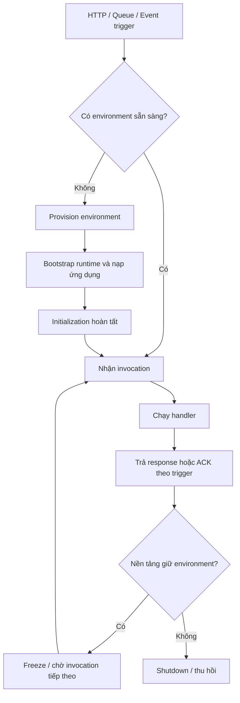
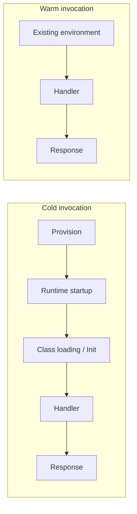

# Các bước khởi tạo, thực thi và kết thúc môi trường chạy

Một lần gọi serverless không chỉ là lúc function chạy câu lệnh đầu tiên trong handler. Trước đó, nền tảng phải chuẩn bị một môi trường thực thi, khởi động runtime và nạp mã ứng dụng. Sau khi handler trả kết quả, môi trường có thể được giữ lại để phục vụ lần gọi tiếp theo hoặc bị thu hồi khi nền tảng giảm tài nguyên. Chuỗi hoạt động này tạo nên vòng đời thực thi function.

Hiểu vòng đời giúp lập trình viên Java quyết định đặt cấu hình ở đâu, khi nào tạo kết nối, cách quản lý trạng thái, cách xử lý lỗi và cách đo cold start. Điều quan trọng là phân biệt **vòng đời của một invocation** với **vòng đời của execution environment**. Một invocation có thể kết thúc sau vài mili giây, trong khi môi trường đã chạy invocation đó có thể tiếp tục tồn tại lâu hơn; tuy nhiên, ứng dụng không được giả định môi trường sẽ luôn được tái sử dụng.

## 1. Hai vòng đời cần phân biệt

Trong FaaS, nền tảng thường quản lý một execution environment (môi trường thực thi) gồm runtime, mã ứng dụng, bộ nhớ và một số tài nguyên tạm. Khi có trigger, nền tảng điều phối một invocation vào môi trường phù hợp. Nếu chưa có môi trường sẵn sàng, nền tảng có thể phải tạo môi trường mới.



Sơ đồ thể hiện một luồng khái quát. Tên phase, cách cấp phát tài nguyên, cách tái sử dụng và thời điểm shutdown khác nhau giữa các nền tảng. Có nền tảng cho phép nhiều invocation đồng thời trong một process; có nền tảng thường gán một invocation tại một thời điểm cho mỗi environment. Cần đọc hợp đồng runtime của nhà cung cấp trước khi dựa vào bất kỳ giả định cụ thể nào.

| Phạm vi | Bắt đầu khi nào? | Kết thúc khi nào? | Ví dụ dữ liệu hoặc tài nguyên |
|---|---|---|---|
| Một invocation | Runtime nhận một request, message hoặc event | Handler hoàn tất, timeout hoặc lỗi | Request, event, context, biến local |
| Một execution environment | Nền tảng tạo sandbox/process và khởi động runtime | Nền tảng thu hồi hoặc kết thúc environment | Class đã nạp, object dùng chung, client HTTP, cache trong bộ nhớ |
| Dữ liệu bền vững | Được ghi vào dịch vụ lưu trữ | Theo chính sách nghiệp vụ hoặc retention | Đơn hàng, trạng thái workflow, idempotency record, outbox |

Ba phạm vi này có thời gian sống khác nhau. Biến local của handler thuộc invocation. Một `static final HttpClient` có thể tồn tại trong suốt thời gian process còn sống. Bản ghi đơn hàng trong database tồn tại độc lập với việc runtime có còn chạy hay không.

## 2. Giai đoạn khởi tạo môi trường (Initialization)

Khi không có environment sẵn sàng, nền tảng chuẩn bị một môi trường mới. Quá trình tổng quát thường gồm các bước sau:

1. **Cấp phát môi trường:** chọn vùng, tài nguyên CPU/bộ nhớ và tạo sandbox hoặc container tương ứng với cấu hình function.
2. **Chuẩn bị artifact:** lấy mã triển khai và các dependency cần thiết, gắn cấu hình, biến môi trường và quyền truy cập theo cấu hình đã cấp.
3. **Khởi động runtime:** chạy JVM hoặc runtime tương ứng, khởi tạo giao tiếp giữa nền tảng và runtime, nạp extension nếu có.
4. **Nạp ứng dụng:** tải class, thực thi static initializer, tạo đối tượng cấu hình hoặc dependency injection container tùy cách ứng dụng được viết.
5. **Sẵn sàng nhận invocation:** runtime báo đã sẵn sàng hoặc hoàn tất quá trình khởi tạo theo giao thức của nền tảng.

Không phải nền tảng nào cũng thực hiện đúng thứ tự hoặc công khai từng bước trên. Một số runtime giữ phần bootstrap trong hệ thống quản lý; một số cho phép extension hoặc hook khởi tạo. Tuy vậy, với ứng dụng Java, việc khởi động JVM, tải class và tạo dependency thường là phần đáng kể của thời gian trước handler.

### Khởi tạo trong Java

Java có thể thực thi công việc trước handler thông qua static initializer, static field initializer, constructor của lớp handler hoặc dependency injection framework. Ví dụ:

```java
import java.net.http.HttpClient;
import java.time.Duration;

public final class CatalogFunction {
    // Được tạo khi class được khởi tạo trong execution environment.
    private static final HttpClient HTTP = HttpClient.newBuilder()
            .connectTimeout(Duration.ofSeconds(2))
            .build();

    private static final CatalogConfig CONFIG = CatalogConfig.fromEnvironment();

    public ApiResponse handle(ApiRequest request, InvocationContext context) {
        // Dữ liệu thay đổi theo request phải nằm trong phạm vi invocation.
        String requestId = context.requestId();
        return loadCatalog(request, requestId);
    }

    private ApiResponse loadCatalog(ApiRequest request, String requestId) {
        // Gọi dịch vụ catalog bằng HTTP và xử lý kết quả.
        return CatalogClient.fetch(HTTP, CONFIG, request, requestId);
    }
}
```

`HttpClient` và `CatalogConfig` được tạo ở phạm vi class, nên có thể được tái sử dụng khi cùng process tiếp tục nhận invocation. Cách này tránh tạo lại client ở mọi lần gọi. Các kiểu `ApiRequest`, `ApiResponse`, `InvocationContext`, `CatalogConfig` và `CatalogClient` là kiểu ứng dụng minh họa; adapter thực tế phụ thuộc runtime hoặc framework được chọn.

Khởi tạo sớm phù hợp với đối tượng dùng chung, an toàn và ít thay đổi. Không nên thực hiện các side effect nghiệp vụ trong static initializer, chẳng hạn tạo đơn hàng, gửi email hoặc ghi một bản ghi đánh dấu function đã khởi động. Một environment có thể được tạo rồi không nhận invocation, hoặc bị khởi tạo lại sau lỗi. Side effect trong initialization vì vậy có thể chạy nhiều lần và không gắn với một yêu cầu nghiệp vụ xác định.

### Những lỗi thường gặp khi khởi tạo

- **Cấu hình thiếu hoặc sai:** biến môi trường, secret hoặc endpoint không hợp lệ làm class khởi tạo thất bại. Hãy kiểm tra cấu hình bắt buộc sớm và trả lỗi rõ ràng trong log khởi tạo.
- **Dependency quá nặng:** quét classpath, tạo framework container lớn hoặc nạp nhiều thư viện kéo dài thời gian cold start. Chỉ khởi tạo những thành phần thực sự cần cho function.
- **Kết nối mạng trong static initializer:** DNS, secret manager hoặc database tạm thời không sẵn sàng có thể khiến toàn bộ environment không khởi động được. Cân nhắc khởi tạo client nhẹ ở phase init, còn kết nối thực tế thực hiện theo nhu cầu với timeout và khả năng retry có giới hạn.
- **Secret bị cache vô thời hạn:** lấy secret ở init có thể giảm số lần gọi secret manager, nhưng secret có thể được luân chuyển trong khi environment còn sống. Dùng TTL, cơ chế refresh hoặc phiên bản secret phù hợp với chính sách bảo mật.
- **Dùng chung object có thể thay đổi:** trạng thái mutable ở phạm vi static dễ gây rò dữ liệu giữa invocation hoặc race condition nếu runtime hỗ trợ concurrency trong cùng process.

## 3. Giai đoạn thực thi invocation

Khi environment đã sẵn sàng, runtime nhận một invocation. Invocation có thể đến từ HTTP request, message trong queue, lịch chạy hoặc sự kiện từ dịch vụ khác. Adapter của nền tảng chuyển payload và metadata thành tham số mà handler sử dụng.

Một invocation điển hình có các bước:

1. **Nhận đầu vào:** runtime giải mã request hoặc event, chuẩn bị context như request ID, deadline, thông tin function và metadata trigger.
2. **Tạo phạm vi xử lý:** handler đọc dữ liệu đầu vào, xác thực cấu trúc, tạo các object chỉ dùng cho invocation và xác định correlation ID.
3. **Thực hiện nghiệp vụ:** kiểm tra quyền, đọc/ghi kho dữ liệu, gọi API bên ngoài hoặc phát lệnh sang queue/event bus.
4. **Hoàn tất:** trả HTTP response, xác nhận message, hoặc báo kết quả cho adapter theo hợp đồng trigger.
5. **Thu dọn theo invocation:** đóng tài nguyên riêng của lần gọi, hoàn tất transaction và ghi log/metric cần thiết.

Với HTTP, response của handler thường được chuyển về gateway hoặc caller. Nếu function chỉ tiếp nhận một quy trình dài, nên trả trạng thái tiếp nhận cùng mã theo dõi và tiếp tục xử lý qua queue hoặc workflow. Giữ invocation HTTP mở trong suốt quy trình dài làm tăng nguy cơ timeout và giữ tài nguyên không cần thiết.

Với queue, một invocation có thể nhận một message hoặc cả batch. Việc handler trả thành công có thể đồng nghĩa toàn bộ batch được xác nhận; nếu một phần tử lỗi, chính sách retry có thể khiến cả batch được giao lại. Một số nền tảng hỗ trợ partial batch response để chỉ yêu cầu giao lại các phần tử lỗi. Cần hiểu rõ hợp đồng ACK, visibility timeout, batch size và retry của nguồn sự kiện.

Với event trigger, nền tảng có thể gọi trực tiếp function hoặc dùng một event source mapping để đọc sự kiện từ nguồn rồi gọi function. Cơ chế retry, thời gian lưu, thứ tự và phản hồi lỗi phụ thuộc loại nguồn. Không nên suy ra rằng mọi event đều được giao đúng một lần hoặc theo thứ tự toàn cục.

## 4. Phân chia tài nguyên theo thời gian sống

Thiết kế tốt bắt đầu bằng câu hỏi: tài nguyên này thuộc một invocation, một environment hay phải tồn tại bền vững?

| Loại tài nguyên | Phạm vi nên dùng | Lưu ý |
|---|---|---|
| Request, event, user identity, transaction nghiệp vụ | Invocation | Không giữ sang lần gọi khác |
| Biến local, DTO, validation result | Invocation | Tạo mới theo đầu vào hiện tại |
| HTTP client, serializer, immutable config | Environment | Có thể tái sử dụng nếu thread-safe và có timeout phù hợp |
| Connection pool | Environment hoặc managed proxy | Theo dõi tổng connection khi scale-out; xử lý connection stale sau thời gian idle |
| Cache dữ liệu tham khảo | Environment với TTL rõ ràng | Chấp nhận cache miss, dữ liệu cũ và environment bị thu hồi |
| `/tmp` hoặc ephemeral disk | Environment | Có thể còn dữ liệu giữa invocation nhưng không bền vững; phải kiểm soát dung lượng và xóa dữ liệu nhạy cảm |
| Trạng thái đơn hàng, tiến trình, idempotency key | Kho dữ liệu bền vững | Không phụ thuộc environment còn sống |

Một environment có thể được tái sử dụng, nhưng đó chỉ là cơ hội tối ưu hiệu năng. Nền tảng có thể thu hồi environment sau một lần gọi, sau một khoảng idle, khi scale-in, khi triển khai phiên bản mới hoặc khi gặp lỗi. Vì vậy, cache trong bộ nhớ và file tạm không được là nguồn dữ liệu duy nhất cho một quy trình nghiệp vụ.

### Tránh rò rỉ dữ liệu giữa các invocation

Giả sử một function xử lý yêu cầu tra cứu sản phẩm cho nhiều khách hàng. Nếu lưu `currentCustomerId` trong biến static rồi quên đặt lại, một invocation tiếp theo có thể sử dụng nhầm dữ liệu khách hàng trước đó. Tương tự, danh sách kết quả dùng chung có thể tích lũy dữ liệu qua nhiều lần gọi.

Quy tắc an toàn là giữ dữ liệu theo request trong biến local hoặc object được tạo mới cho invocation. Object dùng chung nên bất biến hoặc được thiết kế thread-safe; cache cần khóa theo key đúng, có TTL và không lưu dữ liệu nhạy cảm nếu không có biện pháp cô lập phù hợp. Luôn kiểm tra quyền truy cập theo danh tính hiện tại, không dựa vào thông tin đã cache từ invocation trước.

## 5. Sau khi handler kết thúc: tái sử dụng, freeze và shutdown

Sau khi invocation hoàn tất, environment có thể đi theo một trong các hướng:

- **Tái sử dụng:** runtime giữ process hoặc container ở trạng thái sẵn sàng để invocation sau dùng lại. Static object, class đã nạp và một số dữ liệu trong bộ nhớ có thể còn tồn tại.
- **Tạm dừng hoặc freeze:** nền tảng có thể đóng băng CPU của environment khi không có việc. Khi được dùng lại, process có thể tiếp tục với heap và file tạm còn tồn tại. Chi tiết này phụ thuộc nền tảng.
- **Thu hồi:** nền tảng kết thúc environment để giải phóng tài nguyên. Bộ nhớ và file tạm mất đi; các kết nối mạng cũng có thể bị đóng.

Ứng dụng không nhất thiết nhận được thông báo trước khi environment bị thu hồi. Một số nền tảng có hook shutdown hoặc tín hiệu kết thúc với khoảng thời gian dọn dẹp giới hạn; một số tình huống như hard timeout, sự cố máy chủ hoặc kill cưỡng bức không cho ứng dụng cơ hội chạy cleanup.

Do đó:

- Hoàn tất transaction và side effect cần thiết trước khi handler trả kết quả.
- Dùng `try/finally` hoặc try-with-resources cho tài nguyên thuộc invocation, chẳng hạn stream, file handle hoặc transaction.
- Không đợi shutdown hook để lưu trạng thái nghiệp vụ, gửi sự kiện quan trọng hoặc hoàn thành thanh toán.
- Nếu cần xử lý sau response, đẩy công việc vào queue hoặc workflow bền vững trước khi trả response.
- Xem shutdown hook là cơ hội thu dọn best-effort, không phải một bước bắt buộc trong quy trình đúng đắn.

Ví dụ đóng tài nguyên thuộc invocation:

```java
public ApiResponse handle(ApiRequest request, InvocationContext context) {
    try (var session = database.openSession()) {
        session.begin();
        var result = orderService.process(session, request, context.requestId());
        session.commit();
        return ApiResponse.ok(result);
    } catch (TemporaryDependencyException ex) {
        // Adapter có thể ánh xạ lỗi này thành phản hồi/retry phù hợp trigger.
        throw ex;
    }
}
```

Ví dụ giả định `Session` triển khai `AutoCloseable`; chi tiết transaction phụ thuộc thư viện database. `close()` được gọi khi block kết thúc bình thường hoặc do exception. Nếu process bị kill cưỡng bức, không có bảo đảm `finally` hay `close()` sẽ chạy. Vì vậy database vẫn cần timeout, transaction timeout và cơ chế rollback phía server.

## 6. Cold start và warm invocation

**Cold start** là độ trễ phát sinh khi nền tảng phải chuẩn bị một environment mới trước khi chạy handler. Tùy nền tảng, phần này có thể bao gồm cấp phát sandbox, tải artifact, khởi động runtime, nạp class, chạy static initializer và tạo dependency.

**Warm invocation** sử dụng environment đã được khởi tạo và còn sẵn sàng. Nó thường bỏ qua phần lớn chi phí bootstrap, nhưng vẫn phải giải mã input, chạy handler, gọi dịch vụ phụ thuộc và trả kết quả. Warm không có nghĩa handler chắc chắn nhanh: truy vấn database chậm hoặc API đối tác timeout vẫn có thể chi phối latency.



Các cách giảm cold start cho Java:

1. Giảm kích thước artifact, loại dependency không cần và tránh quét classpath rộng.
2. Giữ static initialization nhẹ; trì hoãn công việc nặng đến khi thật sự cần, nhưng không chuyển lỗi cấu hình bắt buộc sang thời điểm khó chẩn đoán.
3. Khởi tạo client dùng chung một lần cho environment khi client an toàn để tái sử dụng.
4. Đo thời gian khởi tạo framework, class loading và handler riêng để tìm đúng nút thắt.
5. Chọn memory/CPU phù hợp; một số nền tảng cấp CPU theo cấu hình bộ nhớ nên tăng memory có thể rút ngắn thời gian chạy nhưng cũng thay đổi chi phí.
6. Với workload nhạy latency, cân nhắc tính năng giữ trước concurrency, snapshot runtime hoặc cơ chế tương đương nếu nhà cung cấp hỗ trợ; cần tính chi phí duy trì và giới hạn đi kèm.

Một số nền tảng có tối ưu riêng cho Java như snapshot sau initialization hoặc runtime native. Snapshot có thể rút ngắn phần khởi động bằng cách khôi phục trạng thái đã chụp, nhưng cần kiểm tra cách xử lý socket, thread, random seed, timestamp và tài nguyên bên ngoài khi restore. Native image có thể giảm thời gian startup và footprint, nhưng làm thay đổi thời gian build, tương thích reflection/dynamic class loading và đặc tính hiệu năng. Đây là lựa chọn theo nền tảng và workload, không phải yêu cầu bắt buộc của mọi function Java.

## 7. Concurrency và việc tái sử dụng process

Khi tải tăng, nền tảng thường tạo thêm environment để xử lý nhiều invocation đồng thời. Số environment có thể tăng nhanh hơn số kết nối mà database hoặc dịch vụ bên ngoài chịu được. Mỗi environment có thể tạo client hoặc connection pool riêng; tổng kết nối vì vậy tăng theo quy mô scale-out.

Ngoài ra, không phải runtime nào cũng có cùng mô hình concurrency. Có nền tảng chạy tối đa một invocation trên một environment tại một thời điểm; có nền tảng cho phép nhiều request cùng dùng một process. Hãy kiểm tra mô hình cụ thể và viết code an toàn với concurrency nếu có khả năng chia sẻ object giữa các luồng.

Các nguyên tắc thực tế:

- Tái sử dụng client thread-safe như HTTP client, serializer hoặc SDK client.
- Không dùng biến static mutable để giữ request, người dùng hiện tại hoặc trạng thái transaction.
- Giới hạn thread pool và connection pool; không tạo một pool lớn trong mọi environment.
- Đặt timeout cho DNS, connect, read và toàn bộ request; đóng hoặc thay connection stale khi cần.
- Dùng reserved concurrency, max instance hoặc giới hạn consumer tương đương để bảo vệ database và API đối tác.
- Với queue, dùng queue depth và tuổi message để điều tiết số worker thay vì cho phép consumer tăng không giới hạn.

Một lỗi khó thấy là tạo thread nền để tiếp tục công việc sau khi handler trả kết quả. Khi environment bị freeze, thread có thể ngừng tiến triển; khi environment bị thu hồi, công việc có thể mất. Nếu tác vụ phải hoàn tất, hãy biểu diễn nó thành message hoặc workflow có trạng thái bền vững. Thread nền chỉ nên dùng cho công việc phụ có thể bỏ qua và có vòng đời được runtime hỗ trợ rõ ràng.

## 8. Timeout, exception và retry trong vòng đời

Một invocation có thể kết thúc theo nhiều cách:

| Kết quả | Điều xảy ra ở runtime | Cần chú ý |
|---|---|---|
| Handler trả thành công | Runtime gửi response hoặc ACK theo trigger | Xác nhận transaction và side effect đã hoàn tất trước khi báo thành công |
| Handler ném exception | Runtime báo invocation lỗi cho adapter/nền tảng | Trigger quyết định có retry, bỏ message hay chuyển DLQ |
| Invocation vượt timeout | Nền tảng có thể chấm dứt xử lý hoặc runtime | Không giả định `finally` luôn chạy; side effect có thể đã xảy ra trước timeout |
| Environment gặp sự cố | Invocation có thể thất bại giữa chừng | Caller hoặc event source có thể giao lại; cần idempotency |
| Lỗi trong initialization | Environment không sẵn sàng để nhận invocation | Nền tảng có thể thử environment khác hoặc báo lỗi theo chính sách riêng |

Timeout không chứng minh rằng thao tác chưa xảy ra. Ví dụ function đã ghi đơn hàng vào database nhưng bị timeout trước khi trả HTTP response. Client nhìn thấy lỗi và gửi lại request; nếu không có idempotency key, hệ thống có thể tạo đơn hàng thứ hai.

Với message, consumer có thể đã thực hiện side effect nhưng chưa ACK được message. Message được giao lại và handler chạy lần nữa. Vì vậy consumer nên lưu `eventId` hoặc message ID đã xử lý trong cùng transaction với thay đổi nghiệp vụ khi có thể. Nếu gọi hệ thống ngoài, dùng idempotency key của hệ thống đó hoặc thiết kế thao tác có thể bù trừ.

Retry nên có giới hạn, exponential backoff và jitter. Lỗi dữ liệu không thể tự hết không nên retry liên tục. Cấu hình số lần giao, visibility timeout, thời gian lưu và DLQ theo đặc tính của nguồn trigger. Chi tiết retry khác nhau giữa HTTP gateway, queue, stream và event bus; cần kiểm tra hợp đồng nguồn sự kiện thay vì áp dụng một chính sách chung cho tất cả.

## 9. Ví dụ Java: tách initialization khỏi invocation

Đoạn mã dưới đây minh họa cách tổ chức một function xử lý HTTP. Phần cấu hình và client dùng chung được tạo ở cấp environment; dữ liệu request và kết quả được tạo trong mỗi lần gọi.

```java
import java.net.http.HttpClient;
import java.time.Duration;

public final class ProductFunction {
    private static final FunctionConfig CONFIG = FunctionConfig.load();
    private static final HttpClient HTTP = HttpClient.newBuilder()
            .connectTimeout(Duration.ofSeconds(2))
            .build();

    private final ProductService products = new ProductService(HTTP, CONFIG);

    public HttpResponse handle(HttpRequest request, FunctionContext context) {
        String requestId = context.requestId();

        // Các biến này thuộc riêng invocation hiện tại.
        String productId = request.pathParameter("productId");
        String principal = context.authenticatedPrincipal();

        if (productId == null || productId.isBlank()) {
            return HttpResponse.badRequest("productId is required");
        }

        if (!products.canRead(principal, productId)) {
            return HttpResponse.forbidden();
        }

        ProductView result = products.find(productId, requestId);
        return result == null
                ? HttpResponse.notFound()
                : HttpResponse.ok(result);
    }
}
```

Trong ví dụ, `CONFIG`, `HTTP` và `ProductService` thuộc phạm vi process. `productId`, `principal` và `result` thuộc invocation. `ProductService` phải an toàn khi được gọi đồng thời nếu runtime hỗ trợ concurrency trong cùng environment; nó không nên lưu `principal` hoặc `productId` vào field mutable dùng chung. Các lớp request/response/context được adapter của nền tảng cung cấp hoặc chuyển đổi.

Một function nhận message cũng có thể dùng cùng service dùng chung, nhưng mỗi message cần có context và idempotency riêng. Nếu runtime gửi batch, handler phải xác định rõ phần tử nào thành công và phần tử nào cần retry theo giao thức của event source.

## 10. Quan sát vòng đời và chẩn đoán cold start

Nếu chỉ đo tổng thời gian invocation, khó xác định độ trễ nằm ở bootstrap hay ở nghiệp vụ. Nên ghi nhận riêng những khoảng thời gian nền tảng cung cấp và những mốc ứng dụng tự đo được.

| Chỉ số | Ý nghĩa | Dùng để chẩn đoán |
|---|---|---|
| Initialization duration | Thời gian chuẩn bị runtime và ứng dụng theo định nghĩa nền tảng | Cold start, static init hoặc dependency injection chậm |
| Handler duration | Thời gian chạy mã handler | Logic nghiệp vụ, truy vấn và gọi API chậm |
| Invocation count | Số lần handler được gọi | Lưu lượng và thay đổi tải |
| Concurrent executions | Số invocation đang chạy đồng thời | Áp lực lên database, pool và dịch vụ ngoài |
| Error / timeout / throttle | Tỷ lệ lỗi, hết thời gian hoặc bị giới hạn | Dependency không ổn định, cấu hình timeout hoặc giới hạn concurrency |
| Queue age / retry / DLQ | Độ trễ và tình trạng giao lại message | Consumer chậm, poison message hoặc lỗi kéo dài |

Mỗi log nên chứa request ID của nền tảng nếu có, correlation ID của quy trình và event ID khi xử lý message. Không ghi token, secret hoặc toàn bộ payload nhạy cảm. Với môi trường được tái sử dụng, log nên cho biết invocation nào đang chạy để tránh nhầm lẫn giữa log initialization và log nghiệp vụ.

Một số câu hỏi giúp khoanh vùng vấn đề:

- Nếu chỉ invocation đầu sau thời gian idle chậm, kiểm tra cold start và initialization.
- Nếu cả cold và warm đều chậm, đo handler, database, DNS và dịch vụ ngoài.
- Nếu latency tăng khi concurrency tăng, kiểm tra connection pool, giới hạn downstream và throttling.
- Nếu queue age tăng nhưng function không lỗi, kiểm tra concurrency, batch size và tốc độ xử lý.
- Nếu số lỗi tăng sau deploy, kiểm tra static initialization, cấu hình, dependency và tương thích runtime.

## 11. Kiểm thử vòng đời trước khi triển khai

Kiểm thử handler một lần trong unit test chưa đủ để xác nhận hành vi của function serverless. Cần kiểm tra cả những điều xảy ra giữa nhiều invocation và khi environment bị thay đổi:

1. **Initialization:** cấu hình thiếu, secret không truy cập được, dependency lỗi và class khởi tạo thất bại phải tạo thông báo chẩn đoán rõ ràng.
2. **Warm reuse:** gọi handler nhiều lần trong cùng process và xác nhận dữ liệu của request trước không rò sang request sau.
3. **Concurrency:** chạy nhiều invocation đồng thời nếu runtime hỗ trợ; kiểm tra thread safety, pool và cache.
4. **Timeout và retry:** mô phỏng dependency chậm, function dừng sau khi ghi dữ liệu nhưng trước khi trả response, và message được giao lại.
5. **Scale-out:** tăng tải để quan sát số environment, connection, concurrency và throttling.
6. **Environment replacement:** khởi động process mới, xác nhận function hoạt động mà không cần dữ liệu từ bộ nhớ hoặc file tạm của process cũ.
7. **Shutdown:** kiểm tra cleanup trong điều kiện kết thúc bình thường; đồng thời bảo đảm nghiệp vụ vẫn đúng khi shutdown hook không chạy.
8. **Triển khai phiên bản mới:** xác nhận cấu hình và schema tương thích trong thời gian các environment cũ và mới có thể cùng tồn tại theo cơ chế nền tảng.

Không thể buộc mọi nền tảng tái hiện chính xác freeze, restore hoặc hard termination bằng unit test. Dùng integration test trong môi trường cloud tương ứng và theo dõi telemetry sau triển khai để xác minh hành vi thực tế.

## 12. Quyết định đặt công việc ở phase nào

| Công việc | Phase phù hợp | Lý do |
|---|---|---|
| Đọc cấu hình tĩnh, tạo serializer hoặc HTTP client dùng chung | Initialization | Chi phí được trả một lần cho mỗi environment, có thể tái sử dụng |
| Kiểm tra quyền người dùng, validate request, tạo transaction | Invocation | Phụ thuộc danh tính và dữ liệu của lần gọi hiện tại |
| Ghi đơn hàng và outbox | Invocation, trong transaction | Phải gắn với một thao tác nghiệp vụ cụ thể |
| Gửi thông báo sau khi đơn hàng được commit | Consumer invocation qua queue/event | Tách tác vụ bất đồng bộ khỏi response của API |
| Xóa file tạm sau khi xử lý | Cuối invocation hoặc lifecycle hook best-effort | Không để dữ liệu tạm tích lũy; không dùng cleanup làm nơi lưu trạng thái |
| Lưu trạng thái tiến trình nhiều giờ | Database hoặc workflow bền vững | Environment có thể bị thu hồi bất cứ lúc nào |
| Đóng client hoặc flush telemetry khi shutdown | Shutdown hook nếu có | Chỉ là tối ưu dọn dẹp; không được quyết định tính đúng đắn nghiệp vụ |

Không có một phase duy nhất phù hợp cho mọi công việc. Initialization nên tập trung vào tài nguyên dùng chung và an toàn; invocation xử lý dữ liệu cụ thể; dữ liệu dài hạn nằm ở dịch vụ bền vững; shutdown chỉ làm phần thu dọn có thể bỏ qua an toàn.

## 13. Checklist thiết kế

- [ ] Phân biệt invocation với execution environment trong thiết kế và log.
- [ ] Biết rõ nền tảng có tái sử dụng environment và hỗ trợ concurrency theo mô hình nào.
- [ ] Giữ initialization nhẹ, có kiểm tra cấu hình và không tạo side effect nghiệp vụ.
- [ ] Tái sử dụng client thread-safe ở phạm vi environment khi phù hợp.
- [ ] Giữ request data, principal và transaction trong phạm vi invocation.
- [ ] Không dùng static field hoặc file tạm làm nguồn trạng thái nghiệp vụ bền vững.
- [ ] Đặt timeout cho dependency, giới hạn pool và kiểm soát concurrency khi scale-out.
- [ ] Hoàn tất side effect trước khi trả thành công; dùng idempotency cho retry và giao trùng.
- [ ] Không phụ thuộc shutdown hook để commit dữ liệu hoặc phát sự kiện quan trọng.
- [ ] Đo riêng initialization, handler duration, concurrency, lỗi, timeout và queue age.
- [ ] Kiểm thử cold start, warm reuse, concurrency, retry, timeout và environment replacement.

Vòng đời function gồm chuẩn bị environment, khởi tạo runtime và ứng dụng, thực thi từng invocation, rồi tái sử dụng hoặc thu hồi environment. Khi đặt đúng công việc vào đúng phạm vi thời gian sống, ứng dụng Java có thể tận dụng warm reuse để giảm chi phí khởi tạo mà vẫn giữ trạng thái nghiệp vụ an toàn trước retry, scale-out và việc runtime bị kết thúc bất kỳ lúc nào.
