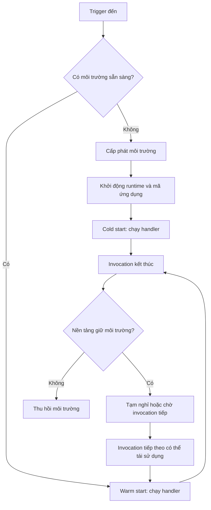

# Cold start, warm start và tái sử dụng môi trường thực thi

Một function serverless có thể được gọi hàng nghìn lần, nhưng điều đó không có nghĩa nền tảng tạo một máy ảo hoặc tiến trình mới cho từng request. Để giảm độ trễ và chi phí, nền tảng thường giữ lại một môi trường thực thi sau khi invocation kết thúc và có thể dùng môi trường đó cho invocation tiếp theo. Khi một môi trường mới phải được chuẩn bị, request đầu tiên chịu thêm thời gian khởi tạo, thường được gọi là **cold start**. Khi một môi trường đã sẵn sàng được dùng lại, invocation thường có **warm start** và bỏ qua phần lớn chi phí khởi tạo ban đầu.

Với Java, khác biệt này có thể đáng kể vì runtime cần khởi động JVM, nạp class, chạy static initializer, khởi tạo dependency injection container, chuẩn bị serializer và tạo client kết nối tới dịch vụ bên ngoài. Một ứng dụng nhỏ có thể khởi động nhanh, trong khi ứng dụng dùng framework lớn hoặc quét classpath nhiều có thể mất thêm thời gian trước khi xử lý được request đầu tiên.

Hiểu vòng đời môi trường thực thi giúp người phát triển đặt phần khởi tạo đúng chỗ, tái sử dụng tài nguyên an toàn, tránh phụ thuộc vào trạng thái trong bộ nhớ và chọn cách giảm độ trễ phù hợp. Mục tiêu là bảo đảm function vẫn đúng khi môi trường bị thay thế bất kỳ lúc nào, đồng thời tận dụng việc tái sử dụng khi nền tảng cho phép.

## 1. Phân biệt vòng đời invocation và vòng đời môi trường

Có hai vòng đời liên quan nhưng không giống nhau:

- **Invocation lifecycle** là vòng đời của một lần gọi function: nhận đầu vào, chạy logic, tạo kết quả hoặc lỗi, rồi kết thúc lần gọi.
- **Execution environment lifecycle** là vòng đời của môi trường mà function chạy: được cấp phát, khởi tạo runtime và mã ứng dụng, xử lý một hoặc nhiều invocation, rồi có thể bị đóng băng, tái sử dụng hoặc loại bỏ.

Một invocation kết thúc không đồng nghĩa execution environment bị hủy. Ngược lại, một execution environment đang hoạt động cũng không bảo đảm nó sẽ tồn tại cho invocation sau. Nền tảng quyết định khi nào tạo thêm môi trường, giữ môi trường nhàn rỗi, tạm dừng hoặc thu hồi chúng.

Có thể hình dung một chu kỳ đơn giản:



Sơ đồ chỉ mô tả khái niệm. Chi tiết cấp phát, freeze/thaw, thời gian giữ môi trường và số invocation được xử lý trên một môi trường phụ thuộc nhà cung cấp, cấu hình runtime và loại trigger.

### Cold start

Cold start xảy ra khi nền tảng cần chuẩn bị một execution environment mới trước khi gọi handler. Một số công việc có thể gồm:

1. Cấp phát hoặc chọn tài nguyên tính toán và cô lập môi trường.
2. Chuẩn bị runtime tương ứng với phiên bản Java đã cấu hình.
3. Tải hoặc gắn mã function và các dependency cần thiết.
4. Khởi động tiến trình JVM hoặc runtime tương đương.
5. Nạp class, chạy static initializer và khởi tạo đối tượng dùng chung.
6. Khởi tạo framework, dependency injection, serializer, logging và client kết nối.
7. Gọi handler để xử lý trigger đầu tiên.

Không phải nền tảng nào cũng thực hiện các bước theo cùng thứ tự hoặc hiển thị tất cả thời gian này thành một chỉ số. Một số phần có thể được nền tảng cache hoặc thực hiện trước khi request đến.

### Warm start

Warm start xảy ra khi một invocation được chạy trên môi trường đã được khởi tạo. JVM và các class đã nạp thường vẫn còn trong bộ nhớ; static field, singleton và client dùng chung có thể tiếp tục tồn tại. Vì vậy, function có thể bỏ qua nhiều công việc khởi động và đi thẳng vào xử lý invocation.

Warm start không phải cam kết về độ trễ cố định. Invocation vẫn có thể chậm do JIT compilation, garbage collection, cache miss, kết nối hết hạn, DNS lookup, tải từ database hoặc dịch vụ đối tác. Một môi trường đã tồn tại cũng có thể phải khởi tạo lazy một thành phần chưa từng được dùng.

## 2. Điều gì khiến nền tảng tạo môi trường mới?

Cold start không chỉ xảy ra khi function được gọi lần đầu sau khi triển khai. Một môi trường mới có thể được tạo khi:

- Function nhận tải tăng và cần thêm capacity để xử lý invocation đồng thời.
- Môi trường cũ đã nhàn rỗi đủ lâu và bị nền tảng thu hồi.
- Một phiên bản, cấu hình, runtime hoặc dependency mới được triển khai.
- Nền tảng thay thế môi trường vì bảo trì, lỗi, giới hạn tài nguyên hoặc điều phối nội bộ.
- Một trigger hoặc luồng tải khác cần capacity chưa có sẵn.

Điều này giải thích vì sao một function có thể có warm start trong phần lớn thời gian nhưng vẫn phát sinh cold start khi traffic tăng đột biến. Mở rộng ngang thường tạo thêm execution environment; các môi trường mới cần khởi tạo trước khi nhận việc.

Số môi trường được tạo không nhất thiết bằng số request. Nền tảng có thể xử lý nhiều invocation theo batch, giới hạn concurrency, tái sử dụng môi trường hoặc áp dụng mô hình concurrency riêng. Hãy đọc semantics của nền tảng đang dùng thay vì suy ra số instance chỉ từ số request.

## 3. Những thành phần tạo ra độ trễ khởi động trong Java

Java có nhiều lớp khởi tạo nằm giữa lúc runtime được chuẩn bị và lúc handler sẵn sàng. Các thành phần thường ảnh hưởng gồm:

| Thành phần | Công việc | Nguyên nhân làm chậm |
|---|---|---|
| JVM startup | Khởi động runtime, thiết lập heap và các dịch vụ nội bộ | Runtime và cấu hình bộ nhớ cần thời gian chuẩn bị |
| Class loading | Tìm, đọc, xác minh và liên kết class | Nhiều class, dependency lớn hoặc classloader phức tạp |
| Static initialization | Chạy static block và tạo static object | Khởi tạo đồng bộ, đọc cấu hình hoặc gọi mạng trong initializer |
| Dependency injection | Tạo object graph và resolve dependency | Quét classpath, reflection, proxy, annotation processing lúc chạy |
| Framework bootstrap | Khởi tạo routing, context, serializer và extension | Framework lớn, auto-configuration hoặc plugin discovery |
| JIT và runtime profiling | Biên dịch các đoạn code thường chạy thành mã máy tối ưu | Các invocation đầu có thể chưa đạt hiệu năng ổn định |
| Kết nối ngoài | DNS, TLS handshake, xác thực và mở connection | Phụ thuộc mạng, dịch vụ từ xa và secret/config lookup |
| Logging và telemetry | Khởi tạo appender, exporter, tracer và metric | Exporter đồng bộ hoặc cấu hình nhiều thành phần |

Không phải tất cả các công việc này đều nằm trong cùng một chỉ số cold start. Ví dụ, nếu HTTP client được tạo ở lần sử dụng đầu tiên trong handler, chi phí kết nối có thể xuất hiện ở invocation đầu của tính năng đó thay vì phần init mà nền tảng báo cáo.

Một cách phân tích hữu ích là chia tổng thời gian quan sát được thành các phần:

\[
T_{response} =
T_{platform_init} +
T_{application_init} +
T_{handler} +
T_{dependency}
\]

Đây là cách phân rã khái niệm, không phải công thức đo chuẩn của mọi nhà cung cấp. Một số phần có thể chồng lấp hoặc đã được tính trong chỉ số khác. Khi tối ưu, hãy xác định phần nào thực sự chiếm thời gian thay vì mặc định JVM startup là nguyên nhân duy nhất.

## 4. Đặt khởi tạo dùng chung ở đâu?

Một quyết định quan trọng là chọn công việc nào chạy trong giai đoạn khởi tạo và công việc nào chạy khi có request.

### Khởi tạo eager

Khởi tạo eager tạo tài nguyên trước khi handler xử lý invocation đầu tiên. Trong Java, cách phổ biến là dùng `static final` cho object dùng chung, bất biến hoặc thread-safe:

```java
public final class OrderHandler {
    private static final HttpClient HTTP_CLIENT =
            HttpClient.newBuilder()
                    .connectTimeout(Duration.ofSeconds(2))
                    .build();

    private static final ObjectMapper JSON =
            new ObjectMapper();

    private static final URI PAYMENT_API =
            URI.create(requiredEnv("PAYMENT_API_URL"));

    public Response handle(Request request, Context context) {
        // Dùng các dependency đã được khởi tạo.
        // Dữ liệu riêng của request được giữ trong biến cục bộ.
        return process(request, HTTP_CLIENT, JSON, PAYMENT_API);
    }

    private static String requiredEnv(String name) {
        String value = System.getenv(name);
        if (value == null || value.isBlank()) {
            throw new IllegalStateException(
                    "Missing environment variable: " + name);
        }
        return value;
    }
}
```

Đây là ví dụ minh họa cho một handler adapter tổng quát; kiểu `Request`, `Response` và `Context` cần được thay bằng kiểu của runtime hoặc framework thực tế.

Ưu điểm của eager initialization:

- Phát hiện sớm cấu hình thiếu hoặc lỗi tạo dependency.
- Tái sử dụng object qua nhiều invocation trên cùng môi trường.
- Giảm công việc lặp lại trong handler.
- Làm thời gian xử lý handler dễ dự đoán hơn sau khi init thành công.

Nhược điểm là mọi invocation đầu tiên phải chờ phần khởi tạo đó, kể cả khi request không dùng đến một số dependency. Nếu một static initializer gọi dịch vụ bên ngoài, một lỗi mạng tạm thời có thể khiến cả môi trường không khởi tạo được. Hãy tránh thực hiện side effect nghiệp vụ hoặc gọi mạng không cần thiết trong static initializer.

### Khởi tạo lazy

Khởi tạo lazy trì hoãn việc tạo dependency đến lần đầu tiên tính năng đó được sử dụng. Cách này hữu ích khi một function có nhiều nhánh nghiệp vụ nhưng mỗi invocation chỉ dùng một phần nhỏ dependency.

Ưu điểm là handler cho những nhánh phổ biến có thể tránh chi phí của thành phần không liên quan. Nhược điểm là request đầu tiên đi vào nhánh đó sẽ chịu chi phí khởi tạo; nếu nhiều invocation đồng thời cùng truy cập, cơ chế khởi tạo phải an toàn luồng.

Có thể dùng holder idiom của Java để khởi tạo một object dùng chung khi truy cập lần đầu:

```java
final class ReportClientHolder {
    private ReportClientHolder() {}

    private static final class Instance {
        static final ReportClient CLIENT = createClient();
    }

    static ReportClient get() {
        return Instance.CLIENT;
    }

    private static ReportClient createClient() {
        return new ReportClient(
                URI.create(System.getenv("REPORT_API_URL")));
    }
}
```

Class initialization của JVM bảo đảm việc khởi tạo class được đồng bộ theo quy tắc của Java. Tuy nhiên, nếu tạo client cần retry, refresh secret hoặc đóng tài nguyên, một holder đơn giản có thể chưa đủ. Khi đó cần một abstraction có trạng thái và đồng bộ rõ ràng.

### Chọn eager hay lazy?

| Tình huống | Hướng phù hợp |
|---|---|
| Object nhỏ, dùng ở hầu hết invocation, thread-safe | Eager initialization |
| Dependency nặng chỉ dùng ở một nhánh ít gặp | Lazy initialization |
| Cấu hình bắt buộc phải hợp lệ trước khi nhận request | Eager validation lúc init |
| Secret hoặc token có vòng đời cần refresh | Cache có TTL và cơ chế refresh |
| Kết nối tới dịch vụ ngoài có thể lỗi tạm thời | Khởi tạo có timeout và chiến lược phục hồi; tránh làm static initializer bị treo |
| Tài nguyên riêng của một request | Tạo trong invocation và giải phóng đúng cách |

Không có quy tắc rằng mọi thứ nên được khởi tạo static. Hãy chọn theo tần suất sử dụng, chi phí tạo, khả năng thread-safe, vòng đời credential và hành vi lỗi.

## 5. Tái sử dụng môi trường mà không tạo lỗi trạng thái

Static field, singleton và object dùng chung có thể tồn tại qua nhiều invocation trên cùng execution environment. Đây là cơ hội giảm chi phí, nhưng cũng là nguồn lỗi nếu vô tình giữ dữ liệu của request trước.

Ví dụ nguy hiểm:

```java
public final class UnsafeHandler {
    private static String currentUserId;
    private static Map<String, Object> currentRequestData;

    public Response handle(Request request) {
        currentUserId = request.userId();
        currentRequestData = request.attributes();

        return process(currentUserId, currentRequestData);
    }
}
```

Nếu môi trường được tái sử dụng, giá trị cũ có thể tồn tại. Nếu runtime cho phép nhiều invocation đồng thời trên cùng instance, hai request còn có thể ghi đè dữ liệu của nhau. Ngay cả khi nền tảng hiện tại tuần tự hóa invocation trên một môi trường, thiết kế dựa vào giả định đó có thể hỏng khi chuyển runtime hoặc thay đổi cấu hình concurrency.

Giữ dữ liệu theo request trong biến cục bộ và truyền tường minh qua các hàm:

```java
public final class SafeHandler {
    public Response handle(Request request) {
        String userId = request.userId();
        Map<String, Object> requestData = request.attributes();

        return process(userId, requestData);
    }
}
```

Các quy tắc thực hành:

- Dùng static field cho dependency bất biến hoặc object có hợp đồng thread-safe.
- Không lưu user ID, tenant ID, authorization context hoặc payload của request vào biến dùng chung.
- Không dùng biến static như database để giữ trạng thái nghiệp vụ giữa invocation.
- Nếu cache dữ liệu, xác định TTL, giới hạn kích thước, quy tắc invalidation và cách tránh trộn dữ liệu tenant.
- Không giữ secret hoặc token hết hạn vô thời hạn; cần refresh và xử lý rotation.
- Kiểm tra thread safety của SDK, client, serializer và thư viện được dùng chung.
- Không dựa vào thứ tự invocation hoặc việc một invocation cụ thể sẽ chạy trên cùng môi trường.

Môi trường được tái sử dụng là một tối ưu hóa có thể tận dụng. Nó không phải nơi lưu trạng thái bền vững. Khi cần lưu tiến trình nghiệp vụ, hãy dùng database, object storage, queue hoặc workflow state phù hợp.

## 6. Tái sử dụng kết nối và quản lý tài nguyên

Tạo kết nối mạng thường tốn thời gian vì cần DNS lookup, TCP handshake, TLS handshake và xác thực. Tái sử dụng HTTP client hoặc connection pool có thể giảm chi phí này ở các warm invocation.

Trong Java, các client được thiết kế thread-safe như `java.net.http.HttpClient` có thể được tạo một lần và dùng lại. Với JDBC, connection pool có thể giúp giảm số lần thiết lập kết nối, nhưng cấu hình pool trong serverless cần thận trọng.

Giả sử mỗi execution environment tạo một pool tối đa 10 kết nối và hệ thống mở rộng lên 80 môi trường. Về lý thuyết, các pool có thể tạo tổng cộng tới 800 kết nối tới database. Nếu database chỉ chịu được 200 kết nối, việc tăng concurrency của function có thể làm database quá tải dù từng pool riêng lẻ có vẻ nhỏ.

Khi tái sử dụng kết nối:

1. Đặt connection timeout, request timeout và read timeout có giới hạn.
2. Xác định cách phát hiện connection đã stale hoặc bị server đóng.
3. Cấu hình pool nhỏ theo số kết nối thực sự cần trên mỗi môi trường.
4. Tính tổng connection budget theo số môi trường tối đa, không chỉ theo một instance.
5. Dùng proxy hoặc dịch vụ quản lý kết nối khi nền tảng và kiến trúc hỗ trợ.
6. Xử lý lỗi kết nối và retry theo loại thao tác; không retry mù quáng một transaction có side effect.
7. Đóng response body, statement và resource theo đúng contract của thư viện.

Một warm environment có thể giữ client lâu hơn thời hạn connection của dịch vụ đích. Vì vậy, tái sử dụng client không có nghĩa mọi connection bên trong luôn còn hợp lệ. Client và pool cần tự phục hồi hoặc được cấu hình để kiểm tra connection trước khi dùng.

Đối với file, stream và temporary resource, giải phóng trong phạm vi invocation bằng try-with-resources. Không để một invocation kết thúc nhưng file descriptor hoặc stream vẫn bị giữ trong object dùng chung.

## 7. Freeze, thaw và kết thúc môi trường

Một số nền tảng có thể tạm dừng môi trường khi không có invocation và tiếp tục dùng lại sau đó. Cách triển khai thường được gọi là freeze/thaw. Khi môi trường được tạm dừng, thread và timer nền có thể không chạy như ứng dụng server truyền thống. Khi được tiếp tục, thời gian thực đã trôi qua; token, lease, socket hoặc dữ liệu cache có thể đã hết hạn.

Do đó:

- Không dùng background thread để hoàn tất công việc nghiệp vụ sau khi handler đã trả kết quả.
- Không giả định timer sẽ chạy đúng thời điểm khi môi trường đang nhàn rỗi.
- Không dùng đồng hồ monotonic hoặc thời điểm trong bộ nhớ như nguồn sự thật cho thời hạn kéo dài qua nhiều lần freeze.
- Kiểm tra lease, credential và connection khi tiếp tục công việc.
- Dùng queue hoặc workflow để biểu diễn công việc cần chạy sau invocation.

Kết thúc execution environment cũng không phải lúc nào là một callback ứng dụng có thể dự đoán. Nền tảng có thể thu hồi môi trường khi cần. Shutdown hook hoặc callback kết thúc, nếu runtime có cung cấp, chỉ nên dùng cho cleanup best-effort; không đặt thao tác ghi dữ liệu quan trọng hoặc xác nhận message vào bước đó.

Một nguyên tắc an toàn là **ghi bền vững trước khi trả kết quả hoặc xác nhận message**. Nếu cần hoàn tất nghiệp vụ, hãy hoàn tất trong invocation hoặc chuyển giao công việc cho một thành phần bền vững trước khi kết thúc.

## 8. Các kỹ thuật giảm cold start cho ứng dụng Java

Tối ưu cold start nên bắt đầu bằng phép đo và xác định phần chiếm thời gian. Sau đó chọn biện pháp tương ứng.

### Giảm công việc khởi tạo

- Chỉ đưa dependency thực sự cần vào artifact triển khai.
- Tránh quét classpath rộng hoặc tự động phát hiện plugin nếu không cần.
- Dùng dependency injection có thời gian bootstrap thấp; cân nhắc tạo object graph ở build time nếu framework hỗ trợ.
- Tránh gọi API bên ngoài trong static initializer.
- Đưa công việc không bắt buộc ra khỏi giai đoạn init.
- Dùng serializer và client có thể tái sử dụng thay vì tạo mới cho từng request.
- Loại bỏ logging exporter hoặc instrumentation không cần thiết, nhưng vẫn giữ telemetry thiết yếu.

Lazy initialization có thể giảm thời gian init nhưng làm invocation đầu tiên của một nhánh chậm hơn. Hãy đo cả thời gian init và thời gian của request đầu tiên dùng dependency đó.

### Giảm kích thước và độ phức tạp artifact

Dependency lớn làm tăng chi phí tải, giải nén hoặc class loading tùy nền tảng. Hãy loại bỏ dependency không dùng, tránh kéo theo nhiều module chỉ vì một tiện ích nhỏ, và kiểm tra artifact thực tế được triển khai. Với framework, dùng cấu hình loại bỏ auto-configuration hoặc component scanning không cần thiết khi có thể.

### Chọn cấu hình runtime và tài nguyên phù hợp

Một số nền tảng cấp thêm CPU khi cấu hình memory cao hơn. Tăng memory có thể làm JVM startup, class loading và xử lý nhanh hơn, dù chi phí mỗi đơn vị thời gian có thể tăng. Cần so sánh tổng thời gian và tổng chi phí thay vì chỉ nhìn mức memory.

Đo các mức cấu hình với cùng artifact, cùng loại trigger và cùng kịch bản tải. Chọn cấu hình tối ưu theo mục tiêu p95/p99 và chi phí cho mỗi yêu cầu thành công.

### Native image và AOT

Biên dịch ahead-of-time (AOT) hoặc native image có thể giảm thời gian khởi động bằng cách chuyển một phần công việc từ runtime sang build time. Tuy nhiên, native image có thể đòi hỏi cấu hình reflection, dynamic proxy, resource và serialization rõ ràng; một số thư viện phụ thuộc runtime discovery không hoạt động nếu thiếu metadata.

Ngoài thời gian startup, cần đo memory, throughput sau khi warm, thời gian build, kích thước artifact và độ phức tạp vận hành. Native image không tự động nhanh hơn trong mọi workload; JIT có thể đạt throughput tốt sau khi ứng dụng chạy đủ lâu.

### Snapshot hoặc pre-warmed capacity

Một số nền tảng cung cấp cơ chế chuẩn bị sẵn capacity hoặc lưu snapshot của môi trường đã khởi tạo. Các cơ chế này có thể giảm thời gian chờ khởi động cho một phần traffic, nhưng có chi phí và giới hạn riêng.

Với snapshot restore, cần kiểm tra các object được chụp có chứa random seed, timestamp, socket, credential tạm thời hoặc dữ liệu duy nhất cần tạo lại sau restore hay không. Những giá trị cần duy nhất hoặc cần refresh phải được tạo lại ở hook phù hợp sau khi restore theo hướng dẫn của nền tảng.

Với pre-warmed capacity, cần xác định số môi trường sẵn sàng, cách xử lý burst vượt capacity, thời gian duy trì và chi phí. Capacity đã chuẩn bị không có nghĩa mọi request trong mọi tình huống đều không có cold start.

## 9. Đo lường cold start và warm start

Không nên đánh giá cold start chỉ bằng cảm giác hoặc một lần gọi thử. Độ trễ phụ thuộc runtime, vùng triển khai, cấu hình memory, artifact, trạng thái nền tảng và tải đồng thời.

Nên thu thập:

- Thời gian khởi tạo runtime và application init nếu nền tảng cung cấp.
- Thời gian handler thực thi.
- Thời gian gọi dependency bên ngoài.
- Tỷ lệ invocation gặp cold start.
- p50, p95 và p99 latency của toàn bộ request.
- Tỷ lệ lỗi init, timeout và lỗi do dependency.
- Số môi trường đồng thời và concurrency theo thời gian.
- Chi phí thực tế theo cấu hình và mức tải.

Tách biệt các nhóm invocation:

| Nhóm | Đặc điểm | Điều cần xem |
|---|---|---|
| Cold start | Môi trường mới phải khởi tạo | Runtime init, application init, latency request đầu |
| Warm start | Môi trường đã sẵn sàng được tái sử dụng | Handler latency, connection reuse, cache hit |
| Scale-out | Tải tăng và nền tảng tạo thêm môi trường | Tỷ lệ cold start trong burst, concurrency và queue depth |
| First-use lazy path | Dependency được tạo ở lần đầu một nhánh chạy | Độ trễ nhánh đầu tiên, lỗi khởi tạo |
| Resume sau idle | Môi trường được tiếp tục sau thời gian nhàn rỗi | Connection stale, credential hết hạn, cache cũ |

Có thể ghi một cờ `coldStart` ở phạm vi execution environment để phân loại invocation đầu tiên trên môi trường đó, nếu runtime không cung cấp tín hiệu tương đương:

```java
public final class InvocationMetrics {
    private static final AtomicBoolean FIRST_INVOCATION =
            new AtomicBoolean(true);

    private InvocationMetrics() {}

    public static boolean isFirstInvocationInThisEnvironment() {
        return FIRST_INVOCATION.compareAndSet(true, false);
    }
}
```

Cờ này chỉ là tín hiệu quan sát trong bộ nhớ của một môi trường. Nó không phải bằng chứng tuyệt đối về mọi loại cold start do nền tảng định nghĩa; một số nền tảng có nhiều pha init hoặc cung cấp metric chính xác hơn. Nếu runtime đã có metric chính thức, ưu tiên dùng metric đó.

Khi thử nghiệm, hãy chạy nhiều vòng và tách các kịch bản: lần gọi sau triển khai, warm traffic đều, burst traffic, thời gian idle dài, thay đổi phiên bản và lỗi dependency. Không nên dùng một khoảng sleep cố định để khẳng định môi trường chắc chắn đã bị thu hồi vì thời gian giữ môi trường do nền tảng quyết định.

## 10. Đánh đổi giữa độ trễ, độ sẵn sàng và chi phí

Cold start là một phần của mô hình vận hành serverless. Không phải mọi function đều cần loại bỏ nó. Một tác vụ nền có thể chấp nhận vài trăm mili giây khởi tạo; API tương tác trực tiếp hoặc webhook có SLA chặt có thể cần capacity sẵn sàng hơn.

Các lựa chọn thường gặp:

| Lựa chọn | Tác động đến độ trễ | Tác động đến chi phí và vận hành |
|---|---|---|
| Giảm dependency và công việc init | Giảm cold start | Có thể cần điều chỉnh kiến trúc và quy trình build |
| Lazy initialization | Giảm phần init ban đầu | First-use path có thể chậm; cần xử lý đồng thời |
| Tăng memory/CPU | Có thể giảm startup và handler time | Chi phí mỗi đơn vị thời gian thay đổi |
| Native image/AOT | Có thể giảm startup | Build và tương thích thư viện phức tạp hơn |
| Pre-warmed capacity | Giảm thời gian chờ cho capacity đã chuẩn bị | Có chi phí duy trì capacity |
| Snapshot restore | Có thể bỏ qua một phần bootstrap | Có giới hạn restore và yêu cầu xử lý trạng thái snapshot |
| Chấp nhận cold start | Không phát sinh chi phí giữ capacity riêng | Tail latency có thể cao hơn |

Hãy xác định mục tiêu trước khi tối ưu: latency p95 hay p99, tỷ lệ request cần phản hồi nhanh, thời gian hoàn thành batch, chi phí trung bình, hay khả năng chịu burst. Tối ưu một chỉ số có thể làm chỉ số khác xấu đi. Ví dụ, tăng memory có thể rút ngắn thời gian chạy nhưng không nhất thiết giảm tổng chi phí; giữ capacity sẵn sàng có thể giảm latency nhưng tăng chi phí khi traffic thấp.

Một cách quyết định đơn giản:

- Với tác vụ bất đồng bộ, có queue và retry, có thể chấp nhận cold start nếu tổng thời gian xử lý vẫn đáp ứng yêu cầu nghiệp vụ.
- Với API đồng bộ có SLA chặt, đo p95/p99 và cân nhắc giảm init hoặc chuẩn bị capacity.
- Với workload chạy liên tục, ổn định và có thời gian idle thấp, so sánh chi phí FaaS với dịch vụ chạy lâu dài.
- Với Java framework nặng, đo native image/AOT hoặc framework tối ưu startup trước khi cam kết một nền tảng cụ thể.

## 11. Checklist thiết kế vòng đời cho Java function

Trước khi triển khai, hãy kiểm tra các câu hỏi sau:

1. **Init:** Phần nào được chạy trước invocation đầu tiên? Có static initializer nào gọi mạng hoặc thực hiện side effect không?
2. **Dependency:** Object dùng chung có immutable hoặc thread-safe không? Dependency nào có thể lazy?
3. **State:** Có dữ liệu request, user, tenant hoặc token nào bị giữ trong static field không?
4. **Concurrency:** Nền tảng xử lý concurrency trên một environment như thế nào? Code có phụ thuộc vào giả định tuần tự không?
5. **Connection:** Pool có giới hạn phù hợp với số environment tối đa không? Connection stale được xử lý thế nào?
6. **Credential:** Secret và token có thể hết hạn hoặc bị xoay vòng không? Cache có TTL và refresh không?
7. **Freeze/thaw:** Công việc nào có thể bị dừng khi handler đã trả kết quả? Có background task thiết yếu nào cần chuyển sang queue/workflow không?
8. **Shutdown:** Dữ liệu quan trọng có đang phụ thuộc vào shutdown hook để ghi không?
9. **Measurement:** Có phân biệt init time, handler time và dependency time không? Có theo dõi p95/p99 không?
10. **Cost:** Giải pháp giảm cold start có làm tăng chi phí capacity hoặc memory không?

## 12. Ví dụ áp dụng: function xử lý yêu cầu tạo báo cáo

Giả sử một Java function nhận HTTP request tạo báo cáo. Function cần đọc cấu hình, truy vấn database và ghi file vào object storage.

Một thiết kế hợp lý có thể là:

- Khởi tạo serializer, HTTP client và cấu hình bất biến một lần cho mỗi execution environment.
- Đọc danh tính và quyền của người dùng trong từng invocation.
- Validate tenant và tham số báo cáo trước khi truy vấn dữ liệu.
- Dùng database client hoặc pool có giới hạn và xử lý connection stale.
- Ghi báo cáo vào object storage, sau đó lưu trạng thái hoàn tất bền vững.
- Nếu báo cáo mất nhiều thời gian, API tạo job và đưa message vào queue; worker xử lý bất đồng bộ.
- Trả về job ID để client truy vấn trạng thái thay vì giữ HTTP invocation mở.
- Ghi correlation ID xuyên API, queue, worker và object storage metadata khi phù hợp.
- Đo riêng init time, thời gian truy vấn, thời gian tạo file và thời gian upload.

Nếu môi trường bị thu hồi ngay sau khi invocation kết thúc, trạng thái job và file vẫn tồn tại vì được ghi vào dịch vụ bền vững. Nếu môi trường được tái sử dụng, serializer và client dùng chung giúp giảm chi phí. Cùng một thiết kế có thể hoạt động đúng trong cả hai trường hợp.

## Kết luận

Cold start là chi phí chuẩn bị một môi trường thực thi mới; warm start tận dụng môi trường đã được khởi tạo. Với Java, thời gian khởi động có thể đến từ JVM, class loading, static initialization, framework bootstrap và việc chuẩn bị kết nối. Tái sử dụng static object và client giúp giảm công việc lặp lại, nhưng dữ liệu nghiệp vụ và ngữ cảnh request phải được quản lý đúng vòng đời.

Hãy xem execution environment là tài nguyên tạm thời do nền tảng quản lý. Function cần có thể khởi tạo lại, xử lý request độc lập, ghi trạng thái quan trọng ra nơi bền vững và phục hồi khi kết nối hoặc credential đã cũ. Khi đo được phần init, handler và dependency, nhóm có thể chọn giữa giảm công việc khởi tạo, lazy loading, cấu hình tài nguyên, native image hoặc capacity chuẩn bị sẵn dựa trên SLA và chi phí thực tế.

