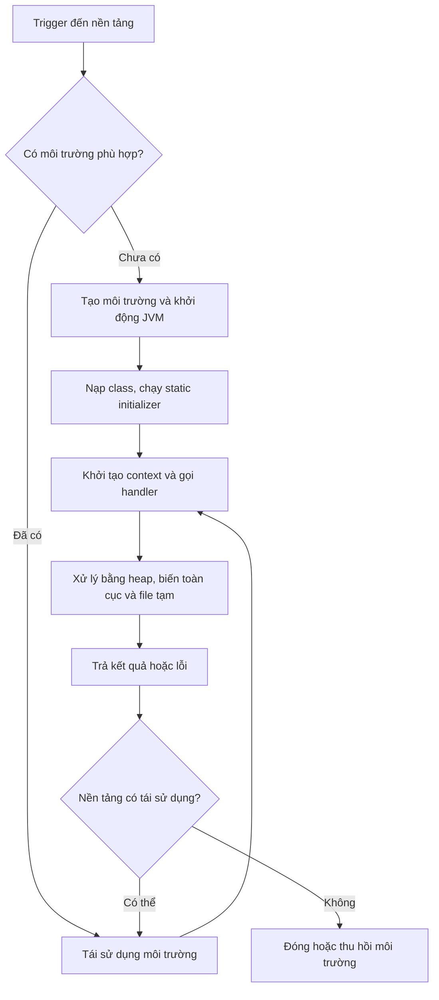

# Biến toàn cục, bộ nhớ cục bộ và thư mục tạm

Một Java function thường được gọi nhiều lần trong suốt vòng đời của một môi trường thực thi. Nền tảng cloud có thể giữ lại môi trường sau một lần gọi để dùng tiếp, tạo thêm môi trường khi tải tăng hoặc hủy môi trường khi không còn cần thiết. Vì vậy, cách đặt dữ liệu trong biến toàn cục, bộ nhớ của một lần gọi và thư mục tạm ảnh hưởng trực tiếp đến tính đúng đắn, bảo mật, độ ổn định và chi phí của function.

Trong module **CLOUD_SERVERLESS**, người học xây dựng và triển khai Java function được kích hoạt bởi HTTP, thông điệp hoặc sự kiện. Bài này tập trung vào ba nơi thường được dùng để giữ dữ liệu trong lúc xử lý: trạng thái cấp môi trường thực thi, bộ nhớ cấp invocation và file tạm. Điểm cốt lõi là phân biệt dữ liệu có thể tái sử dụng để tối ưu với dữ liệu nghiệp vụ cần được lưu bền vững.

## 1. Hiểu môi trường thực thi và một lần gọi function

Hai khái niệm cần phân biệt:

- **Môi trường thực thi (execution environment):** tiến trình hoặc sandbox mà nền tảng chuẩn bị để chạy function. Với Java, môi trường này thường bao gồm runtime/JVM, class loader, các lớp đã nạp, heap, thread và cấu hình thực thi.
- **Lần gọi (invocation):** một lần function xử lý một HTTP request, message hoặc event. Mỗi invocation có dữ liệu đầu vào, context, kết quả và thời hạn xử lý riêng.

Một môi trường có thể xử lý một invocation rồi được tái sử dụng cho invocation tiếp theo. Khi tải tăng, nền tảng có thể tạo nhiều môi trường độc lập để xử lý đồng thời. Khi môi trường bị thu hồi, toàn bộ heap, biến static và file cục bộ thuộc môi trường đó có thể biến mất.

### Vòng đời khái niệm

Sơ đồ mô tả ý tưởng chung. Thời điểm tái sử dụng, đóng băng, đánh thức hoặc thu hồi môi trường phụ thuộc nhà cung cấp và loại trigger. Không có bảo đảm rằng invocation tiếp theo sẽ chạy trong cùng môi trường, cũng không có bảo đảm một môi trường sẽ tồn tại trong một khoảng thời gian cụ thể.

Khi JVM khởi động trong một môi trường mới, Java nạp lớp khi cần và thực hiện static initializer của lớp theo quy tắc của JVM. Sau đó handler được gọi. Nếu nền tảng giữ lại môi trường, các lớp đã nạp và đối tượng static có thể vẫn còn khi invocation tiếp theo đến cùng môi trường. Nếu nền tảng tạo môi trường mới, các đối tượng đó được khởi tạo lại. Đây là lý do một biến static có thể giữ giá trị qua một số lần gọi nhưng lại trở về trạng thái ban đầu ở lần gọi khác.

## 2. Biến toàn cục và trạng thái cấp môi trường

Trong Java, biến static thuộc về lớp đã được nạp trong một class loader. Một singleton hoặc đối tượng được giữ trong container dependency injection cũng có thể sống lâu như môi trường thực thi. Trong một function serverless, các đối tượng này thường được dùng để tránh khởi tạo lặp lại giữa những invocation được xử lý trong cùng môi trường.

### Nên đặt gì ở cấp toàn cục?

Các đối tượng sau thường phù hợp nếu thư viện hoặc API của chúng cho phép tái sử dụng an toàn:

- Hằng số bất biến, cấu hình đã được kiểm tra và không gắn với một request cụ thể.
- HTTP client, SDK client hoặc connection pool được tài liệu của thư viện xác nhận là thread-safe và có cơ chế quản lý kết nối phù hợp.
- Bộ chuyển đổi JSON hoặc bộ phân tích cấu hình đã cấu hình xong và có thể dùng đồng thời.
- Cache nhỏ, có giới hạn kích thước và thời gian sống, trong đó cache chỉ giúp tăng tốc chứ không quyết định tính đúng đắn nghiệp vụ.

Ví dụ, một HTTP client có thể được tạo một lần cho mỗi môi trường để tái sử dụng kết nối:

~~~java
public final class CustomerFunction {
    // HttpClient của Java có thể được tái sử dụng giữa các request.
    private static final HttpClient HTTP = HttpClient.newBuilder()
            .connectTimeout(Duration.ofSeconds(2))
            .build();

    public Response handle(Request request, FunctionContext context) {
        String customerId = request.customerId();
        String requestId = context.requestId();

        // Dữ liệu riêng của invocation được truyền qua biến cục bộ.
        Customer customer = loadCustomer(HTTP, customerId, requestId);
        return Response.ok(customer);
    }

    private Customer loadCustomer(
            HttpClient client, String customerId, String requestId) {
        // Xây dựng và gửi request đến dịch vụ phụ trợ.
        return Customer.from(fetchCustomer(client, customerId, requestId));
    }
}
~~~

Đây là ví dụ minh họa cấu trúc; kiểu Request, Response, FunctionContext và các hàm gọi dịch vụ phụ trợ thuộc adapter của ứng dụng. Với SDK hoặc thư viện khác, cần kiểm tra tài liệu về thread safety, vòng đời và cách đóng client trước khi đặt đối tượng ở cấp static.

### Không dùng biến toàn cục để lưu dữ liệu của người dùng hoặc request

Biến static có thể còn nguyên giá trị sau khi handler trả kết quả. Nếu lưu dữ liệu riêng của invocation vào biến đó, invocation sau có thể đọc nhầm dữ liệu cũ. Khi một môi trường xử lý nhiều request đồng thời, hai request còn có thể ghi đè dữ liệu của nhau.

Ví dụ sau không an toàn:

~~~java
public final class UnsafeCustomerFunction {
    private static String currentCustomerId;

    public Response handle(Request request) {
        currentCustomerId = request.customerId();
        return createResponse(currentCustomerId);
    }
}
~~~

Giả sử request A gán mã khách hàng A, sau đó request B gán mã khách hàng B trước khi request A đọc biến static. Request A có thể tạo phản hồi cho B. Ngay cả khi nền tảng hiện tại chạy tối đa một invocation trong mỗi môi trường, giá trị của A vẫn có thể tồn tại khi invocation sau chạy trên cùng môi trường. Dựa vào biến static để lưu user ID, authorization context, token theo request hoặc dữ liệu giao dịch đều có thể gây rò rỉ dữ liệu và lỗi nghiệp vụ.

Hãy giữ dữ liệu riêng của request trong biến cục bộ và truyền tường minh qua tham số. Nếu cần cache theo khách hàng, cache phải có chính sách key, đồng bộ, giới hạn kích thước, hết hạn và phân quyền phù hợp; tuyệt đối không để cache trở thành nguồn dữ liệu chuẩn cho quyền truy cập hoặc trạng thái giao dịch.

### Biến toàn cục không phải bộ nhớ dùng chung của toàn hệ thống

Mỗi execution environment có bộ nhớ riêng. Khi nền tảng scale out thành nhiều môi trường, mỗi môi trường có một bản sao biến static và cache riêng. Các bản sao không tự đồng bộ với nhau. Khi môi trường bị thu hồi, trạng thái trong đó mất đi.

Do đó, không dùng biến static để:

- Đếm tổng số request hoặc số giao dịch trên toàn hệ thống.
- Đánh dấu một event đã xử lý để chống trùng giữa các môi trường.
- Cấp số thứ tự duy nhất hoặc tạo khóa phân tán.
- Lưu session, giỏ hàng, trạng thái đơn hàng hoặc dữ liệu cần tồn tại sau lần gọi.
- Thực hiện khóa phân tán, leader election hoặc điều phối giữa nhiều instance.

Ví dụ, một AtomicLong static chỉ đếm được số lần tăng trong chính môi trường chứa nó. Khi có ba môi trường, có thể có ba bộ đếm khác nhau; khi một môi trường mới được tạo, bộ đếm của nó bắt đầu lại. Muốn đếm toàn hệ thống, hãy dùng database, bộ đếm phân tán hoặc hệ thống telemetry phù hợp.

### An toàn luồng và khởi tạo

Không phải mọi nền tảng FaaS đều có cùng mô hình đồng thời. Một số runtime chỉ xử lý một invocation tại một thời điểm trong mỗi môi trường; một số nền tảng hoặc mô hình container serverless có thể xử lý nhiều request đồng thời trong cùng instance. Framework Java cũng có thể dùng thread pool hoặc callback bất đồng bộ. Vì vậy, hãy kiểm tra cấu hình concurrency thực tế và thiết kế các đối tượng dùng chung theo hướng thread-safe.

Các lưu ý quan trọng:

- Ưu tiên đối tượng bất biến sau khi khởi tạo.
- Không chia sẻ collection mutable nếu không có cơ chế đồng bộ phù hợp; nếu cần, dùng cấu trúc concurrent và xác định rõ giới hạn dữ liệu.
- Tránh gọi mạng, truy vấn database hoặc tải cấu hình chậm trong static initializer nếu việc đó làm cold start kéo dài hoặc khiến toàn bộ môi trường không thể khởi động khi dịch vụ phụ trợ tạm thời lỗi.
- Xử lý đúng việc cấu hình hoặc credential hết hạn. Đối tượng client có thể tái sử dụng, nhưng token và thông tin xác thực cần được làm mới theo cơ chế an toàn của thư viện.
- Không dựa vào shutdown hook hoặc thời điểm JVM thoát để hoàn tất giao dịch nghiệp vụ hay xóa dữ liệu quan trọng; môi trường có thể bị thu hồi mà ứng dụng không có cơ hội dọn dẹp theo cách mong muốn.

## 3. Bộ nhớ cục bộ trong một invocation

Biến cục bộ trong phương thức handler thường là nơi phù hợp để giữ dữ liệu chỉ cần trong lần xử lý hiện tại: request đã phân tích, kết quả truy vấn, context, dữ liệu trung gian và đối tượng phục vụ việc tạo response.

~~~java
public Response handle(Request request, FunctionContext context) {
    String requestId = context.requestId();
    String orderId = request.orderId();
    Order order = orderRepository.findById(orderId);
    PaymentResult payment = paymentService.check(order);

    return Response.from(requestId, order, payment);
}
~~~

Các biến trên thuộc luồng xử lý của lần gọi. Khi phương thức kết thúc, những biến không còn được tham chiếu có thể trở thành đối tượng đủ điều kiện để garbage collector thu hồi. Tuy nhiên, Java không bảo đảm bộ nhớ được giải phóng ngay tại thời điểm phương thức trả về. Nếu đối tượng còn được giữ bởi biến static, cache, thread, callback hoặc một tác vụ bất đồng bộ, nó vẫn có thể tồn tại sau invocation.

### Heap và giới hạn bộ nhớ

Đối tượng Java thường được cấp phát trên heap của JVM. Ngoài heap, tiến trình còn dùng bộ nhớ native, thread stack, direct buffer, metadata của lớp và vùng nhớ của thư viện native. Giới hạn memory mà nền tảng cấp cho function thường áp dụng ở cấp môi trường hoặc instance theo cách riêng của nhà cung cấp; không nên mặc định toàn bộ giới hạn đó đều là Java heap.

Nếu đọc toàn bộ payload lớn vào byte array hoặc tạo nhiều bản sao của cùng dữ liệu, function có thể tăng heap nhanh và gặp OutOfMemoryError. Garbage collection cũng tiêu tốn CPU và có thể làm tăng độ trễ. Với file hoặc message lớn, nên xử lý theo luồng, theo batch nhỏ hoặc ghi trung gian ra object storage/file tạm thay vì giữ toàn bộ nội dung trong RAM.

~~~java
try (InputStream input = request.body()) {
    processStream(input);
}
~~~

Hãy đóng stream, response body, cursor và tài nguyên tương tự bằng try-with-resources khi API yêu cầu. Tránh giữ tham chiếu đến request hoặc payload lớn trong cache, static field hay collection sống lâu. Nếu dùng cache, cần giới hạn số phần tử hoặc dung lượng và đặt chính sách hết hạn.

### ThreadLocal và tác vụ bất đồng bộ

ThreadLocal có thể hữu ích khi thư viện cần context theo thread, nhưng thread pool thường tái sử dụng thread giữa các công việc. Nếu không gọi remove trong finally, dữ liệu của request trước có thể còn trên thread và bị đọc nhầm ở công việc sau.

~~~java
private static final ThreadLocal<String> REQUEST_ID = new ThreadLocal<>();

public Response handle(Request request, FunctionContext context) {
    REQUEST_ID.set(context.requestId());
    try {
        return process(request);
    } finally {
        REQUEST_ID.remove();
    }
}
~~~

Đoạn mã chỉ nên dùng khi thư viện thực sự yêu cầu ThreadLocal; truyền context tường minh thường dễ hiểu và an toàn hơn. Với tác vụ bất đồng bộ, cần biết rõ ai sở hữu executor, context có được truyền sang thread khác không và tác vụ có hoàn tất trước khi invocation kết thúc không. Không nên khởi chạy một thread nền rồi trả response ngay với kỳ vọng nền tảng sẽ giữ thread chạy đến khi hoàn tất. Một số nền tảng có thể đóng băng hoặc thu hồi môi trường sau response; công việc nền chưa hoàn thành có thể bị gián đoạn. Hãy chờ tác vụ cần thiết hoàn tất trong giới hạn timeout hoặc gửi công việc sang queue/workflow bền vững.

## 4. Thư mục tạm và file cục bộ

Nhiều runtime cung cấp một vùng đĩa có thể ghi để function lưu dữ liệu trung gian. Trong Java, lấy thư mục tạm qua system property java.io.tmpdir thay vì giả định đường dẫn cố định:

~~~java
Path tempDirectory = Path.of(System.getProperty("java.io.tmpdir"));
~~~

Vùng này hữu ích khi cần:

- Tải file từ object storage để xử lý bằng thư viện chỉ nhận đường dẫn file.
- Giải nén archive hoặc tạo file trung gian khi chuyển đổi định dạng.
- Xử lý dữ liệu lớn theo luồng mà không giữ toàn bộ trong heap.
- Tạo báo cáo hoặc artifact trước khi upload sang kho lưu trữ bền vững.

Thư mục tạm thường có dung lượng hữu hạn và thuộc về môi trường thực thi. File có thể còn tồn tại khi môi trường được tái sử dụng, nhưng nền tảng có thể xóa chúng khi tạo môi trường mới hoặc thu hồi môi trường cũ. File cũng không tự động được chia sẻ với instance khác. Vì thế, thư mục tạm không phải database, object storage hay kênh trao đổi dữ liệu giữa các function.

### Tạo và dọn dẹp file an toàn

Ví dụ sau tạo tên file duy nhất, ghi dữ liệu theo luồng và xóa file ngay cả khi xử lý phát sinh lỗi:

~~~java
public Result handle(UploadRequest request) throws IOException {
    Path tempDirectory = Path.of(System.getProperty("java.io.tmpdir"));
    Path tempFile = Files.createTempFile(
            tempDirectory, "upload-", ".bin");

    try {
        try (InputStream input = request.body()) {
            Files.copy(input, tempFile,
                    StandardCopyOption.REPLACE_EXISTING);
        }

        return processFile(tempFile);
    } finally {
        Files.deleteIfExists(tempFile);
    }
}
~~~

Đây là khung minh họa; kiểu UploadRequest, Result và processFile thuộc ứng dụng. Cần bổ sung giới hạn kích thước đầu vào, kiểm tra định dạng, xử lý IOException và xác thực quyền truy cập phù hợp với API thực tế.

Một số nguyên tắc quan trọng khi dùng file tạm:

1. Dùng API tạo file tạm để có tên khó đoán và tránh hai invocation ghi đè file của nhau. Không ghép tên file trực tiếp từ dữ liệu người dùng nếu chưa chuẩn hóa và kiểm tra đường dẫn.
2. Dọn dẹp trong finally hoặc try-with-resources với abstraction phù hợp. Không phụ thuộc vào deleteOnExit vì môi trường có thể tồn tại lâu hơn một invocation và không bảo đảm JVM shutdown diễn ra đúng lúc.
3. Giới hạn kích thước file và kiểm tra dung lượng còn lại. Nếu nhiều request đồng thời ghi file, dung lượng tạm có thể cạn dù mỗi file riêng lẻ đều nhỏ.
4. Không ghi secrets, access token hoặc dữ liệu nhạy cảm ra file nếu không cần. Nếu bắt buộc, xác định chính sách mã hóa, quyền truy cập và thời gian lưu theo khả năng của nền tảng.
5. Không giả định quyền POSIX, loại filesystem hoặc tính năng mã hóa giống nhau trên mọi runtime. Dùng cơ chế bảo vệ được nền tảng cung cấp và kiểm tra cấu hình triển khai thực tế.
6. Sau khi xử lý, upload kết quả cần giữ lâu dài sang object storage hoặc dịch vụ bền vững trước khi trả kết quả cho caller.

## 5. Chọn đúng nơi lưu dữ liệu

| Nơi lưu | Phạm vi và vòng đời | Trường hợp phù hợp | Không nên dùng cho |
|---|---|---|---|
| Biến static/singleton | Trong một JVM/class loader của một execution environment; mất khi môi trường bị thay thế | Hằng số, client có thể tái sử dụng, cache nhỏ có giới hạn | Trạng thái nghiệp vụ, session, bộ đếm toàn hệ thống, chống xử lý trùng phân tán |
| Biến cục bộ/heap | Trong quá trình xử lý và khi còn tham chiếu; garbage collector thu hồi khi đủ điều kiện | Dữ liệu tạm của invocation, object trung gian, kết quả truy vấn | Dữ liệu cần tồn tại qua invocation hoặc payload lớn vượt ngân sách bộ nhớ |
| ThreadLocal | Gắn với thread; thread có thể được tái sử dụng | Context kỹ thuật theo thread khi thư viện yêu cầu | Cách lưu request context mà không dọn dẹp; dữ liệu dùng chung giữa thread |
| Thư mục/file tạm | Đĩa cục bộ của môi trường; có thể mất khi môi trường bị thu hồi | File trung gian, giải nén, xử lý streaming | Lưu trữ lâu dài, chia sẻ giữa instance, checkpoint duy nhất |
| Database/object storage/queue | Theo độ bền và chính sách của dịch vụ được chọn | Trạng thái nghiệp vụ, file cần giữ, công việc cần giao nhận bền vững | Cache cực ngắn nếu chi phí/độ trễ truy cập không phù hợp |

Quy tắc thực hành: nếu mất dữ liệu sau khi một invocation kết thúc hoặc sau khi môi trường bị thay thế làm sai kết quả nghiệp vụ, dữ liệu đó phải được lưu trong một dịch vụ bền vững. Static field và file tạm chỉ có thể là bản sao phục vụ hiệu năng hoặc dữ liệu trung gian có thể tạo lại.

## 6. Ví dụ: xử lý một file được gửi lên

Giả sử một HTTP function nhận yêu cầu xử lý hóa đơn PDF. Function cần lấy file, đọc nội dung, trích xuất thông tin và lưu kết quả.

Một cách bố trí phù hợp:

1. **Cấp môi trường:** tái sử dụng HTTP client hoặc SDK client nếu thư viện hỗ trợ dùng đồng thời. Có thể cache cấu hình bất biến hoặc metadata nhỏ với thời gian sống hữu hạn.
2. **Cấp invocation:** giữ request ID, user ID đã xác thực, mã hóa đơn, kết quả trích xuất và trạng thái xử lý trong biến cục bộ. Không ghi các giá trị này vào static field dùng chung.
3. **Cấp file tạm:** tải PDF vào một file có tên duy nhất trong java.io.tmpdir nếu thư viện OCR cần file path. Kiểm tra kích thước và định dạng trước khi xử lý; xóa file trong finally.
4. **Cấp lưu trữ bền vững:** ghi kết quả và trạng thái hóa đơn vào database. Nếu cần giữ PDF gốc hoặc file đã chuyển đổi, upload sang object storage và lưu object key trong database.
5. **Cấp điều phối:** nếu OCR mất nhiều thời gian hoặc cần retry độc lập, ghi công việc vào queue/workflow và trả mã tiếp nhận cho caller thay vì cố giữ một HTTP invocation mở quá lâu.

Trong kiến trúc này, nếu môi trường bị thu hồi ngay sau khi function trả response, dữ liệu nghiệp vụ vẫn còn trong database/object storage và công việc tiếp tục theo cơ chế queue/workflow. Nếu môi trường được tái sử dụng, HTTP client có thể giúp tiết kiệm thời gian khởi tạo. Tính đúng đắn không phụ thuộc vào việc biến static hay file tạm có còn tồn tại hay không.

## 7. Các lỗi thường gặp và cách phòng tránh

| Biểu hiện | Nguyên nhân có thể có | Cách xử lý |
|---|---|---|
| Request nhận dữ liệu của người dùng khác | Lưu request/user context trong static field hoặc ThreadLocal không được xóa | Đưa dữ liệu vào biến cục bộ, truyền qua tham số; dọn ThreadLocal trong finally |
| Cache có giá trị cũ hoặc khác nhau giữa instance | Mỗi môi trường có cache riêng và không có cơ chế đồng bộ | Đặt TTL/invalidation; dùng database hoặc cache phân tán khi cần tính nhất quán |
| Bộ đếm trở về 0 sau một thời gian | Môi trường bị thay thế hoặc invocation chuyển sang instance khác | Dùng bộ đếm bền vững/phân tán |
| Function lỗi OutOfMemoryError hoặc GC kéo dài | Đọc payload lớn vào heap, giữ tham chiếu lâu, cache không giới hạn | Streaming, batch nhỏ, giới hạn cache, giảm bản sao dữ liệu và đo heap |
| Invocation sau hết dung lượng đĩa tạm | File cũ không được xóa hoặc nhiều invocation ghi đồng thời | Dọn file trong finally, giới hạn dung lượng và theo dõi mức sử dụng |
| Không tìm thấy file ở invocation tiếp theo | Môi trường mới được tạo hoặc file tạm đã bị thu hồi | Lưu file cần giữ vào object storage; chỉ dùng file tạm trong một luồng xử lý có kiểm soát |
| Công việc nền bị dừng sau khi trả response | Môi trường bị đóng băng hoặc thu hồi | Chờ tác vụ hoàn tất hoặc gửi công việc qua queue/workflow |
| Cold start chậm hoặc function không khởi động được | Static initializer thực hiện nhiều công việc hoặc phụ thuộc dịch vụ ngoài | Giảm việc khởi tạo đồng bộ; xử lý timeout/lỗi cấu hình rõ ràng; đo cold start |

## 8. Quy trình thiết kế và kiểm tra

Khi thêm một biến hoặc file vào Java function, hãy trả lời lần lượt:

1. **Ai cần dữ liệu này?** Chỉ một lần gọi, một thread, một môi trường hay nhiều instance/toàn hệ thống?
2. **Cần giữ trong bao lâu?** Trong một phương thức, qua nhiều invocation, qua lần scale/restart hay lâu dài theo nghiệp vụ?
3. **Điều gì xảy ra nếu môi trường bị thay thế ngay sau invocation?** Nếu mất dữ liệu làm sai nghiệp vụ, hãy chuyển dữ liệu sang nơi lưu trữ bền vững.
4. **Có thể có truy cập đồng thời không?** Kiểm tra mô hình concurrency của nền tảng và framework; dùng đối tượng bất biến hoặc cơ chế đồng bộ phù hợp.
5. **Dung lượng có giới hạn không?** Đặt giới hạn heap, cache, payload, file tạm và số tác vụ đồng thời; tránh đọc toàn bộ dữ liệu lớn vào RAM.
6. **Có dữ liệu nhạy cảm không?** Tránh để thông tin theo người dùng trong trạng thái dùng chung; giới hạn quyền file, thời gian lưu và log.
7. **Đã dọn dẹp và xử lý lỗi chưa?** Đóng stream, xóa file, dọn ThreadLocal, giới hạn retry và không phụ thuộc shutdown hook.

Các kiểm tra hữu ích cho function Java gồm:

- Gọi handler nhiều lần trên cùng instance trong một bài test để phát hiện trạng thái cũ rò sang invocation sau.
- Chạy nhiều request song song với các user ID khác nhau để tìm race condition trong biến static và singleton.
- Kiểm tra khi tạo môi trường mới hoặc scale out để xác nhận ứng dụng không phụ thuộc cache cục bộ.
- Giả lập lỗi giữa lúc ghi file và lúc xử lý để xác nhận finally dọn file.
- Thử payload lớn, file tạm gần đầy, timeout và lỗi từ dịch vụ phụ trợ.
- Theo dõi cold start, thời gian xử lý, heap, số lần GC, dung lượng file tạm và tỷ lệ lỗi qua log/metric của nền tảng.

Unit test trong cùng một JVM không thể mô phỏng đầy đủ việc nền tảng đóng băng hoặc thu hồi môi trường. Cần kết hợp kiểm thử tích hợp trên runtime triển khai và xác nhận hành vi concurrency, dung lượng tạm cùng giới hạn bộ nhớ theo cấu hình thật.

## 9. Kết luận

Biến static và singleton có thể giúp tái sử dụng client, cấu hình và cache nhỏ trong cùng execution environment. Chúng tồn tại theo vòng đời của môi trường, có thể bị mất khi scale hoặc restart, và có thể được nhiều invocation hoặc thread dùng chung tùy nền tảng. Vì vậy, không dùng chúng làm nơi lưu trạng thái nghiệp vụ hay dữ liệu riêng của request.

Biến cục bộ và heap phù hợp với dữ liệu trung gian của invocation, nhưng bộ nhớ có giới hạn và garbage collector không giải phóng ngay khi phương thức kết thúc. Thư mục tạm phù hợp với file trung gian có thể tạo lại; cần tạo tên file an toàn, kiểm soát dung lượng và dọn dẹp sau xử lý. Dữ liệu cần tồn tại qua invocation, môi trường hoặc instance phải được lưu trong database, object storage, queue hay dịch vụ bền vững tương ứng.
