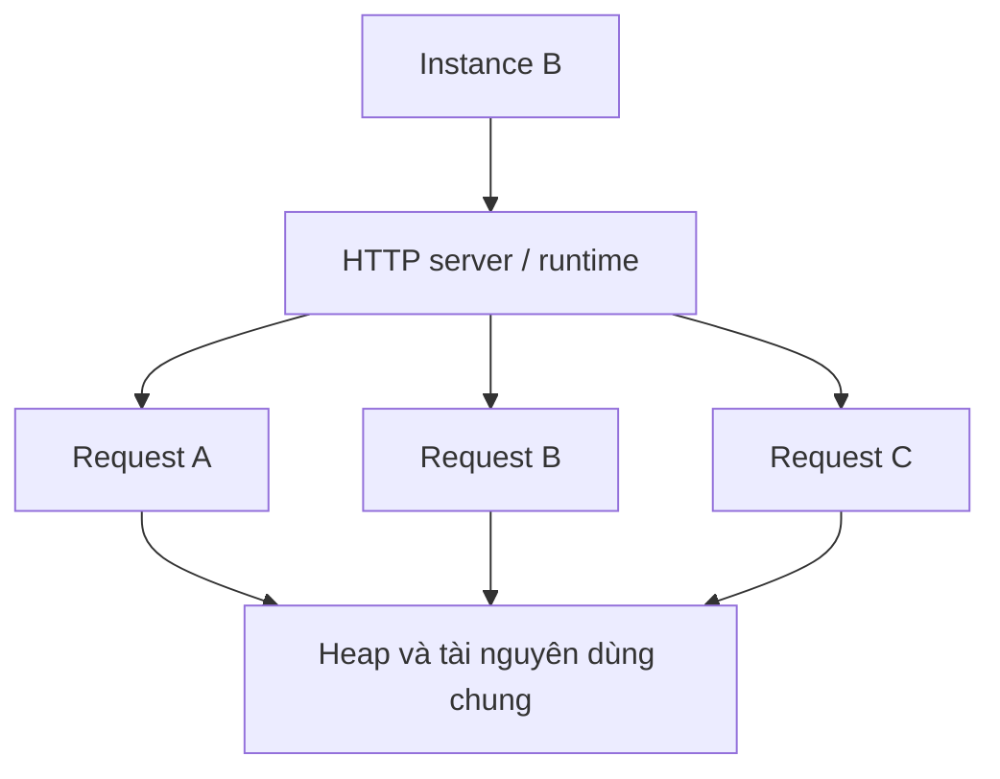
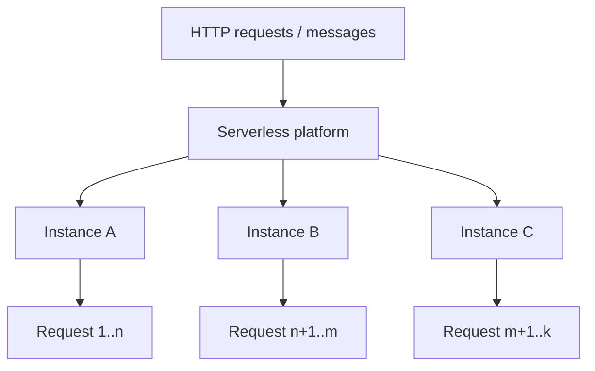
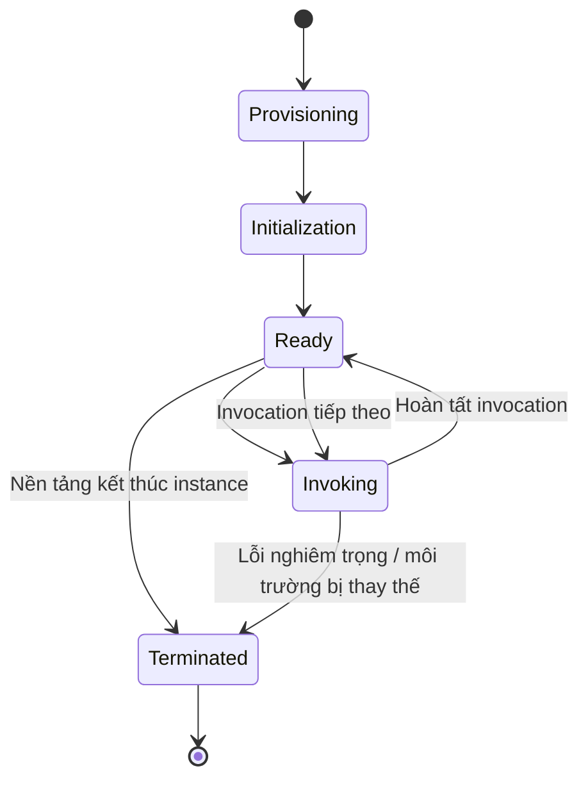

# Mô hình xử lý nhiều yêu cầu trong một instance

## 1. Vì sao cần hiểu cách một instance xử lý nhiều yêu cầu?

Trong mô hình serverless, nhà cung cấp cloud quản lý môi trường thực thi và quyết định khi nào tạo, tái sử dụng hoặc kết thúc môi trường đó. Một function có thể được gọi nhiều lần trong suốt thời gian một môi trường còn tồn tại. Tuy nhiên, cách các lần gọi được phân phối trong một môi trường phụ thuộc vào nền tảng, loại trigger và cấu hình concurrency.

Điểm này ảnh hưởng trực tiếp đến độ trễ, khả năng mở rộng, mức sử dụng bộ nhớ, an toàn luồng trong Java và cách quản lý tài nguyên dùng chung. Nếu giả định mọi lần gọi đều chạy trong một tiến trình mới, ứng dụng có thể khởi tạo lại client và kết nối không cần thiết. Nếu giả định một instance chỉ xử lý tuần tự trong khi nền tảng cho phép nhiều request đồng thời, các biến dùng chung có thể gây lỗi race condition hoặc làm lẫn dữ liệu giữa người dùng.

Trong phạm vi CLOUD_SERVERLESS, nội dung này tập trung vào vòng đời thực thi của Java function được kích hoạt bởi HTTP, thông điệp hoặc sự kiện. Cần phân biệt ba khái niệm: một instance có thể được tái sử dụng qua nhiều lần gọi; một instance có thể xử lý các lần gọi tuần tự hoặc đồng thời; và nền tảng có thể tạo nhiều instance để đáp ứng tổng tải.

## 2. Phân biệt instance, invocation và request

Các thuật ngữ sau thường xuất hiện cùng nhau nhưng không có cùng ý nghĩa:

| Khái niệm | Ý nghĩa | Ví dụ |
| --- | --- | --- |
| Instance / execution environment | Môi trường chạy được nền tảng cấp phát, thường gồm runtime, bộ nhớ và tiến trình ứng dụng | Một môi trường Java đã nạp class và khởi tạo handler |
| Invocation | Một lần nền tảng gọi function để xử lý đầu vào | Một lần gọi handler do HTTP request hoặc message kích hoạt |
| Request | Yêu cầu ở lớp ứng dụng hoặc giao thức | `POST /orders` với nội dung tạo đơn hàng |
| Event/message | Dữ liệu kích hoạt xử lý bất đồng bộ | `OrderCreated` được gửi vào queue |
| Batch | Một nhóm bản ghi được đóng gói trong cùng một invocation | Một lần gọi handler chứa 10 message từ queue |

Trong một số nền tảng HTTP, mỗi request được ánh xạ thành một invocation. Trong dịch vụ container serverless, một instance có thể nhận nhiều HTTP request đồng thời. Với trigger hàng đợi, một invocation có thể chứa một hoặc nhiều message tùy cấu hình batch. Vì vậy, số request, số message, số invocation và số instance không nhất thiết bằng nhau.

**Instance không phải là một lần gọi.** Instance là môi trường có vòng đời dài hơn một invocation. Nền tảng có thể tái sử dụng môi trường đó cho lần gọi tiếp theo hoặc kết thúc nó và tạo môi trường mới.

## 3. Hai mô hình xử lý nhiều lần gọi trong một instance

### 3.1. Tái sử dụng tuần tự (sequential reuse)

Ở mô hình tuần tự, một instance xử lý xong invocation hiện tại rồi mới nhận invocation tiếp theo. Khi xử lý xong, nền tảng có thể giữ môi trường lại để tái sử dụng. Runtime, class đã nạp, đối tượng handler và các tài nguyên dùng chung có thể vẫn còn trong bộ nhớ.


Trong mô hình này, trạng thái ở cấp instance có thể tồn tại từ lần gọi này sang lần gọi sau. Ví dụ, một HTTP client được tạo khi khởi tạo handler có thể được dùng lại để gọi dịch vụ bên ngoài. Một biến static đã được gán ở invocation trước cũng có thể còn giá trị ở invocation sau.

Một số nền tảng FaaS truyền thống áp dụng giới hạn một invocation đồng thời cho mỗi execution environment. Khi nhiều invocation đến cùng lúc, nền tảng thường tạo thêm execution environment hoặc đưa công việc vào hàng đợi theo cơ chế của dịch vụ. Đây là hành vi của nền tảng cụ thể, không phải quy tắc chung cho mọi sản phẩm mang tên serverless.

Tái sử dụng tuần tự giúp tránh chi phí khởi tạo runtime và dependency cho mỗi lần gọi. Dù vậy, không được dựa vào việc một instance chắc chắn sẽ được dùng lại. Nền tảng có thể kết thúc instance sau một khoảng thời gian, khi tải giảm, khi triển khai phiên bản mới hoặc khi cần thay thế môi trường.

### 3.2. Xử lý đồng thời trong cùng instance (concurrent requests)

Ở mô hình đồng thời, một instance có thể tiếp nhận nhiều request hoặc invocation trong khoảng thời gian xử lý chồng lấp. Ứng dụng có thể dùng nhiều thread, event loop hoặc cơ chế bất đồng bộ để xử lý chúng. Các request cùng chia sẻ heap, cấu hình, singleton và những tài nguyên ở cấp tiến trình.



Khả năng xử lý đồng thời trong một instance thường được điều khiển bởi cấu hình concurrency, giới hạn của runtime hoặc máy chủ HTTP bên trong instance. Một số dịch vụ container serverless cho phép đặt số request đồng thời trên mỗi instance. Một số nền tảng function lại giới hạn một invocation đồng thời trong một execution environment. Cần đọc tài liệu và cấu hình của đúng dịch vụ đang dùng, không suy ra hành vi chỉ từ ngôn ngữ Java hoặc từ chữ “serverless”.

Khi nhiều request chạy cùng lúc, các biến local của từng lần gọi có phạm vi riêng, nhưng field của singleton, biến static, cache trong bộ nhớ và client dùng chung có thể được truy cập đồng thời. Vì vậy, code phải an toàn luồng (thread-safe), hoặc phải giới hạn concurrency để phù hợp với thiết kế.

### 3.3. Mở rộng ngang bằng nhiều instance

Ngoài concurrency bên trong một instance, nền tảng còn có thể tạo nhiều instance để xử lý tải. Ví dụ, một instance nhận một số request đồng thời, sau đó bộ điều phối tạo thêm instance khi tổng tải tăng hoặc khi đạt giới hạn concurrency đã cấu hình.



Mỗi instance có bộ nhớ và trạng thái cục bộ riêng. Một biến static trong Instance A không tự động được chia sẻ với Instance B. Nếu ứng dụng cần dữ liệu dùng chung giữa các instance, dữ liệu đó phải nằm trong hệ thống bên ngoài như database, distributed cache, object storage hoặc dịch vụ messaging.

Tổng năng lực xử lý phụ thuộc cả số instance lẫn số request mà mỗi instance có thể xử lý đồng thời. Tăng concurrency trên mỗi instance có thể giảm số instance cần thiết, nhưng cũng làm tăng áp lực CPU, bộ nhớ, connection pool và dịch vụ phụ thuộc. Tăng số instance có thể tăng throughput, nhưng đồng thời tăng số kết nối và chi phí của các dịch vụ phía sau.

## 4. Vòng đời của một instance

Một vòng đời điển hình có thể được mô tả qua các giai đoạn sau. Tên gọi và chi tiết thực tế thay đổi theo nhà cung cấp:

1. **Provisioning:** nền tảng cấp phát môi trường thực thi và tài nguyên cần thiết.
2. **Runtime initialization:** khởi động runtime Java, nạp class và thư viện.
3. **Application initialization:** tạo handler, dependency injection container, client hoặc tài nguyên được khởi tạo ở cấp ứng dụng.
4. **Invocation:** nhận đầu vào, tạo context cho lần gọi và thực thi logic nghiệp vụ.
5. **Kết thúc invocation:** trả kết quả hoặc ghi nhận lỗi; tài nguyên thuộc riêng lần gọi cần được giải phóng.
6. **Reuse hoặc termination:** nền tảng có thể giữ instance để xử lý invocation sau hoặc kết thúc instance.



Lần gọi đầu tiên trong một môi trường mới thường được gọi là cold start vì phải trả thêm thời gian provisioning và initialization. Các lần gọi sau trên môi trường đã khởi tạo có thể là warm invocation. Warm invocation thường nhanh hơn vì runtime và một số tài nguyên đã sẵn sàng, nhưng nền tảng không cam kết instance sẽ tồn tại mãi.

Trong một số nền tảng, môi trường có thể bị tạm dừng hoặc đóng băng giữa các invocation rồi được tiếp tục khi có công việc mới. Ứng dụng không nên dựa vào việc thread nền sẽ tiếp tục chạy trong thời gian đó, cũng không nên coi khoảng thời gian giữa hai invocation là thời gian thực thi được bảo đảm.

## 5. Tài nguyên nào nên được tái sử dụng?

Khi instance được tái sử dụng, có thể giữ lại một số tài nguyên tốn thời gian khởi tạo. Quyết định cần dựa trên vòng đời và tính an toàn của tài nguyên.

| Loại dữ liệu hoặc tài nguyên | Có thể giữ ở cấp instance? | Lưu ý |
| --- | --- | --- |
| Cấu hình bất biến | Có | Nạp một lần nếu cấu hình không thay đổi trong vòng đời instance; khi triển khai phiên bản mới, instance mới có thể nhận cấu hình mới |
| HTTP client hoặc SDK client | Thường có | Tái sử dụng để tận dụng connection pool; kiểm tra tài liệu về thread safety của client |
| Dependency injection container và service stateless | Thường có | Singleton phải an toàn khi được gọi từ nhiều thread nếu nền tảng cho phép concurrency |
| Cache dữ liệu có thể tái tạo | Có điều kiện | Cần giới hạn kích thước, TTL và chấp nhận cache không đồng bộ giữa các instance |
| Request, user hoặc tenant hiện tại | Không | Phải nằm trong biến local hoặc context riêng của invocation |
| Kết quả nghiệp vụ cần tồn tại lâu dài | Không nên chỉ lưu trong instance | Ghi vào database hoặc kho bền vững |
| Khóa idempotency | Không nên chỉ lưu trong instance | Dùng kho bền vững để các instance khác nhau cùng kiểm tra được |
| Thread hoặc tác vụ nền kéo dài | Không nên dựa vào | Nền tảng có thể tạm dừng hoặc kết thúc instance sau invocation |

### 5.1. Tái sử dụng client và đối tượng dùng chung

Khởi tạo kết nối mạng, TLS, SDK client hoặc dependency injection container trong mọi invocation có thể làm tăng độ trễ và tạo nhiều kết nối không cần thiết. Nếu thư viện cho phép tái sử dụng an toàn, có thể khởi tạo client ở cấp class hoặc cấp handler.

Ví dụ Java dưới đây minh họa một handler giữ HTTP client dùng chung, còn context của mỗi request được tạo trong phương thức xử lý:

```java
import java.time.Instant;
import java.net.http.HttpClient;

public final class OrderFunction {
    // HttpClient của Java có thể được tái sử dụng giữa các request.
    private static final HttpClient HTTP_CLIENT = HttpClient.newHttpClient();

    // Service cần stateless hoặc thread-safe nếu instance xử lý đồng thời.
    private final OrderService orderService = new OrderService(HTTP_CLIENT);

    public OrderResponse handle(OrderRequest request) {
        RequestContext context = new RequestContext(
                request.requestId(),
                request.tenantId(),
                Instant.now());

        return orderService.createOrder(request, context);
    }
}

record RequestContext(String requestId, String tenantId, Instant receivedAt) {}
```

`HTTP_CLIENT` được dùng chung, trong khi `RequestContext` là dữ liệu riêng của lần gọi. Ví dụ giả định `OrderService` không lưu request hiện tại vào field có thể bị request khác ghi đè. Nếu service có cache hoặc bộ đếm mutable, cần xác định rõ cách đồng bộ và giới hạn kích thước.

### 5.2. Tránh giữ dữ liệu request trong field

Đoạn mã sau không an toàn khi nhiều request có thể chạy đồng thời trên cùng một đối tượng handler:

```java
public final class UnsafeOrderFunction {
    private final OrderService orderService;
    private String currentTenant;

    public UnsafeOrderFunction(OrderService orderService) {
        this.orderService = orderService;
    }

    public OrderResponse handle(OrderRequest request) {
        currentTenant = request.tenantId();
        return orderService.createOrder(request, currentTenant);
    }
}
```

Giả sử Request A ghi `tenant-A`, sau đó Request B ghi `tenant-B` trước khi A sử dụng `currentTenant`. Request A có thể chạy với tenant của B, dẫn đến lẫn dữ liệu hoặc vi phạm phân tách tenant.

Hãy chuyển dữ liệu theo tham số hoặc context cục bộ:

```java
public final class SafeOrderFunction {
    private final OrderService orderService;

    public SafeOrderFunction(OrderService orderService) {
        this.orderService = orderService;
    }

    public OrderResponse handle(OrderRequest request) {
        String tenantId = request.tenantId();
        return orderService.createOrder(request, tenantId);
    }
}
```

Biến local được tạo riêng cho mỗi lần thực thi phương thức. Tuy nhiên, việc dùng biến local không tự làm cho các đối tượng được tham chiếu trở nên thread-safe; nếu nhiều request cùng sửa một object mutable dùng chung, vẫn cần thiết kế đồng bộ phù hợp.

## 6. An toàn luồng trong ứng dụng Java

Khi concurrency lớn hơn một, nhiều luồng có thể cùng truy cập các đối tượng tồn tại suốt vòng đời instance. Các lỗi thường gặp gồm:

- **Race condition:** kết quả phụ thuộc vào thứ tự xen kẽ giữa các thao tác đọc và ghi.
- **Lost update:** hai request cùng đọc một giá trị rồi ghi đè kết quả của nhau.
- **Shared mutable state:** một request thay đổi field hoặc collection mà request khác đang sử dụng.
- **Resource contention:** nhiều request tranh chấp connection pool, lock, CPU hoặc giới hạn thread.
- **Context leakage:** thông tin người dùng, tenant hoặc correlation ID của request trước còn sót và bị request sau sử dụng.

### 6.1. Thiết kế service stateless

Ưu tiên thiết kế service nhận dữ liệu qua tham số, dùng biến local và trả kết quả. Những field dùng chung nên là bất biến sau khi khởi tạo hoặc là thành phần có hợp đồng thread-safe rõ ràng.

```java
public final class PriceService {
    private final PricingRules rules;

    public PriceService(PricingRules rules) {
        this.rules = rules;
    }

    public Price calculate(Order order, Customer customer) {
        // Không lưu order hoặc customer vào field của service.
        return rules.priceFor(order, customer);
    }
}
```

Nếu cần bộ đếm dùng chung trong một instance, có thể dùng `AtomicLong` hoặc cơ chế đồng bộ phù hợp. Nhưng bộ đếm trong bộ nhớ chỉ phản ánh instance hiện tại; nó không phải tổng số toàn hệ thống và sẽ mất khi instance kết thúc. Nếu cần số liệu chuẩn hoặc cập nhật nghiệp vụ, hãy dùng database hoặc hệ thống metrics phù hợp.

### 6.2. Singleton và dependency injection

Nhiều framework Java tạo bean singleton trong application context. Khi runtime tái sử dụng context qua nhiều request, singleton cũng được tái sử dụng. Một bean singleton chứa dependency bất biến hoặc client thread-safe thường phù hợp. Bean singleton chứa field như `currentUser`, `currentRequest`, danh sách kết quả tạm hoặc buffer mutable không được bảo vệ có thể gây lỗi khi có concurrency.

Scope của bean cần phù hợp với mô hình gọi thực tế. Nếu framework cung cấp request scope, scope đó chỉ có ý nghĩa khi adapter tạo và kết thúc request context đúng cách. Không nên giả định một request-scoped bean luôn tồn tại trong mọi loại trigger; message handler và scheduled event có thể không có HTTP request context.

### 6.3. Thận trọng với ThreadLocal

`ThreadLocal` đôi khi được dùng để gắn correlation ID hoặc context vào thread hiện tại. Tuy nhiên, thread pool có thể tái sử dụng thread cho request khác. Nếu không xóa giá trị trong `finally`, dữ liệu request trước có thể rò sang request sau. Với xử lý bất đồng bộ, context còn có thể không tự truyền sang thread khác.

Nếu buộc phải dùng `ThreadLocal`, luôn dọn dẹp:

```java
public final class RequestContextHolder {
    private static final ThreadLocal<String> REQUEST_ID = new ThreadLocal<>();

    public static void set(String requestId) {
        REQUEST_ID.set(requestId);
    }

    public static String get() {
        return REQUEST_ID.get();
    }

    public static void clear() {
        REQUEST_ID.remove();
    }
}

// Tại ranh giới xử lý request:
Response handle(Request request, OrderService service) {
    try {
        RequestContextHolder.set(request.requestId());
        return service.handle(request);
    } finally {
        RequestContextHolder.clear();
    }
}
```

Nếu framework đã có cơ chế truyền context theo request hoặc theo reactive pipeline, nên ưu tiên cơ chế đó để tránh quản lý ThreadLocal thủ công.

## 7. Quản lý connection pool và tài nguyên có giới hạn

Tái sử dụng instance thường giúp tái sử dụng client và pool kết nối. Tuy nhiên, khi concurrency tăng, số request cùng mượn kết nối cũng tăng. Một pool quá nhỏ làm request chờ lâu; một pool quá lớn trên nhiều instance có thể vượt giới hạn kết nối của database.

Ví dụ, nếu nền tảng chạy 20 instance và mỗi instance có pool tối đa 10 kết nối, tổng số kết nối tiềm năng có thể lên đến 200. Con số thực tế còn phụ thuộc pool có mở kết nối lười hay không và số request đồng thời. Vì vậy, cần tính tổng kết nối theo số instance tối đa, số kết nối mỗi instance và các ứng dụng khác cùng truy cập database.

Các nguyên tắc thực hành:

- Tái sử dụng client hoặc pool nếu thư viện hỗ trợ và có cách đóng tài nguyên khi phù hợp.
- Đặt giới hạn pool dựa trên concurrency và giới hạn của database.
- Đặt timeout khi chờ connection, timeout truy vấn và giới hạn thời gian request.
- Giải phóng connection, stream, file handle và lock trong `try-with-resources` hoặc `finally`.
- Cân nhắc database proxy hoặc dịch vụ quản lý kết nối khi số instance có thể tăng nhanh.
- Theo dõi pool utilization, số lần chờ, connection timeout và số kết nối thực tế ở database.

Không nên tạo một pool mới cho mỗi request nếu pool có thể được dùng chung an toàn. Ngược lại, cũng không nên dùng một client không thread-safe từ nhiều request đồng thời chỉ vì nó được khai báo `static`.

## 8. Xử lý message theo batch khác với concurrency của instance

Với trigger hàng đợi hoặc stream, nền tảng có thể gom nhiều message vào một invocation. Ví dụ, một lần gọi handler nhận danh sách 10 message và vòng lặp xử lý từng message. Đây là batch processing: một invocation chứa nhiều bản ghi.

Ứng dụng có thể xử lý batch tuần tự hoặc chủ động xử lý song song bên trong invocation. Nếu xử lý song song, cần giới hạn số tác vụ đồng thời, bảo đảm dependency thread-safe và xác định cách báo lỗi từng message. Nếu nền tảng hỗ trợ partial batch response, handler có thể chỉ ra những message cần được gửi lại; nếu không, một message lỗi có thể khiến cả batch được giao lại tùy dịch vụ.

Batch processing không đồng nghĩa nền tảng đang chạy nhiều invocation đồng thời trên cùng một instance. Đây là hai lớp concurrency khác nhau:

| Lớp xử lý | Ví dụ | Cần kiểm soát |
| --- | --- | --- |
| Nhiều bản ghi trong một invocation | Một handler nhận batch 10 message | Vòng lặp, xử lý song song trong ứng dụng, partial failure và timeout |
| Nhiều invocation đồng thời trong một instance | Nhiều HTTP request chạy chồng lấp trong một container | Thread safety, request context, pool và giới hạn concurrency |
| Nhiều instance chạy song song | Nền tảng tạo nhiều môi trường để tăng throughput | Trạng thái dùng chung, quota, kết nối database và tổng chi phí |

## 9. Lỗi, retry và tính lặp an toàn khi instance được tái sử dụng

Việc cùng một instance xử lý nhiều invocation không bảo đảm một request chỉ được thực hiện một lần. HTTP client có thể retry, queue có thể giao lại message, nền tảng có thể gọi lại sau timeout hoặc người dùng gửi lại thao tác. Idempotency vẫn phải được thiết kế ở cấp nghiệp vụ.

Ngoài ra, lỗi ở invocation hiện tại không được để lại trạng thái mutable dở dang làm hỏng invocation tiếp theo. Hãy khởi tạo context riêng cho mỗi request, đóng tài nguyên trong `finally`, xóa ThreadLocal, hoàn nguyên trạng thái tạm và ghi trạng thái nghiệp vụ vào kho bền vững theo giao dịch phù hợp.

Ví dụ, nếu một request cập nhật field `currentOrder` trên singleton rồi gặp exception trước khi xóa field, request tiếp theo có thể vô tình đọc đơn hàng cũ. Thiết kế service stateless và dùng biến local giúp thu hẹp loại lỗi này.

Với message, nên dùng event ID hoặc business key làm khóa idempotency trong kho bền vững. Không dùng một `HashSet` static trong instance làm nơi chống trùng duy nhất: instance khác không nhìn thấy set đó và dữ liệu mất khi instance bị kết thúc.

## 10. Cấu hình concurrency và cân bằng tài nguyên

Concurrency trên mỗi instance là một tham số vận hành cần được chọn dựa trên workload. Giá trị cao có thể tận dụng CPU và giảm số instance, nhưng cũng làm tăng số request tranh chấp tài nguyên. Giá trị thấp có thể giảm cạnh tranh trong instance nhưng làm nền tảng cần nhiều instance hơn để đáp ứng cùng tải.

Khi đánh giá cấu hình, cần xem xét:

- **Đặc tính request:** CPU-bound, I/O-bound, thời gian xử lý trung bình và phân bố p95/p99.
- **Bộ nhớ:** lượng heap mỗi request, kích thước object và khả năng rò rỉ bộ nhớ.
- **Threading model:** số thread, event loop, blocking call và thread pool của framework.
- **Dịch vụ phụ thuộc:** giới hạn kết nối database, rate limit của API ngoài và throughput của queue.
- **Giới hạn nền tảng:** concurrency tối đa mỗi instance, số instance tối đa, timeout và quota theo tài khoản.
- **Chi phí:** số instance, thời gian thực thi, cấu hình CPU/bộ nhớ và dịch vụ phụ trợ.

Không nên tăng concurrency chỉ để giảm số instance nếu ứng dụng đang bị giới hạn bởi database hoặc API ngoài. Khi đó, nhiều request hơn trên một instance có thể chỉ làm hàng đợi nội bộ dài hơn và tăng timeout. Ngược lại, nếu workload chủ yếu chờ I/O và các client đều hỗ trợ concurrency an toàn, tăng concurrency có thể cải thiện mức sử dụng tài nguyên.

Nên đo tải với nhiều mức concurrency và theo dõi throughput, latency p95/p99, tỷ lệ lỗi, CPU, heap, số thread, connection pool, số instance và backlog. Thử nghiệm phải dùng dữ liệu và dịch vụ phụ thuộc gần với môi trường thật.

## 11. Ví dụ luồng xử lý HTTP

Giả sử một dịch vụ nhận request `POST /orders` và chạy trong một nền tảng container serverless có concurrency trên mỗi instance lớn hơn một. Ba request có thể được gửi đến cùng instance trong thời gian chồng lấp:

1. Runtime nhận request và tạo context riêng cho từng request.
2. Handler gọi `OrderService` dùng chung. Service không lưu tenant hoặc đơn hàng hiện tại vào field mutable.
3. Mỗi request tạo context local gồm request ID, tenant ID và thời điểm nhận.
4. HTTP client dùng chung được tái sử dụng để gọi dịch vụ tồn kho; pool kết nối giới hạn số kết nối đang mở.
5. Kết quả của mỗi request được trả về riêng. Log và trace gắn correlation ID để có thể phân biệt các luồng.
6. Khi tải tăng vượt năng lực cấu hình của instance, nền tảng có thể tạo thêm instance. Các instance cùng dùng database làm nguồn dữ liệu chuẩn.

Nếu cùng ví dụ chạy trên nền tảng chỉ cho phép một invocation tại một execution environment, các request đồng thời sẽ được xử lý ở những environment khác nhau hoặc được xếp lịch theo cơ chế nền tảng. Khi instance được tái sử dụng tuần tự, HTTP client vẫn có thể được dùng lại; code vẫn phải tránh lưu trạng thái request vào field vì request tiếp theo có thể dùng lại chính handler đó.

## 12. Checklist thiết kế cho Java function

Trước khi triển khai, hãy kiểm tra các điểm sau:

- Đã xác định nền tảng xử lý một hay nhiều invocation đồng thời trên mỗi instance chưa?
- Đã phân biệt batch message với nhiều invocation đồng thời chưa?
- Đối tượng handler, singleton và static field nào được giữ qua các invocation?
- Dữ liệu request, user, tenant và correlation ID có được giữ riêng trong context của từng lần gọi không?
- Client và SDK dùng chung có thread-safe theo tài liệu của thư viện không?
- Cache trong bộ nhớ có TTL, giới hạn kích thước và chấp nhận được việc mỗi instance có cache riêng không?
- ThreadLocal và tài nguyên theo request có được dọn dẹp kể cả khi exception không?
- Connection pool có phù hợp với concurrency mỗi instance và số instance tối đa không?
- Các thao tác nghiệp vụ có idempotent khi nền tảng hoặc client retry không?
- Trạng thái cần tồn tại lâu dài đã được lưu trong hệ thống bền vững chưa?
- Đã đo cold start, warm latency, throughput, p95/p99, lỗi và chi phí ở mức tải dự kiến chưa?

## 13. Những hiểu lầm thường gặp

| Hiểu lầm | Thực tế cần nhớ |
| --- | --- |
| Một function invocation luôn có một instance mới | Nền tảng có thể tái sử dụng instance qua nhiều invocation |
| Instance đã warm chắc chắn được dùng lại | Việc tái sử dụng là quyết định của nền tảng và không được bảo đảm vô thời hạn |
| Mỗi instance luôn chỉ xử lý một request tại một thời điểm | Concurrency trên mỗi instance phụ thuộc dịch vụ, trigger và cấu hình |
| Khai báo biến `static` làm dữ liệu dùng chung toàn hệ thống | Biến static chỉ thuộc một runtime/instance và có thể mất khi instance kết thúc |
| Singleton luôn an toàn vì chỉ có một đối tượng | Một singleton có thể được nhiều thread truy cập đồng thời |
| Dùng biến local là mọi thứ đã thread-safe | Đối tượng mutable được tham chiếu vẫn có thể là tài nguyên dùng chung |
| Một batch message tương đương nhiều invocation | Batch là nhiều bản ghi trong một invocation; concurrency invocation là lớp khác |
| Dùng cache trong instance đủ để chống xử lý trùng | Các instance không chia sẻ cache; idempotency cần kho bền vững khi phải áp dụng toàn hệ thống |

## 14. Kết luận

Một instance serverless có thể được tái sử dụng qua nhiều lần gọi. Các lần gọi có thể diễn ra tuần tự hoặc đồng thời tùy nền tảng và cấu hình; đồng thời nền tảng có thể mở rộng ngang bằng cách tạo thêm instance. Ba cơ chế này tác động khác nhau đến trạng thái trong bộ nhớ, an toàn luồng, kết nối và chi phí.

Với Java, hãy tái sử dụng những tài nguyên khởi tạo tốn kém và an toàn khi dùng chung, giữ dữ liệu request trong context riêng, thiết kế singleton stateless hoặc thread-safe, quản lý pool theo concurrency và lưu trạng thái nghiệp vụ trong hệ thống bền vững. Luôn xác minh concurrency model của dịch vụ đang triển khai và đo hành vi thực tế trước khi chọn cấu hình production.
