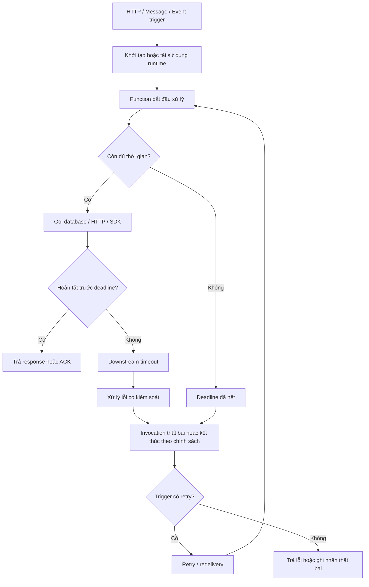
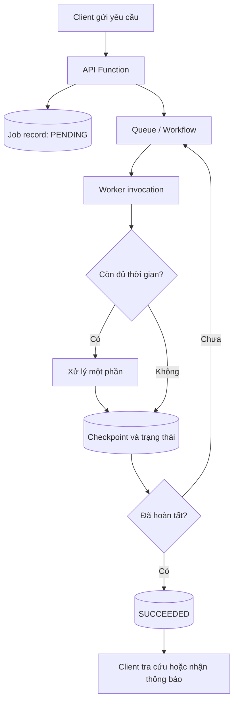

# Thời hạn xử lý và hành vi khi function bị timeout

Mỗi lần một serverless function được kích hoạt đều có một khoảng thời gian để hoàn thành. Khoảng thời gian này bị giới hạn bởi cấu hình của nền tảng và bởi các deadline ở những lớp xung quanh như HTTP gateway, client, queue hoặc dịch vụ downstream. Khi function không hoàn tất trước thời hạn, nền tảng có thể kết thúc invocation và ghi nhận timeout. Hệ quả không chỉ là một request thất bại: công việc có thể đã tạo ra một phần tác động, thông điệp có thể được giao lại, và lần thử tiếp theo có thể chạy đồng thời hoặc lặp lại tác động trước đó.

Vì vậy, timeout cần được thiết kế như một phần của vòng đời thực thi. Ứng dụng phải biết thời gian còn lại, giới hạn từng lời gọi phụ thuộc, dừng công việc khi không còn đủ thời gian và bảo vệ các thao tác có tác động nghiệp vụ bằng idempotency. Với Java function, việc đặt timeout cho HTTP client, JDBC và SDK cũng quan trọng như cấu hình timeout của function trên nền tảng.

## 1. Phân biệt timeout và deadline

Các khái niệm sau thường xuất hiện cùng nhau nhưng đại diện cho những giới hạn khác nhau:

| Khái niệm | Ý nghĩa | Ví dụ |
| --- | --- | --- |
| Function timeout | Thời gian chạy tối đa của một invocation do nền tảng áp dụng | Function được cấu hình tối đa 10 giây |
| Deadline | Thời điểm tuyệt đối mà toàn bộ công việc cần hoàn tất | Request phải có kết quả trước 18:30:05 |
| Client timeout | Thời gian client chờ phản hồi | Trình duyệt hoặc service gọi chờ tối đa 8 giây |
| Gateway/integration timeout | Thời gian gateway chờ function hoặc backend trả kết quả | API gateway ngừng chờ sau 7 giây |
| Downstream timeout | Thời gian tối đa cho một thao tác phụ thuộc | Truy vấn database tối đa 2 giây |
| Idle timeout | Khoảng thời gian kết nối không có dữ liệu trước khi bị đóng | Kết nối HTTP hoặc TCP bị đóng khi nhàn rỗi |

Function timeout thường là giới hạn cứng do nền tảng thực thi. Deadline là khái niệm ở cấp ứng dụng: nó giúp các bước bên trong biết tổng thời gian còn lại và chủ động dừng trước khi nền tảng phải cưỡng chế kết thúc. Một invocation có thể gặp timeout của database trước khi chạm function timeout; cũng có thể gateway hết thời gian chờ trong khi function vẫn đang chạy, tùy cách tích hợp và nền tảng.

Không nên coi timeout của client, gateway, function và downstream là cùng một con số. Mỗi lớp cần có giới hạn phù hợp với vai trò của nó và phải để lại khoảng dự phòng cho lớp gọi xử lý kết quả.

## 2. Vòng đời khi invocation tiến đến giới hạn thời gian

Một invocation thường đi qua các giai đoạn: nhận trigger, chuẩn bị môi trường thực thi nếu cần, chạy logic nghiệp vụ, gọi dịch vụ phụ thuộc và trả kết quả hoặc xác nhận sự kiện. Nền tảng theo dõi thời gian invocation theo quy tắc của dịch vụ. Nếu vượt quá giới hạn, nó đánh dấu lần chạy thất bại do timeout và kết thúc thực thi theo cơ chế riêng.



Nếu function chạm giới hạn cứng của nền tảng, runtime có thể bị dừng ngay. Không thể giả định ứng dụng luôn được chạy `finally`, shutdown hook, callback hoàn tất hoặc đoạn code ghi log cuối cùng. Cách dừng chính xác tùy nhà cung cấp và runtime, nhưng thiết kế an toàn phải xem việc bị ngắt đột ngột là tình huống có thể xảy ra.

Điều này dẫn đến một nguyên tắc quan trọng: mọi dữ liệu cần tồn tại sau invocation phải được ghi vào hệ thống lưu trữ bền vững trước khi function kết thúc. Bộ nhớ heap, biến `static`, thread nền hoặc file tạm trong môi trường function không phải nơi lưu trạng thái có thể khôi phục sau timeout.

## 3. Timeout tác động khác nhau theo trigger

Timeout của function là một sự kiện ở tầng thực thi. Hành vi bên ngoài còn phụ thuộc trigger và giao thức mà function sử dụng.

| Kiểu kích hoạt | Điều bên gọi có thể quan sát | Điều có thể xảy ra tiếp theo |
| --- | --- | --- |
| HTTP đồng bộ | Client hoặc gateway nhận lỗi timeout, lỗi tích hợp hoặc kết nối bị đóng | Client có thể gửi lại; function có thể đã thực hiện một phần side effect trước khi bị dừng |
| Queue/message bất đồng bộ | Producer thường không nhận trực tiếp kết quả xử lý cuối cùng | Message có thể được giao lại sau visibility timeout hoặc theo retry policy |
| Event bus hoặc stream | Event source ghi nhận lần xử lý thất bại theo cơ chế của nó | Bản ghi có thể được retry, giữ lại, bỏ qua hoặc chuyển sang luồng lỗi tùy cấu hình |
| Lịch chạy (schedule) | Lần chạy của lịch có thể bị đánh dấu lỗi | Lịch tiếp theo vẫn có thể chạy; có chồng lấn hay không phụ thuộc scheduler và cơ chế khóa |
| Batch | Một phần bản ghi có thể đã được xử lý trước khi batch thất bại | Cả batch hoặc chỉ bản ghi lỗi có thể được thử lại, tùy khả năng báo lỗi từng phần |

### HTTP đồng bộ

Trong luồng HTTP, có nhiều bên cùng chờ: client chờ gateway, gateway chờ function, function chờ dịch vụ downstream. Nếu gateway hết thời gian chờ trước function, client có thể nhận `504 Gateway Timeout` dù function vẫn đang chạy. Nếu function timeout trước, gateway có thể chuyển lỗi thực thi thành phản hồi lỗi khác. Mã trạng thái và khả năng hủy invocation phụ thuộc nền tảng.

Việc client đóng kết nối hoặc ngừng chờ cũng không đảm bảo function tự động dừng. Nếu function vẫn tiếp tục và ghi dữ liệu sau khi client đã nhận timeout, client gửi lại request có thể tạo ra hai tác động. Vì thế, endpoint có thao tác ghi dữ liệu nên nhận một khóa idempotency ổn định hoặc mã yêu cầu duy nhất.

### Message và event bất đồng bộ

Với queue, function thường chỉ xác nhận message sau khi xử lý thành công theo giao thức của event source. Nếu timeout xảy ra trước khi xác nhận, message có thể được giao lại. Thời gian visibility hoặc cơ chế lease phải đủ dài cho lần xử lý dự kiến và phù hợp với thời hạn tối đa của function. Nếu lease hết trong khi invocation cũ vẫn chạy, một consumer khác có thể nhận cùng message và xử lý đồng thời.

Với stream hoặc event source khác, cách retry có thể ảnh hưởng đến cả shard, partition hoặc batch. Cần đọc chính sách retry, checkpoint, batch window và giới hạn thời gian của đúng dịch vụ. Không thể suy ra mọi event source đều giao lại một bản ghi theo cùng cách.

## 4. Side effect và trạng thái khi timeout

Timeout không phải một giao dịch rollback. Nếu function đã gửi email, tạo bản ghi, trừ tiền hoặc phát sự kiện trước khi bị dừng, các tác động đó có thể vẫn tồn tại. Việc invocation bị đánh dấu thất bại chỉ cho biết nền tảng không ghi nhận xử lý hoàn tất theo giao thức của nó.

Ví dụ, một function xử lý đơn hàng thực hiện các bước sau:

1. Ghi đơn hàng vào database.
2. Gọi dịch vụ thanh toán.
3. Phát sự kiện `OrderPaid`.
4. Trả phản hồi HTTP.

Nếu function timeout sau bước 2 nhưng trước bước 3, lần retry có thể tạo lại yêu cầu thanh toán. Nếu timeout sau bước 3 nhưng trước khi gửi ACK, event source có thể giao lại message và khiến sự kiện được phát lần nữa. Cả hai trường hợp đều cho thấy không thể dựa vào việc function chạy đúng một lần.

Các biện pháp bảo vệ gồm:

- Dùng khóa idempotency hoặc event ID ổn định xuyên suốt các lần thử.
- Ghi nhận trạng thái xử lý và kết quả của thao tác một cách bền vững.
- Dùng unique constraint hoặc conditional write để ngăn hai invocation cùng tạo một kết quả.
- Với database và message broker, cân nhắc transactional outbox/inbox để lưu thay đổi nghiệp vụ và sự kiện trong một giao dịch phù hợp.
- Chỉ ACK message sau khi kết quả cần thiết đã được lưu bền vững.
- Có quy trình đối soát cho các trạng thái không rõ kết quả, ví dụ client timeout nhưng thanh toán có thể đã thành công.

Idempotency không làm invocation miễn phí và cũng không tự động hoàn tác tác động một phần. Nó giúp lần thử lại nhận diện công việc đã được thực hiện và trả lại kết quả đã lưu hoặc bỏ qua thao tác trùng lặp một cách an toàn.

## 5. Chọn timeout theo deadline của toàn bộ luồng

Một cách thiết kế thực tế là đặt ngân sách thời gian từ ngoài vào trong. Lớp bên ngoài phải chờ đủ lâu để lớp bên trong hoàn thành và trả kết quả có kiểm soát. Các thao tác downstream phải kết thúc trước function để còn thời gian xử lý lỗi, ghi trạng thái và trả response.

Ví dụ một API có ngân sách tổng cộng 8 giây có thể phân bổ giả định như sau:

| Lớp | Giới hạn ví dụ | Mục đích |
| --- | ---: | --- |
| Client | 8 giây | Giới hạn thời gian người dùng chờ |
| Gateway | 7 giây | Có thời gian nhận và chuyển phản hồi từ function |
| Function | 6 giây | Có khoảng dự phòng trước gateway timeout |
| Một lời gọi downstream | Tối đa 2 giây | Không để một phụ thuộc chiếm hết ngân sách |
| Xử lý lỗi và trả response | Khoảng 0,5–1 giây dự phòng | Ghi trạng thái, tạo log cần thiết và trả lỗi rõ ràng |

Các con số chỉ minh họa cách phân bổ, không phải cấu hình chuẩn cho mọi nền tảng. Cần xác minh giới hạn tối đa, đơn vị cấu hình và hành vi timeout của gateway, runtime và dịch vụ phụ thuộc đang dùng.

Khi chọn giá trị, hãy dựa trên các yếu tố sau:

1. **SLA đầu cuối:** thời gian tối đa mà người gọi hoặc nghiệp vụ chấp nhận.
2. **Đo lường thực tế:** p50, p95 và p99 của thời gian xử lý dưới tải bình thường và tải cao. Trung bình không phản ánh tốt các trường hợp chậm.
3. **Cold start:** tính cả độ trễ khởi tạo nếu nó nằm trong ngân sách deadline hoặc được tính vào thời gian invocation.
4. **Downstream:** đặt timeout cho từng HTTP call, truy vấn, giao dịch và SDK operation; không để một thao tác chờ vô hạn.
5. **Retry:** dự tính tổng thời gian của tất cả lần thử, backoff và thời gian chờ message. Không đặt một timeout dài rồi để retry lồng nhau kéo dài ngoài SLA.
6. **Khả năng hoàn tất:** nếu tác vụ thường xuyên vượt giới hạn, chia nhỏ công việc hoặc chuyển sang xử lý bất đồng bộ thay vì liên tục tăng timeout.

Một timeout quá ngắn tạo lỗi giả và retry không cần thiết. Timeout quá dài giữ tài nguyên trong lúc downstream có thể đã hỏng, làm tăng độ trễ và chi phí. Giá trị phù hợp phải vừa đủ cho công việc hợp lệ, đồng thời đủ ngắn để hệ thống phục hồi khi có sự cố.

## 6. Truyền deadline và đặt timeout trong Java

Chỉ cấu hình function timeout ở console hoặc Infrastructure as Code là chưa đủ. Mỗi lời gọi phụ thuộc cần nhận phần thời gian còn lại của invocation. Nếu function còn 1 giây nhưng HTTP client vẫn chờ 30 giây, runtime có thể kết thúc function giữa lúc lời gọi chưa hoàn tất.

### Tạo deadline theo thời gian đơn điệu

Để đo thời gian còn lại trong một process, nên dùng `System.nanoTime()` thay vì `System.currentTimeMillis()`. Đồng hồ đơn điệu không bị điều chỉnh bởi đồng bộ thời gian hệ thống. Ví dụ sau minh họa một đối tượng deadline đơn giản:

```java
import java.time.Duration;

public final class InvocationDeadline {
    private final long deadlineNanos;

    public InvocationDeadline(Duration budget) {
        if (budget.isNegative() || budget.isZero()) {
            throw new IllegalArgumentException("budget must be positive");
        }
        this.deadlineNanos = System.nanoTime() + budget.toNanos();
    }

    public Duration remaining() {
        long nanos = deadlineNanos - System.nanoTime();
        if (nanos <= 0) {
            throw new IllegalStateException("Invocation deadline exceeded");
        }
        return Duration.ofNanos(nanos);
    }

    public Duration remainingMinus(Duration reserve) {
        Duration usable = remaining().minus(reserve);
        if (usable.isNegative() || usable.isZero()) {
            throw new IllegalStateException("Insufficient time for next operation");
        }
        return usable;
    }
}
```

Khi runtime cung cấp thời gian còn lại của invocation, hãy dùng thông tin đó làm ngân sách ban đầu hoặc chuyển thành deadline nội bộ. Nếu không có API như vậy, có thể tạo deadline từ ngân sách ứng dụng đã biết, nhưng phải chừa biên an toàn cho thời gian khởi tạo và trả kết quả.

### Áp dụng deadline cho HTTP client

Với Java `HttpClient`, có thể đặt timeout trên từng request dựa trên thời gian còn lại. Dành trước một khoảng cho việc xử lý lỗi và trả response:

```java
import java.net.URI;
import java.net.http.HttpClient;
import java.net.http.HttpRequest;
import java.net.http.HttpResponse;
import java.time.Duration;

public final class PartnerClient {
    private final HttpClient client = HttpClient.newHttpClient();

    public HttpResponse<String> fetch(
            URI uri,
            InvocationDeadline deadline
    ) throws Exception {
        Duration requestBudget = deadline.remainingMinus(Duration.ofMillis(300));

        HttpRequest request = HttpRequest.newBuilder(uri)
                .timeout(requestBudget)
                .GET()
                .build();

        return client.send(request, HttpResponse.BodyHandlers.ofString());
    }
}
```

Ví dụ này đặt giới hạn cho một HTTP request. Trong ứng dụng thật, cần xử lý riêng `HttpTimeoutException`, lỗi kết nối, phản hồi lỗi HTTP và `InterruptedException`. Khi bắt `InterruptedException`, hãy khôi phục cờ interrupt bằng `Thread.currentThread().interrupt()` trước khi truyền lỗi lên tầng gọi. Đừng nuốt interrupt vì đó có thể là tín hiệu yêu cầu dừng công việc.

### Áp dụng cho database và SDK

Với JDBC, có thể đặt query timeout bằng `Statement.setQueryTimeout(...)`, transaction timeout hoặc cấu hình riêng của driver. API JDBC phổ biến dùng đơn vị giây nên độ chính xác có thể thô; hãy kiểm tra driver và database. Cũng cần đặt giới hạn thời gian chờ lấy connection từ pool, vì query timeout không bao phủ thời gian chờ connection.

Với cloud SDK, cấu hình cả connection timeout, socket/read timeout, API call timeout và retry policy theo khả năng của SDK. Timeout kết nối chỉ giới hạn việc thiết lập kết nối; nó không nhất thiết giới hạn toàn bộ request. Một API call có thể bao gồm nhiều lần thử, do đó cần tính tổng ngân sách của cả retry.

Các hàm như `Future.get(timeout, unit)` hoặc `CompletableFuture.orTimeout(...)` giới hạn thời gian chờ của caller. Chúng không tự đảm bảo tác vụ bên dưới đã dừng hoặc side effect đã bị hủy. Cần kiểm tra cơ chế cancellation của thư viện, đóng tài nguyên phù hợp và vẫn dùng idempotency cho thao tác có thể đã được gửi đi.

## 7. Retry, backoff và DLQ sau timeout

Timeout thường được xem là lỗi có thể thử lại, nhưng retry mọi timeout một cách vô điều kiện có thể làm tình trạng tắc nghẽn nặng hơn. Ví dụ, database chậm khiến function timeout; event source giao lại message; nhiều invocation mới cùng truy vấn database; database càng chậm và tỷ lệ timeout tiếp tục tăng. Đây là vòng lặp khuếch đại tải.

Một chính sách retry tốt cần:

- Giới hạn số lần thử và tổng thời gian retry.
- Dùng exponential backoff kèm jitter để tránh nhiều consumer retry cùng thời điểm.
- Phân biệt lỗi tạm thời với lỗi dữ liệu hoặc lỗi cấu hình không thể tự phục hồi.
- Tránh retry lồng nhau ở nhiều tầng mà không có ngân sách chung; ba tầng mỗi tầng thử lại ba lần có thể tạo ra số lời gọi lớn hơn dự kiến.
- Giữ idempotency key xuyên suốt các lần thử và lưu kết quả đã hoàn tất.
- Chuyển message không xử lý được sang dead-letter queue (DLQ) hoặc luồng lỗi sau giới hạn phù hợp.
- Theo dõi tuổi message, số lần nhận, timeout và số lượng bản ghi trong DLQ.

Nếu timeout xảy ra sau khi dịch vụ phụ thuộc đã nhận yêu cầu nhưng trước khi function nhận được phản hồi, kết quả có thể ở trạng thái không xác định. Không nên lập tức thực hiện lại một thao tác không idempotent. Hãy truy vấn trạng thái bằng request ID hoặc idempotency key, đối soát kết quả, rồi mới quyết định thử lại.

## 8. Timeout trong xử lý batch

Khi function xử lý một batch message, thời gian invocation phải đủ cho cả batch và phần dự phòng. Batch lớn giảm số lần invocation nhưng làm tăng thời gian xử lý, lượng bộ nhớ và phạm vi ảnh hưởng nếu batch timeout.

Giả sử batch có 100 bản ghi và function xử lý được 90 bản ghi trước khi timeout. Nếu event source chỉ hỗ trợ retry cả batch, 90 bản ghi đã xử lý có thể chạy lại. Nếu hỗ trợ partial batch response hoặc checkpoint theo bản ghi, function có thể chỉ yêu cầu thử lại phần chưa hoàn tất. Cơ chế cụ thể phụ thuộc trigger.

Khi thiết kế batch:

1. Đo thời gian xử lý p95/p99 cho từng bản ghi và kích thước batch đại diện.
2. Chọn batch size và batch window sao cho có đủ thời gian hoàn thành trước function timeout.
3. Dùng idempotency theo từng bản ghi, không chỉ theo ID của cả batch.
4. Lưu tiến độ hoặc kết quả theo cách bền vững nếu công việc có nhiều bước.
5. Dùng partial batch failure khi event source hỗ trợ và trả đúng danh sách bản ghi cần retry.
6. Kiểm tra timeout, visibility/lease và retry policy phối hợp với nhau để tránh hai consumer xử lý cùng bản ghi.

## 9. Khi công việc không thể hoàn tất trong một invocation

Tăng timeout chỉ phù hợp khi công việc có thời lượng hữu hạn và nằm trong giới hạn của nền tảng. Với tác vụ kéo dài, có thể chuyển sang mô hình chia nhỏ và điều phối:

- Nhận request, xác thực và ghi một job record với trạng thái `PENDING`.
- Đưa job ID vào queue hoặc workflow engine.
- Worker xử lý một phần công việc trong mỗi invocation, lưu checkpoint và trạng thái.
- Nếu gần hết deadline, worker lưu tiến độ rồi kết thúc có kiểm soát để lần chạy sau tiếp tục.
- Khi hoàn tất, cập nhật trạng thái `SUCCEEDED`; nếu thất bại không thể phục hồi, lưu nguyên nhân và chuyển sang luồng xử lý lỗi.
- Client tra cứu trạng thái qua job ID hoặc nhận thông báo khi công việc hoàn thành.



Checkpoint phải được ghi nguyên tử hoặc có cơ chế phát hiện ghi trùng. Nếu worker timeout ngay sau khi lưu checkpoint nhưng trước khi ACK message, lần chạy tiếp theo cần đọc trạng thái và tiếp tục an toàn. Với workflow nhiều bước, một orchestration service có thể quản lý retry, wait, timeout và trạng thái từng bước rõ ràng hơn việc tự viết vòng lặp dài trong một function.

## 10. Quan sát và xử lý sự cố timeout

Một dashboard chỉ có số invocation và số lỗi chưa đủ để chẩn đoán timeout. Nên theo dõi tối thiểu:

| Chỉ số | Điều cần phát hiện |
| --- | --- |
| Invocation duration và billed duration | Function có thường xuyên chạm gần giới hạn không? |
| Timeout count/rate | Timeout tập trung ở function, trigger hay một phiên bản triển khai nào? |
| p50, p95, p99 latency | Đuôi phân phối có tăng trước khi timeout xuất hiện không? |
| Remaining deadline | Còn bao nhiêu thời gian khi bắt đầu từng downstream call? |
| Downstream latency và error | Database, HTTP service hay SDK nào đang chậm? |
| Retry count và age of oldest message | Message có bị giao lại liên tục hoặc backlog tăng không? |
| Batch failure và DLQ depth | Bản ghi nào thường thất bại và có bị kẹt không? |
| Cold start và concurrency | Khởi tạo hoặc tải đồng thời có làm thời gian tăng không? |

Log nên có request ID, event ID, function/version, trigger, attempt number, thời gian xử lý và tên phụ thuộc bị timeout. Không ghi token, secret hoặc toàn bộ payload nhạy cảm chỉ để chẩn đoán. Dùng trace để xem thời gian phân bổ giữa function và downstream; đặt sampling hợp lý để chi phí quan sát không tăng ngoài kiểm soát.

Khi có cảnh báo timeout, quy trình điều tra có thể đi theo thứ tự:

1. Xác định function, phiên bản, trigger và khoảng thời gian xảy ra.
2. So sánh p95/p99 với function timeout và gateway/client timeout.
3. Xem trace để tìm thao tác chiếm nhiều thời gian nhất.
4. Kiểm tra downstream có tăng latency, lỗi, giới hạn kết nối hoặc throttling không.
5. Kiểm tra retry, concurrency, batch size, backlog và DLQ.
6. Xác minh side effect có thể đã xảy ra trước timeout; đối soát theo request ID/idempotency key.
7. Sau khi khắc phục, chạy thử với tải đại diện và xác nhận tỷ lệ timeout giảm mà SLA vẫn được đáp ứng.

## 11. Checklist thiết kế timeout cho Java FaaS

- [ ] Xác định SLA đầu cuối và giới hạn của client, gateway, function, queue và downstream.
- [ ] Đặt function timeout trong giới hạn nền tảng và chừa thời gian dự phòng để xử lý lỗi.
- [ ] Đo p95/p99 dưới tải đại diện, bao gồm cold start khi phù hợp.
- [ ] Truyền deadline hoặc thời gian còn lại đến từng HTTP, database và SDK call.
- [ ] Đặt connection, read, query và API call timeout rõ ràng; không để thao tác chờ vô hạn.
- [ ] Xử lý interrupt đúng cách và không giả định `Future.cancel` luôn dừng side effect.
- [ ] Thiết kế idempotency cho request/message có thể được retry hoặc gửi lại.
- [ ] Giới hạn retry, backoff, jitter và chuyển lỗi kéo dài sang DLQ.
- [ ] Với batch, kiểm tra partial failure, checkpoint và khả năng chạy lại bản ghi đã thành công.
- [ ] Với tác vụ dài, chia nhỏ công việc và lưu trạng thái bền vững giữa các invocation.
- [ ] Theo dõi timeout rate, duration, remaining deadline, downstream latency, retry và backlog.

Timeout là ranh giới thời gian của một lần thực thi, không phải bằng chứng rằng mọi thao tác bên trong đã được hoàn tác. Khi ứng dụng truyền deadline đến các phụ thuộc, lưu trạng thái bền vững, xử lý retry có giới hạn và bảo vệ side effect bằng idempotency, Java function có thể thất bại theo cách dự đoán được và tiếp tục phục hồi an toàn trong mô hình serverless.
