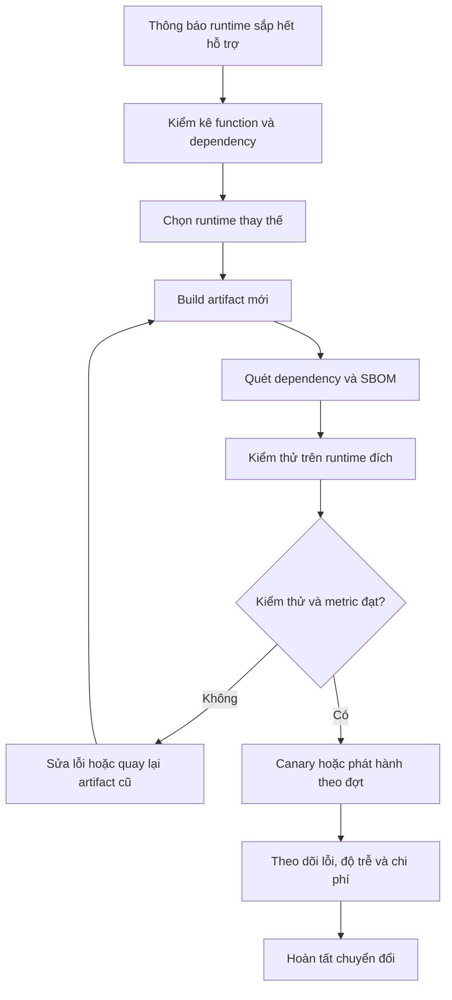

# Phiên bản runtime, dependency và vòng đời hỗ trợ

Một Java function chỉ vận hành ổn định khi mã nguồn, phiên bản Java, thư viện phụ thuộc và môi trường thực thi tương thích với nhau trong suốt thời gian ứng dụng được triển khai. Trong mô hình serverless, nhà cung cấp thường quản lý phần lớn hạ tầng thực thi, nhưng đội phát triển vẫn phải chọn runtime phù hợp, đóng gói dependency an toàn, theo dõi thời hạn hỗ trợ và nâng cấp trước khi phiên bản bị ngừng cung cấp.

Trong phạm vi **CLOUD_SERVERLESS**, nội dung này tập trung vào Java function được kích hoạt bởi HTTP, thông điệp hoặc sự kiện. Người học cần hiểu vòng đời runtime và dependency để triển khai function có thể cập nhật, khôi phục và vận hành lâu dài, đồng thời kiểm soát ảnh hưởng đến cold start, khả năng mở rộng và chi phí.

## 1. Runtime của Java function gồm những gì?

Runtime là môi trường mà nền tảng dùng để khởi chạy mã function. Với Java, cần phân biệt một số thành phần thường được gọi chung là “phiên bản Java”:

- **JDK (Java Development Kit):** bộ công cụ phát triển, biên dịch và đóng gói ứng dụng. JDK thường được dùng trong CI để biên dịch và kiểm thử.
- **JVM (Java Virtual Machine):** máy ảo thực thi bytecode Java. JVM chịu trách nhiệm nạp class, quản lý bộ nhớ, garbage collection và các hoạt động thực thi khác.
- **Java runtime/JRE:** tập hợp thành phần cần thiết để chạy ứng dụng Java. Trên các bản phân phối Java hiện đại, JRE độc lập có thể không được phát hành như một gói riêng; nhà cung cấp thường cung cấp JDK hoặc runtime image phù hợp.
- **Hệ điều hành, kiến trúc và thư viện hệ thống:** runtime có thể phụ thuộc vào Linux, kiến trúc x86-64 hoặc ARM64, chứng chỉ CA, thư viện native và các thành phần nền tảng khác.
- **Function adapter hoặc bootstrap:** lớp tích hợp nhận request/event từ nền tảng rồi chuyển vào handler Java. Cách khởi tạo và giao tiếp tùy thuộc dịch vụ FaaS.

Khi nói một function “chạy Java 21”, cần biết con số đó mô tả JDK dùng để biên dịch, Java release mục tiêu, JVM tại môi trường chạy hay runtime identifier mà nhà cung cấp yêu cầu. Các giá trị này có thể khác nhau. Ví dụ, dự án có thể biên dịch bằng JDK mới hơn nhưng đặt `--release` về một phiên bản cũ hơn; bytecode tạo ra vẫn phải tương thích với runtime triển khai và không được sử dụng API chỉ có ở phiên bản mới.

Một function cũng không chỉ phụ thuộc vào số phiên bản Java. Nó còn phụ thuộc vào kiến trúc CPU, hệ điều hành, framework, thư viện native và cách nền tảng cung cấp handler. Vì vậy, kiểm tra tương thích phải bao phủ toàn bộ môi trường thực thi.

## 2. Chọn phiên bản Java cho môi trường serverless

Khi chọn Java release, đội phát triển cần cân bằng giữa thời gian hỗ trợ, khả năng tương thích, tính năng ngôn ngữ, hiệu năng và lựa chọn runtime mà nhà cung cấp FaaS hỗ trợ.

### Ưu tiên phiên bản có kế hoạch hỗ trợ rõ ràng

Các bản Java LTS thường phù hợp với dịch vụ chạy lâu dài vì có lộ trình cập nhật và thời gian hỗ trợ rộng hơn các bản phát hành ngắn hạn. Tuy nhiên, “LTS” không tự động có nghĩa là mọi nhà cung cấp FaaS đều hỗ trợ phiên bản đó trong cùng thời điểm hoặc trong cùng khoảng thời gian. Cần đối chiếu ít nhất ba mốc:

1. Vòng đời hỗ trợ của bản phân phối JDK mà tổ chức sử dụng.
2. Phiên bản Java và kiến trúc được dịch vụ FaaS hỗ trợ.
3. Vòng đời của framework và các thư viện chính trong ứng dụng.

Ví dụ, một framework có thể chưa hỗ trợ đầy đủ Java release mới, hoặc nhà cung cấp FaaS chưa cung cấp runtime tương ứng cho khu vực triển khai. Khi đó, dùng phiên bản mới nhất có thể làm tăng rủi ro vận hành mà không mang lại lợi ích thực tế.

### Phân biệt phiên bản biên dịch và phiên bản chạy

Nên khai báo rõ phiên bản Java trong hệ thống build thay vì phụ thuộc vào JDK mặc định trên máy lập trình viên hoặc runner CI. Với Maven, có thể đặt release mục tiêu như sau:

```xml
<properties>
    <maven.compiler.release>21</maven.compiler.release>
    <project.build.sourceEncoding>UTF-8</project.build.sourceEncoding>
</properties>
```

Với Gradle, có thể cố định toolchain:

```kotlin
java {
    toolchain {
        languageVersion = JavaLanguageVersion.of(21)
    }
}

tasks.withType<JavaCompile>().configureEach {
    options.release = 21
}
```

Các con số trên chỉ là ví dụ cấu hình. Khi triển khai thực tế, hãy thay bằng phiên bản được framework, pipeline và dịch vụ FaaS hỗ trợ. Nếu dùng Java 21 để biên dịch nhưng function được cấu hình chạy Java 17, bytecode hoặc API được sử dụng có thể không tương thích. Ngược lại, biên dịch với release cũ hơn không bảo đảm ứng dụng chạy tốt trên runtime mới nếu có thay đổi hành vi, cấu hình JVM hoặc thư viện native.

## 3. Vòng đời hỗ trợ runtime

Runtime được cung cấp theo một vòng đời. Tên gọi và thời điểm của từng giai đoạn khác nhau giữa nhà cung cấp, nhưng thường có các trạng thái tương tự sau:

| Giai đoạn | Ý nghĩa thường gặp | Việc đội phát triển cần làm |
|---|---|---|
| Được hỗ trợ (supported) | Có thể tạo, cập nhật và chạy function; nhận cập nhật theo chính sách dịch vụ | Theo dõi thông báo, vá ứng dụng và kiểm thử định kỳ |
| Có thông báo ngừng hỗ trợ (deprecation announced) | Nhà cung cấp công bố ngày kết thúc hỗ trợ hoặc hạn chế sắp tới | Lập kế hoạch nâng cấp, xác định function bị ảnh hưởng và kiểm thử runtime thay thế |
| Bị hạn chế (restricted) | Có thể không tạo function mới hoặc không còn cho cập nhật cấu hình theo một số hình thức | Hoàn tất di chuyển trước các mốc hạn chế; kiểm tra khả năng triển khai lại |
| Hết hỗ trợ (end of support) | Không còn nhận hỗ trợ hoặc bản vá theo chính sách đã công bố | Chuyển sang runtime được hỗ trợ; đánh giá rủi ro nếu còn workload cũ |
| Bị ngừng thực thi (retired) | Nền tảng có thể từ chối khởi chạy function dùng runtime đó | Function phải được nâng cấp hoặc thay thế để tiếp tục hoạt động |

Đây là mô hình khái quát, không phải lịch chung áp dụng cho mọi dịch vụ. Có nhà cung cấp chia nhỏ các mốc như ngừng tạo mới, ngừng cập nhật, rồi mới ngừng gọi function. Có dịch vụ vẫn cho function cũ chạy sau khi hết hỗ trợ trong một khoảng thời gian, nhưng không còn bảo đảm bản vá hoặc khả năng hỗ trợ. Không được xem việc function vẫn đang chạy là bằng chứng runtime còn được hỗ trợ.

Khi nhận thông báo deprecation, cần đọc kỹ:

- Ngày cuối cùng được tạo function mới bằng runtime cũ.
- Ngày cuối cùng được cập nhật code hoặc cấu hình cho function hiện hữu.
- Thời điểm runtime không còn được hỗ trợ và thời điểm bị ngừng thực thi, nếu có.
- Phạm vi khu vực, kiến trúc, loại function hoặc phiên bản API bị ảnh hưởng.
- Cách nền tảng xử lý function hiện hữu và liệu có tự động nâng cấp hay không.
- Quy trình di chuyển, giới hạn tương thích và phương án rollback.

Không nên giả định nhà cung cấp sẽ tự nâng cấp runtime của function. Ngay cả khi nền tảng cập nhật bản vá nhỏ cho runtime được quản lý, việc chuyển từ Java release này sang release khác thường cần đội phát triển kiểm thử và triển khai thay đổi rõ ràng.

## 4. Ranh giới trách nhiệm giữa nhà cung cấp và đội phát triển

Trong FaaS, nhà cung cấp thường quản lý máy chủ, lớp cô lập và một phần môi trường runtime. Tuy nhiên, mức độ quản lý phụ thuộc vào cách đóng gói function.

| Hạng mục | Runtime được quản lý | Custom runtime hoặc container do khách hàng cung cấp |
|---|---|---|
| Máy chủ vật lý và hạ tầng nền | Nhà cung cấp | Nhà cung cấp |
| Lớp điều phối invocation và mở rộng | Nhà cung cấp theo đặc tính dịch vụ | Nhà cung cấp theo đặc tính dịch vụ |
| Bản vá nền tảng và môi trường thực thi chuẩn | Nhà cung cấp thường quản lý theo chính sách runtime | Phụ thuộc phạm vi nền tảng; khách hàng thường quản lý image và runtime bên trong image |
| Phiên bản Java được chọn và tương thích ứng dụng | Đội phát triển chọn trong danh sách được hỗ trợ | Đội phát triển chọn và đóng gói |
| Mã function và dependency ứng dụng | Đội phát triển | Đội phát triển |
| Kiểm thử, nâng cấp và phát hành runtime mới | Đội phát triển kiểm tra ứng dụng; nhà cung cấp duy trì runtime nền theo chính sách | Đội phát triển chịu trách nhiệm cập nhật, kiểm thử và phát hành image/runtime |

Với runtime được quản lý, nhà cung cấp có thể cập nhật bản vá cho hệ điều hành hoặc runtime theo lịch của dịch vụ. Đội phát triển vẫn phải theo dõi thông báo, bảo đảm ứng dụng tương thích, cập nhật dependency riêng và xác minh hành vi sau thay đổi.

Với custom container, đội phát triển thường kiểm soát nhiều hơn: base image, JDK/JRE, chứng chỉ, thư viện hệ thống, bootstrap và dependency được đóng gói. Quyền kiểm soát tăng đồng nghĩa với trách nhiệm vá và phát hành image cũng tăng. Một image đã build từ nhiều tháng trước có thể chứa base image hoặc thư viện hệ thống đã có lỗ hổng dù mã Java không đổi.

## 5. Dependency: những thành phần ứng dụng mang theo

Dependency là các thư viện và module mà ứng dụng cần để biên dịch hoặc chạy. Java function có thể phụ thuộc vào:

- Thư viện trực tiếp được khai báo trong Maven hoặc Gradle.
- Dependency bắc cầu (*transitive dependency*) được thư viện khác kéo vào.
- Framework và adapter tích hợp với nền tảng FaaS.
- Driver cơ sở dữ liệu, HTTP client, SDK của nhà cung cấp và thư viện serialization.
- Thư viện native hoặc thành phần bên ngoài JVM.
- Plugin build, compiler và công cụ đóng gói ảnh hưởng đến artifact được tạo ra.

Dependency bắc cầu thường là nguồn rủi ro khó thấy. Một nâng cấp nhỏ của thư viện trực tiếp có thể kéo theo phiên bản khác của HTTP client, logging hoặc parser. Nếu nhiều thư viện yêu cầu các phiên bản không tương thích, ứng dụng có thể gặp lỗi khi build, lỗi `NoSuchMethodError`, `ClassNotFoundException`, xung đột class hoặc hành vi khác nhau giữa local và production.

Không nên chỉ kiểm tra danh sách dependency trực tiếp. Hãy xem cây dependency, phiên bản thực sự được resolve và nội dung artifact sau khi đóng gói.

## 6. Quản lý dependency có thể tái lập

Một bản build cần tạo ra kết quả có thể giải thích và tái lập. Nếu cùng một commit nhưng hai lần build resolve các phiên bản thư viện khác nhau, việc tái hiện lỗi và điều tra lỗ hổng sẽ khó hơn.

### Khai báo phiên bản rõ ràng

Với Maven, có thể quản lý phiên bản tập trung bằng `dependencyManagement` hoặc BOM của framework. Ví dụ minh họa:

```xml
<properties>
    <jackson.version>2.17.2</jackson.version>
</properties>

<dependencyManagement>
    <dependencies>
        <dependency>
            <groupId>com.fasterxml.jackson</groupId>
            <artifactId>jackson-bom</artifactId>
            <version>${jackson.version}</version>
            <type>pom</type>
            <scope>import</scope>
        </dependency>
    </dependencies>
</dependencyManagement>
```

Phiên bản trong ví dụ chỉ minh họa cách quản lý tập trung; cần chọn bản còn được hỗ trợ và phù hợp với framework đang dùng. Tránh khai báo cùng một thư viện ở nhiều phiên bản không thống nhất.

Với Gradle, có thể bật dependency locking để lưu phiên bản đã resolve:

```kotlin
dependencyLocking {
    lockAllConfigurations()
}
```

Sau khi cấu hình locking, cần tạo và commit lock state theo quy trình build của dự án. Dependency verification có thể được dùng để xác minh checksum hoặc chữ ký artifact, giúp phát hiện artifact bị thay thế ngoài dự kiến.

### Kiểm tra cây dependency

Khi điều tra xung đột hoặc chuẩn bị nâng cấp, hãy xem dependency tree thay vì đoán từ file khai báo. Một số lệnh thường dùng:

```bash
# Maven: xem cây dependency đã resolve
mvn dependency:tree

# Maven: xem dependency có bản cập nhật mới
mvn versions:display-dependency-updates

# Gradle: xem dependency của cấu hình runtime
./gradlew dependencies --configuration runtimeClasspath

# Gradle: giải thích vì sao một phiên bản được chọn
./gradlew dependencyInsight --dependency jackson-databind --configuration runtimeClasspath
```

Các lệnh trên là ví dụ cho môi trường phát triển; cần kiểm tra plugin và cấu hình dự án trước khi đưa vào pipeline. Không tự động nâng cấp toàn bộ dependency chỉ vì công cụ báo có phiên bản mới. Mỗi thay đổi cần được đánh giá về tương thích và rủi ro.

## 7. Đóng gói dependency cho function

FaaS thường yêu cầu upload artifact hoặc container image. Với Java, cách đóng gói có thể là JAR thường, fat/uber JAR, gói ZIP có thư viện đi kèm hoặc container image. Mỗi nền tảng có quy ước riêng về handler, thư mục, bootstrap, kích thước gói và cách nạp class.

Khi đóng gói, cần kiểm tra:

1. Tất cả dependency cần lúc chạy đã có trong artifact hoặc được cung cấp rõ ràng bởi runtime.
2. Không đóng gói nhầm thư viện đã có sẵn trong môi trường nếu việc đó gây xung đột phiên bản.
3. Các file cấu hình, chứng chỉ và resource được đưa vào đúng vị trí trong classpath hoặc image.
4. Thư viện native khớp với hệ điều hành và kiến trúc CPU của function.
5. Kích thước artifact nằm trong giới hạn dịch vụ và không mang theo công cụ phát triển không cần thiết.
6. Không chứa credential, private key, file `.env` hoặc dữ liệu bí mật trong artifact.

Ví dụ, một JAR chạy tốt trên máy lập trình viên có thể thất bại trên FaaS nếu thiếu resource được nạp bằng `ClassLoader`, dùng thư viện native chỉ có cho Windows, hoặc dựa vào file nằm ngoài thư mục được đóng gói. Vì vậy, nên kiểm thử chính artifact sẽ triển khai trong môi trường gần production.

Dependency cũng ảnh hưởng đến cold start. Một gói lớn, nhiều class cần nạp hoặc framework khởi tạo nhiều thành phần có thể làm thời gian khởi động tăng. Tuy nhiên, không nên loại bỏ thư viện chỉ dựa vào kích thước; hãy đo thời gian khởi tạo, chức năng bị ảnh hưởng và chi phí bảo trì của phương án thay thế.

## 8. Bảo mật dependency và quản lý lỗ hổng

Thư viện bên thứ ba có thể chứa lỗ hổng được công bố sau khi function đã triển khai. Việc mã nguồn không thay đổi không có nghĩa rủi ro bảo mật không thay đổi.

Quy trình quản lý dependency nên bao gồm:

- Quét lỗ hổng trong dependency trực tiếp và bắc cầu bằng công cụ phù hợp với hệ sinh thái Java.
- Theo dõi advisory từ nhà phát hành thư viện, framework, JDK và nhà cung cấp nền tảng.
- Đánh giá mức độ ảnh hưởng dựa trên phiên bản, đường gọi có thể khai thác, mức phơi bày và dữ liệu mà function xử lý.
- Ưu tiên cập nhật bản vá bảo mật; kiểm tra release note và breaking changes trước khi nâng cấp phiên bản lớn.
- Xóa dependency không còn sử dụng để giảm bề mặt tấn công và kích thước artifact.
- Tạo SBOM (*Software Bill of Materials*) để biết artifact chứa thành phần nào và hỗ trợ điều tra khi có cảnh báo mới.
- Quét lại artifact đã build trước khi phát hành và theo lịch sau triển khai.

Một cảnh báo CVE không phải lúc nào cũng đồng nghĩa function có thể bị khai thác, nhưng cũng không nên bỏ qua chỉ vì dependency là gián tiếp. Cần xác định phiên bản thực tế trong artifact, chức năng bị ảnh hưởng và đường dữ liệu có thể đi tới thành phần dễ tổn thương. Nếu chưa thể cập nhật ngay, hãy ghi nhận rủi ro, biện pháp giảm thiểu và thời hạn xử lý.

Không nên tải JAR từ nguồn không xác định hoặc tự chép thư viện vào artifact để “sửa nhanh”. Dùng repository đáng tin cậy, kiểm tra checksum/chữ ký khi phù hợp và giới hạn nguồn artifact mà pipeline được phép sử dụng.

## 9. Nâng cấp runtime và dependency an toàn

Nâng cấp Java release hoặc framework có thể tác động đến bytecode, API, reflection, serialization, TLS, garbage collection, memory footprint và thời gian khởi động. Cách nâng cấp an toàn là chia thành các bước nhỏ, có kiểm chứng và có phương án quay lại.

Một quy trình thực tế có thể gồm:

1. **Kiểm kê:** xác định function, runtime identifier, Java release, framework, dependency trực tiếp/bắc cầu, kiến trúc và nguồn trigger đang sử dụng.
2. **Đọc thông báo:** xem lịch deprecation của nhà cung cấp, lịch hỗ trợ JDK và framework, release note cùng danh sách thay đổi không tương thích.
3. **Tạo nhánh nâng cấp:** thay đổi toolchain và target release, cập nhật framework/dependency cần thiết, loại bỏ API đã lỗi thời.
4. **Build sạch:** build từ môi trường CI đã cố định phiên bản công cụ; xác minh dependency được resolve và artifact được đóng gói đúng.
5. **Kiểm thử:** chạy unit test, integration test, kiểm thử contract cho HTTP/event, kiểm tra serialization, database driver, TLS và thư viện native.
6. **Kiểm thử trên runtime đích:** triển khai vào môi trường staging hoặc alias thử nghiệm có cùng loại trigger, cấu hình, quyền và kiến trúc gần production.
7. **Đo vận hành:** so sánh cold start, thời gian xử lý, memory, lỗi, timeout, concurrency và chi phí với phiên bản cũ.
8. **Phát hành có kiểm soát:** dùng canary, traffic shifting hoặc từng nhóm function nếu nền tảng hỗ trợ; theo dõi metric và log sau mỗi đợt.
9. **Rollback hoặc khắc phục:** chuẩn bị artifact cũ còn được hỗ trợ, cấu hình quay lại và cách xử lý dữ liệu đã được ghi bởi phiên bản mới.
10. **Hoàn tất:** cập nhật danh mục runtime, SBOM, tài liệu vận hành và ngày rà soát tiếp theo.

Rollback mã không phải lúc nào cũng đủ. Nếu phiên bản mới đã thay đổi schema dữ liệu hoặc format thông điệp, phiên bản cũ có thể không đọc được dữ liệu mới. Khi thay đổi có ảnh hưởng đến dữ liệu, hãy dùng migration tương thích ngược hoặc kế hoạch chuyển đổi theo giai đoạn.

## 10. Ví dụ: function Java xử lý thông điệp cần nâng runtime

Giả sử một Java function nhận `InvoiceCreated` từ hàng đợi, dùng framework để deserialize JSON, ghi dữ liệu vào cơ sở dữ liệu và gửi thông báo. Sau khi nhà cung cấp công bố runtime Java hiện tại sắp hết hỗ trợ, nhóm phát triển cần đánh giá cả runtime lẫn dependency.



Trong tình huống này, nhóm không chỉ thay runtime identifier. Họ cần xác nhận thư viện JSON hỗ trợ Java release mới, driver cơ sở dữ liệu tương thích, chứng chỉ TLS được nạp đúng, thông điệp cũ vẫn deserialize được và function không vượt timeout sau khi khởi tạo framework. Nếu runtime mới làm cold start tăng, cần đo xem độ trễ đầu cuối có còn đáp ứng yêu cầu hay không.

Nhà cung cấp chịu trách nhiệm duy trì runtime nền theo chính sách dịch vụ và thông báo các mốc vòng đời. Nhóm phát triển chịu trách nhiệm nâng mã, dependency, kiểm thử hợp đồng thông điệp, kiểm soát rollout và xử lý các thay đổi dữ liệu.

## 11. Theo dõi vòng đời trong vận hành thường ngày

Không nên đợi đến khi nhận thông báo runtime bị ngừng hỗ trợ mới bắt đầu kiểm kê. Một danh mục runtime đơn giản có thể lưu các trường sau:

| Trường | Mục đích |
|---|---|
| Tên function và môi trường | Xác định workload và phạm vi ảnh hưởng |
| Nhà cung cấp, dịch vụ FaaS và khu vực | Tra cứu đúng lịch hỗ trợ và giới hạn dịch vụ |
| Runtime identifier và Java release | Biết phiên bản đang chạy thực tế |
| Build JDK và target release | Xác định toolchain và bytecode của artifact |
| Framework và dependency chính | Đánh giá tương thích và lỗ hổng |
| Kiến trúc, loại gói và base image | Kiểm tra khác biệt giữa môi trường chạy |
| Trạng thái hỗ trợ và ngày deprecation | Xác định mức độ khẩn cấp của nâng cấp |
| Nhóm sở hữu và người xử lý | Đảm bảo có người nhận thông báo và hành động |
| Artifact/SBOM và lần quét gần nhất | Hỗ trợ truy vết thành phần và rủi ro |

Nên kết hợp danh mục này với cảnh báo từ nhà cung cấp, công cụ quét dependency và quy trình quản lý thay đổi. Mỗi function cần có chủ sở hữu rõ ràng; function không còn người sở hữu vẫn có thể tiếp tục được gọi và trở thành rủi ro khi runtime hết hỗ trợ.

Một nhịp rà soát phù hợp có thể gồm kiểm tra thông báo runtime hằng tháng, quét dependency trong mỗi lần build và đánh giá toàn bộ danh mục trước các mốc deprecation. Tần suất thực tế phụ thuộc mức độ quan trọng của hệ thống và tốc độ thay đổi của nền tảng.

## 12. Những lỗi thường gặp và cách phòng tránh

| Lỗi | Nguyên nhân | Cách phòng tránh |
|---|---|---|
| Build thành công nhưng function không khởi chạy | Bytecode/API không tương thích với runtime hoặc sai handler/bootstrap | Khai báo rõ Java release và kiểm thử artifact trên runtime đích |
| Chạy local nhưng lỗi trên FaaS | Thiếu dependency/resource, khác hệ điều hành hoặc kiến trúc | Kiểm thử gói triển khai thực tế trong môi trường tương đương |
| `ClassNotFoundException` hoặc `NoSuchMethodError` | Dependency bắc cầu bị thiếu hoặc xung đột phiên bản | Kiểm tra dependency tree và nội dung artifact |
| Lỗi xuất hiện sau khi runtime được cập nhật | Ứng dụng phụ thuộc vào hành vi hoặc cấu hình runtime cũ | Theo dõi thay đổi runtime và kiểm thử staging/canary |
| Function vẫn chạy nhưng đã hết hỗ trợ | Chỉ quan sát invocation mà không theo dõi lịch deprecation | Theo dõi vòng đời runtime và gắn ngày nâng cấp vào backlog |
| Artifact chứa lỗ hổng đã biết | Không quét dependency hoặc không theo dõi dependency bắc cầu | Quét định kỳ, tạo SBOM và có SLA xử lý lỗ hổng |
| Cold start tăng sau khi nâng cấp | Framework hoặc dependency mới khởi tạo nhiều thành phần hơn | Đo riêng thời gian khởi tạo và tối ưu dựa trên dữ liệu |
| Rollback làm lỗi đọc dữ liệu | Schema hoặc format thông điệp đã thay đổi không tương thích ngược | Thiết kế migration theo giai đoạn và kiểm tra khả năng đọc chéo phiên bản |

## 13. Checklist trước khi phát hành hoặc nâng cấp function

| Câu hỏi | Bằng chứng cần có |
|---|---|
| Runtime được chọn có còn được dịch vụ FaaS hỗ trợ? | Runtime identifier và tài liệu vòng đời của đúng dịch vụ/khu vực |
| Java dùng để build có khớp với target và runtime? | Toolchain, `--release` hoặc cấu hình compiler được khai báo rõ |
| Framework và dependency có tương thích? | Dependency tree, compatibility notes và kết quả kiểm thử |
| Artifact có đầy đủ thành phần chạy? | Kiểm tra JAR/ZIP/image, resource, bootstrap và thư viện native |
| Dependency có nguồn gốc đáng tin cậy? | Repository được phê duyệt, checksum/chữ ký khi áp dụng và lock state |
| Có lỗ hổng chưa xử lý? | Kết quả quét dependency, SBOM và hồ sơ ngoại lệ có thời hạn |
| Runtime cũ có mốc deprecation? | Ngày ngừng tạo mới, cập nhật, hỗ trợ và thực thi theo thông báo dịch vụ |
| Nâng cấp có ảnh hưởng đến trigger hoặc dữ liệu? | Kiểm thử HTTP/event, tương thích schema và kế hoạch migration |
| Có thể phát hành và quay lại an toàn? | Canary/rollout plan, artifact cũ còn được hỗ trợ và tiêu chí rollback |
| Hiệu năng và chi phí có chấp nhận được? | So sánh cold start, latency, memory, lỗi, concurrency và chi phí |

## 14. Cách duy trì function trong suốt vòng đời

Vòng đời của một Java function không kết thúc khi triển khai thành công. Runtime mới sẽ xuất hiện, dependency sẽ nhận bản vá, framework sẽ thay đổi và nhà cung cấp sẽ điều chỉnh lịch hỗ trợ. Để function tiếp tục vận hành ổn định, hãy duy trì ba hoạt động song song:

- **Quản lý phiên bản:** cố định toolchain và dependency, ghi nhận runtime thực tế, lưu artifact cùng SBOM và bảo đảm có thể tái lập bản build.
- **Quản lý rủi ro:** quét lỗ hổng, theo dõi thông báo deprecation, đánh giá dependency bắc cầu và xử lý các thành phần không còn được hỗ trợ.
- **Quản lý thay đổi:** kiểm thử trên runtime đích, rollout theo từng giai đoạn, đo cold start/độ trễ/chi phí và có phương án khôi phục tương thích dữ liệu.

Nhà cung cấp serverless giảm công việc quản lý máy chủ và một phần runtime nền, nhưng đội phát triển vẫn sở hữu vòng đời của mã ứng dụng và dependency. Khi hiểu rõ sự khác nhau giữa JDK build, Java release mục tiêu, runtime thực thi và dependency được đóng gói, nhóm có thể chủ động nâng cấp trước hạn hỗ trợ, giảm lỗi tương thích và duy trì Java function an toàn trong production.
