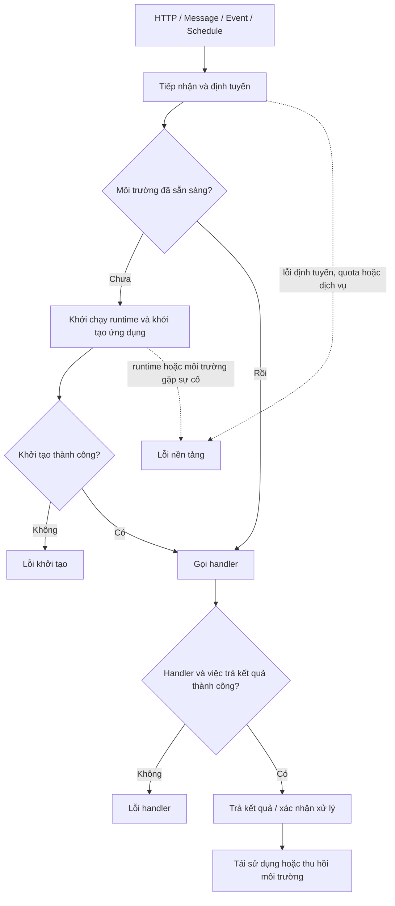
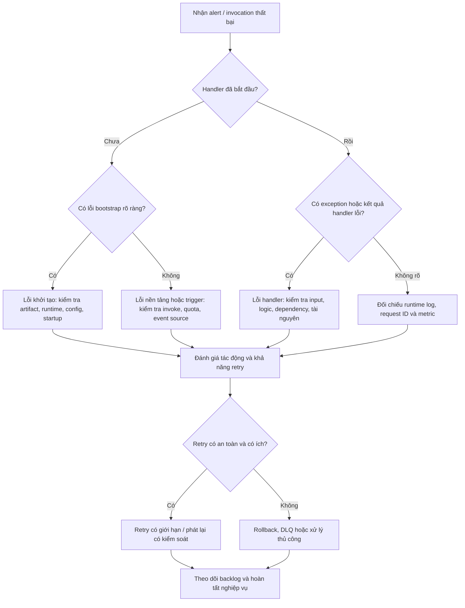

# Phân loại lỗi khởi tạo, lỗi handler và lỗi nền tảng

Một lần thực thi function có thể thất bại ở nhiều thời điểm: trước khi mã xử lý được gọi, trong lúc handler đang chạy hoặc ở lớp dịch vụ serverless điều phối việc thực thi. Nhận diện đúng thời điểm và nguồn gốc lỗi giúp nhóm biết cần sửa mã Java, cấu hình runtime, dependency, trigger hay hạ tầng của nhà cung cấp. Nếu mọi lỗi đều bị gom thành một thông báo “function failed”, việc retry, điều tra và khôi phục thường tốn thời gian hơn, thậm chí có thể làm một lỗi nhỏ lan thành sự cố lớn.

Bài này phân loại lỗi theo ba nhóm thực hành: **lỗi khởi tạo**, **lỗi handler** và **lỗi nền tảng**. Đây là cách phân loại phục vụ thiết kế và vận hành, không phải bộ mã lỗi chuẩn dùng chung cho mọi nhà cung cấp. Tên trạng thái, log và quy tắc retry cụ thể khác nhau giữa các nền tảng FaaS và từng loại trigger.

## 1. Đặt lỗi vào đúng giai đoạn của vòng đời function

Một lần gọi FaaS thường đi qua các giai đoạn sau:

1. **Tiếp nhận và định tuyến trigger:** nền tảng nhận HTTP request, message, event hoặc lịch chạy; kiểm tra cấu hình và tìm function đích.
2. **Chuẩn bị môi trường thực thi:** nền tảng cấp môi trường, khởi chạy runtime và nạp mã ứng dụng khi cần tạo môi trường mới.
3. **Khởi tạo ứng dụng:** runtime nạp class, chạy static initializer, tạo dependency injection container, đọc cấu hình và chuẩn bị các thành phần dùng chung.
4. **Gọi handler:** adapter chuyển đầu vào thành đối tượng phù hợp, gọi hàm xử lý; ứng dụng xác thực dữ liệu, thực hiện nghiệp vụ và tạo kết quả.
5. **Hoàn tất invocation:** runtime tuần tự hóa kết quả, trả phản hồi hoặc xác nhận việc xử lý; với trigger bất đồng bộ, nền tảng hoặc event source có thể quyết định retry.
6. **Tạm dừng, tái sử dụng hoặc thu hồi môi trường:** nền tảng có thể giữ môi trường để phục vụ lần gọi sau hoặc kết thúc nó. Ứng dụng không được giả định instance sẽ luôn được tái sử dụng.



Sơ đồ mô tả ranh giới khái niệm. Trong hệ thống thực tế, nền tảng có thể gộp nhiều giai đoạn thành một trạng thái lỗi, hoặc ghi nhận một lỗi ở lớp runtime dù nguyên nhân ban đầu nằm trong mã ứng dụng. Ví dụ, một static initializer kết nối database thất bại là lỗi khởi tạo về mặt nguyên nhân; nhà cung cấp có thể hiển thị nó dưới dạng runtime initialization error.

### Phân biệt theo thời điểm

| Nhóm lỗi | Thời điểm thường gặp | Dấu hiệu điển hình | Hướng điều tra đầu tiên |
| --- | --- | --- | --- |
| Lỗi khởi tạo | Trước khi handler bắt đầu xử lý | Không có log đầu handler; môi trường mới liên tục không sẵn sàng; lỗi class loading hoặc bootstrap | Artifact, runtime Java, cấu hình, static initializer, dependency và quyền truy cập lúc startup |
| Lỗi handler | Sau khi handler được gọi | Có request/event ID và log xử lý; exception, kết quả sai, timeout hoặc lỗi phụ thuộc | Input, logic nghiệp vụ, truy vấn, API ngoài, serialization và tài nguyên invocation |
| Lỗi nền tảng | Ở lớp tiếp nhận, định tuyến, cấp phát hoặc điều phối | Throttle, service unavailable, invoke bị từ chối, event source không poll được hoặc lỗi control plane | Quota, concurrency, trạng thái dịch vụ, cấu hình trigger và bằng chứng từ provider |

Không có log đầu handler chưa đủ chứng minh đó là lỗi nền tảng. Log có thể chưa được gửi, bị lọc hoặc chưa flush trước khi runtime bị dừng. Hãy đối chiếu request ID, log khởi tạo, metric, event source và trạng thái dịch vụ trước khi kết luận.

## 2. Lỗi khởi tạo (initialization errors)

Lỗi khởi tạo xảy ra khi nền tảng đã bắt đầu chuẩn bị môi trường nhưng ứng dụng không thể sẵn sàng để nhận invocation. Với Java, đây thường là giai đoạn runtime khởi động JVM, nạp class và khởi tạo các thành phần dùng chung.

### 2.1. Các nguyên nhân thường gặp

**Artifact hoặc runtime không tương thích.** Gói triển khai thiếu class, thiếu resource, sai entry point, sai phiên bản bytecode hoặc phụ thuộc vào thư viện native không tương thích với hệ điều hành hay kiến trúc CPU của runtime. Ví dụ, ứng dụng được build cho một phiên bản Java mới hơn runtime triển khai có thể gặp `UnsupportedClassVersionError`.

**Lỗi class loading và static initializer.** Một class không tìm thấy, xung đột phiên bản thư viện hoặc lỗi trong static block có thể khiến ứng dụng không khởi tạo được. Lệnh gọi bên ngoài đặt trong static initializer cũng có thể làm startup phụ thuộc vào database, secret manager hoặc API khác.

```java
public final class ReportHandler {
    // Rủi ro: việc tạo client có thể thất bại ngay khi class được nạp.
    private static final ReportClient CLIENT = ReportClient.connectFromEnvironment();

    public Response handle(Request request) {
        return CLIENT.createReport(request);
    }
}
```

Nếu `connectFromEnvironment()` ném exception, handler có thể chưa từng được gọi. Khi đó log nghiệp vụ ở đầu `handle()` sẽ không xuất hiện. Cần kiểm tra stack trace khởi tạo và các cấu hình mà client cần.

**Dependency injection hoặc framework bootstrap thất bại.** Một bean bắt buộc không được tạo, cấu hình sai, profile không tồn tại, thiếu biến môi trường hoặc framework không tìm thấy resource có thể khiến ứng dụng dừng trước invocation đầu tiên.

**Cấu hình và quyền truy cập lúc startup.** Function có thể không đọc được secret, chứng thư, file cấu hình hoặc endpoint cần thiết. Cần phân biệt quyền thực thi của function với quyền mà dịch vụ được gọi yêu cầu. Nếu một secret bị từ chối ngay trong bootstrap, đó là lỗi khởi tạo; nếu quyền chỉ được dùng khi xử lý một request cụ thể, lỗi có thể xuất hiện ở handler.

**Khởi tạo phụ thuộc mạng không ổn định.** Kết nối database hoặc API ngoài trong giai đoạn startup có thể thất bại do DNS, route, firewall, VPC, TLS, hết connection hoặc dịch vụ phụ trợ chưa sẵn sàng. Một lần lỗi tạm thời có thể khiến mỗi môi trường mới đều thất bại nếu ứng dụng không có timeout và chiến lược khởi tạo hợp lý.

### 2.2. Dấu hiệu và cách chẩn đoán

- Invocation thất bại trước khi log đầu handler xuất hiện.
- Lỗi tập trung ở các môi trường mới hoặc sau khi deploy phiên bản mới.
- Log có các dấu hiệu như lỗi nạp class, lỗi static initializer, thiếu biến môi trường, không tạo được application context hoặc không đọc được secret.
- Thời gian khởi tạo tăng bất thường, cold start kéo dài hoặc môi trường mới liên tục bị tạo rồi kết thúc.
- Phiên bản cũ chạy được nhưng phiên bản mới không thể khởi động, dù đầu vào invocation không thay đổi.

Quy trình điều tra nên bắt đầu từ artifact và runtime: xác minh phiên bản Java, cấu hình handler, classpath, resource được đóng gói, biến môi trường và kiến trúc triển khai. Sau đó đọc log từ đầu quá trình bootstrap, kiểm tra stack trace gốc thay vì chỉ nhìn exception bọc ngoài. Nếu startup gọi dịch vụ khác, kiểm tra DNS, TLS, route, security group/firewall, quyền IAM/service account và trạng thái dependency.

Không nên mặc định mọi lỗi khởi tạo đều do cold start. Cold start là quá trình chuẩn bị môi trường mới; nó có thể thành công hoặc thất bại. Một lần khởi tạo chậm nhưng hoàn tất là vấn đề latency. Một lần khởi tạo không hoàn tất là lỗi khởi tạo.

### 2.3. Cách phòng tránh và khôi phục

- Build với đúng phiên bản Java và target bytecode của runtime; kiểm tra nội dung gói triển khai trước khi phát hành.
- Khởi động ứng dụng trong môi trường tương đương production để phát hiện lỗi class loading, framework và cấu hình.
- Giữ static initializer đơn giản, có tính xác định; tránh thực hiện truy vấn dài hoặc side effect nghiệp vụ khi class được nạp.
- Đặt timeout hữu hạn cho thao tác mạng trong startup. Nếu phụ thuộc tạm thời chưa sẵn sàng, dùng chiến lược retry có backoff và giới hạn thời gian.
- Kiểm tra quyền đọc secret và cấu hình trong môi trường triển khai, không chỉ trên máy phát triển.
- Phát hành theo tỷ lệ nhỏ hoặc dùng alias/version để có thể quay lại bản hoạt động tốt.
- Ghi log bootstrap đủ để xác định thành phần khởi tạo thất bại, nhưng không ghi secret, token hoặc dữ liệu nhạy cảm.

Một lưu ý quan trọng: không phải mọi dependency đều nên được kết nối trước invocation đầu tiên. Khởi tạo client nhẹ, có thể tái sử dụng, thường hữu ích; nhưng thực hiện truy vấn database hoặc gọi API ngoài ngay trong static initializer có thể kéo dài cold start và biến sự cố dependency thành lỗi khiến toàn bộ môi trường không thể khởi động. Hãy cân nhắc tạo client một lần nhưng thực hiện kết nối hoặc truy vấn trong phạm vi invocation, với timeout và xử lý lỗi phù hợp.

## 3. Lỗi handler (handler errors)

Lỗi handler xảy ra sau khi runtime đã gọi mã xử lý. Nguyên nhân có thể nằm trong dữ liệu đầu vào, logic nghiệp vụ, dependency, tài nguyên hoặc bước tạo phản hồi.

### 3.1. Các nhóm lỗi handler

**Đầu vào không hợp lệ.** Thiếu trường bắt buộc, sai kiểu dữ liệu, payload quá lớn, schema thay đổi hoặc dữ liệu không đáp ứng quy tắc nghiệp vụ. Đây thường là lỗi có thể dự đoán và không nên retry vô hạn với cùng đầu vào.

**Lỗi logic nghiệp vụ.** Vi phạm invariant, trạng thái đơn hàng không hợp lệ, tính toán sai hoặc một nhánh xử lý không được bao phủ. Các lỗi này thường cần sửa mã hoặc dữ liệu; retry tự động không làm chúng biến mất.

**Lỗi phụ thuộc bên ngoài.** Database từ chối kết nối, deadlock, API trả lỗi 5xx, rate limit, timeout hoặc dịch vụ thanh toán tạm thời không sẵn sàng. Cần phân biệt lỗi tạm thời với lỗi vĩnh viễn như dữ liệu không tồn tại hoặc quyền truy cập bị từ chối.

**Lỗi serialization và phản hồi.** Handler đã thực hiện nghiệp vụ nhưng không thể chuyển kết quả thành JSON, trả về kiểu dữ liệu runtime không hỗ trợ hoặc tạo response vượt giới hạn gateway. Lỗi có thể xuất hiện sau khi phần nghiệp vụ chính đã hoàn tất.

**Vượt giới hạn tài nguyên trong invocation.** Handler tiêu thụ quá nhiều bộ nhớ, CPU hoặc thời gian và bị runtime/nền tảng kết thúc. Về biểu hiện, đây có thể được báo là timeout hoặc out-of-memory do nền tảng quan sát được; về nguyên nhân, cần điều tra thuật toán, kích thước dữ liệu, truy vấn, vòng lặp, concurrency hoặc giới hạn tài nguyên được cấu hình.

### 3.2. Phân loại theo khả năng phục hồi

| Loại lỗi | Ví dụ | Retry có ích? | Hướng xử lý |
| --- | --- | --- | --- |
| Lỗi dữ liệu/validation | Thiếu `orderId`, sai định dạng | Thường không | Từ chối request hoặc đưa message lỗi vào luồng xử lý dữ liệu sai |
| Lỗi nghiệp vụ không thể tự hết | Đơn hàng đã hủy, trạng thái không cho phép | Thường không | Ghi nhận kết quả nghiệp vụ cuối cùng; không retry vô hạn |
| Lỗi dependency tạm thời | Timeout ngắn, HTTP 503, kết nối bị reset | Có thể | Retry có giới hạn, backoff và jitter; dùng timeout cho mỗi lần gọi |
| Lỗi quota/rate limit của dependency | HTTP 429 hoặc giới hạn request | Có thể sau khi chờ | Tuân theo `Retry-After` nếu có, giảm tốc độ và giới hạn concurrency |
| Lỗi cấu hình/quyền | Sai secret, thiếu quyền đọc bảng | Không cho đến khi sửa | Sửa cấu hình hoặc policy; tránh retry dồn dập |
| Lỗi không xác định | Null pointer, bug hoặc trạng thái không mong đợi | Không chắc chắn | Ghi stack trace và ngữ cảnh; giới hạn retry, đưa trường hợp lặp lại sang nơi điều tra |
| Timeout/OOM | Xử lý tệp lớn vượt memory hoặc deadline | Chỉ khi có nguyên nhân tạm thời | Tối ưu, chia nhỏ, tăng tài nguyên có kiểm chứng hoặc đổi mô hình chạy |

Một exception không tự nói cho nền tảng biết lỗi có thể phục hồi hay không. Runtime hoặc adapter thường chỉ thấy invocation thành công hay thất bại. Ứng dụng và cấu hình trigger phải chuyển phân loại đó thành hành vi phù hợp: trả mã HTTP, ném exception, xác nhận message, yêu cầu retry hoặc gửi bản ghi lỗi đến dead-letter queue.

### 3.3. Không nuốt lỗi và không retry mù quáng

Đoạn mã dưới đây minh họa cách xử lý khác nhau giữa đầu vào không hợp lệ và lỗi phụ thuộc tạm thời trong một handler HTTP. Các kiểu `Request`, `Response` và exception là kiểu minh họa, không phải API của một nhà cung cấp cụ thể.

```java
public final class OrderHttpHandler {
    private final OrderService orders;

    public OrderHttpHandler(OrderService orders) {
        this.orders = orders;
    }

    public Response handle(Request request) {
        try {
            CreateOrder command = validateAndMap(request);
            Order order = orders.create(command);
            return Response.created(order);
        } catch (InvalidRequestException error) {
            // Lỗi đầu vào: trả kết quả rõ ràng, không yêu cầu retry tự động.
            return Response.badRequest(error.getMessage());
        } catch (TransientDependencyException error) {
            // Lỗi tạm thời: báo thất bại để caller áp dụng retry có kiểm soát.
            return Response.serviceUnavailable("Dependency temporarily unavailable");
        } catch (RuntimeException error) {
            // Lỗi chưa phân loại: ghi ngữ cảnh an toàn rồi để runtime thấy thất bại.
            log.error("Order handler failed", error);
            throw error;
        }
    }
}
```

Trong HTTP API, response 400 thường biểu thị đầu vào không hợp lệ; 503 có thể biểu thị dependency tạm thời không sẵn sàng; 500 biểu thị lỗi xử lý không dự kiến. Quy ước cụ thể phụ thuộc hợp đồng API. Nếu gateway hoặc adapter chuyển exception thành HTTP 200, client có thể tưởng request đã thành công. Ngược lại, nếu handler trả 500 cho lỗi dữ liệu vĩnh viễn, client có thể retry vô ích.

Với queue hoặc event bất đồng bộ, cách biểu đạt khác: ném exception hoặc báo bản ghi thất bại để trigger áp dụng retry. Nếu handler bắt exception rồi trả về bình thường, nền tảng có thể xem message đã xử lý thành công. Vì vậy, cùng một lỗi nghiệp vụ có thể cần cách biểu đạt khác nhau tùy trigger.

## 4. Lỗi nền tảng (platform errors)

Lỗi nền tảng xuất hiện ở lớp dịch vụ quản lý invocation, môi trường thực thi, định tuyến hoặc nguồn sự kiện. Ứng dụng có thể chưa được gọi, hoặc không thể hoàn tất do dịch vụ bên ngoài phạm vi mã handler gặp sự cố.

### 4.1. Các nhóm lỗi nền tảng

**Dịch vụ điều phối không sẵn sàng.** Control plane hoặc data plane của nhà cung cấp gặp sự cố, khiến việc tạo môi trường, gọi function hoặc trả kết quả thất bại. Bằng chứng thường nằm trong mã lỗi dịch vụ, request ID, trang trạng thái dịch vụ hoặc thông báo sự cố của provider.

**Throttling và giới hạn quota.** Function vượt concurrency limit, số request mỗi giây, số lần tạo môi trường hoặc giới hạn account/region. Một số trường hợp được trả về như lỗi throttling hoặc invocation bị từ chối trước khi handler chạy.

**Lỗi định tuyến và cấu hình trigger.** API Gateway trỏ sai version/alias, event source mapping bị tắt, subscription thiếu quyền, lịch chạy không được tạo hoặc trigger không thể gọi function. Đây có thể là lỗi cấu hình của nhóm vận hành, không nhất thiết là sự cố hạ tầng của nhà cung cấp, nhưng nằm ngoài logic handler.

**Lỗi event source hoặc truyền nhận.** Queue không thể được poll, stream shard không đọc được, quyền đọc message bị thu hồi hoặc event source mapping gặp lỗi. Khi đó, function có thể không nhận được event dù mã handler hoàn toàn khỏe mạnh.

**Môi trường runtime bị kết thúc ngoài dự kiến.** Runtime host, sandbox hoặc máy chủ vật lý có thể gặp lỗi. Nền tảng có thể khởi tạo môi trường mới và giao lại event, nhưng điều này phụ thuộc trigger và ngữ nghĩa giao nhận.

**Giới hạn nền tảng bị vượt.** Invocation bị chấm dứt do timeout tối đa, memory limit, kích thước payload hoặc giới hạn đồng thời. Cần tách hai câu hỏi: nền tảng đã thực hiện hành động gì và workload đã gây điều kiện nào khiến giới hạn bị vượt. Ví dụ, nền tảng gửi tín hiệu dừng khi timeout; nguyên nhân gốc có thể là truy vấn không có index hoặc dependency bị treo.

### 4.2. Dấu hiệu và cách chẩn đoán

- Lỗi xảy ra trước khi handler bắt đầu hoặc nhiều function khác nhau cùng gặp lỗi trong một khoảng thời gian.
- Có mã lỗi từ API quản lý/invoke, thông báo throttling, service unavailable hoặc trạng thái event source mapping bất thường.
- Lưu lượng tăng cùng thời điểm với concurrency, số lần bị throttle hoặc tuổi message trong queue tăng.
- Function có thể chạy thành công khi gọi trực tiếp nhưng không nhận event từ trigger dự kiến.
- Nhiều invocation bị ảnh hưởng ở cùng region/account hoặc cùng một dịch vụ phụ trợ của provider.

Hãy thu thập request ID/invocation ID, thời điểm có múi giờ, region, function version/alias, trigger, mã lỗi nguyên gốc và metric liên quan. Kiểm tra quota, reserved/provisioned concurrency nếu có, trạng thái trigger, quyền gọi function và tình trạng dịch vụ nhà cung cấp. Nếu có bằng chứng về sự cố diện rộng, đối chiếu thông tin trạng thái của provider.

Không quy mọi lỗi mạng thành lỗi nền tảng. DNS sai, route trong VPC thiếu, security group chặn kết nối hoặc certificate hết hạn có thể do cấu hình của workload. Cần xác định lỗi xảy ra ở đường gọi function, đường function gọi dependency hay đường event source chuyển event.

### 4.3. Cách phòng tránh và phục hồi

- Theo dõi quota và đặt cảnh báo trước khi chạm giới hạn concurrency hoặc request rate.
- Đặt concurrency tối đa theo khả năng của database và dependency, tránh để một đợt scale đột biến làm sập hệ thống phía sau.
- Dùng queue làm bộ đệm khi nghiệp vụ cho phép xử lý bất đồng bộ; theo dõi backlog và tuổi message.
- Thiết kế retry có backoff và jitter để tránh nhiều client hoặc invocation cùng retry tại một thời điểm.
- Cấu hình dead-letter queue hoặc failure destination cho nguồn bất đồng bộ nếu nền tảng hỗ trợ.
- Có quy trình phát lại event sau sự cố, đồng thời bảo đảm handler idempotent.
- Kiểm tra quyền invoke, event source mapping, version/alias và cấu hình mạng sau mỗi lần triển khai.
- Khi provider gặp sự cố, theo dõi trạng thái, bảo toàn event chưa xử lý và chỉ phát lại theo chính sách để tránh tạo tải đột biến sau khi dịch vụ phục hồi.

## 5. Retry phụ thuộc vào loại trigger

Phân loại lỗi chỉ là bước đầu. Cách phục hồi tiếp theo phụ thuộc cách function được gọi. Không có quy tắc chung rằng mọi lỗi đều được nền tảng tự động retry.

| Kiểu trigger | Ai thường quyết định retry? | Điều cần chú ý |
| --- | --- | --- |
| HTTP đồng bộ | Client, API caller hoặc lớp gateway theo cấu hình | Caller có thể gửi lại sau 5xx/timeout; cần idempotency key để tránh tạo đơn hàng hoặc thanh toán trùng |
| Gọi function đồng bộ qua SDK/API | Caller | Phân biệt lỗi dịch vụ từ API invoke với lỗi function được trả trong kết quả invocation; đọc cả response metadata và function error |
| Invocation bất đồng bộ | Dịch vụ FaaS theo retry policy đã cấu hình | Có thể retry khi function báo lỗi; cần giới hạn số lần, tuổi event và dead-letter/failure destination |
| Queue event source | Queue và event source mapping | Visibility timeout, receive count, redrive policy, batch size và xử lý bản ghi lỗi quyết định việc message được giao lại |
| Stream event source | Event source mapping và checkpoint/offset | Một bản ghi lỗi có thể làm chậm tiến độ partition/shard; cần xử lý partial batch, retry và poison record theo đặc tính stream |
| Scheduled event | Scheduler và cơ chế chuyển giao event | Cần xử lý lần chạy trùng, lần chạy trễ và chạy bù sau sự cố |

### 5.1. HTTP và invocation đồng bộ

Với HTTP, function thường trả response trong cùng luồng request. Nếu client timeout, client có thể không biết nghiệp vụ đã hoàn tất hay chưa. Ví dụ, function đã ghi đơn hàng vào database nhưng kết nối trả response bị đứt; client gửi lại có thể tạo đơn trùng nếu không có idempotency key.

Caller nên retry có điều kiện: chỉ retry lỗi có khả năng tạm thời, dùng backoff, giới hạn số lần và giữ nguyên khóa idempotency cho cùng một thao tác nghiệp vụ. Không retry mọi mã 4xx. Với lỗi 5xx, cần xem hợp đồng API và khả năng tác động đã được ghi nhận trước khi gửi lại.

### 5.2. Queue và xử lý batch

Một lần invocation có thể nhận nhiều message. Nếu một message lỗi nhưng handler ném exception chung, nền tảng có thể giao lại cả batch, kể cả message đã xử lý thành công. Điều này làm tăng tải và tạo tác động lặp. Một số nền tảng hỗ trợ báo cáo từng bản ghi thất bại hoặc partial batch response; hãy dùng tính năng đó khi phù hợp và kiểm tra chính xác hợp đồng của event source.

Queue thường có khái niệm visibility timeout hoặc thời hạn xử lý. Nếu function xử lý lâu hơn thời hạn này, message có thể xuất hiện lại trong khi lần xử lý trước chưa kết thúc. Cần cấu hình timeout và visibility timeout tương thích, đồng thời vẫn thiết kế idempotency vì duplicate delivery có thể xảy ra do nhiều nguyên nhân.

### 5.3. Stream và poison record

Trong stream, thứ tự và checkpoint có thể gắn với partition hoặc shard. Một bản ghi độc hại luôn gây lỗi có thể khiến tiến độ của phần stream đó bị chặn hoặc lặp lại. Cần cân nhắc partial batch response, bisect batch, giới hạn retry, thời hạn bản ghi và cơ chế cách ly poison record theo dịch vụ cụ thể.

Đừng bỏ qua bản ghi lỗi chỉ để stream tiếp tục nếu việc đó làm mất dữ liệu nghiệp vụ. Hãy ghi lại định danh, payload đã được bảo vệ và lý do lỗi vào một nơi có thể điều tra, đồng thời xác định cách phát lại sau khi sửa lỗi.

### 5.4. Vì sao idempotency là yêu cầu vận hành

Retry có thể xảy ra sau khi một tác động phụ đã hoàn tất nhưng trước khi nền tảng nhận được xác nhận thành công. Vì vậy, handler cần xử lý an toàn khi nhận lại cùng một event. Dùng event ID hoặc khóa nghiệp vụ ổn định, lưu dấu bằng thao tác nguyên tử và truyền cùng idempotency key đến dịch vụ bên ngoài nếu dịch vụ đó hỗ trợ.

Không nên chỉ dựa vào biến static hoặc bộ nhớ của instance để phát hiện event trùng. Instance có thể bị thay thế, invocation có thể chạy song song và một lần retry có thể đến môi trường khác.

## 6. Ma trận chẩn đoán nhanh

Khi có alert, hãy bắt đầu từ triệu chứng và khoanh vùng theo bằng chứng:

| Triệu chứng | Khả năng cần kiểm tra | Bằng chứng hữu ích |
| --- | --- | --- |
| Không có log handler sau deploy | Lỗi khởi tạo, sai entry point hoặc trigger không gọi được function | Init log, runtime error, function version/alias, invoke request ID |
| Chỉ phiên bản mới thất bại | Artifact, dependency, cấu hình hoặc migration không tương thích | So sánh package, runtime, biến môi trường và stack trace giữa hai version |
| Handler chạy rồi ném exception | Lỗi dữ liệu, nghiệp vụ hoặc dependency | Event/request ID, stack trace, input đã ẩn dữ liệu nhạy cảm, dependency trace |
| Duration chạm đúng timeout | Handler bị treo hoặc tác vụ vượt giới hạn | Duration, timeout metric, trace của truy vấn/API ngoài, log cuối cùng trước khi dừng |
| Memory tăng rồi invocation bị dừng | Rò rỉ bộ nhớ, tải toàn bộ tệp, batch quá lớn hoặc heap không phù hợp | Memory metric, heap profile nếu có, kích thước payload và batch |
| Tăng throttle khi lưu lượng tăng | Concurrency hoặc quota | Concurrent executions, throttle count, request rate và quota account/region |
| Function gọi trực tiếp thành công nhưng queue không xử lý | Event source mapping, quyền đọc queue hoặc lỗi poller | Trạng thái mapping, số message visible/in-flight, quyền và metric event source |
| Message lặp hoặc xử lý hai lần | Retry, visibility timeout, duplicate event hoặc idempotency chưa đủ | Event ID, receive count, thời gian xử lý, bản ghi inbox và log tác động phụ |
| Nhiều function cùng lỗi một thời điểm | Dependency dùng chung hoặc sự cố provider | Mốc thời gian, region, lỗi dependency, provider status và metric nhiều function |

Một cách thực hành hiệu quả là dựng timeline theo một event: thời điểm nguồn phát, thời điểm trigger nhận, thời điểm invocation bắt đầu, thời điểm handler bắt đầu, các lần gọi dependency, thời điểm hoàn tất hoặc thất bại và các lần retry. Timeline giúp xác định lỗi nằm ở đâu và liệu tác động nghiệp vụ đã xảy ra hay chưa.

## 7. Ghi log và metric để phân biệt ba nhóm lỗi

Một hệ thống quan sát tốt phải trả lời được ba câu hỏi: function có được gọi không, handler có chạy không và nghiệp vụ có hoàn tất không.

### 7.1. Log có cấu trúc

Nên ghi các trường tương quan phù hợp với từng lần thực thi:

- `requestId` hoặc invocation ID do nền tảng cấp.
- `eventId`, message ID hoặc idempotency key nếu nguồn có cung cấp.
- `correlationId` hoặc mã nghiệp vụ để nối các bước trong workflow.
- Tên function, version/alias, trigger và stage xử lý.
- Kết quả phân loại lỗi: `INITIALIZATION`, `HANDLER` hoặc `PLATFORM` khi có đủ bằng chứng.
- Mã lỗi nội bộ, loại exception và dependency liên quan.
- Thời lượng, số lần retry và trạng thái hoàn tất nghiệp vụ.

Không ghi toàn bộ payload nếu có dữ liệu nhạy cảm. Hãy log các trường định danh cần thiết, che thông tin cá nhân và token, giới hạn kích thước log, đồng thời bảo đảm log bootstrap không làm lộ secret.

### 7.2. Metric cần theo dõi

| Metric | Ý nghĩa vận hành |
| --- | --- |
| Invocation count và error count | Tổng số lần gọi và tỷ lệ invocation thất bại |
| Init duration / cold start count | Thời gian và tần suất môi trường mới cần khởi tạo |
| Handler duration, p95/p99 | Độ trễ xử lý và xu hướng gần chạm timeout |
| Timeout và memory utilization | Invocation bị giới hạn thời gian hoặc bộ nhớ |
| Throttles và concurrent executions | Áp lực concurrency và quota |
| Queue depth, message age, receive count | Backlog, độ trễ xử lý và mức độ retry |
| Dead-letter queue depth | Số event không thể xử lý theo chính sách hiện tại |
| Business completion/failure | Kết quả nghiệp vụ cuối cùng, tách biệt với invocation success |

Metric của nền tảng thường không thể thay thế metric nghiệp vụ. Một handler có thể trả thành công sau khi chỉ ghi message vào queue; nghiệp vụ hoàn tất ở worker sau đó. Cần đo cả bước tiếp nhận và bước hoàn tất cuối cùng.

### 7.3. Cảnh báo theo tín hiệu có ý nghĩa

Nên cảnh báo khi tỷ lệ lỗi tăng, init error xuất hiện sau deploy, p95/p99 tiến gần timeout, throttle tăng, queue age vượt SLA, DLQ có message hoặc tỷ lệ hoàn tất nghiệp vụ giảm. Một số lỗi nền tảng chỉ xuất hiện ngắn; cảnh báo dựa trên xu hướng và mức ảnh hưởng thường hữu ích hơn cảnh báo một exception đơn lẻ.

## 8. Quy trình xử lý sự cố

Khi một function gặp lỗi trong production, có thể đi theo trình tự sau:

1. **Xác định phạm vi.** Một invocation, một version, một trigger hay nhiều function cùng bị ảnh hưởng? Sự cố bắt đầu lúc nào và có trùng với lần deploy hoặc thay đổi cấu hình không?
2. **Xác định giai đoạn thất bại.** Có tạo được invocation không? Có log khởi tạo không? Handler đã bắt đầu chưa? Kết quả đã được xác nhận hay event đang retry?
3. **Thu thập định danh.** Lưu request ID, event ID, version, region, trigger, timestamp và mã lỗi nguyên gốc.
4. **Phân loại tạm thời.** Lỗi khởi tạo, handler hay nền tảng? Ghi rõ bằng chứng và mức độ chắc chắn; không ép lỗi mơ hồ vào một nhóm khi chưa đủ dữ liệu.
5. **Đánh giá tác động nghiệp vụ.** Có ghi database, gọi thanh toán, gửi email hoặc tạo tài nguyên trước khi lỗi xảy ra không? Có nguy cơ duplicate khi retry không?
6. **Giảm tác động.** Có thể rollback version, giảm concurrency, tạm dừng trigger, chuyển message sang DLQ hoặc bật chế độ suy giảm chức năng không?
7. **Khôi phục có kiểm soát.** Chỉ phát lại event khi handler idempotent và dependency đã sẵn sàng; theo dõi backlog, retry và kết quả nghiệp vụ sau phục hồi.
8. **Xác nhận nguyên nhân gốc.** Tạo timeline, tìm điều kiện kích hoạt và kiểm tra biện pháp sửa đã ngăn lỗi tái diễn hay chưa.



## 9. Ví dụ thực tế

### Ví dụ A: Function Java không chạy sau khi triển khai phiên bản mới

Sau deploy, mọi invocation đều thất bại và không thấy log trong method `handle()`. Log runtime cho thấy `UnsupportedClassVersionError` khi nạp một class.

**Phân loại:** Lỗi khởi tạo do bytecode được build với phiên bản Java mới hơn runtime triển khai.

**Xử lý:** Kiểm tra JDK dùng để build, target bytecode và runtime của function; build lại với cấu hình tương thích; thử khởi động artifact trong môi trường tương đương production; triển khai lại theo version mới và giữ khả năng rollback.

### Ví dụ B: Xử lý đơn hàng thất bại khi database tạm thời mất kết nối

Handler đã bắt đầu, log có `eventId`, nhưng thao tác cập nhật đơn hàng gặp timeout khi database failover. Message được giao lại sau đó.

**Phân loại:** Lỗi handler do dependency tạm thời. Nếu function bị runtime dừng vì timeout tổng, nền tảng có thể ghi nhận invocation timeout, nhưng nguyên nhân gốc vẫn là thời gian chờ database hoặc cách quản lý kết nối.

**Xử lý:** Đặt timeout kết nối và truy vấn nhỏ hơn timeout function; dùng retry có backoff cho thao tác an toàn; kiểm tra idempotency theo order/event; xác nhận transaction không để lại trạng thái nửa chừng; theo dõi receive count và DLQ.

### Ví dụ C: HTTP API bị throttling trong đợt tăng lưu lượng

Function chạy bình thường ở tải thấp nhưng một chiến dịch làm số request đồng thời tăng mạnh. Một phần request bị từ chối trước khi handler bắt đầu; metric throttle tăng.

**Phân loại:** Lỗi nền tảng ở lớp concurrency/quota. Nếu handler tăng concurrency làm database quá tải, đồng thời có thể tồn tại lỗi dependency ở phía ứng dụng.

**Xử lý:** Kiểm tra quota và concurrency; đặt giới hạn phù hợp với sức chịu tải database; dùng queue cho phần việc có thể xử lý bất đồng bộ; trả phản hồi quá tải rõ ràng; cấu hình retry ở client với backoff và jitter; thử tải trước khi tăng quota.

### Ví dụ D: Message độc hại khiến một batch bị giao lặp

Một queue trigger chuyển 10 message cho function. Chín message xử lý xong, một message có schema sai làm handler ném exception. Nếu adapter đánh dấu thất bại cho cả batch, chín message thành công có thể được giao lại.

**Phân loại:** Lỗi handler do dữ liệu không hợp lệ; việc giao lại cả batch là hành vi retry của event source.

**Xử lý:** Xác thực từng record, dùng partial batch response nếu nền tảng hỗ trợ, lưu message lỗi để điều tra và đưa message không thể xử lý vào DLQ theo chính sách. Các thao tác trên chín record thành công vẫn cần idempotent để an toàn với lần giao lặp.

## 10. Checklist thiết kế và vận hành

- [ ] Có thể xác định handler đã bắt đầu hay invocation thất bại trước đó.
- [ ] Log khởi tạo ghi được nguyên nhân bootstrap mà không làm lộ secret.
- [ ] Artifact, phiên bản Java, runtime, classpath và resource đã được kiểm tra trước deploy.
- [ ] Static initializer không thực hiện side effect nghiệp vụ hoặc phụ thuộc mạng không có giới hạn.
- [ ] Handler phân biệt lỗi dữ liệu, lỗi nghiệp vụ, lỗi dependency tạm thời và lỗi không xác định.
- [ ] Exception không bị nuốt khiến nền tảng hiểu nhầm invocation đã thành công.
- [ ] Timeout của dependency nhỏ hơn timeout tổng của function và có giới hạn retry.
- [ ] Retry policy phù hợp với HTTP, async invocation, queue hoặc stream trigger đang dùng.
- [ ] Có idempotency cho tác động phụ và xử lý event trùng.
- [ ] Batch có cơ chế xử lý từng record lỗi nếu event source hỗ trợ.
- [ ] Quota, concurrency, throttle, queue age và DLQ được theo dõi.
- [ ] Có request ID/event ID để dựng timeline và liên kết log giữa các bước.
- [ ] Có quy trình rollback, phát lại event và xác nhận nghiệp vụ sau phục hồi.

## Kết luận

Lỗi khởi tạo xảy ra trước khi handler sẵn sàng, thường liên quan artifact, runtime, class loading, bootstrap hoặc cấu hình startup. Lỗi handler xảy ra trong quá trình xử lý và thường liên quan đầu vào, logic nghiệp vụ, dependency, serialization hoặc giới hạn tài nguyên. Lỗi nền tảng nằm ở lớp tiếp nhận, định tuyến, cấp phát, quota, event source hoặc dịch vụ điều phối của nhà cung cấp.

Ba nhóm này giúp xác định nơi cần điều tra, nhưng không thay thế việc tìm nguyên nhân gốc. Một timeout do nền tảng ghi nhận vẫn có thể bắt nguồn từ truy vấn chậm trong handler; một lỗi mạng lúc khởi tạo có thể do cấu hình VPC của workload. Hãy kết hợp thời điểm thất bại, request/event ID, log, metric và trạng thái trigger để phân loại.

Cuối cùng, retry phải dựa trên loại trigger và khả năng phục hồi của lỗi. Thiết kế idempotent, timeout rõ ràng, retry có giới hạn, dead-letter queue và quan sát xuyên suốt giúp function Java phục hồi an toàn khi lỗi xảy ra mà không tạo thêm tác động nghiệp vụ ngoài ý muốn.
