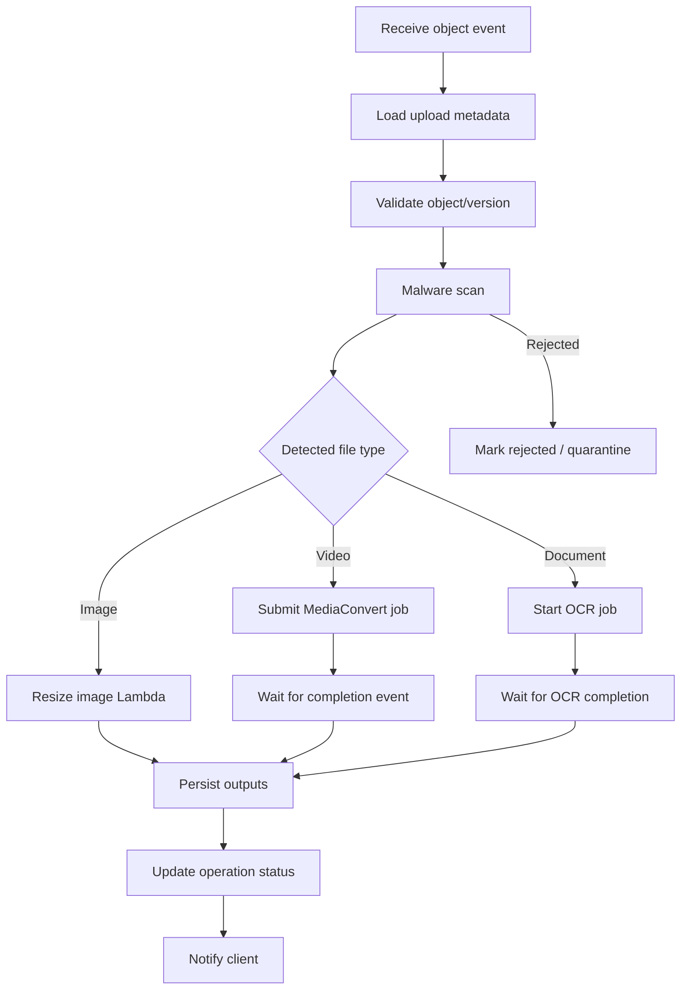

# Thiết kế pipeline xử lý ảnh, video và tài liệu tải lên

## 1. Vì sao cần một pipeline xử lý file bất đồng bộ?

Một ứng dụng Java thường bắt đầu bằng cách nhận file qua HTTP, lưu file rồi xử lý ngay trong cùng request: kiểm tra định dạng, resize ảnh, tạo thumbnail, đọc PDF, trích xuất văn bản hoặc chuyển mã video. Cách này dễ triển khai khi file nhỏ và thời gian xử lý ngắn. Khi file lớn, traffic tăng hoặc thư viện xử lý tốn CPU/RAM, request có thể timeout, JVM giữ nhiều buffer trong heap và một dependency chậm làm nghẽn cả API.

Pipeline serverless tách việc **tiếp nhận file** khỏi **xử lý file**. API cấp quyền upload và tạo upload record; client tải file trực tiếp lên object storage; sự kiện object-created đưa công việc vào queue; worker hoặc workflow xử lý theo loại file; kết quả được lưu ở vùng output riêng và trạng thái được cập nhật để client tra cứu.

Thiết kế này giúp hấp thụ burst, retry từng công việc, scale worker độc lập và không bắt người dùng giữ kết nối HTTP trong suốt thời gian xử lý. Nó cũng tạo thêm trách nhiệm về bảo mật file không tin cậy, duplicate event, idempotency, lifecycle dữ liệu, chi phí lưu trữ và khả năng phục hồi.

Trong module CLOUD_SERVERLESS, Java function có thể xử lý ảnh hoặc bước điều phối ngắn; video dài và tài liệu cần OCR có thể phù hợp hơn với dịch vụ quản lý chuyên dụng. Không nên ép mọi định dạng file vào cùng một Lambda handler.

## 2. Mục tiêu thiết kế và các ranh giới

Một pipeline tốt cần có các ranh giới rõ:

- **Upload boundary:** ai được upload, upload vào key nào, kích thước/định dạng cho phép và URL có hiệu lực bao lâu.
- **Quarantine boundary:** file mới tải lên được xem là dữ liệu không tin cậy cho đến khi được kiểm tra.
- **Processing boundary:** mỗi file/phiên bản file có một operation ID và trạng thái xử lý riêng.
- **Worker boundary:** mỗi worker có quyền tối thiểu cho loại công việc của nó.
- **Output boundary:** kết quả được ghi vào bucket/prefix riêng, có version và policy truy cập rõ.
- **Status boundary:** client có thể xem tiến độ/kết quả mà không cần truy cập queue hoặc storage nội bộ.
- **Recovery boundary:** retry, DLQ, replay và reconciliation có thể vận hành độc lập.

Không dùng tên file do client gửi làm định danh duy nhất. Nhiều người có thể upload `report.pdf`; cùng một key có thể được upload lại; notification có thể đến trễ hoặc lặp. Dùng `uploadId`, object key do server tạo và object version/checksum để nhận diện dữ liệu.

## 3. Kiến trúc tham chiếu

Ví dụ trên AWS: client xin upload session, tải file vào vùng quarantine của S3; S3 phát event vào SQS; một dispatcher kiểm tra metadata và khởi chạy workflow; workflow định tuyến đến processor tương ứng.

```mermaid
flowchart TD
    C[Web / Mobile client] -->|POST /uploads| A[Java API Lambda]
    A --> DB[(Upload metadata DB)]
    A -->|Presigned URL| C
    C -->|PUT / multipart upload| Q[(S3 quarantine bucket)]
    Q -->|Object-created event| S[SQS intake queue]
    S --> D[Java dispatcher Lambda]
    D --> W[Step Functions workflow]
    W --> V[Validate + malware scan]
    V --> R{File type}
    R -->|Image| I[Image Lambda]
    R -->|Video| M[MediaConvert / ECS worker]
    R -->|Document| T[Textract / document worker]
    I --> O[(S3 processed bucket)]
    M --> O
    T --> O
    O --> DB
    DB -->|Status/result| A
    C -->|GET /uploads/{id}| A
```

Luồng chính:

1. API xác thực user/tenant và tạo `uploadId` cùng upload record.
2. API tạo presigned URL hoặc presigned POST cho một object key cụ thể.
3. Client upload trực tiếp lên S3; file được lưu ở bucket/prefix quarantine.
4. Object-created event được đưa vào SQS để buffer và retry.
5. Dispatcher xác minh object, version, upload record và bắt đầu workflow.
6. Workflow quét bảo mật, xác định loại file và chọn processor.
7. Processor tạo output có key xác định, cập nhật metadata và trạng thái.
8. Client poll status hoặc nhận callback khi operation hoàn tất.

SQS làm buffer và retry boundary; Step Functions quản lý nhiều bước, timeout và nhánh xử lý; S3 lưu nội dung file; database lưu trạng thái nghiệp vụ. Không đưa file binary vào message hoặc state payload của workflow.

## 4. Tạo upload session trước khi nhận file

Thay vì cho client tự chọn bucket/key, API nên tạo một upload session có quyền và thời hạn rõ.

Ví dụ request:

```http
POST /uploads
Authorization: Bearer <access-token>
Content-Type: application/json

{
  "fileName": "invoice-2026.pdf",
  "contentType": "application/pdf",
  "expectedSize": 1843200,
  "purpose": "INVOICE_IMPORT"
}
```

Response:

```json
{
  "uploadId": "upl-7f1a",
  "objectKey": "quarantine/tenant-42/upl-7f1a/source",
  "uploadUrl": "https://storage.example/...signed...",
  "expiresAt": "2026-11-17T08:15:00Z",
  "statusUrl": "/uploads/upl-7f1a"
}
```

API lưu metadata trước khi trả URL. Upload URL cần giới hạn:

- Object key và bucket cụ thể.
- HTTP method (PUT hoặc POST) và thời hạn ngắn.
- Content type/checksum nếu có thể ký ràng buộc.
- Kích thước tối đa; presigned POST policy có thể đặt `content-length-range`.
- Không cho client tự ghi vào processed bucket hoặc key của tenant khác.
- Không cấp quyền list bucket, delete object hoặc đọc file khác.

Content type do client gửi không đáng tin tuyệt đối. Worker phải kiểm tra file signature/magic bytes và cấu trúc thật. Presigned URL là bearer capability: ai có URL có thể dùng trong phạm vi quyền và thời hạn của nó, nên không log URL đầy đủ hoặc đưa vào analytics.

## 5. Upload trực tiếp và multipart upload

Với file lớn, để client upload trực tiếp lên object storage tránh đưa toàn bộ byte qua API Gateway/Lambda. Với multipart upload, client gửi nhiều part và hoàn tất bằng `CompleteMultipartUpload`; event xử lý chỉ nên chạy sau khi object hoàn chỉnh.

Thiết kế upload cần:

- Có giới hạn kích thước và số part.
- Lưu upload ID của multipart session để có thể resume hoặc abort.
- Xác minh checksum sau khi hoàn tất nếu yêu cầu integrity.
- Có lifecycle rule dọn multipart upload chưa hoàn tất.
- Xử lý client mất kết nối và retry upload part.
- Không đưa object vào pipeline trước khi upload hoàn tất.

S3 ETag không phải lúc nào cũng là MD5 của toàn bộ object, đặc biệt với multipart upload và một số kiểu mã hóa. Nếu cần kiểm tra integrity, dùng checksum được dịch vụ hỗ trợ và lưu thuật toán/giá trị đã xác minh.

## 6. Quarantine và kiểm tra file không tin cậy

File upload là input không tin cậy. Trước khi gửi cho parser/OCR/transcoder, đưa file vào quarantine và kiểm tra:

- Kích thước thực tế, số trang/frame, duration và số pixel.
- Magic bytes và định dạng thực; không chỉ dựa vào extension hoặc MIME header.
- Malware/virus bằng scanner phù hợp.
- Archive có tỷ lệ nén bất thường, zip bomb hoặc path traversal.
- PDF/Office có macro, script, embedded object hoặc nội dung nguy hiểm.
- File hỏng, truncated hoặc parser timeout.
- Quyền sở hữu tenant, upload session và object key.

Không chạy parser phức tạp với quyền truy cập rộng vào mạng hoặc dữ liệu production. Tách scanner/processor trong security boundary phù hợp, giới hạn CPU/RAM/time và chỉ cấp quyền đọc object đầu vào cùng quyền ghi prefix output riêng.

Với tài liệu nhạy cảm, cân nhắc Content Disarm and Reconstruction (CDR), masking/redaction và quy trình review. Không ghi raw document hoặc thông tin cá nhân vào log.

## 7. Định danh file và xử lý duplicate event

Object-created notification có thể được gửi lặp và không bảo đảm thứ tự toàn cục. SQS Standard cũng có at-least-once delivery. Do đó, cùng một file có thể khởi chạy workflow nhiều lần.

Một processing identity có thể được tạo từ:

```text
processingKey = tenantId
              + bucket
              + objectKey
              + objectVersionId
              + processorName
              + processorVersion
              + transformProfile
```

Nếu versioning được bật, `versionId` giúp phân biệt nội dung upload ở các thời điểm khác nhau. Nếu không có version ID, dùng checksum được xác minh hoặc một upload ID bất biến. Không dựa vào ETag như MD5 tổng quát.

Lưu processing record có unique key/conditional write. Chỉ một worker được claim operation; các event trùng đọc lại trạng thái hiện tại và không tạo side effect lần nữa. Nếu cùng object cần chạy một profile xử lý mới, `processorVersion`/`transformProfile` phải tạo identity mới có chủ đích.

Với S3 event có `sequencer`, có thể dùng nó để nhận diện event mới/cũ cho cùng một object key; không so sánh sequencer giữa các key khác nhau. Nếu xử lý versioning, ưu tiên gắn operation với object version cụ thể thay vì chỉ dựa vào thời điểm event đến.

## 8. Mô hình trạng thái của upload và processing

Upload và processing là hai vòng đời khác nhau. Một upload có thể hoàn tất nhưng chưa được xử lý; một file có thể có nhiều processing profile.

Ví dụ upload state:

```text
CREATED
  -> UPLOADING
  -> UPLOADED
  -> VALIDATING
  -> ACCEPTED
  -> REJECTED
```

Processing state:

```text
PENDING
  -> RUNNING
  -> SUCCEEDED
  -> FAILED_RETRYABLE
  -> FAILED_FINAL
  -> CANCELLED
```

Trong thực tế, `FAILED_RETRYABLE` có thể là trạng thái nội bộ của attempt; operation tổng vẫn `RUNNING` nếu retry còn. State transition phải có điều kiện/version để worker cũ không ghi đè kết quả mới. Lưu `attempt`, `startedAt`, `completedAt`, `errorCode`, `outputKey` và `processorVersion`.

Client cần status API có contract rõ. Không để client truy cập SQS, Step Functions execution ARN hoặc bucket nội bộ để suy ra trạng thái.

## 9. Phân luồng theo loại file

Sau validation, dispatcher chọn processor phù hợp. Không chỉ dựa trên phần mở rộng tên file; kết hợp MIME detection, file signature, policy của upload purpose và giới hạn xử lý.

| Loại | Các bước thường gặp | Nền tảng phù hợp |
|---|---|---|
| Ảnh | Decode, kiểm tra dimension, xoay theo EXIF, resize, thumbnail, strip metadata | Java Lambda cho ảnh vừa/nhỏ; container nếu native dependency hoặc memory lớn |
| Video | Probe metadata, transcode, tạo preview, thumbnail, audio extraction | AWS Elemental MediaConvert hoặc container/batch worker |
| PDF/tài liệu | Malware scan, OCR, page split, classify, extract fields, redact | Textract hoặc document processing service; Lambda điều phối |
| Archive | Kiểm tra entry/path, giới hạn giải nén, scan nội dung | Worker cô lập có quota CPU/disk và giới hạn expansion |

Một event có thể sinh nhiều output: thumbnail nhiều kích thước, preview video, transcript, OCR JSON và metadata. Dùng manifest hoặc output record để mô tả tất cả artifact liên quan đến source version.

## 10. Pipeline xử lý ảnh

Với ảnh, Lambda Java phù hợp cho thao tác ngắn và có giới hạn rõ: resize, thumbnail, format conversion, watermark hoặc metadata extraction.

Một pipeline điển hình:

1. Đọc object version từ quarantine.
2. Xác minh magic bytes và decoder hỗ trợ format.
3. Giới hạn width, height, pixel count và file size trước khi cấp phát buffer lớn.
4. Decode ảnh, áp dụng orientation từ EXIF.
5. Tạo các kích thước theo profile.
6. Strip GPS/EXIF nhạy cảm nếu business không cần.
7. Encode định dạng output và tính checksum.
8. Ghi output vào key bất biến theo source version/profile.
9. Ghi metadata và chuyển operation sang `SUCCEEDED`.

Ví dụ output key:

```text
processed/tenant-42/upl-7f1a/v3/thumbnail-320.webp
processed/tenant-42/upl-7f1a/v3/preview-1280.webp
```

Đưa `profileVersion` vào key giúp chạy lại khi thuật toán thay đổi mà không ghi đè output của phiên bản cũ. Nếu cần output pointer ổn định cho client, database có thể trỏ đến version hiện hành sau khi hoàn tất.

### Java image worker: lưu ý bộ nhớ

Ảnh nén 5 MB có thể cần hàng trăm MB khi decode thành pixel buffer. Ước lượng bộ nhớ dựa trên pixel count, số bản sao trung gian và số ảnh xử lý đồng thời, không chỉ file size. Tránh đọc toàn bộ file vào nhiều `byte[]`; stream khi thư viện hỗ trợ, giới hạn dimension và xử lý từng output một.

Nếu dùng ImageIO hoặc native codec, kiểm tra decoder/plugin có sẵn trong artifact và tương thích Linux/architecture Lambda. Test file CMYK, alpha, orientation, animated image và file malformed. Dùng memory tuning để đo peak RAM và duration.

## 11. Pipeline xử lý video

Video thường có thời gian xử lý dài, file lớn và nhiều profile output. Không nên mặc định tải toàn bộ video vào Java Lambda rồi transcode trong một invocation.

Một pipeline tham chiếu:

1. S3 event tạo job request.
2. Dispatcher kiểm tra metadata và tạo MediaConvert job hoặc ECS/Batch task.
3. Media service đọc object gốc và ghi rendition vào processed bucket.
4. Completion event cập nhật trạng thái operation.
5. Worker tạo thumbnail/manifest hoặc ghi metadata cuối.

Ví dụ output:

```text
processed/video-123/source-version-4/
  ├── hls/master.m3u8
  ├── hls/segment-00001.ts
  ├── hls/segment-00002.ts
  ├── poster.webp
  └── metadata.json
```

Chọn MediaConvert khi cần transcoding managed, codec/profile phổ biến và không muốn tự quản lý fleet. Chọn ECS/Fargate hoặc AWS Batch khi cần binary tùy biến, codec đặc biệt, GPU/CPU lớn hoặc pipeline có logic riêng. Lambda có thể điều phối job, không nhất thiết phải thực hiện phần transcode nặng.

Quản lý job ID, retry, quota, concurrent jobs và chi phí theo phút/đầu ra. Nếu job bị submit hai lần do event duplicate, dùng processing key và kiểm tra job record trước khi tạo job mới.

## 12. Pipeline xử lý tài liệu

Tài liệu có thể cần OCR, trích xuất bảng/form, phân loại, redaction hoặc kiểm tra chữ ký. Với tài liệu lớn/nhiều trang, API đồng bộ thường không phù hợp.

Pipeline ví dụ:

1. Quarantine và malware scan.
2. Kiểm tra định dạng, page count và giới hạn kích thước.
3. Tạo async OCR/analysis job bằng dịch vụ như Amazon Textract.
4. Nhận completion notification hoặc poll job status theo policy.
5. Lấy kết quả theo page/chunk, lưu JSON có schema version.
6. Chuẩn hóa field, validate business rule và redaction.
7. Cập nhật metadata/status hoặc đưa sang human review.

Không đưa toàn bộ OCR response lớn vào Step Functions state. Lưu kết quả ở S3/database rồi truyền reference. Với tài liệu pháp lý/tài chính, không tự động coi OCR confidence thấp là dữ liệu chính xác; thiết kế ngưỡng confidence và human review.

## 13. Orchestration bằng Step Functions

Khi pipeline có nhiều bước, nhánh theo loại file, retry khác nhau hoặc cần chờ dịch vụ xử lý ngoài, Step Functions giúp quản lý state machine.

Ví dụ state flow:



Dùng `Retry` cho lỗi transient và `Catch` cho lỗi cần chuyển trạng thái/compensation. Với task dài, dùng callback/wait pattern hoặc completion event thay vì giữ Lambda chạy để poll liên tục.

Step Functions state payload có giới hạn kích thước. Truyền `bucket`, `key`, `versionId`, `uploadId` và job ID; không truyền byte file hoặc kết quả OCR lớn. Dữ liệu lớn nằm trong S3/database.

## 14. Định nghĩa contract giữa các bước

Một work item nội bộ có thể mang:

```json
{
  "uploadId": "upl-7f1a",
  "tenantId": "tenant-42",
  "source": {
    "bucket": "uploads-quarantine",
    "key": "quarantine/tenant-42/upl-7f1a/source",
    "versionId": "3Lg..."
  },
  "detectedType": "application/pdf",
  "processor": "document-ocr",
  "processorVersion": "v2",
  "correlationId": "corr-92a1",
  "attempt": 1
}
```

Message chỉ mang reference và metadata cần thiết. Worker cần xác minh `tenantId`, bucket/key/version với upload record trước khi đọc file; không tin message payload chỉ vì nó đến từ queue. Dùng schema version để worker cũ có thể xử lý message còn tồn tại trong queue khi producer đã deploy phiên bản mới.

## 15. S3 event notification: duplicate, ordering và vòng lặp

S3 event notification có thể được giao nhiều lần và không đảm bảo thứ tự. Consumer cần idempotent theo object version/processing profile.

Các nguyên tắc:

- Bật versioning nếu cần phân biệt các lần upload cùng key.
- Kiểm tra `versionId`, `sequencer`, event type và bucket/key.
- Dùng `sequencer` chỉ để so sánh event của cùng object key.
- Bỏ qua event cho object version đã xử lý hoặc version cũ theo policy.
- Không subscribe output prefix nếu worker ghi output vào cùng bucket/prefix gây trigger lặp.
- Tốt hơn nên tách quarantine bucket và processed bucket khi boundary bảo mật khác nhau.

Không giả định notification đến đúng một lần hoặc đúng thứ tự. Một event đến muộn có thể tham chiếu object version cũ; worker cần xử lý đúng version được event chỉ ra thay vì đọc “latest object” một cách mù quáng.

## 16. Idempotency và ghi output an toàn

Một processing record có thể dùng unique key:

```text
tenantId#bucket#objectKey#versionId#processor#processorVersion#profile
```

Worker claim record bằng conditional insert/update. Nếu đã `SUCCEEDED`, trả thành công mà không chạy lại. Nếu đang `RUNNING`, worker khác không được chạy song song trừ khi lease hết và có fencing/version. Nếu lỗi transient, tăng attempt và retry; nếu permanent, ghi `FAILED_FINAL`.

Output key nên deterministic theo input version và processing profile. Nếu retry ghi cùng output key, đảm bảo thao tác ghi có thể lặp và chỉ publish pointer đến output sau khi file hoàn chỉnh. Không để client thấy file nửa chừng; có thể ghi vào staging key rồi copy/commit manifest sau.

Database status và object output không nằm trong cùng transaction. Nếu upload output thành công nhưng cập nhật metadata thất bại, retry phải nhận ra output đã tồn tại và hoàn tất metadata. Reconciliation job có thể tìm output mồ côi hoặc operation `RUNNING` quá lâu.

## 17. SQS, retry và DLQ cho file processing

SQS giúp tách event ingestion khỏi tốc độ xử lý. Với Standard queue, message có thể duplicate; với FIFO, ordering/deduplication có phạm vi và cửa sổ cụ thể nhưng consumer vẫn cần idempotency.

Thiết lập:

- Visibility timeout đủ cho Lambda timeout và batch window.
- Batch size phù hợp với memory/duration của từng loại file.
- Partial batch response để retry record lỗi độc lập khi có thể.
- Redrive policy và DLQ với retention/alert.
- Maximum concurrency để bảo vệ database, Textract/MediaConvert quota và downstream API.
- Retry/backoff và phân loại lỗi transient/permanent.

Không retry vô hạn file corrupt hoặc định dạng không hỗ trợ. Những lỗi validation/permanent nên được đánh dấu rejected hoặc chuyển quarantine; lỗi network/throttling transient mới phù hợp retry.

## 18. Backpressure và scale theo loại công việc

Ảnh, video và tài liệu có chi phí xử lý khác nhau. Một queue chung có thể khiến video dài chặn ảnh thumbnail nhỏ. Cân nhắc tách queue theo workload:

- `image-processing-queue`
- `video-transcode-queue`
- `document-ocr-queue`

Mỗi queue có worker concurrency, batch size, visibility timeout, DLQ và alarm riêng. Có thể dùng dispatcher để route theo type sau validation.

Giới hạn concurrency theo downstream quota và chi phí. Ví dụ Textract hoặc MediaConvert có quota job; database metadata cũng có giới hạn write. Tăng Lambda concurrency không tự tăng capacity của dịch vụ xử lý file.

Theo dõi arrival rate, completion rate, queue depth và age. Nếu video queue tăng nhưng image queue ổn định, tăng worker image không giải quyết được video backlog. Scale theo queue/operation type và SLO riêng.

## 19. Chọn Lambda hay dịch vụ xử lý chuyên dụng?

AWS Lambda có thời gian chạy tối đa 15 phút mỗi invocation; `/tmp` mặc định 512 MB và có thể cấu hình đến 10.240 MB; memory có thể cấu hình đến 10.240 MB và CPU tăng theo memory. Các giới hạn này cần được kiểm tra lại theo runtime/Region và thời điểm triển khai.

| Tác vụ | Lambda Java | Dịch vụ/container chuyên dụng |
|---|---|---|
| Tạo thumbnail ảnh nhỏ/vừa | Thường phù hợp | Không cần nếu library/size phù hợp |
| Resize ảnh độ phân giải rất lớn | Có thể cần memory cao và benchmark | ECS/Batch nếu cần tài nguyên hoặc thư viện đặc biệt |
| Probe video metadata | Có thể dùng cho file nhỏ và tool gọn | Container nếu binary/CPU nặng |
| Transcode video dài/nhiều profile | Thường không nên chạy toàn bộ trong Lambda | MediaConvert, ECS/Fargate hoặc Batch |
| OCR tài liệu nhiều trang | Lambda có thể điều phối | Textract async hoặc OCR service/container |
| Malware scan | Có thể cho file nhỏ/engine nhẹ | Scanner service/container cô lập nếu file lớn hoặc engine nặng |
| Archive extraction | Chỉ với giới hạn chặt | Container/job có disk/CPU quota khi cần |

Quyết định theo file size, duration, memory, CPU, native dependency, concurrency, quota và cost. Không chọn Lambda chỉ vì đã dùng Lambda cho API.

## 20. Xử lý file lớn và filesystem tạm

Không tải file lớn vào heap chỉ để chuyển từ S3 sang một thư viện. Cân nhắc streaming hoặc tải xuống `/tmp` khi thư viện cần seek/random access.

Quy tắc:

- Đọc stream và xử lý theo chunk nếu format/library hỗ trợ.
- Kiểm tra kích thước và metadata trước khi allocate buffer.
- Giới hạn số file/part được xử lý đồng thời trong một invocation.
- Dùng `/tmp` có kiểm soát và dọn file tạm sau xử lý; execution environment có thể được tái sử dụng.
- Không coi `/tmp` là storage bền vững hoặc nơi chia sẻ giữa các invocation.
- Kiểm tra disk free space trước khi tải file.
- Đặt timeout phù hợp và chuyển job dài sang container/service chuyên dụng.

Với archive, giới hạn tổng kích thước sau giải nén, số entry, độ sâu thư mục và tỷ lệ expansion để tránh zip bomb. Không dùng archive entry path trực tiếp làm đường dẫn local mà không chuẩn hóa và kiểm tra traversal.

## 21. Lưu output và phân phối kết quả

Output cần có naming, retention và access policy rõ. Có thể dùng bucket/prefix riêng:

```text
uploads-quarantine/
  tenant-42/upload-id/source

uploads-processed/
  tenant-42/upload-id/source-version/processor-version/output...
```

Metadata database lưu:

- Source object key/version/checksum.
- Detected MIME type và kích thước.
- Processor/profile version.
- Output key/version/checksum.
- Status, attempt, error code và timestamps.
- Tenant/owner và access policy.

Client truy cập output qua API authorization hoặc presigned GET URL có thời hạn ngắn. Không public bucket để tiện hiển thị thumbnail. Với nội dung nhạy cảm, kiểm tra quyền mỗi lần cấp URL và audit download.

Nếu output có nhiều file, ghi manifest JSON liệt kê key/version/checksum và chỉ đánh dấu `SUCCEEDED` sau khi toàn bộ artifact cần thiết đã tồn tại.

## 22. Thông báo hoàn tất và callback

Sau khi xử lý, hệ thống có thể:

- Cho client polling `GET /uploads/{uploadId}` hoặc `GET /operations/{operationId}`.
- Gửi webhook callback đã đăng ký.
- Phát domain event `FileProcessingCompleted` đến EventBridge/SNS.
- Cập nhật notification/in-app state.

Webhook callback là một side effect bên ngoài, có thể timeout/duplicate. Dùng stable event ID, signature, retry có backoff và trạng thái delivery riêng. Không để lỗi gửi callback làm mất output đã xử lý thành công; lưu notification intent trong outbox hoặc trạng thái riêng.

## 23. Observability cho pipeline file

Một file có thể đi qua nhiều worker và dịch vụ. Truyền `uploadId`, `processingId`, `eventId`, `correlationId`, source version và workflow execution ID trong log/trace.

Metrics hữu ích:

- Upload accepted/rejected và upload completion latency.
- File size theo bucket/range (không dùng object key làm label).
- Processing duration theo processor/type/profile.
- Queue depth và `ApproximateAgeOfOldestMessage` theo queue.
- Retry, duplicate suppressed, permanent failure và DLQ count.
- Workflow success/failure/timeout.
- Output bytes và storage growth.
- Cost per successfully processed file theo loại.
- Scanner/OCR/transcode quota/throttle.

Không đưa `uploadId`, object key, customer ID hoặc filename làm metric dimension vì cardinality cao và có thể chứa dữ liệu nhạy cảm. Giữ các ID này trong trace/log có kiểm soát quyền và retention.

Dashboard cần cho biết pipeline chậm ở upload, queue wait, scan, transform hay output persistence. API acceptance latency riêng không phản ánh thời gian hoàn tất file.

## 24. Chi phí và FinOps

Chi phí pipeline không chỉ là Lambda duration:

- S3 storage cho original, quarantine, processed và output versions.
- PUT/GET/LIST requests, multipart upload và incomplete multipart parts.
- SQS requests, DLQ storage và redrive.
- Lambda GB-seconds, requests, `/tmp`/memory configuration và retries.
- Step Functions state transitions/executions.
- MediaConvert, Textract hoặc scanner/container runtime.
- KMS requests, data transfer, NAT và cross-AZ traffic.
- CloudWatch Logs, metrics, traces và retention.
- Storage lifecycle, backup và replication.

Đặt lifecycle policy để dọn quarantine/temporary output theo retention, nhưng giữ original theo yêu cầu nghiệp vụ/compliance. Abort multipart uploads chưa hoàn tất. Tránh chạy lại video/OCR tốn phí nếu processing record cho biết job đã hoàn tất.

Đo cost per successful file theo loại và kích thước. Một file 4K video và một thumbnail không nên được tính như hai operation tương đương. Có thể phân bổ chi phí theo tenant, processor, GB input, phút video hoặc số trang tài liệu.

## 25. Kiểm thử pipeline

Test suite cần có file fixture nhỏ, lớn, hợp lệ, malformed và file biên. Kiểm tra:

- Upload URL hết hạn, sai method hoặc sai object key.
- Upload multipart chưa complete và upload hoàn tất.
- MIME header không khớp magic bytes.
- File vượt size/pixel/page/duration limit.
- Duplicate S3 event và event đến sai thứ tự.
- Cùng key nhưng object version mới.
- Worker crash sau output write nhưng trước status update.
- Retry sau throttling/timeout của OCR/transcode provider.
- Poison message vào DLQ và redrive.
- Output không kích hoạt vòng lặp event mới.
- Tenant không đọc được file/output của tenant khác.
- Queue backlog và concurrency limit bảo vệ downstream.
- Lifecycle dọn multipart/quarantine theo policy.

Integration test cloud cần chạy trên bucket/queue/database cô lập, dùng file fixture không chứa PII thật và cleanup theo test run. Không dùng file độc hại thật để test scanner trong production; dùng bộ test file an toàn hoặc scanner test signature được nhà cung cấp công bố.

## 26. Lộ trình triển khai từng bước

1. **Chọn một loại file:** bắt đầu với ảnh thumbnail hoặc tài liệu đơn giản có giới hạn rõ.
2. **Tạo upload API:** lưu upload session và cấp presigned URL có scope.
3. **Tạo quarantine storage:** bật encryption, versioning/lifecycle và bucket policy.
4. **Đưa event vào queue:** cấu hình notification, SQS, DLQ và IAM.
5. **Viết worker idempotent:** processing key, conditional state và output key deterministic.
6. **Thêm validation/scanning:** không xử lý trực tiếp file chưa được kiểm tra.
7. **Thêm status API:** client biết accepted/running/succeeded/failed.
8. **Bổ sung workflow:** chỉ khi cần nhiều bước, retry khác nhau hoặc chờ service ngoài.
9. **Load/security test:** file size, burst, malformed, duplicate, tenant isolation.
10. **Canary:** chuyển một nhóm tenant hoặc loại file nhỏ.
11. **Mở rộng:** thêm video/OCR khi có quota, cost và runbook.
12. **FinOps review:** lifecycle, storage growth, cost/file và retry waste.

## 27. Các anti-pattern thường gặp

| Anti-pattern | Hậu quả | Cách xử lý |
|---|---|---|
| Upload file qua Lambda API rồi giữ toàn bộ trong heap | Memory pressure, timeout và tăng latency | Client upload trực tiếp object storage |
| Tin extension/MIME do client gửi | Parser nhận sai định dạng | Magic-byte detection và validation |
| Xử lý file ngay trong HTTP request | Client chờ lâu, timeout và retry | `202 Accepted` + queue + status API |
| Dùng Lambda để transcode mọi video | Vượt timeout/memory hoặc cost cao | MediaConvert/container/Batch |
| Không có quarantine | File chưa scan đi thẳng vào parser | Quarantine và scan trước processing |
| Không có version/idempotency | Duplicate event tạo output trùng hoặc stale | Processing key theo object version/profile |
| Ghi output vào prefix đang subscribe | S3 event loop | Tách bucket/prefix và filter event |
| Đưa binary/OCR result vào message/state | Payload vượt giới hạn và tốn chi phí | Lưu S3, truyền object reference |
| Một queue cho mọi loại file | Video chặn ảnh, khó scale độc lập | Queue/worker theo workload |
| Retry file corrupt vô hạn | Tốn tiền và gây backlog | Phân loại permanent/transient, DLQ |
| Không kiểm tra tenant ownership | Rò file giữa khách hàng | Xác minh upload record và IAM boundary |
| Không có lifecycle | Chi phí lưu trữ và multipart rác tăng | TTL/lifecycle và reconciliation |

## 28. Checklist production

- [ ] Upload session được tạo sau authentication/authorization.
- [ ] Presigned URL giới hạn key, method, thời hạn và kích thước phù hợp.
- [ ] Client upload trực tiếp object storage cho file lớn.
- [ ] Multipart upload có abort/lifecycle policy.
- [ ] File mới nằm trong quarantine và được scan/validate.
- [ ] MIME type được xác minh bằng signature/content inspection.
- [ ] File size, pixel count, page count, duration và archive expansion có giới hạn.
- [ ] Object version/checksum được lưu để nhận diện chính xác input.
- [ ] Event duplicate/out-of-order được xử lý an toàn.
- [ ] Processing record có idempotency key và conditional claim.
- [ ] Output key deterministic theo source version/profile.
- [ ] Image/video/document dùng processor phù hợp với giới hạn tài nguyên.
- [ ] Step Functions/queue chỉ truyền reference, không truyền binary payload lớn.
- [ ] SQS có visibility timeout, retry, partial batch response và DLQ.
- [ ] Worker concurrency bảo vệ database/provider quota.
- [ ] Operation status và completion latency hiển thị cho client.
- [ ] Output access được kiểm tra theo tenant và có URL hết hạn.
- [ ] S3 event không tạo vòng lặp từ output.
- [ ] Có reconciliation cho output mồ côi và operation treo.
- [ ] Metrics/log/trace có upload ID/correlation nhưng tránh high-cardinality metric labels.
- [ ] Có lifecycle cho quarantine, temporary output và incomplete multipart.
- [ ] Cost per successful file được đo theo loại/kích thước.
- [ ] Có cloud integration test cho duplicate, timeout, malformed file và cross-tenant access.

## Tài liệu tham khảo

- [Amazon S3 event notifications](https://docs.aws.amazon.com/AmazonS3/latest/userguide/EventNotifications.html)
- [Amazon S3 presigned URLs](https://docs.aws.amazon.com/AmazonS3/latest/userguide/using-presigned-url.html)
- [Amazon S3 multipart upload](https://docs.aws.amazon.com/AmazonS3/latest/userguide/mpuoverview.html)
- [Using Lambda with Amazon SQS](https://docs.aws.amazon.com/lambda/latest/dg/with-sqs.html)
- [AWS Step Functions service integrations](https://docs.aws.amazon.com/step-functions/latest/dg/connect-to-resource.html)
- [AWS Lambda quotas](https://docs.aws.amazon.com/lambda/latest/dg/gettingstarted-limits.html)
- [AWS Elemental MediaConvert](https://docs.aws.amazon.com/mediaconvert/latest/ug/what-is.html)
- [Amazon Textract asynchronous operations](https://docs.aws.amazon.com/textract/latest/dg/async.html)
- [Amazon S3 lifecycle management](https://docs.aws.amazon.com/AmazonS3/latest/userguide/object-lifecycle-mgmt.html)
- [AWS Prescriptive Guidance: Serverless image handling](https://docs.aws.amazon.com/prescriptive-guidance/latest/patterns/processing-images-automatically-with-amazon-s3-and-aws-lambda.html)

## Kết luận

Pipeline file serverless nên tiếp nhận file trực tiếp vào object storage, giữ file mới trong quarantine, rồi dùng event và queue để điều phối xử lý bất đồng bộ. Tạo operation ID và processing key theo object version/profile để chịu được duplicate, retry và replay. Dùng Java Lambda cho bước ngắn như resize ảnh hoặc điều phối; chọn MediaConvert/container cho video nặng và OCR service cho tài liệu nhiều trang. Trạng thái, DLQ, backpressure, tenant isolation, lifecycle và cost per successful file phải được thiết kế ngay từ đầu. Bắt đầu với một loại file có phạm vi rõ, kiểm thử failure mode và mở rộng từng processor sau khi pipeline đầu tiên vận hành ổn định.
