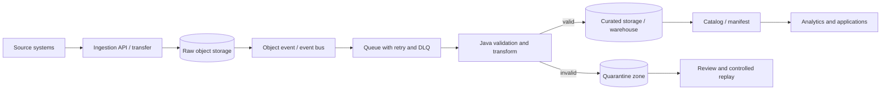
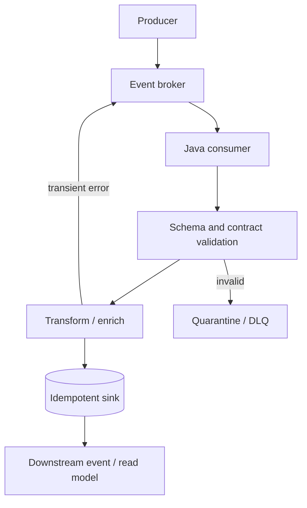
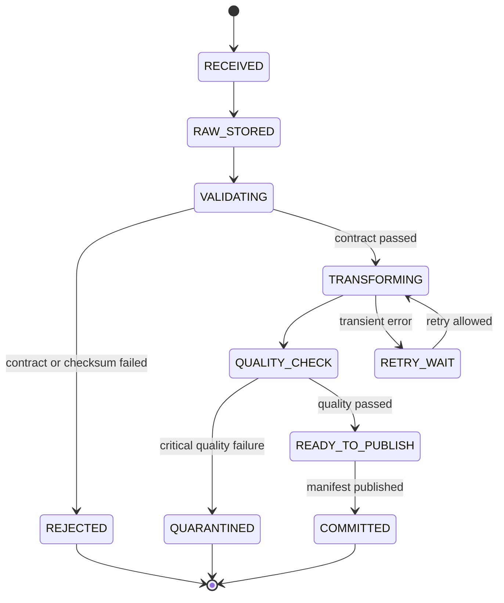

# Thiết kế ETL serverless và kiểm tra chất lượng dữ liệu

## 1. ETL serverless giải quyết bài toán gì?

ETL (Extract, Transform, Load) là quy trình lấy dữ liệu từ một hoặc nhiều nguồn, chuẩn hóa/chuyển đổi dữ liệu rồi nạp vào hệ thống đích để phục vụ báo cáo, tìm kiếm, phân tích hoặc nghiệp vụ. Trong kiến trúc serverless, các bước này được kích hoạt bởi lịch, HTTP request, object event, message hoặc stream event; compute được cấp phát theo nhu cầu và hạ tầng vận hành được giao cho cloud provider.

Một pipeline có thể nhận file đơn hàng từ object storage, kiểm tra schema, loại bản ghi lỗi, chuẩn hóa tiền tệ, tính tổng theo ngày rồi ghi dữ liệu đã làm sạch vào data warehouse. Một pipeline khác có thể xử lý event gần realtime từ queue, enrich với dữ liệu tham chiếu và cập nhật read model.

Serverless ETL hữu ích khi workload có tính burst, chạy theo lịch, xử lý event độc lập hoặc có thể chia thành các chunk nhỏ. Nó giúp giảm việc quản lý server/cluster thường trực, nhưng không xóa bỏ trách nhiệm thiết kế dữ liệu, tính đúng đắn, retry, ordering, bảo mật và chi phí.

Một pipeline tốt cần trả lời được:

- Dữ liệu đến từ đâu, ai sở hữu và schema/contract nào được cam kết?
- Bản gốc có được lưu bất biến để replay và audit không?
- Bản ghi nào hợp lệ, bản ghi nào bị cách ly và theo tiêu chí nào?
- Nếu một event được giao hai lần hoặc đến sai thứ tự thì sao?
- Nếu function dừng giữa chừng, pipeline tiếp tục từ đâu?
- Làm sao biết dữ liệu đầu ra đầy đủ, nhất quán và đúng hạn?
- Ai được đọc dữ liệu raw/quarantine/curated và dữ liệu nhạy cảm được bảo vệ thế nào?
- Chi phí được đo theo file, record, GB hay business outcome nào?

## 2. ETL, ELT và lựa chọn mô hình xử lý

### 2.1. ETL và ELT

| Mô hình | Luồng | Khi phù hợp |
| --- | --- | --- |
| ETL | Extract → Transform → Load | Cần làm sạch/ẩn danh/chuẩn hóa trước khi dữ liệu vào hệ thống đích |
| ELT | Extract → Load raw → Transform trong hệ thống đích | Data warehouse/lakehouse có khả năng xử lý dữ liệu lớn và muốn giữ raw để biến đổi linh hoạt |
| Streaming transformation | Event → Validate/Transform → Sink liên tục | Cần cập nhật gần realtime và có event stream làm nguồn |
| Micro-batch | Gom event/file theo cửa sổ rồi xử lý theo batch nhỏ | Muốn cân bằng latency, throughput và chi phí |

Serverless không bắt buộc phải dùng ETL thuần. Có thể đưa raw data vào object storage trước, sau đó dùng SQL engine, managed Spark hoặc warehouse để biến đổi theo kiểu ELT. Cách này thường phù hợp khi dữ liệu lớn, cần lưu lịch sử và muốn chạy lại transform với logic mới.

### 2.2. Batch, event-driven và streaming

| Đặc điểm | Batch | Event-driven | Streaming |
| --- | --- | --- | --- |
| Trigger | Lịch, manual, file manifest | Object event, queue, webhook | Stream/partition liên tục |
| Đơn vị công việc | File, partition, time window | Một event hoặc nhóm nhỏ | Record/event theo partition và window |
| Latency | Phút/giờ | Giây/phút | Thấp, tùy engine và watermark |
| State | Checkpoint theo batch/partition | Idempotency record và trạng thái job | Offset/checkpoint, window state |
| Phù hợp | Backfill, báo cáo, import | File arrival, webhook, business event | Clickstream, telemetry, event analytics |

Đừng biến một file 20 GB thành hàng triệu invocation xử lý từng dòng. Với dữ liệu lớn, hãy chia theo partition/chunk hoặc dùng dịch vụ xử lý dữ liệu phân tán được quản lý. FaaS phù hợp với bước điều phối, validation nhẹ, enrichment hoặc xử lý chunk có giới hạn; Spark/Dataflow/Glue/warehouse thường phù hợp hơn với join/aggregation lớn và shuffle nặng.

## 3. Kiến trúc tham chiếu

### 3.1. Pipeline batch từ object storage



Object storage là nơi lưu raw data bền vững; event chỉ thông báo rằng một object đã sẵn sàng. Queue tách tốc độ producer khỏi consumer, giữ công việc khi downstream chậm và hỗ trợ retry/DLQ. Java function xử lý một object hoặc chunk, sau đó ghi output curated hoặc quarantine.

### 3.2. Pipeline event-driven



Consumer cần xử lý duplicate delivery và message đến trễ. Nếu sink là database, dùng unique key hoặc upsert có version guard. Nếu sink là object storage, dùng deterministic output key và commit marker/manifest. Không giả định broker và function cung cấp exactly-once end-to-end.

### 3.3. Phân tách các vùng dữ liệu

Một data lake thường chia zone theo mục đích:

| Zone | Nội dung | Quy tắc |
| --- | --- | --- |
| Landing | File vừa được nhận, chưa xác nhận hoàn chỉnh | Chỉ ingestion role ghi; có manifest/upload completion |
| Raw | Bản gốc bất biến theo source/version/ingest time | Không sửa tại chỗ; retention và access chặt |
| Quarantine | Record/file không đạt contract hoặc quality gate | Có error code, lineage, nguồn và quyền truy cập hạn chế |
| Curated | Dữ liệu đã chuẩn hóa và qua quality gate | Schema/version rõ, partition và catalog |
| Serving | Read model, aggregate hoặc bảng phục vụ ứng dụng | Có SLA freshness và owner |

Raw data là bằng chứng để replay và điều tra. Không ghi đè raw bằng dữ liệu đã transform. Curated output nên có lineage đến raw object/version, pipeline version và thời điểm xử lý.

## 4. Thiết kế ingestion an toàn

### 4.1. Nhận dữ liệu và xác nhận upload hoàn chỉnh

Object-created event có thể phát ra khi upload hoàn tất, nhưng với multipart upload hoặc cơ chế transfer riêng, phải hiểu rõ semantics của nguồn. Tránh kích hoạt ETL trên object tạm, file đang ghi hoặc prefix không đúng.

Các cách xác nhận:

- Dùng event loại object finalize/completed tương ứng với provider.
- Producer upload vào staging key rồi copy/rename hoặc publish manifest khi hoàn tất.
- Dùng manifest chứa danh sách file, size, checksum và schema version.
- Kiểm tra object version, content length và checksum trước khi xử lý.

Không chỉ dựa vào tên file hoặc timestamp để kết luận file đã đầy đủ. Nếu producer ghi đè cùng key, cần dùng version ID hoặc immutable object name để phân biệt các lần upload.

### 4.2. Event notification chỉ là tín hiệu

Event object storage có thể bị duplicate, đến sai thứ tự hoặc chứa metadata không đầy đủ. Consumer nên dùng event để lấy object reference, sau đó đọc object theo version/checksum xác định. Không truyền file lớn trong payload event.

Một định danh xử lý có thể được tạo từ:

```text
source_system + bucket/container + object_key + object_version + pipeline_name
```

Nếu cần chạy lại cùng object bằng transform version mới, đưa `pipeline_version` vào processing identity. Nếu chỉ muốn bảo đảm cùng phiên bản pipeline không xử lý lặp, key cần ổn định theo source object/version và pipeline version.

### 4.3. Lưu raw trước khi transform

Khi có thể, ghi dữ liệu vào raw zone trước khi xử lý. Nhờ đó, nếu function lỗi hoặc schema validator thay đổi, có thể replay từ raw mà không yêu cầu producer gửi lại.

Nếu ingestion phải validate trước khi chấp nhận file, vẫn nên lưu bản gốc hoặc quarantine copy theo chính sách retention. Không bỏ dữ liệu không hợp lệ một cách âm thầm.

## 5. Data contract và schema evolution

### 5.1. Data contract

Data contract là thỏa thuận giữa producer và consumer về cấu trúc, ý nghĩa, chất lượng, ownership và cách thay đổi dữ liệu. Contract nên xác định:

- Tên dataset/event và owner.
- Schema version và format (JSON, Avro, Protobuf, Parquet, CSV...).
- Field bắt buộc, kiểu dữ liệu, range và semantics.
- Nullability, default và timezone.
- Primary/business key và quy tắc uniqueness.
- Event time, ingestion time và ordering guarantees.
- Classification dữ liệu, PII và retention.
- Freshness/availability SLO.
- Compatibility policy và quy trình deprecation.

Schema hợp lệ về cú pháp chưa chắc dữ liệu hợp lệ về nghiệp vụ. Ví dụ `amount: -100` là số hợp lệ nhưng có thể vi phạm quy tắc giao dịch; `customer_id` là string nhưng có thể không tồn tại trong customer master.

### 5.2. Quy tắc tương thích schema

| Thay đổi | Rủi ro | Hướng xử lý |
| --- | --- | --- |
| Thêm field optional | Thường tương thích với consumer bỏ qua field lạ | Có default/null semantics rõ |
| Thêm field required | Consumer cũ có thể không cung cấp | Version mới hoặc rollout theo giai đoạn |
| Xóa/rename field | Consumer cũ có thể lỗi | Deprecation window và dual-read/write |
| Đổi kiểu field | Parser/logic có thể lỗi hoặc mất precision | Field mới/version mới và migration |
| Đổi meaning nhưng giữ tên | Lỗi dữ liệu âm thầm | Tạo field/version mới; không đổi semantics ngầm |
| Thay enum values | Consumer exhaustive switch có thể lỗi | Consumer có unknown/default handling |

Với event contract, ưu tiên thay đổi additive và consumer tolerant nhưng có validation. Tolerant không có nghĩa bỏ qua field sai hoặc tự đoán dữ liệu.

### 5.3. Ví dụ JSON Schema

```json
{
  "$schema": "https://json-schema.org/draft/2020-12/schema",
  "$id": "https://schemas.example.test/order-event-v2.json",
  "title": "OrderCreated",
  "type": "object",
  "required": ["eventId", "schemaVersion", "occurredAt", "orderId", "currency", "totalMinor"],
  "properties": {
    "eventId": { "type": "string", "minLength": 1 },
    "schemaVersion": { "const": 2 },
    "occurredAt": { "type": "string", "format": "date-time" },
    "orderId": { "type": "string", "minLength": 1 },
    "currency": { "type": "string", "pattern": "^[A-Z]{3}$" },
    "totalMinor": { "type": "integer", "minimum": 0 },
    "customerReference": { "type": ["string", "null"] }
  },
  "additionalProperties": false
}
```

Schema trên chỉ là ví dụ. `additionalProperties: false` giúp phát hiện field lạ nhưng có thể làm rollout additive field khó hơn nếu consumer chưa được cập nhật. Chọn strictness theo contract: producer/registry có thể strict; consumer có thể cho phép unknown field nhưng vẫn validate field bắt buộc và semantics.

## 6. Kiểm tra chất lượng dữ liệu

### 6.1. Các chiều chất lượng

| Dimension | Câu hỏi | Ví dụ kiểm tra |
| --- | --- | --- |
| Completeness | Có thiếu field/record quan trọng không? | `order_id` không null; số record so với manifest |
| Validity | Giá trị có đúng format/range/domain không? | Currency thuộc danh sách cho phép; timestamp parse được |
| Uniqueness | Có duplicate key không? | Một `event_id` chỉ được áp dụng một lần |
| Consistency | Các field/bảng có khớp nhau không? | Tổng line item bằng order total |
| Accuracy | Dữ liệu có phản ánh nguồn đáng tin không? | Amount đối soát với payment ledger |
| Timeliness | Dữ liệu có đến đúng hạn không? | Event age nhỏ hơn freshness SLO |
| Referential integrity | Khóa tham chiếu có tồn tại không? | `customer_id` có trong customer master |
| Integrity | File/batch có bị hỏng hoặc thiếu không? | Checksum, row count, footer/manifest |

Không có một rule chung cho mọi dataset. Owner nghiệp vụ cần xác định dimension quan trọng, ngưỡng chấp nhận và hậu quả khi vi phạm.

### 6.2. Ba tầng validation

**Tầng 1 – Structural validation:** file có đọc được không, schema version có hỗ trợ không, field/kiểu dữ liệu có đúng không, encoding và delimiter có hợp lệ không.

**Tầng 2 – Record-level semantic validation:** amount không âm, currency hợp lệ, timestamp nằm trong range, business key có giá trị, enum thuộc tập được phép, field phụ thuộc lẫn nhau thỏa quy tắc.

**Tầng 3 – Dataset/batch-level validation:** record count, duplicate ratio, tổng tiền, distribution, referential integrity, partition coverage và đối soát với manifest/source control total.

Một file có mọi row hợp lệ vẫn có thể là batch sai nếu thiếu 30% record hoặc tổng amount không khớp source. Vì vậy, cần cả row-level và batch-level quality gate.

### 6.3. Quality rule có owner và severity

Mỗi rule nên có:

- `rule_id` ổn định.
- Dataset/field/scope áp dụng.
- Điều kiện pass/fail hoặc ngưỡng.
- Severity: reject, quarantine, warn hoặc monitor.
- Owner có quyền quyết định ngoại lệ.
- Error code và cách khắc phục.
- Version và thời điểm hiệu lực.

Không hard-code mọi rule trong một function khổng lồ. Có thể quản lý rule trong code/config có version, test và review; rule ảnh hưởng correctness hoặc bảo mật cần release control tương tự code.

### 6.4. Hard fail, quarantine và warning

| Kết quả | Hành vi | Ví dụ |
| --- | --- | --- |
| Reject batch | Không publish output; đưa batch vào quarantine | Schema không nhận diện, checksum sai, source không tin cậy |
| Quarantine record | Loại record lỗi khỏi curated, giữ record và error metadata | Một order thiếu currency hoặc amount không hợp lệ |
| Warning | Cho qua nhưng ghi quality metric và cảnh báo owner | Field optional thiếu ở tỷ lệ thấp |
| Pass | Ghi curated output và quality report | Tất cả critical rules đạt ngưỡng |

Không nên tự động loại record lỗi rồi coi batch hoàn tất nếu việc loại đó làm sai tổng tiền hoặc số lượng nghiệp vụ. Với critical rule, batch cần fail hoặc không publish curated dataset cho đến khi được xử lý.

## 7. Quality gate ở cấp batch

### 7.1. Ví dụ control totals

Producer gửi manifest:

```json
{
  "batchId": "orders-2026-11-17-001",
  "schemaVersion": 2,
  "object": "raw/orders/date=2026-11-17/part-001.parquet",
  "expectedRows": 125000,
  "expectedAmountMinor": 9876543210,
  "sha256": "<sha256-of-object-bytes>"
}
```

Sau khi đọc file, pipeline so sánh actual row count, checksum và tổng amount với manifest. Nếu source không cung cấp total amount, có thể đối soát với ledger hoặc snapshot đáng tin cậy khác.

### 7.2. Ngưỡng chất lượng

Giả sử batch có 100.000 record:

| Rule | Ngưỡng | Hành động |
| --- | --- | --- |
| Missing order ID | 0 record | Reject batch |
| Invalid currency | Tối đa 0,01% | Quarantine record và cảnh báo |
| Duplicate event ID | 0 duplicate mới | Deduplicate theo event ID; nếu conflicting payload thì quarantine |
| Missing optional phone | Tối đa 5% | Warning |
| Total amount mismatch | Sai lệch bằng 0 minor unit | Không publish; điều tra source |
| Batch freshness | Dưới 15 phút | Cảnh báo SLA hoặc fail downstream gate tùy dataset |

Ngưỡng là ví dụ. Với dữ liệu thanh toán, tolerance amount có thể bằng 0; với telemetry, một tỷ lệ record lỗi nhỏ có thể chấp nhận. Không sao chép threshold giữa các dataset mà không có owner nghiệp vụ.

### 7.3. Không publish nửa batch

Nếu function ghi output trực tiếp vào đường dẫn mà downstream đọc, consumer có thể nhìn thấy dữ liệu chưa hoàn chỉnh. Một cách an toàn:

1. Ghi output vào staging path riêng theo `batch_id` và `pipeline_version`.
2. Ghi quality report, row count và checksum.
3. Nếu critical gates pass, publish manifest/commit marker bằng conditional create hoặc transaction phù hợp.
4. Downstream chỉ đọc batch có manifest trạng thái `COMMITTED`.
5. Nếu fail, giữ staging để điều tra hoặc dọn theo retention sau khi đã ghi quarantine.

Với object storage, rename có thể là copy + delete chứ không phải thao tác atomic. Manifest/commit marker giúp xác định batch đã hoàn tất mà không phụ thuộc rename atomic.

## 8. Quarantine và xử lý dữ liệu lỗi

### 8.1. Quarantine record cần giữ gì?

Một record quarantine nên có:

- Dataset, source system, source object/version và record position.
- Event ID/business key nếu parse được.
- Schema version và pipeline version.
- `rule_id`, error code và field gây lỗi.
- Thời điểm ingest/process và correlation ID.
- Raw payload hoặc reference đến raw payload theo policy.
- Retry/replay status và owner xử lý.

Không đưa toàn bộ PII hoặc secret vào log. Nếu cần giữ raw payload, mã hóa, giới hạn IAM và retention, đồng thời mask dữ liệu trong dashboard.

### 8.2. Phân biệt dữ liệu lỗi và lỗi hạ tầng

| Loại lỗi | Ví dụ | Xử lý |
| --- | --- | --- |
| Permanent data error | Amount sai format, required field thiếu | Quarantine; không retry vô hạn |
| Contract error | Schema version không hỗ trợ | Quarantine batch và yêu cầu producer/consumer update |
| Transient infrastructure error | Timeout object store, database throttling | Retry với backoff/jitter |
| Dependency unavailable | Reference data API tạm ngừng | Retry có giới hạn hoặc buffer |
| Unknown outcome | Sink có thể đã commit nhưng function timeout | Kiểm tra idempotency/commit marker trước khi retry |

Không đưa permanent data error vào retry loop vì mỗi lần retry chỉ tạo thêm chi phí và làm backlog tăng. Ngược lại, không quarantine lỗi network tạm thời như thể payload sai.

### 8.3. Replay có kiểm soát

Replay phải chỉ rõ:

- Source object/event ID và version.
- Pipeline code/config version.
- Bộ quality rule version.
- Phạm vi record cần chạy lại.
- Idempotency key và output namespace.
- Người phê duyệt nếu thay đổi kết quả nghiệp vụ.
- Cách so sánh output cũ/mới và rollback publish nếu cần.

Không sửa raw file rồi replay mà không lưu bằng chứng. Nếu cần sửa dữ liệu nguồn, tạo corrected version có lineage và liên kết đến bản gốc.

## 9. Idempotency và xử lý event trùng

### 9.1. Vì sao ETL cần idempotency?

Object event, queue và stream có thể giao lại cùng một công việc. Function có thể timeout sau khi ghi output nhưng trước khi acknowledge message. Nếu retry tạo output thứ hai hoặc cộng aggregate thêm lần nữa, dữ liệu bị double count.

Processing identity nên bao gồm các yếu tố làm thay đổi kết quả:

```text
dataset + source_id + source_version + pipeline_version + partition_or_event_id
```

Nếu pipeline version không đổi, retry phải ghi cùng output identity. Nếu transform logic thay đổi, chạy với version mới và publish theo quy trình migration/backfill.

### 9.2. Deterministic output

Với file ETL, tạo output key ổn định từ input identity và pipeline version, ví dụ:

```text
curated/orders/pipeline=v3/source-version=17/batch=orders-2026-11-17-001/part-0001.parquet
```

Ghi output theo cách không làm hỏng output đã commit. Có thể ghi staging object immutable, sau đó conditional create manifest. Nếu retry, kiểm tra manifest đã commit chưa; nếu rồi thì trả kết quả đã lưu.

Với sink database, dùng unique key/upsert hoặc transaction. Với aggregate, lưu contribution/event ID đã áp dụng hoặc dùng window recomputation có checkpoint để tránh cộng trùng.

### 9.3. Exactly-once và effectively-once

At-least-once delivery có thể tạo duplicate; at-most-once có thể mất event khi lỗi. Exactly-once end-to-end đòi hỏi phối hợp nguồn, compute và sink, thường không được bảo đảm chỉ bởi một function trigger.

Trong nhiều pipeline, mục tiêu thực tế là effectively-once: chấp nhận delivery/retry nhiều lần nhưng dùng idempotent sink, unique key, checkpoint và commit marker để kết quả quan sát được chỉ xuất hiện một lần.

## 10. Checkpoint, watermark và dữ liệu đến trễ

### 10.1. Event time và processing time

- **Event time:** thời điểm sự kiện thực sự xảy ra ở source.
- **Ingestion time:** thời điểm hệ thống nhận dữ liệu.
- **Processing time:** thời điểm function/engine xử lý.

Nếu một event thanh toán xảy ra lúc 10:00 nhưng đến lúc 10:12, báo cáo theo processing time sẽ xếp event vào phút 10:12; báo cáo theo event time sẽ xếp vào phút 10:00. Chọn semantics theo mục đích nghiệp vụ.

### 10.2. Watermark

Watermark là ước lượng tiến độ event time của stream, dùng để quyết định khi nào window có thể được xem là tương đối hoàn tất. Watermark quá ngắn có thể bỏ lỡ late event; watermark quá dài làm tăng state/storage và độ trễ output.

Với event đến trễ sau watermark, pipeline có thể:

- Chấp nhận late event và cập nhật aggregate.
- Ghi side output để xử lý riêng.
- Reopen/recompute window trong một khoảng allowed lateness.
- Đưa vào late-event quarantine nếu đã qua retention/reconciliation window.

Không xóa event đến trễ chỉ vì nó không nằm trong window hiện tại; phải có policy và metric riêng.

### 10.3. Checkpoint bền vững

Checkpoint cần lưu vị trí đã xử lý, source partition/offset, window state, schema version và pipeline version. Với stream, checkpoint/offset commit phải được phối hợp với sink commit. Nếu commit offset trước khi sink durable, crash có thể làm mất dữ liệu. Nếu sink commit trước rồi crash trước offset commit, event có thể được replay; sink phải idempotent.

Với batch file, checkpoint có thể theo partition/chunk. Ghi checkpoint chỉ sau khi output chunk được commit. Không lưu checkpoint duy nhất trong memory của function vì execution environment có thể bị thu hồi.

## 11. Chia nhỏ công việc và kiểm soát song song

### 11.1. Chunking

Chia file/batch thành chunk có kích thước và thời gian xử lý phù hợp với timeout, memory và giới hạn của function. Mỗi chunk có ID ổn định, input range và output path riêng.

Ví dụ:

```text
batch-001
  chunk-0000: rows 0..9999
  chunk-0001: rows 10000..19999
  chunk-0002: rows 20000..29999
```

Nếu một chunk lỗi, chỉ cần retry chunk đó. Cuối cùng orchestrator xác nhận tất cả chunk cần thiết đã commit và quality gate tổng thể pass trước khi publish batch.

### 11.2. Bounded concurrency

Không fan-out hàng chục nghìn invocation cùng lúc nếu database, API reference hoặc warehouse không chịu được. Đặt giới hạn concurrency theo downstream capacity, batch size và quota. Queue giúp hấp thụ burst; consumer concurrency quyết định tốc độ drain.

### 11.3. Backpressure

Khi sink chậm hoặc quality service bị nghẽn:

- Giảm consumer concurrency.
- Dừng dispatch chunk mới.
- Giữ backlog trong queue có retention đủ dài.
- Retry transient failure với backoff/jitter.
- Tách queue theo criticality nếu workload ưu tiên khác nhau.
- Theo dõi oldest message age và deadline của batch.

Autoscaling không thay thế backpressure. Tạo thêm function instance khi database đã cạn connection chỉ làm sự cố lớn hơn.

## 12. Orchestration và trạng thái pipeline

### 12.1. Khi nào cần workflow engine?

Một function duy nhất phù hợp với ETL nhỏ, một bước và thời gian ngắn. Khi pipeline có nhiều bước, parallel chunk, retry khác nhau, wait, approval, compensation hoặc deadline, dùng workflow/orchestration service.

Workflow engine có thể điều phối:

1. Validate manifest và source object.
2. Khởi chạy partition/chunk jobs có giới hạn song song.
3. Thu kết quả và kiểm tra control totals.
4. Chạy dataset-level quality gate.
5. Publish curated manifest/catalog partition.
6. Gửi completion event và cập nhật lineage.
7. Nếu fail, quarantine hoặc yêu cầu manual review.

### 12.2. State machine tham khảo



Trạng thái pipeline nên lưu `batch_id`, source version, pipeline version, owner, attempt, checkpoint, output manifest, quality report và timestamps. Không dựa vào trạng thái execution trong memory để xác định batch đã hoàn tất.

### 12.3. Publish commit marker

Downstream chỉ đọc partition/batch có trạng thái committed. Manifest có thể gồm:

```json
{
  "batchId": "orders-2026-11-17-001",
  "status": "COMMITTED",
  "pipelineVersion": "v3.4.1",
  "schemaVersion": 2,
  "sourceObjects": ["raw/orders/part-001.parquet"],
  "outputObjects": ["curated/orders/batch-001/part-0001.parquet"],
  "rowCount": 124998,
  "quarantinedRows": 2,
  "qualityReport": "quality/orders/batch-001.json",
  "committedAt": "2026-11-17T10:30:00Z"
}
```

Manifest cần được publish atomically theo khả năng storage, ví dụ conditional create/versioning hoặc transaction ở metadata store. Nếu hai invocation cùng cố commit, chỉ một invocation được tạo manifest; invocation còn lại đọc manifest đã commit và xác minh nó khớp cùng processing identity.

## 13. Java implementation patterns

### 13.1. Data model và validation result

```java
import java.math.BigDecimal;
import java.time.Instant;
import java.util.List;

public record OrderRow(
        String eventId,
        String orderId,
        String customerId,
        BigDecimal amount,
        String currency,
        Instant occurredAt) {
}

public record ValidationIssue(
        String ruleId,
        String field,
        String code,
        String message) {
}

public record ValidationResult(
        OrderRow value,
        List<ValidationIssue> issues) {

    public boolean valid() {
        return value != null && issues.isEmpty();
    }
}
```

Dùng `BigDecimal` cho số tiền, không dùng `double`/`float` vì sai số dấu phẩy động có thể làm lệch đối soát. Dùng `Instant` hoặc kiểu thời gian có timezone rõ ràng cho event timestamp.

### 13.2. Validator theo rule

```java
import java.math.BigDecimal;
import java.util.ArrayList;
import java.util.Set;

public final class OrderValidator {
    private static final Set<String> CURRENCIES = Set.of("VND", "USD", "EUR");

    public ValidationResult validate(OrderRow row) {
        var issues = new ArrayList<ValidationIssue>();

        if (row.eventId() == null || row.eventId().isBlank()) {
            issues.add(new ValidationIssue(
                    "ORDER_EVENT_ID_REQUIRED", "eventId", "MISSING_VALUE",
                    "eventId is required"));
        }
        if (row.orderId() == null || row.orderId().isBlank()) {
            issues.add(new ValidationIssue(
                    "ORDER_ID_REQUIRED", "orderId", "MISSING_VALUE",
                    "orderId is required"));
        }
        if (row.customerId() == null || row.customerId().isBlank()) {
            issues.add(new ValidationIssue(
                    "CUSTOMER_ID_REQUIRED", "customerId", "MISSING_VALUE",
                    "customerId is required"));
        }
        if (row.amount() == null || row.amount().compareTo(BigDecimal.ZERO) < 0) {
            issues.add(new ValidationIssue(
                    "ORDER_AMOUNT_NON_NEGATIVE", "amount", "INVALID_AMOUNT",
                    "amount must be present and non-negative"));
        }
        if (row.currency() == null || !CURRENCIES.contains(row.currency())) {
            issues.add(new ValidationIssue(
                    "ORDER_CURRENCY_ALLOWED", "currency", "INVALID_CURRENCY",
                    "currency is not supported"));
        }
        if (row.occurredAt() == null) {
            issues.add(new ValidationIssue(
                    "ORDER_TIME_REQUIRED", "occurredAt", "MISSING_VALUE",
                    "occurredAt is required"));
        }

        return new ValidationResult(issues.isEmpty() ? row : null, List.copyOf(issues));
    }
}
```

Validator không nên gọi database hoặc HTTP service trực tiếp cho từng field. Referential integrity có thể cần batch lookup/enrichment riêng để tránh N+1 request và kiểm soát timeout.

### 13.3. Xử lý một record và quarantine

```java
import java.util.List;

enum SinkWriteResult {
    INSERTED,
    ALREADY_PRESENT_SAME_PAYLOAD,
    CONFLICTING_PAYLOAD
}

public final class OrderRecordProcessor {
    private final OrderValidator validator;
    private final CuratedSink curatedSink;
    private final QuarantineSink quarantineSink;

    public OrderRecordProcessor(
            OrderValidator validator,
            CuratedSink curatedSink,
            QuarantineSink quarantineSink) {
        this.validator = validator;
        this.curatedSink = curatedSink;
        this.quarantineSink = quarantineSink;
    }

    public RecordOutcome process(
            SourceReference source,
            long rowNumber,
            OrderRow row) {

        ValidationResult result = validator.validate(row);
        if (!result.valid()) {
            quarantineSink.write(source, rowNumber, row, result.issues());
            return RecordOutcome.quarantined(result.issues().size());
        }

        SinkWriteResult writeResult = curatedSink.upsertIdempotently(
                result.value().eventId(), result.value());
        return switch (writeResult) {
            case INSERTED -> RecordOutcome.accepted();
            case ALREADY_PRESENT_SAME_PAYLOAD -> RecordOutcome.deduplicated();
            case CONFLICTING_PAYLOAD -> {
                var issue = new ValidationIssue(
                        "EVENT_ID_PAYLOAD_CONFLICT", "eventId", "CONFLICTING_DUPLICATE",
                        "The same event ID was received with a different payload");
                quarantineSink.write(source, rowNumber, row, List.of(issue));
                yield RecordOutcome.quarantined(1);
            }
        };
    }
}
```

`SinkWriteResult` có ba giá trị `INSERTED`, `ALREADY_PRESENT_SAME_PAYLOAD` và `CONFLICTING_PAYLOAD`; `CuratedSink.upsertIdempotently` cần unique constraint/conditional write và so sánh payload hash. Cùng event ID/cùng payload là duplicate được đếm riêng; cùng event ID/khác payload được quarantine và điều tra, không ghi đè âm thầm. Đây là skeleton nên các interface/type phụ trợ được lược bỏ. `quarantineSink.write` phải lưu bền vững trước khi caller acknowledge source. Nếu sink lỗi tạm thời, ném exception để retry; không biến lỗi storage thành quarantine data.

### 13.4. Batch quality report

```java
import java.math.BigDecimal;

public record BatchQualityReport(
        long inputRows,
        long acceptedRows,
        long quarantinedRows,
        long deduplicatedRows,
        BigDecimal inputAmount,
        BigDecimal acceptedAmount,
        BigDecimal quarantinedAmount,
        BigDecimal deduplicatedAmount,
        BigDecimal expectedAmount,
        boolean checksumMatches) {

    public boolean criticalChecksPassed() {
        return checksumMatches
                && acceptedRows + quarantinedRows + deduplicatedRows == inputRows
                && inputAmount.compareTo(
                        acceptedAmount.add(quarantinedAmount).add(deduplicatedAmount)) == 0
                && inputAmount.compareTo(expectedAmount) == 0;
    }
}
```

Các nhóm `accepted`, `quarantined` và `deduplicated` trong report phải loại trừ lẫn nhau. Nếu quarantine record hoặc loại duplicate chính xác, tổng accepted amount có thể khác source total. Hãy tính tổng input, accepted, quarantined và deduplicated riêng; không so sánh accepted amount với expected source amount như thể record lỗi không tồn tại. Quality report phải biểu diễn reconciliation rõ:

```text
input_amount = accepted_amount + quarantined_amount + deduplicated_amount
input_rows = accepted_rows + quarantined_rows + deduplicated_rows
```

Nếu business rule yêu cầu mọi record phải được chấp nhận, `quarantinedRows > 0` sẽ khiến batch gate fail dù phép cộng vẫn khớp.

### 13.5. Orchestrator không giữ toàn bộ file trong memory

Với file lớn, đọc theo stream hoặc chia thành chunk; không `readAllBytes()` cho file không có giới hạn. Mỗi chunk ghi output riêng và cập nhật checkpoint sau khi sink xác nhận commit. Tính row count, checksum và aggregate incrementally.

```java
try (var rows = sourceReader.open(sourceReference)) {
    long rowNumber = 0;
    while (rows.hasNext()) {
        OrderRow row = rows.next();
        RecordOutcome outcome = processor.process(
                sourceReference, rowNumber, row);
        qualityAccumulator.record(row, outcome);
        rowNumber++;
    }
}
```

Đoạn loop minh họa luồng streaming qua reader; implementation cần giới hạn số record/batch, flush sink theo chunk và lưu checkpoint sau commit. Nếu một function bị timeout, orchestrator tiếp tục từ chunk chưa commit.

## 14. Ví dụ quality queries

### 14.1. Kiểm tra null và range

```sql
SELECT
    COUNT(*) AS total_rows,
    SUM(CASE WHEN order_id IS NULL OR order_id = '' THEN 1 ELSE 0 END) AS missing_order_id,
    SUM(CASE WHEN amount_minor < 0 THEN 1 ELSE 0 END) AS negative_amount,
    SUM(CASE WHEN currency NOT IN ('VND', 'USD', 'EUR') THEN 1 ELSE 0 END) AS invalid_currency
FROM staging_orders
WHERE batch_id = :batch_id;
```

### 14.2. Tìm duplicate key

```sql
SELECT event_id, COUNT(*) AS copies
FROM staging_orders
WHERE batch_id = :batch_id
GROUP BY event_id
HAVING COUNT(*) > 1;
```

Không tự động chọn `MAX(updated_at)` nếu hai bản ghi cùng event ID có payload khác nhau. Duplicate cùng payload có thể là redelivery; conflicting payload là data integrity incident cần quarantine/đối soát.

### 14.3. Kiểm tra referential integrity

```sql
SELECT COUNT(*) AS orphan_orders
FROM staging_orders s
LEFT JOIN customer_dimension c
  ON c.customer_id = s.customer_id
WHERE s.batch_id = :batch_id
  AND c.customer_id IS NULL;
```

Nếu customer dimension được cập nhật bất đồng bộ, orphan có thể là late-arriving reference thay vì dữ liệu sai. Cần xác định allowed lateness hoặc retry enrichment trước khi quarantine.

### 14.4. Đối soát totals

```sql
SELECT
    COUNT(*) AS row_count,
    SUM(amount_minor) AS amount_total_minor,
    COUNT(DISTINCT event_id) AS unique_events
FROM staging_orders
WHERE batch_id = :batch_id;
```

Đối chiếu với manifest/control totals từ source. Với currency khác nhau, không cộng amount trực tiếp nếu chưa quy đổi theo tỷ giá và thời điểm được định nghĩa.

## 15. Orchestration và lựa chọn dịch vụ cloud

### 15.1. AWS

Một kiến trúc có thể dùng:

- Amazon S3 làm landing/raw/curated object storage.
- S3 event notification hoặc EventBridge để phát hiện object mới.
- SQS làm buffer, retry và DLQ.
- AWS Lambda Java cho validation nhẹ, metadata processing hoặc chunk transformation.
- AWS Step Functions điều phối fan-out, retry, wait và quality gate.
- AWS Glue/Spark/Athena/Redshift cho xử lý phân tán, catalog và analytics khi workload lớn.
- DynamoDB/RDS làm idempotency/metadata store tùy consistency và transaction requirement.

Không nên dùng Lambda để xử lý một job vượt execution timeout hoặc cần shuffle lớn. Dùng Glue/managed Spark hoặc chia job thành chunk có checkpoint.

### 15.2. Azure

Một kiến trúc có thể dùng:

- Azure Data Lake Storage Gen2 làm landing/raw/curated.
- Event Grid phát object event.
- Service Bus hoặc Storage Queue làm buffer.
- Azure Functions Java cho validate/transform nhỏ hoặc event handler.
- Durable Functions điều phối orchestration khi cần stateful workflow.
- Azure Data Factory/Synapse/Fabric cho pipeline, data integration và xử lý phân tích lớn.
- Azure Monitor/Application Insights theo dõi freshness, failures và dependency.

Chọn hosting plan theo duration, memory, scale, network và latency; không giả định mọi ETL job đều phù hợp với một Function App.

### 15.3. Google Cloud

Một kiến trúc có thể dùng:

- Cloud Storage làm landing/raw/curated.
- Eventarc hoặc Pub/Sub làm event routing/buffer.
- Cloud Run functions/Cloud Run service Java cho transform và validation.
- Workflows điều phối nhiều bước.
- Dataflow cho batch/stream processing phân tán; BigQuery cho ELT/analytics.
- Dataplex/catalog và Cloud Logging/Monitoring cho governance/observability.

Cloud Run phù hợp với containerized Java workload cần kiểm soát runtime/dependency hoặc thời gian xử lý khác function ngắn. Dataflow/BigQuery phù hợp với workload dữ liệu lớn và parallelism phức tạp.

### 15.4. Tiêu chí chọn compute

| Tình huống | Hướng chọn |
| --- | --- |
| Validate một file nhỏ, xử lý vài giây | Function |
| Event enrichment độc lập, traffic burst | Function + queue |
| Job cần nhiều bước, retry theo state | Workflow orchestrator + function/task |
| File lớn cần split và bounded parallelism | Orchestrator + chunk workers hoặc managed batch |
| Join/shuffle hàng trăm GB/TB | Managed Spark/Dataflow/warehouse |
| Streaming state/window lớn | Managed stream processing engine |
| Transform SQL trên raw data trong warehouse | ELT/warehouse engine |

## 16. Observability và data lineage

### 16.1. Metrics vận hành

Theo dõi tối thiểu:

- Ingested files/bytes/records.
- Accepted, rejected, quarantined và duplicate rows.
- Schema validation failure theo schema version.
- Batch completion/failure duration.
- Queue depth và oldest event age.
- Retry attempts, DLQ count và replay volume.
- Checkpoint lag, watermark lag và late-event count.
- Curated output freshness và commit latency.
- Control total mismatch và reconciliation difference.
- Cost per GB/record/successful dataset.

### 16.2. Data freshness SLO

Ví dụ SLO: 99% partition dữ liệu đơn hàng của ngày hiện tại phải được publish trong vòng 10 phút kể từ ingestion. Đo thời gian từ ingestion timestamp đến committed manifest, không chỉ function duration.

Với batch chạy mỗi đêm, freshness SLO có thể là “dataset sẵn sàng trước 06:00 UTC”. Với stream, đo event-time lag và watermark lag. SLO cần xác định lịch, timezone, ngày nghỉ và cách xử lý source không gửi dữ liệu.

### 16.3. Structured log và correlation

Log nên có:

- `pipeline_name`, `pipeline_version`.
- `batch_id`, `source_id`, `object_version`.
- `chunk_id`, `partition`, `attempt`.
- `schema_version`, `rule_id`, `error_code`.
- `correlation_id`, trace ID.
- `input_rows`, `accepted_rows`, `quarantined_rows`.
- `output_manifest` và commit status.

Không đưa raw row hoặc PII vào log. Dùng record reference hoặc hash có kiểm soát để tìm payload trong quarantine theo quyền.

### 16.4. Lineage

Lineage cần trả lời: curated dataset này đến từ raw object/event nào, transform code/version nào, rule version nào, và ai publish? Có thể lưu trong manifest hoặc catalog metadata:

```json
{
  "dataset": "curated.orders",
  "pipeline": "orders-etl",
  "pipelineVersion": "v3.4.1",
  "schemaVersion": 2,
  "sourceBatch": "orders-2026-11-17-001",
  "sourceObjects": ["raw/orders/part-001.parquet"],
  "qualityRuleSet": "orders-rules-v7",
  "committedAt": "2026-11-17T10:30:00Z"
}
```

Lineage hỗ trợ audit, impact analysis, rollback và replay khi source hoặc transform bị phát hiện sai.

## 17. Bảo mật và governance dữ liệu

### 17.1. Least privilege

Tách role theo stage:

- Ingestion chỉ ghi landing/raw.
- Validator chỉ đọc raw và ghi quality report/quarantine.
- Transformer đọc raw, ghi staging/curated theo prefix được phép.
- Publisher chỉ commit manifest/catalog metadata.
- Analyst chỉ đọc curated/serving theo quyền nghiệp vụ.
- Replay operator có quyền chạy lại có kiểm soát, không mặc định được đọc mọi PII.

Không dùng một role quản trị chung cho toàn pipeline. Tách permission giúp giảm blast radius khi một function hoặc dependency bị xâm nhập.

### 17.2. Mã hóa và dữ liệu nhạy cảm

- TLS khi truyền dữ liệu.
- Encryption at rest với key policy phù hợp.
- Secret trong secret manager, không trong environment/file/log.
- Mask/tokenize PII khi không cần giá trị gốc.
- Giới hạn truy cập raw/quarantine và audit read access.
- Retention/deletion policy cho từng zone.
- Data residency và cross-region transfer theo yêu cầu pháp lý.

### 17.3. Không để quarantine thành kho dữ liệu vô thời hạn

Quarantine có thể chứa dữ liệu sai hoặc nhạy cảm. Cần owner, retention, workflow xử lý và chính sách xóa. Nếu record được sửa và replay, lưu audit về người/ứng dụng thay đổi, lý do và phiên bản đã dùng.

## 18. Tối ưu chi phí và hiệu năng

### 18.1. Tránh small-file problem

Một event cho mỗi record có thể tạo hàng triệu file nhỏ, tăng request/metadata cost và làm query chậm. Có thể gom event thành micro-batch theo time/size threshold rồi ghi file columnar như Parquet/ORC với partition hợp lý.

Không partition theo cardinality quá cao như user ID. Chọn partition key dựa trên query pattern, retention và kích thước dữ liệu mỗi partition.

### 18.2. Chọn batch size và concurrency

Batch size lớn giảm overhead nhưng tăng memory, duration và phạm vi retry. Batch size nhỏ tăng số invocation/transaction. Benchmark nhiều profile và đo cost per successful record, p95 duration, error rate và downstream load.

Concurrency cần dựa trên sink capacity. Nếu database chỉ xử lý an toàn 40 write transaction đồng thời, giới hạn consumer sao cho tổng concurrency toàn fleet không vượt budget đó.

### 18.3. Chỉ đọc field cần thiết

Với columnar format, projection pushdown và partition pruning giúp giảm bytes đọc. Tránh đọc toàn bộ dataset để lọc một ngày. Dùng compression phù hợp và chọn file size mục tiêu theo engine.

### 18.4. Reuse client và connection

Trong Java function, có thể reuse SDK client/HTTP client/connection pool ở execution environment nếu thread-safety và lifecycle cho phép. Đóng stream/response đúng cách; không mở connection mới cho từng record. Giới hạn pool để tổng số instance không làm cạn downstream.

### 18.5. Quan sát cost per dataset

Đo:

\[
Cost\ per\ GB = \frac{Allocated\ pipeline\ cost}{GB\ successfully\ processed}
\]

\[
Cost\ per\ valid\ record = \frac{Allocated\ pipeline\ cost}{Accepted\ records}
\]

Theo dõi riêng raw storage, transform compute, quarantine, logs, network, warehouse load và replay. Nếu replay tăng mạnh, chi phí/record sẽ tăng dù producer traffic không đổi.

## 19. Kiểm thử pipeline ETL

### 19.1. Unit tests

- Parser cho schema version hợp lệ và không hợp lệ.
- Validator cho boundary, null, precision, timezone và enum.
- Transformation deterministic với cùng input/version.
- Rule threshold và quality report.
- Canonical key và idempotency identity.

### 19.2. Integration tests

- Upload object hoàn chỉnh và xác nhận event được nhận.
- Duplicate event không tạo output trùng.
- Storage/database lỗi tạm thời được retry.
- Quarantine được ghi bền vững trước khi ack source.
- Manifest chỉ xuất hiện sau khi quality gate pass.
- Crash sau output write nhưng trước checkpoint không làm double count.
- Replay từ raw tạo output đúng với pipeline version đã chọn.

### 19.3. Data tests và property-based tests

Kiểm tra invariant:

- `input_rows = accepted_rows + quarantined_rows + deduplicated_rows` khi ba nhóm loại trừ lẫn nhau.
- `input_amount = accepted_amount + quarantined_amount + deduplicated_amount` khi mọi record có amount và không có transform làm đổi currency.
- Một event ID không tạo nhiều business effect.
- Transform không tạo null cho field required.
- Output sort/aggregate ổn định khi input order thay đổi nếu semantics yêu cầu.
- Chạy lại cùng batch không làm thay đổi kết quả đã commit.

### 19.4. Load và failure tests

- Burst object events và queue backlog lớn.
- File lớn sát giới hạn memory/timeout.
- Reference data service chậm hoặc unavailable.
- Schema version mới được gửi trước khi consumer deploy.
- Event đến trễ và out-of-order.
- DLQ replay với nhiều batch.
- Region/service outage và checkpoint recovery.
- Permission bị thu hồi hoặc encryption key không khả dụng.

## 20. Ví dụ end-to-end: xử lý file đơn hàng

Giả sử mỗi giờ producer xuất một file Parquet và manifest cho đơn hàng. Pipeline thực hiện:

1. Producer ghi file vào landing với object version bất biến.
2. Producer publish manifest gồm batch ID, schema version, expected rows, amount total và checksum.
3. Event bus đưa object reference vào queue.
4. Java function claim batch ID trong metadata store; duplicate event đọc trạng thái hiện tại.
5. Function kiểm tra checksum, schema và manifest.
6. Reader stream từng record, validate field và business rule.
7. Record hợp lệ ghi vào curated staging theo batch/version; record lỗi ghi quarantine kèm rule ID.
8. Quality accumulator tính row count, amount totals, duplicate count và threshold.
9. Nếu critical rule fail, batch chuyển `QUARANTINED`/`REJECTED`; không publish manifest curated.
10. Nếu pass, publisher conditional-create commit manifest.
11. Catalog/consumer nhận completion event và đọc batch đã commit.
12. Metrics cập nhật freshness, accepted/quarantined rate, cost và lineage.

Khi function timeout sau khi ghi staging, retry kiểm tra batch state và deterministic output path. Khi manifest đã commit, retry trả kết quả hoàn tất. Khi manifest chưa commit, pipeline tiếp tục từ chunk chưa hoàn tất. Khi source payload sai, record được quarantine và chỉ replay sau khi có quyết định sửa dữ liệu.

## 21. Các lỗi thiết kế thường gặp

| Lỗi | Hậu quả | Cách khắc phục |
| --- | --- | --- |
| Transform trực tiếp raw object | Mất bản gốc để audit/replay | Raw immutable và curated riêng |
| Tin event chỉ đến đúng một lần | Duplicate output hoặc double count | Idempotency theo source version/event ID |
| Chỉ validate schema | Dữ liệu sai nghiệp vụ vẫn lọt qua | Record-level và dataset-level quality rules |
| Bỏ record lỗi không ghi lý do | Mất dữ liệu âm thầm | Quarantine và quality report |
| Retry mọi lỗi | Permanent bad data làm backlog tăng | Phân loại transient/permanent/ambiguous |
| Ack trước khi sink durable | Mất dữ liệu khi function crash | Commit sink/checkpoint đúng thứ tự |
| Publish output trước quality gate | Consumer đọc batch nửa hoàn chỉnh | Staging và commit manifest |
| Lưu checkpoint trong RAM | Mất tiến độ khi instance bị thu hồi | Checkpoint bền vững |
| Không quản lý schema evolution | Consumer lỗi khi producer deploy | Data contract, compatibility test, versioning |
| Fan-out không giới hạn | Database/warehouse bị quá tải | Bounded concurrency và backpressure |
| Một invocation cho file quá lớn | Timeout/OOM và retry toàn file | Streaming reader, chunking hoặc managed data engine |
| Dùng double cho tiền | Sai số khi đối soát | BigDecimal/minor units |
| Không lưu lineage | Khó xác định output đến từ nguồn/logic nào | Manifest và pipeline metadata |
| Quarantine không có retention | Dữ liệu nhạy cảm tồn tại vô thời hạn | Access control, owner và TTL |

## 22. Checklist production

- [ ] Data contract có owner, schema version và compatibility policy.
- [ ] Raw data được lưu bất biến hoặc có versioning/retention phù hợp.
- [ ] Ingestion xác nhận object/batch hoàn tất bằng event/manifest/checksum.
- [ ] Event identity ổn định và consumer idempotent.
- [ ] Validation có structural, semantic và dataset-level rules.
- [ ] Quality rule có severity, owner, version và ngưỡng.
- [ ] Record/file lỗi được quarantine với metadata và quyền truy cập phù hợp.
- [ ] Critical quality gate ngăn publish batch sai.
- [ ] Output staging và commit manifest tránh consumer đọc dữ liệu nửa hoàn chỉnh.
- [ ] Checkpoint/offset được lưu bền vững và phối hợp với sink commit.
- [ ] Late event, out-of-order và replay có policy rõ.
- [ ] Chunking/concurrency phù hợp timeout, memory và downstream capacity.
- [ ] Retry/backoff/DLQ phân biệt transient và permanent errors.
- [ ] Metrics bao gồm freshness, accepted/rejected, duplicates, lag và cost.
- [ ] Structured logs không chứa PII/secret.
- [ ] Lineage liên kết output với source, pipeline và rule version.
- [ ] IAM least privilege, encryption, retention và audit được cấu hình.
- [ ] Load/failure tests bao phủ duplicate, timeout, schema change và replay.
- [ ] Cost per GB/record/dataset được theo dõi.
- [ ] Có runbook cho quarantine, replay, reconciliation và rollback publish.

## 23. Kết luận

ETL serverless kết hợp object storage, event/queue, Java function, workflow orchestrator và data processing service để xử lý dữ liệu theo nhu cầu. Function phù hợp với ingestion handler, validation, enrichment và chunk processing có giới hạn; dữ liệu lớn, join/shuffle nặng hoặc streaming state phức tạp thường cần engine chuyên dụng được quản lý.

Chất lượng dữ liệu phải được kiểm tra ở cả cấp schema, record và dataset. Data contract giúp producer/consumer thay đổi có kiểm soát; quality gate xác định dữ liệu nào được publish; quarantine giữ lại lỗi để điều tra; manifest/checkpoint/idempotency giúp retry và replay không làm sai kết quả. Bảo mật, lineage, freshness và cost per outcome cần được theo dõi như các thuộc tính vận hành của pipeline.

Một pipeline chỉ hoàn tất khi output đã được commit, quality report được lưu, lineage truy vết được và downstream có thể đọc một dataset nhất quán. Thiết kế những điều kiện đó ngay từ đầu giúp hệ thống serverless mở rộng mà vẫn giữ được tính đúng đắn và khả năng phục hồi.

## Tài liệu tham khảo

- [AWS Glue – What is AWS Glue?](https://docs.aws.amazon.com/glue/latest/dg/what-is-glue.html)
- [AWS Lambda – Using Lambda with Amazon S3](https://docs.aws.amazon.com/lambda/latest/dg/with-s3.html)
- [AWS Step Functions – Data processing workflows](https://docs.aws.amazon.com/step-functions/latest/dg/welcome.html)
- [Azure Data Factory – Introduction](https://learn.microsoft.com/en-us/azure/data-factory/introduction)
- [Azure Functions – Event-driven scaling](https://learn.microsoft.com/en-us/azure/azure-functions/functions-scale)
- [Google Cloud Dataflow – Overview](https://cloud.google.com/dataflow/docs/overview)
- [Google Cloud Workflows – Overview](https://cloud.google.com/workflows/docs/overview)
- [Apache Parquet – Documentation](https://parquet.apache.org/docs/)
- [JSON Schema – Understanding JSON Schema](https://json-schema.org/understanding-json-schema/)
