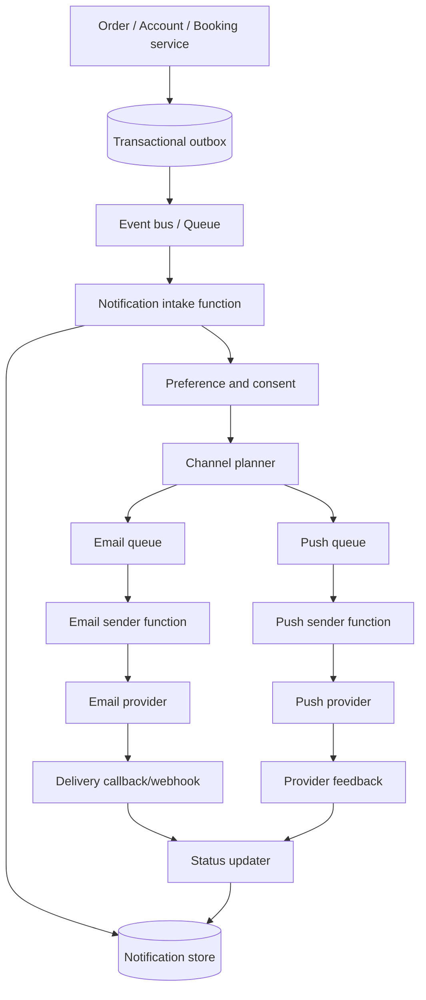
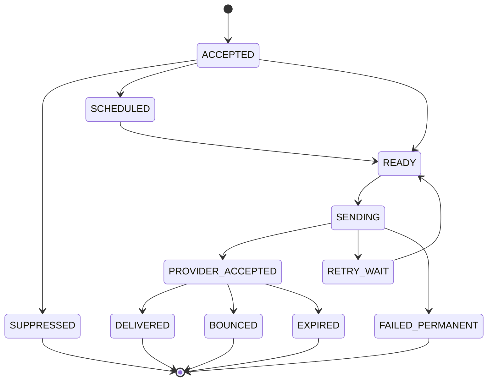

# Xây dựng dịch vụ thông báo qua email và push notification

Email và push notification là hai kênh phổ biến để thông báo cho người dùng về trạng thái đơn hàng, bảo mật tài khoản, lịch hẹn, giao dịch hoặc nội dung mới. Trong hệ thống serverless, một business event có thể kích hoạt nhiều Java function: function kiểm tra preference, render template, gửi qua provider và tiếp nhận delivery callback. Thiết kế tốt giúp tách luồng nghiệp vụ khỏi nhà cung cấp kênh gửi, chịu được burst, retry và duplicate event, đồng thời tôn trọng consent và quyền riêng tư.

Dịch vụ notification không chỉ là một hàm gọi SMTP hoặc push API. Nó cần quản lý **vòng đời thông báo**: yêu cầu được tạo, kiểm tra điều kiện gửi, lập lịch, gửi đến provider, nhận kết quả, xử lý bounce/token invalid và lưu trạng thái có thể truy vết. Cần phân biệt provider đã nhận yêu cầu với email thực sự vào inbox hoặc push thực sự hiển thị trên thiết bị.

Bài này hướng dẫn xây dựng notification service dùng Java FaaS, HTTP API, event bus/queue, email provider và push provider như Firebase Cloud Messaging (FCM) hoặc Apple Push Notification service (APNs). Trọng tâm gồm kiến trúc event-driven, data model, template, preference/consent, idempotency, retry, rate limit, bảo mật, observability, kiểm thử và vận hành.

## 1. Vai trò và kiến trúc tổng thể

### 1.1. Tách business event khỏi notification command

Business service nên phát event mô tả điều đã xảy ra, ví dụ `OrderShipped`, `PasswordResetRequested` hoặc `AppointmentReminderDue`. Notification service quyết định có gửi thông báo hay không, gửi qua kênh nào, template nào và thời điểm nào.

Không để Order Service tự biết SMTP host, FCM credential hoặc template email. Khi provider thay đổi, business logic không nên phải deploy lại chỉ vì adapter gửi thay đổi.

### 1.2. Kiến trúc tham khảo



Các thành phần có thể là nhiều function hoặc một số function kết hợp theo throughput và ownership. Tách queue theo channel giúp giới hạn concurrency riêng, kiểm soát quota provider và tránh email backlog làm chậm push.

### 1.3. Trách nhiệm từng thành phần

| Thành phần | Trách nhiệm |
| --- | --- |
| Producer | Phát domain event sau khi business transaction commit |
| Intake | Validate event, tạo notification intent và kiểm tra idempotency |
| Preference service | Đọc consent, channel preference, quiet hours và frequency cap |
| Planner | Chọn channel, template, locale và thời điểm gửi |
| Sender | Gọi provider, phân loại kết quả và lưu attempt |
| Provider callback | Nhận bounce, complaint, invalid token hoặc delivery feedback |
| Notification store | Lưu state, recipient reference, attempt và audit metadata |
| DLQ/replay | Cô lập thông báo không xử lý được và replay có kiểm soát |

### 1.4. Đồng bộ hay bất đồng bộ?

HTTP API có thể nhận yêu cầu tạo notification và trả `202 Accepted` cùng `notificationId` nếu việc gửi diễn ra bất đồng bộ. Response này có nghĩa yêu cầu đã được tiếp nhận theo contract, không có nghĩa email/push đã được giao.

Với event-driven flow, producer publish event qua outbox/queue sau khi commit. Sender chạy độc lập và có thể retry mà không giữ HTTP request mở trong thời gian provider phản hồi.

## 2. Thiết kế domain model và notification lifecycle

### 2.1. Notification intent

Một notification intent mô tả điều ứng dụng muốn truyền đạt:

- `notificationId`: định danh thông báo ổn định;
- `businessEventId`: event nghiệp vụ nguồn;
- `recipientId`: định danh người nhận nội bộ;
- `notificationType`: loại thông báo, ví dụ `ORDER_SHIPPED`;
- `channels`: channel được phép xem xét;
- `templateKey` và `templateVersion`;
- `locale`;
- `scheduledAt` và `expiresAt`;
- `correlationId`/`causationId`;
- payload biến template đã được lọc;
- classification như transactional/security/marketing.

Không nhúng toàn bộ profile hoặc secret vào event. Dùng recipient ID để lấy địa chỉ email/device token từ profile service với quyền phù hợp.

### 2.2. Trạng thái tổng thể và trạng thái theo channel

Một notification có thể gửi email thành công nhưng push thất bại. Vì vậy, nên theo dõi delivery attempt theo từng channel/recipient thay vì chỉ có một boolean `sent`.

Ví dụ state machine:



`PROVIDER_ACCEPTED` và `DELIVERED` là hai trạng thái khác nhau. Một provider có thể xác nhận đã nhận request nhưng không có bằng chứng chắc chắn email vào inbox hoặc push được hiển thị.

### 2.3. Trạng thái attempt

Mỗi lần gọi provider nên có record riêng:

| Trạng thái | Ý nghĩa |
| --- | --- |
| `STARTED` | Sender bắt đầu một attempt |
| `ACCEPTED` | Provider trả kết quả nhận request |
| `RETRYABLE_FAILURE` | Lỗi tạm thời, có thể thử lại |
| `PERMANENT_FAILURE` | Lỗi không thể tự hết như địa chỉ sai hoặc payload invalid |
| `UNKNOWN_OUTCOME` | Timeout/mất kết nối, chưa biết provider đã xử lý hay chưa |
| `DELIVERED` | Có delivery feedback theo khả năng provider |
| `BOUNCED`/`UNREGISTERED` | Provider báo địa chỉ/token không còn hợp lệ |

Không chuyển `UNKNOWN_OUTCOME` thẳng sang retry hoặc fallback provider nếu có nguy cơ gửi trùng. Cần query/reconcile hoặc dùng provider idempotency nếu được hỗ trợ.

### 2.4. Java domain records

```java
import java.time.Instant;
import java.util.Map;
import java.util.Set;

public enum NotificationChannel {
    EMAIL,
    PUSH
}

public enum NotificationClass {
    SECURITY,
    TRANSACTIONAL,
    MARKETING
}

public record NotificationCommand(
        String notificationId,
        String businessEventId,
        String recipientId,
        String notificationType,
        NotificationClass classification,
        Set<NotificationChannel> requestedChannels,
        String templateKey,
        String locale,
        Instant scheduledAt,
        Instant expiresAt,
        Map<String, String> templateVariables) {
}
```

Trong hệ thống thực tế, `templateVariables` cần schema theo `notificationType`; không chấp nhận map tùy ý từ caller mà không validate. Với dữ liệu nhạy cảm, chỉ truyền reference và lấy nội dung từ source có quyền kiểm soát.

## 3. Event contract và transactional outbox

### 3.1. Vì sao dùng outbox?

Nếu Order Service commit đơn hàng rồi publish event bằng hai thao tác riêng, có thể xảy ra:

- order commit nhưng publish thất bại: không có notification;
- publish thành công nhưng transaction order rollback: thông báo cho một order chưa tồn tại;
- producer timeout sau publish và publish lại: event duplicate.

Transactional outbox ghi business state và event vào cùng database transaction. Publisher đọc outbox và gửi đến broker; publisher có thể gửi lại sau khi mất acknowledgement, vì vậy notification intake vẫn phải idempotent.

### 3.2. Event mẫu

```json
{
  "eventId": "evt-order-9001",
  "source": "orders-service",
  "type": "OrderShipped",
  "occurredAt": "2026-11-17T08:30:00Z",
  "correlationId": "checkout-2201",
  "data": {
    "orderId": "order-9001",
    "recipientId": "user-42",
    "trackingReference": "track-abc"
  }
}
```

Event chứa dữ liệu tối thiểu đủ để định tuyến. Notification service có thể lấy địa chỉ email, locale và preference từ profile service. Không đưa access token, password reset secret hoặc device token vào event bus nếu không cần thiết.

### 3.3. Inbox/idempotency ở intake

Dùng unique key như `(consumer_name, event_id, notification_type)` để cùng event không tạo nhiều notification intent. Với một event có thể hợp lệ tạo nhiều loại notification, đưa type vào key.

```sql
CREATE TABLE notification_inbox (
    consumer_name VARCHAR(100) NOT NULL,
    event_id VARCHAR(200) NOT NULL,
    notification_type VARCHAR(100) NOT NULL,
    received_at TIMESTAMP NOT NULL,
    PRIMARY KEY (consumer_name, event_id, notification_type)
);

CREATE TABLE notification_request (
    notification_id VARCHAR(200) PRIMARY KEY,
    event_id VARCHAR(200) NOT NULL,
    recipient_id VARCHAR(200) NOT NULL,
    notification_type VARCHAR(100) NOT NULL,
    status VARCHAR(40) NOT NULL,
    created_at TIMESTAMP NOT NULL
);
```

Insert inbox record và notification request trong cùng transaction. Nếu insert inbox trùng, xử lý như duplicate delivery và không tạo request thứ hai.

### 3.4. Idempotency key theo recipient và channel

Một notification fan-out cho nhiều recipient/channel. Khóa idempotency của delivery có thể là:

```text
notificationId + channel + recipientId
```

Nếu một người có nhiều thiết bị push, thêm `deviceRegistrationId` hoặc endpoint ID. Không dùng email address hoặc raw device token làm key hiển thị trong log; lưu hash/reference an toàn.

## 4. Preference, consent và chính sách gửi

### 4.1. Phân loại thông báo

Không phải thông báo nào cũng có cùng quy tắc:

- **Security:** cảnh báo đăng nhập, đổi mật khẩu, MFA; cần ưu tiên và nội dung rõ ràng.
- **Transactional:** xác nhận đơn, biên nhận, trạng thái giao hàng; gắn với giao dịch người dùng yêu cầu.
- **Marketing:** khuyến mãi, newsletter, gợi ý sản phẩm; cần consent và cơ chế unsubscribe theo policy/pháp luật áp dụng.

Phân loại phải được lưu trong command và kiểm tra tại thời điểm gửi. Không cho producer tự gắn nhãn `SECURITY` để bỏ qua consent nếu type không được policy cho phép.

### 4.2. Channel preference

Người dùng có thể chọn email, push hoặc cả hai. Preference nên lưu theo notification category/type, không chỉ một cờ global. Ví dụ người dùng tắt marketing push nhưng vẫn muốn nhận cảnh báo bảo mật.

### 4.3. Consent và unsubscribe

Với marketing, lưu evidence về consent: nguồn, thời điểm, policy/version, scope và cách rút lại. Unsubscribe phải có hiệu lực theo yêu cầu policy và được kiểm tra trước khi gửi từng message hoặc theo thời điểm gửi đã xác định.

Không suy luận consent từ việc người dùng có email hoặc đã đăng ký tài khoản. Quy tắc pháp lý cụ thể phụ thuộc quốc gia, loại thông báo và quan hệ với người nhận; tổ chức cần legal/compliance owner xác nhận.

### 4.4. Quiet hours và timezone

Quiet hours có thể trì hoãn notification không khẩn cấp. Lưu timezone của người nhận hoặc một timezone policy rõ. Xử lý daylight saving/timezone change nếu sản phẩm phục vụ nhiều quốc gia.

Không áp dụng quiet hours một cách mù quáng cho security alert hoặc thông báo critical đã được policy miễn trừ. Quy tắc miễn trừ phải được định nghĩa theo type.

### 4.5. Frequency cap và deduplication nghiệp vụ

Một người có thể nhận nhiều event tương tự trong thời gian ngắn. Dùng frequency cap theo category, recipient và time window; gộp digest nếu phù hợp. Không gộp các thông báo có ý nghĩa bảo mật hoặc giao dịch cần gửi riêng.

### 4.6. Kiểm tra preference ngay trước khi gửi

Preference có thể thay đổi giữa lúc event được nhận và lúc sender chạy. Với notification được schedule hoặc queue lâu, kiểm tra consent/channel preference tại send time. Ghi lại policy decision/version để giải thích vì sao một thông báo được gửi hoặc suppressed.

## 5. Email channel

### 5.1. Email provider adapter

Tạo interface chung để business layer không phụ thuộc SDK của provider:

```java
import java.time.Instant;

public record EmailMessage(
        String recipient,
        String subject,
        String htmlBody,
        String textBody,
        String idempotencyKey) {
}

public record ProviderAcceptance(
        String providerMessageId,
        Instant acceptedAt) {
}

public interface EmailProvider {
    ProviderAcceptance send(EmailMessage message);
}
```

Adapter cụ thể có thể gọi SMTP relay hoặc HTTP API của provider. Giữ response provider ID để nối callback/bounce với notification attempt.

### 5.2. Provider acceptance không phải inbox delivery

Email provider có thể trả thành công khi đã nhận message để xử lý. Sau đó email vẫn có thể bounce, bị reject bởi receiving server, vào spam hoặc không hiển thị do policy của mailbox. Notification state nên phân biệt `PROVIDER_ACCEPTED`, `DELIVERED` nếu có feedback, `BOUNCED` và `COMPLAINED`.

### 5.3. SPF, DKIM và DMARC

Domain gửi email production cần cấu hình authentication phù hợp:

- SPF xác định server được phép gửi cho domain;
- DKIM ký message để xác thực nội dung/domain;
- DMARC quy định xử lý và alignment cho SPF/DKIM.

Theo dõi domain reputation, bounce rate, complaint rate và suppression list. Không gửi từ domain cá nhân hoặc domain chưa được xác thực trong production.

### 5.4. Template và nội dung

Template nên có:

- key và version;
- locale;
- subject;
- HTML body;
- text alternative;
- schema của biến;
- owner/reviewer;
- preview/test fixture.

Escape dữ liệu theo context HTML/URL để tránh injection. Không nối trực tiếp input người dùng vào HTML. Link cần HTTPS, domain hợp lệ và không chứa token nhạy cảm trong query nếu có thể.

### 5.5. Unsubscribe và headers

Với email marketing, hỗ trợ unsubscribe dễ thấy và header chuẩn phù hợp với provider/mailbox. Xử lý unsubscribe ở service preference và suppression store, không chỉ ẩn link ở template.

### 5.6. Bounce và complaint feedback

Webhook/provider event có thể báo:

- hard bounce: địa chỉ không tồn tại hoặc không nhận được;
- soft bounce: lỗi tạm thời như mailbox full;
- complaint: người nhận đánh dấu spam;
- suppression: provider từ chối gửi đến địa chỉ đã bị chặn.

Hard bounce/complaint thường cần cập nhật suppression hoặc yêu cầu người dùng xác minh lại. Soft bounce có thể retry theo policy provider. Không retry vô hạn một địa chỉ hard bounce.

## 6. Push notification channel

### 6.1. Device registration

Ứng dụng mobile/web đăng ký device token hoặc push endpoint với backend. Registration record thường gồm:

- recipient/user ID;
- platform (Android/iOS/Web);
- token/endpoint được mã hóa khi lưu;
- app/environment (production/sandbox);
- device registration ID;
- created/lastSeen/updated time;
- trạng thái active/revoked;
- locale và notification capability nếu cần.

Device token có thể thay đổi hoặc hết hiệu lực. Client cần cập nhật token khi provider SDK báo refresh và backend cần xử lý invalid token feedback.

### 6.2. Không coi token là định danh người dùng

Một user có thể có nhiều device. Token có thể rotate hoặc bị thu hồi. Mapping token với user phải được kiểm soát khi login/logout, account switch và thiết bị dùng chung.

Khi user logout hoặc revoke device, xóa/disable registration theo policy. Không gửi notification riêng tư đến token cũ của tài khoản đã logout.

### 6.3. FCM và APNs

FCM cung cấp giao diện gửi đến Android và có thể làm gateway cho một số nền tảng; iOS push cuối cùng phụ thuộc APNs. Với iOS, cấu hình topic/bundle ID, signing key/certificate và environment đúng. Với Android, kiểm tra project/sender ID và app configuration.

Provider adapter nên ẩn khác biệt payload, authentication và error mapping, nhưng không giả vờ các nền tảng có semantics giống nhau hoàn toàn.

### 6.4. Payload và privacy

Push có thể xuất hiện trên lock screen. Payload nên chứa nội dung tối thiểu, tránh số tài khoản, thông tin y tế, payment detail hoặc dữ liệu nhạy cảm. Có thể gửi notification chung và để app fetch nội dung sau khi user xác thực.

Deep link không được tự cấp quyền truy cập. Khi mở app, backend vẫn phải authorize user đối với resource được tham chiếu.

### 6.5. TTL, priority và collapse key

- TTL giới hạn thời gian message còn hữu ích; thông báo giao hàng cũ có thể hết hạn.
- Priority quyết định mức độ khẩn/tiêu thụ tài nguyên theo semantics platform.
- Collapse key giúp gộp các cập nhật trạng thái có thể thay thế nhau, ví dụ “có trạng thái mới nhất của đơn hàng”.

Không dùng collapse key cho event cần hiển thị đầy đủ từng lần như security alert hoặc receipt quan trọng.

### 6.6. Provider accepted không có nghĩa thiết bị đã hiển thị

Push provider có thể nhận message nhưng thiết bị offline, app bị force-stop, quyền notification bị tắt hoặc hệ điều hành không hiển thị. Theo dõi trạng thái provider và client acknowledgement riêng nếu sản phẩm cần biết user đã mở/đọc thông báo.

## 7. Java provider adapters và dispatch

### 7.1. Interface chung cho channel

```java
import java.time.Instant;
import java.util.Map;

public record NotificationContent(
        String title,
        String body,
        String deepLink,
        Map<String, String> data) {
}

public record DeliveryTarget(
        String recipientId,
        String endpointReference,
        NotificationChannel channel) {
}

public interface NotificationChannelSender {
    NotificationChannel channel();

    ProviderAcceptance send(
            DeliveryTarget target,
            NotificationContent content,
            String idempotencyKey);
}
```

`endpointReference` là reference đến email address/device token trong kho được bảo vệ, không phải raw secret in log. Adapter có thể resolve reference bằng repository/service có quyền riêng.

### 7.2. Dispatch service

```java
import java.util.EnumMap;
import java.util.Map;

public final class NotificationDispatcher {
    private final Map<NotificationChannel, NotificationChannelSender> senders;

    public NotificationDispatcher(
            Iterable<NotificationChannelSender> configuredSenders) {
        this.senders = new EnumMap<>(NotificationChannel.class);
        for (NotificationChannelSender sender : configuredSenders) {
            NotificationChannel previous = sender.channel();
            if (senders.put(previous, sender) != null) {
                throw new IllegalArgumentException(
                        "Duplicate sender for channel " + previous);
            }
        }
    }

    public ProviderAcceptance send(
            DeliveryTarget target,
            NotificationContent content,
            String idempotencyKey) {
        NotificationChannelSender sender = senders.get(target.channel());
        if (sender == null) {
            throw new UnsupportedOperationException(
                    "Channel is not configured: " + target.channel());
        }
        return sender.send(target, content, idempotencyKey);
    }
}
```

Trong production, dispatch service nên được gọi sau preference/consent check và sau khi delivery attempt đã được claim atomically. Không giữ transaction database mở trong lúc gọi provider.

### 7.3. Delivery attempt state

Một flow sender có thể:

1. Claim `(notificationId, channel, recipient/device)` bằng conditional update/lease.
2. Tạo attempt ID và ghi `STARTED`.
3. Gọi provider với idempotency key nếu provider hỗ trợ.
4. Lưu provider message ID và response.
5. Phân loại kết quả thành accepted, retryable, permanent hoặc unknown.
6. Acknowledge queue sau khi trạng thái đã được lưu bền vững.

Nếu function timeout sau khi provider nhận request nhưng trước khi lưu response, attempt có thể ở trạng thái unknown. Reconcile bằng provider ID/request log hoặc provider idempotency trước khi gửi lại.

## 8. Retry, idempotency và duplicate delivery

### 8.1. Phân loại lỗi

| Lỗi | Xử lý thường phù hợp |
| --- | --- |
| Provider 429/throttling | Tôn trọng `Retry-After`, giảm concurrency và retry có jitter |
| Provider 5xx/transient network | Retry có giới hạn nếu outcome an toàn |
| Invalid recipient/email | Permanent failure hoặc suppression |
| Invalid push token | Deactivate registration và không retry token đó |
| Invalid template/payload | Permanent failure, alert owner template |
| Auth/configuration error | Fail fast, alert owner; không retry dồn dập |
| Timeout với outcome không rõ | Reconcile trước khi gửi lại hoặc fallback |

### 8.2. Exponential backoff và jitter

Một retry policy có thể dùng:

\[
Delay_n = Random(0, \min(MaxDelay, BaseDelay \times 2^n))
\]

Giới hạn max attempts, total retry window và notification expiry. Nếu notification hết giá trị sau 15 phút, không retry sau một ngày chỉ vì message còn trong queue.

### 8.3. Exactly-once delivery không thể giả định

Queue thường cung cấp at-least-once delivery. Provider call cũng có thể timeout sau khi nhận message. Vì vậy, notification service phải chấp nhận duplicate attempt và dùng idempotency/deduplication.

Không phải provider nào cũng hỗ trợ idempotency key cho send API. Nếu không hỗ trợ, application-level claim giảm duplicate nhưng không loại bỏ hoàn toàn trường hợp process crash giữa provider acceptance và persistence update. Cần thiết kế trạng thái `UNKNOWN_OUTCOME` và reconciliation.

### 8.4. Idempotency theo recipient/channel

Ví dụ key:

```text
notificationId:EMAIL:recipient-42
notificationId:PUSH:device-registration-91
```

Nếu một notification gửi email và push, hai channel có trạng thái độc lập. Retry push không gửi lại email đã accepted. Nếu một user có ba device, từng endpoint có attempt riêng.

### 8.5. DLQ và replay

Đưa message vào DLQ khi hết retry budget hoặc payload không thể xử lý. DLQ record cần notification ID, event ID, channel, error category, attempt count và timestamp. Không lưu raw secret hoặc token trong log.

Replay phải kiểm tra expiry, consent hiện tại, idempotency và provider suppression. Không redrive hàng loạt trong khi provider đang throttling.

## 9. Rate limit, fan-out và backpressure

### 9.1. Fan-out theo recipient

Một event có thể gửi cho hàng nghìn người. Không tạo một invocation duy nhất giữ toàn bộ recipient list trong memory và gọi provider tuần tự. Tách fan-out thành batch/page hoặc message theo recipient/partition.

### 9.2. Rate limit theo provider và tenant

Áp dụng quota ở nhiều phạm vi:

- provider account/project;
- channel;
- tenant/customer;
- recipient;
- notification category;
- campaign/batch.

Provider quota có thể thay đổi theo region, account reputation hoặc loại message. Lưu cấu hình giới hạn bên ngoài code và có dashboard theo dõi throttling.

### 9.3. Concurrency cap

Giới hạn sender concurrency để không vượt provider quota và không làm cạn database connection. Concurrency limit ở một JVM không phải global limit; cần platform-level concurrency, queue consumer cap hoặc distributed rate limiter.

### 9.4. Queue smoothing

Queue hấp thụ burst nhưng không tạo capacity vô hạn. Theo dõi queue depth, oldest message age, enqueue/dequeue rate, provider throttling và retry. Nếu producer nhanh hơn sender lâu dài, cần giảm admission, batch hoặc tăng quota/provider capacity.

### 9.5. Ưu tiên thông báo

Security/transactional notification có thể cần queue/priority riêng với marketing campaign. Đừng để campaign gửi hàng triệu email làm trễ password reset hoặc OTP. Cần fairness giữa tenant và giới hạn burst theo category.

### 9.6. Scheduled notification

Với reminder/digest, lưu `scheduledAt` và `expiresAt`, dùng scheduler/workflow/queue delay phù hợp. Xác định timezone, duplicate schedule và missed-run behavior. Idempotency key có thể gồm recipient, notification type và logical schedule window.

## 10. Email và push fallback

### 10.1. Fallback phải theo policy

Nếu push không thể gửi vì token invalid, có thể fallback email nếu user đã consent và preference cho phép. Nhưng không tự động fallback mọi lỗi:

- provider timeout với outcome unknown có thể đã gửi push;
- security notification có thể không được gửi qua email theo policy;
- marketing channel có thể đã bị unsubscribe;
- email bounce không đồng nghĩa được phép gửi SMS.

### 10.2. Fallback state machine

Ghi channel decision, reason và policy version. Ví dụ `PUSH_INVALID_TOKEN` có thể chuyển sang email nếu policy cho phép; `PUSH_UNKNOWN_OUTCOME` cần reconcile trước khi fallback để tránh duplicate.

### 10.3. Không dùng fallback để né consent

Người dùng tắt push marketing không có nghĩa được phép gửi cùng nội dung qua email. Consent và preference phải được kiểm tra cho channel fallback riêng.

## 11. Security và privacy

### 11.1. Bảo vệ recipient data

- mã hóa email address và device token khi lưu nếu policy yêu cầu;
- hạn chế quyền đọc recipient endpoint;
- không log raw token/email hoặc payload nhạy cảm;
- dùng TLS khi gọi provider;
- rotate provider credential qua secret manager;
- tách identity cho email sender và push sender;
- áp dụng retention/deletion cho notification history.

### 11.2. Webhook verification

Provider callback có thể bị giả mạo nếu endpoint không xác minh. Dùng chữ ký/HMAC hoặc cơ chế xác thực chính thức của provider, kiểm tra timestamp/replay window và idempotency của callback event. Không tin status trong request body chỉ vì endpoint có URL khó đoán.

### 11.3. Template injection và phishing

Escape biến theo HTML context; không cho người dùng nhập subject/from address tùy ý. Giữ sender domain được xác thực và link allowlist. Security notification cần domain/link nhất quán để người dùng nhận biết.

### 11.4. Push payload và deep link

Không đưa access token, reset token hoặc dữ liệu nhạy cảm vào push payload. Deep link chỉ điều hướng app; backend phải kiểm tra authentication/authorization trước khi trả dữ liệu.

### 11.5. Data retention

Notification history có thể chứa recipient, nội dung và provider metadata. Đặt retention theo mục đích nghiệp vụ/audit và policy privacy. Khi xóa user data, xác định cả profile, endpoint, queued notification, DLQ, provider logs và backup theo quy trình xóa dữ liệu.

## 12. Observability và trạng thái giao nhận

### 12.1. Metrics

Theo dõi theo channel/provider/type với cardinality thấp:

- notifications accepted/suppressed/scheduled;
- send attempts và retry count;
- provider acceptance rate;
- delivery/bounce/complaint rate nếu provider hỗ trợ;
- invalid push token rate;
- provider 429/5xx/timeout;
- queue depth và oldest message age;
- time from event to provider acceptance;
- time to delivery feedback;
- cost per accepted/delivered notification.

Không dùng `recipientId`, email hoặc device token làm metric label. Dùng log/trace có kiểm soát cho từng notification ID.

### 12.2. Trace context

Propagate W3C trace context từ business event qua intake, planner, sender và provider callback khi khả thi. Callback có thể đến nhiều phút/giờ sau, vì vậy correlation ID/notification ID thường cần để nối lifecycle; không giả định trace span cha còn mở.

### 12.3. Structured log

Các field hữu ích:

- notification ID/event ID/correlation ID;
- channel/provider;
- template key/version/locale;
- attempt number và idempotency key hash;
- provider message ID;
- result/error category;
- latency và queue age;
- policy decision (allowed/suppressed/fallback).

Redact recipient endpoint và payload. Không ghi nội dung email/push đầy đủ trừ khi có lý do, access control và retention đã được duyệt.

### 12.4. Provider callback và delivery semantics

Webhook callback cần:

- verify signature/authentication;
- validate event schema/version;
- deduplicate callback ID;
- map provider message ID về notification attempt;
- cập nhật state transition hợp lệ;
- ack sau khi persist;
- gửi event nội bộ nếu business workflow cần delivery result.

Callback có thể đến trễ hoặc sai thứ tự. Không cho một callback `ACCEPTED` đến muộn ghi đè trạng thái `BOUNCED` đã xác nhận. Dùng transition rule/version.

## 13. Java example: policy trước khi gửi

Ví dụ tách policy evaluation khỏi provider call:

```java
public record RecipientPreferences(
        boolean emailEnabled,
        boolean pushEnabled,
        boolean marketingConsent,
        String locale,
        String timeZone) {
}

public record SendDecision(
        NotificationChannel channel,
        boolean allowed,
        String reason) {
}

public final class NotificationPolicy {
    public SendDecision evaluate(
            NotificationCommand command,
            NotificationChannel channel,
            RecipientPreferences preferences) {

        if (command.classification() == NotificationClass.MARKETING
                && !preferences.marketingConsent()) {
            return new SendDecision(channel, false, "NO_MARKETING_CONSENT");
        }

        boolean enabled = switch (channel) {
            case EMAIL -> preferences.emailEnabled();
            case PUSH -> preferences.pushEnabled();
        };

        if (!enabled) {
            return new SendDecision(channel, false, "CHANNEL_DISABLED");
        }

        return new SendDecision(channel, true, "ALLOWED");
    }
}
```

Đây là policy tối thiểu để minh họa. Production policy cần phân biệt notification class/type, consent scope, legal basis, quiet hours, frequency cap, mandatory security notice và user-level suppression. Không dùng một boolean consent cho tất cả loại notification.

## 14. Java example: xử lý provider result

Không nên để mọi exception đều đi vào retry. Dùng kết quả có phân loại:

```java
public enum ProviderFailureKind {
    THROTTLED,
    TRANSIENT,
    PERMANENT,
    CONFIGURATION,
    UNKNOWN_OUTCOME
}

public sealed interface SendResult {
    record Accepted(String providerMessageId) implements SendResult {}
    record Failed(ProviderFailureKind kind, String code) implements SendResult {}
}

public final class SendResultHandler {
    public DeliveryAction decide(SendResult result) {
        return switch (result) {
            case SendResult.Accepted accepted -> DeliveryAction.MARK_ACCEPTED;
            case SendResult.Failed failed -> switch (failed.kind()) {
                case THROTTLED, TRANSIENT -> DeliveryAction.RETRY_WITH_BACKOFF;
                case PERMANENT -> DeliveryAction.MARK_FAILED;
                case CONFIGURATION -> DeliveryAction.ALERT_AND_STOP;
                case UNKNOWN_OUTCOME -> DeliveryAction.RECONCILE_FIRST;
            };
        };
    }
}
```

`DeliveryAction` là enum ứng dụng. Ví dụ dùng sealed type/pattern switch yêu cầu phiên bản Java hỗ trợ tương ứng. Adapter provider phải map error code cụ thể sang `ProviderFailureKind`; không phân loại chỉ dựa trên exception message.

## 15. Kiểm thử notification service

### 15.1. Unit test

Kiểm tra:

- preference/consent cho từng notification class;
- locale/template variable validation;
- quiet hours và timezone;
- fallback policy;
- retry classification và expiry;
- idempotency key generation;
- state transition hợp lệ;
- invalid token/bounce suppression.

Inject `Clock`, provider client và policy repository để test deterministic.

### 15.2. Contract test với provider

Mock hoặc sandbox provider để xác minh:

- request payload và authentication;
- response mapping/provider message ID;
- 429/5xx/invalid request semantics;
- callback signature verification;
- bounce/complaint/token invalid event mapping;
- provider API version compatibility.

Không gửi email/push thật đến người dùng production trong test.

### 15.3. Integration test

Kiểm tra:

- outbox publish duplicate;
- queue redelivery;
- hai invocation cùng claim một notification;
- timeout sau provider acceptance;
- callback đến trễ/sai thứ tự;
- một channel thành công, channel khác thất bại;
- preference thay đổi sau khi message được schedule;
- DLQ redrive sau khi notification hết hạn.

### 15.4. Load test

Tạo burst lớn và phân bố recipient skew. Kiểm tra provider quota, sender concurrency, queue age, database connection và cost. Load test phải dùng sandbox/test tenant và giới hạn traffic để không làm ảnh hưởng reputation của email domain hoặc push project.

### 15.5. End-to-end acceptance

Với test mailbox/device được kiểm soát, xác nhận:

- nội dung/locale đúng;
- link và deep link hợp lệ;
- unsubscribe hoạt động;
- push permission/device token lifecycle;
- provider acceptance và feedback được ghi đúng;
- duplicate event không tạo duplicate business notification.

## 16. Reliability, fallback và disaster recovery

### 16.1. Provider outage

Khi email provider lỗi:

- giảm sender concurrency;
- giữ message trong queue đến expiry;
- retry transient theo budget;
- mở circuit breaker khi cần;
- cân nhắc provider dự phòng nếu contract và idempotency cho phép;
- không đổi provider liên tục khi outcome chưa rõ.

Với push provider, xem xét token invalid rate, provider health và app-specific credential. Provider fallback phải được kiểm thử trước outage.

### 16.2. Multi-provider strategy

Adapter abstraction giúp thay provider nhưng không bảo đảm provider thứ hai có cùng semantics, quota, template, feedback hoặc idempotency. Cần mapping và test riêng.

Nếu primary timeout sau khi gửi request, không gửi ngay sang secondary vì primary có thể đã nhận. Reconcile bằng provider message ID/idempotency nếu có; nếu không thể xác định, áp dụng policy chấp nhận duplicate hoặc chờ trạng thái rõ và ghi nhận rủi ro.

### 16.3. Queue retention và expiry

Message có thể tồn tại trong queue lâu hơn thời gian nội dung còn hữu ích. Mỗi notification nên có `expiresAt`; sender kiểm tra trước khi gửi. Reminder cũ hoặc trạng thái đơn đã thay đổi có thể bị suppress.

### 16.4. Backup và recovery

Backup notification state, preference/consent và template version theo recovery policy. Khi restore/replay, giữ idempotency key và kiểm tra expiry/consent hiện tại để không gửi lại hàng loạt notification cũ.

## 17. Cost và FinOps

### 17.1. Cost drivers

- FaaS invocation/duration/memory;
- queue/event bus request và payload;
- database read/write/storage;
- email provider theo volume/tier;
- push provider và network;
- template asset/object storage;
- log/metric/trace ingest và retention;
- data transfer và NAT/egress.

### 17.2. Unit cost

Theo dõi:

\[
CostPerAccepted = \frac{TotalNotificationCost}{ProviderAcceptedCount}
\]

\[
CostPerDelivered = \frac{TotalNotificationCost}{DeliveredCount}
\]

Nếu provider không cung cấp delivery confirmation, không đặt `ProviderAcceptedCount` bằng `DeliveredCount`. Báo cáo rõ mẫu số và feedback coverage.

### 17.3. Cost controls

- frequency cap và deduplication;
- batch/fan-out có giới hạn;
- TTL/expiry cho notification lỗi thời;
- giảm log payload/cardinality;
- template cache an toàn;
- quota theo tenant/campaign;
- dashboard retry amplification và provider throttling.

Không giảm chi phí bằng cách bỏ security notice, unsubscribe hoặc audit evidence bắt buộc.

## 18. Vận hành và runbook

### 18.1. Email bounce tăng

1. Kiểm tra bounce theo domain/provider/template.
2. Phân biệt hard bounce, soft bounce và complaint.
3. Xác nhận SPF/DKIM/DMARC, sender reputation và suppression.
4. Tạm dừng campaign nếu complaint/bounce vượt threshold.
5. Cập nhật suppression/recipient validation.
6. Chỉ resume sau khi provider/domain owner xác nhận.

### 18.2. Push invalid token tăng

1. Phân nhóm theo app version/platform/environment.
2. Kiểm tra token refresh registration và login/logout flow.
3. Deactivate token provider đánh dấu unregistered.
4. Không retry token invalid.
5. Yêu cầu client cập nhật token và kiểm tra mapping account/device.

### 18.3. Queue backlog tăng

1. Xem provider 429/5xx, sender duration và concurrency.
2. Xác định queue nào bị nghẽn: email hay push.
3. Điều chỉnh concurrency trong provider quota.
4. Kiểm tra notification expiry và priority.
5. Mở circuit breaker hoặc giảm producer rate nếu dependency quá tải.
6. Theo dõi oldest message age, DLQ và business delivery outcome.

### 18.4. Duplicate notification

1. Tìm notification ID, event ID và attempt history.
2. Xác định duplicate ở producer, outbox, queue, sender hay provider callback.
3. Kiểm tra unique constraint/idempotency scope.
4. Kiểm tra timeout/unknown outcome và provider idempotency.
5. Chặn replay/route tạo thêm duplicate.
6. Sửa state transition và chạy reconciliation.

## 19. Checklist production

- [ ] Business event phát sau commit qua outbox hoặc cơ chế tin cậy tương đương.
- [ ] Notification intent có ID ổn định và schema được validate.
- [ ] Inbox/idempotency ngăn event duplicate tạo notification intent trùng.
- [ ] Delivery idempotency được scope theo notification/channel/recipient/device.
- [ ] Provider acceptance được phân biệt với delivered/displayed.
- [ ] Preference, consent, unsubscribe và suppression được kiểm tra đúng channel/type.
- [ ] Quiet hours/timezone/frequency cap có policy rõ.
- [ ] Template có version, locale, schema và output escaping.
- [ ] Email domain có SPF/DKIM/DMARC và bounce/complaint feedback.
- [ ] Push token lifecycle, logout/revocation và invalid token cleanup được xử lý.
- [ ] Push payload không chứa dữ liệu nhạy cảm; deep link được authorize lại.
- [ ] Provider credential nằm trong secret manager và được rotate.
- [ ] Webhook callback được verify, deduplicate và xử lý out-of-order.
- [ ] Retry có classification, max attempts, backoff, jitter và expiry.
- [ ] Unknown outcome được reconcile trước retry/fallback khi cần.
- [ ] Queue, concurrency và rate limit bảo vệ provider quota.
- [ ] Security/transactional notification được tách ưu tiên khỏi marketing campaign.
- [ ] DLQ/replay có audit, idempotency và rate limit.
- [ ] Metrics/log/trace không chứa raw email, token hoặc high-cardinality IDs.
- [ ] Có dashboard provider health, bounce, complaint, invalid token, lag và cost.
- [ ] Unit/contract/integration/load/E2E test đã bao phủ failure modes.
- [ ] Có runbook provider outage, bounce, invalid token, backlog và duplicate.
- [ ] Retention/deletion áp dụng cho notification history, endpoint và DLQ.

## Kết luận

Notification service nên được thiết kế như một hệ thống xử lý event có state và delivery lifecycle. Business service phát event sau commit; notification intake tạo intent idempotent; policy kiểm tra consent/preference; planner chọn channel; sender gọi provider; callback cập nhật trạng thái. Queue tách workload và giúp kiểm soát burst, còn adapter giữ business logic độc lập với provider.

Email provider accepted không có nghĩa message vào inbox; push provider accepted không có nghĩa thiết bị hiển thị. Retry, duplicate và timeout cần được xử lý theo idempotency key, attempt state và reconciliation. Preference, unsubscribe, invalid token, webhook verification, data minimization và retention là phần cốt lõi của production design.

Với Java FaaS, hãy giữ handler mỏng, dùng outbox/inbox, provider adapter, queue riêng theo channel, rate limit và observability theo notification lifecycle. Theo dõi delivery feedback, backlog, bounce, retry và cost per accepted/delivered notification. Kiểm thử cả trạng thái bình thường lẫn provider outage, duplicate, unknown outcome và callback đến sai thứ tự trước khi mở traffic production.
