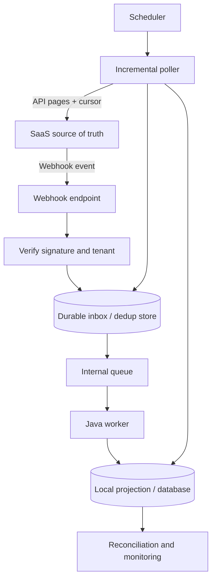

# Đồng bộ dữ liệu SaaS bằng webhook và lịch định kỳ

Khi tích hợp một ứng dụng Java với SaaS bên ngoài, dữ liệu có thể thay đổi ở cả hai phía. Ví dụ CRM cập nhật khách hàng, hệ thống billing thay đổi trạng thái subscription hoặc nền tảng hỗ trợ tạo ticket mới. Ứng dụng của bạn cần nhận biết thay đổi đó và cập nhật bản sao dữ liệu nội bộ đủ nhanh, đồng thời xử lý được trường hợp webhook bị mất, gửi trùng, đến sai thứ tự hoặc API SaaS tạm thời không khả dụng.

Một thiết kế thực tế thường kết hợp **webhook để nhận thay đổi gần thời gian thực** và **lịch định kỳ để đối soát, khôi phục sự kiện bị bỏ lỡ**. Webhook giúp giảm độ trễ và số lần polling; scheduled sync giúp phát hiện sai lệch, xử lý sự cố kéo dài và cập nhật lại trạng thái theo nguồn dữ liệu chuẩn. Cả hai đường đi phải dùng chung quy tắc tenant, idempotency, cursor và conflict resolution để không ghi đè dữ liệu sai.

## 1. Vì sao nên kết hợp webhook và scheduled sync?

Webhook là một HTTP request do SaaS gửi đến endpoint của ứng dụng khi có sự kiện. Scheduled sync là công việc chủ động gọi API SaaS theo chu kỳ để lấy các bản ghi mới hoặc đã thay đổi kể từ lần đồng bộ trước.

| Cách đồng bộ | Điểm mạnh | Giới hạn |
|---|---|---|
| Webhook | Độ trễ thấp, chỉ thông báo khi có thay đổi, giảm polling | Có thể gửi trùng, sai thứ tự, bị retry, bị mất khi endpoint gián đoạn hoặc cấu hình sai |
| Polling định kỳ | Chủ động kiểm tra trạng thái, có thể lấy lại thay đổi bị bỏ lỡ | Độ trễ phụ thuộc chu kỳ, tiêu thụ API quota và cần quản lý pagination/cursor |
| Hybrid | Webhook cập nhật nhanh; polling sửa sai lệch và phục hồi | Cần xử lý hai luồng cùng ghi vào một dữ liệu và quản lý checkpoint rõ ràng |

Không nên coi webhook là một message queue bền vững do ứng dụng sở hữu. Nhà cung cấp có thể chỉ retry trong một khoảng thời gian, có giới hạn số lần gửi hoặc yêu cầu người dùng replay thủ công. Ngược lại, polling liên tục theo toàn bộ dataset có thể tốn quota và tạo tải không cần thiết. Hybrid pattern tận dụng ưu điểm của hai cách.



Webhook và poller có thể cùng đưa thay đổi vào một pipeline xử lý chung. Khi làm vậy, cần lưu nguồn sự kiện (`WEBHOOK` hoặc `POLL`), event/object version và cursor để có thể điều tra nguồn gốc của mỗi lần cập nhật. Nếu sau khi ghi inbox cần publish một message sang queue riêng, dùng transactional outbox hoặc để worker poll inbox; không giả định thao tác ghi database và publish broker là một transaction nguyên tử. Nếu publish thất bại sau khi inbox đã commit, outbox/inbox dispatcher phải thử lại mà không làm mất event.

## 2. Xác định nguồn dữ liệu chuẩn và phạm vi đồng bộ

Trước khi triển khai, hãy quyết định dữ liệu nào thuộc quyền sở hữu của SaaS và dữ liệu nào do ứng dụng nội bộ quản lý.

- **SaaS là source of truth:** các field như subscription status, external customer name hoặc ticket status được lấy từ SaaS; local database chỉ là projection/cache.
- **Ứng dụng nội bộ là source of truth:** dữ liệu được tạo nội bộ và gửi sang SaaS; webhook chỉ phản ánh trạng thái tiếp nhận hoặc thay đổi do người dùng SaaS thực hiện.
- **Hai chiều:** mỗi hệ thống có thể cập nhật một phần field; cần quy định ownership theo field hoặc workflow, không dùng quy tắc “bản ghi đến sau luôn thắng” một cách mù quáng.

Xác định rõ:

- Object/resource nào cần đồng bộ, ví dụ customer, contact, invoice, subscription hoặc ticket.
- Field nào được đồng bộ và field nào chỉ có ý nghĩa nội bộ.
- Tenant/account kết nối với SaaS nào.
- Tần suất và độ trễ mục tiêu cho webhook và reconciliation.
- Cách xử lý create, update, archive, hard delete và restore.
- Chính sách conflict khi cùng một object thay đổi ở hai hệ thống.
- Thời gian lưu event, cursor, audit log và dữ liệu tombstone.

Đừng lưu toàn bộ payload SaaS vào database nội bộ nếu chỉ cần một số field. Chọn projection tối thiểu giúp giảm dữ liệu nhạy cảm, giảm schema coupling và dễ thay đổi khi vendor thêm field.

## 3. Luồng webhook: xác thực, lưu bền vững rồi phản hồi nhanh

Một endpoint webhook nên thực hiện các bước theo thứ tự:

1. Nhận HTTP request qua HTTPS và giới hạn kích thước body.
2. Đọc raw request body đúng như bytes nhận được.
3. Xác thực chữ ký, timestamp hoặc token theo tài liệu của SaaS.
4. Xác định tenant/connection bằng cấu hình đã đăng ký; không tin tenant ID chỉ vì nó xuất hiện trong body.
5. Kiểm tra event type, event ID, schema version và các header cần thiết.
6. Ghi event vào durable inbox với unique key để deduplicate.
7. Commit việc lưu event trước khi trả HTTP success.
8. Worker bất đồng bộ xử lý event và cập nhật local projection.

Endpoint nên trả `2xx` sau khi event đã được lưu bền vững. Không nên giữ kết nối HTTP mở để gọi nhiều API SaaS, cập nhật nhiều bảng hoặc gửi email. Nếu xử lý business logic quá lâu, timeout của provider có thể khiến webhook được gửi lại và tạo thêm bản sao. Giới hạn body ở API gateway/reverse proxy và HTTP server trước khi framework buffer toàn bộ request; kiểm tra `rawBody.length` trong controller chỉ là lớp kiểm tra bổ sung sau khi bytes đã được đọc.

### Tại sao cần durable inbox?

Nếu endpoint trả `200 OK` trước khi ghi event, process có thể chết ngay sau đó và provider nghĩ rằng event đã được nhận. Nếu endpoint thực hiện toàn bộ xử lý rồi mới trả response, request có thể timeout sau khi side effect đã thành công; provider sẽ retry và gây duplicate.

Durable inbox tách việc **nhận event** khỏi việc **xử lý event**. Một bảng inbox có thể có các field:

| Field | Mục đích |
|---|---|
| `provider` | Tên SaaS/provider |
| `connection_id` | Kết nối SaaS đã xác thực |
| `tenant_id` | Tenant nội bộ đã ánh xạ |
| `event_id` | ID sự kiện do provider cấp |
| `event_type` | Loại sự kiện |
| `object_id` | ID đối tượng bên SaaS nếu có |
| `occurred_at` | Thời điểm sự kiện xảy ra theo provider |
| `received_at` | Thời điểm endpoint nhận được |
| `payload` | Payload đã được bảo vệ/giới hạn hoặc reference tới object lưu trữ |
| `status` | RECEIVED, PROCESSING, PROCESSED, RETRY hoặc DEAD |
| `attempt_count` | Số lần worker thử xử lý |
| `last_error` | Mã lỗi đã làm sạch để điều tra |

Đặt unique constraint phù hợp, ví dụ `(provider, connection_id, event_id)`. Nếu provider không cấp event ID ổn định, cần xác định dedup key theo contract; hash payload chỉ là phương án dự phòng vì hai event hợp lệ có thể có payload giống nhau.

## 4. Xác thực webhook an toàn

Webhook endpoint là một HTTP ingress công khai hoặc được SaaS truy cập từ bên ngoài. Không xử lý payload chỉ vì request có đường dẫn bí mật hoặc header tenant hợp lệ.

Các cơ chế phổ biến:

- HMAC signature trên raw body bằng shared secret.
- Timestamp nằm trong signature để giới hạn replay window.
- Secret riêng cho mỗi SaaS connection/tenant nếu provider hỗ trợ.
- mTLS hoặc token authentication nếu provider hỗ trợ và contract yêu cầu.
- IP allowlist chỉ như lớp bổ sung; không thay thế chữ ký mật mã vì IP ranges có thể thay đổi.

### HMAC phải dùng raw body

Nhiều provider ký trên đúng byte của request body. Nếu parse JSON rồi serialize lại, thứ tự field, khoảng trắng hoặc encoding có thể thay đổi và làm signature không còn hợp lệ. Hãy đọc raw bytes, tính HMAC theo đúng canonicalization của provider và so sánh constant-time.

Ví dụ helper Java minh họa với header có dạng `sha256=<hex>`:

```java
import javax.crypto.Mac;
import javax.crypto.spec.SecretKeySpec;
import java.security.MessageDigest;
import java.util.HexFormat;

public final class WebhookSignature {
    public static boolean verify(byte[] rawBody,
                                 String suppliedHeader,
                                 byte[] secret) throws Exception {
        if (suppliedHeader == null || !suppliedHeader.startsWith("sha256=")) {
            return false;
        }

        byte[] supplied;
        try {
            supplied = HexFormat.of().parseHex(
                    suppliedHeader.substring("sha256=".length()));
        } catch (IllegalArgumentException invalidHex) {
            return false;
        }

        Mac mac = Mac.getInstance("HmacSHA256");
        mac.init(new SecretKeySpec(secret, "HmacSHA256"));
        byte[] expected = mac.doFinal(rawBody);
        return MessageDigest.isEqual(expected, supplied);
    }

    private WebhookSignature() {}
}
```

Đây là ví dụ cho một contract giả định. Provider có thể dùng HMAC khác, Base64, timestamp prefix, nhiều signature version hoặc canonical string khác. Phải triển khai chính xác tài liệu của provider; không sao chép header format này cho mọi SaaS. Secret phải được lấy từ secret manager, không hardcode trong source hoặc log.

### Chống replay

Nếu provider ký kèm timestamp, xác minh timestamp nằm trong khoảng chấp nhận được (ví dụ vài phút, tùy clock skew và contract). Chữ ký hợp lệ của một request cũ vẫn có thể bị phát lại; vì vậy timestamp validation phải đi cùng dedup event ID. Không dùng timestamp làm khóa dedup duy nhất.

### Rotation secret

Nếu provider hỗ trợ secret rotation, có thể có giai đoạn chấp nhận cả secret hiện tại và secret kế tiếp. Giới hạn khoảng thời gian overlap, ghi nhận key version đã xác thực và thu hồi secret cũ sau khi provider xác nhận chuyển đổi. Không thử vô hạn nhiều secret vì làm tăng bề mặt tấn công và chi phí xử lý.

## 5. Java: webhook controller chỉ nhận và lưu event

Ví dụ Spring Boot controller nhận raw body, xác thực signature rồi gọi inbox service. Phần mapping header, secret lookup và transaction được tách khỏi controller để dễ kiểm thử.

```java
@RestController
@RequestMapping("/integrations/acme/webhooks")
public class AcmeWebhookController {
    private final WebhookVerifier verifier;
    private final WebhookInboxService inbox;

    public AcmeWebhookController(WebhookVerifier verifier,
                                 WebhookInboxService inbox) {
        this.verifier = verifier;
        this.inbox = inbox;
    }

    @PostMapping
    public ResponseEntity<Void> receive(
            @RequestHeader("X-Acme-Signature") String signature,
            @RequestHeader("X-Acme-Event-Id") String eventId,
            @RequestBody byte[] rawBody) {

        if (rawBody.length > 256 * 1024) {
            return ResponseEntity.status(HttpStatus.PAYLOAD_TOO_LARGE).build();
        }
        VerifiedWebhook verified = verifier.verify(signature, rawBody);
        if (!verified.valid()) {
            return ResponseEntity.status(HttpStatus.UNAUTHORIZED).build();
        }

        // The provider adapter must ensure eventId is covered by the
        // verified signature, or extract it from the signed body.
        inbox.accept(verified.connectionId(), eventId, rawBody);
        return ResponseEntity.accepted().build();
    }
}
```

Controller minh họa không thể thay thế adapter theo contract thật: một số provider gửi event ID trong body, một số ký cả timestamp/header, một số dùng nhiều webhook endpoint theo connection. Nếu event ID nằm trong header mà chữ ký chỉ bao phủ body, không được tin header đó cho dedup nếu provider không có cơ chế ràng buộc nó với payload đã ký; hãy lấy ID từ body đã xác thực hoặc xác minh canonical signature bao gồm header. Việc tìm connection/secret cũng phải dựa trên endpoint key hoặc installation identifier đã đăng ký, sau đó mới xác thực chữ ký. Nếu event bị xác thực sai, trả mã lỗi theo quy ước provider; nếu inbox/database tạm lỗi, trả lỗi retryable thay vì trả `2xx` khi chưa lưu bền vững.

### Inbox transaction và duplicate

Service lưu inbox cần xử lý race giữa hai webhook delivery giống nhau. Dựa vào unique constraint trong database, không chỉ `SELECT` trước rồi mới `INSERT`, vì hai request đồng thời có thể cùng thấy “chưa tồn tại”.

```java
@Transactional
public AcceptResult accept(String connectionId,
                           String eventId,
                           byte[] rawBody) {
    boolean inserted = inboxRepository.insertIfAbsent(
            connectionId, eventId, rawBody, clock.instant());
    return inserted ? AcceptResult.STORED : AcceptResult.ALREADY_RECEIVED;
}
```

`insertIfAbsent` nên dùng một lệnh atomic phù hợp với database, ví dụ `INSERT ... ON CONFLICT DO NOTHING` hoặc câu lệnh tương đương dựa trên unique constraint. Cách này tránh bắt exception constraint violation bên trong transaction rồi tiếp tục dùng transaction có thể đã bị đánh dấu rollback-only. Khi duplicate đã được lưu trước đó, có thể trả `2xx` vì ứng dụng đã nhận event. Chỉ coi duplicate là thành công nếu unique key thực sự đại diện cho cùng event theo contract. Nếu event ID trùng nhưng payload khác, cần phát hiện bất thường và ghi audit/security signal.

## 6. Xử lý event bất đồng bộ và idempotency

Webhook provider thường dùng at-least-once delivery: một event có thể được gửi nhiều lần cho đến khi nhận phản hồi thành công hoặc hết retry policy. Worker cũng có thể chạy lại sau timeout, crash hoặc lỗi acknowledgement. Vì vậy handler cần idempotent.

Một cách là dùng event ID làm khóa xử lý và lưu trạng thái trong cùng transaction với cập nhật dữ liệu:

1. Đọc event đang ở trạng thái RECEIVED/RETRY.
2. Claim event bằng trạng thái/lease có điều kiện để tránh hai worker cùng xử lý.
3. Kiểm tra event ID đã được xử lý chưa.
4. Áp dụng thay đổi vào projection và ghi processed marker trong cùng transaction.
5. Commit; sau đó đánh dấu hoặc phát tín hiệu hoàn tất.

Nếu side effect nằm ngoài database (gọi API khác, gửi email), transaction database không thể bảo đảm atomic với hệ thống bên ngoài. Dùng outbox, idempotency key của downstream hoặc workflow có trạng thái và compensation phù hợp.

### Inbox và outbox

- **Inbox:** lưu event inbound bền vững, deduplicate và theo dõi trạng thái xử lý.
- **Outbox:** lưu command/event outbound cùng transaction với thay đổi dữ liệu nội bộ; publisher riêng gửi ra broker hoặc SaaS.

Hai pattern này giảm rủi ro “database đã commit nhưng message chưa gửi” hoặc “message đã nhận nhưng chưa lưu”. Chúng không tạo exactly-once delivery trên toàn hệ thống; mục tiêu là at-least-once có kiểm soát với idempotent effects.

## 7. Xử lý event đến sai thứ tự

Webhook có thể đến sai thứ tự do retry, mạng hoặc nhiều worker xử lý song song. Ví dụ `customer.updated` phiên bản 12 có thể được xử lý trước phiên bản 11. Nếu event cũ đến sau và ghi đè toàn bộ bản ghi, dữ liệu nội bộ bị lùi trạng thái.

Ưu tiên metadata do provider cung cấp:

- Monotonic object version hoặc sequence number.
- `updated_at` với độ chính xác và semantics rõ.
- Event creation time và object revision.
- Causation/parent event ID nếu có.

Nếu provider có version tăng đơn điệu, chỉ áp dụng event khi version mới hơn version đang lưu. Nếu chỉ có timestamp, cần cân nhắc clock skew, độ chính xác và hai thay đổi có cùng timestamp. Không giả định event arrival time là thứ tự nghiệp vụ.

Khi event chỉ thông báo “object đã thay đổi” và payload không chứa snapshot đầy đủ, worker có thể gọi API SaaS để lấy trạng thái mới nhất của object. Cách này giúp tránh áp dụng event cũ nhưng phải xử lý API quota, object có thể đã bị xóa và trạng thái có thể thay đổi thêm trong lúc fetch.

## 8. Scheduled sync: incremental polling thay vì quét toàn bộ

Poller nên lấy các bản ghi thay đổi kể từ checkpoint trước, thay vì tải toàn bộ dữ liệu mỗi lần. API SaaS thường hỗ trợ một hoặc nhiều cơ chế:

- `updated_since` / `modified_after` timestamp.
- Opaque cursor hoặc delta token.
- Pagination token (`nextPageToken`, `next_cursor`, link `rel=next`).
- Change feed hoặc export job.
- Sequence number hoặc revision.

Ưu tiên delta cursor do provider cấp vì nó thường xử lý chính xác semantics thay đổi tốt hơn timestamp tự quản. Nếu API chỉ hỗ trợ timestamp, cần overlap window để tránh bỏ sót do độ trễ index, timestamp precision hoặc record cập nhật đồng thời.

### Watermark và overlap window

Giả sử lần sync trước đã hoàn tất đến watermark `T`. Lần tiếp theo có thể truy vấn từ `T - overlap`, ví dụ lùi lại vài phút. Những record trong overlap sẽ được đọc lại; upsert phải idempotent và version check sẽ ngăn ghi đè sai.

```text
lastSuccessfulWatermark = 10:00:00Z
overlapWindow           = 5 minutes
nextQueryFrom           = 09:55:00Z
```

Overlap giúp chống bỏ sót nhưng tăng số record đọc lại. Chọn độ dài dựa trên độ trễ cập nhật của API, precision timestamp và quota. Không đặt overlap quá nhỏ nếu provider có eventual consistency dài; không đặt quá lớn nếu dataset và quota hạn chế.

### Không dùng thời điểm bắt đầu job làm checkpoint

Nếu job bắt đầu lúc 10:05 nhưng xử lý page cuối thất bại, không được cập nhật checkpoint lên 10:05. Checkpoint chỉ tiến lên sau khi tất cả record trước đó đã được lưu bền vững. Nếu dùng timestamp, có thể checkpoint theo thời điểm dữ liệu đã xử lý đến, không phải thời điểm hiện tại của scheduler.

## 9. Pagination và cursor an toàn

Với API phân trang, mỗi page thường chứa dữ liệu và token để lấy page tiếp theo. Cursor có thể là opaque token; không parse, sửa hoặc tự tạo giá trị nếu provider yêu cầu giữ nguyên.

Quy tắc an toàn:

- Lưu cursor mới chỉ sau khi page hiện tại đã được xử lý và commit.
- Nếu xử lý page lỗi giữa chừng, có thể chạy lại page đó; upsert/dedup phải idempotent.
- Không tiến cursor trước khi dữ liệu page được lưu thành công.
- Giới hạn page size theo quota và payload.
- Theo dõi số page, số record, thời gian và lỗi theo tenant/connection.
- Xử lý cursor hết hạn/không hợp lệ theo contract; có thể cần full resync có kiểm soát.
- Nếu API trả `next` URL, chỉ gọi host đã allowlist hoặc xác thực origin theo contract để tránh SSRF.

### Ví dụ Java: đọc các page theo cursor

```java
public void syncPages(SaaSConnection connection) {
    String cursor = checkpointStore.loadCursor(connection.id());

    while (true) {
        Page<CustomerDto> page = saasClient.fetchCustomers(
                connection, cursor, 200);

        transactionTemplate.executeWithoutResult(status -> {
            for (CustomerDto item : page.items()) {
                customerRepository.upsertIfNewer(
                        connection.tenantId(), item);
            }
            checkpointStore.saveCursor(
                    connection.id(), page.nextCursor());
        });

        if (page.nextCursor() == null) {
            break;
        }
        cursor = page.nextCursor();
    }
}
```

Đây là pseudocode Java; cần điều chỉnh cho transaction manager và semantics thực tế của API. `customerRepository` và `checkpointStore` nên dùng cùng transaction resource nếu muốn commit dữ liệu page và cursor nguyên tử. Nếu checkpoint nằm ở hệ thống khác, chỉ ghi cursor sau khi dữ liệu đã commit; khi crash ở khoảng giữa, page có thể được đọc lại nên upsert phải idempotent. Nếu API trả `nextCursor` rỗng ở page cuối, checkpoint cần lưu trạng thái “sync complete”/watermark phù hợp thay vì dùng null một cách mơ hồ. Nếu transaction không thể bao trùm cả page do quá lớn, xử lý record theo chunk nhưng chỉ commit cursor khi toàn page đã hoàn tất hoặc lưu progress theo từng item một cách nhất quán. Có thể đặt giới hạn page count và phát hiện cursor lặp để tránh poller chạy vô hạn khi provider trả pagination token bất thường.

## 10. Full sync, delta sync và reconciliation

### Initial full sync

Khi tenant kết nối SaaS lần đầu, cần tạo bản sao ban đầu. Full sync có thể kéo dài và bị giới hạn quota. Thực hiện theo page, có checkpoint, giới hạn concurrency và có thể chạy theo object type. Đừng tải tất cả record vào memory rồi mới ghi database.

Trong lúc full sync đang chạy, webhook vẫn có thể đến. Một chiến lược an toàn:

1. Ghi nhận webhook vào inbox ngay khi kết nối được kích hoạt.
2. Lấy initial snapshot/cursor theo cơ chế provider hỗ trợ.
3. Đồng bộ từng page với checkpoint.
4. Phát lại/process các event đã nhận trong lúc full sync.
5. Chạy delta sync từ cursor/watermark phù hợp để bắt thay đổi phát sinh trong quá trình snapshot.
6. Đánh dấu connection READY sau khi reconciliation đạt tiêu chí hoàn tất.

Nếu provider không hỗ trợ snapshot-consistent cursor, có thể cần bắt đầu webhook trước, lấy full snapshot, sau đó poll một overlap window và upsert theo version. Tài liệu provider quyết định thứ tự chính xác; không giả định một full list API là snapshot nhất quán.

### Delta sync

Delta sync chỉ lấy record mới hoặc thay đổi kể từ cursor/watermark. Nó tiết kiệm quota và thời gian, nhưng phụ thuộc việc cursor được lưu đúng và provider giữ change history đủ lâu.

### Reconciliation

Reconciliation so sánh dữ liệu nội bộ với trạng thái nguồn theo một phạm vi có kiểm soát. Có thể:

- Lấy lại các object được cập nhật trong một khoảng thời gian gần đây.
- Kiểm tra một mẫu record ngẫu nhiên hoặc theo tenant.
- Đối chiếu count/aggregate theo object type.
- Chạy full inventory theo lịch thưa hơn nếu quota cho phép.
- Kiểm tra webhook delivery gaps, event age và cursor lag.

Reconciliation không nhất thiết chạy toàn bộ mỗi vài phút. Chọn cadence theo criticality, volume, API quota và chi phí. Dữ liệu billing hoặc entitlement có thể cần đối soát thường xuyên hơn dữ liệu profile ít quan trọng.

## 11. Xử lý delete, archive và restore

Delete là phần dễ bị bỏ sót trong đồng bộ. Nhiều API delta chỉ trả record còn tồn tại hoặc record đã update; nếu object bị xóa cứng, nó có thể không còn xuất hiện trong list endpoint.

Các cách phổ biến:

- Webhook `deleted`/`archived` event và tombstone local.
- Change feed bao gồm deletion marker.
- API audit/change log có trạng thái xóa.
- Full reconciliation theo snapshot/count, nhưng cần tránh xóa nhầm do pagination lỗi.

Không xóa local object chỉ vì nó không xuất hiện trong một page hoặc một lần query. Chỉ kết luận object đã bị xóa khi provider contract xác nhận hoặc một full snapshot hoàn tất nhất quán. Lưu tombstone với external ID, deleted version/time và nguồn sự kiện để xử lý event cũ đến sau.

Nếu object được restore hoặc unarchive, version mới phải thắng tombstone cũ theo version/sequence. Định nghĩa retention tombstone đủ lâu để dedup event đến trễ.

## 12. Lịch chạy, tránh job chồng lấn và lease phân tán

Một `@Scheduled` method chạy trên nhiều application instance có thể khởi động cùng lúc ở mỗi instance. Điều này tạo nhiều poller cho cùng một tenant và làm tăng quota, duplicate write hoặc cursor race.

Các lựa chọn điều phối:

- Scheduler managed của cloud gọi một function/endpoint duy nhất.
- Distributed lock trong database/Redis với owner, lease expiry và fencing token.
- Scheduler library có persistent job store và cluster mode.
- Partition tenant giữa worker bằng queue/lease để chạy song song có kiểm soát.

### Lock cần có lease và fencing

Lock không nên chỉ là boolean “đang chạy”. Worker có thể chết và để lock vĩnh viễn; hoặc worker cũ bị pause, lease hết hạn, worker mới lấy lock rồi worker cũ tiếp tục ghi dữ liệu. Fencing token tăng đơn điệu giúp storage từ chối write từ owner cũ.

Một lease record có thể gồm:

| Field | Mục đích |
|---|---|
| `job_key` | Tenant + provider + object type |
| `owner_id` | Instance/job run đang giữ lease |
| `lease_until` | Thời điểm hết hạn theo UTC |
| `fencing_token` | Số tăng đơn điệu mỗi lần claim |
| `heartbeat_at` | Lần gia hạn gần nhất |

Không dùng lock local `synchronized` hoặc static flag để phối hợp nhiều serverless instance. Những cơ chế đó chỉ có hiệu lực trong một JVM.

### Chia tải theo tenant

Không nên để một tenant có dataset rất lớn chặn toàn bộ tenant còn lại. Dùng queue hoặc scheduler partition để mỗi connection có tiến độ riêng, concurrency giới hạn và rate budget riêng. Một tenant bị throttling có thể được retry sau mà không làm chậm các tenant khác.

## 13. Java: scheduled sync với per-connection lock và checkpoint

Ví dụ dưới đây minh họa cấu trúc orchestration; lock, checkpoint và transaction phải được triển khai bằng storage phân tán phù hợp.

```java
public final class SaaSSyncJob {
    private final ConnectionRepository connections;
    private final DistributedLease leases;
    private final SyncService syncService;

    public void runDueConnections() {
        for (SaaSConnection connection : connections.findDueConnections()) {
            String key = connection.provider() + ":" + connection.id();
            leases.tryAcquire(key).ifPresent(lease -> {
                try (lease) {
                    syncService.syncIncrementally(connection, lease);
                } catch (RetryableSyncException ex) {
                    syncService.recordRetry(connection, ex);
                }
            });
        }
    }
}
```

`tryAcquire` phải thực hiện atomic claim ở nơi dùng chung, trả lease có expiry/heartbeat và fencing token. `findDueConnections` cần phân trang, giới hạn số tenant mỗi run và có fairness để tenant lâu chưa sync không bị bỏ đói.

Với serverless, scheduler thường nên gửi một trigger ngắn rồi enqueue từng tenant/connection vào queue. Worker xử lý từng connection độc lập, nhờ vậy thời gian một invocation không bị kéo dài bởi toàn bộ danh sách tenant.

## 14. Rate limit và retry khi gọi SaaS API

SaaS thường giới hạn API theo tenant, API key, application, endpoint hoặc plan. Một scheduled sync chạy song song nhiều tenant có thể vượt global limit hoặc per-tenant limit.

Hãy phân loại lỗi:

| Lỗi | Hành động gợi ý |
|---|---|
| `429 Too Many Requests` | Tôn trọng `Retry-After` hoặc reset header; giảm tốc độ và retry có jitter |
| `5xx` | Retry có giới hạn với exponential backoff/jitter |
| Timeout/network reset | Retry idempotent trong deadline; kiểm tra request có thể đã được xử lý hay chưa |
| `401` | Refresh token theo quy trình, retry giới hạn một lần nếu hợp lệ |
| `403` | Kiểm tra scope/permission; thường cần hành động người dùng/admin, không retry liên tục |
| `400` validation/schema | Đánh dấu lỗi dữ liệu/contract, không retry vô hạn |
| Cursor expired/invalid | Khởi động lại delta/full sync theo quy trình phục hồi |
| `404` | Phân biệt object đã xóa với endpoint/resource sai |

### Backoff và jitter

Retry nhiều tenant cùng lúc với cùng delay có thể tạo thundering herd. Dùng exponential backoff có jitter, giới hạn attempt và deadline. Nếu provider gửi `Retry-After`, đó thường là tín hiệu cần ưu tiên. Ghi retry state bền vững để function không phải sleep trong thời gian dài.

### Rate limiter theo đúng scope

Nếu SaaS có per-tenant limit, mỗi connection cần token bucket riêng. Nếu có global app limit, cần một limiter dùng chung giữa worker. Local in-memory limiter chỉ giới hạn một instance; khi function scale-out, tổng request có thể vượt quota. Có thể điều tiết bằng queue concurrency, distributed token bucket hoặc centralized dispatcher.

## 15. OAuth token và connection lifecycle

Nhiều SaaS dùng OAuth 2.0 để cấp access token/refresh token. Đồng bộ định kỳ cần xử lý token hết hạn, rotation, revoke và scope thay đổi.

- Mã hóa refresh token khi lưu và giới hạn quyền đọc.
- Không log access/refresh token hoặc URL chứa token.
- Refresh token theo contract; một số provider xoay refresh token và làm token cũ mất hiệu lực ngay.
- Tránh nhiều worker cùng refresh một connection đồng thời; dùng single-flight/lease theo connection.
- Khi refresh thất bại do `invalid_grant`, đánh dấu connection cần re-authentication thay vì retry liên tục.
- Ghi nhận scopes đã cấp và phát hiện scope bị thu hồi.
- Khi user disconnect, dừng scheduled sync, thu hồi token nếu provider hỗ trợ, xóa secret và xử lý retention dữ liệu theo policy.

Không dùng một OAuth token chung cho mọi tenant nếu provider yêu cầu consent riêng. Mỗi connection cần được ánh xạ tới tenant và principal đúng.

## 16. Multi-tenancy và bảo vệ dữ liệu

Webhook payload có thể chứa external customer ID, email hoặc dữ liệu nghiệp vụ. Mọi thao tác cần được ràng buộc với connection đã xác thực:

- Ánh xạ endpoint/secret/provider connection tới đúng tenant.
- Không tin `tenantId` trong body để quyết định nơi ghi dữ liệu.
- Dùng composite key gồm tenant/connection và external object ID.
- Mọi query, upsert, delete và checkpoint đều phải có tenant scope.
- Giới hạn quyền worker chỉ đọc secret của connection mà nó xử lý.
- Không để event từ tenant A ghi vào projection của tenant B.
- Tách encryption key hoặc secret scope theo chính sách dữ liệu.
- Có audit log cho connect, disconnect, replay, full resync và manual override.

Với webhook endpoint dùng một URL chung, signature key hoặc provider account mapping phải xác định tenant trước khi xử lý. Nếu provider chỉ hỗ trợ một secret toàn ứng dụng, cần xác minh event account/installation ID bên trong payload theo dữ liệu đã đăng ký.

### SSRF khi dùng callback hoặc next-page URL

Một số API trả link `next`, export URL hoặc webhook callback URL. Không gọi tùy ý URL do payload bên ngoài cung cấp. Validate scheme HTTPS, hostname nằm trong allowlist provider, chặn IP private/link-local/metadata endpoint và kiểm tra redirect. Cấu hình HTTP client không theo redirect sang host không tin cậy nếu có nguy cơ lộ OAuth token.

## 17. Conflict resolution khi dữ liệu thay đổi ở hai phía

Nếu SaaS và ứng dụng nội bộ đều có thể sửa object, cần xác định quyền sở hữu field:

| Field | Owner | Quy tắc |
|---|---|---|
| `externalSubscriptionStatus` | SaaS billing | SaaS event/poll cập nhật |
| `internalRiskScore` | Ứng dụng nội bộ | Không ghi ngược từ webhook |
| `displayName` | Quy định theo nghiệp vụ | Có thể cần last-write-wins có version hoặc manual conflict |
| `syncStatus` | Integration service | Nội bộ tự quản lý |

Nếu dùng last-write-wins, timestamp phải đến từ nguồn có semantics rõ và có thể so sánh. Không dùng thời điểm worker xử lý vì webhook đến trễ có thể ghi đè thay đổi mới hơn. Với dữ liệu quan trọng, lưu source version và conflict record để con người hoặc workflow giải quyết.

Một cách an toàn là coi local database như projection của SaaS cho field thuộc SaaS, đồng thời giữ field nội bộ ở bảng/column riêng. Khi push dữ liệu từ local sang SaaS, dùng command/outbox riêng và idempotency key của API nếu provider hỗ trợ.

## 18. Quan sát tình trạng đồng bộ

Không chỉ theo dõi số lần function chạy. Cần biết từng tenant có đồng bộ kịp không và dữ liệu đã được đối soát đến đâu.

Metric hữu ích:

- Webhook received, verified, rejected, duplicate và inbox age.
- Inbox backlog, processing duration, retry count và dead-letter count.
- Webhook delivery delay: `received_at - occurred_at` nếu timestamp đáng tin.
- Last successful sync time theo tenant/provider/object type.
- Cursor lag hoặc watermark lag.
- Số page/record fetched, inserted, updated, skipped và deleted/tombstoned.
- API request count, `429`, `5xx`, timeout và token refresh failure.
- Reconciliation mismatch count và thời gian xử lý mismatch.
- Lease conflict, overlapping job attempt và job duration.

Structured log nên có `provider`, `connectionId`, `tenantId` (dạng nội bộ không nhạy cảm), `eventId`, `objectId`, `syncRunId`, `cursorVersion`, `attempt` và `correlationId`. Không log raw webhook body, OAuth token hoặc PII đầy đủ.

Alert nên tập trung vào tác động nghiệp vụ:

- Tenant quan trọng chưa sync thành công trong ngưỡng SLA.
- Oldest inbox event vượt quá thời gian cho phép.
- Cursor lag tăng liên tục.
- `429` hoặc auth failure tăng đột biến.
- DLQ có event mới hoặc reconciliation mismatch vượt ngưỡng.
- Scheduler không chạy hoặc lease bị giữ quá lâu.

## 19. Kiểm thử webhook và scheduled sync

Test cần mô phỏng hành vi không lý tưởng của SaaS:

### Webhook

- Signature hợp lệ, sai, thiếu hoặc dùng secret cũ trong rotation window.
- Timestamp quá cũ hoặc clock skew vượt giới hạn.
- Payload vượt kích thước, JSON sai hoặc schema version chưa hỗ trợ.
- Cùng event ID gửi nhiều lần và gửi đồng thời.
- Event đến sai thứ tự hoặc event cũ đến sau event mới.
- Database/inbox unavailable trước khi endpoint trả `2xx`.
- Worker chết sau khi cập nhật database nhưng trước khi ack.

### Scheduled sync

- Pagination nhiều page và page cuối rỗng.
- API trả `429`, `5xx`, timeout hoặc `Retry-After`.
- Cursor hết hạn/invalid và cần full resync.
- Job chạy chồng lấn trên nhiều instance.
- Worker chết giữa page; lần sau phải tiếp tục mà không bỏ sót.
- Record thay đổi trong lúc pagination đang diễn ra.
- Object bị xóa, archive, restore hoặc không còn xuất hiện trong list.
- Một tenant bị throttle không làm tenant khác bị bỏ đói.

### Consistency và security

- Webhook và poller cùng cập nhật một object.
- Event duplicate không tạo side effect duplicate.
- Tenant ID giả trong payload không đổi được tenant đích.
- Next-page URL không thể truy cập metadata/private endpoint.
- Log không chứa token hoặc payload nhạy cảm.
- Disconnect tenant dừng job và thu hồi credential theo policy.

Dùng fake SaaS server hoặc WireMock/MockWebServer để kiểm soát response, pagination và lỗi. Bổ sung contract test trên sandbox provider trước khi bật production connection. Đừng dùng test account có dữ liệu khách hàng thật nếu không có biện pháp bảo vệ phù hợp.

## 20. Rollout và vận hành kết nối SaaS

Một trình tự triển khai an toàn:

1. Tạo connection và lưu credential trong secret store.
2. Xác minh OAuth scopes, webhook subscription và callback URL.
3. Bật webhook endpoint nhưng chỉ ghi durable inbox; kiểm tra signature và mapping tenant.
4. Bắt đầu initial full sync với rate/concurrency thấp và checkpoint.
5. Process inbox event phát sinh trong lúc full sync.
6. Chạy delta sync và reconciliation để bắt thay đổi còn thiếu.
7. Đánh dấu connection READY khi cursor và projection đạt điều kiện.
8. Tăng dần sync concurrency theo API quota và database capacity.
9. Theo dõi inbox age, cursor lag, `429`, auth failures và mismatch.
10. Khi disconnect hoặc lỗi quyền, pause sync, yêu cầu re-auth và giữ trạng thái rõ ràng.

Khi thay schema hoặc mapping, dùng expand-contract: thêm field/cột tương thích trước, triển khai worker hiểu cả version cũ/mới, sau đó mới bỏ field cũ. Webhook có thể đến trong khi rollout đang diễn ra; versioned event envelope và tolerant reader giúp giảm lỗi tương thích.

## 21. Các lỗi thiết kế thường gặp

| Lỗi | Hậu quả | Cách khắc phục |
|---|---|---|
| Chỉ dựa vào webhook | Mất event khi provider ngừng retry hoặc endpoint lỗi lâu | Scheduled reconciliation |
| Chỉ polling toàn bộ dataset | Tốn quota, latency cao và tải lớn | Delta cursor/watermark và overlap hợp lý |
| Trả `2xx` trước khi lưu event | Mất event khi process chết | Durable inbox trước acknowledgement |
| Xử lý toàn bộ nghiệp vụ trong webhook request | Timeout và duplicate retry | Enqueue/worker bất đồng bộ |
| Không xác minh signature trên raw body | Có thể nhận event giả hoặc signature sai | HMAC/provider verification theo contract |
| Dùng event ID làm khóa toàn cục | Collision giữa tenant/provider | Composite key theo provider/connection/event |
| Check rồi insert không có unique constraint | Race tạo duplicate | Unique constraint và insert atomic |
| Cập nhật cursor trước khi commit dữ liệu | Bỏ sót record khi crash | Commit data trước/đồng thời checkpoint |
| Dùng arrival time để sắp thứ tự event | Event cũ ghi đè state mới | Object version/sequence và conflict policy |
| Job chạy trên mọi instance không có lock | Polling trùng và cursor race | Scheduler/lease phân tán |
| Retry ngay lập tức khi `429` | Thundering herd và quota bị siết thêm | `Retry-After`, backoff, jitter, limiter |
| Dùng local semaphore làm global limit | Scale-out vượt quota SaaS | Distributed limiter hoặc concurrency cap |
| Xóa local object khi không thấy trong một page | Mất dữ liệu do pagination không hoàn tất | Tombstone và full reconciliation có kiểm soát |
| Tin tenant ID hoặc next URL từ payload | Cross-tenant write hoặc SSRF | Mapping đã xác thực và allowlist URL |

## 22. Checklist triển khai

### Connection và webhook

- [ ] Đã xác định source of truth và field ownership.
- [ ] Webhook dùng HTTPS, signature verification và secret rotation.
- [ ] Raw body được dùng theo đúng signature contract.
- [ ] Timestamp/replay window và event ID được xác minh.
- [ ] Tenant được ánh xạ từ connection đã xác thực.
- [ ] Inbox ghi bền vững trước khi trả `2xx`.
- [ ] Duplicate delivery được xử lý bằng unique key/idempotency.
- [ ] Worker bất đồng bộ có retry, lease và dead-letter handling.

### Scheduled sync và checkpoint

- [ ] Ưu tiên delta cursor hoặc watermark thay vì full scan liên tục.
- [ ] Có overlap window khi API chỉ hỗ trợ timestamp.
- [ ] Pagination lưu cursor sau khi page commit.
- [ ] Cursor invalid/expired có quy trình reset/full resync.
- [ ] Delete/archive/restore được biểu diễn bằng tombstone hoặc change feed.
- [ ] Job có distributed lease/fencing và tránh overlap.
- [ ] Tenant được chia tải công bằng, có rate budget riêng.

### Reliability và consistency

- [ ] Webhook và poller dùng chung idempotent upsert logic.
- [ ] Event ordering được kiểm soát bằng version/sequence.
- [ ] Conflict policy rõ ràng cho field hai chiều.
- [ ] Outbox/inbox dùng khi cần bảo đảm side effect bền vững.
- [ ] Retry có backoff/jitter, tôn trọng `Retry-After` và có retry budget.
- [ ] `429`, auth error, schema error và cursor error được phân loại riêng.

### Security và operations

- [ ] OAuth token/secret được mã hóa và không xuất hiện trong log.
- [ ] Next-page/callback URL được allowlist, tránh SSRF.
- [ ] Mọi query/write/checkpoint đều có tenant scope.
- [ ] Có metric last successful sync, cursor lag, inbox age, DLQ và reconciliation mismatch.
- [ ] Có alert, replay/runbook và audit cho connect/disconnect/full resync.
- [ ] Có sandbox contract test và rollout theo từng tenant.

Webhook cung cấp tín hiệu thay đổi nhanh; scheduled sync kiểm tra lại trạng thái nguồn và phục hồi những thay đổi bị bỏ lỡ. Khi lưu event bền vững, deduplicate theo connection, xử lý idempotent, giữ checkpoint sau commit, kiểm soát pagination/rate limit và đối soát định kỳ, tích hợp Java với SaaS có thể chịu được retry, outage và event đến sai thứ tự. Thiết kế hybrid này tạo một bản sao dữ liệu nội bộ đáng tin cậy hơn mà vẫn kiểm soát được độ trễ, API quota, bảo mật và chi phí vận hành.
