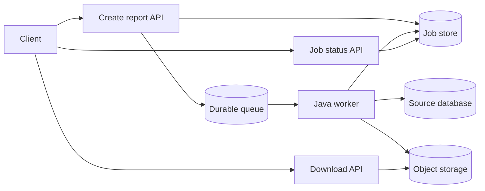
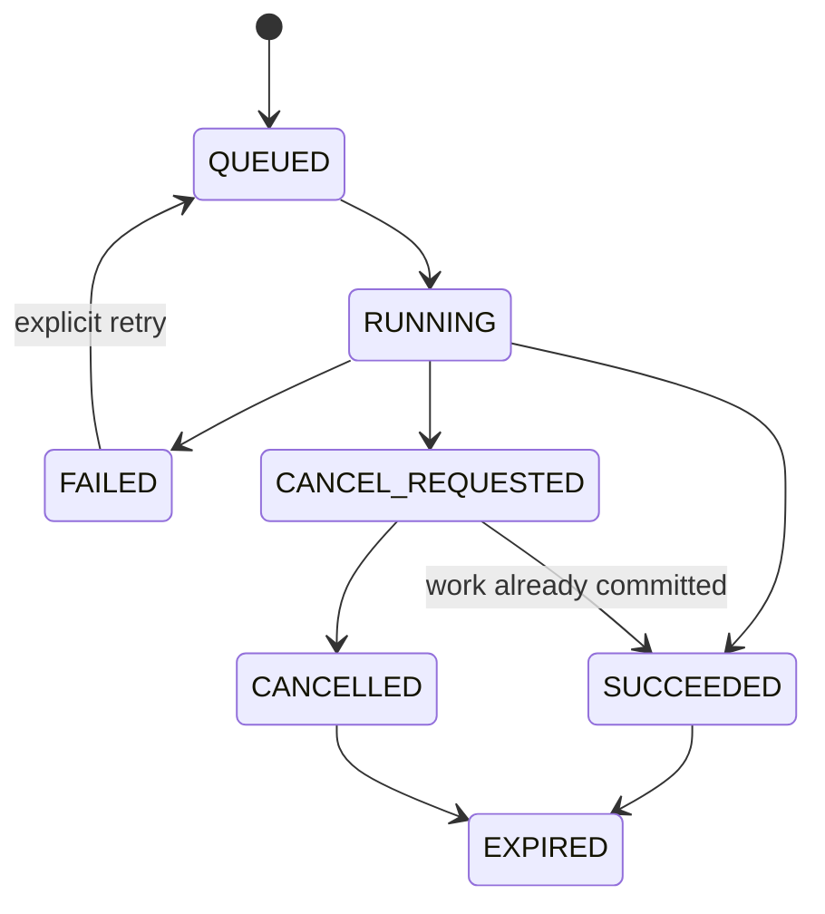
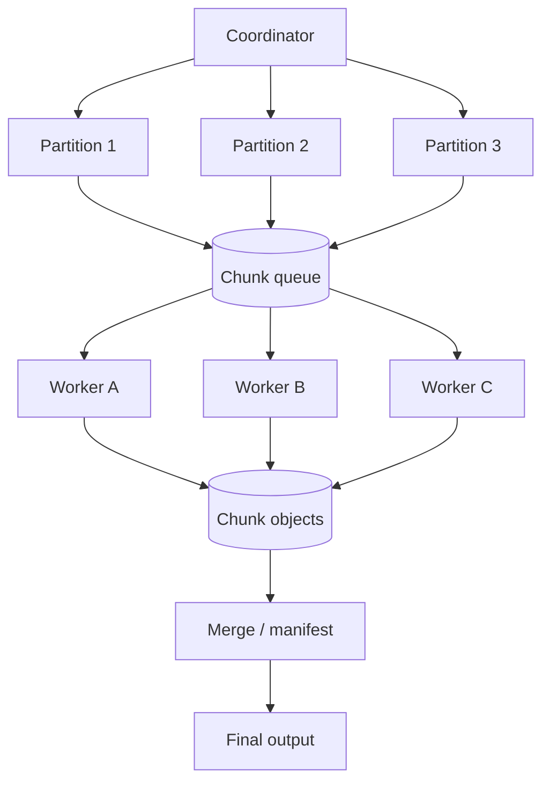

# Tạo báo cáo và xuất tệp cho tác vụ chạy dài

Tạo báo cáo lớn, tổng hợp dữ liệu nhiều tháng hoặc xuất hàng triệu bản ghi thường mất từ vài chục giây đến vài phút, thậm chí lâu hơn. Nếu xử lý toàn bộ trong một HTTP request, function có thể chạm timeout, giữ concurrency slot trong thời gian dài và khiến client phải chờ một kết nối không ổn định. Người dùng đóng trình duyệt hoặc mạng bị ngắt cũng không nên làm mất công việc đã được chấp nhận.

Mẫu phù hợp là **asynchronous job**: API xác thực và tạo job bền vững, worker xử lý ở nền, trạng thái được lưu để client theo dõi, kết quả được ghi vào object storage và người dùng tải xuống qua một đường dẫn có thời hạn. Với Java serverless, mẫu này kết hợp HTTP trigger, queue/event trigger, state management, retry, idempotency, quyền truy cập, scale-out và kiểm soát chi phí.

Trong phạm vi **CLOUD_SERVERLESS**, bài học tập trung vào phát triển và triển khai ứng dụng serverless, đặc biệt là Java function kích hoạt bởi HTTP, thông điệp hoặc sự kiện. Người học xử lý trigger, trạng thái, quyền truy cập, retry, idempotency, cold start, mở rộng và chi phí. Bài này hướng dẫn thiết kế một luồng tạo báo cáo và xuất tệp đủ bền vững để xử lý tác vụ dài, có thể theo dõi, tiếp tục sau lỗi và phân phối kết quả an toàn.

## 1. Vì sao không nên giữ HTTP request mở cho đến khi xuất xong?

Một HTTP request đồng bộ buộc client và function cùng chờ trong suốt thời gian tạo báo cáo. Cách này có một số giới hạn:

- API gateway, load balancer hoặc runtime có timeout riêng; timeout của lớp ngoài có thể ngắn hơn thời gian xử lý.
- Function giữ concurrency slot, memory và các kết nối downstream trong khi làm công việc dài.
- Client có thể mất kết nối dù server vẫn đang xử lý; client retry có thể tạo báo cáo trùng.
- Một truy vấn lớn có thể chiếm connection database và làm chậm request tương tác.
- Khó thể hiện tiến độ, pause, cancel, retry từng phần hoặc tiếp tục sau khi instance bị recycle.
- Response lớn có thể tiêu tốn memory và network buffer, đặc biệt khi phải tạo ZIP hoặc XLSX.

HTTP đồng bộ vẫn phù hợp với báo cáo nhỏ, có giới hạn kích thước và latency được đo rõ ràng. Khi thời gian xử lý không thể dự đoán hoặc có thể vượt timeout, hãy chuyển sang job bất đồng bộ.

## 2. Kiến trúc asynchronous job

Luồng cơ bản gồm API nhận yêu cầu, kho trạng thái job, hàng đợi bền vững, worker và object storage:



API trả về nhanh sau khi job và thông điệp đã được lưu bền vững. Worker thực hiện công việc độc lập với kết nối HTTP ban đầu. Client dùng `jobId` để xem trạng thái và lấy kết quả khi hoàn tất.

Các thành phần có trách nhiệm riêng:

- **API:** xác thực, kiểm tra input, áp quota, tạo job và trả operation ID.
- **Job store:** lưu trạng thái, tiến độ, owner/tenant, timestamps, version và kết quả.
- **Queue hoặc workflow engine:** đánh thức worker, điều phối bước và retry.
- **Worker:** đọc dữ liệu theo trang/chunk, tạo output và cập nhật tiến độ.
- **Object storage:** lưu file hoàn chỉnh và manifest; không dùng bộ nhớ function làm nơi lưu kết quả lâu dài.
- **Notification:** thông báo hoàn tất/thất bại nếu sản phẩm cần push thay vì polling.

## 3. Hợp đồng HTTP cho job bất đồng bộ

Một API có thể cung cấp các endpoint:

| Method | Endpoint | Mục đích |
|---|---|---|
| `POST` | `/reports` | Tạo job xuất báo cáo |
| `GET` | `/reports/{jobId}` | Xem trạng thái và tiến độ |
| `GET` | `/reports/{jobId}/download` | Nhận đường dẫn tải có thời hạn khi hoàn tất |
| `POST` | `/reports/{jobId}/cancel` | Yêu cầu hủy job nếu còn có thể |
| `GET` | `/reports` | Liệt kê job của caller theo bộ lọc/phân trang |

Ví dụ tạo job:

```http
POST /reports
Authorization: Bearer <access-token>
Idempotency-Key: report:customer-42:2026-10
Content-Type: application/json

{
  "reportType": "monthly-orders",
  "from": "2026-10-01T00:00:00Z",
  "to": "2026-11-01T00:00:00Z",
  "format": "CSV",
  "filters": {
    "status": ["CONFIRMED", "SHIPPED"]
  }
}
```

Response khi job đã được nhận:

```http
HTTP/1.1 202 Accepted
Location: /reports/job-8f32
Retry-After: 3
Content-Type: application/json

{
  "jobId": "job-8f32",
  "status": "QUEUED",
  "statusUrl": "/reports/job-8f32"
}
```

`202 Accepted` có nghĩa hệ thống đã nhận công việc để xử lý sau; không có nghĩa báo cáo đã tạo xong. Chỉ trả `202` sau khi việc tạo job và cơ chế phát message đã được ghi bền vững theo thiết kế nhất quán.

## 4. Job state machine

Job cần có state rõ ràng để API, worker, notification và người dùng hiểu cùng một trạng thái.



Ý nghĩa gợi ý:

| State | Ý nghĩa |
|---|---|
| `QUEUED` | Job đã được nhận và chờ worker |
| `RUNNING` | Worker đang xử lý |
| `CANCEL_REQUESTED` | Đã ghi nhận yêu cầu hủy; worker cần kiểm tra checkpoint |
| `SUCCEEDED` | Output đã hoàn tất và được publish an toàn |
| `FAILED` | Job kết thúc thất bại; có error code có thể hiển thị |
| `CANCELLED` | Worker đã dừng và xác nhận job bị hủy |
| `EXPIRED` | Kết quả hết thời hạn lưu và không còn tải xuống được |

Không chuyển `RUNNING` sang `SUCCEEDED` chỉ vì worker đã tạo xong bytes trong memory. Cần bảo đảm object output hoàn chỉnh, metadata được ghi và job store trỏ đến output hợp lệ trước khi công bố thành công.

## 5. Job record cần lưu những gì?

Một job record tối thiểu có thể gồm:

```json
{
  "jobId": "job-8f32",
  "tenantId": "tenant-42",
  "requestedBy": "user-17",
  "reportType": "monthly-orders",
  "status": "RUNNING",
  "progress": {
    "completedUnits": 4,
    "totalUnits": 10,
    "unit": "partition"
  },
  "attempt": 1,
  "version": 6,
  "createdAt": "2026-11-17T09:00:00Z",
  "startedAt": "2026-11-17T09:00:03Z",
  "updatedAt": "2026-11-17T09:01:20Z",
  "expiresAt": "2026-11-24T09:00:00Z",
  "output": null,
  "errorCode": null
}
```

Các field quan trọng:

- `tenantId` và `requestedBy`: xác định quyền sở hữu job.
- `status`: trạng thái workflow.
- `progress`: đơn vị tiến độ có ý nghĩa, ví dụ partition, page hoặc record.
- `attempt`: số lần worker thực hiện.
- `version`: hỗ trợ conditional update/optimistic locking khi nhiều worker hoặc cancel API cùng cập nhật.
- `expiresAt`: retention của job metadata và output.
- `output`: object key/version, kích thước, checksum và content type khi hoàn tất.
- `errorCode`: mã lỗi an toàn để hiển thị; stack trace nằm trong log có kiểm soát.

Không lưu presigned URL dài hạn trong job record. URL tải xuống nên được tạo khi caller có quyền yêu cầu tải và chỉ có hiệu lực trong thời gian ngắn.

## 6. Tạo job nhất quán với transactional outbox

Một lỗi phổ biến là ghi job vào database rồi publish message bằng hai thao tác độc lập:

1. Database insert job thành công.
2. Queue publish thất bại.
3. Job bị kẹt ở `QUEUED` nhưng không có worker nhận.

Chiều ngược lại cũng có thể xảy ra: message được publish nhưng transaction lưu job rollback, worker nhận một job không tồn tại.

Transactional outbox giải quyết khoảng trống này bằng cách ghi job và outbox event trong cùng transaction. Một relay đọc outbox rồi publish vào queue. Relay có thể publish lại nếu mất response, vì vậy consumer vẫn phải idempotent.

```sql
BEGIN;

INSERT INTO report_jobs(job_id, tenant_id, status, request_hash, version)
VALUES (:job_id, :tenant_id, 'QUEUED', :request_hash, 1);

INSERT INTO outbox_events(event_id, aggregate_id, event_type, payload)
VALUES (:event_id, :job_id, 'ReportRequested', :payload);

COMMIT;
```

Relay chỉ đánh dấu outbox đã publish sau khi broker xác nhận theo semantics của nó. Nếu relay crash sau publish nhưng trước khi cập nhật outbox, message có thể được gửi lại; `jobId`/`eventId` là khóa deduplication ở worker.

## 7. Idempotency khi client gửi yêu cầu tạo báo cáo

Client có thể timeout sau khi server đã tạo job. Khi retry, hệ thống cần xác định đây là cùng yêu cầu hay một yêu cầu mới.

Thiết kế idempotency key:

- Client gửi `Idempotency-Key` ổn định cho một hành động.
- Server gắn key với tenant/caller và hash của normalized request.
- Cùng key, cùng request hash: trả lại job đã tạo.
- Cùng key nhưng payload khác: trả `409 Conflict`.
- Key hết hạn theo retention policy sau khoảng thời gian client có thể retry.

Không dùng idempotency key do client cung cấp làm quyền truy cập. Người dùng khác không được đọc job chỉ vì đoán được key hoặc `jobId`.

## 8. Validate và giới hạn yêu cầu trước khi enqueue

Tác vụ xuất tệp có thể tiêu thụ nhiều CPU, database I/O, storage và network. API cần kiểm tra trước khi nhận job:

- Loại báo cáo và format được phép.
- Khoảng thời gian truy vấn tối đa.
- Số tenant/project được phép truy cập.
- Bộ lọc và cột được phép export.
- Ước lượng kích thước hoặc số record nếu có thể.
- Quota job đồng thời theo user/tenant.
- Quyền export dữ liệu nhạy cảm.
- Deadline hoặc thời gian lưu kết quả.

Nếu vượt giới hạn, trả lỗi phù hợp như `400`, `403`, `413`, `422` hoặc `429` theo API contract. Không enqueue công việc chắc chắn không thể hoàn thành đúng giới hạn rồi để worker tiêu tốn tài nguyên.

## 9. Chọn queue hay workflow engine?

Một queue và worker đơn giản phù hợp khi công việc có một bước xử lý hoặc một chuỗi ngắn do worker tự quản lý. Workflow engine phù hợp khi cần nhiều bước bền vững, branching, wait, callback, retry theo bước và trạng thái orchestration.

| Nhu cầu | Pattern phù hợp |
|---|---|
| Một worker tạo CSV từ một truy vấn | Queue + Java worker |
| Nhiều partition xử lý song song rồi merge | Queue fan-out + coordinator |
| Export gồm extract, transform, upload, notify | Workflow/state machine hoặc worker điều phối |
| Chờ người duyệt trước khi tạo file | Durable workflow với human approval callback |
| Tạo báo cáo định kỳ | Scheduler tạo job + queue/workflow |
| Có thể chạy nhiều giờ và cần resume từng bước | Workflow engine có durable state |

Ví dụ dịch vụ orchestration gồm AWS Step Functions, Azure Durable Functions và Google Cloud Workflows; cách tích hợp, timeout, quota và chi phí khác nhau theo nền tảng. Không nên tự xây một workflow engine trong database nếu dịch vụ quản lý sẵn đáp ứng yêu cầu.

## 10. Chia công việc thành bước và checkpoint

Một báo cáo lớn nên được chia thành các đơn vị có thể retry độc lập:

1. Chuẩn hóa và lưu report specification.
2. Chốt snapshot/watermark dữ liệu.
3. Tạo danh sách partition hoặc key range.
4. Enqueue các chunk.
5. Worker đọc và tạo từng chunk.
6. Coordinator xác nhận tất cả chunk thành công.
7. Merge/compose output hoặc tạo manifest.
8. Kiểm tra checksum/kích thước và publish output.
9. Cập nhật job `SUCCEEDED`.
10. Gửi notification.

Checkpoint cần đủ thông tin để worker tiếp tục mà không xử lý lại toàn bộ dữ liệu. Không lưu cursor chỉ trong memory của function vì instance có thể bị recycle.

## 11. Tính nhất quán của dữ liệu nguồn

Một báo cáo chạy trong 20 phút có thể đọc dữ liệu đã thay đổi trong lúc export. Nếu không định nghĩa snapshot, các trang đầu và cuối có thể phản ánh hai thời điểm khác nhau.

Các lựa chọn:

- **Database snapshot transaction:** dùng snapshot isolation/repeatable read nếu database hỗ trợ và thời gian transaction chấp nhận được.
- **Watermark:** chốt `asOf` hoặc sequence trước khi xử lý; truy vấn chỉ lấy dữ liệu không mới hơn watermark.
- **Materialized snapshot:** tạo tập dữ liệu/report staging riêng tại thời điểm yêu cầu.
- **Immutable event/source version:** đọc từ event log hoặc version bất biến nếu hệ thống có mô hình đó.

Không giữ transaction database mở trong nhiều phút hoặc nhiều giờ chỉ để tạo file nếu điều đó gây lock, giữ connection hoặc ảnh hưởng OLTP. Watermark cần dựa trên cột/sequence có semantics rõ; timestamp không đủ nếu có late-arriving updates hoặc clock skew.

## 12. Phân trang bằng keyset thay vì tải tất cả vào memory

Không nên đọc hàng triệu record vào `List` rồi mới serialize. Dùng streaming hoặc keyset pagination để memory gần như ổn định.

Ví dụ keyset query:

```sql
SELECT id, created_at, customer_name, total_amount
FROM orders
WHERE created_at < :as_of
  AND (created_at, id) > (:last_created_at, :last_id)
ORDER BY created_at, id
LIMIT :page_size;
```

`(created_at, id)` tạo thứ tự ổn định nếu `id` là tie-breaker duy nhất. Với database không hỗ trợ row-value comparison, viết điều kiện tương đương bằng `created_at > :last_created_at OR (created_at = :last_created_at AND id > :last_id)`.

Offset pagination có thể chậm khi offset lớn và dễ bỏ/trùng bản ghi nếu dữ liệu thay đổi giữa các trang. Keyset pagination cần index phù hợp và cursor lưu trong checkpoint. Nếu nguồn có snapshot/watermark, mọi trang phải dùng cùng điều kiện snapshot.

## 13. Java worker đọc từng trang

Ví dụ service xử lý từng trang và chỉ lưu cursor sau khi chunk đã được ghi an toàn:

```java
public void exportPartition(ExportJob job, Partition partition) {
    ExportCursor cursor = checkpointRepository.load(job.id(), partition.id())
            .orElse(ExportCursor.start());

    while (true) {
        cancellationService.throwIfCancellationRequested(job.id());

        List<OrderRow> rows = orderRepository.fetchNextPage(
                job.snapshotWatermark(), cursor, 1_000);

        if (rows.isEmpty()) {
            checkpointRepository.markComplete(job.id(), partition.id(), cursor);
            return;
        }

        ChunkResult chunk = chunkWriter.writeDeterministicChunk(
                job.id(), partition.id(), cursor, rows);

        checkpointRepository.advanceAfterWrite(
                job.id(), partition.id(), cursor, chunk.nextCursor(),
                chunk.objectKey(), chunk.checksum());

        cursor = chunk.nextCursor();
    }
}
```

Đây là skeleton; `advanceAfterWrite` phải có conditional update/transaction và `writeDeterministicChunk` phải idempotent. Nếu worker crash sau upload nhưng trước checkpoint, lần chạy lại cần nhận diện object chunk đã tồn tại và xác minh checksum thay vì append dữ liệu hai lần.

## 14. Streaming CSV thay vì dựng toàn bộ file trong RAM

CSV thường phù hợp với export lớn vì có thể ghi tuần tự. Dùng `Writer` bọc output stream để encode UTF-8 và escape field đúng quy tắc.

```java
try (OutputStream output = objectStorage.openUploadStream(outputKey);
     BufferedWriter writer = new BufferedWriter(
             new OutputStreamWriter(output, StandardCharsets.UTF_8))) {

    writer.write("order_id,created_at,customer,total_amount");
    writer.newLine();

    for (OrderRow row : repository.streamRows(snapshot, filters)) {
        writer.write(csv(row.orderId()));
        writer.write(',');
        writer.write(csv(row.createdAt().toString()));
        writer.write(',');
        writer.write(csv(row.customerName()));
        writer.write(',');
        writer.write(row.totalAmount().toPlainString());
        writer.newLine();
    }
}
```

`objectStorage.openUploadStream` là abstraction; nhiều object storage yêu cầu multipart upload thay vì một stream đơn giản. Với multipart, cần hoàn tất upload chỉ sau khi mọi part được ghi, và abort multipart khi job thất bại hoặc bị hủy.

Không dùng `repository.streamRows` nếu implementation giữ transaction/connection quá lâu mà không có cơ chế fetch/timeout phù hợp. Với export dài, keyset page thường dễ checkpoint và kiểm soát hơn stream cursor kéo dài.

## 15. CSV escaping và an toàn khi mở bằng spreadsheet

CSV cần xử lý dấu phẩy, dấu nháy kép và newline trong field. Một hàm cơ bản:

```java
static String csv(String value) {
    if (value == null) {
        return "";
    }
    String escaped = value.replace("\"", "\"\"");
    return "\"" + escaped + "\"";
}
```

Khi file được mở bằng Excel hoặc spreadsheet khác, cần xem xét **CSV formula injection**. Nội dung không tin cậy bắt đầu bằng `=`, `+`, `-`, `@` hoặc ký tự điều khiển có thể bị diễn giải như công thức. Với cột văn bản do người dùng kiểm soát, áp dụng policy an toàn cho spreadsheet (ví dụ prefix apostrophe sau khi chuẩn hóa ký tự đầu) và kiểm thử với phần mềm đích. Cách escape phải được ghi rõ trong hợp đồng export vì có thể thay đổi nội dung khi nhập lại bằng máy.

Ngoài ra cần quy định delimiter, line ending, charset, BOM nếu cần tương thích, decimal separator, timezone và cách biểu diễn null. Không phụ thuộc locale mặc định của JVM; dùng định dạng cố định và UTC hoặc timezone được nêu trong report specification.

## 16. XLSX, PDF và ZIP có giới hạn riêng

CSV không có cấu trúc sheet, style hoặc type. XLSX phù hợp khi người dùng cần nhiều sheet, công thức hoặc định dạng, nhưng library có thể tiêu tốn memory nếu giữ toàn bộ workbook. Với Apache POI, cân nhắc streaming API như SXSSF cho sheet lớn, cấu hình row window, temporary file và cleanup.

Excel giới hạn 1.048.576 hàng trên mỗi worksheet. Nếu dữ liệu vượt giới hạn, cần chia sheet/file hoặc cung cấp CSV/Parquet phù hợp hơn. PDF phù hợp với báo cáo trình bày, nhưng thường cần pagination/layout và không phù hợp để dump hàng triệu dòng.

ZIP giúp gom nhiều file nhưng cần giới hạn tổng dung lượng, số entry và mức nén. Không tin file name hoặc path do người dùng cung cấp; tránh path traversal khi tạo entry. Khi đọc file nén đầu vào, giới hạn kích thước giải nén và compression ratio để tránh zip bomb.

## 17. Chia partition để scale-out

Một worker duy nhất có thể không đủ nhanh. Có thể chia dữ liệu theo tenant, ngày, ID range hoặc partition key rồi enqueue từng chunk.



Partition nên có kích thước tương đối cân bằng để tránh một chunk quá lớn kéo dài toàn job. Tránh tạo hàng triệu message nhỏ; overhead queue và orchestration có thể vượt lợi ích. Chọn chunk size dựa trên thời gian xử lý, memory, retry cost và downstream capacity.

Nếu output cần thứ tự, mỗi partition cần sequence/index ổn định. Coordinator merge theo partition order hoặc tạo manifest mô tả thứ tự các part. Không phụ thuộc thứ tự message đến từ queue Standard hoặc worker hoàn thành.

## 18. Giới hạn concurrency để bảo vệ database

Scale-out worker không đồng nghĩa nên tăng concurrency vô hạn. Nếu mỗi worker mở một connection và database chỉ có một connection budget giới hạn, quá nhiều worker có thể làm cạn pool.

Đặt giới hạn theo:

- Max concurrent jobs theo tenant và toàn hệ thống.
- Max concurrent chunks/partition.
- Database connection pool và query concurrency.
- Read replica capacity nếu dùng replica cho reporting.
- Object storage multipart concurrency.
- API quota của dependency.
- Memory/CPU của function và kích thước page.

Có thể tách queue `interactive-export` và `bulk-export` để ưu tiên báo cáo người dùng đang chờ hơn batch lịch sử. Admission control cần xem backlog và oldest job age trước khi nhận thêm job.

## 19. Idempotency của chunk worker

Queue thường có delivery semantics ít nhất một lần hoặc có thể redeliver khi ack/lock timeout. Worker phải giả định một chunk có thể được xử lý nhiều lần.

Một chunk identity có thể là:

```text
jobId + partitionId + chunkSequence + inputSnapshotVersion
```

Object key xác định theo identity này giúp retry ghi đè cùng một chunk có kiểm soát hoặc xác minh object đã tồn tại. Không dùng tên file ngẫu nhiên mỗi lần retry, vì sẽ tạo nhiều bản sao và khó xác định output đúng.

Checkpoint phải chỉ advance sau khi chunk được ghi bền vững và checksum/metadata được xác nhận. Nếu storage upload thành công nhưng checkpoint thất bại, retry cần xác minh object và tiếp tục. Nếu checkpoint commit trước khi upload hoàn tất, job có thể bỏ qua dữ liệu chưa được lưu.

## 20. Tạo output tạm và publish kết quả cuối

Không để client tải một object đang được worker ghi dở. Dùng key tạm hoặc prefix riêng:

```text
exports/{tenantId}/{jobId}/staging/part-00001.csv
exports/{tenantId}/{jobId}/staging/part-00002.csv
exports/{tenantId}/{jobId}/final/report.csv
exports/{tenantId}/{jobId}/manifest.json
```

Khi mọi part hoàn tất:

1. Xác minh số part và trạng thái.
2. Merge hoặc tạo manifest theo định dạng output.
3. Kiểm tra checksum, kích thước, row count và schema.
4. Ghi object cuối vào key/version bất biến.
5. Cập nhật job store trỏ đến object cuối bằng conditional update.
6. Chuyển job sang `SUCCEEDED`.
7. Gửi notification sau khi trạng thái thành công đã được commit.

Object storage không phải lúc nào cũng có thao tác atomic rename. Copy từ staging sang final có thể tạo thêm chi phí và thời gian. Có thể dùng manifest/pointer làm bước publish cuối, nhưng client chỉ được truy cập qua API kiểm tra job state.

## 21. Manifest cho export nhiều phần

Nếu không cần merge thành một file lớn, có thể trả một manifest liệt kê các part:

```json
{
  "jobId": "job-8f32",
  "format": "CSV_PARTS",
  "snapshot": "orders-as-of-2026-11-17T09:00:00Z",
  "parts": [
    {
      "sequence": 1,
      "objectKey": "exports/tenant-42/job-8f32/part-00001.csv",
      "rows": 100000,
      "sha256": "..."
    },
    {
      "sequence": 2,
      "objectKey": "exports/tenant-42/job-8f32/part-00002.csv",
      "rows": 85000,
      "sha256": "..."
    }
  ]
}
```

Manifest phải được kiểm tra quyền truy cập như chính file. Không đưa public object URL hoặc credential vào manifest. API download có thể tạo URL ngắn hạn cho từng part hoặc cung cấp một archive sau khi merge.

## 22. Theo dõi tiến độ có ý nghĩa

Tiến độ không nhất thiết phải là phần trăm chính xác. Nếu chưa biết tổng số record, có thể báo số partition đã hoàn thành, phase hiện tại hoặc trạng thái “đang chuẩn bị dữ liệu”.

Ví dụ status response:

```json
{
  "jobId": "job-8f32",
  "status": "RUNNING",
  "phase": "EXPORTING",
  "progress": {
    "completedPartitions": 4,
    "totalPartitions": 10
  },
  "updatedAt": "2026-11-17T09:01:20Z"
}
```

Không tăng progress trước khi chunk được commit. Cập nhật progress quá thường xuyên có thể làm tăng write load và chi phí. Có thể update theo chunk, theo khoảng thời gian hoặc khi phase thay đổi.

## 23. Conditional update cho state và progress

Nhiều worker hoặc cancel endpoint có thể cùng cập nhật job. Dùng version/conditional update để tránh worker cũ ghi đè state mới.

Ví dụ SQL:

```sql
UPDATE report_jobs
SET status = 'RUNNING',
    started_at = COALESCE(started_at, CURRENT_TIMESTAMP),
    version = version + 1,
    updated_at = CURRENT_TIMESTAMP
WHERE job_id = :job_id
  AND status = 'QUEUED'
  AND version = :expected_version;
```

Worker chỉ được claim job nếu update đúng một row. Nếu không, job có thể đã được claim hoặc cancel bởi worker khác. Với queue có visibility/lock, vẫn nên dùng conditional state transition vì message redelivery có thể xảy ra.

## 24. Cancellation và deadline

Cancel là yêu cầu hợp tác giữa API và worker; không thể giả định function đang chạy sẽ bị dừng ngay khi client gọi cancel.

Một luồng an toàn:

1. API kiểm tra caller sở hữu job và job còn ở trạng thái có thể hủy.
2. API chuyển `RUNNING` sang `CANCEL_REQUESTED` bằng conditional update.
3. Worker kiểm tra cờ cancel tại ranh giới chunk/checkpoint.
4. Worker ngừng nhận chunk mới, abort multipart upload và dọn staging theo policy.
5. Worker cập nhật `CANCELLED`.

Nếu worker đã publish output cuối và commit `SUCCEEDED`, cancel không thể đảo ngược thành công; API cần trả trạng thái hiện tại. Deadline cũng cần được lưu trong job để worker bỏ qua công việc đã hết giá trị hoặc dừng theo policy.

## 25. Retry, timeout và dead-letter queue

Retry nên xảy ra ở cấp chunk hoặc bước có thể thực hiện lại an toàn. Một job dài không nên bị chạy lại toàn bộ chỉ vì một partition lỗi.

Phân loại lỗi:

| Lỗi | Hành vi phù hợp |
|---|---|
| Temporary network/database error | Retry có giới hạn, exponential backoff và jitter |
| Rate limit từ dependency | Tôn trọng `Retry-After`, giảm concurrency |
| Invalid report filter | Thất bại sớm, không retry |
| Permission revoked | Dừng job và ghi reason an toàn |
| Poison message/schema invalid | DLQ/quarantine và cảnh báo |
| Worker timeout | Retry chunk từ checkpoint nếu idempotent |
| Storage upload interrupted | Abort/resume multipart theo provider, xác minh part |
| Cancellation requested | Dừng tại checkpoint và settle message theo semantics |

Visibility timeout/lock duration/ack deadline cần dài hơn thời gian xử lý chunk hoặc được gia hạn đúng cách. Không chọn timeout bằng tổng thời gian toàn bộ report nếu worker xử lý từng chunk độc lập.

## 26. Notification khi hoàn tất

Sau khi job `SUCCEEDED` đã được commit, có thể gửi email, webhook hoặc in-app notification. Notification cũng nên dùng outbox để tránh job hoàn tất nhưng không gửi thông báo hoặc gửi lặp không kiểm soát.

Notification không nên chứa presigned URL dài hạn. Có thể chỉ chứa `jobId` và liên kết đến ứng dụng; khi người dùng mở, backend kiểm tra quyền và tạo download URL mới. Với webhook, ký payload, xác thực endpoint, retry có giới hạn và ghi nhận delivery state.

## 27. Tải file an toàn

Endpoint download cần:

- Xác thực caller.
- Kiểm tra tenant/user sở hữu job.
- Kiểm tra job đã `SUCCEEDED` và output chưa hết hạn.
- Tạo presigned URL có TTL ngắn hoặc proxy stream qua API.
- Chỉ cấp quyền `GET` cho object cụ thể, không cấp quyền list bucket.
- Đặt `Content-Type`, `Content-Disposition` và tên file an toàn.
- Không để URL xuất hiện trong log, analytics hoặc referrer không cần thiết.
- Có thể giới hạn số lần download hoặc ghi audit event theo policy.

Presigned URL là bearer credential: ai có URL đều có thể dùng trong thời gian hiệu lực. TTL ngắn, object key khó đoán và quyền IAM hẹp giúp giảm rủi ro, nhưng không thay thế authorization trước khi tạo URL.

## 28. Bảo vệ dữ liệu trong file export

Export thường gom dữ liệu từ nhiều bảng và có thể nhạy cảm hơn từng màn hình trong ứng dụng. Áp dụng:

- Kiểm tra quyền theo từng loại báo cáo và từng cột.
- Không cho client tùy ý export field nội bộ hoặc dữ liệu tenant khác.
- Áp dụng row-level/tenant-level filtering ở server.
- Mã hóa object bằng cơ chế phù hợp và kiểm soát key access.
- Dùng TLS khi truyền và signed download link.
- Redact/mask dữ liệu không cần thiết.
- Đặt retention ngắn nhất đáp ứng nhu cầu nghiệp vụ.
- Audit ai yêu cầu, tạo và tải file.
- Xóa output, staging, part, manifest và backup theo policy.

Không tin `tenantId`, `userId`, object key hoặc report type do client gửi mà chưa đối chiếu với identity và quyền ở server.

## 29. Giới hạn dung lượng, quota và chống lạm dụng

Export có thể bị lạm dụng để trích xuất hàng loạt dữ liệu. Cần đặt:

- Số job đồng thời tối đa theo user/tenant.
- Số job mới mỗi phút/ngày.
- Khoảng thời gian dữ liệu tối đa cho từng report type.
- Kích thước output tối đa và giới hạn số dòng.
- Số chunk/partition và tổng thời gian xử lý.
- Giới hạn download và TTL output.
- Ưu tiên/quota riêng cho tác vụ interactive và bulk.
- Cơ chế từ chối hoặc lên lịch lại khi backlog vượt ngưỡng.

Quota nên được áp dụng ở API và worker. Chỉ giới hạn API là chưa đủ nếu queue đã chứa backlog hoặc có producer nội bộ khác.

## 30. Chi phí và tối ưu hiệu năng

Chi phí của một report gồm nhiều thành phần:

- Invocation duration, CPU/memory và số lần retry.
- Queue requests, workflow transitions và orchestration.
- Database reads, connection time và read replica usage.
- Object storage bytes, multipart requests, copy/merge và retention.
- Network egress và download traffic.
- Notification, logs, metrics và traces.
- Temporary files và collector/worker overhead.

Để tối ưu:

1. Chạy query có index và chỉ đọc cột cần export.
2. Dùng keyset pagination, page size có kiểm soát và streaming.
3. Chia chunk để retry nhỏ, tránh chạy lại toàn report.
4. Chọn compression phù hợp; đo CPU so với storage/network tiết kiệm.
5. Giới hạn concurrency theo database và storage budget.
6. Xóa staging/part khi thất bại hoặc hết retention.
7. Tính cost per report và cost per exported row.
8. Đưa export lớn vào giờ thấp tải nếu SLA cho phép.

Không tăng memory chỉ để giữ toàn bộ file trong RAM nếu streaming/object multipart giải quyết được. Ngược lại, chunk quá nhỏ có thể làm queue/orchestration overhead tăng; cần đo bằng workload thực tế.

## 31. Observability cho job dài

Dashboard cần theo dõi:

| Metric | Câu hỏi |
|---|---|
| Jobs created/completed/failed | Tỷ lệ hoàn tất và xu hướng lỗi? |
| Queue age/depth | Job có chờ quá lâu? |
| Job duration p50/p95/p99 | Loại báo cáo nào chậm? |
| Chunk duration/retry | Partition nào gây bottleneck? |
| Rows/bytes exported | Workload và output size thay đổi ra sao? |
| Worker concurrency/throttle | Có chạm giới hạn hoặc quá tải dependency? |
| Cancel/failure reason | Người dùng hủy hay hệ thống lỗi? |
| Output expiration/cleanup | File có bị giữ quá hạn? |
| Cost per job | Báo cáo nào tiêu tốn nhiều tài nguyên? |

Log/trace nên có `jobId`, `tenantId` ở dạng phù hợp quyền truy cập, `partitionId`, `attempt`, `phase` và `correlationId`. Không dùng các ID này làm metric label có cardinality cao. Trace có thể nối API create job với worker bằng trace context/message context hoặc correlation ID; job dài có thể vượt thời gian retention của một trace, khi đó tạo trace riêng cho mỗi phase và liên kết bằng job ID.

## 32. Triển khai trên các nền tảng cloud

Tên dịch vụ và giới hạn khác nhau theo region/tier; bảng dưới đây mô tả các pattern thường dùng, không thay thế tài liệu cấu hình của provider.

| Nền tảng | Nhận job/điều phối | Worker | File output |
|---|---|---|---|
| AWS | API Gateway/Lambda + SQS hoặc Step Functions | Lambda hoặc container worker | S3 |
| Azure | API Management/Functions + Service Bus hoặc Durable Functions | Azure Functions/Container Apps job | Blob Storage |
| Google Cloud | API endpoint/Cloud Run + Cloud Tasks/Pub/Sub hoặc Workflows | Cloud Run job/service hoặc function | Cloud Storage |

Khi chọn dịch vụ, kiểm tra maximum execution time, payload size, retry semantics, queue retention, concurrency, orchestration history retention, object multipart support và region availability. Đừng thiết kế một job dài hơn giới hạn tối đa của worker mà không chia nhỏ hoặc chuyển sang compute phù hợp.

## 33. Kiểm thử các tình huống lỗi

Test happy path chưa đủ. Cần kiểm tra:

- Client gửi lại `POST /reports` sau timeout với cùng idempotency key.
- Queue giao cùng chunk hai lần.
- Worker crash sau upload nhưng trước checkpoint.
- Worker crash trước khi upload hoàn tất.
- Một partition thất bại trong khi các partition khác thành công.
- Database chậm hoặc replica lag.
- Job bị cancel trong lúc đang xử lý.
- Job hết deadline hoặc output hết retention.
- Presigned URL hết hạn hoặc caller mất quyền.
- Tenant khác cố đọc `jobId` hoặc object key.
- CSV chứa dấu phẩy, quote, newline, Unicode và formula-like value.
- File vượt row/size limit hoặc multipart upload bị gián đoạn.
- Outbox relay publish lặp hoặc queue tạm thời không khả dụng.

Integration test nên dùng database, queue và object storage emulator/test environment có semantics gần production. Cần có load test với nhiều job đồng thời để đo database load, queue age, memory, output throughput và cost.

## 34. Những lỗi thiết kế thường gặp

| Lỗi | Hậu quả | Cách xử lý |
|---|---|---|
| Giữ HTTP request mở cho export dài | Timeout và giữ concurrency slot | Trả 202 và xử lý bằng job nền |
| Trả 202 trước khi job được lưu bền vững | Client tưởng job đã nhận nhưng job mất | Job store + outbox/confirmed publish |
| Đọc tất cả record vào List | OOM và GC pressure | Keyset pagination/streaming |
| Không chốt snapshot | Báo cáo chứa dữ liệu từ nhiều thời điểm | Watermark hoặc snapshot semantics |
| Dùng offset lớn | Query chậm và dễ trùng/bỏ dòng khi dữ liệu thay đổi | Keyset pagination với index |
| Worker không idempotent | Duplicate chunk và output sai | Deterministic key, checkpoint và checksum |
| Publish output trước khi hoàn tất | Người dùng tải file dở | Staging + final publish/pointer |
| Progress update không conditional | Worker cũ ghi đè trạng thái mới | Version/CAS và state transition |
| Không giới hạn export | Data exfiltration và chi phí tăng | Authorization, quota, size/time limits |
| Presigned URL quá dài hạn | Link bị chia sẻ có thể truy cập lâu | TTL ngắn và authorization mỗi lần cấp |
| Không cleanup staging | Storage tăng và lưu dữ liệu quá hạn | Lifecycle và cleanup job |

## 35. Quy trình thiết kế end-to-end

1. **Xác định SLA:** thời gian hoàn thành, kích thước, số dòng, retention và UX khi chờ.
2. **Thiết kế API:** create/status/cancel/download và idempotency contract.
3. **Lưu job bền vững:** state, owner, request hash, version, deadline và expiry.
4. **Tạo message nhất quán:** transactional outbox hoặc cơ chế atomic được provider hỗ trợ.
5. **Chốt dữ liệu nguồn:** snapshot/watermark và report specification bất biến.
6. **Chia partition:** kích thước chunk, keyset cursor và concurrency budget.
7. **Viết worker idempotent:** deterministic output key, checkpoint và retry có giới hạn.
8. **Publish output an toàn:** staging, validation, manifest/final pointer và job state.
9. **Bảo vệ download:** authorization, tenant isolation, short-lived URL và audit.
10. **Vận hành:** dashboard, alert, retention cleanup, cost allocation và runbook.

## 36. Checklist production

| Câu hỏi | Bằng chứng cần có |
|---|---|
| Tác vụ dài đã tách khỏi HTTP request? | API trả 202 và có job ID/status URL |
| Job được lưu bền vững? | Job store, outbox hoặc publish confirmation |
| API tạo job idempotent? | Idempotency key + request hash + retention |
| State transition có kiểm soát? | State machine và conditional update/version |
| Input được validate và giới hạn? | Authorization, range/size/quota policy |
| Snapshot dữ liệu rõ ràng? | Watermark/snapshot version trong job |
| Worker không tải toàn bộ dữ liệu vào RAM? | Keyset paging/streaming và memory test |
| Chunk retry được an toàn? | Deterministic key, checkpoint, checksum |
| Concurrency bảo vệ database? | Worker cap, pool budget và backpressure |
| Output chỉ publish khi hoàn chỉnh? | Staging, manifest/checksum và final pointer |
| Cancel/deadline có semantics rõ? | Checkpoint cancellation và terminal state |
| Download được authorization? | Tenant check, short-lived URL và audit |
| File format an toàn? | CSV escaping/formula policy, XLSX/PDF limits |
| Retention và cleanup hoạt động? | TTL/lifecycle cho job, output và staging |
| Có observability/cost? | Job duration, queue age, bytes/rows và cost/job |
| Đã test failure và scale? | Duplicate delivery, crash recovery, load và DR tests |

Mẫu tạo báo cáo bất đồng bộ tách thời gian tiếp nhận yêu cầu khỏi thời gian xử lý thực tế. Job store cung cấp trạng thái bền vững; queue/workflow điều phối worker; checkpoint, conditional update và idempotency giúp tiếp tục an toàn sau retry; object storage giữ output cho đến khi hết hạn. Khi kết hợp snapshot nhất quán, phân trang/streaming, concurrency limit, authorization và cleanup, Java serverless có thể tạo các file lớn mà không phụ thuộc vào một HTTP request kéo dài hoặc memory của một function instance.
