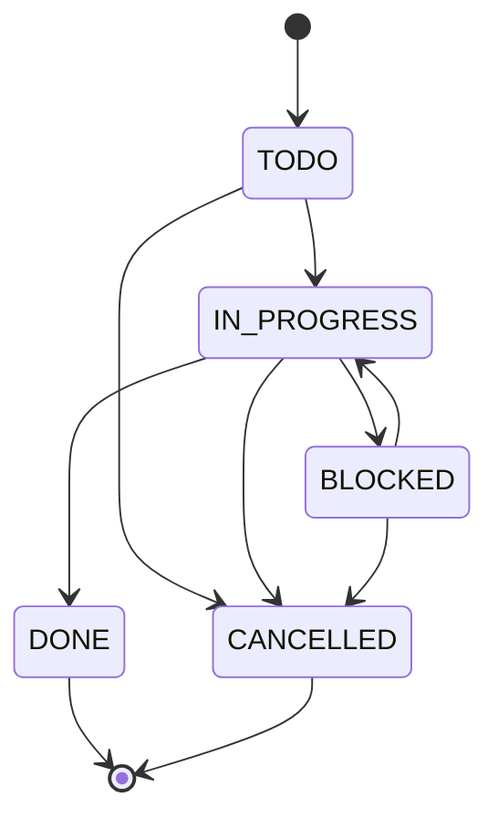

# Xác định yêu cầu, API contract và SLO cho dịch vụ quản lý công việc

Trước khi viết Java handler hoặc tạo cloud function, nhóm phát triển cần thống nhất dịch vụ sẽ giải quyết vấn đề gì, ai được phép sử dụng, dữ liệu nào được quản lý, API phản hồi ra sao và thế nào được coi là hệ thống hoạt động tốt. Những quyết định này tạo thành nền tảng cho một Java serverless API có thể triển khai, kiểm thử và vận hành an toàn.

Bài học sử dụng một dự án xuyên suốt: **Task Management API** cho phép người dùng và nhóm tạo, xem, cập nhật, giao việc và theo dõi công việc. API chạy trên nền tảng serverless, nhận HTTP request; một số thao tác có thể được xử lý bất đồng bộ qua queue/event và Java worker. Phạm vi tập trung vào yêu cầu, resource model, HTTP contract và Service Level Objective (SLO), chưa đi sâu vào cấu hình triển khai cụ thể của từng cloud.

Kết quả mong đợi là một bản đặc tả đủ rõ để frontend, backend, QA, platform và product cùng triển khai mà không phải tự suy đoán các quy tắc quan trọng.

## 1. Bắt đầu từ vấn đề và người sử dụng

Task Management API không chỉ là tập endpoint CRUD. Người dùng cần biết ai chịu trách nhiệm cho công việc, trạng thái hiện tại, hạn hoàn thành và lịch sử thay đổi. Nhóm cần lọc công việc theo project, assignee, trạng thái hoặc deadline; hệ thống cần ngăn người dùng của tenant này đọc dữ liệu tenant khác.

### Các actor chính

| Actor | Mục tiêu | Quyền điển hình |
| --- | --- | --- |
| Người tạo task | Tạo và theo dõi công việc | Tạo task, xem task mình có quyền truy cập |
| Assignee | Thực hiện công việc được giao | Xem, cập nhật tiến độ, thêm comment theo policy |
| Project manager | Điều phối công việc của project | Giao việc, đổi priority/deadline, xem báo cáo |
| Tenant administrator | Quản lý thành viên và cấu hình tenant | Quản lý membership, role và project trong tenant |
| Service integration | Tạo/cập nhật task từ hệ thống khác | Quyền máy-máy theo scope được cấp |
| Operator | Hỗ trợ vận hành hệ thống | Xem health/metrics và xử lý job theo quyền vận hành; không mặc nhiên có quyền đọc mọi nội dung nghiệp vụ |

Actor là vai trò nghiệp vụ. Một người có thể đồng thời là creator, assignee và project manager ở các project khác nhau. Authorization phải dựa trên identity đã xác thực, membership và policy của resource, không chỉ dựa vào tên role do client gửi.

### Use case cốt lõi

1. Người dùng tạo task với tiêu đề, mô tả, project, assignee và deadline.
2. Người dùng xem chi tiết task và lịch sử thay đổi.
3. Người dùng tìm task theo project, trạng thái, assignee và thời gian.
4. Người có quyền cập nhật nội dung hoặc metadata của task.
5. Assignee chuyển trạng thái task theo workflow hợp lệ.
6. Project manager giao hoặc chuyển task cho thành viên khác.
7. Hệ thống phát event khi task được tạo, giao hoặc hoàn tất.
8. Client có thể retry request khi timeout mà không tạo task trùng.
9. Người dùng nhận được lỗi có cấu trúc khi dữ liệu không hợp lệ hoặc không có quyền.

## 2. Xác định phạm vi và những gì chưa làm

Phạm vi phiên bản đầu cần đủ nhỏ để triển khai nhưng không mơ hồ.

### In scope cho MVP

- Xác thực caller bằng access token hoặc cơ chế identity của tổ chức.
- Phân tách dữ liệu theo tenant và project membership.
- Tạo, đọc, cập nhật, tìm kiếm và chuyển trạng thái task.
- Cursor pagination cho danh sách.
- Idempotency cho thao tác tạo task có thể được retry.
- Optimistic concurrency để tránh ghi đè cập nhật đồng thời.
- Audit các thay đổi quan trọng.
- API error format nhất quán.
- Structured logging, metrics, tracing và SLO cơ bản.
- Event bất đồng bộ cho notification hoặc tích hợp nếu cần.

### Ngoài phạm vi ban đầu

- Chat thời gian thực và cộng tác chỉnh sửa cùng một trường.
- Gantt chart, resource planning và dependency graph phức tạp.
- File attachment lớn trực tiếp qua API task.
- Workflow tùy biến theo từng tenant.
- Tìm kiếm toàn văn nâng cao trên nhiều tenant.
- SLA thương mại hoặc chargeback theo usage.

Ngoài phạm vi không có nghĩa là không bao giờ triển khai. Việc ghi rõ giúp API không vô tình hứa hỗ trợ các behavior chưa được thiết kế.

## 3. Viết yêu cầu chức năng có thể kiểm thử

Yêu cầu tốt mô tả hành vi quan sát được và điều kiện chấp nhận. Tránh câu như “API phải nhanh”, “hệ thống phải an toàn” hoặc “task phải dễ quản lý” nếu chưa có tiêu chí cụ thể.

| ID | Yêu cầu chức năng | Tiêu chí chấp nhận mẫu |
| --- | --- | --- |
| FR-01 | Tạo task trong project caller được phép truy cập | Request hợp lệ trả `201 Created`, có ID và representation của task |
| FR-02 | Xem task theo ID | Trả `200`; task không tồn tại hoặc không thuộc phạm vi truy cập được xử lý theo policy thống nhất |
| FR-03 | Cập nhật task | Chỉ field được phép mới được thay đổi; hỗ trợ concurrency check |
| FR-04 | Chuyển trạng thái task | Chỉ cho phép transition hợp lệ theo state machine |
| FR-05 | Liệt kê task | Có filter, sort ổn định và cursor pagination |
| FR-06 | Giao task | Assignee phải là thành viên hợp lệ của project/tenant |
| FR-07 | Ghi lịch sử thay đổi | Actor, thời điểm, loại thay đổi và correlation ID được lưu theo policy |
| FR-08 | Phát event | Event được phát sau khi business transaction commit; không phát event giả khi transaction rollback |
| FR-09 | Retry create request | Cùng idempotency key trong phạm vi quy định không tạo task thứ hai |
| FR-10 | Cách ly tenant | Caller không đọc hoặc sửa resource của tenant khác |

Mỗi yêu cầu cần owner, priority, test case và liên kết tới API operation hoặc workflow. Nếu một yêu cầu chưa có tiêu chí đo được, cần làm rõ trước khi xem là hoàn tất.

## 4. Yêu cầu phi chức năng

Yêu cầu phi chức năng (NFR) định nghĩa chất lượng và giới hạn của hệ thống. Với serverless, NFR cần xem cả platform và dependency vì function có thể scale nhanh hơn database.

| Nhóm | Câu hỏi cần chốt | Ví dụ tiêu chí MVP |
| --- | --- | --- |
| Availability | API cần sẵn sàng bao nhiêu? | SLO availability 99,9% theo tháng cho API critical |
| Latency | Người dùng chờ bao lâu? | p95 dưới 300 ms, p99 dưới 800 ms cho request đọc/ghi thông thường |
| Throughput | Tải bình thường và peak? | 100 request/s sustained, burst 300 request/s trong cửa sổ đã định nghĩa |
| Scalability | Scale theo request hay queue? | Có giới hạn concurrency để bảo vệ database |
| Durability | Khi API báo tạo task thành công thì dữ liệu có bền vững không? | Chỉ trả `201` sau khi transaction commit |
| Security | Ai được truy cập task? | OIDC/OAuth2, tenant isolation, least privilege |
| Consistency | Cập nhật đồng thời xử lý thế nào? | Optimistic concurrency; không silently overwrite |
| Observability | Có phát hiện lỗi và điều tra được không? | Correlation ID, structured logs, metrics, traces và alert |
| Recovery | Mất dữ liệu hoặc region thì sao? | RPO/RTO được product/operations phê duyệt |
| Cost | Có giới hạn chi phí? | Theo dõi cost per active tenant/task và budget theo environment |

Các con số trên là giả định khởi đầu để minh họa đặc tả. Product, QA và operations phải xác nhận bằng traffic forecast, load test, dependency capacity và mức độ quan trọng của dịch vụ trước khi coi là cam kết.

## 5. Xác định resource model

REST API nên biểu diễn tài nguyên theo danh từ và quan hệ rõ ràng. Một model đơn giản:

```text
Tenant
  └── Project
       └── Task
            ├── Assignee (User reference)
            ├── Comments
            └── Activity / Audit entries
```

Task có thể chứa:

| Field | Kiểu logic | Quy tắc |
| --- | --- | --- |
| `id` | UUID/ULID | Server tạo, bất biến |
| `tenantId` | Identifier | Lấy từ identity/context, không tin body client |
| `projectId` | Identifier | Phải thuộc tenant caller có quyền truy cập |
| `title` | String | Bắt buộc, giới hạn độ dài |
| `description` | String | Optional, có giới hạn kích thước |
| `status` | Enum | Server kiểm soát transition |
| `priority` | Enum | Ví dụ `LOW`, `NORMAL`, `HIGH`, `URGENT` |
| `assigneeId` | Identifier/null | Phải là thành viên hợp lệ |
| `dueAt` | Instant/null | ISO-8601 có timezone/offset rõ |
| `createdBy` | Identifier | Lấy từ authenticated principal |
| `createdAt` | Instant | Server tạo |
| `updatedAt` | Instant | Server cập nhật |
| `version` | Integer/ETag | Tăng khi resource thay đổi |

Không cho client tự gán `tenantId`, `createdBy`, `createdAt` hoặc `version` khi tạo task. Nếu cho phép import dữ liệu với các field này, đó phải là một API/permission riêng có audit.

### State machine cho task

Một state machine mẫu:



Đây là policy mẫu. Nếu cho phép mở lại task `DONE`, thêm transition `DONE -> TODO` hoặc `DONE -> IN_PROGRESS` cùng quyền và audit rule. Không để client gửi bất kỳ string trạng thái nào rồi ghi trực tiếp vào database.

## 6. Xác định HTTP API surface

Một API MVP có thể dùng các resource path sau:

| Method | Path | Mục đích | Thành công điển hình |
| --- | --- | --- | --- |
| `POST` | `/v1/projects/{projectId}/tasks` | Tạo task | `201 Created` |
| `GET` | `/v1/tasks/{taskId}` | Xem chi tiết | `200 OK` |
| `PATCH` | `/v1/tasks/{taskId}` | Cập nhật field được phép | `200 OK` |
| `POST` | `/v1/tasks/{taskId}/transitions` | Chuyển trạng thái | `200 OK` |
| `GET` | `/v1/projects/{projectId}/tasks` | Tìm task trong project | `200 OK` |
| `GET` | `/v1/tasks/{taskId}/activity` | Xem lịch sử | `200 OK` |
| `POST` | `/v1/tasks/{taskId}/comments` | Thêm comment | `201 Created` |

Path dùng danh từ số nhiều, ID rõ ràng và version prefix `/v1`. Tránh tạo endpoint theo tên implementation như `/runTaskUpdateFunction`; client nên phụ thuộc vào business contract thay vì cloud function name.

### Đồng bộ hay bất đồng bộ?

Thao tác tạo task thường có thể trả đồng bộ sau khi database commit. Nhưng export hàng nghìn task, bulk import hoặc workflow gửi notification có thể dài và nên chạy bất đồng bộ.

Mẫu async:

1. Client gửi request tạo job.
2. API xác thực, validate và lưu job/message bền vững.
3. API trả `202 Accepted` cùng `jobId` và URL trạng thái.
4. Worker xử lý queue/event theo concurrency limit.
5. Client gọi status endpoint để xem `PENDING`, `RUNNING`, `COMPLETED` hoặc `FAILED`.

Không trả `202` trước khi công việc được ghi bền vững. Nếu enqueue thất bại, API phải báo lỗi thay vì nói đã nhận công việc.

## 7. Định nghĩa request/response contract

API contract phải nói rõ field nào bắt buộc, kiểu dữ liệu, giới hạn, default, enum, status code, header và lỗi có thể xảy ra.

### Create task request

```http
POST /v1/projects/prj_123/tasks HTTP/1.1
Authorization: Bearer <access-token>
Content-Type: application/json
Idempotency-Key: 3e6b1b5a-...
X-Correlation-ID: req-01J...
```

```json
{
  "title": "Chuẩn bị bản phát hành tháng 11",
  "description": "Kiểm tra checklist và xác nhận owner",
  "priority": "HIGH",
  "assigneeId": "usr_456",
  "dueAt": "2026-11-25T17:00:00+07:00"
}
```

Response:

```http
HTTP/1.1 201 Created
Location: /v1/tasks/tsk_789
ETag: "1"
Content-Type: application/json
```

```json
{
  "id": "tsk_789",
  "projectId": "prj_123",
  "title": "Chuẩn bị bản phát hành tháng 11",
  "description": "Kiểm tra checklist và xác nhận owner",
  "status": "TODO",
  "priority": "HIGH",
  "assigneeId": "usr_456",
  "dueAt": "2026-11-25T10:00:00Z",
  "createdAt": "2026-11-17T03:15:00Z",
  "updatedAt": "2026-11-17T03:15:00Z",
  "version": 1
}
```

Server có thể chuẩn hóa timestamp về UTC trong response. Contract phải xác định rõ đầu vào phải có offset/timezone hay cho phép local time; tránh diễn giải timestamp không timezone theo timezone mặc định của runtime.

### Field ownership

| Field | Client gửi? | Server tạo/kiểm soát? |
| --- | --- | --- |
| `title`, `description`, `priority` | Có | Validate và chuẩn hóa |
| `projectId` | Path | Kiểm tra quyền và tenant ownership |
| `assigneeId`, `dueAt` | Có nếu được phép | Kiểm tra membership, timezone/format |
| `id`, `status` ban đầu | Không | Server tạo và đặt mặc định |
| `tenantId`, `createdBy` | Không | Lấy từ security context |
| `createdAt`, `updatedAt`, `version` | Không | Server quản lý |

Không bind trực tiếp JSON request vào persistence entity. Dùng request DTO allowlist field để tránh mass assignment, ví dụ client gửi `tenantId`, `createdBy` hoặc `status=ADMIN_APPROVED` ngoài contract.

## 8. Validation và chuẩn hóa dữ liệu

Validation cần xảy ra ở boundary trước khi gọi business logic:

- `title`: trim, không rỗng, độ dài tối đa được công bố.
- `description`: giới hạn byte/character để tránh payload quá lớn.
- `priority`: chỉ nhận enum đã định nghĩa.
- `assigneeId`: tồn tại và thuộc project/tenant được phép.
- `dueAt`: ISO-8601 hợp lệ; quy tắc cho thời điểm quá khứ phải rõ.
- `projectId`: caller có quyền tạo task trong project.
- JSON body: từ chối field không hỗ trợ hoặc bỏ qua theo policy được công bố.
- Content-Type: chỉ chấp nhận media type được hỗ trợ.
- Request size: giới hạn để bảo vệ memory và chi phí.

Validation ở client cải thiện UX nhưng server vẫn là nơi quyết định cuối cùng. Không dựa vào JavaScript/frontend để enforce authorization hoặc business invariant.

### Validation error không được mơ hồ

Thay vì trả `400 Bad Request` với text “Invalid request”, hãy trả lỗi có code và field liên quan. Ví dụ:

```json
{
  "type": "https://api.example.com/problems/validation-error",
  "title": "Request validation failed",
  "status": 400,
  "detail": "One or more fields are invalid.",
  "instance": "/v1/projects/prj_123/tasks",
  "code": "VALIDATION_FAILED",
  "errors": [
    {
      "field": "title",
      "code": "REQUIRED",
      "message": "Title must not be empty."
    }
  ],
  "traceId": "trace-01J..."
}
```

Có thể dùng Problem Details for HTTP APIs (RFC 9457) làm format nền và thêm extension fields có quy ước. Không đưa stack trace, SQL, secret hoặc nội dung nội bộ vào response.

## 9. HTTP status code và error contract

| Status | Khi dùng trong Task API | Client nên làm gì? |
| --- | --- | --- |
| `200 OK` | Đọc/cập nhật/chuyển trạng thái thành công có response body | Sử dụng representation mới |
| `201 Created` | Tạo task/comment thành công | Đọc `Location` và body |
| `202 Accepted` | Job bất đồng bộ đã được nhận bền vững | Poll status hoặc nhận callback |
| `204 No Content` | Thao tác thành công không cần body | Không chờ JSON |
| `400 Bad Request` | JSON/field/format không hợp lệ | Sửa request |
| `401 Unauthorized` | Thiếu hoặc token không hợp lệ | Xác thực lại |
| `403 Forbidden` | Caller đã xác thực nhưng không được phép | Không retry cùng quyền |
| `404 Not Found` | Resource không tồn tại hoặc policy che giấu resource ngoài tenant | Kiểm tra ID/quyền theo contract |
| `409 Conflict` | State transition/business conflict hoặc idempotency key dùng sai payload | Đọc conflict code và xử lý |
| `412 Precondition Failed` | `If-Match` không khớp ETag/version | Fetch representation mới rồi quyết định cập nhật lại |
| `413 Content Too Large` | Body vượt giới hạn | Giảm payload hoặc dùng upload flow riêng |
| `415 Unsupported Media Type` | Content-Type không hỗ trợ | Gửi media type đúng |
| `422 Unprocessable Content` | Request parse được nhưng vi phạm semantic rule nếu API chọn dùng status này | Sửa nội dung theo lỗi |
| `429 Too Many Requests` | Vượt rate/quota | Tuân thủ `Retry-After` nếu có |
| `500 Internal Server Error` | Lỗi không dự kiến | Retry có kiểm soát nếu operation idempotent |
| `502/503/504` | Gateway/dependency/service tạm thời lỗi hoặc timeout | Retry theo backoff và deadline |

Chọn một quy ước thống nhất giữa `400` và `422` cho validation. Không dùng `500` cho lỗi nghiệp vụ dự kiến như assignee không thuộc project; những trường hợp đó cần status/code được định nghĩa.

## 10. Idempotency cho create và các thao tác có side effect

Client có thể gửi `POST /tasks`, server tạo task thành công nhưng response bị mất trên đường truyền. Nếu client gửi lại, hệ thống có thể tạo hai task. `Idempotency-Key` giúp xác định các lần retry thuộc cùng một logical request.

Contract cần quy định:

- Header có bắt buộc với operation nào.
- Phạm vi key: tenant + operation + key, hoặc principal + route + key.
- Thời gian lưu key.
- Cách so sánh payload hash.
- Response khi key được gửi lại với payload giống hoặc khác.
- Cách xử lý hai request cùng key đến đồng thời.
- Kết quả khi lần đầu đang xử lý hoặc đã thất bại.

Behavior mẫu:

| Trường hợp | Hành vi |
| --- | --- |
| Key mới, payload hợp lệ | Tạo task và lưu kết quả cùng key |
| Key cũ, payload giống, operation đã xong | Trả lại kết quả đã lưu theo contract |
| Key cũ, payload khác | `409 Conflict` với code `IDEMPOTENCY_KEY_REUSED` |
| Hai request cùng key đến đồng thời | Một request claim key; request còn lại nhận kết quả hoặc trạng thái in-progress |
| Key hết retention | Có thể được coi là request mới theo policy; client không nên retry sau cửa sổ này |

Idempotency record cần được ghi bền vững. Không dùng `HashMap` static trong Lambda/Function App/Cloud Run instance vì nhiều instance không chia sẻ memory và có thể bị kết thúc.

### Idempotency và transaction

Nếu task row và idempotency record nằm trong cùng database, ghi chúng trong một transaction. Nếu cần publish `TaskCreated`, dùng transactional outbox để bảo đảm event được ghi cùng transaction; relay có thể gửi event nhiều lần nên consumer vẫn cần deduplication.

## 11. Cập nhật đồng thời bằng ETag/version

Hai người dùng có thể cùng mở một task, sửa title và priority rồi lưu gần như cùng lúc. Nếu API dùng last-write-wins mà không báo, thay đổi của người lưu sau có thể ghi đè thay đổi trước.

Optimistic concurrency dùng version hoặc ETag:

```http
GET /v1/tasks/tsk_789
```

```http
ETag: "7"
```

Client gửi:

```http
PATCH /v1/tasks/tsk_789
If-Match: "7"
Content-Type: application/merge-patch+json
```

Nếu resource vẫn ở version 7, server áp dụng patch và trả version 8. Nếu resource đã đổi thành version 8, server trả `412 Precondition Failed` để client fetch dữ liệu mới và quyết định merge. Nếu API dùng version trong body thay cho ETag, cần định nghĩa status/error tương đương và không dùng cả hai theo cách mâu thuẫn.

## 12. Pagination, filtering và sorting

Danh sách task có thể lớn. Không trả toàn bộ danh sách trong một response.

Ví dụ:

```http
GET /v1/projects/prj_123/tasks?status=IN_PROGRESS&assigneeId=usr_456&limit=50
```

Response:

```json
{
  "items": [
    {
      "id": "tsk_789",
      "title": "Chuẩn bị bản phát hành tháng 11",
      "status": "IN_PROGRESS",
      "priority": "HIGH"
    }
  ],
  "nextCursor": "eyJpZCI6InRzay03ODkifQ",
  "hasMore": true
}
```

Contract cần quy định:

- `limit` mặc định và tối đa.
- Filter được hỗ trợ và cách kết hợp filter.
- Sort field và sort direction allowlist.
- Stable tie-breaker, ví dụ `createdAt,id`.
- Cursor opaque, không để client sửa tùy ý.
- Cursor có gắn tenant/filter/sort context hay không.
- Hành vi khi record thay đổi trong lúc client phân trang.

Cursor pagination thường ổn định hơn offset pagination khi dữ liệu liên tục thêm mới. Cursor phải được kiểm tra và không được cho phép dùng để vượt tenant boundary.

## 13. Authentication và authorization

Authentication xác định caller là ai; authorization quyết định caller được làm gì trên resource cụ thể.

Một mô hình mẫu:

- OAuth 2.0/OIDC access token được API gateway hoặc application xác minh.
- Claim `sub` xác định principal.
- Tenant context lấy từ claim đã được issuer tin cậy hoặc membership lookup.
- Scope/role cho phép operation ở mức coarse-grained.
- Policy trên project/task quyết định access ở mức resource.

Ví dụ scope:

| Scope | Ý nghĩa |
| --- | --- |
| `tasks:read` | Đọc task mà principal được phép truy cập |
| `tasks:write` | Tạo/cập nhật task trong project được phép |
| `tasks:assign` | Giao task cho thành viên hợp lệ |
| `tasks:admin` | Quản lý cấu hình task/project theo policy |

Không coi `tasks:write` là quyền sửa mọi task trong mọi tenant. Mọi query cần được scope theo tenant/project access. Khi resource ID tồn tại nhưng thuộc tenant khác, có thể trả `404` để tránh tiết lộ sự tồn tại; chọn behavior nhất quán và ghi rõ trong contract.

### Tenant isolation

Mỗi task phải gắn tenant ID từ server context. Repository query nên có điều kiện tenant ngay trong truy vấn:

```sql
SELECT id, title, status
FROM task
WHERE tenant_id = :authenticated_tenant_id
  AND project_id = :project_id
  AND id = :task_id;
```

Không fetch theo `task_id` trước rồi chỉ dựa vào frontend để ẩn resource. Authorization phải được enforce ở backend, gần data access boundary.

## 14. API versioning và compatibility

Đặt version trong URL như `/v1` giúp client nhìn thấy contract major version. Versioning cần có policy:

- Thay đổi additive (thêm optional field) thường có thể giữ cùng major version nếu client cũ bỏ qua field không biết.
- Đổi semantics, xóa field, đổi kiểu dữ liệu hoặc đổi state transition có thể là breaking change.
- Deprecation cần thông báo, thời hạn và telemetry để biết client nào còn dùng.
- Event schema có version riêng; không giả định HTTP API version và event version luôn giống nhau.
- API response cần tránh phụ thuộc thứ tự field JSON.

Không tạo `/v2` chỉ vì thêm một field optional. Ngược lại, không giữ `/v1` nếu thay đổi làm client cũ hiểu sai dữ liệu hoặc thực hiện side effect khác.

## 15. SLO, SLA và SLI

Ba khái niệm cần phân biệt:

- **SLI (Service Level Indicator):** phép đo thực tế, ví dụ tỷ lệ request hợp lệ hoàn tất thành công hoặc p95 latency.
- **SLO (Service Level Objective):** mục tiêu nội bộ cho SLI trong một cửa sổ thời gian, ví dụ 99,9% availability theo tháng.
- **SLA (Service Level Agreement):** cam kết chính thức với khách hàng, có thể kèm credit hoặc điều khoản hợp đồng.

Không nên gọi một mục tiêu kỹ thuật là SLA nếu chưa được product/legal/operations phê duyệt. SLO là công cụ vận hành và lập ưu tiên engineering; SLA là cam kết bên ngoài.

### Định nghĩa SLI availability

Với Task API, có thể định nghĩa eligible request là request đã tới API và có method/path hợp lệ, không bao gồm lỗi xác thực hoặc validation do caller. Successful request là request hoàn tất đúng contract với status thành công.

\[
Availability = \frac{Good\ requests}{Eligible\ requests} \times 100\%
\]

Phải công bố rõ có tính `429`, timeout ở gateway, dependency error và request bị hủy hay không. Không loại lỗi server khỏi mẫu số chỉ vì chúng xảy ra ở dependency; từ góc nhìn client, service vẫn chưa hoàn thành request.

### Ví dụ SLO cho MVP

| SLI | SLO mẫu | Cửa sổ đo |
| --- | --- | --- |
| API availability | 99,9% | Rolling 30 ngày |
| Read/write latency p95 | Dưới 300 ms | 5 phút/1 giờ, theo endpoint class |
| Read/write latency p99 | Dưới 800 ms | Rolling window theo traffic đủ lớn |
| Async task dispatch delay | 95% job bắt đầu trong 60 giây sau accepted | Rolling 7 ngày |
| Async completion | 99% job loại standard hoàn tất trong 5 phút | Theo job class |
| Data durability | Không mất task đã trả `201` sau commit | Kiểm thử recovery và audit |
| Tenant isolation | Không có truy cập chéo tenant được xác nhận | Continuous security control |

Các mục tiêu này là ví dụ để khởi tạo thảo luận, không phải lời hứa về khả năng của một provider. SLO latency cần tách endpoint đọc, ghi và query phức tạp; không gộp tất cả vào một percentile khiến endpoint nhẹ che khuất endpoint nặng.

## 16. Error budget và cách sử dụng

Với availability SLO 99,9%, error budget là 0,1% eligible request trong cửa sổ. Nếu dùng tháng 30 ngày, thời gian tương đương khoảng:

\[
30 \times 24 \times 60 \times 0,001 = 43,2\text{ phút}
\]

Đây chỉ là quy đổi theo thời gian nếu service liên tục có traffic và định nghĩa availability theo time-based. Với request-based SLI, error budget nên tính trên số request eligible, không chuyển trực tiếp thành phút downtime.

Khi error budget tiêu thụ nhanh:

- Ưu tiên sửa reliability issue thay vì tăng feature rollout.
- Giảm blast radius bằng canary và rollback.
- Xem dependency, throttling, timeout, retry và capacity.
- Giảm tốc release nếu burn rate vượt ngưỡng.
- Thông báo owner và product theo policy.

Không dùng error budget để bỏ qua incident security/data correctness. Một vụ lộ dữ liệu tenant có thể nghiêm trọng dù availability vẫn đạt 99,99%.

## 17. Định nghĩa latency SLI chính xác

Latency cần được đo từ góc nhìn caller. Với HTTP API:

- Gateway/request latency: từ lúc edge nhận request tới khi response hoàn tất.
- Integration/backend latency: thời gian chờ function/service backend.
- Handler duration: thời gian Java handler thực thi.
- Dependency span: thời gian database, queue hoặc external API.

Nếu chỉ dùng handler duration, cold start hoặc gateway overhead có thể bị bỏ sót. Với async job, đo từ thời điểm API trả `202` tới khi worker bắt đầu (dispatch delay), và từ accepted tới completed (end-to-end completion time).

Percentile cần tính trên distribution/histogram phù hợp. Không lấy trung bình p95 của từng instance để suy ra p95 toàn hệ thống. Với traffic thấp, p99 có thể không ổn định; dùng cửa sổ đủ dài và xem cả sample count.

## 18. Contract cho asynchronous job

Nếu Task API có bulk import, report hoặc thao tác nền dài, định nghĩa một resource job riêng:

```http
POST /v1/projects/prj_123/task-imports
Idempotency-Key: import-2026-11-17-001
Content-Type: application/json
```

```json
{
  "sourceObjectId": "obj_456",
  "mode": "VALIDATE_AND_IMPORT"
}
```

Response:

```http
HTTP/1.1 202 Accepted
Location: /v1/jobs/job_789
Retry-After: 3
```

```json
{
  "jobId": "job_789",
  "status": "PENDING",
  "submittedAt": "2026-11-17T03:15:00Z",
  "statusUrl": "/v1/jobs/job_789"
}
```

Client theo dõi:

```http
GET /v1/jobs/job_789
```

Response cuối có thể chứa `COMPLETED`, `FAILED`, `CANCELLED`, số record đã xử lý và link kết quả. Không đưa stack trace hoặc thông tin nội bộ vào `errorDetail`; dùng `errorCode` ổn định và trace ID.

### Job status contract

| Status | Ý nghĩa |
| --- | --- |
| `PENDING` | Đã nhận bền vững, đang chờ worker |
| `RUNNING` | Worker đang xử lý |
| `RETRY_WAIT` | Chờ retry theo policy |
| `COMPLETED` | Đã hoàn tất và validation đạt |
| `FAILED` | Hết retry hoặc cần operator xử lý |
| `CANCEL_REQUESTED` | Đã nhận yêu cầu hủy |
| `CANCELLED` | Đã dừng theo policy và lưu trạng thái |

Nếu job có thể chạy nhiều giờ, status API cần trả progress/checkpoint tổng quát và timestamp cập nhật để client biết job còn hoạt động.

## 19. API contract cho audit/activity

Lịch sử task cần trả lời ai thay đổi gì và khi nào. Một activity entry mẫu:

```json
{
  "id": "act_321",
  "taskId": "tsk_789",
  "actorId": "usr_456",
  "type": "STATUS_CHANGED",
  "occurredAt": "2026-11-17T03:20:00Z",
  "changes": {
    "status": {
      "from": "TODO",
      "to": "IN_PROGRESS"
    }
  },
  "correlationId": "req-01J..."
}
```

Audit contract cần quy định:

- Actor là user, service principal hay system job.
- Timestamp là server time và theo UTC.
- Field nào được lưu trong `changes`; tránh ghi secret/PII.
- Activity có immutable không và ai được đọc.
- Pagination/order của activity.
- Retention và export theo compliance policy.

Audit event không nên chỉ là application log text nếu cần dùng để tái dựng lịch sử nghiệp vụ. Lưu record bền vững có schema và quyền truy cập rõ; log/trace bổ sung thông tin kỹ thuật.

## 20. OpenAPI làm nguồn contract chung

OpenAPI giúp backend, frontend, QA và tool sinh client cùng hiểu một contract. Một phần spec minh họa:

```yaml
openapi: 3.1.0
info:
  title: Task Management API
  version: 1.0.0
servers:
  - url: https://api.example.com
paths:
  /v1/projects/{projectId}/tasks:
    post:
      operationId: createTask
      summary: Create a task in a project
      parameters:
        - name: projectId
          in: path
          required: true
          schema:
            type: string
        - name: Idempotency-Key
          in: header
          required: true
          schema:
            type: string
            maxLength: 128
      requestBody:
        required: true
        content:
          application/json:
            schema:
              $ref: '#/components/schemas/CreateTaskRequest'
      responses:
        '201':
          description: Task created
          headers:
            Location:
              schema:
                type: string
            ETag:
              schema:
                type: string
          content:
            application/json:
              schema:
                $ref: '#/components/schemas/Task'
        '400':
          description: Invalid request
        '401':
          description: Authentication required
        '403':
          description: Operation forbidden
        '409':
          description: Idempotency or business conflict
        '429':
          description: Rate limit exceeded
  /v1/tasks/{taskId}:
    get:
      operationId: getTask
      summary: Get a task
      parameters:
        - name: taskId
          in: path
          required: true
          schema:
            type: string
      responses:
        '200':
          description: Task found
        '404':
          description: Task not found or not visible
components:
  schemas:
    CreateTaskRequest:
      type: object
      additionalProperties: false
      required: [title]
      properties:
        title:
          type: string
          minLength: 1
          maxLength: 200
        description:
          type: string
          maxLength: 10000
        priority:
          type: string
          enum: [LOW, NORMAL, HIGH, URGENT]
        assigneeId:
          type: [string, 'null']
        dueAt:
          type: [string, 'null']
          format: date-time
    Task:
      type: object
      required: [id, projectId, title, status, createdAt, version]
      properties:
        id:
          type: string
        projectId:
          type: string
        title:
          type: string
        status:
          type: string
          enum: [TODO, IN_PROGRESS, BLOCKED, DONE, CANCELLED]
        createdAt:
          type: string
          format: date-time
        version:
          type: integer
```

Đây là trích đoạn khởi đầu, chưa phải OpenAPI spec hoàn chỉnh. Cần bổ sung security schemes, error schemas, PATCH semantics, pagination parameters, transition operation, activity/job paths, examples và response headers. `additionalProperties: false` giúp contract rõ hơn nhưng cần cân nhắc cách client/server xử lý field mới trong quá trình version evolution.

### Contract-first workflow

1. Product/backend thống nhất use case và resource model.
2. Viết OpenAPI và event schema.
3. Review status code, error, auth, idempotency, pagination và SLO.
4. Sinh mock server/client hoặc contract test.
5. Implement Java adapter/application service.
6. Chạy consumer/provider contract tests trong CI.
7. Version hóa spec cùng release và thông báo deprecation.

## 21. Java DTO và validation boundary

Dùng request DTO riêng thay vì bind trực tiếp entity:

```java
import jakarta.validation.constraints.NotBlank;
import jakarta.validation.constraints.Size;

public record CreateTaskRequest(
        @NotBlank
        @Size(max = 200)
        String title,

        @Size(max = 10_000)
        String description,

        TaskPriority priority,
        String assigneeId,
        java.time.OffsetDateTime dueAt
) {}
```

DTO thể hiện các field caller được phép gửi. `tenantId`, `createdBy`, `status`, `createdAt` và `version` được xác định ở server. Validation annotation cần được kích hoạt ở framework adapter; annotation đơn lẻ không tự chạy nếu không có validation integration.

### Phân lớp Java gợi ý

```text
com.example.taskapi
├── adapter
│   └── http
│       ├── TaskController.java
│       ├── CreateTaskRequest.java
│       └── ApiExceptionHandler.java
├── application
│   ├── CreateTaskService.java
│   ├── UpdateTaskService.java
│   └── TaskQueryService.java
├── domain
│   ├── Task.java
│   ├── TaskStatus.java
│   └── TaskPolicy.java
└── infrastructure
    ├── persistence
    ├── messaging
    └── security
```

HTTP adapter xử lý serialization, validation và status code. Application service thực thi use case. Domain model chứa state transition/invariant. Infrastructure cung cấp database, queue và identity integration. Cấu trúc này giúp cùng business logic được gọi từ HTTP function, queue worker hoặc test mà không gắn vào một cloud SDK.

## 22. SLO cho API và worker cần tách riêng

Một API có thể trả `202` nhanh nhưng worker xử lý chậm. Nếu chỉ đo HTTP latency, người dùng có thể thấy API “khỏe” trong khi công việc không hoàn tất.

Định nghĩa SLI riêng:

| Layer | SLI | Ví dụ SLO |
| --- | --- | --- |
| HTTP edge | Availability và request latency | 99,9%; p95 dưới 300 ms |
| API application | Validation/business success, handler duration | p95 handler dưới 200 ms với request class standard |
| Queue dispatch | Accepted-to-start delay, oldest message age | 95% job bắt đầu trong 60 giây |
| Worker | Completion rate và processing duration | 99% standard task hoàn tất trong 5 phút |
| Data correctness | Duplicate task, invalid transition, lost accepted job | Không có duplicate logical create được xác nhận; không mất job đã accepted |
| Security | Cross-tenant access và unauthorized mutation | Không có truy cập trái phép được xác nhận |

SLO data correctness và security không nên chỉ biểu diễn bằng percentile. Chúng có thể là invariant/zero-tolerance control với quy trình incident riêng.

### End-to-end SLO

Nếu client gửi một bulk import và nhận `202`, thời gian hoàn tất phải tính từ lúc server chấp nhận request tới khi job ở trạng thái `COMPLETED`, không chỉ thời gian trả response. Có thể đặt SLO theo job class: small, standard, large; mỗi class có giới hạn kích thước và deadline khác nhau.

## 23. Capacity assumptions và load profile

SLO không thể xác nhận nếu chưa mô tả traffic profile:

- Request rate trung bình và peak.
- Burst duration và request mix theo endpoint.
- Payload size p50/p95/max.
- Tỷ lệ read/write và query complexity.
- Số tenant active và tenant lớn nhất.
- Batch size, queue event rate và retry rate.
- Database connection/throughput budget.
- External API quota và timeout.
- Lịch tăng tải theo giờ/ngày/sự kiện.

Ví dụ load profile ban đầu:

| Chỉ số | Giá trị giả định |
| --- | ---: |
| Active tenants | 500 |
| Concurrent users giờ cao điểm | 2.000 |
| HTTP sustained rate | 100 req/s |
| HTTP burst | 300 req/s trong 30 giây |
| Read/write ratio | 70/30 |
| Request body p95 | Dưới 16 KB |
| Async event rate | 50 event/s trung bình, burst 200 event/s |
| Task list page size mặc định/tối đa | 50/100 |

Đây là giả định minh họa để chuẩn bị load test. Nếu traffic thực tế khác, cập nhật profile và SLO trước production. Không tăng concurrency function chỉ dựa trên HTTP peak; phải kiểm tra database và downstream capacity.

## 24. Observability và correlation contract

Mỗi request cần correlation ID để nối gateway, Java function, database span, outbox và worker. Nếu client gửi `X-Correlation-ID`, server có thể validate/giới hạn độ dài rồi tiếp tục sử dụng; nếu không có, server tạo ID mới. Không dùng correlation ID thay authorization hoặc idempotency key.

Structured log nên có:

- `timestamp`, `level`, `service`, `environment`, `region`, `revision`.
- `requestId`, `correlationId`, `traceId`.
- `tenantId` nội bộ nếu policy cho phép và không gây lộ dữ liệu.
- `operation`, `httpRoute`, `statusCode`, `durationMs`.
- `taskId`/`jobId` khi cần điều tra, không làm metric label cardinality cao.
- `errorCode` và dependency name, không ghi secret/payload nhạy cảm.

Metric nền tảng gồm request/invocation, errors, duration, throttles và concurrency. Metric nghiệp vụ gồm tasks created/completed, invalid transitions, duplicate suppression, queue age, job completion và reconciliation mismatch. Trace giúp phân tích dependency latency.

## 25. Security và data handling requirements

Đặc tả API cần quy định:

- TLS cho mọi request ngoài trust boundary.
- Token validation: issuer, audience, signature, expiry và key rotation.
- Tenant isolation ở query và event consumer.
- Authorization theo role/scope và resource membership.
- Rate limit theo principal/tenant và endpoint cost.
- Request size limit và input validation.
- Không log access token, secret, password hoặc toàn bộ payload chứa PII.
- Encryption at rest cho database/object và quản lý key.
- Audit cho assign, status transition, permission và export.
- Retention/deletion policy cho task, comments và activity.
- Secret/config được quản lý ngoài artifact.
- Workload identity riêng cho API, worker và deployment pipeline.

Với serverless, scale-out không làm giảm yêu cầu bảo mật. Mỗi invocation cần được kiểm tra quyền dựa trên identity/context; không dùng biến static để lưu tenant/user hiện tại vì execution environment có thể được tái sử dụng cho request tiếp theo.

## 26. Acceptance criteria cho MVP

Một release MVP có thể được xem xét khi các điều kiện sau đạt:

### Functional

- Người dùng có quyền tạo task trong project hợp lệ.
- Task mới có ID, status ban đầu, audit metadata và version.
- Người dùng chỉ xem được task thuộc tenant/project có quyền.
- Update và transition tuân thủ state machine.
- List endpoint filter/sort/paginate ổn định.
- Idempotency ngăn duplicate create trong cửa sổ quy định.
- Async job trả `202` chỉ sau khi accepted state được lưu bền vững.

### Contract

- OpenAPI mô tả request, response, headers, error và auth.
- Status code/error code nhất quán.
- Timestamp format/timezone được định nghĩa.
- Pagination, idempotency và concurrency semantics được ghi rõ.
- API version/deprecation policy được thống nhất.

### Reliability and operations

- SLO/SLI có owner, measurement window và query/dashboard.
- Load test đạt traffic profile đã phê duyệt.
- Timeout/retry/rate limit không gây retry storm.
- Database concurrency nằm trong capacity budget.
- Logs/metrics/traces có correlation ID.
- Alert cho availability, latency, queue age, worker failure và security event.
- Backup/recovery và RPO/RTO được xác định cho data tier quan trọng.

### Security

- Authentication và authorization test pass.
- Cross-tenant access test pass.
- Không có secret hoặc PII ngoài policy trong log.
- Least-privilege identity được cấu hình.
- Audit thay đổi task và quyền được lưu theo policy.

## 27. Câu hỏi cần product/engineering chốt trước implementation

Một số quyết định không thể tự suy ra chỉ từ framework:

1. Tenant có phải boundary bắt buộc cho mọi task không? Có project public/share không?
2. Ai được giao task cho người ngoài project? Có cho assign chính mình không?
3. Task `DONE` có thể mở lại không? Ai có quyền?
4. Xóa task là hard delete, soft delete hay archive? Retention bao lâu?
5. Comment/activity có được chỉnh sửa/xóa không? Audit cần giữ gì?
6. Deadline là instant hay ngày địa phương? Nếu là ngày, timezone của project hay user?
7. `Idempotency-Key` retention bao lâu và có bắt buộc cho create không?
8. API list có cần search toàn văn, sort theo priority hay due date không?
9. Bulk import/report có cần async trong MVP không? Giới hạn kích thước?
10. SLO 99,9% và latency mục tiêu có phù hợp với product tier không?
11. RPO/RTO và data residency do ai phê duyệt?
12. API có public internet hay chỉ nội bộ/private network?

Ghi các câu trả lời vào ADR/API contract hoặc product requirement. Nếu chưa chốt, đánh dấu assumption, owner và deadline thay vì âm thầm đưa vào code.

## 28. Các lỗi thường gặp khi đặc tả API serverless

1. **Bắt đầu từ function handler trước khi hiểu use case.** Kết quả là API phản ánh implementation thay vì nhu cầu.
2. **Chỉ viết endpoint và JSON mẫu.** Thiếu auth, error, retry, pagination, idempotency và concurrency semantics.
3. **Tin `tenantId` trong request body.** Có thể tạo lỗ hổng truy cập chéo tenant.
4. **Trả `200` trước khi dữ liệu commit.** Client nghĩ task đã tạo nhưng record có thể mất.
5. **Không có idempotency cho POST.** Retry sau timeout tạo task trùng.
6. **Không định nghĩa state transition.** Client có thể đưa task sang trạng thái không hợp lệ.
7. **Không có optimistic concurrency.** Người dùng ghi đè cập nhật của nhau.
8. **Dùng offset pagination cho dữ liệu thay đổi nhanh mà không chấp nhận inconsistency.** Có thể lặp/bỏ sót record giữa page.
9. **Đo handler duration thay vì client latency.** Bỏ qua gateway/cold start/dependency.
10. **Chỉ đặt SLO cho HTTP.** Worker async có thể backlog vô hạn trong khi API vẫn trả 202.
11. **Gọi mục tiêu nội bộ là SLA.** Tạo cam kết bên ngoài chưa được phê duyệt.
12. **Không mô tả traffic profile.** Không thể kiểm chứng capacity hoặc chi phí.
13. **Không phân biệt platform success và business success.** Invocation thành công không đồng nghĩa task đã hoàn tất đúng.
14. **Dùng một concurrency limit cho mọi dependency.** Database/API có capacity khác nhau.

## 29. Quy trình từ requirement đến contract và SLO

1. **Discover:** xác định actor, pain point, use case và business outcome.
2. **Scope:** chốt MVP và out-of-scope.
3. **Model:** xác định tenant/project/task/job/activity và state machine.
4. **Specify:** viết yêu cầu chức năng và tiêu chí chấp nhận.
5. **Set NFR:** xác định availability, latency, throughput, durability, security, recovery và cost.
6. **Design API:** chọn resource path, method, request/response, status code và error schema.
7. **Define semantics:** idempotency, concurrency, pagination, versioning, sync/async và retry.
8. **Secure:** xác định authentication, authorization, tenant isolation và audit.
9. **Measure:** định nghĩa SLI/SLO, load profile, dashboard và error budget.
10. **Review:** product, backend, frontend, QA, security và operations cùng review contract.
11. **Test:** sinh contract test, validation test, load test và failure-mode test.
12. **Baseline:** lưu version OpenAPI, SLO và assumptions cùng release.

## 30. Checklist trước khi bắt đầu code

- [ ] Actor, use case và business outcome đã rõ.
- [ ] MVP và out-of-scope được ghi lại.
- [ ] Functional requirement có ID và acceptance criteria.
- [ ] NFR có con số, cửa sổ đo và owner.
- [ ] Resource model và task state machine đã được review.
- [ ] API path/method/request/response được mô tả trong OpenAPI.
- [ ] Status code và Problem Details error contract được thống nhất.
- [ ] Authentication, authorization và tenant isolation được định nghĩa.
- [ ] Idempotency key scope/retention/concurrent behavior đã rõ.
- [ ] ETag/version và conflict behavior đã rõ.
- [ ] Pagination/filter/sort có giới hạn và cursor semantics.
- [ ] Async job có `202`, status resource, retry và completion SLO.
- [ ] Timestamp/timezone, field ownership và validation rules đã rõ.
- [ ] SLI/SLO tách HTTP edge, application, worker và data correctness.
- [ ] Traffic profile và downstream capacity assumptions có cơ sở.
- [ ] Logging/metrics/tracing và correlation ID được quy định.
- [ ] Security, audit, data retention và privacy requirements đã rõ.
- [ ] Acceptance criteria được QA và operations xác nhận.

Một Java serverless API thành công bắt đầu từ contract và mục tiêu vận hành rõ ràng. Với Task Management API, resource model xác định task thuộc tenant/project nào và có state transition nào; HTTP contract định nghĩa request, response, error, pagination, idempotency và concurrency; SLO đo trải nghiệm của cả request đồng bộ lẫn worker bất đồng bộ. Khi các quyết định này được review và kiểm thử trước implementation, nhóm có thể chọn function, queue, database và workflow phù hợp mà không phải sửa contract liên tục sau khi client đã phụ thuộc vào API.

## Tài liệu tham khảo chính thức

- [OpenAPI Specification](https://spec.openapis.org/oas/latest.html)
- [RFC 9110 – HTTP Semantics](https://www.rfc-editor.org/rfc/rfc9110)
- [RFC 9457 – Problem Details for HTTP APIs](https://www.rfc-editor.org/rfc/rfc9457)
- [RFC 3339 – Date and Time on the Internet](https://www.rfc-editor.org/rfc/rfc3339)
- [Google Cloud – Service Level Objectives](https://cloud.google.com/stackdriver/docs/solutions/slo-monitoring)
- [Google SRE Book – Service Level Objectives](https://sre.google/sre-book/service-level-objectives/)
- [AWS Well-Architected – Serverless Applications Lens](https://docs.aws.amazon.com/wellarchitected/latest/serverless-applications-lens/serverless-applications-lens.html)
- [AWS Lambda – Best practices](https://docs.aws.amazon.com/lambda/latest/dg/best-practices.html)
- [Microsoft Azure Well-Architected Framework – Reliability](https://learn.microsoft.com/azure/well-architected/reliability/)
- [OAuth 2.0 Security Best Current Practice (RFC 9700)](https://www.rfc-editor.org/rfc/rfc9700)
