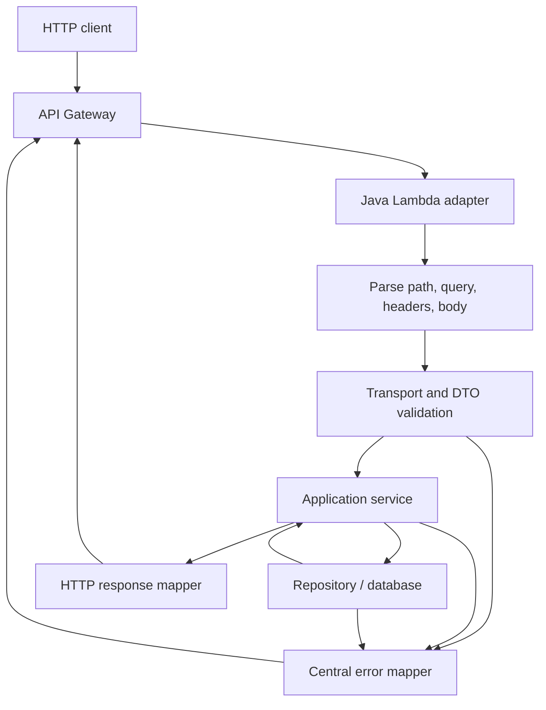

# Thêm validation, phân trang và ánh xạ lỗi HTTP

Một API Java serverless tốt cần xử lý đầu vào không đáng tin cậy, trả danh sách dữ liệu có giới hạn và biểu diễn lỗi theo một hợp đồng nhất quán. Ba phần này liên quan chặt chẽ: validation quyết định request có hợp lệ để xử lý hay không; pagination kiểm soát lượng dữ liệu và chi phí truy vấn; error mapping chuyển lỗi từ nhiều lớp bên trong thành HTTP response rõ ràng, an toàn và dễ tự động hóa.

Trong dự án API Java serverless, request thường đi qua API Gateway rồi kích hoạt Java function. Function có thể chạy trên AWS Lambda hoặc nền tảng FaaS tương đương. Adapter nhận HTTP event, chuyển thành request nội bộ, gọi service/repository và chuyển kết quả thành HTTP response. Vì vậy không nên để logic validation, pagination hay lỗi phụ thuộc trực tiếp vào một loại event của cloud provider.

Bài này xây dựng cách tổ chức ba năng lực trên cho API như `POST /customers`, `GET /customers` và `GET /customers/{id}`. Ví dụ dùng Java, Jakarta Bean Validation, SQL và API Gateway HTTP API; các nguyên tắc vẫn áp dụng được cho Azure Functions, Google Cloud Functions hoặc framework Java khác.

## 1. Nhìn toàn bộ request pipeline

Một request nên đi qua các ranh giới có trách nhiệm rõ ràng:



| Thành phần | Trách nhiệm |
|---|---|
| API Gateway | TLS, route, authorizer, throttling, payload limit và chuyển event |
| Lambda adapter | Đọc HTTP event, parse request, lấy request ID và tạo response |
| DTO validation | Kiểm tra hình dạng, kiểu, độ dài, range và quan hệ giữa các field |
| Application service | Kiểm tra quy tắc nghiệp vụ, quyền trên resource và điều phối use case |
| Repository | Truy vấn dữ liệu, giới hạn kết quả và thực thi pagination |
| Error mapper | Ánh xạ exception thành status, headers và error body |
| Response mapper | Serialize body, headers, status và content type |

Validation ở gateway có thể giảm request không hợp lệ, nhưng function vẫn phải kiểm tra dữ liệu mà nó nhận. Client có thể gọi function qua nhiều route, test harness hoặc event source khác; gateway validation không phải ranh giới tin cậy duy nhất.

## 2. Phân biệt các lớp validation

Không gom mọi kiểm tra vào một câu `if` lớn. Chia validation theo lớp giúp trả đúng lỗi và đặt kiểm tra tại nơi có đủ thông tin.

| Lớp | Ví dụ | Nơi thực hiện phù hợp |
|---|---|---|
| Transport | Thiếu body, content type không hỗ trợ, query `pageSize` không phải số | HTTP adapter |
| Syntax/format | JSON hỏng, UUID sai định dạng, timestamp không parse được | Parser/adapter |
| Schema/field | `name` rỗng, email sai định dạng, quantity âm | DTO validation |
| Cross-field | `startDate` phải trước `endDate`, chỉ một trong hai field được phép có giá trị | Class-level validator hoặc application service |
| Business rule | Email đã được dùng, order không thể chuyển trạng thái, hạn mức bị vượt | Application/domain service |
| Authorization | User không được đọc customer thuộc tenant khác | Security/application service |
| Persistence constraint | Unique key bị tranh chấp, foreign key không còn tồn tại | Database/repository và error mapper |

Một request có thể hợp lệ về cấu trúc nhưng không hợp lệ về nghiệp vụ. Ví dụ `email` có định dạng hợp lệ nhưng đã được một tài khoản khác sử dụng. Đây là conflict của tài nguyên, không phải lỗi định dạng email.

### Validation không thay thế authorization

UUID đúng định dạng không có nghĩa caller được phép truy cập resource đó. Sau khi parse và validate ID, application service vẫn phải kiểm tra tenant/owner/role. Tránh trả lỗi khác nhau khiến người gọi dò được resource tồn tại trong tenant khác; tùy threat model, có thể trả `404` cho cả “không tồn tại” và “không được phép biết”.

## 3. Thiết kế request DTO và Jakarta Bean Validation

Không bind JSON trực tiếp vào entity database. Dùng DTO riêng để API chỉ nhận những field được phép, tránh mass assignment vào `id`, `role`, `tenantId`, `createdAt` hoặc trạng thái nội bộ.

Ví dụ DTO tạo customer:

```java
import jakarta.validation.constraints.Email;
import jakarta.validation.constraints.NotBlank;
import jakarta.validation.constraints.Pattern;
import jakarta.validation.constraints.Size;

public record CreateCustomerRequest(
        @NotBlank(message = "Tên không được để trống")
        @Size(max = 120, message = "Tên tối đa 120 ký tự")
        String name,

        @NotBlank(message = "Email không được để trống")
        @Email(message = "Email không đúng định dạng")
        @Size(max = 254, message = "Email quá dài")
        String email,

        @Pattern(
                regexp = "^[0-9+() .-]{7,24}$",
                message = "Số điện thoại không đúng định dạng")
        String phone
) {}
```

Constraint nên phản ánh hợp đồng API, không cố thay thế mọi business rule. `@Email` kiểm tra hình thức cơ bản, không chứng minh mailbox tồn tại hay người dùng sở hữu địa chỉ đó. Regex điện thoại trong ví dụ cũng chỉ là quy tắc đầu vào đơn giản; nếu sản phẩm hỗ trợ nhiều quốc gia, hãy dùng thư viện/chuẩn phù hợp và lưu dạng chuẩn hóa.

### Chạy validation trong Java function

Trong ứng dụng dùng Spring/Jakarta EE, framework có thể tự kích hoạt validation qua annotation. Với Java Lambda handler thuần, annotation không tự chạy; cần gọi `Validator` rõ ràng hoặc dùng framework adapter đã cấu hình validation.

Khởi tạo `ValidatorFactory` một lần cho execution environment để tái sử dụng giữa các warm invocation. Đóng factory khi ứng dụng kết thúc nếu runtime/framework có lifecycle hook phù hợp.

```java
import jakarta.validation.Validation;
import jakarta.validation.Validator;
import jakarta.validation.ValidatorFactory;

public final class RequestValidators {
    private static final ValidatorFactory FACTORY =
            Validation.buildDefaultValidatorFactory();
    private static final Validator VALIDATOR = FACTORY.getValidator();

    private RequestValidators() {}

    public static Validator get() {
        return VALIDATOR;
    }
}
```

Validate DTO:

```java
import jakarta.validation.ConstraintViolation;
import jakarta.validation.Validator;

import java.util.Set;

public final class CreateCustomerValidator {
    private final Validator validator;

    public CreateCustomerValidator(Validator validator) {
        this.validator = validator;
    }

    public void validate(CreateCustomerRequest request) {
        Set<ConstraintViolation<CreateCustomerRequest>> violations =
                validator.validate(request);

        if (!violations.isEmpty()) {
            throw RequestValidationException.from(violations);
        }
    }
}
```

Nếu cần custom constraint cho quan hệ giữa nhiều field, dùng class-level annotation và validator riêng. Ví dụ khoảng ngày phải có `startDate <= endDate`; lỗi nên gắn với object hoặc field liên quan theo error contract đã công bố.

### Parse JSON an toàn

Parser có thể ném exception trước khi DTO được tạo. Xử lý riêng lỗi JSON malformed, body rỗng và content type không hỗ trợ. Không biến mọi lỗi parse thành `500 Internal Server Error`.

Các kiểm tra hữu ích:

- `Content-Type` phải nằm trong danh sách hỗ trợ, ví dụ `application/json`.
- Body phải tồn tại với route yêu cầu payload.
- JSON phải đúng cú pháp và đúng kiểu field.
- Từ chối field không được hỗ trợ hoặc định nghĩa rõ chính sách unknown field.
- Giới hạn body size ở gateway và/hoặc adapter.
- Không ghi nguyên body có thể chứa PII/secret vào log khi parse lỗi.

## 4. Chuẩn hóa dữ liệu sau khi validate

Validation xác nhận dữ liệu chấp nhận được; normalization chuyển dữ liệu về dạng nhất quán để so sánh và lưu trữ.

Ví dụ:

- Trim khoảng trắng ở đầu/cuối tên và chuỗi tìm kiếm.
- Chuẩn hóa email theo chính sách của hệ thống; không tự ý thay đổi local-part nếu chưa xác định semantics.
- Parse timestamp thành `Instant`/`OffsetDateTime` thay vì so sánh chuỗi.
- Chuẩn hóa mã quốc gia, currency hoặc phone theo chuẩn domain.
- Phân biệt field không được gửi, gửi `null` và gửi chuỗi rỗng trong PATCH.

Không normalization làm thay đổi ý nghĩa dữ liệu một cách âm thầm. Ví dụ chữ hoa/thường của email cần chính sách rõ; với Unicode, cần cân nhắc normalization form và quy tắc so sánh của domain.

## 5. Validation nghiệp vụ và xử lý race condition

Kiểm tra trước khi ghi không đủ để bảo đảm invariant khi có request đồng thời. Ví dụ hai request cùng kiểm tra email chưa tồn tại, sau đó cả hai cùng insert. Database unique constraint mới là bảo vệ cuối cùng.

Mẫu xử lý:

1. Validate định dạng request.
2. Kiểm tra business rule để trả feedback thân thiện.
3. Thực hiện write có constraint/transaction bảo vệ invariant.
4. Nếu database báo unique conflict, map thành `409 Conflict`.

Ví dụ SQL:

```sql
CREATE UNIQUE INDEX uq_customer_email
    ON customer (normalized_email);
```

Repository nên bắt đúng lỗi unique constraint liên quan tới email và chuyển thành `CustomerEmailAlreadyExistsException`. Không map mọi `SQLException` hoặc mọi integrity violation thành `409`; lỗi kết nối database vẫn là lỗi server/dependency.

## 6. Thiết kế query parameters cho pagination

Một endpoint list cần giới hạn lượng dữ liệu trả về. Ví dụ:

```http
GET /customers?pageSize=25&sort=createdAt,desc&status=ACTIVE
```

Quy ước API nên được công bố:

| Parameter | Quy tắc ví dụ |
|---|---|
| `pageSize` | Mặc định 25, tối thiểu 1, tối đa 100 |
| `cursor` | Opaque token do server phát; không kết hợp với `offset` |
| `offset` | Chỉ hỗ trợ ở endpoint nhỏ/đơn giản nếu cần |
| `sort` | Chỉ nhận field và direction trong allowlist |
| `status` | Enum đã công bố; từ chối giá trị không hợp lệ |
| `q` | Chuỗi tìm kiếm có giới hạn độ dài và semantics rõ |

Quyết định page size quá lớn sẽ bị từ chối hay clamp về maximum cần nhất quán. Nếu clamp, nên trả metadata hoặc tài liệu cho biết giới hạn. Không để client gửi `pageSize=1000000` khiến function đọc hàng triệu row hoặc response vượt giới hạn payload.

### Parse query parameter nghiêm ngặt

Không dùng `Integer.parseInt` mà không bắt lỗi. Kiểm tra:

- Giá trị có mặt hay không; áp dụng default khi thiếu.
- Chỉ có một giá trị nếu parameter không cho phép lặp.
- Parse đúng kiểu số và không overflow.
- Giá trị nằm trong min/max.
- Enum/sort field nằm trong allowlist.
- `cursor` và `offset` không xuất hiện đồng thời nếu API không hỗ trợ kết hợp.
- Filter có kích thước hợp lý và được chuẩn hóa.

Không nối trực tiếp `sort` từ query vào SQL. Tên cột và hướng sort thường không thể bind như query value; hãy map từ allowlist sang SQL fragment cố định.

## 7. Offset pagination và keyset/cursor pagination

Hai cách phân trang phổ biến có trade-off khác nhau.

| Tiêu chí | Offset pagination | Keyset/cursor pagination |
|---|---|---|
| Request | `limit`, `offset` | `limit`, `cursor` |
| Truy cập trang sâu | Có thể chậm vì database phải bỏ qua nhiều row | Thường hiệu quả hơn với index phù hợp |
| Dataset thay đổi giữa các trang | Có thể lặp hoặc bỏ sót row | Ổn định hơn nếu sort key và cursor được thiết kế đúng |
| Nhảy tới trang số N | Dễ hơn | Không tự nhiên; cần đi tuần tự hoặc lưu checkpoint |
| Triển khai | Đơn giản | Cần cursor format/version và validation |
| Phù hợp | Dataset nhỏ, báo cáo nội bộ, UI cần page number | API lớn, dữ liệu liên tục thay đổi, infinite scroll |

### Offset pagination

Ví dụ:

```sql
SELECT id, name, email, created_at
FROM customer
WHERE tenant_id = :tenant_id
ORDER BY created_at DESC, id DESC
LIMIT :limit OFFSET :offset;
```

Offset cần thứ tự deterministic. Nếu chỉ `ORDER BY created_at` và nhiều row có cùng timestamp, thứ tự có thể không ổn định. Thêm unique tie-breaker như `id`.

Offset lớn thường tốn công scan/skip nhiều row. Khi có insert/delete giữa các request, row có thể dịch vị trí làm người dùng thấy duplicate hoặc missing item. Với dữ liệu cập nhật thường xuyên, cursor/keyset thường phù hợp hơn.

### Keyset pagination

Giả sử sort theo `created_at DESC, id DESC`. Cursor lưu cặp giá trị của row cuối trang trước. Trang tiếp theo truy vấn:

```sql
SELECT id, name, email, created_at
FROM customer
WHERE tenant_id = :tenant_id
  AND (
      created_at < :last_created_at
      OR (created_at = :last_created_at AND id < :last_id)
  )
ORDER BY created_at DESC, id DESC
LIMIT :page_size_plus_one;
```

Đọc `pageSize + 1` row để biết có trang kế tiếp hay không; trả tối đa `pageSize` row. Nếu có row dư, tạo cursor từ row cuối thực sự trả về. Cần index hỗ trợ filter và sort, ví dụ `(tenant_id, created_at DESC, id DESC)`.

Keyset tránh chi phí offset sâu và chống dịch trang tốt hơn, nhưng không tạo snapshot nhất quán tuyệt đối nếu sort key có thể thay đổi hoặc dữ liệu bị xóa. Hãy chọn sort key bất biến nếu có thể và xác định semantics khi dữ liệu mới được insert trong lúc client đang duyệt.

## 8. Thiết kế cursor an toàn

Cursor nên là token opaque: client chỉ lưu và gửi lại, không tự chỉnh sửa nội dung. Một payload cursor có thể chứa:

- Version của cursor format.
- Giá trị sort key của row cuối trang trước.
- Sort direction và filter fingerprint.
- Tenant/user scope nếu cần bind theo caller.
- Expiration time hoặc snapshot/version nếu API cần.

Ví dụ payload nội bộ (không phải format public):

```json
{
  "v": 1,
  "createdAt": "2026-11-17T08:30:00Z",
  "id": "cus-1042",
  "sort": "createdAt:desc,id:desc",
  "filterHash": "f2a19c",
  "expiresAt": "2026-11-17T10:30:00Z"
}
```

Server có thể serialize JSON, Base64URL encode và ký HMAC. Khi nhận cursor, decode, xác minh chữ ký bằng constant-time comparison, kiểm tra version/expiry/filter và parse kiểu dữ liệu trước khi tạo query. Nếu cursor chứa thông tin nhạy cảm, chữ ký không che giấu nội dung; dùng encryption hoặc server-side opaque handle.

Cursor không phải authorization. Dù token được ký, server vẫn phải lấy tenant/user từ security context và áp dụng predicate quyền truy cập ở query. Không tin `tenantId` do client gửi trong cursor hoặc query.

### Ví dụ cursor signing trong Java

Đây là skeleton minh họa HMAC-SHA256; production cần quản lý secret trong secret manager, hỗ trợ key rotation và version/key ID.

```java
import javax.crypto.Mac;
import javax.crypto.SecretKey;
import java.security.MessageDigest;
import java.util.Base64;

public final class CursorSigner {
    private final SecretKey key;

    public CursorSigner(SecretKey key) {
        this.key = key;
    }

    public String sign(byte[] payload) {
        byte[] signature = hmac(payload);
        Base64.Encoder encoder = Base64.getUrlEncoder().withoutPadding();
        return encoder.encodeToString(payload) + "."
                + encoder.encodeToString(signature);
    }

    public byte[] verify(String token) {
        String[] parts = token.split("\\.", -1);
        if (parts.length != 2) {
            throw new InvalidCursorException();
        }

        Base64.Decoder decoder = Base64.getUrlDecoder();
        try {
            byte[] payload = decoder.decode(parts[0]);
            byte[] supplied = decoder.decode(parts[1]);
            byte[] expected = hmac(payload);
            if (!MessageDigest.isEqual(expected, supplied)) {
                throw new InvalidCursorException();
            }
            return payload;
        } catch (IllegalArgumentException error) {
            throw new InvalidCursorException();
        }
    }

    private byte[] hmac(byte[] payload) {
        try {
            Mac mac = Mac.getInstance("HmacSHA256");
            mac.init(key);
            return mac.doFinal(payload);
        } catch (Exception error) {
            throw new IllegalStateException("Cursor signing unavailable", error);
        }
    }
}
```

Đoạn code không thay thế việc validate payload sau verify. Hãy giới hạn token length, kiểm tra cursor version/expiry/filter fingerprint và chỉ cho phép sort keys được server hỗ trợ. Không trả lỗi khác nhau cho “signature sai” và “resource không tồn tại” nếu điều đó làm lộ thông tin không cần thiết.

## 9. Repository pagination và an toàn SQL

Repository phải nhận một object query đã validate thay vì raw query string.

```java
public record CustomerSearch(
        int pageSize,
        CustomerSort sort,
        CustomerStatus status,
        String normalizedQuery,
        CustomerCursor cursor
) {}

public enum CustomerSort {
    CREATED_DESC,
    CREATED_ASC,
    NAME_ASC
}
```

Map enum sang SQL cố định:

```java
String orderBy = switch (query.sort()) {
    case CREATED_DESC -> "created_at DESC, id DESC";
    case CREATED_ASC -> "created_at ASC, id ASC";
    case NAME_ASC -> "name ASC, id ASC";
};
```

Ví dụ trên chỉ an toàn vì `orderBy` đến từ enum nội bộ, không phải string tùy ý của client. Các filter values vẫn phải bind parameter (`?`, `:tenantId`); không nối giá trị tìm kiếm vào SQL. Với tên cột hoặc direction không thể bind, dùng allowlist và map cố định.

### Trả thêm một row để xác định `hasNextPage`

```java
List<Customer> rows = repository.find(query, query.pageSize() + 1);
boolean hasNextPage = rows.size() > query.pageSize();

List<Customer> items = hasNextPage
        ? rows.subList(0, query.pageSize())
        : rows;

String nextCursor = hasNextPage
        ? cursorFactory.from(items.get(items.size() - 1), query)
        : null;
```

Đảm bảo `pageSize >= 1` trước khi dùng `items.get(items.size() - 1)`. Không tạo cursor từ row dư; nếu làm vậy, trang tiếp theo sẽ bỏ qua row chưa được trả cho client.

### Count có thực sự cần không?

`COUNT(*)` có thể đắt với bảng lớn, filter phức tạp hoặc dữ liệu phân tán. Chỉ trả `totalCount` khi sản phẩm thực sự cần và database có thể đáp ứng. Cursor API thường chỉ cần `items`, `nextCursor` và `hasNextPage`. Nếu total count là ước lượng hoặc eventual consistent, phải ghi rõ semantics.

## 10. Response pagination nhất quán

Ví dụ response:

```json
{
  "items": [
    {
      "id": "cus-1042",
      "name": "Nguyen An",
      "email": "an@example.test"
    }
  ],
  "page": {
    "pageSize": 25,
    "hasNextPage": true,
    "nextCursor": "eyJ2IjoxLCJpZCI6ImN1cy0xMDQyIn0.signature"
  }
}
```

Quy ước:

- `items` luôn là array, kể cả khi rỗng.
- `pageSize` là số item tối đa server đã dùng.
- `hasNextPage` dựa trên row dư hoặc continuation token từ datastore.
- `nextCursor` là `null`/vắng mặt khi không có trang sau; chọn một quy ước và giữ ổn định.
- Không trả cursor nếu không có trang kế tiếp.
- Giữ cùng filter/sort trong các trang; cursor nên bind với filter fingerprint.

Nếu API cần offset pagination, có thể trả `pageNumber`, `pageSize`, `totalCount` và `totalPages`, nhưng phải định nghĩa behavior khi dữ liệu thay đổi giữa các lần gọi.

## 11. Ánh xạ lỗi HTTP theo một hợp đồng duy nhất

Exception Java không nên đi thẳng ra HTTP. Mỗi layer có thể ném loại exception khác nhau; error mapper trung tâm chuyển chúng thành status, headers và body đã công bố.

Một API có thể dùng RFC 9457 Problem Details với media type `application/problem+json`.

```json
{
  "type": "https://api.example.test/problems/validation-error",
  "title": "Request không hợp lệ",
  "status": 422,
  "detail": "Một hoặc nhiều field không đáp ứng yêu cầu.",
  "instance": "/customers",
  "code": "VALIDATION_FAILED",
  "traceId": "req-7f8c",
  "errors": [
    {
      "field": "email",
      "code": "INVALID_FORMAT",
      "message": "Email không đúng định dạng"
    }
  ]
}
```

Các field `code`, `traceId`, `errors` là extension của API. Giữ `type`, `title`, `status`, `detail`, `instance` theo semantics của Problem Details. `detail` và `message` phải an toàn cho client; không đưa SQL, stack trace, secret, internal hostname hoặc raw rejected value vào response.

### Bảng ánh xạ status

| HTTP status | Dùng khi | Ví dụ |
|---|---|---|
| `400 Bad Request` | Request không parse được hoặc transport/query sai cú pháp | JSON malformed, `pageSize=abc` |
| `401 Unauthorized` | Chưa xác thực hoặc credential không hợp lệ | Token hết hạn |
| `403 Forbidden` | Đã xác thực nhưng không có quyền thực hiện | Không có quyền tạo customer |
| `404 Not Found` | Resource/route không tồn tại hoặc không được phép biết | Customer ID không thấy trong tenant |
| `405 Method Not Allowed` | Route có nhưng method không hỗ trợ | POST vào route chỉ GET |
| `409 Conflict` | Xung đột với trạng thái/tài nguyên hiện có | Email trùng, optimistic lock conflict |
| `412 Precondition Failed` | Điều kiện request như `If-Match` không đạt | ETag đã thay đổi |
| `413 Content Too Large` | Body vượt giới hạn | JSON upload quá lớn |
| `415 Unsupported Media Type` | Content-Type không hỗ trợ | Gửi XML vào endpoint JSON-only |
| `422 Unprocessable Content` | JSON parse được nhưng field/schema/business input không hợp lệ | Email sai định dạng, ngày kết thúc trước ngày bắt đầu |
| `429 Too Many Requests` | Caller vượt rate/concurrency quota | Rate limit theo tenant |
| `500 Internal Server Error` | Lỗi không dự kiến trong function | Bug hoặc invariant bị vi phạm |
| `502 Bad Gateway` | Function nhận phản hồi không hợp lệ từ upstream | Response từ dependency bị malformed |
| `503 Service Unavailable` | Dependency/service tạm thời không sẵn sàng | Database pool cạn, provider unavailable |
| `504 Gateway Timeout` | Gateway/function/dependency hết thời gian chờ | Request đồng bộ vượt timeout |

`400` và `422` có thể được một số API gộp theo convention. Điều quan trọng là chọn quy ước, ghi trong OpenAPI và áp dụng nhất quán. Không dùng `200 OK` với body `{ "success": false }` cho lỗi HTTP thông thường.

### Không lạm dụng 500

Lỗi validation, not found và conflict là kết quả dự kiến của API, không phải lỗi hệ thống. Nếu mọi exception đều map thành 500, client không biết có nên sửa request, đăng nhập lại, retry hay dừng. Ngược lại, không map mọi exception thành 400 vì sẽ che giấu lỗi server và làm monitoring mất tín hiệu.

## 12. Xây dựng error taxonomy trong Java

Tạo exception nghiệp vụ rõ nghĩa thay vì kiểm tra message string.

```java
public abstract class ApiException extends RuntimeException {
    protected ApiException(String message) {
        super(message);
    }
}

public final class CustomerNotFoundException extends ApiException {
    public CustomerNotFoundException() {
        super("Customer not found");
    }
}

public final class CustomerEmailAlreadyExistsException extends ApiException {
    public CustomerEmailAlreadyExistsException() {
        super("Customer email already exists");
    }
}
```

Trong hệ thống thực tế, exception có thể mang code/metadata an toàn thay vì message public. Error mapper quyết định thông điệp hiển thị, không lấy nguyên `getMessage()` của exception hạ tầng.

### Problem Details model

```java
public record ApiProblem(
        String type,
        String title,
        int status,
        String detail,
        String instance,
        String code,
        String traceId,
        List<FieldProblem> errors
) {}

public record FieldProblem(
        String field,
        String code,
        String message
) {}
```

### Error mapper trung tâm

```java
public final class ApiErrorMapper {
    public ApiProblem map(
            Exception error,
            String path,
            String traceId) {

        if (error instanceof RequestValidationException validation) {
            return problem(422, "Request không hợp lệ",
                    "Một hoặc nhiều field không đáp ứng yêu cầu.",
                    "VALIDATION_FAILED", path, traceId,
                    validation.fieldProblems());
        }

        if (error instanceof CustomerNotFoundException) {
            return problem(404, "Không tìm thấy tài nguyên",
                    "Customer không tồn tại.",
                    "CUSTOMER_NOT_FOUND", path, traceId, List.of());
        }

        if (error instanceof CustomerEmailAlreadyExistsException) {
            return problem(409, "Xung đột dữ liệu",
                    "Email đã được sử dụng.",
                    "CUSTOMER_EMAIL_EXISTS", path, traceId, List.of());
        }

        if (error instanceof DependencyUnavailableException) {
            return problem(503, "Dịch vụ tạm thời không sẵn sàng",
                    "Vui lòng thử lại sau.",
                    "DEPENDENCY_UNAVAILABLE", path, traceId, List.of());
        }

        return problem(500, "Lỗi máy chủ",
                "Đã xảy ra lỗi không mong đợi.",
                "INTERNAL_ERROR", path, traceId, List.of());
    }

    private ApiProblem problem(
            int status, String title, String detail, String code,
            String path, String traceId, List<FieldProblem> errors) {
        return new ApiProblem(
                "https://api.example.test/problems/"
                        + code.toLowerCase(java.util.Locale.ROOT).replace('_', '-'),
                title, status, detail, path,
                code, traceId, errors);
    }
}
```

Đây là skeleton để thể hiện nguyên tắc. Production nên dùng `type` URI ổn định cho từng loại problem, chuẩn hóa error codes và xử lý thêm authentication, authorization, malformed JSON, throttling, timeout cùng provider-specific exceptions. Không bắt `Throwable` để che cả lỗi nghiêm trọng của JVM; adapter có thể bắt `Exception` ở ranh giới request sau khi đã có logging/monitoring phù hợp.

### Validation error phải ổn định

Không trả nguyên `ConstraintViolation` object vì nó có thể chứa root bean, invalid value hoặc implementation detail. Chuyển sang DTO an toàn:

```java
List<FieldProblem> fieldProblems = violations.stream()
        .map(v -> new FieldProblem(
                v.getPropertyPath().toString(),
                v.getConstraintDescriptor()
                        .getAnnotation().annotationType().getSimpleName(),
                v.getMessage()))
        .sorted(Comparator.comparing(FieldProblem::field)
                .thenComparing(FieldProblem::code))
        .toList();
```

Trong API lớn, dùng mã lỗi do ứng dụng định nghĩa như `REQUIRED`, `TOO_LONG`, `INVALID_FORMAT` thay vì expose tên annotation. Sort errors theo field/code để test và client nhận kết quả deterministic. Tránh trả rejected value vì nó có thể là password, token hoặc dữ liệu nhạy cảm.

## 13. Ánh xạ lỗi ở ranh giới API Gateway và Lambda

Với Lambda proxy integration, function thường tự trả status code, headers và body. Error mapper phải được gọi tại adapter để không có exception không xử lý rơi ra ngoài và biến thành response không theo contract.

Luồng xử lý:

1. Lấy request ID từ API Gateway context hoặc tạo correlation ID an toàn.
2. Parse method, path, headers, query và body.
3. Gọi router/controller và application service.
4. Serialize success response.
5. Nếu có exception, gọi central error mapper và serialize Problem Details.
6. Gắn `Content-Type: application/problem+json` cho lỗi, CORS headers phù hợp và request/trace ID.

API Gateway cũng có thể tự trả lỗi trước khi function chạy, ví dụ authorizer reject, route không tồn tại, throttling hoặc payload quá lớn. Những response do gateway sinh ra không tự đi qua Java error mapper. Cần cấu hình gateway response/default error mapping và CORS để client nhận format nhất quán nhất có thể; đồng thời ghi rõ các trường hợp platform không thể trả Problem Details giống function.

### Adapter skeleton cho API Gateway HTTP API v2

```java
import com.amazonaws.services.lambda.runtime.Context;
import com.amazonaws.services.lambda.runtime.RequestHandler;
import com.amazonaws.services.lambda.runtime.events.APIGatewayV2HTTPEvent;
import com.amazonaws.services.lambda.runtime.events.APIGatewayV2HTTPResponse;

import java.util.Map;

public final class CustomerApiHandler implements
        RequestHandler<APIGatewayV2HTTPEvent, APIGatewayV2HTTPResponse> {

    private final CustomerRouter router = ApplicationGraph.customerRouter();
    private final ApiErrorMapper errors = new ApiErrorMapper();

    @Override
    public APIGatewayV2HTTPResponse handleRequest(
            APIGatewayV2HTTPEvent event, Context context) {

        String requestId = context.getAwsRequestId();
        String path = event.getRawPath() == null ? "/" : event.getRawPath();

        try {
            ApiRequest request = ApiGatewayRequestAdapter.from(event, requestId);
            ApiResponse response = router.handle(request);
            return toGatewayResponse(response);
        } catch (Exception error) {
            ApiProblem problem = errors.map(error, path, requestId);
            return APIGatewayV2HTTPResponse.builder()
                    .withStatusCode(problem.status())
                    .withHeaders(Map.of(
                            "Content-Type", "application/problem+json",
                            "Cache-Control", "no-store"))
                    .withBody(Json.write(problem))
                    .withIsBase64Encoded(false)
                    .build();
        }
    }

    private APIGatewayV2HTTPResponse toGatewayResponse(ApiResponse response) {
        return APIGatewayV2HTTPResponse.builder()
                .withStatusCode(response.status())
                .withHeaders(response.headers())
                .withBody(response.body())
                .withIsBase64Encoded(false)
                .build();
    }
}
```

`ApiGatewayRequestAdapter`, `CustomerRouter`, `ApplicationGraph` và `Json` là abstraction của ứng dụng trong ví dụ. Tên builder/accessor cần khớp phiên bản `aws-lambda-java-events` đang dùng. Với binary body hoặc base64 event, adapter phải decode đúng theo `isBase64Encoded`; không giả định mọi body đều là UTF-8 JSON. Cũng cần bảo đảm success response có CORS/security headers như error response.

## 14. Retry semantics và HTTP error mapping

Status code ảnh hưởng cách client retry. Hãy định nghĩa rõ:

| Lỗi | Client nên làm gì? |
|---|---|
| `400`, `401`, `403`, `404`, `415`, `422` | Sửa request/credential/quyền; không retry y nguyên liên tục |
| `409` | Đọc trạng thái hiện tại hoặc giải quyết conflict trước khi gửi lại |
| `412` | Fetch resource/ETag mới rồi quyết định cập nhật lại |
| `429` | Tôn trọng `Retry-After`, exponential backoff và jitter |
| `500`, `502`, `503`, `504` | Có thể retry nếu operation an toàn/idempotent và còn retry budget |

Nếu API hỗ trợ write request có side effect, dùng idempotency key để client retry sau timeout mà không tạo record/payment trùng. Error response có thể có `Retry-After` cho 429/503. Không gửi header retry nếu server không có ước lượng phù hợp.

Một lỗi dependency timeout có thể có kết quả chưa xác định: provider đã xử lý nhưng response bị mất. Không biến timeout thành “thất bại chắc chắn” rồi gọi lại với key mới. Dùng cùng idempotency key hoặc reconciliation theo contract provider.

## 15. Pagination trong serverless: giới hạn compute, memory và response

Pagination không chỉ là trải nghiệm UI. Một Lambda có memory/time limit và chi phí theo thời gian thực thi/tài nguyên. Đọc quá nhiều row làm tăng query duration, memory, serialization time và nguy cơ timeout.

Thiết kế cần tính:

- Page size tối đa theo kích thước item và payload limit.
- Database index cho filter + sort.
- Projection chỉ lấy field API cần, tránh load toàn entity/large blob.
- Timeout của query thấp hơn function timeout để còn thời gian map response.
- Connection pool và concurrency theo capacity database.
- Cursor token size và validation cost.
- Không chạy `COUNT(*)` ở mỗi trang nếu không cần.

Với DynamoDB, pagination thường dùng `LastEvaluatedKey`/`ExclusiveStartKey`; API nên bọc key đó thành cursor opaque, ký hoặc lưu server-side nếu cần. `Limit` của DynamoDB là số item được đánh giá trước filter trong một số query pattern, nên số item trả về có thể ít hơn page size. Không giả định một lần `Query` luôn trả đúng số item client yêu cầu.

Với SQL database, keyset pagination và index phù hợp thường cho chi phí ổn định hơn offset sâu. Hãy đo query plan và latency theo page depth thực tế.

## 16. Security cho validation, pagination và errors

Các nguyên tắc bảo mật:

- Validate server-side mọi input, kể cả khi frontend đã validate.
- Dùng DTO allowlist, tránh bind request vào persistence entity.
- Parameterize SQL values; allowlist sort field/direction.
- Enforce tenant/resource authorization trong query/service.
- Giới hạn body size, page size, query length và cursor length.
- Ký cursor để phát hiện sửa đổi; mã hóa nếu payload cursor chứa thông tin cần giữ kín.
- Không coi cursor đã ký là quyền truy cập; kiểm tra quyền ở mỗi request.
- Không trả stack trace, SQL, tên bảng, secret, token hoặc rejected value.
- Redact PII trong logs và validation diagnostics.
- Throttle các endpoint list/search để hạn chế enumeration và chi phí.

Validation message cũng có thể làm lộ schema nội bộ nếu trả tên field/constraint quá chi tiết. Chỉ expose field và error code trong API contract, giữ diagnostic đầy đủ ở log có access control.

## 17. Observability và vận hành

Một API serverless cần metric để biết validation/pagination/error mapping có đang hoạt động đúng hay không.

| Metric/log field | Mục đích |
|---|---|
| Request count theo route/method/status | Phân bố traffic và lỗi |
| Validation failure count theo error code | Phát hiện client integration lỗi hoặc abuse |
| Error count theo category | Phân biệt client, business, dependency và internal errors |
| p50/p95/p99 latency | Theo dõi API và query latency |
| Rows returned / query duration | Phát hiện page size/query plan bất thường |
| Cursor invalid/expired count | Phát hiện client bug hoặc token tampering |
| Response bytes | Phát hiện payload quá lớn |
| Throttles/concurrency/timeouts | Theo dõi giới hạn serverless |
| Trace/request ID | Liên kết API Gateway, Lambda và database call |

Không dùng customer ID, cursor token, email hoặc request ID làm metric label vì cardinality cao và rủi ro dữ liệu. Log structured fields như route template, status, error code và request ID; không log raw body/token. Gắn trace ID vào Problem Details để client gửi khi cần hỗ trợ.

## 18. Kiểm thử validation, pagination và error mapping

Kiểm thử từng ranh giới, không chỉ test happy path.

### Validation tests

- Body rỗng, JSON malformed, sai content type và body quá lớn.
- Field thiếu, null, blank, sai format, quá dài và sai range.
- Unknown field và field không được phép bind.
- Cross-field constraint.
- Unicode, whitespace, case normalization và timestamp/timezone.
- Hai request đồng thời vi phạm unique constraint; chỉ một request thành công.
- Authorization theo tenant dù ID đúng định dạng.

### Pagination tests

- Default page size, min/max và page size vượt giới hạn.
- Cursor hợp lệ, sai chữ ký, hết hạn, sai version và quá dài.
- Cursor dùng với filter/sort khác.
- Sort field/direction không nằm trong allowlist.
- Nhiều row có cùng sort timestamp; tie-breaker không gây duplicate/missing.
- Insert/delete giữa hai trang theo semantics đã công bố.
- Empty page, last page và `hasNextPage`.
- Tenant isolation trên từng page.
- Query plan/index và giới hạn thời gian dưới tải mục tiêu.

### Error mapping tests

- Mỗi exception type ánh xạ đúng status/code/title.
- Validation errors được sort deterministic.
- Response có `application/problem+json` và không chứa stack trace/secret/rejected value.
- `Retry-After` có trên lỗi throttling/dependency phù hợp.
- API Gateway-generated errors và CORS được kiểm thử ở integration stage.
- Request/trace ID có thể dùng để tìm log.

Ví dụ JUnit cho mapper:

```java
@Test
void mapsCustomerConflictTo409Problem() {
    ApiProblem problem = mapper.map(
            new CustomerEmailAlreadyExistsException(),
            "/customers",
            "req-test-1");

    assertEquals(409, problem.status());
    assertEquals("CUSTOMER_EMAIL_EXISTS", problem.code());
    assertEquals("req-test-1", problem.traceId());
}
```

Ví dụ test này giả định mapper/model đã được khởi tạo trong test fixture. Bổ sung contract test so sánh response thực tế với OpenAPI schema để tránh code và tài liệu API lệch nhau.

## 19. Các lỗi thường gặp

| Anti-pattern | Hệ quả | Cách xử lý |
|---|---|---|
| Chỉ validate ở frontend/API Gateway | Request đi đường khác có thể bỏ qua kiểm tra | Validate lại trong function/application boundary |
| Bind JSON vào entity database | Mass assignment và coupling schema | Dùng request DTO allowlist |
| Gộp business conflict thành validation error | Client nhận sai semantics | Tách 422 và 409 theo contract |
| Mọi exception thành 500 | Client không biết cách sửa/retry | Error taxonomy và mapper trung tâm |
| Trả exception message/stack trace | Lộ implementation và dữ liệu nhạy cảm | Problem Details an toàn |
| SQL sort nối trực tiếp từ query | SQL injection | Enum/allowlist cho sort, bind filter values |
| Page size không giới hạn | Query/response lớn, tăng chi phí và timeout | Default/max page size |
| Offset sâu trên bảng lớn | Query chậm và scan nhiều row | Keyset/cursor với index |
| Sort không có tie-breaker | Duplicate/missing row giữa các trang | Sort deterministic bằng unique key |
| Cursor chỉ Base64, không ký | Client sửa vị trí/filter/tenant | HMAC hoặc server-side opaque cursor |
| Tin tenant ID trong cursor | Có thể truy cập chéo tenant | Lấy tenant từ auth context và enforce ở query |
| `COUNT(*)` mọi request | Tăng latency và DB load | Count tùy nhu cầu hoặc bỏ khỏi cursor API |
| Chỉ test function, không test gateway | Gateway-generated errors lệch format/CORS | Integration test API Gateway boundary |

## 20. Quy trình triển khai cho API Java serverless

1. **Chốt API contract.** Định nghĩa field, status code, Problem Details, pagination parameters và OpenAPI schema.
2. **Tạo request/response DTO.** Không dùng persistence entity làm API model.
3. **Thêm parser và validation.** Parse transport, validate field/cross-field, normalize dữ liệu.
4. **Tách business rules.** Kiểm tra uniqueness/state/authorization trong service và bảo vệ invariant bằng database constraint.
5. **Thiết kế pagination.** Chọn offset hay keyset theo dataset, sort ổn định, giới hạn page size và index.
6. **Tạo cursor codec.** Version, ký, expiry, filter fingerprint và key rotation nếu dùng cursor.
7. **Xây error taxonomy.** Định nghĩa exception/code ổn định và mapper tập trung.
8. **Tích hợp API Gateway adapter.** Map status, headers, Problem Details, binary body và CORS.
9. **Thêm observability.** Metrics theo route/status/error code, query latency, response size và trace ID.
10. **Kiểm thử.** Unit, repository, property/cursor, contract và gateway integration tests.
11. **Triển khai có kiểm soát.** Theo dõi validation errors, p95/p99, query latency, 4xx/5xx và Lambda timeout.
12. **Cập nhật tài liệu.** Giữ OpenAPI, examples và error code catalogue đồng bộ với implementation.

## 21. Checklist trước production

- [ ] Request DTO tách biệt persistence entity và chỉ chứa field được phép.
- [ ] Validation server-side chạy trong function/application boundary.
- [ ] JSON malformed, content type, body size và query parsing có error mapping rõ.
- [ ] Cross-field và business validation nằm đúng layer.
- [ ] Database constraints bảo vệ invariant trước race condition.
- [ ] Tenant/resource authorization được kiểm tra ở mọi query.
- [ ] Page size có default, minimum và maximum.
- [ ] Sort/filter dùng allowlist và parameterized SQL.
- [ ] Pagination dùng thứ tự deterministic với unique tie-breaker.
- [ ] Cursor có version, integrity check, expiry và filter binding nếu cần.
- [ ] API định nghĩa rõ `hasNextPage`, `nextCursor` và semantics khi data thay đổi.
- [ ] `COUNT(*)` chỉ chạy khi thực sự cần.
- [ ] Problem Details có error code ổn định và không lộ nội bộ.
- [ ] 4xx/5xx mapping và retry semantics được công bố.
- [ ] Gateway-generated errors, CORS và function-generated errors đã được kiểm thử.
- [ ] Logs/metrics không chứa raw PII, secret hoặc cursor token.
- [ ] Validation, pagination, error mapper và OpenAPI contract tests pass.
- [ ] Query latency, response bytes, Lambda timeout và database capacity có dashboard/alert.

## Tài liệu tham khảo

- [RFC 9457: Problem Details for HTTP APIs](https://www.rfc-editor.org/rfc/rfc9457.html)
- [RFC 9110: HTTP Semantics](https://www.rfc-editor.org/rfc/rfc9110.html)
- [Jakarta Bean Validation](https://jakarta.ee/specifications/bean-validation/)
- [OWASP Input Validation Cheat Sheet](https://cheatsheetseries.owasp.org/cheatsheets/Input_Validation_Cheat_Sheet.html)
- [AWS Lambda Java handler](https://docs.aws.amazon.com/lambda/latest/dg/java-handler.html)
- [API Gateway HTTP API Lambda integrations](https://docs.aws.amazon.com/apigateway/latest/developerguide/http-api-develop-integrations-lambda.html)
- [AWS Lambda best practices](https://docs.aws.amazon.com/lambda/latest/dg/best-practices.html)

## Kết luận

Validation, pagination và error mapping là ba phần của cùng một hợp đồng API. Dùng DTO và validation server-side để kiểm soát đầu vào; đặt business rule và authorization ở application boundary; dùng page size giới hạn, sort allowlist và cursor/keyset khi dataset lớn; chuyển exception thành Problem Details với HTTP status có nghĩa và không lộ nội bộ. Trong serverless, hãy kiểm thử cả function lẫn lỗi do API Gateway tạo ra, theo dõi query/response cost và tái sử dụng thành phần khởi tạo tốn kém giữa warm invocation. Khi các quy tắc này được công bố trong OpenAPI và kiểm thử ở cả unit lẫn integration boundary, API Java sẽ dễ tích hợp, an toàn và vận hành ổn định hơn.
