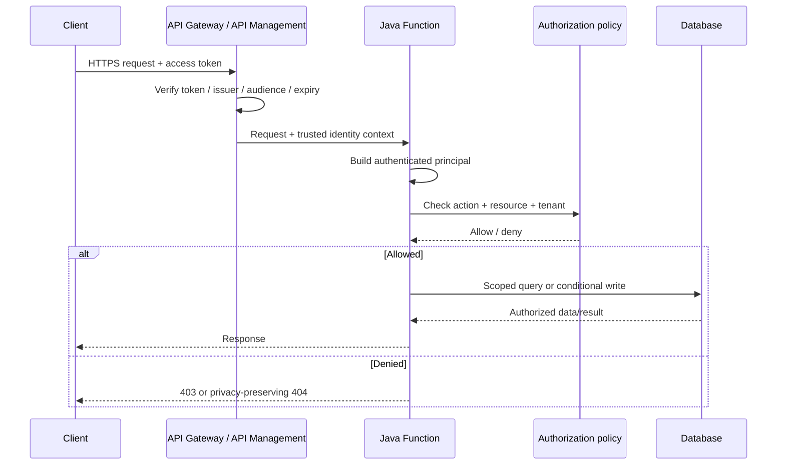

# Tích hợp xác thực và kiểm tra quyền sở hữu dữ liệu

Một API Java serverless cần xác minh **ai đang gọi** và **người gọi được phép làm gì với đúng tài nguyên đang yêu cầu**. Hai câu hỏi này liên quan nhưng không giống nhau. Xác thực (authentication) xác nhận danh tính của caller; phân quyền (authorization) quyết định caller có được đọc, tạo, sửa hoặc xóa một resource cụ thể hay không.

Một request có access token hợp lệ vẫn có thể không được phép đọc đơn hàng của tenant khác. Một user có role `customer` có thể được gọi endpoint `GET /orders/{id}`, nhưng chỉ được xem đơn hàng thuộc tenant và phạm vi sở hữu của mình. Nếu API chỉ kiểm tra token hoặc role chung mà bỏ qua quyền trên từng object, hệ thống dễ mắc lỗi Broken Object Level Authorization (BOLA), thường được khai thác bằng cách thay ID trên URL hoặc request body.

Trong kiến trúc serverless, API Gateway hoặc API Management có thể xác minh token ở lớp đầu vào; Java function vẫn cần áp dụng quy tắc nghiệp vụ và quyền trên dữ liệu. Execution role của function cho phép function truy cập dịch vụ cloud, nhưng không tự động chứng minh người dùng cuối có quyền truy cập record mà họ yêu cầu.

## 1. Xác thực và phân quyền là hai bước riêng

### 1.1. Authentication: xác minh danh tính

Xác thực trả lời câu hỏi: “Caller là ai và bằng chứng danh tính có đáng tin cậy không?” Với API hiện đại, danh tính thường đến từ OAuth 2.0 access token được cấp bởi Authorization Server, thường kết hợp OpenID Connect (OIDC) để đăng nhập người dùng.

API có thể nhận:

- **JWT access token:** token có chữ ký, chứa claims như issuer, subject, audience, expiry, scope hoặc role.
- **Opaque access token:** chuỗi không tự mô tả; resource server cần introspection hoặc cơ chế xác minh do identity provider cung cấp.
- **Workload identity:** IAM role, managed identity, service principal hoặc client credentials cho service-to-service.

API phải xác minh token theo contract của identity provider. Không giải mã phần payload của JWT rồi tin các claim mà không kiểm tra chữ ký và các điều kiện cần thiết.

### 1.2. Authorization: quyết định quyền trên hành động và resource

Phân quyền trả lời: “Danh tính này được thực hiện hành động nào trên resource nào trong ngữ cảnh nào?” Một quyết định thường phụ thuộc vào:

- subject: user, service hoặc workload đang gọi;
- action: `read`, `create`, `update`, `delete`, `approve`, `export`;
- resource: document, order, account, tenant hoặc record cụ thể;
- context: tenant, trạng thái nghiệp vụ, thời gian, địa chỉ mạng hoặc mức độ nhạy cảm;
- policy: vai trò, quan hệ sở hữu, membership và quy tắc nghiệp vụ.

Ví dụ: `orders:read` cho phép caller gọi nhóm API đọc đơn hàng, nhưng chưa đủ để kết luận caller được đọc mọi order ID. API cần kiểm tra tenant và quyền trên order cụ thể.

### 1.3. Luồng xử lý tổng quát



Gateway giúp loại request không có danh tính hợp lệ sớm. Function vẫn phải kiểm tra quyền nghiệp vụ vì gateway thường không biết caller có phải chủ sở hữu order/document đang được truy cập hay không.

## 2. Chọn giao thức và loại token phù hợp

### 2.1. OAuth 2.0 access token

OAuth 2.0 là framework ủy quyền. Client nhận access token để gọi resource server/API với scope hoặc quyền được cấp. API nên nhận access token theo `Authorization: Bearer ...` qua HTTPS và chỉ chấp nhận token được phát hành cho đúng API.

Không dùng ID token thay access token để bảo vệ API. ID token của OIDC mô tả kết quả đăng nhập cho client ứng dụng; audience của nó thường là client ID. Access token mới là credential được cấp để gọi resource server và phải có audience/permission phù hợp với API.

### 2.2. OpenID Connect

OIDC bổ sung lớp xác thực danh tính trên OAuth 2.0. Claims như `sub`, `iss`, `email` hoặc `name` có ý nghĩa tùy provider và policy. Dùng cặp `iss` + `sub` làm định danh subject ổn định theo issuer; email có thể thay đổi và không nên mặc định là khóa chính.

Không giả định `sub` giống nhau giữa hai identity provider. Nếu hệ thống hỗ trợ nhiều issuer, phải namespace subject theo issuer hoặc ánh xạ sang internal user ID đã được quản lý.

### 2.3. JWT và opaque token

| Đặc điểm | JWT access token | Opaque access token |
|---|---|---|
| Xác minh | Kiểm tra chữ ký và claims theo metadata/JWKS | Introspection hoặc cơ chế của provider |
| Phụ thuộc mạng lúc request | Có thể xác minh cục bộ khi key còn cache | Thường cần gọi introspection hoặc cache kết quả |
| Thu hồi | Khó thu hồi tức thời nếu resource server chỉ kiểm tra JWT offline | Có thể phản ánh trạng thái thu hồi qua introspection |
| Kích thước | Có thể lớn do nhiều claims | Thường ngắn hơn |
| Rủi ro | Tin claim sai, key rotation hoặc audience sai | Introspection outage/cache stale |

Chọn theo khả năng của identity provider, latency, yêu cầu thu hồi token và threat model. Dù dùng loại nào, function phải fail closed khi không thể xác minh danh tính theo chính sách; không coi lỗi kiểm tra token là quyền truy cập hợp lệ.

## 3. Xác minh JWT đúng cách

Nếu API nhận JWT access token, phải kiểm tra ít nhất:

1. **Chữ ký:** dùng public key từ JWKS/metadata tin cậy của issuer; chỉ cho phép thuật toán đã cấu hình. Không tin thuật toán do token tự chọn ngoài allowlist.
2. **Issuer (`iss`):** phải khớp chính xác issuer đã cấu hình.
3. **Audience (`aud`):** phải chứa identifier của API/resource server này.
4. **Expiry (`exp`):** token chưa hết hạn; áp dụng clock skew nhỏ, có giới hạn.
5. **Not before (`nbf`):** không sử dụng token trước thời điểm hiệu lực.
6. **Token type/use:** xác nhận đây là access token đúng loại theo provider, không nhận nhầm ID token.
7. **Scope/permission:** token có quyền tối thiểu cần cho endpoint.
8. **Tenant/organization context:** nếu dùng claim tenant, xác minh claim đến từ issuer tin cậy và khớp tenant của resource.

Tùy provider, cần kiểm tra thêm `client_id` hoặc `azp`, token version, authorized party, authentication context và policy về token delegation. Không dựa vào một claim tên `role` hoặc `groups` nếu issuer không cam kết semantics và nguồn phát hành của claim đó.

### 3.1. JWKS và key rotation

JWT thường có header `kid` để chọn public key trong JWKS. API nên:

- lấy JWKS từ metadata endpoint được cấu hình sẵn của issuer;
- cache key theo TTL hợp lý để giảm network call và cold-start latency;
- refresh khi gặp `kid` mới theo cơ chế có giới hạn;
- hỗ trợ thời gian overlap giữa key cũ và mới khi provider rotate key;
- không tải JWKS từ URL do token hoặc request tùy ý cung cấp;
- fail closed nếu không thể xác minh chữ ký và không có key hợp lệ.

Cache trong static field của Java function chỉ là tối ưu best-effort. Execution environment có thể bị tạo mới hoặc bị thu hồi bất cứ lúc nào; không dùng memory cache làm nơi lưu state bảo mật duy nhất. Nếu JWKS endpoint tạm thời lỗi, chỉ dùng key đã cache trong phạm vi policy và thời gian cho phép.

### 3.2. Không tự viết JWT verifier sơ sài

Không nên tự parse Base64 rồi so sánh claim. Dùng thư viện JOSE/OIDC được duy trì hoặc để gateway/identity middleware xác minh. Cấu hình thư viện phải pin issuer, audience, thuật toán và key source; “thư viện đã verify signature” không có nghĩa là mọi điều kiện token đã được kiểm tra.

## 4. Đặt xác thực ở API Gateway và Java function

### 4.1. API Gateway/API Management authorizer

Gateway có thể xác minh token trước khi request đến function:

- AWS API Gateway HTTP API hỗ trợ JWT authorizer với issuer, audience và route scopes.
- Amazon Cognito hoặc Lambda authorizer có thể cung cấp mô hình xác thực/ủy quyền phù hợp với API Gateway.
- Azure API Management có policy `validate-jwt` để kiểm tra token trước khi forward request đến Azure Function hoặc backend.
- Các gateway/reverse proxy khác có thể tích hợp OIDC provider hoặc external authorization service.

Authorizer giúp bảo vệ perimeter và chuẩn hóa identity context. Nhưng route scope như `documents:read` vẫn không thay thế kiểm tra owner, tenant hoặc ACL của từng document.

### 4.2. Function chỉ tin identity context từ đường gọi đã được bảo vệ

Nếu function nhận identity claims từ gateway context, chỉ tin chúng khi:

- chỉ gateway/đúng service principal được phép invoke function;
- endpoint function không bị public hoặc không có đường invoke bypass gateway;
- transport/invocation policy bảo vệ tính toàn vẹn của context;
- adapter lấy claims từ trường context do nền tảng xác thực, không lấy từ header do client tự gửi.

Không tin `X-User-Id`, `X-Tenant-Id`, `X-Role` hoặc header tương tự nếu client có thể tự đặt. Nếu function có thể được invoke trực tiếp bởi nhiều nguồn, mỗi đường vào phải có cơ chế xác thực riêng và chuẩn hóa thành một principal đáng tin.

### 4.3. Phân biệt caller identity và execution identity

Có ít nhất hai danh tính trong một lần chạy:

- **Caller identity:** user/service đã gọi API và là subject của quyết định nghiệp vụ.
- **Execution identity:** IAM role hoặc managed identity mà function dùng để truy cập database, queue, secret store và cloud resource.

Execution role có thể cho function quyền đọc bảng `documents`, nhưng không có nghĩa caller được đọc mọi dòng trong bảng. Function phải thực hiện authorization theo caller context trước khi trả dữ liệu. Cấp quyền DB rộng cho function không được biến thành quyền rộng cho mọi người dùng API.

## 5. Chuẩn hóa principal trong Java

Sau khi token/context đã được xác minh, adapter chuyển dữ liệu thành một đối tượng principal bất biến. Các lớp nghiệp vụ không nên tự đọc header hoặc parse JWT.

```java
import java.util.Set;

public record Actor(
        String issuer,
        String subject,
        String tenantId,
        Set<String> scopes,
        Set<String> roles,
        String clientId) {

    public Actor {
        if (issuer == null || issuer.isBlank()) {
            throw new IllegalArgumentException("issuer is required");
        }
        if (subject == null || subject.isBlank()) {
            throw new IllegalArgumentException("subject is required");
        }
        scopes = scopes == null ? Set.of() : Set.copyOf(scopes);
        roles = roles == null ? Set.of() : Set.copyOf(roles);
    }
}
```

Trong ứng dụng thực tế, `subject` nên được namespace bởi `issuer` hoặc ánh xạ sang internal principal ID. Không dùng email làm `subject` chỉ vì email dễ đọc. `tenantId` có thể rỗng với API không đa tenant; nếu endpoint yêu cầu tenant mà principal không có tenant hợp lệ, từ chối request.

Ví dụ adapter nhận identity context đã được gateway xác minh:

```java
public interface VerifiedIdentityContext {
    String issuer();
    String subject();
    String tenantId();
    Set<String> scopes();
    Set<String> roles();
    String clientId();
}

public final class ActorFactory {
    public Actor from(VerifiedIdentityContext context) {
        return new Actor(
                context.issuer(),
                context.subject(),
                context.tenantId(),
                context.scopes(),
                context.roles(),
                context.clientId());
    }
}
```

`VerifiedIdentityContext` là abstraction của adapter; implementation phải lấy claims từ authorizer context đáng tin cậy. Đoạn code không chứng minh JWT đã được verify và không được nối trực tiếp với header do client điều khiển.

## 6. Chọn mô hình phân quyền

### 6.1. RBAC: quyền theo vai trò

Role gom các quyền có liên quan, ví dụ:

| Role | Quyền thường gặp |
|---|---|
| `customer` | Đọc và cập nhật một số thông tin của tài khoản/order thuộc phạm vi của mình |
| `support_agent` | Xem thông tin hỗ trợ theo tenant/queue được phân công; thao tác nhạy cảm cần audit |
| `tenant_admin` | Quản lý thành viên và tài nguyên trong tenant của mình |
| `platform_admin` | Quyền vận hành nền tảng có kiểm soát, thường tách khỏi API người dùng |

Role chỉ mô tả nhóm quyền. `tenant_admin` của tenant A không tự động là admin tenant B. Luôn kết hợp role với tenant/resource scope.

### 6.2. ABAC: quyền theo thuộc tính

ABAC quyết định dựa trên thuộc tính của subject, resource, action và environment. Ví dụ:

- actor có `tenantId = tenant-17`;
- document có `tenantId = tenant-17`;
- actor có scope `documents:read`;
- document có trạng thái `published`;
- request đến từ ứng dụng đã được xác thực.

Policy có thể cho phép đọc nếu tenant khớp và actor là owner hoặc có role được phép đọc tài liệu trong tenant. ABAC phù hợp khi quyền phụ thuộc nhiều thuộc tính hơn một role đơn giản.

### 6.3. ReBAC: quyền theo quan hệ

ReBAC mô hình hóa quan hệ như owner, member, editor, viewer, approver hoặc parent-child. Ví dụ một user không phải owner trực tiếp nhưng được chia sẻ document với quyền `viewer`. Khi đó, kiểm tra chỉ `owner_subject == actor.subject` sẽ quá hạn chế; hệ thống cần ACL hoặc relationship store đáng tin cậy.

### 6.4. Kết hợp các mô hình

Một quyết định phổ biến có thể gồm:

1. Token hợp lệ và có scope phù hợp.
2. Actor thuộc tenant chứa resource.
3. Actor là owner, member có quyền hoặc role được policy cho phép.
4. Trạng thái resource cho phép hành động ở thời điểm hiện tại.

Áp dụng **deny by default**: nếu thiếu claim, thiếu quan hệ, policy không xác định hoặc authorization service không thể trả quyết định đáng tin cậy, không cấp quyền.

## 7. Mô hình dữ liệu sở hữu resource

Với API đa tenant, một resource thường cần các trường phân vùng và ownership rõ ràng. Ví dụ bảng `documents`:

| Field | Ý nghĩa |
|---|---|
| `id` | ID resource, có thể là UUID hoặc ID không tuần tự |
| `tenant_id` | Tenant sở hữu dữ liệu |
| `owner_subject` | Subject nội bộ/đã namespace của người tạo hoặc chủ sở hữu |
| `created_at` | Thời điểm tạo |
| `updated_at` | Thời điểm cập nhật |
| `version` | Phiên bản phục vụ optimistic locking |
| `visibility` | Phạm vi như private, tenant hoặc shared |

Nếu có chia sẻ resource, dùng bảng ACL/relationship riêng, ví dụ `document_permissions(document_id, subject_id, permission)`. Không nhồi danh sách user vào JSON rồi quên kiểm tra transaction hoặc index khi cập nhật quyền.

### 7.1. Tenant và owner là hai ranh giới khác nhau

- Tenant xác định vùng dữ liệu/tổ chức mà resource thuộc về.
- Owner xác định subject có quyền sở hữu trực tiếp resource.
- ACL/relationship cho phép một số subject khác truy cập theo quyền được chia sẻ.
- Role cấp quyền quản trị trong phạm vi xác định, thường là tenant.

Không dùng `ownerId` từ request body để chứng minh caller là owner. Khi tạo resource, server lấy `tenant_id` và `owner_subject` từ principal đã xác minh hoặc từ quy tắc nghiệp vụ đáng tin cậy.

### 7.2. ID khó đoán không thay thế authorization

UUID, ULID hoặc ID ngẫu nhiên giúp giảm khả năng dò tuần tự nhưng không phải cơ chế phân quyền. Kẻ tấn công có thể lấy ID từ log, link chia sẻ, response hoặc một nguồn khác. Mọi thao tác trên object vẫn phải kiểm tra tenant, owner hoặc ACL.

## 8. Kiểm tra quyền ở service và data layer

Authorization không nên chỉ nằm trong controller hoặc API Gateway. Đặt quy tắc nghiệp vụ trong application/domain service để mọi adapter (HTTP, queue, scheduler hoặc internal call) dùng chung. Data access cũng nên giới hạn truy vấn theo tenant/owner nhằm giảm nguy cơ một code path quên filter.

### 8.1. Ví dụ Java: đọc document theo owner

```java
import java.util.Optional;

public interface DocumentRepository {
    Optional<Document> findByIdAndTenantId(String id, String tenantId);
}

public interface DocumentPolicy {
    boolean canRead(Actor actor, Document document);
}

public final class DocumentService {
    private final DocumentRepository repository;
    private final DocumentPolicy policy;

    public DocumentService(DocumentRepository repository, DocumentPolicy policy) {
        this.repository = repository;
        this.policy = policy;
    }

    public Document get(Actor actor, String documentId) {
        if (actor.tenantId() == null || actor.tenantId().isBlank()) {
            throw new ForbiddenException();
        }

        Document document = repository
                .findByIdAndTenantId(documentId, actor.tenantId())
                .orElseThrow(NotFoundException::new);

        if (!policy.canRead(actor, document)) {
            // Use 404 when the API deliberately hides resource existence.
            throw new NotFoundException();
        }

        return document;
    }
}
```

Trong ví dụ này repository giới hạn kết quả theo tenant trước, policy kiểm tra owner/ACL/role sau đó. `DocumentPolicy` có thể cho phép owner, viewer được chia sẻ hoặc tenant admin theo quy tắc đã định nghĩa. Nếu hệ thống dùng chung một cách trả lỗi, có thể trả 403; nếu cần tránh tiết lộ resource có tồn tại ở tenant khác, trả 404 nhất quán.

### 8.2. Query có scope ngay từ đầu

Đối với danh sách, search, export và pagination, filter tenant/owner phải nằm trong query. Không tải toàn bộ record rồi lọc ở Java:

```sql
SELECT id, title, owner_subject, updated_at, version
FROM documents
WHERE tenant_id = :tenant_id
  AND owner_subject = :subject
ORDER BY updated_at DESC
LIMIT :limit OFFSET :offset;
```

Nếu có ACL hoặc tenant admin, query cần join với permission/relationship phù hợp. Count query, aggregate, autocomplete, export và background report cũng phải áp dụng cùng ranh giới; chỉ bảo vệ endpoint `GET /documents/{id}` là chưa đủ.

### 8.3. Tạo resource từ principal đã xác minh

```java
public Document create(Actor actor, CreateDocumentRequest request) {
    if (!actor.scopes().contains("documents:write")) {
        throw new ForbiddenException();
    }

    Document document = new Document(
            newDocumentId(),
            actor.tenantId(),
            actor.subject(),
            request.title(),
            request.body());

    return repository.insert(document);
}
```

`tenantId` và `ownerSubject` được lấy từ `Actor`, không lấy từ request body. Client có thể gửi `title` và `body` nếu contract cho phép, nhưng không được tự gán owner hoặc tenant.

### 8.4. Cập nhật/xóa phải kiểm tra atomic

Mẫu “đọc resource → kiểm tra owner → cập nhật” có thể gặp race nếu ownership hoặc ACL thay đổi giữa lúc kiểm tra và ghi. Với thao tác quan trọng, đưa điều kiện tenant/owner/version vào câu lệnh update hoặc thực hiện policy check và write trong transaction phù hợp.

Ví dụ owner-only update:

```sql
UPDATE documents
SET title = :title,
    body = :body,
    version = version + 1,
    updated_at = CURRENT_TIMESTAMP
WHERE id = :document_id
  AND tenant_id = :tenant_id
  AND owner_subject = :subject
  AND version = :expected_version;
```

Nếu số dòng cập nhật bằng 0, resource có thể không tồn tại, không thuộc actor hoặc version đã thay đổi. API cần ánh xạ kết quả theo policy bảo mật và concurrency, không trả dữ liệu của resource để giải thích lỗi cho caller không có quyền.

Với ACL phức tạp, có thể dùng transaction để kiểm tra permission row và cập nhật resource cùng nhau, hoặc dùng một câu lệnh có điều kiện/row-level security được kiểm thử. Không để policy check và write bị tách rời khi race có thể tạo lỗ hổng.

### 8.5. Nested resource và bulk operation

Endpoint như `GET /tenants/{tenantId}/projects/{projectId}/documents/{documentId}` phải xác minh toàn bộ quan hệ: actor có tenant membership, project thuộc tenant đó và document thuộc project đó. Không chỉ kiểm tra document ID cuối cùng.

Với bulk API, kiểm tra từng resource hoặc thực hiện query giới hạn theo cùng policy. Không nhận một mảng ID rồi tải/xóa tất cả mà không kiểm tra ownership từng record. Nếu một phần được phép và một phần bị cấm, định nghĩa rõ API xử lý atomic hay trả kết quả từng item; tránh để response tiết lộ ID ngoài phạm vi.

## 9. Ngăn BOLA/IDOR và mass assignment

### 9.1. BOLA/IDOR

BOLA xảy ra khi API cho phép caller thao tác object chỉ bằng cách cung cấp ID mà không kiểm tra quyền trên object đó. Ví dụ:

```http
GET /api/orders/ord-9002
Authorization: Bearer <valid-access-token-for-user-A>
```

Nếu `ord-9002` thuộc user B nhưng API chỉ xác minh token hợp lệ, user A có thể đọc dữ liệu của B. Cách sửa là truy vấn theo tenant/owner/ACL và áp dụng policy cho mọi operation, kể cả export và nested resource.

### 9.2. Mass assignment

Không bind request JSON trực tiếp vào entity có trường `tenantId`, `ownerSubject`, `status`, `approvedBy` hoặc `role`. Kẻ gọi có thể thêm field ngoài contract để thay đổi ownership hoặc trạng thái.

Dùng DTO input allowlist:

```java
public record CreateDocumentRequest(
        String title,
        String body) {
}

public record UpdateDocumentRequest(
        String title,
        String body,
        long expectedVersion) {
}
```

Các field đặc quyền do server quản lý hoặc đi qua endpoint/workflow được bảo vệ riêng. Không deserialize request trực tiếp thành JPA entity rồi `save()` toàn bộ object.

### 9.3. Kiểm tra ownership trên mọi verb

| Operation | Kiểm tra tối thiểu |
|---|---|
| `GET /resources/{id}` | Tenant + owner/ACL + read permission |
| `GET /resources` | Query scope theo tenant/owner/ACL |
| `POST /resources` | Tenant/owner lấy từ principal; kiểm tra create permission |
| `PUT/PATCH /resources/{id}` | Tenant + owner/ACL + update permission + version/concurrency |
| `DELETE /resources/{id}` | Tenant + owner/ACL + delete permission; audit nếu cần |
| `POST /resources/{id}/approve` | Role/relationship được phép approve + trạng thái nghiệp vụ |
| `POST /resources/export` | Scope trên toàn bộ tập dữ liệu được export và quota |

## 10. Đa tenant và cô lập dữ liệu

### 10.1. Tenant context phải đến từ nguồn đáng tin

Nếu token chứa tenant claim, xác minh claim đó được identity provider phát hành theo đúng membership model. Nếu tenant nằm trong path (`/tenants/{tenantId}/...`), so sánh path với tenant mà actor được phép truy cập. Path parameter do client gửi không tự chứng minh membership.

Với user thuộc nhiều tenant, có thể cho client chọn tenant context, nhưng server phải kiểm tra membership và tạo request-scoped actor/tenant context sau khi xác minh. Không giữ tenant hiện tại trong static mutable field của function vì execution environment có thể được tái sử dụng cho invocation của user khác.

### 10.2. Defense in depth ở database

Ngoài service authorization, có thể dùng:

- composite key/index chứa `tenant_id`;
- repository method bắt buộc nhận tenant context;
- database row-level security (RLS) nếu database hỗ trợ;
- schema/database riêng cho tenant có yêu cầu isolation cao;
- credential/role tách theo workload hoặc data boundary.

RLS là lớp phòng thủ bổ sung; cần đảm bảo session/connection context được đặt và reset an toàn khi connection pool được tái sử dụng. Một connection mang tenant context cũ có thể gây rò dữ liệu nếu context không được transaction-scoped và reset chắc chắn.

### 10.3. Cache cũng là một data boundary

Cache key phải chứa đủ tenant/resource/authorization context. Key chỉ là `document:{id}` có thể khiến response của tenant A được trả cho tenant B nếu ID không globally unique hoặc cache policy sai. Khi quyền ACL thay đổi, cần invalidation/versioning để user bị thu hồi quyền không tiếp tục đọc nội dung từ cache.

## 11. Identity cho event và xử lý bất đồng bộ

Java function có thể được kích hoạt bởi queue, stream, event bus hoặc scheduler. Consumer cần phân biệt **ai đã khởi tạo nghiệp vụ** với **service nào đang thực thi event**.

### 11.1. Không đưa access token của user vào message

Không đặt bearer token thô trong queue/event. Token có thể hết hạn trước khi consumer xử lý, bị sao chép qua log/DLQ hoặc bị dùng lại ngoài intended audience. Message nên chứa event/operation ID và actor context tối thiểu cần cho audit/nghiệp vụ.

Ví dụ envelope:

```json
{
  "eventId": "evt-81c2",
  "eventType": "document.export.requested",
  "schemaVersion": 1,
  "occurredAt": "2026-11-17T10:30:00Z",
  "tenantId": "tenant-17",
  "actor": {
    "issuer": "https://identity.example.com/",
    "subject": "user-284",
    "clientId": "web-app"
  },
  "data": {
    "documentId": "doc-73",
    "operationId": "op-501"
  }
}
```

Envelope chỉ đáng tin khi producer được xác thực/ủy quyền publish, broker policy giới hạn producer, schema được validate và message integrity được bảo vệ theo kiến trúc. Không tin `actor.subject` nếu event được tạo trực tiếp từ payload client mà không có trusted ingress.

### 11.2. Hai lớp danh tính trong consumer

- **Producer/service identity:** function consumer xác minh event đến từ broker/producer được phép.
- **Original actor:** subject đã khởi tạo command, dùng để audit hoặc áp dụng policy nghiệp vụ theo semantics đã chọn.

Consumer truy cập database bằng execution role/managed identity của chính nó. Không mượn quyền DB của user cuối bằng cách nhúng token vào event.

### 11.3. Quyết định authorization tại thời điểm nào?

Với event mô tả một sự kiện đã được chấp nhận (ví dụ `document.created`), producer thường đã xác minh quyền tại thời điểm command được nhận. Consumer xử lý fact đáng tin từ producer, kiểm tra producer permission, event schema, idempotency và invariant của chính nó. Không yêu cầu access token gốc vẫn còn hiệu lực nhiều giờ sau đó.

Với command bị trì hoãn (ví dụ “export document vào ngày mai”), nghiệp vụ phải quyết định quyền được kiểm tra:

- tại thời điểm user yêu cầu, rồi lưu bằng chứng/decision context; hoặc
- tại thời điểm thực thi, để việc thu hồi quyền có hiệu lực trước khi action xảy ra.

Quy tắc này phải được ghi rõ trong business policy. Dù chọn cách nào, consumer vẫn kiểm tra resource còn tồn tại, trạng thái cho phép và tenant/ACL phù hợp. Không coi event payload là bằng chứng duy nhất cho quyền hiện tại.

### 11.4. Event replay và audit

Replay có thể chạy nhiều ngày sau khi user bị khóa hoặc ACL thay đổi. Xác định replay là khôi phục một quyết định đã được chấp nhận hay là một command mới cần re-authorize. Ghi actor, producer, operation ID, policy version và thời điểm quyết định theo nhu cầu audit. Không lưu nhiều dữ liệu cá nhân hơn mức cần thiết trong event retention.

## 12. Service-to-service authorization

Khi một function gọi API khác, downstream cần xác minh workload caller. Các lựa chọn gồm OAuth 2.0 client credentials, workload identity, managed identity, IAM-signed request hoặc token exchange/on-behalf-of nếu downstream phải biết user gốc.

Phân biệt hai mô hình:

- **Service identity:** downstream chỉ cần biết function nào đang gọi và cấp quyền theo workload.
- **Delegated user context:** downstream cần áp dụng quyền của user cuối; dùng token exchange/OBO hoặc một cơ chế delegation được provider hỗ trợ.

Không chuyển tiếp access token của user đến mọi dependency theo mặc định. Token có audience giới hạn; gửi token đến API không đúng audience vừa có thể bị từ chối, vừa làm tăng nguy cơ lộ credential. Không tự tạo header `X-Acting-User` để giả lập delegation.

Execution role/managed identity nên theo least privilege: function đọc document chỉ cần quyền đọc các resource liên quan; function gửi notification không cần quyền xóa database. Tách function/role theo capability giúp giảm blast radius nếu một handler bị khai thác.

## 13. Xử lý lỗi và mã HTTP

| Tình huống | HTTP status thường dùng | Ghi chú |
|---|---:|---|
| Không có token hoặc token không hợp lệ/hết hạn | `401 Unauthorized` | Có thể kèm `WWW-Authenticate` theo contract |
| Token hợp lệ nhưng thiếu scope/role cho endpoint | `403 Forbidden` | Caller đã xác thực nhưng không đủ quyền |
| Resource không tồn tại | `404 Not Found` | Không tìm thấy resource |
| Resource tồn tại nhưng không muốn tiết lộ cho caller | `404 Not Found` | Có thể dùng nhất quán để chống enumeration |
| Version đã thay đổi khi cập nhật | `409 Conflict` hoặc `412 Precondition Failed` | Theo API concurrency contract |
| Authorization provider không khả dụng | `503 Service Unavailable` hoặc lỗi được policy định nghĩa | Fail closed; không biến lỗi thành allow |

Chọn 403 hay 404 là quyết định thiết kế. Nếu dùng 404 để che giấu resource, áp dụng nhất quán để tránh timing/message khác nhau làm lộ sự tồn tại. Không trả stack trace, SQL, token claim nhạy cảm hoặc thông tin owner cho caller không được phép.

## 14. Cache và hiệu năng trong serverless

Authorization có chi phí: token verification, JWKS refresh, membership lookup, ACL query và policy evaluation. Cần tối ưu mà vẫn giữ semantics bảo mật.

- Cache JWKS/public key theo TTL và xử lý `kid` mới có giới hạn.
- Cache metadata/membership ngắn hạn nếu chấp nhận được độ trễ thu hồi quyền.
- Cache policy decision chỉ khi cache key bao gồm subject, tenant, action, resource và policy/version context phù hợp.
- Invalidate hoặc version cache khi owner/ACL/role thay đổi.
- Dùng batch query có scope cho danh sách thay vì N+1 authorization calls.
- Tránh gọi identity provider ở mọi request nếu gateway đã xác minh token và trust boundary được bảo vệ.
- Không lưu principal mutable trong static field; request context phải riêng cho từng invocation.

Với Java cold start, khởi tạo thư viện OIDC/JWKS client có thể tăng init duration. Tái sử dụng HTTP client và public key cache trong execution environment là tối ưu hợp lệ, nhưng cache không phải nguồn chân lý và phải có TTL/refresh/fail-closed behavior.

## 15. Logging, audit và khả năng điều tra

Log authorization decision theo cấu trúc để điều tra được ai truy cập resource nào và policy nào được áp dụng. Các trường hữu ích:

- request/correlation/trace ID;
- service, function name và version;
- issuer namespace hoặc internal actor ID;
- tenant ID;
- action và resource type/ID (theo data classification);
- allow/deny và reason code không nhạy cảm;
- policy version/decision ID;
- timestamp và producer identity với event-driven flow.

Không ghi raw access token, refresh token, session cookie, private key hoặc toàn bộ payload chứa PII vào log. Nếu cần liên kết subject, dùng internal ID hoặc pseudonymous identifier theo chính sách. Audit trail cho thao tác nhạy cảm như export, approve, delete, change owner hoặc grant access cần có retention và quyền đọc riêng.

Tách operational log khỏi audit log nếu yêu cầu bất biến, retention hoặc kiểm soát truy cập khác nhau. Không để user thông thường xóa hoặc sửa audit event về chính hành động của họ.

## 16. Kiểm thử authentication và ownership

Test phải bao gồm cả token hợp lệ lẫn các tình huống truy cập chéo resource/tenant. Unit test policy không thay thế integration test qua gateway và database.

### 16.1. Authentication tests

- token thiếu, sai định dạng, chữ ký sai hoặc `kid` không biết;
- issuer không được phép;
- audience của client khác hoặc ID token thay cho access token;
- token hết hạn hoặc chưa đến `nbf`;
- scope thiếu hoặc claim sai kiểu;
- key rotation/JWKS refresh;
- identity provider/introspection timeout;
- function bị invoke trực tiếp để xác minh không bypass authorizer.

### 16.2. Ownership/tenant tests

| Actor | Resource | Kết quả mong đợi |
|---|---|---|
| Owner A, tenant 1 | Document A, tenant 1 | Allow theo action/scope |
| User B, tenant 1 | Document A, tenant 1 | Deny nếu không có ACL/role chia sẻ |
| User A, tenant 1 | Document C, tenant 2 | Deny; không rò nội dung hoặc metadata |
| Tenant admin 1 | Document khác trong tenant 1 | Allow nếu policy admin cho phép |
| Tenant admin 1 | Document tenant 2 | Deny |
| User không có tenant claim | Endpoint yêu cầu tenant | Deny |
| Viewer được chia sẻ | Document được ACL cho phép | Allow read, deny write |
| User bị thu hồi ACL | Document đã từng được chia sẻ | Deny theo thời hạn cache/revocation policy |

### 16.3. Object-level security tests

- Thay ID trên URL, query, nested path và request body.
- Gửi `tenantId`, `ownerId`, `role`, `status` hoặc `approvedBy` giả mạo trong JSON.
- Kiểm tra list/search/count/export có filter tenant giống detail endpoint.
- Kiểm tra bulk update/delete với tập ID trộn giữa resource được phép và không được phép.
- Kiểm tra race khi ACL/owner thay đổi đồng thời với update/delete.
- Kiểm tra cache key và invalidation sau khi thu hồi quyền.
- Kiểm tra event replay và service-to-service identity.

### 16.4. Test database isolation

Nếu dùng RLS hoặc pooled connection, kiểm tra transaction của tenant A kết thúc thì connection được tái sử dụng cho tenant B không mang context cũ. Test cả success, exception, timeout và rollback path để bảo đảm context được reset.

## 17. Những lỗi thiết kế thường gặp

| Lỗi | Rủi ro | Cách khắc phục |
|---|---|---|
| Chỉ kiểm tra JWT hợp lệ | User đọc object của người khác | Authorization ở từng resource/action |
| Tin `userId` hoặc `tenantId` từ body/header | Giả mạo danh tính/tenant | Lấy từ verified principal và kiểm tra membership |
| Dùng role chung như `customer` để mở mọi record | BOLA/IDOR | Kết hợp role với tenant, owner và ACL |
| Dùng ID khó đoán thay authorization | Resource bị lộ khi ID bị biết | Kiểm tra quyền trên mọi request |
| Chỉ lọc detail endpoint | List/export/search rò dữ liệu | Áp dụng query scope cho mọi data path |
| Bind request vào entity | Mass assignment đổi owner/role/status | Input DTO allowlist và server-managed fields |
| Tin custom forwarded header | Client giả mạo actor | Chỉ lấy context từ gateway/invocation path tin cậy |
| Nhầm execution role là quyền user | Function đọc quá nhiều dữ liệu thay caller | Kiểm tra caller authorization riêng |
| Nhúng access token vào event | Token lộ/hết hạn trước xử lý | Trusted event envelope và service identity |
| Cache ACL không có invalidation | User tiếp tục truy cập sau khi bị thu hồi | TTL/version/invalidation theo policy |
| Dùng static mutable tenant context | Rò context giữa invocation | Request-scoped immutable principal |
| Fail open khi auth provider lỗi | Caller không xác minh vẫn được truy cập | Fail closed và xử lý lỗi có kiểm soát |

## 18. Checklist triển khai

### Authentication

1. API dùng OAuth 2.0/OIDC hoặc workload identity phù hợp chưa?
2. API chỉ nhận access token đúng audience, không nhận nhầm ID token chưa?
3. Issuer, signature, algorithm, expiry, `nbf`, key rotation và scope đã được xác minh chưa?
4. Gateway authorizer có bảo vệ mọi route và function không có đường bypass trái phép không?
5. Claims được chuyển qua trusted invocation context, không qua header client tự đặt không?

### Authorization và ownership

6. Principal có issuer/subject/tenant được chuẩn hóa và bất biến không?
7. Policy phân biệt scope endpoint với quyền trên từng resource không?
8. Tenant, owner, ACL, role và trạng thái nghiệp vụ đã được kiểm tra chưa?
9. List/search/export/bulk/nested resource có cùng data scope không?
10. Create/update không cho client tự gán owner, tenant hoặc field đặc quyền không?
11. Query/write có tenant/owner condition và xử lý concurrency phù hợp không?
12. Cache key/invalidation có xét tenant và quyền không?

### Serverless và vận hành

13. Caller identity được phân biệt với execution role/managed identity chưa?
14. Event producer được xác thực, actor context đáng tin và không chứa raw token chưa?
15. Consumer có policy rõ về authorization tại thời điểm nhận hay thực thi command chưa?
16. IAM/RBAC của từng function theo least privilege chưa?
17. Log/audit có decision ID và không chứa token/PII ngoài nhu cầu không?
18. Có test BOLA, IDOR, mass assignment, tenant isolation, key rotation và direct invoke bypass không?
19. Auth provider/JWKS outage được xử lý fail closed và có metric/alert không?
20. Owner chịu trách nhiệm cập nhật policy, review access và xử lý incident đã rõ chưa?

## Kết luận

API serverless an toàn cần xác minh token và danh tính ở ranh giới tin cậy, sau đó áp dụng policy trên từng hành động và resource. Gateway authorizer có thể xác minh access token, nhưng Java service vẫn phải kiểm tra tenant, owner, ACL và trạng thái nghiệp vụ. Lấy identity từ verified context, giữ principal bất biến theo invocation, giới hạn query/write ngay tại data layer và không tin ID/role/tenant do client tự gửi. Với queue và event, xác minh producer identity, giữ actor context tối thiểu để audit và xác định rõ authorization được quyết định lúc nhận command hay lúc thực thi. Kiểm thử chéo tenant, BOLA/IDOR, mass assignment, cache và replay là điều kiện cần để chứng minh quyền sở hữu dữ liệu được thực thi nhất quán trên mọi đường vào.
