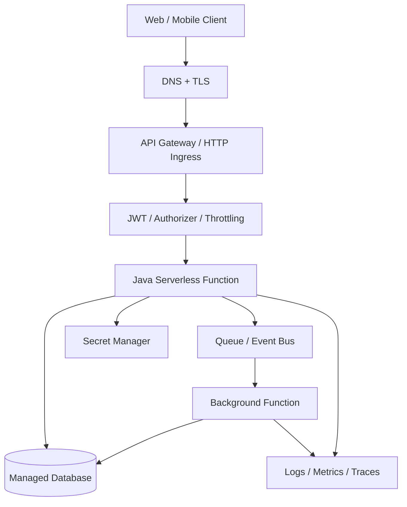

# Khai báo hạ tầng và cấu hình môi trường cho dự án API

Một Java serverless API không chỉ gồm handler nhận HTTP request. Để chạy được trên cloud, dự án còn cần API Gateway hoặc HTTP ingress, function runtime, quyền truy cập, database, secret, log, metric, alarm, network và cấu hình riêng cho từng môi trường. Nếu tạo các resource thủ công hoặc để cấu hình nằm rải rác trong source code, môi trường dev, staging và production dễ lệch nhau, khó tái tạo và khó kiểm tra trước khi release.

Cách quản lý bền vững là khai báo hạ tầng bằng **Infrastructure as Code (IaC)**, tách cấu hình không bí mật khỏi secret, tham số hóa các giá trị khác nhau theo môi trường và triển khai cùng một artifact đã kiểm thử qua các môi trường. Với Java serverless API, IaC mô tả resource graph và quyền truy cập; ứng dụng Java đọc cấu hình runtime đã được inject; pipeline kiểm tra template, tạo deployment plan, triển khai và xác minh kết quả.

## 1. Hạ tầng của một Java serverless API gồm những gì?

Một API quản lý công việc đơn giản có thể có các thành phần:

- HTTP API Gateway nhận request, định tuyến và áp dụng authentication/throttling.
- Java function xử lý business logic.
- Database lưu task và metadata.
- Secret manager lưu credential của hệ thống ngoài nếu có.
- IAM role/service identity cấp quyền tối thiểu cho function.
- Log group, metrics, tracing và alarms phục vụ vận hành.
- Queue hoặc event bus cho tác vụ bất đồng bộ nếu API cần xử lý nền.
- DNS, custom domain, certificate, WAF hoặc private networking theo yêu cầu.



Không phải dự án nào cũng cần tất cả thành phần. Chỉ thêm queue, VPC, NAT Gateway, WAF hoặc nhiều database khi có yêu cầu cụ thể. Mỗi resource mới làm tăng chi phí, quyền cần quản lý và bề mặt vận hành.

### Resource graph và dependency

IaC mô tả resource và quan hệ phụ thuộc. Ví dụ function cần tên bảng database, execution role cần ARN của bảng, API route cần function integration và alarm cần metric của function. Một deployment đúng phải tạo resource theo dependency và cung cấp output cần thiết cho bước tiếp theo.

Phân biệt:

- **Resource:** một đối tượng cloud có vòng đời riêng, như function, API, table hoặc queue.
- **Configuration:** giá trị điều khiển cách resource hoạt động, như timeout, memory, concurrency hoặc stage.
- **Output:** thông tin được xuất sau deploy, như API URL, function ARN hoặc table name.
- **Secret:** credential hoặc key cần kiểm soát truy cập và rotation.
- **Runtime configuration:** giá trị ứng dụng Java cần đọc khi function khởi tạo hoặc xử lý request.

## 2. Infrastructure as Code là gì?

Infrastructure as Code mô tả hạ tầng bằng file có thể version control, review, validate và triển khai lặp lại. Thay vì nhấn nút tạo từng resource trên console, nhóm phát triển khai báo trạng thái mong muốn trong template hoặc code.

IaC giúp:

- Tái tạo dev, staging và production từ cùng một cấu trúc.
- Review thay đổi hạ tầng qua pull request.
- Kiểm tra quyền IAM, network và cấu hình trước khi deploy.
- Tạo môi trường thử nghiệm có thể xóa hoặc tái tạo.
- Theo dõi thay đổi, drift và lịch sử release.
- Giảm thao tác thủ công và cấu hình không nhất quán.

IaC không tự bảo đảm an toàn. Một template có thể khai báo quyền quá rộng, public database hoặc xóa nhầm resource stateful. Cần review plan/diff, policy check, backup/retention và quyền deploy riêng.

### Chọn công cụ theo nền tảng

| Công cụ | Phạm vi thường dùng | Ghi chú |
|---|---|---|
| AWS SAM / CloudFormation | AWS Lambda, API Gateway, DynamoDB, SQS và resource AWS | SAM bổ sung cú pháp serverless trên CloudFormation |
| AWS CDK | Khai báo AWS infrastructure bằng Java, TypeScript, Python và ngôn ngữ hỗ trợ | Sinh CloudFormation; cần review synthesized template |
| Terraform | Nhiều cloud/provider, resource và dịch vụ ngoài cloud | Quản lý state, locking, provider version và plan |
| Azure Bicep / ARM | Azure Functions, API Management, Service Bus, Storage và Azure resources | Bicep là ngôn ngữ khai báo biên dịch thành ARM template |
| Google Cloud Terraform / deployment tooling | Cloud Run/Functions, API Gateway, Pub/Sub, IAM và GCP resources | Quản lý project, region, API enablement và IAM |

Chọn một công cụ chính cho một phạm vi hạ tầng để tránh nhiều hệ thống cùng quản lý một resource. Nếu dùng CDK, SAM và Terraform trong cùng tổ chức, xác định ranh giới sở hữu resource rõ ràng.

## 3. Cấu trúc thư mục cho dự án

Một cấu trúc có thể tách source Java, IaC và cấu hình triển khai:

```text
java-serverless-api/
├── src/
│   ├── main/java/com/example/api/
│   └── test/java/com/example/api/
├── infra/
│   ├── template.yaml
│   ├── parameters/
│   │   ├── dev.json
│   │   ├── staging.json
│   │   └── prod.json
│   └── policies/
├── config/
│   └── application-local.yml
├── scripts/
│   ├── deploy.ps1
│   └── smoke-test.ps1
├── pom.xml
└── README.md
```

Đây là ví dụ tổ chức source, không phải yêu cầu phải dùng đúng tên thư mục. Điều quan trọng là:

- IaC có thể được validate độc lập.
- Cấu hình môi trường không chứa secret plaintext.
- File local không vô tình được đóng gói vào production artifact.
- Pipeline biết rõ template, artifact và parameter set của từng môi trường.
- Các resource stateful có lifecycle/retention policy rõ ràng.

Không tạo thêm một bản source code riêng cho từng môi trường. Khác biệt môi trường nên đi qua parameter/configuration và policy được kiểm soát.

## 4. Tách môi trường dev, staging và production

Mỗi môi trường phục vụ mục đích khác nhau:

| Môi trường | Mục đích | Dữ liệu và quyền |
|---|---|---|
| Dev | Phát triển nhanh, kiểm tra tích hợp | Dữ liệu giả/synthetic, quyền giới hạn, có thể tạo và xóa resource thường xuyên |
| Staging | Kiểm thử gần production, migration và smoke test | Cấu hình gần production, dữ liệu đã mask hoặc synthetic, quyền deploy có kiểm soát |
| Production | Phục vụ người dùng thật | Dữ liệu thật, quyền tối thiểu, backup/retention, approval và audit |

### Cô lập ở cấp account/project/subscription

Khi có thể, dùng AWS account, Azure subscription hoặc Google Cloud project riêng cho từng môi trường quan trọng. Cô lập account/project giúp tách:

- IAM principal và permission boundary.
- Quota, billing và budget.
- Network, secret và encryption key.
- Audit log và resource policy.
- Blast radius khi dev bị cấu hình sai.

Chỉ đổi tên stack thành `prod` trong cùng account không tạo ra ranh giới bảo mật tương đương. Nếu tổ chức buộc phải dùng chung account, phải tách role, resource naming, network, secret path và policy theo môi trường.

### Region và availability

Chọn region theo latency người dùng, data residency, dịch vụ hỗ trợ, quota và chi phí. Các resource liên kết như function, API, database, secret và queue thường cần được đặt ở region tương thích. Không giả định quota, secret, IAM resource hoặc endpoint ở region này tự tồn tại ở region khác.

## 5. Phân loại cấu hình: default, environment, secret và feature flag

Không phải mọi giá trị đều nên được xử lý giống nhau.

| Loại | Ví dụ | Nơi quản lý phù hợp |
|---|---|---|
| Default không nhạy cảm | Page size mặc định, tên operation | Code hoặc config mặc định có version |
| Environment configuration | Stage, log level, table name, API base URL | IaC parameter, environment variable hoặc config service |
| Secret | Password, OAuth client secret, API key, private key | Secret Manager/Key Vault/Secret Manager của cloud |
| Feature flag | Bật endpoint mới, chuyển traffic theo tenant | Feature flag service hoặc config có audit |
| Dynamic operational setting | Tạm giảm concurrency nghiệp vụ, giới hạn batch | Config service có cache/refresh và quyền thay đổi riêng |

Một quy tắc đơn giản:

- Giá trị không bí mật, ít thay đổi và cần biết ngay lúc khởi động có thể được inject qua environment variable.
- Secret phải được lấy từ secret store hoặc cơ chế identity được quản lý; không commit vào repository hay template.
- Feature flag có thể cần thay đổi không deploy lại; tách khỏi config bất biến của deployment.
- Giá trị lớn hoặc cấu hình phức tạp nên dùng config service có version thay vì nhồi vào environment variable.

### Tránh hard-code theo môi trường

Không viết kiểu:

```java
String tableName = "tasks-prod";
String apiUrl = "https://api.example.com";
```

trong business logic. Cấu hình phải được inject từ runtime/deployment. Code không nên tự đoán production dựa trên hostname, tên branch hoặc một biến boolean không được validate.

## 6. Quy tắc đặt tên và tagging resource

Tên resource nên giúp xác định service, môi trường, vùng chức năng và owner. Ví dụ:

```text
tasks-api-dev
tasks-api-staging
tasks-api-prod
tasks-table-prod
tasks-events-prod
```

Không phải resource nào cũng cho phép cùng ký tự hoặc độ dài. Dùng naming convention phù hợp từng provider và tránh đưa email, customer name hoặc thông tin nhạy cảm vào tên resource.

Tag/label hữu ích:

| Tag | Ví dụ | Mục đích |
|---|---|---|
| `service` | `tasks-api` | Nhóm resource theo dịch vụ |
| `environment` | `prod` | Phân biệt môi trường |
| `owner` | `platform-team` | Xác định nhóm chịu trách nhiệm |
| `cost-center` | `cc-042` | Phân bổ chi phí |
| `managed-by` | `sam` / `terraform` | Xác định công cụ quản lý |
| `data-classification` | `confidential` | Áp dụng chính sách dữ liệu |

Tag không thay thế IAM hoặc resource policy. Một tag `environment=dev` không tự ngăn principal dev đọc dữ liệu production nếu policy không kiểm soát.

## 7. Khai báo AWS serverless API bằng AWS SAM

AWS SAM mở rộng CloudFormation để mô tả Lambda function, API event và các resource serverless. Template được version control cùng source code; parameter truyền giá trị theo môi trường.

Ví dụ sau khai báo HTTP API có JWT authorizer, Java Lambda function và DynamoDB table. Đây là template minh họa cho một API đọc task; cần điều chỉnh runtime, route, schema, IAM và quota theo dự án thật.

```yaml
AWSTemplateFormatVersion: '2010-09-09'
Transform: AWS::Serverless-2016-10-31
Description: Java serverless Tasks API

Parameters:
  EnvironmentName:
    Type: String
    AllowedValues:
      - dev
      - staging
      - prod
  JwtIssuer:
    Type: String
  JwtAudience:
    Type: String
  FunctionConcurrency:
    Type: Number
    Default: 50

Globals:
  Function:
    Runtime: java21
    Architectures:
      - arm64
    MemorySize: 1024
    Timeout: 10
    Tracing: Active
    Environment:
      Variables:
        APP_ENV: !Ref EnvironmentName
        LOG_LEVEL: INFO

Resources:
  TasksTable:
    Type: AWS::DynamoDB::Table
    DeletionPolicy: Retain
    UpdateReplacePolicy: Retain
    Properties:
      TableName: !Sub '${EnvironmentName}-tasks'
      BillingMode: PAY_PER_REQUEST
      AttributeDefinitions:
        - AttributeName: pk
          AttributeType: S
        - AttributeName: sk
          AttributeType: S
      KeySchema:
        - AttributeName: pk
          KeyType: HASH
        - AttributeName: sk
          KeyType: RANGE
      SSESpecification:
        SSEEnabled: true
      PointInTimeRecoverySpecification:
        PointInTimeRecoveryEnabled: true

  TasksHttpApi:
    Type: AWS::Serverless::HttpApi
    Properties:
      StageName: !Ref EnvironmentName
      Auth:
        Authorizers:
          JwtAuthorizer:
            JwtConfiguration:
              issuer: !Ref JwtIssuer
              audience:
                - !Ref JwtAudience
            IdentitySource: "$request.header.Authorization"

  TasksFunction:
    Type: AWS::Serverless::Function
    Properties:
      CodeUri: target/function.zip
      Handler: com.example.api.TasksHandler
      ReservedConcurrentExecutions: !Ref FunctionConcurrency
      Environment:
        Variables:
          TASKS_TABLE_NAME: !Ref TasksTable
      Policies:
        - Statement:
            - Effect: Allow
              Action:
                - dynamodb:GetItem
                - dynamodb:PutItem
                - dynamodb:UpdateItem
                - dynamodb:Query
              Resource: !GetAtt TasksTable.Arn
      Events:
        ListTasks:
          Type: HttpApi
          Properties:
            ApiId: !Ref TasksHttpApi
            Path: /tasks
            Method: GET
            Auth:
              Authorizer: JwtAuthorizer

Outputs:
  ApiUrl:
    Description: Base URL of the HTTP API
    Value: !Sub 'https://${TasksHttpApi}.execute-api.${AWS::Region}.amazonaws.com/${EnvironmentName}'
  TasksTableName:
    Description: DynamoDB table name
    Value: !Ref TasksTable
  TasksFunctionArn:
    Description: Lambda function ARN
    Value: !GetAtt TasksFunction.Arn
```

### Đọc template theo từng phần

- `Parameters` khai báo giá trị cần cung cấp khi deploy, như environment, JWT issuer/audience và concurrency.
- `Globals` đặt cấu hình chung cho function để tránh lặp runtime, memory, timeout và tracing.
- `TasksTable` khai báo database, encryption và point-in-time recovery. `DeletionPolicy: Retain` giúp tránh xóa dữ liệu khi stack bị xóa; cần có quy trình lifecycle/cleanup riêng cho môi trường thử nghiệm.
- `TasksHttpApi` khai báo HTTP API và JWT authorizer.
- `TasksFunction` khai báo artifact, handler, concurrency, environment variable và IAM policy.
- `Events` nối route `GET /tasks` tới function và yêu cầu authorizer.
- `Outputs` cung cấp URL, table name và ARN cho smoke test hoặc stack phụ thuộc.

### Lưu ý khi dùng template trong dự án thật

- `java21` và `arm64` phải được hỗ trợ bởi runtime/provider và dependency native của artifact. Nếu dùng thư viện native không hỗ trợ ARM64, chọn kiến trúc phù hợp.
- `CodeUri` phải trỏ đến package được build đúng cấu trúc; pipeline cần tạo artifact trước khi `sam build/deploy`.
- JWT issuer/audience phải khớp identity provider thực tế; không dùng giá trị dev cho production.
- `ReservedConcurrentExecutions` phải nằm trong quota account/region và phù hợp khả năng database.
- IAM policy trong ví dụ chỉ là quyền cho thao tác minh họa. Nếu dùng GSI, stream, KMS customer-managed key hoặc secret, cần resource/action tương ứng.
- Không đặt secret plaintext trong `Parameters`, `Environment` hoặc template. Truyền ARN/reference tới secret store và cấp quyền đọc riêng khi function thực sự cần.
- `DeletionPolicy: Retain` không thay thế backup, restore test hoặc data retention policy.

## 8. Cấu hình môi trường cho từng deployment

Template nên giữ cấu trúc resource giống nhau, còn giá trị môi trường được cung cấp qua parameter set. Ví dụ:

| Parameter | Dev | Staging | Production |
|---|---|---|---|
| `EnvironmentName` | `dev` | `staging` | `prod` |
| `JwtIssuer` | issuer sandbox | issuer staging | issuer production |
| `JwtAudience` | `tasks-api-dev` | `tasks-api-staging` | `tasks-api` |
| `FunctionConcurrency` | 5 | 20 | Theo load test/quota |
| Log level | DEBUG/INFO | INFO | INFO/WARN |
| Data | Synthetic | Masked/synthetic | Production data |

Các giá trị trong bảng chỉ minh họa. Production concurrency không được suy ra từ dev; cần tính peak traffic, database capacity, downstream limits và quota.

### samconfig.toml

AWS SAM CLI có thể lưu cấu hình deploy theo environment trong `samconfig.toml`. File này phù hợp cho non-secret parameters, stack name, region và cách deploy. Không đưa access key, password hoặc secret value vào file.

Ví dụ cấu trúc đơn giản:

```toml
version = 0.1

[dev.deploy.parameters]
stack_name = "tasks-api-dev"
region = "ap-southeast-1"
capabilities = "CAPABILITY_IAM"
parameter_overrides = "EnvironmentName=dev JwtIssuer=https://identity-dev.example.com JwtAudience=tasks-api-dev FunctionConcurrency=5"

[staging.deploy.parameters]
stack_name = "tasks-api-staging"
region = "ap-southeast-1"
capabilities = "CAPABILITY_IAM"
parameter_overrides = "EnvironmentName=staging JwtIssuer=https://identity-staging.example.com JwtAudience=tasks-api-staging FunctionConcurrency=20"
```

Production có thể được cấu hình trong pipeline secret/variable store và cần approval. Không commit production credentials. Nếu `samconfig.toml` chứa account/region/parameter không nhạy cảm, vẫn cần review để tránh deploy nhầm account hoặc region.

## 9. Environment variable trong Java

Java function nên đọc cấu hình qua một lớp tập trung, validate khi khởi tạo và truyền vào service. Tránh gọi `System.getenv()` rải rác trong business logic.

Ví dụ:

```java
import java.util.Map;
import java.util.Set;

public record ApiConfig(
        String environment,
        String tasksTableName,
        String logLevel) {

    private static final Set<String> ALLOWED_ENVIRONMENTS =
            Set.of("dev", "staging", "prod");

    public static ApiConfig from(Map<String, String> env) {
        String environment = required(env, "APP_ENV");
        if (!ALLOWED_ENVIRONMENTS.contains(environment)) {
            throw new IllegalStateException("Unsupported APP_ENV");
        }

        String tableName = required(env, "TASKS_TABLE_NAME");
        String logLevel = env.getOrDefault("LOG_LEVEL", "INFO");
        if (!Set.of("TRACE", "DEBUG", "INFO", "WARN", "ERROR")
                .contains(logLevel.toUpperCase())) {
            throw new IllegalStateException("Invalid LOG_LEVEL");
        }
        return new ApiConfig(environment, tableName, logLevel.toUpperCase());
    }

    private static String required(Map<String, String> env, String key) {
        String value = env.get(key);
        if (value == null || value.isBlank()) {
            throw new IllegalStateException("Missing configuration: " + key);
        }
        return value;
    }
}
```

Trong Lambda, có thể tạo config một lần ở initialization phase:

```java
public final class TasksHandler {
    private static final ApiConfig CONFIG = ApiConfig.from(System.getenv());
    // Reuse thread-safe SDK clients; keep request data out of static fields.
}
```

Validate cấu hình sớm giúp deployment lỗi được phát hiện trước khi xử lý request nghiệp vụ. Tuy nhiên, exception message chỉ nên nêu tên key thiếu/sai, không in giá trị secret. Với môi trường có thể thay config động, dùng config service có version và refresh policy thay vì kỳ vọng environment variable tự thay đổi trong execution environment đang chạy.

## 10. Secret management

Secret là dữ liệu nhạy cảm như database password, OAuth client secret, webhook signing key, API token hoặc private key. Không lưu secret trong:

- Git repository, commit history hoặc pull request.
- Dockerfile, JAR resource, `application.yml` đóng gói vào artifact.
- IaC parameter plaintext hoặc output của stack.
- Environment variable chứa trực tiếp password/token nếu có thể dùng secret reference.
- Log, exception message, metric label hoặc command line có thể bị ghi lại.

### Dùng secret manager

| Cloud | Dịch vụ thường dùng |
|---|---|
| AWS | Secrets Manager, Systems Manager Parameter Store (SecureString) |
| Azure | Key Vault |
| Google Cloud | Secret Manager |

Function nên dùng execution role/service identity để lấy secret. Cấp quyền đúng secret ARN/resource và đúng action. Không dùng access key tĩnh trong environment variable nếu provider có managed identity/role.

### Lưu ARN/reference thay vì secret value

Ví dụ environment variable:

```text
PAYMENT_PROVIDER_SECRET_ARN=arn:aws:secretsmanager:ap-southeast-1:123456789012:secret:tasks/prod/payment-abc
```

ARN không phải secret value, nhưng vẫn có thể tiết lộ tên resource và account. Chỉ cho phép principal cần thiết đọc metadata/secret. Function dùng Secrets Manager SDK với execution role để lấy giá trị khi cần.

### Rotation và cache

Secret có thể được rotate. Nếu function cache secret trong memory để giảm API call, đặt TTL phù hợp, xử lý refresh failure và không giữ credential cũ vô thời hạn. Với connection pool, rotation có thể yêu cầu tạo connection mới hoặc refresh credential trước khi reconnect. Không ghi secret vào log khi refresh thất bại.

## 11. IAM và service identity

Mỗi function nên có execution role/service account riêng hoặc một nhóm quyền rất nhỏ theo workload. Quyền cần được xác định từ thao tác thực tế:

- Đọc/ghi đúng bảng hoặc collection cần dùng.
- Đọc đúng secret ARN nếu function cần credential.
- Gửi message tới đúng queue/topic.
- Ghi log/trace theo cơ chế platform.
- Giải mã bằng đúng KMS key nếu dùng customer-managed key.

Tránh policy `*` cho action hoặc resource nếu có thể giới hạn. Tách:

- **Identity policy:** principal được phép làm gì với resource.
- **Resource policy:** resource cho phép principal nào truy cập.
- **Trust policy:** identity nào được phép assume role hoặc impersonate service account.
- **Permission boundary/organization policy:** giới hạn tối đa quyền có thể cấp.

Không dùng cùng một role admin để deploy và chạy function. Deployment principal có quyền tạo/sửa resource; runtime identity chỉ có quyền phục vụ request. CI/CD nên assume role qua federation/OIDC khi nền tảng hỗ trợ thay vì lưu long-lived cloud access key.

## 12. Cấu hình API Gateway và authentication

IaC nên khai báo API route, authorizer, CORS, throttling và access logging. Những thiết lập này là một phần của API contract và security posture.

### Authentication và authorization

- JWT authorizer/OIDC xác minh token ở gateway khi phù hợp.
- Function vẫn phải kiểm tra quyền trên resource và tenant; token hợp lệ không đồng nghĩa user được truy cập mọi task.
- IAM authorization phù hợp cho service-to-service trên nền tảng hỗ trợ.
- API key chủ yếu dùng nhận diện/quota client theo contract, không nên thay thế user authentication.
- Resource policy/private API/network policy dùng để giới hạn nguồn truy cập khi cần.

### CORS

CORS là chính sách browser cho cross-origin request, không phải cơ chế authentication. Chỉ khai báo origin, method và header cần thiết. Tránh `*` khi API dùng credential hoặc cần giới hạn origin cụ thể. CORS không ngăn client ngoài browser gọi API.

### Throttling và payload

Khai báo request rate/burst phù hợp quota và downstream capacity. Đặt payload limit, timeout và access log. Nếu API nhận request lớn, cân nhắc upload trực tiếp lên object storage bằng presigned URL thay vì truyền toàn bộ bytes qua Lambda.

## 13. Database, queue và network configuration

### Database

- Dùng encryption at rest và TLS in transit.
- Cấu hình backup/PITR, retention và deletion policy.
- Tách database/schema/table theo môi trường.
- Chỉ cấp function quyền tới resource cần thiết.
- Quản lý connection pool theo concurrency và giới hạn database.
- Dùng migration có version; không tự động chạy destructive migration từ mọi cold start.

### Queue và event bus

- Khai báo retention, visibility/lock timeout, DLQ và retry policy.
- Cấp quyền producer/consumer theo queue/topic cụ thể.
- Cấu hình batch size, batch window và maximum concurrency theo latency budget.
- Thiết kế message schema có version, event ID và correlation ID.
- Bảo đảm consumer idempotent vì delivery có thể lặp.

### Network

Không đưa function vào VPC/VNet chỉ vì đó là mặc định của một template cũ. Private networking có ích khi cần truy cập database/private service, nhưng có thể thêm complexity, IP/subnet capacity, NAT cost và routing.

Nếu function cần VPC:

- Chọn private subnets đủ IP và availability zones phù hợp.
- Security group chỉ mở outbound/inbound cần thiết.
- Dùng VPC endpoints/private endpoints cho service phù hợp để giảm đường ra Internet/NAT.
- Kiểm tra DNS, route table, NAT, firewall và egress policy.
- Theo dõi connection count và ephemeral port exhaustion.

Không đặt database public chỉ để function kết nối dễ hơn. Hãy thiết kế network path an toàn và kiểm tra kết nối từ runtime thực tế.

## 14. Cấu hình quan sát và cảnh báo bằng IaC

Log, metric và alarm nên được khai báo cùng function để tránh triển khai xong mới phát hiện không có dữ liệu vận hành.

Tối thiểu cần:

- Structured log có timestamp, service, environment, request ID, correlation ID và outcome.
- Error count, duration, throttles và concurrent executions.
- API 4xx/5xx, latency và integration errors.
- Queue depth/oldest message age nếu có async processing.
- Database throttling/connection saturation.
- Alarm theo SLO, không chỉ theo một ngưỡng CPU/memory.
- Log retention và encryption phù hợp data classification.

Tránh log request body hoặc secret. Đặt retention khác nhau theo môi trường và quy định; dev có thể ngắn hơn production nhưng phải phù hợp điều tra và compliance.

## 15. Cấu hình quota, concurrency và chi phí

Hạ tầng cần khai báo giới hạn có chủ đích:

- Reserved/max concurrency để bảo vệ downstream.
- Provisioned/minimum capacity nếu SLO yêu cầu latency ổn định.
- API Gateway throttling để kiểm soát burst.
- Queue event source maximum concurrency để điều tiết worker.
- Database capacity/connection limit.
- Log retention, tracing sampling và storage lifecycle.

Không đặt concurrency cao chỉ để function scale nhanh. Ví dụ 100 Lambda instance, mỗi instance có connection pool 10, có thể tạo đến 1.000 connection nếu tất cả đều mở pool đầy đủ. Tính concurrency × connection per instance và so với quota database.

Tag resource theo service, environment, owner và cost center. Thiết lập budget/alert theo account/project/subscription. Theo dõi cost per successful request, bao gồm retry và downstream cost, thay vì chỉ nhìn số invocation.

## 16. Terraform và quản lý state

Nếu dự án dùng Terraform, các environment nên có state backend riêng hoặc key/state boundary được thiết kế rõ, có locking và versioning. Không lưu state chứa secret trong repository.

Ví dụ cấu trúc:

```text
infra/terraform/
├── modules/
│   ├── api-function/
│   ├── http-api/
│   └── data-store/
└── environments/
    ├── dev/
    │   ├── main.tf
    │   └── terraform.tfvars
    ├── staging/
    └── prod/
```

Ví dụ variable và local:

```hcl
variable "environment" {
  type = string
  validation {
    condition     = contains(["dev", "staging", "prod"], var.environment)
    error_message = "environment must be dev, staging, or prod."
  }
}

variable "function_memory_mb" {
  type    = number
  default = 1024
}

locals {
  service_name = "tasks-api"
  resource_name = "${local.service_name}-${var.environment}"
}
```

Các lệnh thường dùng:

```bash
terraform fmt -check
terraform validate
terraform plan -var-file=environments/staging/terraform.tfvars
terraform apply -var-file=environments/staging/terraform.tfvars
```

Luôn review plan trước apply production. Dùng remote backend có encryption, access control, versioning và state locking. Terraform workspace chỉ là một cơ chế chọn state; không tự tạo ranh giới bảo mật/account tương đương môi trường cô lập.

## 17. Azure Bicep và Google Cloud

Các nguyên tắc giống nhau dù cú pháp khác:

### Azure Bicep

- Dùng parameter cho location, environment, SKU và resource naming.
- Dùng Key Vault reference/managed identity cho secret.
- Phân quyền qua managed identity và role assignment tối thiểu.
- Dùng deployment scope phù hợp: resource group, subscription hoặc management group.
- Dùng `what-if` để xem thay đổi trước deployment.
- Tách subscription/management group cho production theo governance của tổ chức.

### Google Cloud

- Dùng project riêng cho môi trường quan trọng.
- Bật API cần thiết trong project qua IaC/bootstrap có kiểm soát.
- Dùng service account riêng cho Cloud Run/Functions và IAM binding theo resource.
- Dùng Secret Manager và Workload Identity/managed identity tương ứng; không nhúng service account key vào artifact.
- Parameterize region, service account, concurrency, memory, ingress và scaling.
- Dùng Terraform plan hoặc công cụ deployment phù hợp để review thay đổi.

Không sao chép nguyên một IAM role hay network policy từ AWS sang Azure/GCP; mapping cần dựa trên mô hình identity và resource policy của provider.

## 18. Local development và environment parity

Local development cần mô phỏng contract của runtime nhưng không nhất thiết dựng toàn bộ cloud infrastructure cho mỗi lần chạy.

Các lựa chọn:

- Chạy Java handler/controller trực tiếp với environment variables local.
- AWS SAM local để invoke function/API với event mẫu.
- LocalStack hoặc emulator phù hợp khi cần kiểm tra tương tác service.
- Testcontainers cho database, queue hoặc dependency hỗ trợ container.
- Mock server cho external API và identity provider.

File `application-local.yml` hoặc `.env.local` chỉ dùng cho local và phải nằm trong `.gitignore`. Không copy secret production về máy developer. Dùng sandbox account hoặc secret local riêng có quyền hạn nhỏ.

Environment parity có nghĩa là giữ contract, schema và resource behavior đủ gần nhau để phát hiện lỗi, không phải dùng cùng kích thước database hay quota ở mọi môi trường. Dev có thể nhỏ hơn nhưng cần ghi rõ khác biệt có ảnh hưởng đến kết quả test.

## 19. CI/CD: validate, plan, deploy và promote artifact

Pipeline nên kiểm tra cả code Java lẫn IaC:

1. Compile và unit test Java.
2. Package artifact và tạo checksum/digest.
3. Validate IaC syntax/schema và lint.
4. Scan dependency, secret, container image và IaC misconfiguration.
5. Tạo deployment plan/diff cho đúng environment.
6. Review IAM, public exposure, data deletion và resource replacement.
7. Deploy dev tự động; chạy integration/smoke test.
8. Promote cùng artifact digest sang staging và production.
9. Production có approval và deployment identity riêng.
10. Theo dõi health, alarms và rollback/roll-forward plan.

### AWS SAM command ví dụ

```bash
mvn clean package
sam validate --lint
sam build
sam deploy --config-env dev
sam local start-api
```

Các lệnh cần chạy trong project đã cấu hình đúng `template.yaml`, build artifact, AWS profile/role và `samconfig.toml`. `sam deploy --config-env dev` chọn phần cấu hình deploy tương ứng; pipeline production cần assume role đúng account và cung cấp parameter đã review.

### Promote cùng artifact

Không build lại source độc lập cho từng environment nếu muốn bảo đảm binary đã test chính là binary chạy production. Build một artifact bất biến, lưu digest và promote qua dev → staging → production. Environment-specific values được inject khi deploy/runtime, không compile vào JAR.

### Approval và quyền deploy

Tách role deploy dev và production. Pipeline production chỉ được chạy từ branch/tag hoặc workflow đã bảo vệ, có review và approval. Không để developer role có quyền tùy ý sửa production IAM hoặc xóa database.

## 20. Drift detection và thay đổi ngoài IaC

Configuration drift xảy ra khi resource trên cloud khác với khai báo trong repository, ví dụ ai đó sửa timeout trên console, thêm quyền IAM hoặc đổi API route thủ công.

Quy trình xử lý:

- Phát hiện drift bằng CloudFormation drift detection, Terraform refresh/plan hoặc công cụ tương ứng.
- Xác định thay đổi có chủ ý hay ngoài quy trình.
- Nếu cần giữ thay đổi, cập nhật IaC và review.
- Nếu không được phép, reconcile resource về trạng thái khai báo sau khi đánh giá tác động.
- Ghi audit trail, owner và lý do thay đổi.

Không chạy apply/reconcile mù quáng khi có drift ở database hoặc resource stateful. Một plan có thể đề xuất replace resource và gây mất dữ liệu nếu lifecycle policy sai.

## 21. Migration và lifecycle của resource stateful

Function có thể được thay thế nhanh, nhưng database, queue và object storage thường chứa dữ liệu dài hạn. Tách lifecycle:

- Stateless resources: function version, API deployment, temporary log/test resource có thể replace thường xuyên.
- Stateful resources: database/table, bucket, queue có message cần giữ, encryption key và secret có rotation/retention.

Với schema change, dùng expand-contract:

1. Thêm field/index tương thích với code cũ.
2. Deploy code có thể đọc schema cũ và mới.
3. Backfill dữ liệu nếu cần.
4. Chuyển ghi/đọc sang schema mới.
5. Chỉ xóa field cũ sau khi tất cả function/version đã chuyển.

Không chạy destructive migration tự động trong static initializer hoặc mỗi Lambda cold start. Dùng migration job có quyền riêng, lock và audit. Production database cần backup/PITR và thử restore định kỳ.

## 22. Kiểm thử cấu hình và hạ tầng

Các lớp kiểm thử hữu ích:

| Kiểm thử | Mục tiêu |
|---|---|
| IaC lint/validate | Phát hiện syntax và schema sai |
| Policy-as-code | Phát hiện wildcard IAM, public resource hoặc encryption thiếu |
| Template unit test | Kiểm tra resource, route, env var, policy và output được khai báo |
| Integration test | Xác minh function truy cập đúng database/queue/secret |
| Environment smoke test | Kiểm tra API URL, authentication, route và health sau deploy |
| Negative security test | Principal không có quyền phải bị từ chối |
| Drift test | Xác minh resource thực tế phù hợp IaC |
| Recovery test | Kiểm tra backup/restore và rollback tương thích |

Test template nên kiểm tra cả việc không cấp quyền ngoài ý muốn. Ví dụ function đọc bảng tasks không nên có quyền `dynamodb:*` trên mọi resource.

## 23. Lỗi cấu hình thường gặp

| Lỗi | Hậu quả | Cách khắc phục |
|---|---|---|
| Hard-code endpoint/table name | Deploy sai môi trường hoặc khó tái sử dụng | Parameterize và inject config |
| Commit secret vào IaC | Lộ credential qua Git/state/log | Secret manager và runtime identity |
| Dùng chung account/role mọi môi trường | Tăng blast radius và rủi ro deploy nhầm | Tách account/project/role |
| IAM `*` cho nhanh | Function có quyền vượt nhu cầu | Least privilege theo action/resource |
| VPC không cần thiết | Tăng network complexity và cost | Chỉ dùng private networking khi có requirement |
| Concurrency không xét database | Connection exhaustion/throttling | Tính concurrency × pool size và đặt cap |
| Deploy template không review plan | Replace/xóa resource hoặc public exposure | Review diff, backup và approval |
| Build lại artifact mỗi môi trường | Binary staging khác production | Promote cùng digest |
| Chỉ test từ IDE | Thiếu dependency/config trong deployment package | Test artifact đã build và runtime event thật |
| Không phát hiện drift | Console change làm môi trường lệch | Drift detection và IaC reconciliation |
| Xóa stack làm mất database | Mất dữ liệu production | Retain policy, backup và lifecycle riêng |
| Config động không có version | Khó tái hiện lỗi và rollback | Versioned config/feature flag audit |

## 24. Checklist trước khi deploy production

### IaC và môi trường

- [ ] Resource graph, dependency và output được khai báo trong IaC.
- [ ] Dev/staging/prod có parameter set riêng và account/project/subscription phù hợp.
- [ ] Region, naming, tags, quota và budget đã được xác định.
- [ ] Template đã lint/validate và deployment plan đã được review.
- [ ] Không có resource được quản lý đồng thời bởi nhiều IaC state.

### Configuration và secret

- [ ] Cấu hình không nhạy cảm được inject theo môi trường.
- [ ] Secret nằm trong Secret Manager/Key Vault và không xuất hiện trong Git/template/log.
- [ ] Runtime identity có quyền đọc đúng secret/resource.
- [ ] Java config được validate và lỗi không làm lộ giá trị nhạy cảm.
- [ ] Feature flag có owner, audit và quy trình rollback.

### Security và network

- [ ] IAM least privilege và trust policy được review.
- [ ] API auth, authorization theo tenant/resource và throttling đã cấu hình.
- [ ] CORS chỉ mở origin cần thiết; hiểu rằng CORS không phải authentication.
- [ ] Database/private service không public ngoài yêu cầu.
- [ ] Encryption, TLS, KMS và secret rotation đã được xác định.

### Reliability và operations

- [ ] Timeout, memory, concurrency và downstream capacity đã được load test.
- [ ] Backup/PITR, retention và deletion policy của stateful resource đã rõ.
- [ ] Logs, metrics, traces, alarms và log retention đã khai báo.
- [ ] Quota, budget và cost allocation tags đã được kiểm tra.
- [ ] CI/CD promote cùng artifact digest và production approval.
- [ ] Có smoke test, rollback/roll-forward và drift detection.

Khai báo hạ tầng và cấu hình môi trường giúp Java serverless API có thể triển khai lặp lại, kiểm tra được và vận hành nhất quán. Hãy mô tả resource graph bằng IaC, cô lập môi trường theo account/project khi phù hợp, inject cấu hình không bí mật, lấy secret từ secret manager, cấp IAM tối thiểu và kiểm tra quota/network/dependency trước khi release. Khi pipeline validate template, review plan, promote cùng artifact và theo dõi drift, nhóm phát triển có thể mở rộng API mà vẫn kiểm soát được bảo mật, độ tin cậy và chi phí.
