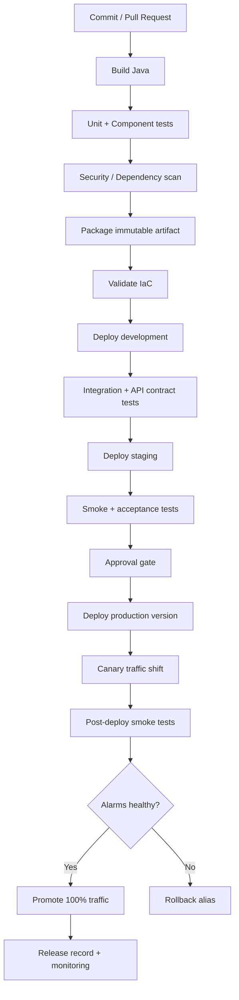

# Tạo pipeline triển khai API và smoke test sau phát hành

## 1. Vì sao API serverless cần pipeline triển khai?

Một Java API chạy trên AWS Lambda thường gồm nhiều thành phần: mã Java, dependency, Lambda function, API Gateway, IAM role, log/metric, queue hoặc database và cấu hình theo môi trường. Chỉ build được JAR không có nghĩa API đã sẵn sàng production. Một bản phát hành còn phải tạo/cập nhật hạ tầng, gắn đúng phiên bản Lambda vào API route, cấu hình quyền, kiểm tra endpoint sau deploy và có cách quay lại khi phát hiện lỗi.

Pipeline CI/CD tự động hóa các bước lặp lại từ commit đến production. Nó giúp mọi môi trường được triển khai theo cùng một quy trình, artifact có thể truy vết, thay đổi hạ tầng được review và lỗi sau phát hành được phát hiện sớm.

Smoke test là nhóm kiểm tra ngắn chạy sau deploy để xác nhận đường đi quan trọng thực sự hoạt động: DNS/API endpoint có truy cập được, xác thực hoạt động, Lambda được gọi, response có cấu trúc đúng và dependency thiết yếu có thể truy cập. Smoke test không thay thế unit test, integration test hay load test; nó là tín hiệu nhanh rằng bản phát hành mới không bị hỏng ở mức cơ bản.

Trong dự án CLOUD_SERVERLESS, pipeline nên triển khai Java function và API Gateway theo hướng immutable artifact, Infrastructure as Code (IaC), Lambda version/alias, rollout có kiểm soát, smoke test sau phát hành và rollback dựa trên alarm. Mục tiêu là phát hành lặp lại được, biết chính xác phiên bản nào đang phục vụ traffic và phát hiện lỗi trước khi mở rộng toàn bộ traffic.

## 2. Kiến trúc pipeline tham chiếu

Một pipeline điển hình có các giai đoạn:



Các bước có thể được thực hiện bằng GitHub Actions, AWS CodePipeline/CodeBuild hoặc hệ thống CI hiện có. Công cụ khác nhau nhưng contract nên giống nhau: một commit tạo một artifact xác định; artifact được kiểm thử trước khi promote; deploy và kiểm tra sau deploy có kết quả lưu lại.

## 3. Quy ước repository cho Java serverless API

Một cấu trúc repository đơn giản:

```text
orders-api/
├── src/
│   ├── main/java/com/example/orders/
│   └── test/java/com/example/orders/
├── template.yaml              # AWS SAM template
├── samconfig.toml             # deploy config theo môi trường, không chứa secret
├── scripts/
│   ├── smoke-test.sh
│   └── package-info.sh
├── .github/workflows/
│   └── deploy.yml
├── pom.xml
└── README.md
```

Repository thực tế có thể dùng Gradle, AWS CDK hoặc Terraform thay cho Maven/SAM. Quan trọng là code ứng dụng, hạ tầng và kiểm thử phát hành được version hóa, review và triển khai đồng bộ.

Không commit credential, access key, token, database password hoặc file cấu hình chứa secret. `samconfig.toml` chỉ nên chứa tên stack, Region, parameter không nhạy cảm và lựa chọn deploy.

## 4. Build Java artifact có thể tái lập

Build phải chạy từ commit đã xác định, dùng JDK/runtime tương thích với Lambda và khóa dependency versions. Ví dụ Maven:

```bash
mvn --batch-mode --no-transfer-progress clean verify
```

`verify` chạy các phase trước đó trong Maven lifecycle, gồm compile, test và các plugin được cấu hình trong project. Pipeline cần thất bại ngay nếu compile hoặc test lỗi.

Với Lambda Java, kiểm tra:

- JDK build version và Java runtime Lambda tương thích.
- Handler class/method đúng với cấu hình deployment.
- Dependency được đóng gói đầy đủ, không thiếu runtime library.
- Native library/JNI được build cho đúng Linux architecture.
- JAR/ZIP không chứa secret hoặc file test không cần thiết.
- Artifact có kích thước phù hợp và startup time được đo.
- Unit/integration test dùng cùng dependency versions với artifact deploy.

Nếu dùng Maven Shade Plugin hoặc Spring Boot packaging, kiểm tra manifest, service loader và resource merging. Một JAR chạy được trên máy developer chưa chắc chạy đúng trong Lambda nếu handler, classpath hoặc native dependency sai.

## 5. Chạy các lớp kiểm thử trước khi deploy

Không nên đợi smoke test production mới phát hiện lỗi code. Mỗi loại test có phạm vi khác nhau.

| Loại test | Kiểm tra gì? | Chạy ở đâu? |
|---|---|---|
| Unit test | Business logic, validation, mapping, state transition | Mỗi pull request |
| Component test | Handler/application service với dependency giả lập | Mỗi pull request |
| Contract test | Request/response schema, status code, event schema | Pull request và trước release |
| Integration test | IAM, Lambda, API Gateway, queue, database thật | Cloud sandbox hoặc ephemeral environment |
| End-to-end test | Một hành trình nghiệp vụ xuyên nhiều service | Staging hoặc môi trường kiểm thử riêng |
| Smoke test | Những đường đi cốt lõi sau deploy có hoạt động không | Sau mỗi deployment/canary |
| Load test | Throughput, latency, concurrency, throttling và cost | Trước release lớn/định kỳ |

Smoke test nên ngắn, ổn định và ít phụ thuộc dữ liệu. Một bộ smoke test chỉ gồm `GET /health` có thể bỏ sót lỗi auth, route mapping hoặc serialization; hãy chọn vài request đại diện cho API contract.

## 6. Kiểm tra dependency và bảo mật trong CI

Trước khi đóng gói artifact, pipeline nên thực hiện các kiểm tra phù hợp:

- Dependency vulnerability scan và kiểm tra license.
- Secret scanning trên source và artifact.
- Static analysis/lint theo quy ước project.
- Kiểm tra IaC policy: public resource, wildcard IAM, encryption và logging.
- Kiểm tra dependency tree để phát hiện version conflict.
- Container image scan nếu deploy bằng image.
- SBOM hoặc dependency manifest để truy vết thành phần đã build.

Không tự động bỏ qua mọi vulnerability chỉ vì build đang cần gấp. Dùng policy có severity, exception có owner/thời hạn và ghi nhận quyết định. Secret scan phải chạy trước khi artifact được upload hoặc deploy.

## 7. Artifact bất biến và truy vết release

Build một lần rồi promote cùng artifact qua dev, staging và production. Không build lại riêng cho production vì dependency resolution hoặc build environment có thể tạo ra artifact khác.

Lưu metadata cho mỗi artifact:

- Git commit SHA.
- Build run ID và thời điểm build.
- JAR/ZIP SHA-256 hoặc container image digest.
- Java/JDK version và dependency manifest.
- IaC template version.
- Test result và security scan summary.
- Release version/tag.

Ví dụ tạo checksum:

```bash
sha256sum target/orders-api.jar > target/orders-api.jar.sha256
```

Với container image, deploy bằng digest (`repository@sha256:...`) thay vì tag mutable như `latest`. Với Lambda ZIP, lưu package trong artifact store/S3 theo key có version hoặc hash và bật versioning/retention phù hợp.

Không rebuild artifact sau smoke test staging. Production phải nhận đúng bytes đã được kiểm thử, còn environment-specific configuration được truyền riêng khi deploy.

## 8. Infrastructure as Code cho API và Lambda

API Gateway, Lambda, IAM, log group, alarms, queue và permission nên được quản lý bằng IaC. AWS SAM là một lựa chọn phù hợp cho Lambda/API Gateway; CDK hoặc Terraform cũng có thể được dùng.

IaC giúp:

- Review thay đổi hạ tầng như review code.
- Tạo môi trường nhất quán.
- Lưu lịch sử thay đổi và tái tạo resource.
- Kiểm tra permission và configuration trước deploy.
- Tránh cấu hình thủ công khác nhau giữa staging và production.

Pipeline nên chạy lint/validate/template checks trước khi deploy. Ví dụ SAM:

```bash
sam validate --lint
sam build
```

`sam build` tạo thư mục build artifact theo template. Sau đó `sam deploy` dùng artifact đã build; không chỉnh tay resource production ngoài IaC nếu thay đổi đó không được đưa lại vào repository.

## 9. Ví dụ SAM template cho Java API và Lambda alias

Ví dụ rút gọn sau minh họa HTTP API, Java 21 function, published alias `live` và canary deployment. Alarm cần được định nghĩa trong stack và gắn vào deployment preference theo metric/SLO của hệ thống.

```yaml
AWSTemplateFormatVersion: '2010-09-09'
Transform: AWS::Serverless-2016-10-31
Description: Orders API - Java Lambda

Parameters:
  Environment:
    Type: String
    AllowedValues: [dev, staging, prod]

Resources:
  OrdersHttpApi:
    Type: AWS::Serverless::HttpApi
    Properties:
      StageName: '$default'

  OrdersFunction:
    Type: AWS::Serverless::Function
    Properties:
      FunctionName: !Sub 'orders-api-${Environment}'
      Runtime: java21
      Architectures:
        - arm64
      Handler: com.example.orders.OrderHandler::handleRequest
      CodeUri: .
      MemorySize: 1024
      Timeout: 15
      AutoPublishAlias: live
      DeploymentPreference:
        Type: Canary10Percent5Minutes
      Environment:
        Variables:
          APP_ENV: !Ref Environment
      Tracing: Active
      Events:
        Health:
          Type: HttpApi
          Properties:
            ApiId: !Ref OrdersHttpApi
            Path: /health/ready
            Method: GET
        GetOrder:
          Type: HttpApi
          Properties:
            ApiId: !Ref OrdersHttpApi
            Path: /v1/orders/{orderId}
            Method: GET
```

Đây là skeleton cần điều chỉnh theo project: `CodeUri: .` giả định `pom.xml` và source của function nằm ở repository root để SAM Java builder đóng gói; nếu project là multi-module, trỏ đến module chứa `pom.xml` tương ứng. `OrderHandler` trong ví dụ là class triển khai `RequestHandler<OrderRequest, OrderResponse>` và có method `handleRequest`. Với Spring Cloud Function hoặc AWS Serverless Java Container, entry point khác nhau.

`DeploymentPreference` dùng CodeDeploy để dịch chuyển traffic của alias theo cấu hình canary. Để tự động rollback, bổ sung CloudWatch alarms phù hợp và kiểm tra IAM/service role cho CodeDeploy. Không copy template vào production mà chưa review memory, timeout, architecture, permissions, logging, API auth, CORS và alarms.

## 10. Cấu hình theo môi trường

Các môi trường thường có `dev`, `staging` và `prod`. Chúng nên khác nhau ở account/Region, endpoint, quota, retention và mức bảo vệ; nhưng cùng dùng một template và artifact.

| Thành phần | Dev | Staging | Production |
|---|---|---|---|
| AWS account | Sandbox/dev account | Pre-production account | Production account |
| Data | Synthetic/test data | Masked hoặc synthetic gần thực tế | Business data |
| API auth | Test identity | Identity tương đương production | Auth chính thức |
| Lambda concurrency | Thấp, có giới hạn | Gần production cho test | Theo capacity plan |
| Logging | Debug có kiểm soát | Info/structured | Structured, retention theo policy |
| Alarms | Cơ bản | Đầy đủ để diễn tập | Paging theo SLO |
| Deployment | Tự động | Tự động sau tests | Approval + canary |

Không hardcode endpoint, account ID, database URL hoặc secret vào JAR. Dùng environment variables cho cấu hình không nhạy cảm và Secrets Manager/Parameter Store cho secret. Mỗi environment có secret/resource riêng; không sao chép production secret sang dev.

## 11. GitHub Actions và AWS OIDC

CI runner cần quyền deploy AWS nhưng không nên lưu access key dài hạn trong repository secret. GitHub Actions có thể dùng OpenID Connect (OIDC) để assume một IAM role với trust policy giới hạn repository, branch hoặc GitHub Environment.

Ví dụ workflow rút gọn:

```yaml
name: Deploy Orders API

on:
  pull_request:
    branches: [main]
  push:
    branches: [main]

permissions:
  contents: read
  id-token: write

jobs:
  build-test:
    runs-on: ubuntu-latest
    steps:
      - uses: actions/checkout@v4

      - uses: actions/setup-java@v4
        with:
          distribution: temurin
          java-version: '21'
          cache: maven

      - name: Build and test
        run: mvn --batch-mode clean verify

      - name: Validate SAM
        run: |
          sam validate --lint
          sam build

      - name: Package release bundle
        run: |
          tar -czf release-bundle.tgz .aws-sam/build scripts/smoke-test.sh
          sha256sum release-bundle.tgz
      - uses: actions/upload-artifact@v4
        with:
          name: orders-api-release
          path: release-bundle.tgz
          if-no-files-found: error

  deploy-staging:
    if: github.event_name == 'push'
    needs: build-test
    runs-on: ubuntu-latest
    environment: staging
    steps:
      - uses: actions/download-artifact@v4
        with:
          name: orders-api-release
      - uses: aws-actions/setup-sam@v2
      - uses: aws-actions/configure-aws-credentials@v4
        with:
          role-to-assume: ${{ vars.AWS_DEPLOY_ROLE_ARN }}
          aws-region: ${{ vars.AWS_REGION }}
      - name: Deploy staging from the release bundle
        run: |
          tar -xzf release-bundle.tgz
          sam deploy \
            --template-file .aws-sam/build/template.yaml \
            --stack-name orders-api-staging \
            --resolve-s3 \
            --capabilities CAPABILITY_IAM \
            --parameter-overrides ParameterKey=Environment,ParameterValue=staging \
            --no-confirm-changeset
      - name: Smoke test staging
        env:
          API_BASE_URL: ${{ vars.API_BASE_URL }}
          API_TOKEN: ${{ secrets.SMOKE_TEST_TOKEN }}
        run: bash scripts/smoke-test.sh

  deploy-production:
    if: github.event_name == 'push'
    needs: deploy-staging
    runs-on: ubuntu-latest
    environment: production # Configure required reviewers in GitHub Environment
    steps:
      - uses: actions/download-artifact@v4
        with:
          name: orders-api-release
      - uses: aws-actions/setup-sam@v2
      - uses: aws-actions/configure-aws-credentials@v4
        with:
          role-to-assume: ${{ vars.AWS_DEPLOY_ROLE_ARN }}
          aws-region: ${{ vars.AWS_REGION }}
      - name: Deploy production from the same release bundle
        run: |
          tar -xzf release-bundle.tgz
          sam deploy \
            --template-file .aws-sam/build/template.yaml \
            --stack-name orders-api-production \
            --resolve-s3 \
            --capabilities CAPABILITY_IAM \
            --parameter-overrides ParameterKey=Environment,ParameterValue=prod \
            --no-confirm-changeset
      - name: Smoke test production
        env:
          API_BASE_URL: ${{ vars.API_BASE_URL }}
          API_TOKEN: ${{ secrets.SMOKE_TEST_TOKEN }}
        run: bash scripts/smoke-test.sh
```

Đây là ví dụ cấu trúc, không phải workflow dùng nguyên trạng. Job build tạo `.aws-sam/build`, đóng gói cùng smoke script và upload thành release bundle; staging và production tải đúng bundle đó, không build lại. Cần cấu hình trust policy OIDC, IAM deploy role, artifact retention, Region, stack parameters và API URL riêng ngoài workflow. Production nên là GitHub Environment có required reviewers hoặc approval gate. Với hệ thống yêu cầu promote chính xác cùng package đã deploy staging, lưu checksum release bundle và xác minh checksum sau khi download ở mỗi job.

Các action nên được pin theo commit SHA theo policy bảo mật của tổ chức; ví dụ tag `@v4` dễ đọc nhưng không bất biến tuyệt đối.

## 12. Tách build, deploy và promote

Một release tốt có ba thao tác riêng:

1. **Build:** tạo artifact bất biến và metadata.
2. **Deploy:** tạo Lambda version mới, cập nhật resource/configuration và gắn version vào alias.
3. **Promote:** tăng traffic sang version mới sau khi smoke/alarms đạt điều kiện.

Không cần build lại khi promote. Cùng artifact có thể được deploy vào staging rồi production với parameter khác. Nếu environment cần compile-time configuration, hãy cân nhắc lại thiết kế vì nó làm artifact khác nhau theo môi trường và giảm khả năng truy vết.

## 13. Lambda version và alias

Lambda `$LATEST` là phiên bản mutable. Mỗi lần cập nhật code/configuration, `$LATEST` có thể thay đổi. Published version là snapshot bất biến của code và một phần configuration; alias là tên ổn định trỏ đến một version cụ thể.

Ví dụ:

```text
orders-api:$LATEST  -> code đang phát triển
orders-api:41       -> version đã publish
orders-api:42       -> version mới
orders-api:live     -> alias trỏ version 42
```

API Gateway integration nên trỏ đến alias phù hợp thay vì `$LATEST` nếu muốn rollout/rollback bằng cách đổi alias. Khi dùng SAM `AutoPublishAlias`, SAM có thể quản lý published version và alias cho function.

Ghi lại version/alias trong release record. Đừng chỉ ghi “đã deploy orders-api”; phải biết version, artifact hash và alias nào nhận traffic.

## 14. Canary và linear deployment

Canary đưa một phần nhỏ traffic đến version mới, theo dõi rồi mới tăng tỷ lệ. Ví dụ `Canary10Percent5Minutes` chuyển 10% traffic trong 5 phút đầu; nếu deployment alarms không kích hoạt, CodeDeploy tiếp tục hoàn tất theo chiến lược. Linear deployment tăng traffic theo từng bước đều nhau.

Canary hữu ích khi:

- API có traffic production đủ để tạo tín hiệu thống kê.
- Metric error/latency được phân tách theo version/alias hoặc deployment.
- Có thể rollback alias nhanh.
- Database/schema và event contract tương thích với cả version cũ/mới trong thời gian chuyển tiếp.

Canary không thay thế smoke test. Smoke test kiểm tra một vài hành trình cụ thể; canary quan sát hành vi trên traffic thật. Cần cả hai nếu rủi ro release đáng kể.

## 15. Alarm để tự động rollback

Alarm nên phản ánh user impact và lỗi của function:

- API Gateway 5xx rate hoặc count.
- Lambda `Errors` và `Throttles`.
- Lambda `Duration` hoặc API integration latency p95/p99.
- Dependency timeout/error rate.
- Queue age nếu API phát event sang worker.
- Business invariant hoặc operation failure rate nếu có metric đáng tin.

Đặt threshold dựa trên baseline/SLO và traffic volume. Alarm quá nhạy có thể rollback do một lỗi đơn lẻ; alarm quá lỏng có thể để bản lỗi nhận nhiều traffic. Với traffic thấp, kết hợp CloudWatch alarm với smoke test và kiểm tra log/trace.

CodeDeploy rollback có thể tự động khi alarm kích hoạt hoặc deployment lifecycle hook thất bại. Kiểm tra deployment status, alarm state và quyền CodeDeploy trước khi bật production rollout.

## 16. Smoke test sau deploy nên kiểm tra gì?

Một bộ smoke test cho Java API có thể gồm:

1. **Reachability:** API domain/route trả response trong thời gian giới hạn.
2. **Health/readiness:** function có thể chạy và các dependency bắt buộc ở trạng thái phù hợp.
3. **Authentication:** token hợp lệ được chấp nhận; request thiếu/sai token bị từ chối đúng status.
4. **Routing:** API Gateway route/method/path trỏ đúng Lambda alias.
5. **Serialization:** response JSON có field/type quan trọng.
6. **Dependency path:** truy vấn read-only đến database/cache hoặc dependency thiết yếu.
7. **CORS:** preflight hoạt động nếu API phục vụ browser.
8. **Latency:** request kết thúc trong ngưỡng smoke test.
9. **Correlation:** response/log có request ID hoặc trace để điều tra.

Smoke test phải an toàn khi chạy nhiều lần. Ưu tiên GET/read-only endpoint. Nếu phải tạo resource, dùng tenant/test namespace riêng, idempotency key, cleanup và không kích hoạt payment/email thật.

## 17. Health endpoint cho Lambda API

Có thể cung cấp hai endpoint với ý nghĩa khác nhau:

- `/health/live`: ứng dụng có thể nhận request và handler còn hoạt động.
- `/health/ready`: dependency bắt buộc để phục vụ request hiện có thể truy cập.

Không nên để readiness gọi mọi dependency hoặc chạy query nặng trên từng request. Health endpoint phải nhanh, có timeout ngắn và không tiết lộ hostname, credential, stack trace hoặc chi tiết nội bộ.

Lambda không phải một server process luôn chạy như container; health endpoint chỉ là một invocation. Nó không chứng minh mọi execution environment hoặc mọi concurrency đều warm/healthy. Vì vậy cần kết hợp smoke test với CloudWatch metrics và service-level monitoring.

## 18. Ví dụ smoke test script

Ví dụ script Bash dùng `curl` và `jq`. CI inject `API_BASE_URL` và `API_TOKEN` từ environment/secret store; không ghi token ra log.

```bash
#!/usr/bin/env bash
set -euo pipefail

: "${API_BASE_URL:?API_BASE_URL is required}"
: "${API_TOKEN:?API_TOKEN is required}"

response="$(curl --silent --show-error --fail-with-body \
  --max-time 8 \
  --header "Authorization: Bearer ${API_TOKEN}" \
  --header "Accept: application/json" \
  "${API_BASE_URL}/health/ready")"

printf '%s' "${response}" | jq -e '.status == "ok"' >/dev/null

orders_response="$(curl --silent --show-error --fail-with-body \
  --max-time 8 \
  --header "Authorization: Bearer ${API_TOKEN}" \
  --header "Accept: application/json" \
  "${API_BASE_URL}/v1/orders?limit=1")"

printf '%s' "${orders_response}" | jq -e '
  (.items | type == "array") and
  (.items | length <= 1)
' >/dev/null

echo "Smoke tests passed"
```

Đường dẫn `/health/ready` và `/v1/orders` là ví dụ, cần thay bằng route thực tế. Nếu API trả response chứa dữ liệu nhạy cảm, không in toàn bộ body vào log; script chỉ kiểm tra cấu trúc và bỏ output. Dùng `--max-time` để smoke test không treo pipeline.

Nếu cần kiểm tra POST, tạo record trong tenant chuyên dụng với idempotency key duy nhất theo build/run ID và có bước cleanup. Không gọi endpoint gửi email, capture payment hoặc tạo shipment production chỉ để xác nhận deployment.

## 19. Smoke test theo canary và sau khi promote

Trình tự gợi ý:

1. Deploy version mới và publish Lambda version.
2. Chờ alias/Provisioned Concurrency (nếu dùng) ở trạng thái sẵn sàng.
3. CodeDeploy chuyển tỷ lệ traffic canary.
4. Chạy smoke test qua API Gateway public/private endpoint thực tế.
5. Theo dõi 5xx, Lambda errors, throttles, duration và business metrics.
6. Nếu smoke hoặc alarm fail, rollback alias.
7. Nếu đạt điều kiện, promote 100% traffic.
8. Chạy smoke test lần nữa trên trạng thái đã promote.
9. Theo dõi release trong một khoảng thời gian hậu phát hành.

Smoke test cần xác định nó đang kiểm tra version nào. Nếu test gọi alias production trong lúc canary, request có thể đi vào version cũ hoặc mới theo weighted routing. Để kiểm tra chính xác version mới, có thể dùng test alias riêng hoặc deployment hook phù hợp; không expose alias nội bộ cho người dùng ngoài.

## 20. API contract smoke test

HTTP status đúng nhưng JSON contract sai vẫn có thể làm client hỏng. Kiểm tra một số field quan trọng:

```json
{
  "orderId": "order-9381",
  "status": "PENDING",
  "createdAt": "2026-11-17T08:00:00Z"
}
```

Smoke test có thể xác minh:

- `orderId` là string không rỗng.
- `status` thuộc enum đã công bố.
- `createdAt` là timestamp parse được.
- API trả đúng `Content-Type: application/json`.
- Error response không chứa stack trace/secret.
- Request ID/correlation header có mặt theo contract.

Contract test đầy đủ nên chạy trước deploy; smoke test chỉ kiểm tra một mẫu quan trọng sau deploy để giữ thời gian chạy ngắn.

## 21. Kiểm tra API Gateway và Lambda permission

Sau deploy, một số lỗi thường không xuất hiện trong unit test:

- API Gateway route/method chưa được tạo hoặc stage chưa cập nhật.
- Lambda integration trỏ nhầm function/version/alias.
- Lambda resource-based policy không cho API Gateway invoke.
- IAM execution role thiếu quyền đọc secret/database/queue.
- Authorizer/JWT issuer/audience cấu hình sai.
- CORS allow-origin/header/method không đúng.
- Custom domain/base path mapping hoặc DNS chưa cập nhật.
- VPC route/security group/DNS không cho Lambda truy cập dependency.

Smoke test qua endpoint API thực tế giúp phát hiện routing/auth/integration issue. Chỉ invoke trực tiếp Lambda không chứng minh API Gateway, authorizer, mapping template, CORS hoặc custom domain hoạt động.

## 22. Database migration và tương thích ngược

Deploy code và database schema thường không thể rollback như một artifact đơn giản. Dùng expand-and-contract:

1. **Expand:** thêm column/table/index mới theo cách code cũ vẫn hoạt động.
2. Deploy code mới có thể đọc cả schema cũ/mới và ghi theo transition plan.
3. Backfill dữ liệu nếu cần.
4. Chuyển traffic và xác minh.
5. **Contract:** chỉ xóa column/đường cũ sau khi mọi version cũ không còn sử dụng.

Canary có thể chạy đồng thời code cũ và mới; schema phải tương thích trong thời gian đó. Không deploy migration destructive trước khi chắc chắn rollback không cần schema cũ.

Với event/queue, consumer cũ có thể nhận message mới trong lúc deploy. Duy trì backward compatibility, version schema và rollout producer/consumer theo thứ tự an toàn.

## 23. Secrets và quyền deploy

Tách quyền của CI deploy role khỏi Lambda execution role:

- CI role: cập nhật stack/function/API/alias và đọc artifact cần thiết.
- Lambda execution role: chỉ truy cập database/queue/secret/log mà handler cần.
- API Gateway invoke permission: chỉ cho phép API/stage/account phù hợp invoke function/alias.
- Smoke test identity: chỉ quyền gọi các endpoint kiểm tra cần thiết.

Dùng OIDC trust policy giới hạn repository, branch và environment. Không cấp `AdministratorAccess` cho workflow chỉ để deploy dễ hơn. Với CloudFormation/SAM, review capabilities và IAM changes trong change set.

Secret cho smoke test nên là test principal có scope nhỏ và rotation. Tránh in environment variables hoặc command line có token trong log.

## 24. Deployment strategy: rolling, canary và blue/green

| Chiến lược | Cách hoạt động | Khi phù hợp |
|---|---|---|
| All-at-once | Chuyển toàn bộ traffic sang version mới | Dev/staging hoặc service ít rủi ro |
| Canary | Chuyển một phần nhỏ, quan sát rồi tăng | API production cần kiểm soát rủi ro |
| Linear | Tăng traffic theo các bước cố định | Cần rollout từ từ, traffic đủ lớn |
| Blue/green | Duy trì hai môi trường/version, chuyển traffic có kiểm soát | Thay đổi lớn, cần test environment mới trước |

Lambda alias routing hỗ trợ weighted traffic giữa published versions. API Gateway có thể tiếp tục gọi alias ổn định; CodeDeploy quản lý quá trình shift/rollback. Với API Gateway stage deployment, cần hiểu cách IaC tạo deployment/stage và không trộn thay đổi thủ công với template.

## 25. Sau deploy: release verification và monitoring

Smoke test chỉ là điểm kiểm tra đầu tiên. Trong giai đoạn hậu phát hành, theo dõi:

- API 4xx/5xx theo route và environment.
- Lambda Errors, Duration, Throttles, ConcurrentExecutions.
- Cold start/init duration nếu có ảnh hưởng đến SLO.
- Database query/connection/lock và dependency latency.
- Queue age, retry, DLQ và workflow failures nếu API phát event.
- Business metric: order accepted/completed, payment failure, operation stuck.
- Cost/request và log/trace volume.

Ghi release annotation hoặc deployment ID vào dashboard/log. Khi sự cố xảy ra, có thể so sánh metric trước/sau release và xác định version đang nhận traffic.

## 26. Rollback và phục hồi

Rollback code thường là chuyển alias về version trước hoặc rollback CloudFormation deployment khi phù hợp. Nhưng rollback không tự hoàn tác side effect hoặc dữ liệu đã ghi.

Trước release, xác định:

- Version trước có còn được giữ và deploy lại được không?
- Alias có thể quay lại nhanh không?
- Database schema có tương thích với version cũ không?
- Event đã enqueue có thể được consumer cũ xử lý không?
- Request đang chạy có thể hoàn tất hay cần retry?
- Feature flag có thể tắt phần code mới không?
- Có reconciliation/compensation cho side effect đã xảy ra không?

Không xóa artifact/version cũ ngay sau deploy. Giữ retention theo policy và có runbook rollback. Với thay đổi dữ liệu destructive, forward-fix có thể an toàn hơn rollback code.

## 27. Các lỗi thường gặp trong CI/CD và smoke test

| Lỗi | Hậu quả | Cách xử lý |
|---|---|---|
| Build lại artifact ở mỗi environment | Staging và production có bytes khác nhau | Build một lần, promote cùng artifact |
| Deploy code nhưng quên IaC/API permission | Lambda chạy được nhưng route trả 5xx/403 | Deploy và validate hạ tầng cùng pipeline |
| API Gateway gọi `$LATEST` | Khó canary và rollback | Tích hợp qua alias/version ổn định |
| Smoke test chỉ invoke Lambda trực tiếp | Bỏ sót API Gateway, auth, CORS và custom domain | Test qua endpoint thực tế |
| Smoke test tạo payment/email thật | Tạo side effect và chi phí production | Read-only hoặc test tenant/sandbox |
| Chỉ kiểm tra HTTP 200 | JSON/schema/business path vẫn có thể sai | Kiểm tra status, schema và dependency cốt lõi |
| Không có alarm rollback | Bản lỗi nhận 100% traffic | CodeDeploy alarm và canary |
| Alarm không gắn đúng metric dimension | Không phát hiện lỗi version mới | Kiểm tra metric/alias/stage dimension |
| Migration schema destructive | Rollback code không chạy với schema mới | Expand-and-contract |
| Token smoke test hardcode | Rò credential | OIDC/secrets manager và test principal |
| Smoke test timeout không giới hạn | Pipeline treo | Đặt connect/total timeout và retry ngắn |
| Xóa version/artifact cũ ngay | Không thể rollback | Retention và release inventory |

## 28. Quy trình triển khai đề xuất

1. **Commit và review:** branch protection, code review và change description.
2. **Build:** dùng JDK cố định, khóa dependency và tạo JAR/ZIP.
3. **Test:** unit, component, contract và integration tests phù hợp.
4. **Scan:** dependency, secret, license và IaC security.
5. **Package:** tạo artifact bất biến, checksum và release metadata.
6. **Validate IaC:** lint, validate, diff/change set và review IAM changes.
7. **Deploy dev:** triển khai stack và chạy smoke test.
8. **Deploy staging:** dùng cùng artifact, chạy API contract/E2E/smoke tests.
9. **Approval:** kiểm tra release notes, test evidence, risk và rollback plan.
10. **Deploy production:** publish version mới và gắn alias.
11. **Canary:** chuyển traffic theo chiến lược và theo dõi alarm.
12. **Post-deploy smoke:** gọi API Gateway endpoint thật, kiểm tra auth/schema/latency.
13. **Promote hoặc rollback:** dựa trên smoke result và alarm.
14. **Release record:** lưu commit, artifact hash, Lambda version, alias, deployment ID và thời gian.
15. **Observe:** theo dõi SLO/business metrics sau phát hành.

## 29. Checklist trước production

- [ ] Build Java có thể tái lập và JDK/runtime được cố định.
- [ ] Unit/component/contract/integration tests chạy trước deploy.
- [ ] Dependency, secret và IaC security scan đã chạy.
- [ ] Artifact có checksum, commit SHA và release metadata.
- [ ] Artifact được build một lần và promote qua các môi trường.
- [ ] IaC quản lý Lambda, API Gateway, IAM, alarms và logging.
- [ ] Cấu hình môi trường không chứa secret trong artifact.
- [ ] CI dùng OIDC/role giới hạn thay vì access key dài hạn.
- [ ] Lambda published version và alias được dùng cho rollout.
- [ ] API Gateway integration trỏ đúng alias và invoke permission đúng.
- [ ] Canary/linear deployment có alarm và rollback policy.
- [ ] Smoke test chạy qua endpoint thực tế sau deploy.
- [ ] Smoke test kiểm tra auth, route, schema và dependency cốt lõi.
- [ ] Smoke test an toàn, có timeout và không tạo side effect thật.
- [ ] Database/event schema tương thích với version cũ trong rollout.
- [ ] Có release record và dashboard annotation.
- [ ] Artifact/version cũ được giữ để rollback.
- [ ] Có runbook cho failed deployment, alarm và smoke failure.
- [ ] Có post-deploy monitoring cho SLO và business metrics.

## Tài liệu tham khảo

- [AWS SAM deployment preferences](https://docs.aws.amazon.com/serverless-application-model/latest/developerguide/automating-updates-to-serverless-apps.html)
- [AWS SAM CLI commands](https://docs.aws.amazon.com/serverless-application-model/latest/developerguide/using-sam-cli.html)
- [Lambda versions](https://docs.aws.amazon.com/lambda/latest/dg/configuration-versions.html)
- [Lambda aliases](https://docs.aws.amazon.com/lambda/latest/dg/configuration-aliases.html)
- [Lambda traffic shifting with CodeDeploy](https://docs.aws.amazon.com/lambda/latest/dg/configuring-alias-routing.html)
- [API Gateway HTTP API metrics](https://docs.aws.amazon.com/apigateway/latest/developerguide/http-api-metrics.html)
- [GitHub Actions: configuring OpenID Connect in AWS](https://docs.github.com/actions/deployment/security-hardening-your-deployments/configuring-openid-connect-in-amazon-web-services)
- [AWS Lambda best practices](https://docs.aws.amazon.com/lambda/latest/dg/best-practices.html)
- [AWS CloudFormation change sets](https://docs.aws.amazon.com/AWSCloudFormation/latest/UserGuide/using-cfn-updating-stacks-changesets.html)
- [AWS CodeDeploy deployment configurations for Lambda](https://docs.aws.amazon.com/codedeploy/latest/userguide/deployment-configurations.html)

## Kết luận

Pipeline triển khai Java serverless API cần build artifact bất biến, kiểm thử và scan trước deploy, quản lý hạ tầng bằng IaC, rồi phát hành qua Lambda version/alias với canary và alarm rollback. Smoke test phải gọi API Gateway endpoint thực tế, kiểm tra route, authentication, response contract và dependency thiết yếu; các test ghi dữ liệu cần idempotency và test tenant riêng. Sau khi deploy, chỉ promote toàn bộ traffic khi smoke test và alarm đạt yêu cầu. Lưu release metadata, giữ version cũ và kiểm tra tương thích schema để rollback code không làm hỏng dữ liệu đã phát sinh.
