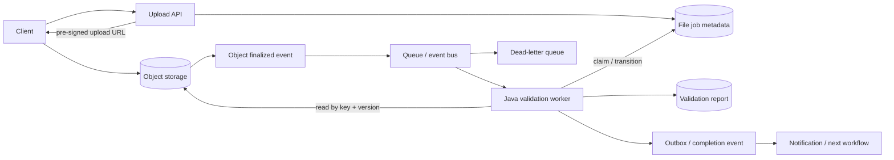

# Cài đặt worker kiểm tra tệp và cập nhật trạng thái xử lý

## 1. Mục tiêu của worker

Trong một hệ thống xử lý tệp theo mô hình serverless, API thường tiếp nhận yêu cầu upload, object storage giữ nội dung tệp, event bus/queue thông báo có tệp mới và một worker thực hiện kiểm tra trước khi dữ liệu được chuyển sang bước tiếp theo. Worker có thể là Java function được kích hoạt bởi message hoặc object event. Worker chỉ chạy trong thời gian có công việc; nền tảng quản lý việc cấp phát instance và mở rộng.

Bài này xây dựng worker có nhiệm vụ:

1. Nhận event chứa định danh job và tham chiếu đến tệp.
2. Đọc trạng thái job từ kho metadata và claim quyền xử lý một cách nguyên tử.
3. Kiểm tra tệp theo metadata, checksum, kích thước, định dạng và quy tắc nghiệp vụ.
4. Ghi báo cáo kiểm tra và chuyển trạng thái sang `VALIDATED` hoặc `REJECTED`.
5. Retry lỗi hạ tầng có giới hạn; đưa công việc không thể phục hồi vào DLQ hoặc luồng xử lý thủ công.
6. Bảo đảm event trùng, worker chạy đồng thời hoặc function bị timeout không làm cập nhật trạng thái sai.

Ví dụ xuyên suốt là dịch vụ nhận file CSV/JSON đơn hàng. API tạo `file_job`, trả `202 Accepted` và URL upload có thời hạn. Khi upload hoàn tất, hệ thống phát event. Worker kiểm tra file, lưu validation report rồi cập nhật trạng thái để client có thể truy vấn.

Worker không nên nhận toàn bộ bytes của file trong message. Message chỉ mang `job_id`, `tenant_id`, object key/version và correlation ID; nội dung lớn được đọc trực tiếp từ object storage theo stream. Cách này giảm payload, tránh giới hạn message và tách vòng đời tệp khỏi vòng đời invocation.

## 2. Kiến trúc tổng thể



Các thành phần có trách nhiệm riêng:

| Thành phần | Trách nhiệm |
| --- | --- |
| Upload API | Xác thực caller, kiểm tra quota, tạo job và cấp quyền upload có giới hạn |
| Object storage | Lưu bytes của tệp; cung cấp version/checksum hoặc metadata để xác minh |
| Event bus/queue | Buffer burst, tách producer/consumer, redelivery khi worker lỗi |
| Java worker | Claim job, kiểm tra nội dung, ghi report và chuyển trạng thái |
| Metadata store | Lưu trạng thái bền vững, lease, attempt, owner và output reference |
| Quarantine | Giữ file hoặc record không đạt kiểm tra theo retention policy |
| DLQ | Giữ message vượt retry policy để điều tra và replay có kiểm soát |
| Outbox/notification | Phát kết quả sau khi trạng thái nghiệp vụ đã được commit |

Luồng điển hình:

1. Client gọi API tạo upload job; API tạo job ở trạng thái `UPLOAD_PENDING`.
2. API trả `job_id` và URL upload có expiry, object key giới hạn theo tenant.
3. Client upload file. Storage phát event hoàn tất hoặc producer gửi manifest.
4. Ingestion adapter xác minh object reference rồi đưa message nhỏ vào queue.
5. Worker claim job trong metadata store.
6. Worker đọc object theo version, kiểm tra nội dung và tạo report.
7. Worker commit trạng thái cuối cùng bằng conditional update.
8. Completion event được ghi qua outbox và publish sau commit.
9. Client truy vấn `GET /file-jobs/{jobId}` để xem trạng thái và kết quả.

Event notification có thể duplicate hoặc đến trễ. Vì vậy, trạng thái trong metadata store là nguồn sự thật; event chỉ là tín hiệu đánh thức worker.

## 3. Hợp đồng event và dữ liệu job

### 3.1. Message chỉ mang tham chiếu

Ví dụ payload queue:

```json
{
  "eventId": "evt_01JCV9QX7A",
  "eventType": "file.upload.completed",
  "schemaVersion": 1,
  "jobId": "job_01JCV9P2K3",
  "tenantId": "tenant-42",
  "object": {
    "bucket": "incoming-files",
    "key": "tenant-42/job_01JCV9P2K3/source.csv",
    "versionId": "v-00017",
    "sizeBytes": 48291,
    "checksumAlgorithm": "SHA256",
    "checksum": "<hex-sha256>"
  },
  "correlationId": "req_01JCV9P1AB",
  "occurredAt": "2026-11-17T08:30:00Z"
}
```

`eventId` nhận diện lần phát event; `jobId` nhận diện công việc nghiệp vụ. Hai giá trị này có mục đích khác nhau. Có thể có nhiều event cho cùng job do redelivery hoặc do nhiều nguồn phát tín hiệu. Idempotency của worker phải dựa trên job và object version, không chỉ dựa vào event ID.

Không tin `tenantId`, bucket hoặc object key từ message mà không đối chiếu với job đã lưu. Worker cần đọc job theo `jobId`, xác minh tenant và so sánh object reference với metadata đã được API ghi nhận. Điều này ngăn một message giả mạo yêu cầu worker đọc tệp của tenant khác.

### 3.2. Bản ghi file job

Một bảng metadata có thể có các trường:

| Field | Ý nghĩa |
| --- | --- |
| `job_id` | Khóa nghiệp vụ duy nhất |
| `tenant_id` | Chủ sở hữu job |
| `status` | Trạng thái hiện tại |
| `object_bucket`, `object_key` | Vị trí tệp đã được cấp cho job |
| `object_version` | Version bất biến của object nếu storage hỗ trợ |
| `expected_size_bytes` | Kích thước dự kiến từ upload completion/manifest |
| `expected_checksum` | Checksum do producer hoặc storage cung cấp |
| `detected_content_type` | Content type quan sát được; không phải bằng chứng duy nhất |
| `schema_version` | Phiên bản schema mà worker cần áp dụng |
| `attempt_count` | Số lần claim/attempt đã thực hiện |
| `owner_token` | Token của invocation đang giữ lease |
| `generation` | Fencing/version tăng mỗi lần takeover |
| `lease_until` | Thời điểm claim hết hạn |
| `retry_after` | Thời điểm sớm nhất được retry |
| `validation_report_key` | Reference đến report đã lưu |
| `error_code` | Mã lỗi ổn định để client/ops xử lý |
| `created_at`, `updated_at` | Timestamp do storage/DB quản lý |
| `expires_at` | Thời hạn lưu metadata theo retention policy |

Không lưu file bytes trong row metadata. Lưu object reference, checksum, size, trạng thái và report reference; tệp nằm trong object storage.

### 3.3. Schema SQL tham khảo

```sql
CREATE TABLE file_job (
    job_id                 VARCHAR(80) PRIMARY KEY,
    tenant_id              VARCHAR(100) NOT NULL,
    status                 VARCHAR(32) NOT NULL,
    object_bucket          VARCHAR(200) NOT NULL,
    object_key             VARCHAR(1024) NOT NULL,
    object_version         VARCHAR(300),
    expected_size_bytes    BIGINT NOT NULL,
    expected_checksum      VARCHAR(128),
    checksum_algorithm     VARCHAR(16),
    schema_version         INTEGER NOT NULL,
    validator_version      VARCHAR(80),
    attempt_count          INTEGER NOT NULL DEFAULT 0,
    owner_token            UUID,
    generation             BIGINT NOT NULL DEFAULT 0,
    lease_until            TIMESTAMPTZ,
    retry_after            TIMESTAMPTZ,
    validation_report_key  VARCHAR(1024),
    output_reference       VARCHAR(1024),
    reconciliation_reference VARCHAR(1024),
    error_code             VARCHAR(100),
    error_detail_safe      VARCHAR(500),
    created_at             TIMESTAMPTZ NOT NULL DEFAULT now(),
    updated_at             TIMESTAMPTZ NOT NULL DEFAULT now(),
    expires_at             TIMESTAMPTZ NOT NULL,
    CHECK (status IN (
        'UPLOAD_PENDING', 'RECEIVED', 'VALIDATING', 'VALIDATED',
        'REJECTED', 'FAILED_RETRYABLE', 'FAILED_FINAL',
        'RECONCILIATION_REQUIRED'
    )),
    CHECK (expected_size_bytes >= 0),
    CHECK (attempt_count >= 0),
    CHECK (generation >= 0)
);

CREATE INDEX file_job_status_retry_idx
    ON file_job(status, retry_after);
```

Nếu hỗ trợ nhiều loại file, có thể thêm `file_type` hoặc lưu schema contract reference. Không dùng tên file do client cung cấp làm primary key hoặc đường dẫn output mà không chuẩn hóa và kiểm soát.

## 4. State machine cho xử lý tệp

### 4.1. Các trạng thái

| Trạng thái | Ý nghĩa | Chuyển tiếp thường gặp |
| --- | --- | --- |
| `UPLOAD_PENDING` | Job đã tạo nhưng chưa xác nhận upload hoàn tất | `RECEIVED` khi object finalize hợp lệ |
| `RECEIVED` | Đã có object reference và chờ worker | `VALIDATING` khi claim thành công |
| `VALIDATING` | Một worker đang giữ lease và kiểm tra | `VALIDATED`, `REJECTED`, `FAILED_RETRYABLE` hoặc `RECONCILIATION_REQUIRED` |
| `VALIDATED` | Tệp đã qua toàn bộ critical checks | Trạng thái thành công cuối cùng |
| `REJECTED` | Nội dung vi phạm contract/quy tắc không thể khắc phục bằng retry | Trạng thái từ chối cuối cùng |
| `FAILED_RETRYABLE` | Lỗi hạ tầng tạm thời; được retry sau backoff | `VALIDATING` khi claim lại hợp lệ |
| `FAILED_FINAL` | Đã hết retry hoặc lỗi vận hành không thể tự phục hồi | Cần can thiệp/replay có kiểm soát |
| `RECONCILIATION_REQUIRED` | Không rõ kết quả commit ở một dependency hoặc metadata | Đối soát trước khi tiếp tục |

`REJECTED` và `FAILED_FINAL` khác nhau: `REJECTED` mô tả tệp không đạt quy tắc dữ liệu; `FAILED_FINAL` mô tả công việc không hoàn thành do lỗi vận hành sau retry hoặc policy. Client có thể sửa tệp và tạo job mới; không nên âm thầm thay bytes trong job đã bị reject.

### 4.2. Sơ đồ trạng thái

```mermaid
stateDiagram-v2
    [*] --> UPLOAD_PENDING
    UPLOAD_PENDING --> RECEIVED: upload finalized
    RECEIVED --> VALIDATING: atomic claim
    FAILED_RETRYABLE --> VALIDATING: retry is eligible
    VALIDATING --> VALIDATED: all critical checks pass
    VALIDATING --> REJECTED: permanent content error
    VALIDATING --> FAILED_RETRYABLE: transient infrastructure error
    VALIDATING --> RECONCILIATION_REQUIRED: outcome is ambiguous
    VALIDATING --> VALIDATING: lease takeover with new generation
    RECONCILIATION_REQUIRED --> VALIDATED: commit confirmed
    RECONCILIATION_REQUIRED --> FAILED_RETRYABLE: no side effect; retry allowed
    FAILED_RETRYABLE --> FAILED_FINAL: retry budget exhausted
    VALIDATED --> [*]
    REJECTED --> [*]
    FAILED_FINAL --> [*]
```



Chỉ các chuyển tiếp hợp lệ mới được ghi. Ví dụ, job `VALIDATED` không được quay về `VALIDATING` do một event upload trùng. Muốn kiểm tra lại cùng object bằng schema/validator version mới, tạo một processing run mới có identity riêng hoặc một job mới theo contract.

### 4.3. Quy tắc trạng thái

- Chỉ một worker sở hữu lease hợp lệ cho một job/generation tại một thời điểm.
- Trạng thái cuối cùng phải được lưu bền vững trước khi queue message được acknowledge.
- Không chuyển lỗi dữ liệu cố định thành retry vô hạn.
- Không chuyển timeout mơ hồ thành `FAILED_RETRYABLE` nếu một side effect có thể đã commit.
- Mọi cập nhật của worker phải kiểm tra `owner_token` và `generation`.
- Status API chỉ trả trạng thái đã commit; không suy đoán trạng thái từ log hoặc event nhận được.

## 5. Tạo job và phát event đáng tin cậy

### 5.1. Tránh dual-write giữa database và queue

Khi ingestion adapter chuyển job sang `RECEIVED`, nếu ghi database thành công nhưng publish message thất bại, worker có thể không được đánh thức. Ngược lại, nếu publish message thành công nhưng transaction DB rollback, worker nhận message cho job chưa được xác nhận.

Transactional outbox giải quyết vấn đề này:

1. Trong một transaction DB, insert `file_job` và insert `outbox_event`.
2. Outbox publisher đọc event chưa gửi và publish lên queue.
3. Sau khi broker xác nhận, đánh dấu outbox event đã publish.
4. Nếu publisher crash sau publish nhưng trước khi đánh dấu, event có thể được publish lại; worker phải idempotent.

```sql
CREATE TABLE outbox_event (
    event_id       VARCHAR(128) PRIMARY KEY,
    aggregate_id   VARCHAR(80) NOT NULL,
    event_type     VARCHAR(120) NOT NULL,
    payload        JSONB NOT NULL,
    created_at     TIMESTAMPTZ NOT NULL DEFAULT now(),
    published_at   TIMESTAMPTZ
);
```

Object storage event có thể được dùng trực tiếp làm trigger, nhưng nếu hệ thống cần xác nhận quyền sở hữu, object version và job metadata trước khi xử lý, một adapter nên xác minh event rồi ghi outbox/queue message chuẩn hóa.

### 5.2. Chuyển `UPLOAD_PENDING` sang `RECEIVED`

Khi nhận object-finalized event, adapter cần:

1. Tìm job bằng `job_id` trong metadata, không suy ra tenant chỉ từ prefix.
2. Xác minh object bucket/key thuộc job đó.
3. Lưu object version, size và checksum thực tế.
4. So sánh size với giới hạn upload và quota của tenant.
5. Conditional update từ `UPLOAD_PENDING` sang `RECEIVED`.
6. Ghi outbox event `file.validation.requested` trong cùng transaction.

Nếu event trùng, conditional update không thay đổi job đã `RECEIVED` hoặc trạng thái sau đó. Adapter có thể trả thành công sau khi xác nhận job đã được nhận; không tạo job thứ hai.

Ví dụ cập nhật metadata và tạo message validation trong cùng transaction:

```sql
WITH received AS (
    UPDATE file_job
    SET status = 'RECEIVED',
        object_version = :object_version,
        expected_size_bytes = :actual_size_bytes,
        expected_checksum = :actual_checksum,
        checksum_algorithm = :checksum_algorithm,
        updated_at = clock_timestamp()
    WHERE job_id = :job_id
      AND tenant_id = :tenant_id
      AND object_bucket = :bucket
      AND object_key = :object_key
      AND expected_size_bytes = :actual_size_bytes
      AND status = 'UPLOAD_PENDING'
      AND expires_at > clock_timestamp()
    RETURNING job_id, tenant_id, object_bucket, object_key, object_version,
              expected_size_bytes, expected_checksum, checksum_algorithm
)
INSERT INTO outbox_event(event_id, aggregate_id, event_type, payload)
SELECT :stable_event_id,
       job_id,
       'file.validation.requested',
       jsonb_build_object(
           'jobId', job_id,
           'tenantId', tenant_id,
           'bucket', object_bucket,
           'key', object_key,
           'versionId', object_version,
           'sizeBytes', expected_size_bytes,
           'checksum', expected_checksum,
           'checksumAlgorithm', checksum_algorithm
       )
FROM received
RETURNING event_id;
```

`stable_event_id` có thể là `file-validation-requested:` cộng với SHA-256 của `job_id|object_version`; cách này giữ ID có độ dài cố định ngay cả khi version ID dài. Nếu câu lệnh không trả row, adapter đọc lại job: nếu cùng object version đã được nhận thì coi event là duplicate; nếu reference khác hoặc job đã hết hạn thì ghi security/operational audit và xử lý theo policy. Không publish queue message trước khi transaction metadata/outbox commit.

Adapter ánh xạ `sizeBytes` sang `ObjectReference.expectedSizeBytes` và đưa `versionId`, `checksum`, `checksumAlgorithm` vào đúng field của Java record. Các field trong message phải khớp với `FileJob` đã lưu; worker không dùng payload làm nguồn sự thật.

## 6. Claim job nguyên tử

### 6.1. Vì sao không dùng check-then-act?

Đoạn code sau không an toàn:

```java
if (repository.find(jobId).status() == Status.RECEIVED) {
    repository.updateStatus(jobId, Status.VALIDATING);
    validator.validate(file);
}
```

Hai invocation có thể cùng đọc `RECEIVED` trước khi invocation nào ghi `VALIDATING`. Cả hai sau đó cùng kiểm tra và cùng ghi report. Đọc trạng thái rồi ghi trạng thái là hai thao tác riêng nên không tạo được quyền sở hữu độc quyền.

Claim phải là một thao tác nguyên tử ở database hoặc metadata store có conditional write. Cơ chế thường dùng là compare-and-set, transaction condition hoặc unique claim record.

### 6.2. Conditional claim trong PostgreSQL

```sql
UPDATE file_job
SET status = 'VALIDATING',
    owner_token = :owner_token,
    generation = generation + 1,
    lease_until = clock_timestamp() + make_interval(secs => :lease_seconds),
    retry_after = NULL,
    attempt_count = attempt_count + 1,
    updated_at = clock_timestamp()
WHERE job_id = :job_id
  AND expires_at > clock_timestamp()
  AND (
      status = 'RECEIVED'
      OR (
          status = 'FAILED_RETRYABLE'
          AND (retry_after IS NULL OR retry_after <= clock_timestamp())
      )
      OR (
          status = 'VALIDATING'
          AND lease_until < clock_timestamp()
      )
  )
RETURNING job_id, owner_token, generation, lease_until, attempt_count;
```

Nếu trả về một row, worker đã claim thành công. Nếu không có row, worker phải đọc trạng thái hiện tại bằng read phù hợp và phân loại `ALREADY_TERMINAL`, `BUSY`, `NOT_READY`, `NOT_FOUND` hoặc `EXPIRED`. Không tự tạo lease trong application memory.

`clock_timestamp()` được dùng để quyết định lease theo đồng hồ database. Không so sánh lease bằng đồng hồ của các function instance vì đồng hồ có thể lệch nhau. Với database khác, dùng conditional update/transaction và time source do storage quản lý.

### 6.3. Lease và fencing token

Lease cho phép worker khác takeover nếu invocation trước bị crash. `owner_token` nhận diện invocation hiện tại; `generation` tăng mỗi lần claim/takeover. Mọi lệnh cập nhật trạng thái cần điều kiện:

```sql
WHERE job_id = :job_id
  AND status = 'VALIDATING'
  AND owner_token = :owner_token
  AND generation = :generation
```

Nếu worker cũ tỉnh lại sau khi lease đã bị takeover, generation của nó đã cũ; update sẽ ảnh hưởng 0 row. Đây là fencing để ngăn stale worker ghi đè trạng thái của owner mới.

Lease không tự hủy side effect của worker cũ. Nếu worker có thể ghi object hoặc gọi downstream, hãy ghi staging theo `job_id/generation`, dùng idempotency key ở downstream và chỉ publish output qua một commit record được bảo vệ bằng conditional update. Fencing chỉ có hiệu lực với hệ thống nhận và kiểm tra fencing token.

### 6.4. Gia hạn lease

Với file lớn, worker có thể cần nhiều hơn lease ban đầu. Gia hạn định kỳ bằng conditional update:

```sql
UPDATE file_job
SET lease_until = clock_timestamp() + make_interval(secs => :lease_seconds),
    updated_at = clock_timestamp()
WHERE job_id = :job_id
  AND status = 'VALIDATING'
  AND owner_token = :owner_token
  AND generation = :generation
  AND lease_until > clock_timestamp();
```

Nếu update ảnh hưởng 0 row, worker đã mất quyền sở hữu hoặc lease hết hạn. Worker nên dừng trước khi publish kết quả. Chọn lease dài hơn chu kỳ heartbeat dự kiến và có headroom cho network pause; không đặt lease ngắn đến mức worker khỏe mạnh liên tục bị takeover.

## 7. Quy trình kiểm tra tệp

### 7.1. Các bước kiểm tra theo lớp

| Lớp | Kiểm tra | Ví dụ lỗi |
| --- | --- | --- |
| Reference | Job, tenant, object key/version khớp metadata | Message trỏ sang object của tenant khác |
| Existence | Object tồn tại và đúng version | Object bị xóa hoặc version không còn |
| Size | Kích thước trong giới hạn và khớp metadata | File rỗng, quá lớn, size thay đổi |
| Integrity | Checksum tính lại khớp checksum mong đợi | Upload hỏng hoặc object bị thay đổi |
| Type | Magic bytes và parser nhận dạng đúng định dạng | Đổi đuôi `.csv` nhưng bytes là executable |
| Syntax | File parse được theo format | CSV sai quote, JSON hỏng, encoding lỗi |
| Schema | Field, type, required field và version hợp lệ | Thiếu `order_id`, field sai kiểu |
| Business rules | Range, uniqueness, cross-field rules | Amount âm, currency không hỗ trợ |
| Security | Archive/path/resource limits, malware scan nếu yêu cầu | Zip bomb, path traversal, malware |

Không dựa vào file extension hoặc `Content-Type` do client gửi. Đây là metadata có thể bị giả mạo. Kiểm tra signature/magic bytes, parser và schema theo allowlist.

### 7.2. Kiểm tra object metadata

Trước khi đọc nội dung, worker xác minh:

- `bucket/container` và `object_key` khớp job đã lưu.
- `versionId` được dùng nếu object storage hỗ trợ versioning.
- `sizeBytes` không vượt giới hạn global và quota của tenant.
- Checksum algorithm thuộc danh sách hỗ trợ.
- Job chưa hết retention và chưa ở trạng thái cuối.

ETag không phải lúc nào cũng là MD5 của bytes; multipart upload, encryption và provider semantics có thể làm ETag khác checksum nội dung. Nếu cần integrity, dùng checksum SHA-256 được tính lại hoặc checksum được storage cung cấp với semantics rõ.

### 7.3. Đọc stream và giới hạn tài nguyên

Không tải toàn bộ file lớn vào heap. Dùng streaming parser, giới hạn bytes đọc, giới hạn thời gian và giới hạn số record. Với archive, giới hạn số entry, độ sâu, tổng bytes giải nén và tỷ lệ nén. Không giải nén vào path do client kiểm soát.

Ví dụ Java minh họa checksum theo stream:

```java
import java.io.IOException;
import java.io.InputStream;
import java.security.DigestInputStream;
import java.security.MessageDigest;
import java.security.NoSuchAlgorithmException;
import java.util.HexFormat;

public final class ChecksumVerifier {
    public void verifySha256(
            InputStream input,
            long maxBytes,
            String expectedHex) throws IOException, NoSuchAlgorithmException {
        MessageDigest digest = MessageDigest.getInstance("SHA-256");
        byte[] buffer = new byte[16 * 1024];
        long total = 0;

        try (DigestInputStream stream = new DigestInputStream(input, digest)) {
            int read;
            while ((read = stream.read(buffer)) != -1) {
                total += read;
                if (total > maxBytes) {
                    throw new FileTooLargeException(maxBytes);
                }
            }
        }
        byte[] expected = HexFormat.of().parseHex(expectedHex);
        if (!MessageDigest.isEqual(expected, digest.digest())) {
            throw new ChecksumMismatchException();
        }
    }
}
```

Method sở hữu và đóng `InputStream` được truyền vào. Production cần validate checksum hex trước khi gọi, truyền `maxBytes` từ policy đã validate và có thể kết hợp `DigestInputStream` với parser để không phải đọc file hai lần. Nếu parser dừng sớm, phải tiếp tục drain stream trong giới hạn để checksum bao phủ toàn bộ object.

### 7.4. Không tin nội dung upload

Tệp do người dùng gửi là input không tin cậy. Các biện pháp cần cân nhắc:

- Chỉ cho phép format cần thiết, ví dụ CSV/JSON/PDF; từ chối executable và serialized Java object.
- Dùng parser có giới hạn độ sâu, token, record length và nesting.
- Với XML, tắt external entity/DTD để tránh XXE.
- Với ZIP, ngăn zip slip, zip bomb, entry path tuyệt đối và `../`.
- Không thực thi macro, script hoặc nội dung nhúng.
- Scan malware bằng dịch vụ riêng khi threat model yêu cầu; timeout scanner là lỗi dependency, không phải kết luận file sạch.
- Cô lập worker, không cho egress tùy ý nếu không cần.
- Không ghi raw payload, access token hoặc PII vào log.

## 8. Java worker: tách domain logic khỏi cloud adapter

Các ví dụ Java dùng Java 17 trở lên (records, `HexFormat` và switch expression). Interface phụ trợ được lược bớt để tập trung vào luồng xử lý; cần triển khai bằng SDK/parser phù hợp với cloud provider và định dạng file.

### 8.1. Domain types

```java
import java.time.Instant;
import java.util.UUID;

public record FileEvent(
        String eventId,
        String jobId,
        String tenantId,
        ObjectReference object,
        String correlationId) {
}

public record ObjectReference(
        String bucket,
        String key,
        String versionId,
        long expectedSizeBytes,
        String checksumAlgorithm,
        String expectedChecksum) {
}

public record FileJob(
        String jobId,
        String tenantId,
        FileStatus status,
        ObjectReference object,
        int schemaVersion,
        int attemptCount,
        Instant retryAfter) {
}

public enum FileStatus {
    UPLOAD_PENDING,
    RECEIVED,
    VALIDATING,
    VALIDATED,
    REJECTED,
    FAILED_RETRYABLE,
    FAILED_FINAL,
    RECONCILIATION_REQUIRED
}

public record Claim(
        String jobId,
        UUID ownerToken,
        long generation,
        Instant leaseUntil,
        int attemptCount) {
}
```

`ObjectReference` trong event chỉ là dữ liệu gợi ý. Worker dùng object reference đã được lưu trong `FileJob` sau khi đối chiếu event với job. Không dùng trực tiếp bucket/key từ message để truy cập storage.

### 8.2. Repository contract

```java
import java.time.Duration;
import java.time.Instant;
import java.util.Optional;
import java.util.UUID;

public interface FileJobRepository {
    Optional<FileJob> find(String jobId);

    ClaimResult tryClaim(String jobId, UUID ownerToken, Duration lease);

    boolean renewLease(Claim claim, Duration lease);

    boolean completeValidatedAndAppendOutbox(
            Claim claim,
            String reportKey,
            String outputReference,
            String validatorVersion,
            String completionEventId);

    boolean markRejectedAndAppendOutbox(
            Claim claim,
            String errorCode,
            String safeDetail,
            String reportKey,
            String completionEventId);

    boolean markRetryable(
            Claim claim,
            Duration retryDelay,
            String errorCode);

    boolean markFailedFinal(Claim claim, String errorCode, String safeDetail);

    boolean markReconciliationRequired(
            Claim claim,
            String reconciliationReference);
}

public record ClaimResult(
        Claim claim,
        ClaimDisposition disposition,
        Instant nextEligibleAt) {
}

public enum ClaimDisposition {
    CLAIMED,
    ALREADY_TERMINAL,
    BUSY,
    NOT_READY,
    RECONCILIATION_REQUIRED,
    NOT_FOUND,
    EXPIRED
}
```

Các method update phải kiểm tra `status`, `owner_token` và `generation` trong cùng câu lệnh/transaction. `boolean=false` có nghĩa worker không còn quyền cập nhật; không được bỏ qua rồi báo job thành công.

### 8.3. Validator contract

```java
import java.util.List;

public interface FileValidator {
    String version();

    ValidationReport validate(
            FileJob job,
            ObjectMetadata metadata,
            InputStreamProvider content);
}

@FunctionalInterface
public interface InputStreamProvider {
    java.io.InputStream open() throws java.io.IOException;
}

public record ValidationIssue(
        String code,
        String field,
        String message,
        Severity severity) {
}

public enum Severity {
    ERROR,
    WARNING
}

public record ValidationReport(
        boolean accepted,
        long bytesRead,
        long recordsRead,
        String checksum,
        List<ValidationIssue> issues) {
}
```

`ValidationReport` nên được lưu bền vững dưới một key deterministic theo job và validator version. Không đưa exception stack trace hoặc raw row vào report công khai; report cho client chỉ chứa error code/message đã được làm sạch.

```java
public interface ValidationReportStore {
    String putForGeneration(
            String jobId,
            long generation,
            String validatorVersion,
            ValidationReport report);
}
```

### 8.3.1. Ví dụ rule kiểm tra CSV đơn hàng

Tách parser khỏi rule nghiệp vụ để có thể thay thư viện CSV mà không thay đổi worker. `CsvReader` dưới đây là adapter mỏng quanh Apache Commons CSV hoặc parser đã được kiểm thử; parser phải giới hạn record length và xử lý encoding theo contract.

```java
import java.math.BigDecimal;
import java.nio.charset.StandardCharsets;
import java.util.ArrayList;
import java.util.List;
import java.util.Set;

public final class OrderCsvValidator {
    private static final Set<String> REQUIRED =
            Set.of("order_id", "customer_id", "amount", "currency");
    private static final Set<String> CURRENCIES = Set.of("VND", "USD", "EUR");

    private final CsvReaderFactory readers;

    public OrderCsvValidator(CsvReaderFactory readers) {
        this.readers = readers;
    }

    public List<ValidationIssue> validate(InputStreamProvider source) throws Exception {
        var issues = new ArrayList<ValidationIssue>();
        try (CsvReader csv = readers.open(source.open(), StandardCharsets.UTF_8)) {
            Set<String> headers = csv.headers();
            for (String required : REQUIRED) {
                if (!headers.contains(required)) {
                    issues.add(new ValidationIssue(
                            "REQUIRED_COLUMN_MISSING", required,
                            "Required column is missing", Severity.ERROR));
                }
            }
            if (!issues.isEmpty()) {
                return List.copyOf(issues);
            }

            while (csv.hasNext()) {
                CsvRow row = csv.next();
                if (row.value("order_id").isBlank()) {
                    issues.add(issue("ORDER_ID_REQUIRED", "order_id"));
                }
                if (row.value("customer_id").isBlank()) {
                    issues.add(issue("CUSTOMER_ID_REQUIRED", "customer_id"));
                }
                try {
                    if (new BigDecimal(row.value("amount")).signum() < 0) {
                        issues.add(issue("AMOUNT_NEGATIVE", "amount"));
                    }
                } catch (NumberFormatException ex) {
                    issues.add(issue("AMOUNT_INVALID", "amount"));
                }
                if (!CURRENCIES.contains(row.value("currency"))) {
                    issues.add(issue("CURRENCY_UNSUPPORTED", "currency"));
                }
                if (issues.size() >= 100) {
                    issues.add(new ValidationIssue(
                            "ISSUE_LIMIT_REACHED", "", "Further issues were omitted",
                            Severity.WARNING));
                    break;
                }
            }
        }
        return List.copyOf(issues);
    }

    private static ValidationIssue issue(String code, String field) {
        return new ValidationIssue(code, field, "Value did not pass validation", Severity.ERROR);
    }
}
```

Các type `CsvReaderFactory`, `CsvReader` và `CsvRow` là adapter interfaces; `CsvRow.value()` cần trả chuỗi rỗng thay vì `null` cho field thiếu. Parser phải phát hiện duplicate header trước khi chuyển header thành `Set`. Code minh họa rule; production cần thêm uniqueness check theo batch, control totals, giới hạn số row/field, checksum toàn file và phân biệt lỗi parse (permanent) với lỗi I/O (transient). Không lưu một issue cho mọi row nếu file có hàng triệu lỗi; giới hạn report và lưu counters/sample có kiểm soát.

### 8.4. Worker orchestration

```java
import java.time.Duration;
import java.util.UUID;

public final class FileValidationWorker {
    private static final Duration LEASE = Duration.ofSeconds(90);
    private static final int MAX_ATTEMPTS = 6;

    private final FileJobRepository jobs;
    private final ObjectStore objects;
    private final FileValidator validator;
    private final ValidationReportStore reports;

    public FileValidationWorker(
            FileJobRepository jobs,
            ObjectStore objects,
            FileValidator validator,
            ValidationReportStore reports) {
        this.jobs = jobs;
        this.objects = objects;
        this.validator = validator;
        this.reports = reports;
    }

    public WorkerOutcome handle(FileEvent event) {
        FileJob observed = jobs.find(event.jobId())
                .orElseThrow(() -> new UnknownJobException(event.jobId()));
        if (!observed.tenantId().equals(event.tenantId())
                || !observed.object().equals(event.object())) {
            // Do not poison a legitimate job because an untrusted event has a bad reference.
            return WorkerOutcome.deadLetter("EVENT_REFERENCE_MISMATCH");
        }

        UUID ownerToken = UUID.randomUUID();
        ClaimResult result = jobs.tryClaim(event.jobId(), ownerToken, LEASE);

        switch (result.disposition()) {
            case ALREADY_TERMINAL -> return WorkerOutcome.acknowledged();
            case NOT_FOUND -> throw new UnknownJobException(event.jobId());
            case EXPIRED -> return WorkerOutcome.discardWithAudit("JOB_EXPIRED");
            case BUSY, NOT_READY ->
                    return WorkerOutcome.deferUntil(result.nextEligibleAt());
            case RECONCILIATION_REQUIRED -> return WorkerOutcome.routeToReconciliation();
            case CLAIMED -> { }
        }

        Claim claim = result.claim();
        FileJob job = jobs.find(event.jobId())
                .orElseThrow(() -> new UnknownJobException(event.jobId()));

        if (!job.tenantId().equals(event.tenantId()) || !job.object().equals(event.object())) {
            return WorkerOutcome.lostClaim();
        }
        if (claim.attemptCount() > MAX_ATTEMPTS) {
            boolean updated = jobs.markFailedFinal(
                    claim, "RETRY_BUDGET_EXHAUSTED", "Maximum validation attempts exceeded");
            return updated ? WorkerOutcome.acknowledged() : WorkerOutcome.lostClaim();
        }

        try {
            ObjectMetadata metadata = objects.head(job.object());
            verifyObjectReference(job, metadata);

            ValidationReport report = validator.validate(
                    job, metadata, () -> objects.open(job.object()));
            String reportKey = reports.putForGeneration(
                    job.jobId(), claim.generation(), validator.version(), report);

            if (!report.accepted()) {
                boolean updated = jobs.markRejectedAndAppendOutbox(
                        claim,
                        "FILE_VALIDATION_FAILED",
                        "File did not pass validation",
                        reportKey,
                        "file-rejected:" + job.jobId());
                return updated
                        ? WorkerOutcome.acknowledged()
                        : WorkerOutcome.lostClaim();
            }

            String completionEventId = "file-validated:" + job.jobId();
            boolean updated = jobs.completeValidatedAndAppendOutbox(
                    claim, reportKey, metadata.canonicalReference(),
                    validator.version(), completionEventId);
            if (!updated) {
                return WorkerOutcome.lostClaim();
            }
            return WorkerOutcome.acknowledged();

        } catch (PermanentFileException ex) {
            return reject(claim, ex.code(), ex.safeMessage());
        } catch (TransientDependencyException ex) {
            boolean updated = jobs.markRetryable(claim, ex.retryDelay(), ex.code());
            return updated
                    ? WorkerOutcome.retry()
                    : WorkerOutcome.lostClaim();
        } catch (AmbiguousOutcomeException ex) {
            boolean updated = jobs.markReconciliationRequired(claim, ex.reference());
            return updated
                    ? WorkerOutcome.deferUntil(ex.recheckAt())
                    : WorkerOutcome.lostClaim();
        }
    }

    private WorkerOutcome reject(Claim claim, String code, String safeDetail) {
        boolean updated = jobs.markRejectedAndAppendOutbox(
                claim, code, safeDetail, null, "file-rejected:" + claim.jobId());
        return updated
                ? WorkerOutcome.acknowledged()
                : WorkerOutcome.lostClaim();
    }

    private void verifyObjectReference(FileJob job, ObjectMetadata metadata) {
        ObjectReference expected = job.object();
        if (!expected.bucket().equals(metadata.bucket())
                || !expected.key().equals(metadata.key())) {
            throw new PermanentFileException("OBJECT_REFERENCE_MISMATCH");
        }
        if (expected.versionId() != null
                && !expected.versionId().equals(metadata.versionId())) {
            throw new PermanentFileException("OBJECT_VERSION_MISMATCH");
        }
        if (metadata.sizeBytes() > FileLimits.MAX_BYTES) {
            throw new PermanentFileException("FILE_TOO_LARGE");
        }
        if (expected.expectedSizeBytes() != metadata.sizeBytes()) {
            throw new PermanentFileException("FILE_SIZE_MISMATCH");
        }
    }
}
```

Đây là skeleton điều phối, các interface phụ trợ và mapping queue-specific được lược bỏ. Một số điểm cần hoàn thiện trong production:

- `PermanentFileException`, `TransientDependencyException`, `AmbiguousOutcomeException`, `UnknownJobException` và `LostClaimException` là exception riêng của ứng dụng; ví dụ giả định chúng là unchecked exceptions. Adapter bọc checked exception từ SDK/parser thành đúng nhóm lỗi trước khi trả về domain worker.
- `find` phải đọc từ primary/strongly consistent store; object reference được xem là bất biến sau khi job chuyển sang `RECEIVED`.
- `completeValidatedAndAppendOutbox` thực hiện conditional update job và insert outbox trong cùng transaction. Nếu update ảnh hưởng 0 row, rollback và trả `false`.
- `markRejectedAndAppendOutbox` áp dụng cùng nguyên tắc cho trạng thái `REJECTED`, để client/consumer nhận được kết quả từ chối sau khi trạng thái đã commit.
- Nếu transaction commit thành công nhưng response timeout, redelivery đọc job terminal và ack; không chạy side effect lần nữa.
- `BUSY`/`NOT_READY` phải được adapter ánh xạ thành defer/visibility timeout/retry theo broker. Không acknowledge một message duy nhất nếu không có cơ chế lease sweeper/re-drive đáng tin cậy.
- `RECONCILIATION_REQUIRED` được chuyển cho reconciliation worker/sweeper, không được claim lại như một validation attempt thông thường.
- Nếu worker mất claim, dừng publish và không ghi đè trạng thái của generation mới.

`WorkerOutcome` là kết quả nội bộ để adapter quyết định settlement: `acknowledged` chỉ ack sau commit; `retry` yêu cầu broker redeliver; `deferUntil` gia hạn visibility/lock hoặc schedule lại; `deadLetter` đưa message sai contract sang DLQ/security queue; `discardWithAudit` ghi audit rồi ack event đã hết hạn; `lostClaim` yêu cầu đọc lại job và ack nếu job terminal, nếu chưa terminal thì defer. Adapter không được biến `lostClaim` thành success vô điều kiện.

Với file mất nhiều thời gian, gọi `jobs.renewLease(claim, LEASE)` giữa các chunk hoặc theo callback của streaming parser. Nếu trả `false`, ném `LostClaimException` và dừng xử lý/publish. Không để heartbeat thread tiếp tục gia hạn sau khi invocation đã kết thúc.

### 8.5. Hoàn tất trạng thái và outbox trong cùng transaction

Repository method dùng trong worker là một transaction duy nhất:

```java
boolean completeValidatedAndAppendOutbox(
        Claim claim,
        String reportKey,
        String outputReference,
        String validatorVersion,
        String completionEventId);
```

Method này thực hiện trong cùng transaction:

1. Conditional update job từ `VALIDATING` sang `VALIDATED` với owner/generation khớp.
2. Nếu update ảnh hưởng 0 row, rollback và trả `false`.
3. Insert outbox event có `completionEventId` unique.
4. Commit transaction.

Một PostgreSQL implementation có thể dùng CTE để chỉ insert outbox khi conditional update thành công:

```sql
WITH completed AS (
    UPDATE file_job
    SET status = 'VALIDATED',
        validation_report_key = :report_key,
        output_reference = :output_reference,
        validator_version = :validator_version,
        error_code = NULL,
        error_detail_safe = NULL,
        owner_token = NULL,
        lease_until = NULL,
        retry_after = NULL,
        updated_at = clock_timestamp()
    WHERE job_id = :job_id
      AND status = 'VALIDATING'
      AND owner_token = :owner_token
      AND generation = :generation
    RETURNING job_id, tenant_id, validation_report_key
)
INSERT INTO outbox_event(event_id, aggregate_id, event_type, payload)
SELECT :completion_event_id,
       job_id,
       'file.validation.completed',
       jsonb_build_object(
           'jobId', job_id,
           'tenantId', tenant_id,
           'reportKey', validation_report_key
       )
FROM completed
RETURNING event_id;
```

Nếu câu lệnh không trả row, conditional update không thành công hoặc outbox không được tạo; repository trả `false`/lỗi transaction để caller đọc lại state. Không tách update job và insert outbox thành hai transaction riêng.

Outbox publisher có thể gửi event nhiều lần nếu crash sau publish. Consumer nhận completion event vẫn cần idempotency theo `job_id`/event ID.

`markRejectedAndAppendOutbox` dùng cùng conditional update/fencing và insert event `file.validation.rejected`. Không publish event từ `catch` block trước khi transaction trạng thái commit; nếu cần notification cho `FAILED_FINAL`, hãy ghi event vận hành trong transaction cập nhật trạng thái đó.

## 9. Xử lý lỗi và retry

### 9.1. Phân loại lỗi

| Loại lỗi | Ví dụ | Trạng thái/hành động |
| --- | --- | --- |
| Permanent content error | CSV sai cấu trúc, schema không hỗ trợ, checksum sai | `REJECTED`, lưu report và acknowledge |
| Transient dependency error | Object store timeout, database throttling, scanner tạm ngừng | `FAILED_RETRYABLE`, backoff rồi retry |
| Capacity/lease busy | Một worker khác đang giữ lease | Defer message đến sau lease hoặc chờ lease recovery |
| Unknown job | Message tham chiếu job không tồn tại | Đưa vào DLQ/điều tra; không tự tạo job |
| Authorization/reference mismatch | Tenant hoặc object không khớp job | Reject và security audit |
| Ambiguous commit | Không rõ trạng thái/report/outbox đã commit chưa | `RECONCILIATION_REQUIRED` hoặc read-after-timeout |
| Retry budget exhausted | Quá số attempt hoặc quá deadline | `FAILED_FINAL`, DLQ/manual replay |

Lỗi parser do bytes không hợp lệ là lỗi nội dung. Lỗi parser do thiếu memory hoặc dependency timeout có thể là lỗi hạ tầng. Cần exception taxonomy rõ ràng để không quarantine nhầm lỗi tạm thời.

### 9.2. Exponential backoff với jitter

Một policy tham khảo:

\[
delay_n = random(0, \min(cap, base \times 2^n))
\]

Ví dụ `base=2s`, `cap=5m`, tối đa 6 lần retry. Full jitter giúp tránh nhiều worker cùng retry một dependency tại một thời điểm. Nếu provider trả `Retry-After`, tôn trọng giá trị đó trong giới hạn policy.

Không retry liên tục trong cùng invocation bằng vòng lặp dài. Serverless invocation có timeout và chi phí; hãy persist retry state và để queue/scheduler kích hoạt lần tiếp theo.

### 9.3. Phối hợp database retry_after và broker

Nếu DB ghi `retry_after = 10:05`, nhưng queue redeliver lúc 10:01, worker phải không claim được và defer message. Nếu broker không hỗ trợ delay chính xác, có thể:

- Tăng visibility timeout theo backoff.
- Dùng delay queue hoặc scheduler để phát lại job khi đến hạn.
- Dùng outbox/sweeper định kỳ tìm `FAILED_RETRYABLE` đã đến hạn và enqueue lại.

Sweeper phải dùng conditional claim/unique event key để tránh tạo nhiều message cho cùng job. Queue retry count và `attempt_count` trong DB cần được đối chiếu; hai con số có thể khác nhau do event duplicate hoặc publish retry.

### 9.4. DLQ không phải nơi lưu trạng thái nghiệp vụ duy nhất

DLQ giữ message phục vụ điều tra. Trạng thái `FAILED_FINAL`, `error_code`, `attempt_count` và report reference phải nằm trong metadata store. Khi replay DLQ, operator xác minh nguyên nhân, chọn policy/version mới nếu cần và phát lệnh replay có audit. Không tự động replay mọi message trong DLQ liên tục.

`maxReceiveCount` của broker có thể đạt trước `MAX_ATTEMPTS` trong database vì event duplicate cũng làm tăng receive count. DLQ consumer hoặc sweeper cần đối chiếu job state và chuyển job sang `FAILED_FINAL` theo policy; việc message xuất hiện trong DLQ không tự động cập nhật row `file_job`.

### 9.5. Acknowledge sau commit

Với queue consumer, chỉ acknowledge khi:

- Job đã ở trạng thái terminal (`VALIDATED`/`REJECTED`/`FAILED_FINAL`) và report/outbox cần thiết đã commit; hoặc
- Duplicate event đã được xác nhận job đã terminal; hoặc
- Có cơ chế bền vững khác chịu trách nhiệm re-drive khi message hiện tại được acknowledge.

Nếu DB không khả dụng, không thể ghi trạng thái và không có durable retry record, worker phải fail invocation để broker redeliver. Không log lỗi rồi return success.

## 10. Cập nhật trạng thái an toàn

### 10.1. Complete có fencing

```sql
UPDATE file_job
SET status = 'VALIDATED',
    validation_report_key = :report_key,
    error_code = NULL,
    error_detail_safe = NULL,
    owner_token = NULL,
    lease_until = NULL,
    updated_at = clock_timestamp()
WHERE job_id = :job_id
  AND status = 'VALIDATING'
  AND owner_token = :owner_token
  AND generation = :generation;
```

Nếu affected rows bằng 0, worker đã mất lease, job đã chuyển trạng thái hoặc một invocation khác đã hoàn tất. Đọc lại trạng thái và phân loại; không ghi tiếp.

Đây là câu lệnh minh họa conditional update. Production phải thực hiện cập nhật `VALIDATED` cùng insert outbox trong một transaction như mục 8.5; không dùng riêng câu lệnh này rồi publish event từ application code.

### 10.2. Mark rejected

```sql
UPDATE file_job
SET status = 'REJECTED',
    error_code = :error_code,
    error_detail_safe = :safe_detail,
    validation_report_key = :report_key,
    owner_token = NULL,
    lease_until = NULL,
    updated_at = clock_timestamp()
WHERE job_id = :job_id
  AND status = 'VALIDATING'
  AND owner_token = :owner_token
  AND generation = :generation;
```

Chỉ dùng `REJECTED` cho lỗi nội dung/permanent theo contract. Không đưa exception stack trace hoặc nội dung PII vào `error_detail_safe`.

Method repository dùng trong worker là `markRejectedAndAppendOutbox`; nó thực hiện update này và insert event từ chối trong cùng transaction.

### 10.3. Mark retryable

```sql
UPDATE file_job
SET status = 'FAILED_RETRYABLE',
    retry_after = clock_timestamp() + make_interval(secs => :retry_seconds),
    error_code = :error_code,
    owner_token = NULL,
    lease_until = NULL,
    updated_at = clock_timestamp()
WHERE job_id = :job_id
  AND status = 'VALIDATING'
  AND owner_token = :owner_token
  AND generation = :generation;
```

Repository nhận `Duration retryDelay`, chuyển sang `retry_seconds` để bind vào `make_interval`; database tự tính `retry_after` bằng đồng hồ của mình để tránh lệch clock giữa các function instance. Tương tự, `Duration lease` được chuyển thành `lease_seconds` trong các lệnh claim/renew. Chỉ đánh dấu retryable nếu biết side effect nào đã xảy ra và có thể retry an toàn. Nếu report/output đã ghi, lần retry phải dùng deterministic key và kiểm tra lại trước khi ghi. Nếu không rõ commit outcome, đọc lại state/report/manifest trước.

### 10.4. Mark failed final và reconciliation

Khi attempt budget đã hết, chuyển trạng thái bằng conditional update:

```sql
UPDATE file_job
SET status = 'FAILED_FINAL',
    error_code = :error_code,
    error_detail_safe = :safe_detail,
    owner_token = NULL,
    lease_until = NULL,
    retry_after = NULL,
    updated_at = clock_timestamp()
WHERE job_id = :job_id
  AND status = 'VALIDATING'
  AND owner_token = :owner_token
  AND generation = :generation;
```

Nếu dependency có thể đã commit side effect nhưng worker không nhận được kết quả, dùng `RECONCILIATION_REQUIRED` và lưu reference để đối soát:

```sql
UPDATE file_job
SET status = 'RECONCILIATION_REQUIRED',
    error_code = 'AMBIGUOUS_OUTCOME',
    error_detail_safe = 'A downstream result must be reconciled',
    reconciliation_reference = :reconciliation_reference,
    owner_token = NULL,
    lease_until = NULL,
    updated_at = clock_timestamp()
WHERE job_id = :job_id
  AND status = 'VALIDATING'
  AND owner_token = :owner_token
  AND generation = :generation;
```

Một sweeper hoặc reconciliation worker tìm các job này, tra cứu dependency bằng idempotency/reference đã lưu và quyết định `VALIDATED`, `FAILED_RETRYABLE` hoặc `FAILED_FINAL`. Không tự động chạy lại side effect khi chưa xác định kết quả cũ.

### 10.5. Stale worker và output staging

Worker nên ghi report/output vào key có namespace:

```text
validation/{job_id}/generation={generation}/report.json
```

Sau khi ghi report, worker conditional update job để trỏ đến key đó. Nếu worker cũ bị mất lease, report của generation cũ không được job tham chiếu và có thể dọn sau retention. Không cho downstream liệt kê prefix rồi tự chọn report mới nhất; downstream chỉ tin reference đã commit trong job metadata.

## 11. API truy vấn trạng thái

### 11.1. Tạo upload job

```http
POST /v1/file-jobs
Authorization: Bearer <access-token>
Idempotency-Key: 7d9c...
Content-Type: application/json

{
  "fileName": "orders-2026-11-17.csv",
  "contentLength": 48291,
  "contentType": "text/csv",
  "schemaVersion": 3
}
```

Response:

```http
HTTP/1.1 202 Accepted
Location: /v1/file-jobs/job_01JCV9P2K3
Content-Type: application/json

{
  "jobId": "job_01JCV9P2K3",
  "status": "UPLOAD_PENDING",
  "uploadUrl": "<short-lived-upload-url>",
  "uploadExpiresAt": "2026-11-17T09:00:00Z"
}
```

API cần bind idempotency key với request fingerprint. Cùng key/cùng payload trả lại job đã tạo; cùng key/khác payload trả conflict. URL upload chỉ cấp quyền ghi đúng object key, đúng method, đúng content constraints nếu provider hỗ trợ, và có thời hạn ngắn.

### 11.2. Truy vấn trạng thái

```http
GET /v1/file-jobs/job_01JCV9P2K3
Authorization: Bearer <access-token>
```

Response khi đang chạy:

```json
{
  "jobId": "job_01JCV9P2K3",
  "status": "VALIDATING",
  "createdAt": "2026-11-17T08:29:00Z",
  "updatedAt": "2026-11-17T08:30:12Z",
  "attemptCount": 1,
  "statusUrl": "/v1/file-jobs/job_01JCV9P2K3"
}
```

Response khi hoàn tất:

```json
{
  "jobId": "job_01JCV9P2K3",
  "status": "VALIDATED",
  "validation": {
    "recordsRead": 1200,
    "recordsAccepted": 1200,
    "recordsRejected": 0,
    "warnings": 2
  },
  "completedAt": "2026-11-17T08:30:14Z"
}
```

Response `REJECTED` chỉ nên hiển thị error code và hướng sửa an toàn, không lộ internal bucket, path, stack trace, parser internals hoặc dữ liệu của tenant khác. GET phải kiểm tra tenant ownership trên mỗi request.

### 11.3. HTTP status semantics

| Tình huống | HTTP status gợi ý |
| --- | --- |
| Tạo job và bắt đầu xử lý bất đồng bộ | `202 Accepted` |
| Lấy job thành công | `200 OK` |
| Idempotency key dùng lại với payload khác | `409 Conflict` |
| Job không thuộc tenant hoặc không tồn tại | `404 Not Found` theo chính sách chống enumeration |
| Upload metadata không hợp lệ | `400 Bad Request` hoặc `422 Unprocessable Content` |
| Client vượt quota/rate limit | `429 Too Many Requests` |

`202` không có nghĩa tệp đã hợp lệ. Nó chỉ xác nhận job đã được nhận và có thể truy vấn qua `Location`/status URL.

## 12. Bảo mật và cách ly tenant

### 12.1. Quyền truy cập object

- API xác thực caller và kiểm tra quyền tạo job cho tenant.
- Upload URL chỉ ghi được đúng key và hết hạn nhanh.
- Worker dùng execution role/service identity, không dùng credentials do client gửi.
- Worker chỉ đọc prefix/bucket cần thiết và chỉ ghi report vào namespace được phép.
- Tenant ID lấy từ job đã xác thực, không tin message payload.
- Object version và job metadata phải khớp trước khi đọc.

### 12.2. Giới hạn tài nguyên

Đặt giới hạn cho:

- Max upload bytes theo tenant và loại file.
- Max records/row length/field count.
- Max JSON nesting/decompression size/archive entries.
- Max CPU time, memory và invocation timeout.
- Max concurrent jobs per tenant và toàn hệ thống.
- Max retry attempts và DLQ retention.

Quota giúp tránh một tenant gửi file quá lớn làm cạn compute hoặc storage của tenant khác. Có thể dùng queue riêng theo tier/tenant hoặc admission control để bảo vệ workload critical.

### 12.3. Không biến worker thành SSRF proxy

Worker nên đọc object theo bucket/key được lưu nội bộ. Không nhận URL tùy ý trong event rồi gọi HTTP đến địa chỉ đó; điều này có thể tạo SSRF tới metadata endpoint hoặc private network. Nếu cần tải từ external URL, dùng allowlist host, chặn private/link-local IP, kiểm tra redirect và giới hạn bytes/time.

## 13. Observability

### 13.1. Structured logs

Mỗi log event nên có:

```json
{
  "service": "file-validation-worker",
  "jobId": "job_01JCV9P2K3",
  "tenantIdHash": "<stable-non-reversible-reference>",
  "eventId": "evt_01JCV9QX7A",
  "correlationId": "req_01JCV9P1AB",
  "generation": 2,
  "attempt": 2,
  "status": "VALIDATING",
  "durationMs": 842,
  "bytesRead": 48291,
  "result": "SCHEMA_CHECK_PASSED"
}
```

Không log presigned URL, access token, raw content, email hoặc PII. Hash tenant ID chỉ dùng để group metric/log; cần bảo đảm không thể suy ra thông tin nhạy cảm ngoài ý muốn.

### 13.2. Metrics cần theo dõi

| Metric | Ý nghĩa |
| --- | --- |
| `file_jobs_received_total` | Số job đã được nhận |
| `file_jobs_validated_total` | Số job hoàn tất thành công |
| `file_jobs_rejected_total` | Số job bị reject theo content rules |
| `file_jobs_retry_total` | Số attempt retry |
| `file_jobs_dlq_total` | Số job/message vào DLQ |
| `file_validation_duration_seconds` | Thời gian kiểm tra |
| `file_validation_bytes_total` | Tổng bytes đã đọc |
| `file_queue_oldest_message_age_seconds` | Tuổi message cũ nhất |
| `file_job_lease_takeover_total` | Số lần lease takeover |
| `file_job_lost_claim_total` | Worker bị fencing do mất claim |
| `file_validation_failure_total{error_code}` | Lỗi theo mã ổn định |

Theo dõi cả queue age và thời gian từ `RECEIVED` đến trạng thái cuối. Function duration thấp nhưng queue age cao vẫn có nghĩa SLA xử lý tệp đang bị vi phạm.

### 13.3. Alert và runbook

Alert nên kích hoạt khi:

- Queue oldest message age vượt SLA.
- Tỷ lệ `FAILED_RETRYABLE` hoặc DLQ tăng đột biến.
- Số lease takeover/lost claim tăng bất thường.
- Tỷ lệ checksum/schema rejection thay đổi mạnh.
- Worker timeout hoặc dependency throttling vượt ngưỡng.
- Có job `VALIDATING` quá lâu so với lease/heartbeat policy.

Runbook cần nêu cách xem job, report, object version, attempt history, DLQ, dependency health và cách replay. Không yêu cầu operator sửa trực tiếp status trong database; cung cấp command/API quản trị có audit và conditional transition.

## 14. Kiểm thử worker

### 14.1. Unit tests

- Tệp hợp lệ theo từng schema version.
- Thiếu required field, sai type, sai encoding và malformed CSV/JSON.
- Size vượt giới hạn và checksum mismatch.
- Content type giả mạo và magic bytes không khớp.
- Duplicate event cùng job.
- Tenant mismatch và object version mismatch.
- Permanent error được reject, transient error được retry.
- Report không chứa raw PII hoặc stack trace.

### 14.2. Concurrency và failure tests

| Kịch bản | Kỳ vọng |
| --- | --- |
| Hai worker nhận cùng `job_id` cùng lúc | Chỉ một worker claim thành công |
| Worker A giữ lease, worker B nhận duplicate | B defer; không validate đồng thời |
| A crash, lease hết hạn, B takeover | B nhận generation mới và tiếp tục |
| A tỉnh lại sau khi B takeover | Update của A ảnh hưởng 0 row |
| Worker ghi report rồi crash trước status update | Retry dùng deterministic key; report không được coi là committed nếu job chưa tham chiếu |
| Status commit xong nhưng queue ack thất bại | Redelivery đọc terminal state và ack an toàn |
| DB không khả dụng | Worker không ack thành công; broker retry |
| Outbox publish rồi publisher crash | Event có thể duplicate; consumer idempotent |
| Job hết retry budget | Chuyển `FAILED_FINAL`, giữ thông tin điều tra |

Ví dụ integration test cho atomic claim (repository phải trỏ đến database test thật, không mock `tryClaim`):

```java
import static org.junit.jupiter.api.Assertions.assertEquals;
import static org.junit.jupiter.api.Assertions.assertTrue;

import java.time.Duration;
import java.util.List;
import java.util.UUID;
import java.util.concurrent.CountDownLatch;
import java.util.concurrent.Executors;
import java.util.concurrent.TimeUnit;

@Test
void onlyOneWorkerCanClaimTheSameJob() throws Exception {
    String jobId = testFixture.createReceivedJob();
    var ready = new CountDownLatch(2);
    var start = new CountDownLatch(1);
    var pool = Executors.newFixedThreadPool(2);
    try {
        var tasks = List.of(
                pool.submit(() -> claimAfterBarrier(jobId, ready, start)),
                pool.submit(() -> claimAfterBarrier(jobId, ready, start)));

        assertTrue(ready.await(5, TimeUnit.SECONDS));
        start.countDown();
        var results = List.of(tasks.get(0).get(), tasks.get(1).get());

        assertEquals(1, results.stream()
                .filter(r -> r.disposition() == ClaimDisposition.CLAIMED).count());
        assertEquals(1, results.stream()
                .filter(r -> r.disposition() == ClaimDisposition.BUSY).count());
    } finally {
        pool.shutdownNow();
    }
}

private ClaimResult claimAfterBarrier(
        String jobId, CountDownLatch ready, CountDownLatch start) throws Exception {
    ready.countDown();
    start.await();
    return repository.tryClaim(jobId, UUID.randomUUID(), Duration.ofSeconds(30));
}
```

Test này kiểm tra hai transaction cạnh tranh thật. Nếu test chỉ mock repository hoặc gọi hai lần tuần tự, nó không chứng minh unique/conditional claim hoạt động dưới concurrency.

### 14.3. Integration tests

Nên kiểm thử với database/queue/object storage emulator hoặc môi trường test tương thích:

1. Tạo job và upload object có version/checksum.
2. Phát event hoàn tất và xác nhận queue message được tạo.
3. Worker claim, đọc stream, ghi report và chuyển `VALIDATED`.
4. Upload file sai schema và xác nhận `REJECTED` cùng report.
5. Giả lập object store timeout và xác nhận retry/backoff.
6. Gửi duplicate event đồng thời và xác nhận một kết quả nghiệp vụ.
7. Crash tại các điểm trước/sau output write, status update và ack.
8. Xác nhận completion outbox chỉ có một event ID nghiệp vụ.

### 14.4. Property/invariant tests

- Job ở trạng thái terminal không bị event duplicate chuyển ngược về `VALIDATING`.
- Chỉ owner token/generation hiện tại được cập nhật trạng thái.
- Mỗi `job_id + object_version + validator_version` chỉ có một validation result được publish.
- `VALIDATED` luôn tham chiếu report đã lưu bền vững.
- `REJECTED` có error code và report hoặc lý do reject được lưu.
- Message chỉ được ack sau khi state transition cần thiết đã commit.
- Tenant không thể đọc job/report của tenant khác.

## 15. Triển khai trên nền tảng serverless

### 15.1. AWS Lambda + SQS + S3

Một triển khai thường gặp:

- S3 lưu file và version.
- S3 notification/EventBridge phát object-created event.
- SQS buffer event để kiểm soát retry và DLQ.
- Lambda Java xử lý SQS message, đọc object từ S3 bằng AWS SDK for Java v2.
- RDS/DynamoDB lưu job state và claim condition.
- CloudWatch theo dõi duration, errors, throttles và queue age.

Với Lambda event source mapping cho SQS, invocation thành công khiến message được xóa theo cơ chế tích hợp; invocation lỗi khiến message được visibility timeout/redrive theo cấu hình. Bật partial batch response nếu muốn chỉ retry record lỗi trong batch. Nếu worker xử lý nhiều message trong một batch, không để một message lỗi làm mất cơ hội ack các message đã commit thành công.

Đặt queue visibility timeout lớn hơn Lambda timeout theo khuyến nghị của AWS; cấu hình DLQ/redrive max receive count; reserved concurrency và event source maximum concurrency để bảo vệ database. Nếu cần retry tại một thời điểm cụ thể, dùng delay queue/scheduler hoặc thay đổi visibility phù hợp thay vì busy-loop trong Lambda.

### 15.2. Azure Functions + Storage Queue/Service Bus + Blob Storage

Azure Functions có thể được trigger bởi Storage Queue hoặc Service Bus; Blob Storage lưu tệp. Queue trigger có retry/poison message semantics riêng theo extension và hosting plan. Với Service Bus, dùng message lock/settlement và dead-letter theo policy. Worker cập nhật job state trong database trước khi complete message. Khi message lock sắp hết hạn, gia hạn lock nếu xử lý lâu hoặc chia tệp thành chunk.

### 15.3. Google Cloud Run functions/Cloud Run + Pub/Sub + Cloud Storage

Eventarc hoặc Pub/Sub kích hoạt worker; Cloud Storage giữ tệp; Firestore/Cloud SQL có thể lưu metadata. Pub/Sub có ack deadline/redelivery và dead-letter policy. Nếu dùng Cloud Run service pull subscriber, worker kiểm soát ack/nack; nếu dùng push/event-triggered function, adapter ánh xạ response thành ack/retry theo semantics dịch vụ.

### 15.4. Provider abstraction

Domain worker không nên phụ thuộc trực tiếp vào SQS, Pub/Sub hoặc Blob SDK. Tạo adapter cho:

- `QueueDelivery` – ack, retry/defer hoặc extend visibility/lock.
- `ObjectStore` – head/read theo bucket/key/version.
- `FileJobRepository` – conditional claim và state transitions.
- `ValidationReportStore` – lưu report deterministic.
- `OutboxPublisher` – đọc và publish completion event đã commit trong outbox.

Adapter chịu trách nhiệm ánh xạ semantics của provider. Không giả định `return` có nghĩa giống nhau trên mọi trigger; một số runtime ack khi handler return bình thường, một số yêu cầu explicit settlement.

## 16. Cấu hình và giới hạn vận hành

Ví dụ cấu hình theo môi trường:

```yaml
worker:
  leaseDuration: 90s
  leaseHeartbeat: 25s
  maxAttempts: 6
  retryBaseDelay: 2s
  retryMaxDelay: 5m
  maxFileBytes: 52428800
  maxRecords: 500000
  maxRecordBytes: 65536
  allowedFormats:
    - CSV
    - JSON
  concurrency:
    global: 20
    perTenant: 3
  report:
    retentionDays: 90
  quarantine:
    retentionDays: 30
```

Các con số chỉ minh họa. Cấu hình phải được kiểm tra khi startup: lease heartbeat nhỏ hơn lease duration, max attempts dương, file/record limit phù hợp memory, concurrency không vượt downstream capacity, retention đáp ứng yêu cầu nghiệp vụ/pháp lý.

Không cho client thay đổi giới hạn worker bằng request upload. Tenant quota là policy riêng được quản trị ở control plane.

## 17. Quy trình vận hành và replay

### 17.1. Khi job bị kẹt ở `VALIDATING`

1. Đọc `updated_at`, `lease_until`, owner token (chỉ hiển thị fingerprint), generation và heartbeat.
2. Kiểm tra invocation còn chạy hay đã timeout.
3. Kiểm tra queue message age và redelivery count.
4. Nếu lease hết hạn, conditional takeover tạo generation mới.
5. Worker mới kiểm tra report/staging của generation trước trước khi đọc lại file.
6. Nếu có kết quả commit mơ hồ, chuyển sang reconciliation thay vì chạy side effect mới.

### 17.2. Replay job

Replay phải là hành động được xác thực và audit. API/operator command cần ghi:

- Người yêu cầu và lý do.
- `job_id`, object version và checksum.
- Validator/schema version sẽ dùng.
- Trạng thái hiện tại và trạng thái đích hợp lệ.
- Idempotency key/replay ID.
- Thời điểm và kết quả.

Không reset row `VALIDATED`/`REJECTED` về `RECEIVED` trực tiếp. Nếu cần chạy bằng validator version mới, tạo validation run mới hoặc job mới để giữ lịch sử kết quả cũ.

### 17.3. Dọn dữ liệu theo retention

Job metadata, report, quarantine file, raw upload và DLQ có retention khác nhau. Xóa report không được làm mất bằng chứng audit bắt buộc. Dọn staging generation cũ sau khi xác nhận không có job nào tham chiếu; không xóa raw object trước khi hết retention và replay window.

## 18. Các lỗi triển khai thường gặp

| Lỗi | Hậu quả | Cách khắc phục |
| --- | --- | --- |
| Đưa bytes tệp vào message | Vượt giới hạn payload, tốn network và khó retry | Message chỉ mang object reference |
| Tin object key từ event | Có thể đọc nhầm tenant/object | Đối chiếu job metadata và version |
| Dùng `Content-Type` làm bằng chứng | Tệp giả mạo được chấp nhận | Magic bytes + parser + schema allowlist |
| Dùng check-then-act | Hai worker xử lý cùng job | Atomic claim/conditional update |
| Không có lease/fencing | Worker cũ ghi đè kết quả mới | Owner token + generation |
| Ack trước khi cập nhật trạng thái | Message mất nhưng job chưa hoàn tất | Commit state trước ack |
| Return success khi DB lỗi | Broker không retry, job bị kẹt | Fail invocation nếu chưa lưu durable retry |
| Retry lỗi nội dung vô hạn | Tăng chi phí và queue backlog | Reject/quarantine permanent error |
| Ghi output trực tiếp vào key public | Stale worker có thể publish dữ liệu sai | Staging theo generation và commit reference |
| Dùng ETag như MD5 trong mọi trường hợp | Checksum sai hoặc false failure | Dùng checksum có semantics rõ |
| Đọc toàn bộ file vào heap | OOM/cold start và timeout | Streaming parser, size limit, chunking |
| Log raw payload hoặc presigned URL | Rò rỉ dữ liệu/credential | Structured logs đã mask |
| Dùng một role có quyền toàn bucket | Blast radius lớn | Least privilege theo prefix/stage |
| Coi DLQ là trạng thái job | Không biết job thực sự đang ở đâu | State bền vững trong metadata store |

## 19. Checklist production

- [ ] Message chỉ chứa job/object reference và correlation metadata.
- [ ] Worker đối chiếu tenant, object key và version với job đã lưu.
- [ ] Job state machine và transition policy được định nghĩa rõ.
- [ ] Claim nguyên tử có owner token, generation và lease.
- [ ] Lease renewal và stale-worker fencing được kiểm thử.
- [ ] Object được đọc theo version và streaming.
- [ ] Có giới hạn size, record count, parser depth, archive expansion và timeout.
- [ ] Checksum dùng algorithm/semantics được xác định rõ.
- [ ] Content type không phải tín hiệu tin cậy duy nhất.
- [ ] Permanent, transient, ambiguous và capacity errors được phân loại.
- [ ] Report được lưu bền vững trước khi job chuyển terminal.
- [ ] Status transition và completion outbox được commit trong cùng transaction.
- [ ] Queue ack chỉ diễn ra sau durable state transition.
- [ ] Retry/backoff/DLQ có max attempts và runbook replay.
- [ ] Status API kiểm tra tenant ownership và không lộ internal details.
- [ ] Metrics theo dõi queue age, validation duration, rejection, retry, DLQ và lease takeover.
- [ ] Logs không chứa raw file, PII, token hoặc presigned URL.
- [ ] IAM least privilege, encryption và retention được cấu hình.
- [ ] Concurrency/quota bảo vệ database, scanner và object storage.
- [ ] Có tests cho duplicate, concurrent claim, crash, stale owner và ambiguous commit.
- [ ] Có quy trình replay/audit và dọn staging/quarantine an toàn.

## 20. Kết luận

Worker kiểm tra tệp là một consumer serverless có trạng thái nghiệp vụ được lưu bền vững. Event/queue chỉ chuyển tín hiệu; metadata store quyết định job đang ở đâu và ai có quyền xử lý. Atomic claim, lease và fencing ngăn hai invocation cùng sở hữu một job; validation theo lớp phát hiện tệp hỏng, sai schema hoặc không an toàn; report và status transition phải được commit trước khi message được acknowledge.

Retry chỉ dành cho lỗi có thể phục hồi. File sai contract được `REJECTED`; lỗi hạ tầng được `FAILED_RETRYABLE`; kết quả commit không rõ cần reconciliation; message vượt retry budget được đưa vào DLQ và job có trạng thái vận hành tương ứng. Staging output theo generation và commit manifest giúp stale worker không công bố kết quả.

Khi triển khai Java trên AWS Lambda, Azure Functions hoặc Google Cloud Run/functions, hãy giữ domain worker độc lập với provider và để adapter xử lý ack, visibility, lock, retry và object access theo đúng semantics nền tảng. Kết quả là một worker có thể scale theo queue mà vẫn giữ được tính đúng đắn, khả năng truy vết và an toàn dữ liệu.

## Tài liệu tham khảo

- [AWS Lambda – Using AWS Lambda with Amazon SQS](https://docs.aws.amazon.com/lambda/latest/dg/with-sqs.html)
- [AWS Lambda – Handling errors for an SQS event source](https://docs.aws.amazon.com/lambda/latest/dg/services-sqs-errorhandling.html)
- [Amazon SQS – Visibility timeout](https://docs.aws.amazon.com/AWSSimpleQueueService/latest/SQSDeveloperGuide/sqs-visibility-timeout.html)
- [Amazon S3 – Checking object integrity](https://docs.aws.amazon.com/AmazonS3/latest/userguide/checking-object-integrity.html)
- [Azure Functions – Queue storage trigger](https://learn.microsoft.com/en-us/azure/azure-functions/functions-bindings-storage-queue-trigger)
- [Azure Functions – Service Bus trigger](https://learn.microsoft.com/en-us/azure/azure-functions/functions-bindings-service-bus-trigger)
- [Google Cloud Pub/Sub – Subscription overview](https://cloud.google.com/pubsub/docs/subscription-overview)
- [Google Cloud Run – Event-driven functions](https://cloud.google.com/run/docs/functions/overview)
- [OWASP – File Upload Cheat Sheet](https://cheatsheetseries.owasp.org/cheatsheets/File_Upload_Cheat_Sheet.html)
- [OWASP – XML External Entity Prevention Cheat Sheet](https://cheatsheetseries.owasp.org/cheatsheets/XML_External_Entity_Prevention_Cheat_Sheet.html)
