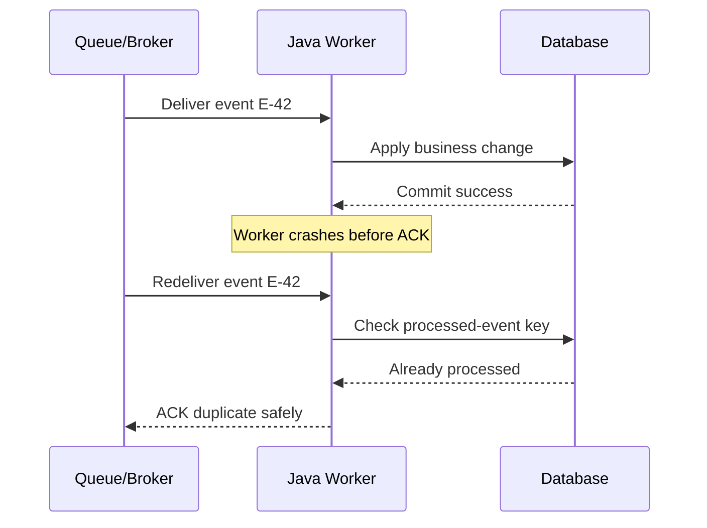
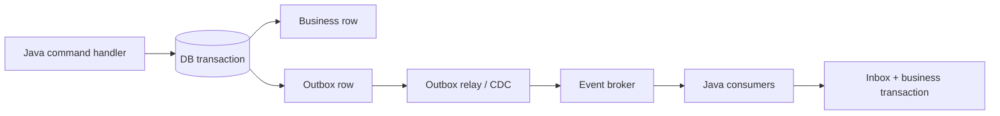

# Chống xử lý trùng và kiểm soát số worker đồng thời

Một hệ thống xử lý sự kiện không thể giả định mỗi message chỉ đến đúng một lần. Broker có thể giao lại message khi worker timeout, mất kết nối trước khi ACK, bị dừng giữa transaction hoặc không xác nhận được kết quả. Scheduler, producer retry và thao tác redrive từ dead-letter queue cũng có thể tạo thêm lần giao. Với Java serverless, nhiều invocation còn có thể chạy đồng thời trên nhiều execution environment.

Vì vậy, event processor cần giải quyết hai vấn đề cùng lúc: **xử lý trùng an toàn** và **giới hạn concurrency theo khả năng thực tế của hệ thống**. Idempotency bảo đảm một event được giao nhiều lần không tạo thêm side effect nghiệp vụ. Concurrency control ngăn số worker hoặc request đồng thời vượt capacity của database, API đối tác và các dependency khác. Hai cơ chế phải phối hợp với retry, ordering, checkpoint và backpressure.

Bài học dùng một Event Processing Service viết bằng Java làm ví dụ: nhận `OrderCreated`, cập nhật read model, ghi audit và phát notification. Worker có thể được kích hoạt bởi queue hoặc event bus trên AWS, Azure hay Google Cloud. Mục tiêu là thiết kế consumer chịu được duplicate delivery, nhiều worker chạy song song và sự cố xảy ra ở bất kỳ ranh giới nào giữa xử lý, commit và ACK.

## 1. Vì sao một event có thể được xử lý nhiều lần?

Nhiều hệ thống message/event cung cấp delivery theo kiểu *at least once*: broker cố gắng giao message cho tới khi nhận được acknowledgement hoặc hết retry/retention policy. Điều này tăng khả năng không mất message nhưng cho phép một message xuất hiện nhiều lần.

Các tình huống thường gặp:

- Worker xử lý xong nhưng bị crash trước khi ACK.
- Worker gửi ACK nhưng kết nối bị ngắt trước khi broker nhận được ACK.
- Function timeout trong khi database transaction đã commit.
- Visibility timeout hoặc message lock hết hạn khi worker vẫn còn chạy.
- Producer gửi lại event vì không nhận được publish confirmation.
- Broker redeliver sau lỗi tạm thời hoặc consumer restart.
- Operator redrive message từ DLQ.
- Event source gửi cùng một business change qua nhiều đường tích hợp.
- Một batch được retry vì một record lỗi, khiến record đã thành công cũng xuất hiện lại nếu không có partial failure handling.

Ví dụ worker nhận `OrderCreated(order-123)`, ghi order vào read model thành công rồi mất kết nối trước ACK. Broker không biết transaction đã commit nên giao lại message. Nếu consumer luôn insert một order mới hoặc gửi email mỗi lần nhận, hệ thống sẽ tạo duplicate.



Duplicate delivery là một tình huống bình thường cần được xử lý trong thiết kế. Không nên chỉ dựa vào việc broker “thường giao một lần” hoặc tăng visibility timeout để loại bỏ hoàn toàn duplicate.

## 2. Phân biệt idempotency, deduplication và exactly-once

Ba khái niệm có liên quan nhưng khác nhau:

| Khái niệm | Ý nghĩa | Ví dụ |
| --- | --- | --- |
| Idempotency | Thực hiện cùng một logical operation nhiều lần vẫn cho cùng kết quả nghiệp vụ như thực hiện một lần | Ghi trạng thái order thành `CREATED` theo order ID |
| Deduplication | Nhận biết và bỏ qua một event/request đã được xử lý | Kiểm tra `eventId` trong inbox table |
| Exactly-once effect | Một side effect nghiệp vụ chỉ được áp dụng một lần trong phạm vi được định nghĩa | Một order chỉ được tạo một lần dù event redelivery |

Deduplication thường là một phần của cách triển khai idempotency, nhưng chỉ lưu `eventId` trong cache không bảo đảm side effect được áp dụng đúng một lần. Cache có thể hết hạn hoặc mất khi instance restart. Cần một nguồn trạng thái bền vững và transaction/conditional write phù hợp.

“Exactly once” phải được hiểu trong một ranh giới cụ thể. Broker có thể có tính năng deduplication hoặc transactional consume trong phạm vi dịch vụ, nhưng điều đó không tự động bao phủ database, email provider, payment gateway và các API ngoài. Thiết kế phổ biến là at-least-once delivery kết hợp idempotent consumer, unique constraint và outbox/inbox.

## 3. Event identity phải ổn định từ producer

Consumer cần một định danh để nhận biết cùng một event qua các lần retry. Event ID phải được tạo một lần ở producer và giữ nguyên khi publish retry, redelivery, archive hoặc replay.

Một event envelope có thể gồm:

```json
{
  "eventId": "evt-01JQ8M7K3F5A",
  "eventType": "OrderCreated",
  "schemaVersion": 2,
  "aggregateType": "Order",
  "aggregateId": "order-123",
  "sequence": 7,
  "occurredAt": "2026-11-17T08:15:30Z",
  "producer": "orders-api",
  "correlationId": "req-01JQ8M6Y",
  "data": {
    "orderId": "order-123",
    "tenantId": "tenant-42",
    "amountMinor": 125000,
    "currency": "VND"
  }
}
```

Các trường có vai trò khác nhau:

- `eventId`: định danh duy nhất của lần phát sinh event.
- `aggregateId`: khóa nghiệp vụ dùng để phân vùng hoặc giữ thứ tự.
- `sequence`: số thứ tự/version của aggregate nếu producer hỗ trợ.
- `occurredAt`: thời điểm nghiệp vụ xảy ra, không phải thời điểm replay.
- `correlationId`: liên kết các bước trong một request/workflow.
- `schemaVersion`: chọn parser/upcaster tương ứng.

Không tạo event ID mới mỗi lần producer retry publish. Nếu producer tạo ID mới cho cùng một business operation, consumer không thể nhận ra hai event là cùng một ý định. Có thể dùng ID do application tạo trước transaction, hoặc business key cộng operation version khi contract cho phép.

### Event ID khác business key

Một order có thể phát nhiều event hợp lệ: `OrderCreated`, `OrderPaid`, `OrderShipped`. Vì vậy, chỉ dùng `aggregateId=order-123` làm deduplication key sẽ làm mất event sau event đầu tiên. Dùng `eventId` cho deduplication event; dùng business key như `orderId + operation` khi muốn bảo vệ một side effect cụ thể.

## 4. Chọn idempotency key theo ý nghĩa nghiệp vụ

Key cần phân biệt hai trường hợp:

1. Cùng một event được giao lại nhiều lần.
2. Hai event khác nhau nhưng cùng yêu cầu một business effect không được lặp.

Ví dụ:

| Operation | Key có thể dùng |
| --- | --- |
| Apply một event | `eventId` |
| Tạo order từ command | `tenantId + clientRequestId` |
| Gửi email cho một invoice/template | `invoiceId + notificationType + templateVersion` |
| Cập nhật projection theo aggregate version | `aggregateId + sequence` |
| Thanh toán cho một invoice | `invoiceId + paymentAttemptId` theo payment contract |
| Chạy một logical scheduled job | `jobName + scheduledPeriod` |

Key quá rộng có thể bỏ nhầm một operation hợp lệ; key quá hẹp không chặn được duplicate. Hãy xác định rõ phạm vi tenant, loại operation và thời gian giữ key.

## 5. Inbox pattern và bảng processed events

Một consumer có thể lưu event đã xử lý trong bảng inbox/processed-event. Cấu trúc tối thiểu:

```sql
CREATE TABLE processed_event (
    consumer_name  VARCHAR(120) NOT NULL,
    event_id       VARCHAR(200) NOT NULL,
    processed_at   TIMESTAMP NOT NULL,
    outcome        VARCHAR(40) NOT NULL,
    PRIMARY KEY (consumer_name, event_id)
);
```

`consumer_name` là cần thiết khi nhiều consumer độc lập cùng nhận một event. Consumer `search-projection` và consumer `billing` phải có thể xử lý cùng `eventId` một lần cho mỗi consumer. Nếu dùng một unique constraint toàn cục chỉ trên `event_id`, consumer đầu tiên sẽ chặn consumer còn lại.

### Transaction boundary

Khi inbox và business data nằm trong cùng database, thực hiện trong một transaction:

1. Thử insert `(consumer_name, event_id)`.
2. Nếu key đã tồn tại, coi là duplicate và không lặp business effect.
3. Nếu insert mới thành công, áp dụng business update.
4. Ghi outbox event nếu cần phát event tiếp theo.
5. Commit transaction.
6. Chỉ ACK message sau khi commit thành công.

Nếu transaction rollback, inbox insert và business update cùng rollback; message có thể được retry. Nếu transaction commit nhưng ACK thất bại, lần giao sau gặp unique key và được bỏ qua an toàn.

Không ghi processed key trước transaction nghiệp vụ ở một hệ thống khác. Nếu đánh dấu processed trước rồi crash trước business update, event sẽ bị bỏ qua vĩnh viễn dù công việc chưa hoàn tất.

## 6. Java example: consumer idempotent với JDBC transaction

Ví dụ sau dùng PostgreSQL syntax `ON CONFLICT DO NOTHING`. Inbox insert, business update và outbox insert nằm trong cùng transaction:

```java
import javax.sql.DataSource;
import java.sql.Connection;
import java.sql.PreparedStatement;
import java.sql.SQLException;

public final class OrderCreatedConsumer {
    private final DataSource dataSource;

    public OrderCreatedConsumer(DataSource dataSource) {
        this.dataSource = dataSource;
    }

    public ProcessingResult handle(OrderCreated event) throws SQLException {
        try (Connection connection = dataSource.getConnection()) {
            connection.setAutoCommit(false);
            try {
                int inserted = insertInbox(connection, event.eventId());
                if (inserted == 0) {
                    connection.rollback();
                    return ProcessingResult.DUPLICATE;
                }

                applyOrderProjection(connection, event);
                insertOutbox(connection, event);

                connection.commit();
                return ProcessingResult.APPLIED;
            } catch (SQLException | RuntimeException ex) {
                connection.rollback();
                throw ex;
            }
        }
    }

    private int insertInbox(Connection connection, String eventId)
            throws SQLException {
        String sql = """
                INSERT INTO processed_event
                    (consumer_name, event_id, processed_at, outcome)
                VALUES ('order-projection', ?, CURRENT_TIMESTAMP, 'APPLIED')
                ON CONFLICT (consumer_name, event_id) DO NOTHING
                """;
        try (PreparedStatement statement = connection.prepareStatement(sql)) {
            statement.setString(1, eventId);
            return statement.executeUpdate();
        }
    }

    private void applyOrderProjection(Connection connection, OrderCreated event)
            throws SQLException {
        String sql = """
                INSERT INTO order_projection (order_id, tenant_id, status)
                VALUES (?, ?, 'CREATED')
                ON CONFLICT (order_id) DO UPDATE
                SET tenant_id = EXCLUDED.tenant_id
                """;
        try (PreparedStatement statement = connection.prepareStatement(sql)) {
            statement.setString(1, event.orderId());
            statement.setString(2, event.tenantId());
            statement.executeUpdate();
        }
    }

    private void insertOutbox(Connection connection, OrderCreated event)
            throws SQLException {
        // Ghi event tiếp theo trong cùng transaction với projection.
        // Relay outbox sẽ publish bất đồng bộ và có thể publish lại.
    }

    public enum ProcessingResult { APPLIED, DUPLICATE }

    public record OrderCreated(
            String eventId, String orderId, String tenantId) {}
}
```

Đây là ví dụ cấu trúc, cần điều chỉnh schema, error handling và SQL theo database thực tế. Với PostgreSQL, `ON CONFLICT` là thao tác nguyên tử dựa trên unique constraint. Không thay nó bằng `SELECT` rồi `INSERT` ở hai câu lệnh không khóa vì hai worker có thể cùng thấy chưa có record và cùng áp dụng side effect.

`applyOrderProjection` cần được thiết kế theo semantics của projection. Ví dụ trên không phải mẫu cập nhật mọi loại order; nếu event cũ có thể đến sau event mới, cần kiểm tra aggregate sequence/version trước khi update.

### ACK sau commit

Adapter của queue chỉ ACK khi `handle` trả về thành công (kết quả `APPLIED` hoặc `DUPLICATE`). Nếu transaction ném lỗi, không ACK để broker retry theo policy. Không ACK trước khi transaction commit.

## 7. Xử lý side effect nằm ngoài database

Inbox transaction chỉ bảo vệ được side effect nằm trong cùng transaction database. Giả sử worker cập nhật order rồi gọi email provider:

1. Database commit thành công.
2. Email provider gửi email thành công.
3. Worker crash trước khi ghi `email_sent` hoặc ACK.
4. Event được giao lại và worker gửi email lần nữa.

Database transaction không thể rollback email đã gửi. Có một số cách xử lý:

- Gửi idempotency key tới provider nếu provider hỗ trợ.
- Ghi một notification command vào outbox cùng transaction với business update; notification worker có inbox riêng.
- Lưu trạng thái gửi và reconcile với provider khi kết quả không rõ.
- Dùng business key ổn định để provider hoặc adapter nhận diện cùng một notification.
- Nếu provider không hỗ trợ idempotency và không có API tra cứu, chấp nhận/định nghĩa rõ mức đảm bảo và quy trình xử lý duplicate.

Không tuyên bố exactly-once cho email/payment chỉ vì đã có `processed_event` table trong database nội bộ.

## 8. Transactional outbox: không dual-write trực tiếp

Một producer thường cần vừa ghi database vừa publish event. Nếu ghi DB thành công nhưng publish thất bại, consumer không nhận được event. Nếu publish thành công rồi DB rollback, event mô tả một thay đổi chưa tồn tại.

Transactional outbox giải quyết khoảng trống này:

1. Trong một transaction database, ghi business row và outbox row.
2. Commit transaction.
3. Một relay/CDC publisher đọc outbox và gửi event tới broker.
4. Relay đánh dấu published hoặc lưu checkpoint sau confirmation.
5. Nếu relay không chắc broker đã nhận, có thể publish lại; consumer idempotent xử lý duplicate.



Outbox không làm broker delivery exactly-once; nó bảo đảm business change và ý định publish được ghi cùng nhau. Relay có thể giao lại, vì vậy consumer vẫn cần inbox/idempotency.

## 9. Giữ concurrency ở mức an toàn

Concurrency là số công việc đang được xử lý đồng thời. Nếu một worker xử lý trung bình 200 ms và nhận 100 message/giây, số công việc đang chạy trung bình theo Little's Law xấp xỉ:

\[
L = \lambda W = 100 \times 0,2 = 20
\]

Nếu latency tăng lên 1 giây do database chậm, cùng arrival rate 100 message/giây có thể tạo concurrency trung bình khoảng 100. Khi đó connection pool, memory và downstream quota có thể bị vượt.

Giới hạn concurrency cần dựa trên bottleneck thấp nhất trong đường xử lý:

- Database connection/transaction capacity.
- API đối tác rate limit và concurrent request quota.
- CPU/memory của function/container.
- Broker partition/consumer throughput.
- Ordering requirement theo aggregate.
- Timeout/visibility/lock duration.

Không chọn max concurrency chỉ theo khả năng scale của cloud. Scale-out vô hạn có thể biến một dependency chậm thành sự cố toàn hệ thống.

## 10. Phân biệt concurrency toàn hệ thống và concurrency trong một JVM

Một Java `Semaphore(10)` giới hạn tối đa 10 task trong một process. Nếu nền tảng chạy 30 instance, tổng concurrency có thể lên tới 300. Vì vậy, cần phân biệt:

| Lớp | Cơ chế | Phạm vi |
| --- | --- | --- |
| Cloud account/project | Account quota hoặc reserved concurrency | Nhiều function/resource trong scope provider |
| Function/service | Max instances/reserved concurrency | Toàn function/service tùy platform |
| Event source mapping/subscription | Max concurrent consumers, outstanding messages | Một trigger/subscription |
| Container/job | Task parallelism/replica limit | Một execution/job |
| JVM | Thread pool, semaphore, connection pool | Một process/instance |
| Database | Connection limit, transaction/lock capacity | Database/resource |

Hãy dùng platform/trigger limit làm giới hạn tổng khi có thể; dùng semaphore/thread pool để bảo vệ từng instance và dependency cục bộ. Hai lớp không thay thế nhau.

## 11. Java: bounded worker pool và rejection policy

Nếu một Java process cần xử lý nhiều record song song, dùng bounded thread pool thay vì unbounded executor queue:

```java
import java.util.concurrent.ArrayBlockingQueue;
import java.util.concurrent.ThreadPoolExecutor;
import java.util.concurrent.TimeUnit;

public final class EventWorkerPool implements AutoCloseable {
    private final ThreadPoolExecutor executor = new ThreadPoolExecutor(
            8,
            8,
            0L,
            TimeUnit.MILLISECONDS,
            new ArrayBlockingQueue<>(100),
            new ThreadPoolExecutor.AbortPolicy());

    public void submit(Runnable task) {
        executor.execute(task);
    }

    public int activeWorkers() {
        return executor.getActiveCount();
    }

    public int queuedTasks() {
        return executor.getQueue().size();
    }

    @Override
    public void close() {
        executor.shutdown();
    }
}
```

Khi 8 worker đang bận và queue đã chứa 100 task, task tiếp theo bị reject thay vì làm heap tăng không giới hạn. Adapter cần bắt `RejectedExecutionException` và áp dụng policy: không ACK message, trả lỗi để broker retry, hoặc dừng pull thêm message.

Trong serverless, không nên tạo thread nền rồi kết thúc invocation trước khi các thread đó hoàn tất. Runtime có thể freeze/terminate execution environment. Với queue-triggered function, thường an toàn hơn khi mỗi invocation xử lý một message/batch, chờ mọi công việc hoàn tất rồi mới trả kết quả để nền tảng ACK. Ví dụ thread pool hữu ích cho một consumer process có lifecycle rõ hoặc một invocation có kiểm soát join/await trước khi return.

## 12. Semaphore cho dependency cụ thể

Một worker có thể xử lý event song song nhưng database chỉ nên nhận một số lượng truy vấn đồng thời nhất định. Semaphore cục bộ có thể giới hạn call tới dependency:

```java
import java.util.concurrent.Semaphore;

public final class PartnerApiGate {
    private final Semaphore permits = new Semaphore(5);

    public PartnerResponse call(PartnerRequest request) throws Exception {
        if (!permits.tryAcquire()) {
            throw new DependencyCapacityException("Partner API capacity reached");
        }
        try {
            return invokePartner(request);
        } finally {
            permits.release();
        }
    }

    private PartnerResponse invokePartner(PartnerRequest request) {
        // HTTP client phải có connect/request timeout.
        return new PartnerResponse("accepted");
    }

    public record PartnerRequest(String reference) {}
    public record PartnerResponse(String status) {}

    public static final class DependencyCapacityException
            extends RuntimeException {
        public DependencyCapacityException(String message) {
            super(message);
        }
    }
}
```

Semaphore này chỉ giới hạn 5 call trong một JVM. Với nhiều instance, tổng có thể cao hơn nhiều. Cần kết hợp global rate/concurrency limit ở gateway, queue subscription, platform max instances hoặc distributed quota service. Không giữ permit trong lúc chờ các bước không liên quan tới dependency đó.

## 13. Distributed lock, lease và fencing token

Idempotency không phải lúc nào cũng đủ. Một số tác vụ yêu cầu chỉ một worker được phép xử lý một aggregate/partition tại một thời điểm, ví dụ cập nhật số dư theo thứ tự hoặc chạy singleton compaction.

Distributed lock/lease có thể được dùng khi:

- Cần bảo vệ một tài nguyên shared khỏi concurrent mutation.
- Một logical job chỉ được một worker claim.
- Cần phân công partition cho worker trong một khoảng thời gian.

Lease cần thời hạn để worker chết không khóa tài nguyên vĩnh viễn. Worker renew lease khi còn sở hữu. Tuy nhiên, lease có thể hết hạn trong lúc worker cũ bị pause; worker mới claim và bắt đầu xử lý trong khi worker cũ tỉnh lại.

**Fencing token** là generation tăng dần mỗi lần cấp lease. Khi ghi dữ liệu, resource kiểm tra token hiện tại; token cũ bị từ chối. Điều này ngăn worker cũ ghi sau khi mất quyền sở hữu.

Không dùng lock như cơ chế mặc định cho mọi event. Unique constraint, conditional update, partition key và idempotent transaction thường đơn giản và an toàn hơn. Lock có thể giảm throughput và tạo bottleneck nếu giữ quá lâu.

## 14. Ordering: giới hạn concurrency theo aggregate key

Nhiều event có thể xử lý song song nếu độc lập. Nhưng event của cùng một order/account thường cần thứ tự.

Ví dụ:

```text
OrderCreated(order-123, sequence=1)
OrderPaid(order-123, sequence=2)
OrderShipped(order-123, sequence=3)
```

Nếu `OrderShipped` chạy trước `OrderCreated`, projection có thể tạo trạng thái không hợp lệ. Các cách giữ ordering:

- Partition message theo `aggregateId` để cùng aggregate vào một partition/lane.
- Chỉ xử lý tuần tự trong cùng partition/key nhưng xử lý nhiều partition song song.
- Kiểm tra sequence/version trong database trước khi apply.
- Nếu sequence có gap, retry có backoff hoặc đưa vào pending buffer/quarantine.
- Không tăng parallelization vượt khả năng ordering của broker/partition.

### Optimistic sequence check

Một update có thể yêu cầu sequence mới đúng bằng sequence hiện tại cộng một:

```sql
UPDATE order_projection
SET status = :new_status,
    last_sequence = :incoming_sequence
WHERE order_id = :order_id
  AND last_sequence = :incoming_sequence - 1;
```

Nếu update count bằng 0, event có thể là duplicate, out-of-order, sequence gap hoặc aggregate chưa tồn tại. Consumer phải đọc trạng thái hiện tại để phân loại. Không coi mọi update count 0 là duplicate và ACK; event sequence tương lai có thể cần chờ event trước.

### Không cần global ordering nếu chỉ cần per-key ordering

Global ordering làm giảm throughput vì mọi event phải đi qua một lane. Thường chỉ cần ordering theo `aggregateId`, `accountId` hoặc một business key. Xác định key chính xác trong contract và không giả định broker tự giữ thứ tự giữa nhiều partition.

## 15. Bounded concurrency, batch size và queue flow control

Với queue consumer, batch size và số batch chạy đồng thời cùng quyết định lượng công việc đang in-flight. Nếu batch có 100 record và có 20 invocation đồng thời, hệ thống có thể xử lý tới khoảng 2.000 record cùng lúc, chưa tính concurrency bên trong mỗi invocation.

Chọn batch/concurrency theo:

- Kích thước payload và memory mỗi record.
- Processing duration p95/p99.
- Database transaction/connection capacity.
- Retry semantics của batch.
- Visibility timeout/message lock và function timeout.
- Ordering/partition constraints.
- Downstream rate limit.

Pull consumer nên giới hạn số message/byte outstanding. Khi đạt giới hạn, dừng pull cho tới khi xử lý/ACK xong. Với push trigger, cấu hình max concurrent delivery/instances và trả response đúng semantics khi quá tải.

## 16. Backpressure và admission control

Khi worker đạt concurrency cap, hệ thống cần quyết định:

- Không nhận thêm message cho tới khi worker rảnh.
- Để message chờ trong durable queue.
- Từ chối request HTTP bằng `429` hoặc `503` với retry policy phù hợp.
- Giảm tốc producer hoặc tạm dừng một loại event best-effort.
- Đưa record lỗi không thể xử lý vào DLQ/quarantine.

Không tạo một queue in-memory không giới hạn trong function. Queue bền vững của broker phù hợp hơn để hấp thụ burst. Backpressure cần được đo qua queue age, backlog, rejected count và downstream latency.

### Retry không phải cách điều tiết tải

Nếu database đang quá tải, retry nhanh làm tải tăng thêm. Dùng exponential backoff, jitter, maximum attempts và retry budget. Tách lỗi transient khỏi poison message; không retry mãi một payload sai schema.

## 17. AWS Lambda: giới hạn concurrency cho SQS event source

Với AWS Lambda và SQS, các cơ chế thường dùng:

- **Reserved concurrency:** giới hạn concurrency của function và giữ capacity khỏi pool unreserved của account.
- **Maximum concurrency của event source mapping:** giới hạn mức poller scale cho mapping SQS cụ thể.
- **Batch size:** số record tối đa trong một invocation theo cấu hình và loại queue.
- **Partial batch response:** báo chính xác record lỗi để chỉ retry record cần thiết khi cấu hình hỗ trợ.
- **Visibility timeout:** message tạm ẩn trong khi xử lý; nếu xử lý không hoàn tất/ACK, message có thể được giao lại.
- **DLQ/redrive policy:** cô lập message vượt số lần nhận/thử theo cấu hình.

Reserved concurrency và maximum concurrency của nhiều event source mapping phải được tính cùng nhau. Nếu tổng concurrency yêu cầu vượt reserved concurrency, mapping có thể bị throttle. Nếu concurrency quá cao, database có thể bị quá tải. Chọn giới hạn theo capacity downstream và chừa headroom cho function khác.

### Partial batch response

Với SQS batch, nếu một record lỗi nhưng các record khác thành công, partial batch response có thể tránh retry toàn bộ batch. Với FIFO queue, cần giữ ordering: khi record lỗi, xử lý/return failure theo semantics FIFO để không vượt qua message trước đó cùng nhóm thứ tự.

Đừng ACK batch trước khi từng record đã commit. Consumer phải phân biệt record thành công, duplicate đã xử lý và record cần retry/DLQ.

## 18. Azure Functions: concurrency của queue và Service Bus

Azure Functions có cấu hình concurrency theo trigger extension/host. Các cơ chế thường gặp:

- Queue Storage trigger: `batchSize`, `newBatchThreshold`, `maxDequeueCount` và poison queue.
- Service Bus trigger: `maxConcurrentCalls`, session concurrency, prefetch và lock renewal tùy extension/runtime.
- Event Hubs trigger: partition ownership, batch size và checkpoint; concurrency chịu giới hạn partition.
- Hosting plan: scale/instance limit và tài nguyên mỗi instance.
- API Management/gateway: rate limit trước HTTP function.

Các giá trị nằm trong `host.json` và có thể khác theo extension version. Cấu hình per-host không nhất thiết là global concurrency cap; khi Function App scale nhiều host, tổng concurrency có thể cao hơn. Phải kết hợp plan-level max scale và capacity database.

Với Service Bus, message lock có thể hết hạn trước khi xử lý xong nếu thời gian xử lý dài hoặc host chậm. Cần cấu hình lock renewal/timeout phù hợp, xử lý duplicate và không dựa vào lock để bảo đảm business exactly-once.

## 19. Google Cloud: Pub/Sub flow control và Cloud Run concurrency

Với Pub/Sub pull subscriber, flow control có thể giới hạn:

- Số outstanding messages.
- Tổng outstanding bytes.
- Số message đang xử lý đồng thời qua executor/consumer configuration.

Khi đạt ngưỡng, subscriber tạm dừng pull thêm message cho đến khi ACK hoặc xử lý xong. Với push subscription, endpoint cần trả response theo delivery contract; lỗi có thể dẫn đến redelivery.

Cloud Run service có concurrency per instance và maximum instances. Giới hạn tổng request in-flight gần đúng bằng:

\[
MaxInFlight \approx MaxInstances \times ConcurrencyPerInstance
\]

Đây là giới hạn gần đúng ở tầng request, không phải rate per second. Nếu mỗi request xử lý batch hoặc tạo thread pool riêng, concurrency thực tế của downstream còn có thể lớn hơn. Cloud Run Jobs có task parallelism để giới hạn số task chạy cùng lúc.

Với Cloud Run functions/Functions Framework, kiểm tra cấu hình theo generation/runtime cụ thể; không giả định mọi loại function có cùng concurrency behavior như Cloud Run service.

## 20. Retry, poison message và DLQ

Retry xử lý lỗi tạm thời; DLQ/quarantine xử lý message không thể tiếp tục theo policy thông thường.

Phân loại:

| Lỗi | Ví dụ | Hành động |
| --- | --- | --- |
| Transient | Network reset, DB failover, HTTP 503 | Retry với backoff/jitter |
| Throttling | HTTP 429, database capacity | Giảm concurrency, tôn trọng Retry-After |
| Duplicate | Inbox key đã tồn tại | Không chạy lại side effect; ACK |
| Out-of-order | Sequence 12 tới trước 11 | Buffer/retry hoặc quarantine theo policy |
| Invalid payload | JSON sai, thiếu required field | Không retry vô hạn; DLQ/quarantine |
| Unsupported schema | Version consumer chưa hỗ trợ | Route compatibility handler hoặc DLQ |
| Permanent business rejection | Resource đã đóng, operation không hợp lệ | Ghi outcome nghiệp vụ và ACK nếu contract xác định đây là terminal |
| Permission/configuration | AccessDenied, secret sai | Dừng/alert; retry không sửa được quyền |

DLQ cần có owner, retention, dashboard và quy trình redrive. Trước khi redrive, sửa nguyên nhân, kiểm tra schema/side effect và giới hạn tốc độ. Không tự động đưa toàn bộ DLQ trở lại queue theo vòng lặp không giới hạn.

## 21. Batching và partial failure

Batch tăng throughput nhưng thay đổi blast radius. Nếu một invocation nhận 100 record và record thứ 80 lỗi:

- Nếu adapter chỉ báo invocation failed, broker có thể giao lại cả batch.
- 79 record đầu có thể được xử lý lần nữa.
- Nếu side effect không idempotent, duplicate sẽ xảy ra.
- Nếu partial batch response được hỗ trợ, chỉ record lỗi có thể được retry.

Dù có partial batch, từng record vẫn cần idempotency vì duplicate có thể đến từ producer hoặc redrive độc lập. Batch transaction toàn bộ có thể bảo đảm all-or-nothing trong một database, nhưng transaction quá lớn làm tăng lock duration và có thể vượt timeout. Chọn transaction boundary theo nghiệp vụ.

## 22. Idempotency retention và cleanup

Processed-event table không thể tăng vô hạn. Cần retention dựa trên:

- Queue retention tối đa.
- Broker redelivery/retry window.
- DLQ retention và khả năng redrive.
- Event archive/replay horizon.
- Client retry window và scheduled reprocessing.
- Quy định audit/legal của business.

Nếu event có thể được replay sau 90 ngày, không xóa inbox key sau 7 ngày nếu consumer dựa vào nó để chống side effect trùng. Có thể archive key cũ, partition table theo thời gian hoặc giữ business uniqueness ở bảng domain.

Cleanup phải an toàn khi đang có worker xử lý. Dùng partition retention hoặc batch delete có giới hạn; không xóa key đang thuộc active processing window. Nếu dùng TTL eventual deletion (ví dụ NoSQL), hiểu rằng record có thể tồn tại lâu hơn TTL hoặc biến mất theo timing của service.

## 23. Chống duplicate trong NoSQL bằng conditional write

Với database không dùng SQL transaction như DynamoDB, có thể dùng conditional put để claim event ID:

```java
// Pseudocode AWS SDK v2: chỉ ghi nếu partition key chưa tồn tại.
PutItemRequest request = PutItemRequest.builder()
        .tableName("ProcessedEvents")
        .item(Map.of(
                "consumerEventKey", AttributeValue.fromS(consumerName + "#" + eventId),
                "processedAt", AttributeValue.fromS(Instant.now().toString())))
        .conditionExpression("attribute_not_exists(consumerEventKey)")
        .build();

try {
    dynamoDbClient.putItem(request);
    // Claim mới thành công; tiếp tục xử lý.
} catch (ConditionalCheckFailedException duplicate) {
    // Key đã được claim/xử lý; cần đọc trạng thái để phân biệt in-progress/completed.
}
```

Đây là đoạn minh họa, chưa xử lý transaction kết hợp với business item. Nếu chỉ claim key rồi gọi database/API khác, worker có thể crash sau claim và trước business effect; lần retry sẽ thấy key tồn tại và bỏ qua công việc chưa hoàn tất. Cần state machine `IN_PROGRESS/COMPLETED`, lease expiry/fencing hoặc transaction API như DynamoDB `TransactWriteItems` khi mọi thay đổi nằm trong cùng service/database.

### Trạng thái idempotency

Nếu cần xử lý dài, một record có thể có:

| Status | Ý nghĩa |
| --- | --- |
| `IN_PROGRESS` | Worker đã claim key, công việc chưa hoàn tất |
| `COMPLETED` | Side effect đã commit |
| `FAILED_RETRYABLE` | Lỗi transient, có thể thử lại |
| `FAILED_FINAL` | Lỗi terminal cần operator/business action |

Claim phải atomic. Lease hết hạn không tự chứng minh worker cũ đã dừng; dùng fencing token hoặc conditional version để worker cũ không thể commit sau khi quyền claim chuyển sang worker mới.

## 24. Chọn concurrency theo capacity và Little's Law

Giả sử database dành cho event processor có thể xử lý ổn định 120 transaction/giây. Mỗi worker giữ transaction trung bình 100 ms. Concurrency lý thuyết theo Little's Law:

\[
C \approx \lambda W = 120 \times 0,1 = 12
\]

Đây là mức concurrency trung bình để đạt throughput đó trong giả định service time ổn định. Thực tế cần đo p95, lock wait, connection pool và transaction CPU. Có thể đặt cap thấp hơn để chừa headroom cho HTTP API và các service khác.

Nếu worker xử lý trung bình 500 ms, cùng throughput 120 transaction/giây cần concurrency lý thuyết khoảng 60. Nhưng nếu database chỉ có 40 connection dành cho workload này, tăng concurrency lên 60 có thể làm thread chờ connection và latency tăng. Cần tối ưu transaction hoặc tăng capacity trước.

### Tính tổng concurrency nhiều lớp

Ví dụ:

- 10 serverless instances.
- Mỗi instance có tối đa 5 invocation đồng thời.
- Mỗi invocation xử lý 4 record song song.

Concurrency record tối đa có thể gần:

\[
10 \times 5 \times 4 = 200
\]

Không chỉ nhìn max instances hoặc invocation concurrency riêng lẻ. Hãy nhân các lớp song song có thể cùng hoạt động và đối chiếu với downstream capacity.

## 25. Per-tenant fairness và noisy neighbor

Một tenant có thể phát event với tốc độ rất cao, chiếm hết worker và khiến tenant khác bị trễ. Cần cân bằng tổng throughput và fairness:

- Rate limit theo tenant đã xác thực.
- Queue/partition theo tenant hoặc tenant class khi cần isolation.
- Giới hạn số event in-flight cho một tenant.
- Weighted fair scheduling hoặc round-robin giữa tenant.
- Priority queue cho event critical và best-effort.
- Quota theo weighted work units thay vì chỉ message count.
- Theo dõi queue age và throughput theo tenant group.

Không nhất thiết tạo queue riêng cho mọi tenant; số queue lớn làm tăng operational overhead. Có thể dùng shared queue với partition key, scheduler hoặc dispatch layer. Với tenant lớn cần isolation mạnh, dedicated queue/resource có thể hợp lý.

## 26. Java consumer lifecycle trong serverless

Một Java serverless function có thể được gọi trên execution environment tái sử dụng. Static client/connection pool có thể giúp giảm initialization cost, nhưng không được giữ user-specific mutable state hoặc giả định process tồn tại lâu dài.

Nguyên tắc:

- Tạo SDK client/thread-safe connection pool có thể tái sử dụng nếu platform/runtime khuyến nghị.
- Không lưu `processedEventIds` trong static set làm nguồn deduplication chính.
- Không chạy background thread sau khi handler return nếu host không quản lý lifecycle đó.
- Đóng transaction/connection đúng cách trong mọi nhánh.
- Giới hạn connection pool theo tổng max instances.
- Thiết lập timeout cho database/API và deadline invocation.
- Trả kết quả thành công chỉ sau khi side effect bền vững đã commit.
- Propagate trace/correlation context qua message header.

### Ví dụ handler theo một batch

```java
import java.util.ArrayList;
import java.util.List;

public final class EventBatchHandler {
    private final OrderCreatedConsumer consumer;

    public BatchResult handle(List<OrderCreated> events) {
        List<String> failedIds = new ArrayList<>();
        int applied = 0;
        int duplicates = 0;

        for (OrderCreated event : events) {
            try {
                var result = consumer.handle(event);
                if (result == OrderCreatedConsumer.ProcessingResult.APPLIED) {
                    applied++;
                } else {
                    duplicates++;
                }
            } catch (TransientProcessingException ex) {
                failedIds.add(event.eventId());
            }
        }

        return new BatchResult(applied, duplicates, failedIds);
    }

    public record BatchResult(
            int applied,
            int duplicates,
            List<String> failedEventIds) {}
}
```

Adapter cloud cần chuyển `failedEventIds` sang đúng partial batch response schema của provider. Lỗi terminal như invalid payload có thể cần ghi quarantine/DLQ rồi ACK theo policy; không được đưa mọi exception vào retry vô hạn. Ví dụ giả định consumer phân biệt transient và terminal exception rõ ràng.

## 27. Các giới hạn concurrency ở từng cloud

| Nền tảng | Cơ chế thường dùng | Điều cần xác minh |
| --- | --- | --- |
| AWS Lambda + SQS | Reserved concurrency, event source maximum concurrency, batch size, partial batch response | Tổng mapping concurrency so với reserved/account quota; FIFO ordering; visibility timeout |
| Azure Functions + Queue Storage | `batchSize`, `newBatchThreshold`, host/plan scale limit, poison queue | Extension version và concurrency nhân theo số host |
| Azure Functions + Service Bus | `maxConcurrentCalls`, sessions, prefetch, lock renewal | Tổng host concurrency, lock duration và session ordering |
| Azure Functions + Event Hubs | Partition count, batch size, checkpoint, host scale | Một partition chỉ có một owner active theo processor model; lag và parallelism |
| Google Pub/Sub pull | Max outstanding messages/bytes, executor/flow control | Ack deadline, lease extension và number of subscribers |
| Google Pub/Sub push | Endpoint capacity, push delivery behavior, retry/backoff | HTTP response semantics, Cloud Run concurrency/max instances |
| Google Cloud Run | Concurrency per instance, max instances | Request concurrency nhân instance count và resource capacity |
| Google Cloud Run Jobs | Task count, parallelism | Số task đồng thời và downstream quota |

Tên setting và default có thể thay đổi theo runtime, trigger extension và generation. Đọc đúng tài liệu phiên bản đang triển khai và xác minh bằng metrics/load test; không sao chép một giá trị `host.json` hoặc concurrency từ project khác.

## 28. Observability: đo duplicate, concurrency và backlog

Chỉ theo dõi invocation count là chưa đủ. Dashboard event processor nên có:

| Metric | Ý nghĩa |
| --- | --- |
| `events.received` | Số event nhận được |
| `events.applied` | Số event tạo business effect thành công |
| `events.duplicate` | Số event bị bỏ qua do inbox/deduplication |
| `events.failed.retryable` | Lỗi transient được retry |
| `events.failed.terminal` | Lỗi terminal/quarantine |
| `events.processing.duration` | Thời gian xử lý p50/p95/p99 |
| `workers.active` | Worker đang hoạt động |
| `workers.rejected` | Task bị từ chối do local capacity |
| `queue.depth` | Backlog hiện tại |
| `queue.oldest_age` | Tuổi message cũ nhất |
| `queue.redelivery` | Số lần redelivery |
| `dlq.depth` | Số message trong DLQ |
| `dependency.in_flight` | Call đồng thời tới DB/API |
| `dependency.timeout` | Timeout downstream |
| `ordering.gap` | Event sequence bị thiếu hoặc đến sai thứ tự |
| `idempotency.in_progress_age` | Claim đang xử lý quá lâu |

Theo dõi duplicate rate cùng applied count. Duplicate tăng có thể do ACK failure, visibility timeout ngắn, producer retry hoặc redrive; không phải lúc nào cũng là lỗi business. Nhưng duplicate rate tăng đột biến có thể báo hiệu worker timeout hoặc broker configuration sai.

Không dùng `eventId`, `aggregateId` hoặc tenant ID có cardinality lớn làm metric label. Dùng log/trace có kiểm soát để drill-down theo correlation ID.

## 29. Alert và runbook xử lý

Alert nên dựa trên tác động:

- Oldest message age vượt SLO.
- Queue depth tăng liên tục trong khi throughput không tăng.
- DLQ depth tăng hoặc poison message lặp lại.
- Worker concurrency chạm cap kéo dài và rejected/throttle tăng.
- Database connection wait, lock wait hoặc API 429 tăng.
- Idempotency `IN_PROGRESS` quá hạn.
- Duplicate rate tăng bất thường so với baseline.
- Event sequence gap tồn tại lâu.

Khi incident:

1. Xác định queue/topic, consumer và event type bị ảnh hưởng.
2. Kiểm tra duplicate/redelivery, retry count, queue age và DLQ.
3. Xem worker concurrency, duration, timeout và dependency health.
4. Giảm concurrency hoặc pause consumer nếu downstream quá tải.
5. Không xóa inbox/processed-event record để “thử lại” nếu chưa hiểu side effect.
6. Kiểm tra trạng thái nghiệp vụ và reconcile event đang `IN_PROGRESS`.
7. Sửa nguyên nhân, redrive có giới hạn và theo dõi duplicate/business outcome.

Nếu consumer đã commit business effect nhưng ACK thất bại, không cần xóa idempotency record. Lần giao lại phải được nhận diện là duplicate và ACK an toàn.

## 30. Test concurrency và duplicate

Unit test đơn lẻ không thể chứng minh race condition được xử lý đúng. Cần test song song với cùng event ID:

- Gửi 50–100 invocation đồng thời với cùng event ID.
- Xác minh chỉ một business effect được commit.
- Xác minh các invocation còn lại trả duplicate hoặc in-progress theo contract.
- Gửi nhiều event ID khác nhau cùng aggregate để kiểm tra ordering/sequence.
- Giả lập worker crash sau DB commit nhưng trước ACK.
- Giả lập ACK failure hoặc message redelivery.
- Giả lập lease expiry khi worker cũ vẫn đang chạy.
- Giả lập database timeout, deadlock và connection pool exhaustion.
- Giả lập poison payload, schema version không hỗ trợ và DLQ redrive.
- Kiểm tra max concurrency thực tế không vượt downstream budget.

### Failure injection theo điểm crash

| Điểm crash | Hành vi mong đợi khi retry |
| --- | --- |
| Trước inbox insert | Event được xử lý như mới |
| Sau inbox insert nhưng trước business update, cùng transaction | Transaction rollback; retry có thể claim lại |
| Sau business update nhưng trước commit, cùng transaction | Rollback cả inbox và business update |
| Sau commit nhưng trước ACK | Redelivery bị inbox unique key nhận diện; không lặp side effect |
| Sau outbox commit nhưng trước publish | Relay publish lại từ outbox |
| Sau publish nhưng trước đánh dấu outbox sent | Có thể publish duplicate; consumer dedupe |
| Sau external API effect nhưng trước local status | Dùng provider idempotency/reconciliation để xử lý unknown outcome |

## 31. Những lỗi thường gặp

1. **Dùng static HashSet để nhớ event đã xử lý.** State mất khi instance restart và không chia sẻ giữa instances.
2. **ACK trước khi commit.** Có thể mất event khi database transaction thất bại.
3. **Commit xong nhưng không idempotent.** ACK failure dẫn tới duplicate side effect.
4. **Dùng event ID mới khi retry publish.** Consumer không nhận ra cùng event.
5. **Chỉ dùng SELECT rồi INSERT.** Hai worker có thể cùng vượt qua kiểm tra và insert.
6. **Claim idempotency key ở DB rồi gọi external API không có recovery state.** Crash có thể để key đã claim nhưng effect chưa xảy ra.
7. **Dùng một unique key cho mọi consumer.** Consumer độc lập có thể chặn nhau.
8. **Dùng aggregate ID thay event ID cho mọi deduplication.** Event hợp lệ tiếp theo bị bỏ qua.
9. **Tăng concurrency mà không tính tổng các lớp song song.** Downstream bị quá tải.
10. **Chỉ dùng semaphore cục bộ để đặt global limit.** Nhiều instances nhân giới hạn lên.
11. **Lock không có lease/fencing.** Worker cũ có thể ghi sau khi lock hết hạn.
12. **Giữ global ordering cho mọi event.** Throughput thấp không cần thiết.
13. **Không xử lý sequence gap.** Projection có thể đi vào trạng thái sai.
14. **Retry poison message vô hạn.** Tốn chi phí và chặn queue.
15. **Không kiểm tra retention của inbox.** Replay cũ có thể tạo side effect lại.
16. **Chạy thread nền rồi return invocation.** Runtime có thể freeze/terminate trước khi xử lý xong.

## 32. Quy trình thiết kế consumer an toàn

1. **Define event contract:** event ID ổn định, aggregate key, sequence, schema version và occurred time.
2. **Choose idempotency scope:** event-level, business-operation-level hoặc cả hai.
3. **Design inbox:** unique constraint theo consumer + event ID; retention theo replay horizon.
4. **Define transaction:** inbox, business state và outbox commit cùng nhau khi có thể.
5. **Handle external effects:** provider idempotency key, outbox worker và reconciliation.
6. **Set ordering:** partition key/sequence check theo aggregate, không áp đặt global ordering nếu không cần.
7. **Set concurrency:** tính capacity database/API, platform max concurrency, batch và per-instance pool.
8. **Apply backpressure:** giới hạn outstanding messages, worker pool và producer rate.
9. **Configure retry/DLQ:** transient vs terminal, backoff/jitter, attempt limit và redrive policy.
10. **Instrument:** received/applied/duplicate/retry, concurrency, queue age, dependency latency và sequence gap.
11. **Test failure windows:** crash trước/sau commit, ACK failure, concurrent duplicate và lease expiry.
12. **Operate:** runbook pause/resume, reconcile, redrive và retention cleanup.

## 33. Checklist trước production

- [ ] Producer tạo `eventId` ổn định và giữ nguyên qua publish retry/redelivery.
- [ ] Event có `aggregateId`, sequence và schema version khi nghiệp vụ cần.
- [ ] Consumer có inbox/processed-event store bền vững với unique constraint.
- [ ] Inbox key được scope theo consumer và tenant/business operation khi cần.
- [ ] Inbox insert, business update và outbox commit trong cùng transaction nếu cùng database.
- [ ] Message chỉ ACK sau khi business transaction commit.
- [ ] External side effect dùng provider idempotency hoặc reconciliation.
- [ ] Idempotency retention bao phủ retry, DLQ redrive và replay window.
- [ ] Ordering được bảo đảm theo aggregate key/partition nếu cần.
- [ ] Sequence gap và out-of-order event có policy rõ.
- [ ] Max concurrency được tính theo tổng instance × invocation × per-record parallelism.
- [ ] Database pool/API quota có headroom cho các workload khác.
- [ ] Bounded executor/queue có rejection policy rõ, không unbounded memory queue.
- [ ] Platform/trigger concurrency và batch size đã được cấu hình, load test.
- [ ] Backpressure, retry budget, timeout và DLQ/redrive được định nghĩa.
- [ ] Java invocation không return khi thread nền vẫn còn công việc chưa commit.
- [ ] Dashboard theo dõi duplicate, applied, retry, concurrency, backlog age và DLQ.
- [ ] Có test đồng thời cùng event ID và failure injection tại ranh giới commit/ACK.
- [ ] Runbook không xóa inbox key để retry mù và có bước reconciliation.

Chống xử lý trùng và kiểm soát số worker đồng thời là hai nền tảng của một event processor đáng tin cậy. Event ID ổn định, inbox/unique constraint và transaction giúp consumer xử lý redelivery an toàn; outbox và provider idempotency mở rộng bảo vệ sang side effect bên ngoài. Bounded concurrency, partition ordering, flow control và backpressure giữ worker trong giới hạn database/API có thể chịu được. Khi kết hợp các cơ chế này với retry/DLQ, metrics và failure-injection tests, Java serverless worker có thể scale-out mà không biến duplicate delivery hoặc burst traffic thành lỗi dữ liệu.

## Tài liệu tham khảo chính thức

- [AWS Lambda – Using Lambda with Amazon SQS](https://docs.aws.amazon.com/lambda/latest/dg/with-sqs.html)
- [AWS Lambda – Configuring maximum concurrency for SQS event source mappings](https://docs.aws.amazon.com/lambda/latest/dg/services-sqs-scaling.html)
- [AWS Lambda – Handling errors for an SQS event source](https://docs.aws.amazon.com/lambda/latest/dg/services-sqs-errorhandling.html)
- [Amazon SQS – Visibility timeout](https://docs.aws.amazon.com/AWSSimpleQueueService/latest/SQSDeveloperGuide/sqs-visibility-timeout.html)
- [Azure Functions – Concurrency](https://learn.microsoft.com/azure/azure-functions/functions-concurrency)
- [Azure Functions – host.json reference](https://learn.microsoft.com/azure/azure-functions/functions-host-json)
- [Azure Service Bus – Message transfers, locks and settlement](https://learn.microsoft.com/azure/service-bus-messaging/message-transfers-locks-settlement)
- [Google Cloud Pub/Sub – Subscriber flow control](https://cloud.google.com/pubsub/docs/flow-control)
- [Google Cloud Pub/Sub – Message replay and seek](https://cloud.google.com/pubsub/docs/replay-message)
- [Google Cloud Run – Concurrency](https://cloud.google.com/run/docs/about-concurrency)
- [Resilience4j – Bulkhead](https://resilience4j.readme.io/docs/bulkhead)
- [Debezium – Outbox Event Router](https://debezium.io/documentation/reference/stable/transformations/outbox-event-router.html)
