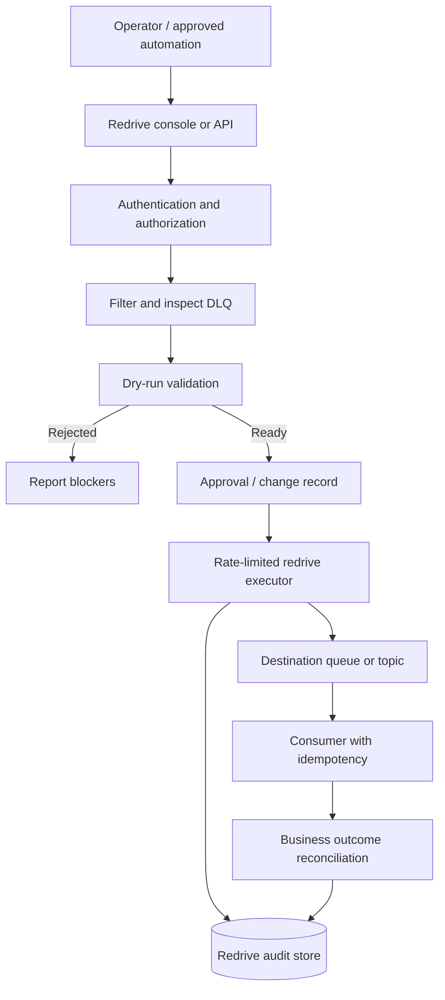

# Thiết kế dead-letter queue và công cụ redrive có kiểm soát

Trong hệ thống xử lý sự kiện, một message có thể thất bại vì dependency tạm thời không khả dụng, payload sai schema, dữ liệu nghiệp vụ không hợp lệ hoặc bug trong consumer. Nếu retry mọi lỗi theo cùng một cách, message lỗi có thể được giao đi giao lại, chiếm worker capacity và làm backlog tăng. Nếu bỏ message ngay khi gặp lỗi, hệ thống có thể mất công việc và không còn bằng chứng để điều tra.

Dead-letter queue (DLQ) là nơi cách ly message đã vượt chính sách retry hoặc không thể xử lý theo luồng bình thường. Redrive là quy trình đưa message đã cách ly trở lại một luồng xử lý sau khi nguyên nhân lỗi được hiểu và điều kiện phục hồi đã sẵn sàng. Redrive an toàn cần kiểm tra dữ liệu, xác thực người vận hành, giới hạn tốc độ, giữ lịch sử và bảo đảm consumer idempotent.

Trong phạm vi **CLOUD_SERVERLESS**, bài học tập trung vào phát triển và triển khai ứng dụng serverless, đặc biệt là Java function kích hoạt bởi HTTP, thông điệp hoặc sự kiện. Người học xử lý trigger, trạng thái, quyền truy cập, retry, idempotency, cold start, mở rộng và chi phí. Bài này hướng dẫn thiết kế DLQ và công cụ redrive có kiểm soát để phục hồi event-driven workflow mà không tạo thêm side effect hoặc làm quá tải hệ thống.

## 1. DLQ giải quyết vấn đề gì?

Một message queue thường giao message cho consumer theo delivery semantics ít nhất một lần. Consumer có thể timeout, crash trước khi acknowledge, mất lock hoặc trả lỗi. Broker có thể giao lại message. Sau một số lần thử, message vẫn không xử lý được.

Các tình huống điển hình:

- Dependency tạm thời lỗi hoặc throttling kéo dài.
- Payload không đúng schema hoặc thiếu field bắt buộc.
- Message chứa giá trị nghiệp vụ không hợp lệ.
- Consumer có bug và ném exception với một nhóm message cụ thể.
- Message vượt giới hạn kích thước hoặc không giải mã được.
- Message bị hết hạn hoặc không còn ý nghĩa nghiệp vụ.
- Poison message liên tục làm worker thất bại.

DLQ giúp tách message gây lỗi khỏi luồng bình thường để các message khác tiếp tục được xử lý. Nó tạo một nơi lưu bằng chứng và hỗ trợ điều tra, sửa dữ liệu hoặc code, rồi redrive theo chính sách.

DLQ không tự sửa lỗi, không bảo đảm message sẽ được xử lý thành công sau này và không phải nơi lưu trữ vô thời hạn. Nếu không có owner, retention, alert và quy trình xử lý, DLQ chỉ trở thành một backlog thứ hai khó quan sát hơn.

## 2. Phân biệt retry, DLQ và quarantine

Ba cơ chế có mục đích khác nhau:

| Cơ chế | Mục đích | Khi sử dụng |
|---|---|---|
| Retry | Thử lại lỗi có khả năng tạm thời | Timeout, network reset, HTTP 503, throttling |
| Dead-letter queue | Cách ly message đã vượt chính sách giao lại hoặc bị từ chối | Hết delivery attempts, poison message, lỗi không thể xử lý |
| Quarantine | Giữ message cần kiểm tra thủ công hoặc cần sửa dữ liệu/schema | Payload độc hại, dữ liệu nhạy cảm, contract không rõ hoặc vi phạm policy |

Một số broker có DLQ tích hợp; một số hệ thống tự tạo quarantine topic/queue. Dù tên gọi khác nhau, cần xác định rõ ai sở hữu message, vì sao nó bị cách ly, message có thể được phát lại không và ai có quyền thực hiện.

Không đưa message vào DLQ chỉ vì dependency đang lỗi trong vài giây. Retry có backoff phù hợp giúp xử lý lỗi tạm thời. Ngược lại, retry vô hạn một payload sai schema không làm nó hợp lệ hơn.

## 3. Phân loại lỗi trước khi chọn retry policy

Consumer cần phân biệt lỗi tạm thời, lỗi vĩnh viễn và lỗi nghiệp vụ:

| Nhóm lỗi | Ví dụ | Hành vi thường phù hợp |
|---|---|---|
| Transient infrastructure | Connection reset, timeout, HTTP 503 | Retry có giới hạn, backoff và jitter |
| Throttling | HTTP 429, database capacity exceeded | Giảm tốc, tôn trọng Retry-After, retry |
| Dependency configuration | Credential sai, endpoint không tồn tại | Dừng hoặc circuit break, alert; tránh retry dồn dập |
| Invalid contract | JSON không parse được, schema version không hỗ trợ | DLQ/quarantine và cảnh báo |
| Permanent business rejection | Account đóng, order đã bị hủy | Ghi kết quả nghiệp vụ; không retry vô hạn |
| Duplicate/already applied | Event đã được xử lý | Acknowledge sau khi xác minh idempotency |
| Expired/stale event | Deadline đã qua hoặc aggregate đã tiến xa hơn | Bỏ qua có ghi nhận hoặc compensation theo domain |
| Unknown exception | Bug chưa phân loại | Retry giới hạn; sau đó DLQ và điều tra |

Phân loại phải dựa trên semantics của domain và dependency. Ví dụ HTTP 404 có thể là lỗi vĩnh viễn nếu resource không tồn tại, nhưng có thể là lỗi tạm thời nếu resource được tạo bất đồng bộ và eventual consistency được chấp nhận. Không nên chỉ dựa vào mã exception tổng quát.

## 4. Thiết kế retry budget

Retry policy cần giới hạn tổng số lần thử và tổng thời gian xử lý. Các tham số chính:

- Maximum delivery attempts hoặc maximum receives.
- Initial backoff và maximum backoff.
- Exponential multiplier.
- Jitter để phân tán thời điểm retry.
- Message TTL/deadline.
- Visibility timeout, lock duration hoặc ack deadline.
- Function timeout và downstream timeout.
- Số lần redrive được phép sau khi vào DLQ.

Ví dụ backoff tăng dần:

| Attempt | Delay ví dụ |
|---:|---:|
| 1 | 1 giây |
| 2 | 2 giây |
| 3 | 4 giây |
| 4 | 8 giây |
| 5 | 16 giây |

Có thể dùng full jitter để chọn delay ngẫu nhiên trong khoảng từ 0 đến exponential cap. Giá trị thực tế phải dựa trên dependency và SLA; bảng trên chỉ minh họa. Nếu mọi consumer retry cùng một lịch cố định, khi dependency phục hồi chúng có thể tạo thundering herd.

## 5. Poison message và retry storm

Poison message là message khiến consumer thất bại lặp lại do một đặc tính của chính message hoặc do bug lặp lại trong code. Ví dụ JSON bị hỏng, enum không hỗ trợ, field bắt buộc null hoặc một record gây exception trong mapper.

Retry storm xảy ra khi số lần retry tăng mạnh trong lúc dependency đang suy giảm. Mỗi lần retry lại tạo thêm invocation, log, network call và có thể chiếm concurrency của message mới.

Biện pháp:

- Đặt retry cap và exponential backoff có jitter.
- Phân loại permanent failure để dead-letter sớm.
- Giới hạn concurrency và tốc độ consumer.
- Dùng circuit breaker cho dependency.
- Theo dõi delivery count, oldest message age và DLQ rate.
- Không retry ở nhiều tầng cùng lúc nếu không có retry budget chung.
- Không tự động redrive toàn bộ DLQ khi dependency chưa phục hồi.

## 6. Envelope và metadata cần giữ trong DLQ

Khi message bị dead-letter, người vận hành cần biết message gốc là gì, đi qua đâu, thất bại bao nhiêu lần và consumer version nào xử lý nó. Broker có thể giữ một số metadata riêng; ứng dụng nên có envelope hoặc metadata record bổ sung theo khả năng dịch vụ.

Ví dụ envelope ứng dụng:

```json
{
  "eventId": "evt-7812",
  "eventType": "OrderSubmitted",
  "schemaVersion": 3,
  "aggregateId": "order-42",
  "aggregateVersion": 8,
  "correlationId": "order-42",
  "occurredAt": "2026-11-17T10:00:00Z",
  "tenantId": "tenant-17",
  "payload": {
    "orderId": "order-42"
  }
}
```

Metadata xử lý có thể được lưu riêng hoặc trong message properties:

- Source queue/topic/subscription.
- Original broker message ID và sequence/partition/offset nếu có.
- First enqueued time và dead-letter time.
- Delivery count hoặc attempt count.
- Failure category và normalized error code.
- Consumer/service version.
- Correlation ID và trace context đã được lọc an toàn.
- Schema version và content type.
- Redrive count, redrive batch ID và thời điểm redrive.
- Tenant hoặc business owner theo chính sách phân loại dữ liệu.

Không ghi toàn bộ stack trace, secret, access token hoặc payload nhạy cảm vào message properties. Stack trace chi tiết có thể được lưu trong log/incident store với quyền truy cập riêng, còn DLQ chỉ giữ error code và reference cần thiết.

## 7. Giữ nguyên message gốc và lịch sử lỗi

DLQ là bằng chứng về message đã thất bại. Không sửa trực tiếp payload gốc để làm nó chạy được. Nếu cần chuyển đổi dữ liệu, hãy tạo một transformation có version, ghi lại input/output hash và giữ quan hệ với message ban đầu.

Một bản ghi redrive nên cho biết:

- Message gốc và source location.
- Lý do dead-letter ban đầu.
- Số lần delivery/retry trước khi dead-letter.
- Các lần redrive trước đó và kết quả.
- Consumer/schema version dùng cho lần redrive.
- Người hoặc automation khởi chạy redrive.
- Destination queue/topic.
- Transformation version nếu có.
- Thời điểm, tốc độ và số lượng message đã phát lại.

Điều này cho phép audit, điều tra và trả lời câu hỏi “message này đã được xử lý bao nhiêu lần, bằng code nào và tạo side effect gì?”.

## 8. DLQ không phải kho lưu trữ vô hạn

DLQ vẫn cần retention và capacity plan. Một DLQ không được xử lý có thể tăng chi phí storage, làm tăng rủi ro lộ dữ liệu và khiến incident cũ khó phân biệt với incident mới.

Chính sách cần nêu:

- Retention theo loại dữ liệu và nghĩa vụ audit.
- Số lượng/tuổi message cảnh báo.
- Ai là owner của từng DLQ.
- Thời hạn phân loại và xử lý.
- Quy tắc archive hoặc purge.
- Cách bảo vệ payload và audit metadata.
- Cách xử lý message hết TTL hoặc đã mất giá trị nghiệp vụ.

Không xóa message chỉ để làm DLQ count về 0. Trước khi purge, cần xác định message đã được xử lý, được chấp thuận bỏ qua, đã hết hạn theo policy hoặc đã được archive theo quy định.

## 9. Kiến trúc công cụ redrive có kiểm soát

Một redrive tool không nên là nút “replay all”. Nó cần tách phần xem xét, phê duyệt và thực thi:



Các thành phần:

- **Console/API:** tìm message, lọc theo reason, thời gian, tenant và source.
- **Authorization:** xác minh vai trò, phạm vi tenant, môi trường và quyền redrive.
- **Dry-run validator:** kiểm tra schema, destination, dependency health, capacity và duplicate risk.
- **Approval:** yêu cầu người có quyền phê duyệt theo mức độ ảnh hưởng.
- **Executor:** phát lại theo batch/rate limit, có thể pause/stop.
- **Audit store:** lưu kế hoạch, người phê duyệt, message ID, kết quả và lỗi.
- **Reconciliation:** xác nhận business effect sau redrive, không chỉ xác nhận publish thành công.

## 10. Các giai đoạn của một redrive operation

Một quy trình an toàn có thể gồm các trạng thái:

| State | Ý nghĩa |
|---|---|
| `DRAFT` | Người vận hành tạo yêu cầu redrive |
| `VALIDATING` | Hệ thống kiểm tra message và destination |
| `REJECTED` | Có blocker, không được thực thi |
| `AWAITING_APPROVAL` | Đang chờ phê duyệt |
| `APPROVED` | Đã được phép thực hiện |
| `RUNNING` | Executor đang phát message theo giới hạn |
| `PAUSED` | Tạm dừng để xử lý sự cố hoặc xem xét |
| `COMPLETED` | Đã xử lý hết tập message dự kiến gửi |
| `PARTIAL` | Một phần message được gửi, phần còn lại lỗi/bị bỏ qua |
| `CANCELLED` | Đã dừng theo yêu cầu |
| `FAILED` | Operation thất bại cần điều tra |

`COMPLETED` chỉ xác nhận việc redrive đã gửi message theo kế hoạch. Nó không chứng minh mọi message đã được consumer xử lý thành công. Kết quả nghiệp vụ cần được theo dõi riêng bằng event ID, job ID hoặc business operation ID.

## 11. Dry-run phải làm gì?

Dry-run tạo bản xem trước mà không gửi message vào destination. Nó nên kiểm tra:

- Số message phù hợp bộ lọc và số message sẽ bị bỏ qua.
- Source DLQ và destination có đúng môi trường/region không.
- Message có thể parse và schema version có được consumer hỗ trợ không.
- Error category có được phép redrive không.
- Message có hết deadline hoặc TTL không.
- Business state hiện tại có cho phép áp dụng event không.
- Event đã được xử lý hoặc đã có redrive operation khác chưa.
- Destination queue/topic còn hoạt động và có đủ capacity không.
- Dependency downstream có khỏe và không bị throttling không.
- Tổng số message, tốc độ, thời gian ước tính và mức ảnh hưởng.
- Transformation có version, được kiểm thử và có thể audit không.

Dry-run nên hiển thị summary và một mẫu đã được redact, không phơi toàn bộ payload nhạy cảm cho operator không có quyền xem.

Dry-run không khóa được trạng thái của hệ thống. Giữa dry-run và execute, message có thể được xử lý thủ công hoặc destination có thể thay đổi. Executor phải kiểm tra lại điều kiện quan trọng ngay trước khi gửi.

## 12. Lọc message theo tiêu chí cụ thể

Không redrive theo toàn bộ DLQ nếu chỉ một nhóm message đã được sửa lỗi. Bộ lọc thường gồm:

- Source queue/topic/subscription.
- Dead-letter reason/error category.
- Khoảng thời gian dead-letter.
- Event type và schema version.
- Consumer version đã xử lý lần trước.
- Tenant hoặc business partition.
- Correlation ID, aggregate ID hoặc event ID.
- Message age/deadline.
- Redrive count và trạng thái redrive trước đó.

Bộ lọc cần có giới hạn số lượng và quyền truy cập. Một operator có thể được phép redrive DLQ của service mình nhưng không được truy cập dữ liệu của tenant khác.

Không dùng filter theo raw exception message nếu nội dung không ổn định hoặc chứa dữ liệu nhạy cảm. Chuẩn hóa error category như `INVALID_SCHEMA`, `DEPENDENCY_TIMEOUT`, `BUSINESS_REJECTED` và `UNKNOWN` để lọc có thể dự đoán.

## 13. Phê duyệt theo mức độ rủi ro

Không phải mọi redrive đều cần cùng mức phê duyệt. Có thể phân tầng:

| Tình huống | Kiểm soát gợi ý |
|---|---|
| Một message test trong staging | Operator có quyền môi trường test |
| Một nhóm nhỏ, lỗi transient đã hết | Operator on-call và dry-run |
| Hàng nghìn message production | Approval của service owner/on-call lead |
| Dữ liệu tài chính hoặc side effect không đảo ngược | Hai người phê duyệt và reconciliation plan |
| Có transformation payload | Code review, test fixture, version và approval |
| Redrive qua tenant hoặc region khác | Security/data owner approval theo policy |

Approval record nên gắn với tập message cụ thể hoặc query/filter bất biến, destination, tốc độ, số lượng tối đa và transformation version. Nếu tập message thay đổi sau approval, cần chạy dry-run và phê duyệt lại.

## 14. Rate limit và batch control

Redrive có thể tạo một burst lớn vào consumer và downstream. Executor cần giới hạn:

- Message/giây.
- Batch size.
- Số request publish đồng thời.
- Số message tối đa cho mỗi operation.
- Số operation redrive chạy đồng thời.
- Tốc độ theo tenant/priority.
- Thời gian chạy và deadline của redrive batch.

Ví dụ: DLQ có 100.000 message, nhưng hệ thống chỉ có capacity dư 50 message/giây sau khi xử lý traffic bình thường. Redrive toàn bộ trong vài giây sẽ làm queue backlog và database load tăng mạnh. Executor nên phát theo rate đã được đo bằng load test, theo dõi backlog và tự pause khi vượt ngưỡng.

Dùng token bucket hoặc leaky bucket để điều tiết. Có thể giảm rate khi consumer latency, throttling hoặc queue age tăng; tăng dần khi hệ thống ổn định. Không tăng tốc chỉ vì DLQ count đang giảm chậm.

## 15. Idempotency là điều kiện bắt buộc

Redrive có thể tạo duplicate delivery. Executor có thể gửi message thành công nhưng mất response, rồi gửi lại. Consumer có thể xử lý side effect xong nhưng crash trước khi acknowledge. Vì vậy không được dựa vào “message chỉ chạy một lần”.

Consumer nên có idempotency key ổn định theo event/business operation:

```java
public ProcessingResult handle(OrderSubmitted event) {
    return idempotencyStore.executeOnce(
            event.eventId(),
            () -> orderService.submit(event.orderId()));
}
```

`executeOnce` cần được triển khai bằng unique constraint, conditional write hoặc transaction trên shared durable store. `synchronized`, static set hoặc cache local trong JVM không bảo vệ được nhiều function instance.

Nếu side effect nằm ở provider bên ngoài, truyền idempotency key đến provider khi hỗ trợ. Nếu không, dùng outbox, reconciliation hoặc saga compensation để xử lý trường hợp timeout sau khi provider đã thực hiện nhưng consumer chưa nhận response.

## 16. Phân biệt event ID, broker message ID và redrive ID

Ba định danh có mục đích khác nhau:

| ID | Mục đích | Có thay đổi khi redrive? |
|---|---|---|
| Event ID | Nhận diện sự kiện nghiệp vụ gốc | Thường giữ nguyên |
| Broker message ID | Nhận diện lần message được publish/giao trong broker | Có thể được broker cấp mới |
| Redrive operation/batch ID | Nhận diện một lần vận hành phát lại | Tạo mới cho mỗi redrive operation |

Correlation ID thường giữ nguyên để nối toàn bộ workflow. Attempt count hoặc redrive count được tăng theo quy tắc rõ ràng. Không ghi đè event ID bằng redrive ID vì consumer sẽ mất khả năng deduplicate sự kiện gốc.

Một envelope có thể giữ metadata redrive riêng:

```json
{
  "eventId": "evt-7812",
  "correlationId": "order-42",
  "redrive": {
    "operationId": "rd-2026-0041",
    "attempt": 2,
    "source": "orders-dlq",
    "initiatedAt": "2026-11-17T11:00:00Z"
  }
}
```

Nếu broker có message properties riêng, ưu tiên lưu metadata vận hành ở đó hoặc audit store để tránh thay đổi business payload contract.

## 17. Redrive có idempotency ở cấp công cụ

Không chỉ consumer cần idempotent. Redrive executor cũng cần tránh tạo lại cùng một operation khi operator double-click, browser retry hoặc worker bị restart.

Một data model đơn giản:

```sql
CREATE TABLE redrive_operations (
    operation_id VARCHAR(100) PRIMARY KEY,
    source_name VARCHAR(200) NOT NULL,
    destination_name VARCHAR(200) NOT NULL,
    filter_hash VARCHAR(128) NOT NULL,
    status VARCHAR(30) NOT NULL,
    requested_by VARCHAR(200) NOT NULL,
    approved_by VARCHAR(200),
    max_messages INTEGER NOT NULL,
    rate_per_second INTEGER NOT NULL,
    created_at TIMESTAMP NOT NULL
);

CREATE TABLE redrive_items (
    operation_id VARCHAR(100) NOT NULL,
    source_message_key VARCHAR(300) NOT NULL,
    status VARCHAR(30) NOT NULL,
    destination_message_id VARCHAR(300),
    last_error_code VARCHAR(100),
    updated_at TIMESTAMP NOT NULL,
    PRIMARY KEY (operation_id, source_message_key)
);
```

Unique key trên operation và source message giúp executor resume mà không tạo lại các item đã hoàn tất. Tuy nhiên, nếu broker publish thành công nhưng transaction cập nhật `redrive_items` thất bại, duplicate vẫn có thể xảy ra. Consumer idempotency vẫn là lớp bảo vệ cuối cùng.

Không đánh dấu item `SENT` trước khi broker xác nhận publish. Nếu kết quả publish không rõ do timeout, trạng thái nên là `UNKNOWN`/`RECONCILE_REQUIRED` để đối chiếu bằng event ID hoặc destination message metadata trước khi gửi lại.

## 18. Java redrive service với policy rõ ràng

Tách logic vận hành khỏi SDK cụ thể bằng interface. Điều này giúp test policy mà không phụ thuộc broker:

```java
public record RedriveRequest(
        String operationId,
        String source,
        String destination,
        String filterId,
        int maxMessages,
        int ratePerSecond,
        String requestedBy) {
}

public record RedriveCandidate(
        String sourceMessageKey,
        String eventId,
        String eventType,
        int schemaVersion,
        String failureCode,
        Instant deadlineAt) {
}

public interface DeadLetterSource {
    List<RedriveCandidate> findCandidates(
            String filterId, int limit);
}

public interface RedriveValidator {
    ValidationResult validate(RedriveCandidate candidate);
}

public interface MessagePublisher {
    PublishResult publish(
            String destination, RedriveCandidate candidate,
            String operationId);
}

public interface RedriveAudit {
    boolean claim(String operationId, String sourceMessageKey);
    void markSent(String operationId, String sourceMessageKey,
                  String destinationMessageId);
    void markSkipped(String operationId, String sourceMessageKey,
                     String reason);
    void markUnknown(String operationId, String sourceMessageKey,
                     String reason);
}
```

Một executor có thể thực hiện theo batch:

```java
public void executeBatch(RedriveRequest request) {
    List<RedriveCandidate> candidates =
            source.findCandidates(request.filterId(), request.maxMessages());

    for (RedriveCandidate candidate : candidates) {
        rateLimiter.acquire(request.ratePerSecond());

        ValidationResult validation = validator.validate(candidate);
        if (!validation.allowed()) {
            audit.markSkipped(
                    request.operationId(),
                    candidate.sourceMessageKey(),
                    validation.reason());
            continue;
        }

        if (!audit.claim(
                request.operationId(), candidate.sourceMessageKey())) {
            continue; // already claimed or processed by this operation
        }

        try {
            PublishResult result = publisher.publish(
                    request.destination(), candidate, request.operationId());

            audit.markSent(
                    request.operationId(),
                    candidate.sourceMessageKey(),
                    result.messageId());
        } catch (PublishOutcomeUnknownException uncertain) {
            audit.markUnknown(
                    request.operationId(),
                    candidate.sourceMessageKey(),
                    "PUBLISH_OUTCOME_UNKNOWN");
        } catch (PermanentPublishException failure) {
            audit.markSkipped(
                    request.operationId(),
                    candidate.sourceMessageKey(),
                    failure.code());
        }
    }
}
```

Đây là skeleton kiến trúc, không phải implementation hoàn chỉnh. `claim` cần atomic/conditional update, rate limiter phải hoạt động đúng khi nhiều executor instance chạy song song, và trạng thái publish không rõ phải được reconcile. Không để một vòng lặp không giới hạn chạy trong HTTP function; redrive lớn nên là job bất đồng bộ có checkpoint, pause và resume.

## 19. Dry-run report và execute report

Dry-run nên tạo một report có thể lưu và tham chiếu trong approval:

| Trường | Ví dụ |
|---|---|
| Operation ID | `rd-2026-0041` |
| Source | `orders-dlq-prod` |
| Destination | `orders-retry-prod` |
| Filter | `failureCode=DEPENDENCY_TIMEOUT`, dead-letter time range |
| Candidates | 4.200 |
| Eligible | 4.050 |
| Skipped | 150 |
| Skip reasons | Expired 80, schema unsupported 40, already completed 30 |
| Rate limit | 25 messages/second |
| Estimated duration | Khoảng 162 giây, chưa tính retry |
| Consumer version | `orders-worker-2026.11.17.2` |
| Transformation | `none` |
| Approval | `change-4821` |

Execute report cần cập nhật số đã gửi, số bỏ qua, số publish outcome unknown, số lỗi và số consumer outcome đã đối chiếu. Không chỉ báo “4.200 messages redriven” nếu thực tế mới publish vào queue mà chưa biết business result.

## 20. Redrive có thể cần transformation

Một số message không thể xử lý bằng consumer hiện tại vì schema cũ hoặc field sai định dạng. Có thể cần chuyển đổi payload trước khi phát lại, nhưng transformation là một thay đổi dữ liệu có ảnh hưởng nghiệp vụ.

Quy tắc:

- Giữ raw/original payload bất biến.
- Transformation có version và test fixture.
- Lưu hash của input và output.
- Ghi người phê duyệt và lý do.
- Validate output theo schema destination.
- Không tự ý đổi tenant, amount, identity hoặc business key.
- Có thể chạy transformation ở chế độ preview trước.
- Ghi rõ event ID gốc và transformation version vào audit.

Nếu transformation làm thay đổi semantics của event, có thể cần phát một event correction mới thay vì giả vờ event gốc chưa từng xảy ra. Điều này phụ thuộc event contract và domain audit trail.

## 21. Redrive và ordering

Queue Standard hoặc nhiều consumer có thể không bảo đảm thứ tự toàn cục. Nếu redrive event cũ vào queue hiện tại, nó có thể đến sau event mới hơn.

Ví dụ:

1. `OrderCreated` bị dead-letter.
2. `OrderCancelled` đã được xử lý thành công.
3. Operator redrive `OrderCreated`.
4. Consumer nhận lại event cũ sau khi order đã bị hủy.

Consumer phải kiểm tra aggregate version/state, không chỉ dựa vào queue ordering. Với FIFO/session/partition ordering, redrive cần giữ đúng key và thứ tự theo contract. Nếu không thể bảo đảm, có thể đưa vào repair workflow riêng để reconcile trạng thái thay vì gửi lại trực tiếp vào luồng chính.

Không replay toàn bộ DLQ theo thứ tự thời gian nếu các event có dependency giữa nhau mà chưa xác minh sequence.

## 22. Khi nào nên redrive và khi nào nên sửa nghiệp vụ?

Không phải message nào vào DLQ cũng cần redrive.

| Tình huống | Hành động |
|---|---|
| Dependency timeout đã phục hồi | Redrive theo rate limit sau khi xác minh health |
| Consumer bug đã được sửa và deploy | Redrive nhóm message bị ảnh hưởng với consumer version mới |
| Schema version không được hỗ trợ | Deploy consumer tương thích hoặc transformation đã phê duyệt |
| Dữ liệu nghiệp vụ sai | Sửa qua workflow correction có audit; không sửa payload tùy tiện |
| Event đã được xử lý bằng luồng khác | Đánh dấu duplicate/already applied, không redrive |
| Event hết deadline | Expire hoặc compensation theo domain |
| Message chứa dữ liệu độc hại | Quarantine, security review và không redrive nguyên trạng |
| Side effect không idempotent, kết quả không rõ | Reconciliation trước khi redrive |
| Dependency vẫn đang quá tải | Chờ phục hồi, không tạo thêm tải |

Người vận hành cần hiểu business effect của event. “Publish lại thành công” không đồng nghĩa “đúng khi xử lý lại”.

## 23. Redrive từ AWS SQS

SQS hỗ trợ cấu hình redrive policy để message vượt `maxReceiveCount` được chuyển sang DLQ. Với các queue được hỗ trợ, có thể dùng managed message move task để chuyển message từ DLQ về source queue hoặc destination queue được chỉ định.

Các điểm cần lưu ý:

- Source queue phải có redrive policy và DLQ phù hợp.
- Redrive allow policy của DLQ kiểm soát queue nào được phép dùng nó.
- Managed redrive có thể giới hạn tốc độ message di chuyển.
- Managed move không thay thế application-level validation theo event schema hoặc business state.
- Nếu cần lọc theo error category, tenant hoặc transformation, thường cần custom redrive worker/tool.
- Consumer vẫn cần idempotency vì message có thể được giao lại.

Ví dụ lệnh minh họa, thay ARN và region bằng giá trị đã được phê duyệt:

```bash
aws sqs start-message-move-task \
  --source-arn arn:aws:sqs:REGION:ACCOUNT:orders-dlq \
  --destination-arn arn:aws:sqs:REGION:ACCOUNT:orders \
  --max-number-of-messages-per-second 25
```

Managed redrive phù hợp khi muốn di chuyển message mà không cần biến đổi payload và không cần lọc nghiệp vụ phức tạp. Trước khi chạy production, kiểm tra trạng thái task, giới hạn tốc độ, IAM permission, queue retention và dashboard consumer. Nếu cần dry-run, approval theo từng message hoặc kiểm tra trạng thái order, hãy xây custom control plane phía trên thay vì coi lệnh move task là toàn bộ quy trình.

## 24. Redrive từ Azure Service Bus

Azure Service Bus có dead-letter subqueue cho queue hoặc subscription. Message có thể được đưa vào DLQ với dead-letter reason và description. Có thể đọc message từ DLQ, kiểm tra metadata, rồi gửi một message mới đến queue/topic đích.

Với Java SDK, luồng khái niệm:

```java
ServiceBusReceiverClient dlqReceiver = clientBuilder
        .receiver()
        .queueName("orders")
        .subQueue(SubQueue.DEAD_LETTER_QUEUE)
        .buildClient();

ServiceBusSenderClient sender = clientBuilder
        .sender()
        .queueName("orders")
        .buildClient();

ServiceBusReceivedMessage deadLetter =
        dlqReceiver.receiveMessage(Duration.ofSeconds(5));

if (deadLetter != null) {
    ServiceBusMessage replay = new ServiceBusMessage(deadLetter.getBody());
    replay.setCorrelationId(deadLetter.getCorrelationId());
    replay.getApplicationProperties().putAll(
            deadLetter.getApplicationProperties());

    sender.sendMessage(replay);

    // Complete only after the destination send has been confirmed.
    dlqReceiver.complete(deadLetter);
}
```

Đây là ví dụ minh họa; cần xử lý batch, lock renewal, close client và sao chép các properties được phép theo contract. Không phải mọi broker metadata đều có thể hoặc nên được copy sang message mới. Nếu send thành công nhưng worker crash trước `complete`, message DLQ có thể được nhận lại và gửi duplicate. Vì vậy cần audit/idempotency ở cấp redrive operation và consumer.

Service Bus sessions phục vụ ordering theo session; khi redrive cần giữ session ID nếu contract yêu cầu. Không tạo session ID tùy ý làm thay đổi thứ tự hoặc phân vùng nghiệp vụ.

## 25. Redrive với Google Cloud Pub/Sub

Pub/Sub có thể cấu hình dead-letter topic trên subscription. Delivery attempt là một giá trị xấp xỉ theo cơ chế retry và forwarding của dịch vụ; không nên coi nó là bộ đếm tuyệt đối cho mọi trường hợp. Dead-letter topic cần subscription và quyền publish/subscribe phù hợp.

Redrive thường được thực hiện bằng một subscriber đọc dead-letter topic, kiểm tra message rồi publish lại vào topic gốc hoặc topic repair. Khi làm vậy:

- Giữ event ID/correlation ID gốc trong attributes hoặc payload.
- Ghi redrive operation ID riêng.
- Giữ ordering key nếu ordering là một phần của contract.
- Xác minh schema version và business state trước khi publish.
- Chỉ acknowledge message DLQ sau khi publish đích được xác nhận và audit state đã được ghi theo thiết kế.
- Consumer phải idempotent vì publish/ack có thể gặp kết quả không rõ.

Không coi dead-letter topic là một lệnh tự động “move back”. Cần xây quy trình kiểm tra và giới hạn tốc độ phù hợp với subscription và downstream capacity.

## 26. Redrive cho Kafka hoặc Event Hubs

Stream như Kafka và Event Hubs khác queue truyền thống: consumer quản lý offset/checkpoint theo partition. Thường không có DLQ semantics chung áp dụng cho mọi deployment; nhiều hệ thống tạo quarantine topic hoặc storage riêng.

Một pattern:

1. Consumer đọc event tại partition/offset.
2. Nếu lỗi vĩnh viễn, publish envelope gốc và failure metadata sang quarantine topic.
3. Chỉ commit offset theo chiến lược bảo đảm message đã được lưu bền vững trong quarantine.
4. Operator lọc và kiểm tra event.
5. Redrive worker publish event vào topic repair hoặc topic nguồn theo policy.
6. Consumer xử lý với aggregate version và idempotency.

Nếu commit offset trước khi quarantine publish được xác nhận, event có thể mất. Nếu publish thành công nhưng commit offset thất bại, duplicate có thể xảy ra. Cần transaction hoặc idempotency phù hợp với broker và client library.

Với partition ordering, replay event cũ có thể ảnh hưởng các event mới hơn. Nhiều trường hợp nên phát event correction/compensation hoặc chạy reconciliation thay vì chèn event cũ vào giữa luồng đã tiến xa.

## 27. Công cụ redrive nên có chế độ pause, resume và stop

Một redrive operation lớn không nên là một vòng lặp không thể dừng. Cần hỗ trợ:

- Pause để ngừng gửi message mới nhưng giữ trạng thái operation.
- Resume từ item chưa hoàn tất.
- Stop/cancel để kết thúc có kiểm soát.
- Max message count và max duration.
- Rate limit thay đổi trong phạm vi được phê duyệt.
- Circuit breaker khi destination hoặc downstream bị lỗi.
- Checkpoint để tiếp tục sau khi executor recycle.
- Hiển thị item `SENT`, `SKIPPED`, `FAILED`, `UNKNOWN` và `RECONCILE_REQUIRED`.

Stop không thể thu hồi message đã được publish. Khi dừng, phải hiển thị số message đã gửi và số còn lại để operator biết phạm vi tác động.

## 28. Bảo mật và phân quyền redrive

Redrive có thể tạo lại payment, gửi notification, cấp quyền hoặc thực hiện một business effect nhạy cảm. Vì vậy quyền redrive cần tách khỏi quyền đọc log hoặc xem DLQ.

Các vai trò có thể gồm:

- **Viewer:** xem số liệu và metadata đã redact.
- **Investigator:** xem chi tiết message theo phạm vi được cấp.
- **Requester:** tạo dry-run và yêu cầu redrive.
- **Approver:** phê duyệt operation theo policy.
- **Executor:** service identity thực hiện publish.
- **Auditor:** xem lịch sử bất biến và reconciliation.

Kiểm soát cần có:

- Least privilege theo source/destination, environment và tenant.
- Tách quyền production khỏi staging/development.
- MFA/SSO và approval theo rủi ro.
- Audit mọi thao tác inspect, export, approve, execute, pause và purge.
- Mask PII/secret trong console.
- Không cho phép operator tự chọn destination tùy ý.
- Không cấp quyền ghi DLQ trực tiếp cho function nghiệp vụ nếu không cần.

Service account của executor chỉ được đọc source DLQ, publish destination đã allowlist và ghi audit store cần thiết. Không dùng credential người dùng để chạy worker nền.

## 29. Audit trail và bằng chứng vận hành

Một redrive audit record nên lưu:

| Field | Mục đích |
|---|---|
| `operationId` | Nhận diện lần redrive |
| `requestedBy` | Người yêu cầu |
| `approvedBy` | Người phê duyệt |
| `changeReference` | Ticket/incident/change record |
| `source` và `destination` | Phạm vi message |
| `filterHash` | Chứng minh tập message được chọn |
| `dryRunResult` | Số lượng đủ điều kiện và lý do loại |
| `rateLimit` | Tốc độ được phê duyệt |
| `consumerVersion` | Phiên bản dự kiến xử lý |
| `transformationVersion` | Biến đổi payload nếu có |
| `startedAt`/`completedAt` | Thời gian thực thi |
| `sent/skipped/failed/unknown` | Kết quả gửi |
| `reconciliationStatus` | Kết quả nghiệp vụ sau xử lý |

Audit store cần retention và quyền truy cập phù hợp. Không lưu raw payload nhạy cảm vào audit nếu chỉ cần event ID/hash/reference.

## 30. Observability cho DLQ và redrive

Các metric nên có:

| Metric | Ý nghĩa |
|---|---|
| DLQ message count | Số message đang bị cách ly |
| DLQ oldest message age | Message cũ nhất chưa xử lý |
| DLQ arrival rate | Tốc độ message đi vào DLQ |
| Dead-letter reason count | Nhóm lỗi phổ biến |
| Redrive requested/sent/skipped/failed | Tiến độ operation |
| Redrive publish rate | Tốc độ phát lại thực tế |
| Redrive outcome unknown | Publish result chưa xác định |
| Consumer success after redrive | Kết quả xử lý sau khi gửi |
| Duplicate/idempotency suppression | Số duplicate bị chặn |
| Queue age/backlog after redrive | Tác động lên luồng chính |
| Downstream latency/throttling | Sức khỏe dependency |
| Cost per recovered event | Chi phí phục hồi một event |

Alert khi DLQ tăng nhanh, oldest age vượt SLA, một error category chiếm tỷ lệ bất thường, redrive có nhiều publish outcome unknown hoặc consumer failure tăng sau khi redrive. DLQ count bằng 0 không phải lúc nào cũng là mục tiêu tốt nếu message đã được xử lý bằng correction hoặc được chấp thuận purge có audit.

## 31. Runbook xử lý DLQ

Một runbook có thể theo trình tự:

1. **Phát hiện:** alert từ DLQ arrival rate, oldest age hoặc dead-letter reason.
2. **Khoanh vùng:** xác định source, event type, consumer version, tenant và thời điểm bắt đầu.
3. **Phân loại:** transient, permanent, schema, business, security hoặc unknown.
4. **Tạm bảo vệ hệ thống:** giảm consumer concurrency, pause retry/redrive hoặc bật circuit breaker nếu downstream lỗi.
5. **Sửa nguyên nhân:** deploy consumer fix, khôi phục dependency hoặc chuẩn bị transformation.
6. **Đánh giá dữ liệu:** kiểm tra event có còn hợp lệ, deadline còn hiệu lực và business effect đã xảy ra chưa.
7. **Dry-run:** lọc tập message, kiểm tra schema/destination/capacity và ước lượng tác động.
8. **Phê duyệt:** gắn incident/change record và approval phù hợp.
9. **Redrive giới hạn:** bắt đầu tốc độ thấp, theo dõi queue age và dependency.
10. **Reconcile:** xác minh business state, duplicate, missing event và kết quả cuối.
11. **Đóng incident:** lưu audit, quyết định xử lý message còn lại và cập nhật retry policy.
12. **Phòng ngừa:** thêm test, metric, schema compatibility hoặc guardrail để tránh tái diễn.

Không redrive chỉ để đóng incident nhanh. Cần biết message nào được gửi, message nào được xử lý và business effect cuối cùng ra sao.

## 32. Những lỗi thường gặp

| Lỗi | Hậu quả | Cách xử lý |
|---|---|---|
| Retry vô hạn | Poison message và retry storm | Retry cap, backoff, DLQ |
| DLQ không có owner | Message tồn đọng và dữ liệu cũ | Owner, SLA xử lý và alert |
| Redrive toàn bộ DLQ | Burst làm quá tải consumer/dependency | Filter, dry-run và rate limit |
| Không kiểm tra business state | Event cũ tạo side effect sai | Reconcile, aggregate version và idempotency |
| Đổi event ID khi replay | Duplicate detection mất tác dụng | Giữ event ID, tạo redrive ID riêng |
| Sửa payload gốc không audit | Mất bằng chứng và không tái lập được | Immutable original + versioned transformation |
| Publish rồi complete nhưng không có idempotency | Crash tạo duplicate | Audit item state và consumer idempotency |
| Complete message trước khi publish đích | Message có thể bị mất | Chỉ settle sau khi publish bền vững được xác nhận |
| Không xử lý publish outcome unknown | Gửi lặp hoặc bỏ sót | Reconcile theo event ID/destination metadata |
| Không giới hạn tốc độ | Backlog và dependency saturation | Token bucket, pause/resume và capacity budget |
| Không bảo vệ DLQ console | Lộ dữ liệu hoặc replay trái phép | RBAC, masking, approval và audit |
| Không theo dõi kết quả sau redrive | Chỉ biết publish, không biết business success | Reconciliation và outcome metrics |

## 33. Quy trình thiết kế DLQ và redrive từ đầu

1. **Vẽ event flow:** source, consumer, dependency, ack/lock và business effect.
2. **Phân loại lỗi:** transient, permanent, business, schema, security và unknown.
3. **Đặt retry policy:** attempts, backoff, jitter, timeout, TTL và retry budget.
4. **Thiết kế DLQ/quarantine:** source mapping, metadata, retention, owner và alert.
5. **Định nghĩa envelope:** event ID, schema version, correlation, tenant và deadline.
6. **Bảo vệ consumer:** idempotency, aggregate version và transaction/outbox.
7. **Thiết kế redrive operation:** filter, dry-run, approval, executor và audit.
8. **Đặt giới hạn:** rate, batch, max count, max duration và downstream capacity.
9. **Thiết kế reconciliation:** xác minh business outcome sau publish.
10. **Diễn tập:** poison message, dependency outage, duplicate, ordering và pause/resume.

## 34. Checklist production

| Câu hỏi | Bằng chứng cần có |
|---|---|
| Retry có giới hạn? | Max attempts, backoff, jitter và deadline |
| Permanent failure được phân loại? | Error taxonomy và test |
| DLQ có owner và retention? | Ownership, SLA, archive/purge policy |
| Message giữ đủ metadata? | Event ID, source, reason, attempt, schema, correlation |
| Payload gốc có được bảo toàn? | Immutable raw record hoặc hash/reference |
| Consumer idempotent? | Durable key và duplicate delivery test |
| Redrive có dry-run? | Eligible/skipped summary và validation |
| Có approval theo rủi ro? | Approver, change/incident reference |
| Có rate limit và pause/resume? | Max rate, batch, checkpoint và stop behavior |
| Có xử lý publish outcome unknown? | Reconciliation trước khi retry |
| Ordering và stale event được kiểm tra? | Aggregate version/session/partition policy |
| Transformation có version? | Input/output hash, test và approval |
| Redrive tool có least privilege? | Role matrix, destination allowlist và audit |
| Có theo dõi business outcome? | Consumer result/reconciliation, không chỉ publish count |
| Đã diễn tập? | Runbook và kết quả fault/recovery test |

Thiết kế DLQ tốt giúp message lỗi không chặn luồng bình thường nhưng vẫn giữ được bằng chứng để phục hồi. Công cụ redrive tốt phải giới hạn phạm vi, kiểm tra trước khi gửi, yêu cầu phê duyệt phù hợp, phát lại theo tốc độ an toàn và ghi audit đầy đủ. Với Java serverless, consumer idempotency, aggregate version, retry budget và reconciliation là các lớp bảo vệ bắt buộc để redrive không biến một incident cũ thành lỗi nghiệp vụ mới.
