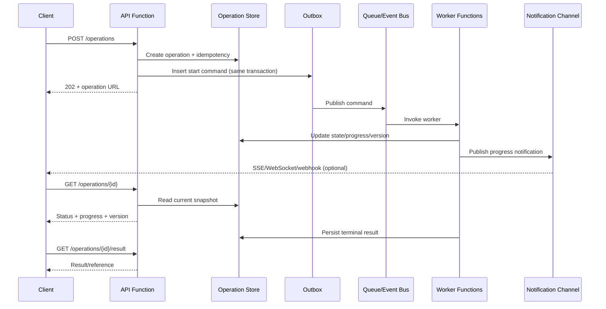
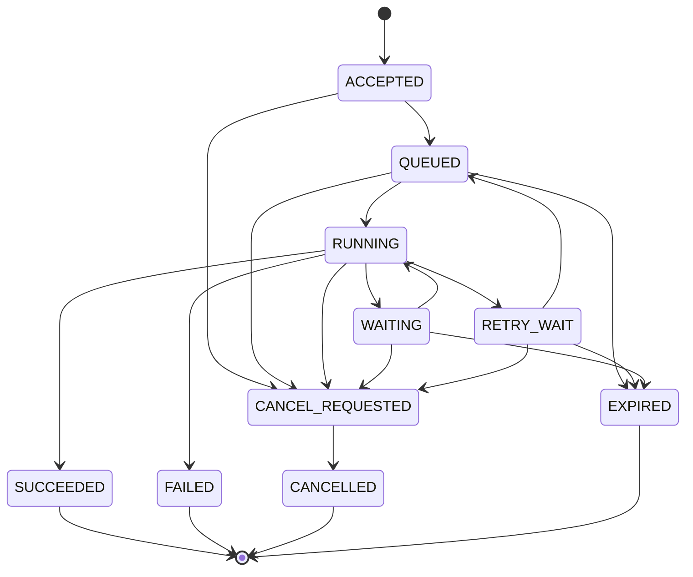

# Theo dõi tiến độ xử lý và thông báo kết quả cho client

Một client gửi yêu cầu xử lý dữ liệu lớn, tạo báo cáo, import file hoặc chạy workflow có thể phải chờ nhiều giây, nhiều phút, thậm chí nhiều giờ. Giữ HTTP request mở trong suốt thời gian đó dễ gặp timeout ở gateway, client, proxy hoặc function runtime. Mô hình phù hợp hơn là tiếp nhận yêu cầu nhanh, trả về một mã operation, xử lý bất đồng bộ và cung cấp API để client theo dõi tiến độ cũng như nhận kết quả cuối cùng.

Trong kiến trúc serverless, mỗi invocation có thể kết thúc trước khi công việc nghiệp vụ hoàn tất. Function tiếp theo có thể chạy trên execution environment khác. Vì vậy, tiến độ và trạng thái phải được lưu bền vững; không thể dựa vào biến static, session trong JVM hoặc kết nối HTTP ban đầu. Queue, event bus hoặc workflow orchestrator điều phối các bước; một operation store giữ trạng thái có thẩm quyền; polling, Server-Sent Events (SSE), WebSocket hoặc webhook đưa cập nhật đến client.

Bài này xây dựng mô hình theo dõi operation end-to-end cho Java FaaS. Ta sẽ thiết kế API bất đồng bộ, state machine, progress model, durable event log, cơ chế cập nhật có version, các cách thông báo đến client, xử lý cancel/retry/expiry, bảo mật, kiểm thử và vận hành.

## 1. Bài toán và mục tiêu thiết kế

### 1.1. Vì sao không giữ request mở?

Một HTTP request đồng bộ phù hợp khi công việc hoàn tất trong thời gian ngắn và có giới hạn rõ. Với công việc dài, các vấn đề thường gặp là:

- API Gateway hoặc reverse proxy hết thời gian chờ trước khi xử lý xong.
- Client đóng app, mất mạng hoặc chuyển sang background.
- Function runtime có giới hạn thời gian thực thi.
- Retry của client tạo thêm một lần xử lý trong khi lần đầu vẫn đang chạy.
- Workflow cần nhiều bước hoặc chờ external event.
- Không thể báo tiến độ một cách đáng tin cậy chỉ bằng một response HTTP.

Giữ connection mở không làm công việc bền vững hơn. Nếu connection mất, client không biết operation đã dừng hay vẫn tiếp tục.

### 1.2. Mô hình asynchronous request-response

Luồng tổng quát:

1. Client gửi request tạo công việc.
2. API xác thực, kiểm tra request và idempotency key.
3. Service tạo operation record bền vững và enqueue command trong cùng transaction qua outbox.
4. API trả `202 Accepted`, `operationId` và URL để theo dõi.
5. Worker/function thực hiện từng bước, cập nhật progress và phát progress event.
6. Client polling hoặc nhận push update.
7. Khi hoàn tất, operation lưu kết quả hoặc reference đến kết quả.
8. Client lấy kết quả bằng API có authorization.



### 1.3. Các mục tiêu cần giữ

- **Durability:** operation vẫn có thể theo dõi sau khi function kết thúc hoặc được retry.
- **Truthfulness:** progress phản ánh công việc thực tế; không tự tăng phần trăm để tạo cảm giác nhanh.
- **Monotonicity:** version/progress không bị ghi lùi bởi event cũ.
- **Idempotency:** request hoặc event giao lại không tạo operation/side effect trùng.
- **Authorization:** chỉ đúng principal được xem operation và kết quả.
- **Resilience:** client disconnect không làm mất công việc; notification thất bại không làm mất kết quả.
- **Bounded cost:** không ghi progress quá dày hoặc tạo một invocation cho từng phần trăm nhỏ.

## 2. Operation resource và API contract

### 2.1. Operation là resource có vòng đời riêng

Thay vì coi request ban đầu là toàn bộ công việc, tạo một resource đại diện cho operation. Client nhận `operationId` và có thể đọc trạng thái nhiều lần.

Ví dụ:

```http
POST /v1/reports
Idempotency-Key: 1e6d9c8f-6d6a-4e35-9a52-3c0a1c1c8a01
Content-Type: application/json

{
  "reportType": "monthly-sales",
  "period": "2026-10",
  "format": "csv"
}
```

Response:

```http
HTTP/1.1 202 Accepted
Location: /v1/operations/op_01JREPORT9X
Retry-After: 3
Content-Type: application/json

{
  "operationId": "op_01JREPORT9X",
  "status": "QUEUED",
  "statusUrl": "/v1/operations/op_01JREPORT9X",
  "resultUrl": "/v1/operations/op_01JREPORT9X/result"
}
```

`202 Accepted` chỉ có nghĩa service đã nhận trách nhiệm xử lý theo contract. Nó không khẳng định report đã chạy hoặc chắc chắn sẽ thành công. Nếu operation chưa được lưu bền vững/enqueue an toàn thì không nên trả `202`.

### 2.2. Đọc trạng thái

```http
GET /v1/operations/op_01JREPORT9X
If-None-Match: "op_01JREPORT9X-v12"
```

Response minh họa:

```http
HTTP/1.1 200 OK
ETag: "op_01JREPORT9X-v13"
Retry-After: 5
Content-Type: application/json

{
  "operationId": "op_01JREPORT9X",
  "status": "RUNNING",
  "progress": {
    "phase": "EXPORTING",
    "percent": 65,
    "completedUnits": 65000,
    "totalUnits": 100000,
    "unit": "rows"
  },
  "createdAt": "2026-11-17T08:00:00Z",
  "startedAt": "2026-11-17T08:00:02Z",
  "updatedAt": "2026-11-17T08:02:10Z",
  "version": 13
}
```

Nếu version không đổi, API có thể trả `304 Not Modified` khi client gửi `If-None-Match`. `Retry-After` là gợi ý thời gian polling, không phải bảo đảm chính xác.

### 2.3. Lấy kết quả

```http
GET /v1/operations/op_01JREPORT9X/result
```

- Nếu operation chưa terminal: trả `409 Conflict` hoặc `202 Accepted` theo API contract, kèm status URL.
- Nếu thành công: trả kết quả nhỏ hoặc URL download đã được cấp quyền.
- Nếu thất bại: trả error resource có mã lỗi ổn định và thông tin hỗ trợ phù hợp.
- Nếu kết quả đã hết retention: trả trạng thái rõ ràng như `410 Gone`.

Không trả presigned URL dài hạn hoặc public object URL cho file chứa dữ liệu nhạy cảm. Tạo URL có thời hạn ngắn sau khi authorize client.

### 2.4. Hủy operation

```http
DELETE /v1/operations/op_01JREPORT9X
```

API có thể trả `202 Accepted` với trạng thái `CANCEL_REQUESTED` vì việc dừng worker là bất đồng bộ. Nếu công việc đã hoàn tất, API nên trả trạng thái hiện tại theo contract và không giả vờ có thể đảo ngược kết quả.

### 2.5. API contract và mã lỗi

| Tình huống | HTTP status gợi ý | Ý nghĩa |
| --- | ---: | --- |
| Tạo operation thành công | 202 | Đã nhận và lưu operation |
| Request không hợp lệ | 400/422 | Validation thất bại |
| Idempotency key dùng lại với payload khác | 409 | Conflict |
| Client không có quyền | 403 hoặc 404 | Theo policy chống enumeration |
| Operation chưa hoàn tất | 202/409 | Chưa có result cuối |
| Operation không tồn tại/hết hạn | 404/410 | Resource không khả dụng |
| Poll không có thay đổi | 304 | Snapshot chưa đổi |
| Quá tải/admission bị từ chối | 429/503 | Client retry theo hướng dẫn |

Giữ schema response và error code ổn định để client không phụ thuộc message text.

## 3. State machine cho operation

### 3.1. Các trạng thái cơ bản

Một state machine thực tế có thể gồm:

| State | Ý nghĩa | Terminal? |
| --- | --- | --- |
| `ACCEPTED` | Request hợp lệ và đã tạo operation | Không |
| `QUEUED` | Đang chờ worker nhận | Không |
| `RUNNING` | Đang thực hiện | Không |
| `WAITING` | Đang chờ dependency/event/timer | Không |
| `RETRY_WAIT` | Chờ retry sau lỗi tạm thời | Không |
| `CANCEL_REQUESTED` | Đã nhận yêu cầu hủy | Không |
| `SUCCEEDED` | Hoàn tất thành công | Có |
| `FAILED` | Kết thúc thất bại | Có |
| `CANCELLED` | Đã dừng an toàn | Có |
| `EXPIRED` | Hết thời hạn xử lý theo policy | Có |

Terminal state không được chuyển ngược sang `RUNNING`. Nếu cần chạy lại, tạo operation mới hoặc một retry/recovery generation được định nghĩa rõ.

### 3.2. Transition hợp lệ



Các transition cần kiểm tra điều kiện tại persistence boundary. Ví dụ worker cũ không được ghi `SUCCEEDED` sau khi operation đã được cancel hoặc một worker mới đã nhận lease khác.

### 3.3. State transition phải atomic

Dùng version/CAS hoặc conditional update:

```sql
UPDATE operation
SET status = :newStatus,
    version = version + 1,
    updated_at = CURRENT_TIMESTAMP
WHERE operation_id = :operationId
  AND version = :expectedVersion
  AND status IN ('QUEUED', 'RUNNING', 'WAITING');
```

Nếu update count bằng 0, worker phải đọc trạng thái mới và quyết định xử lý conflict. Không ghi đè snapshot cũ.

### 3.4. State và progress là hai khái niệm khác nhau

`RUNNING` là trạng thái vòng đời. Progress cho biết mức hoàn thành trong phase hiện tại. Không nên suy ra operation thành công chỉ vì progress đạt 100%; trạng thái chỉ chuyển `SUCCEEDED` sau khi output đã được commit và kiểm tra.

## 4. Thiết kế progress model trung thực

### 4.1. Progress cần có ngữ nghĩa

Một phần trăm không có ý nghĩa nếu không biết mẫu số. Progress nên chỉ rõ:

- phase hiện tại;
- completed units;
- total units nếu biết;
- đơn vị (rows, files, records, pages, steps...);
- thời điểm cập nhật;
- version/sequence;
- message an toàn cho client nếu cần.

Ví dụ `650/1000 files` có thể đáng tin hơn `65%` nếu số file là công việc thực tế được đo.

### 4.2. Progress nhiều phase

Workflow có thể gồm:

1. `VALIDATING` — 5% trọng số.
2. `FETCHING` — 20%.
3. `TRANSFORMING` — 35%.
4. `PERSISTING` — 30%.
5. `FINALIZING` — 10%.

Phần trăm tổng có thể tính theo trọng số phase nếu khối lượng từng phase tương đối ổn định. Nhưng nếu phase có thời lượng biến thiên lớn, hiển thị phase và số lượng đơn vị rõ ràng thường trung thực hơn một phần trăm chính xác giả tạo.

### 4.3. Khi không biết total

Với stream vô hạn, pagination không biết tổng, hoặc workflow phụ thuộc external event, không thể tính percentage đáng tin. Dùng progress indeterminate:

```json
{
  "phase": "WAITING_FOR_PROVIDER",
  "percent": null,
  "message": "Đang chờ xác nhận từ hệ thống bên ngoài"
}
```

Client nên hỗ trợ spinner/phase state thay vì tự nội suy phần trăm.

### 4.4. Progress không được giảm tùy tiện

Progress nên đơn điệu trong một phase/generation. Khi bắt đầu phase mới, có thể phần trăm tổng giữ nguyên hoặc tăng theo weight. Nếu phải chạy lại phase, biểu diễn `attempt`/`generation` thay vì âm thầm lùi từ 80% về 20%.

### 4.5. Giảm tần suất progress update

Không ghi database và publish event cho từng record nếu workload có hàng triệu record. Có thể cập nhật theo:

- batch size;
- thời gian tối thiểu giữa hai lần update;
- mức thay đổi phần trăm;
- phase transition;
- heartbeat khi công việc dài.

Ví dụ chỉ publish khi tăng ít nhất 1% hoặc đã qua 2 giây, trừ khi có phase transition quan trọng. Chọn ngưỡng theo trải nghiệm client và cost budget.

## 5. Data model bền vững

### 5.1. Operation snapshot

Snapshot lưu trạng thái mới nhất để GET nhanh:

```sql
CREATE TABLE operation (
    operation_id VARCHAR(80) PRIMARY KEY,
    owner_subject VARCHAR(200) NOT NULL,
    operation_type VARCHAR(100) NOT NULL,
    status VARCHAR(32) NOT NULL,
    phase VARCHAR(80),
    completed_units BIGINT,
    total_units BIGINT,
    unit_name VARCHAR(40),
    percent SMALLINT,
    result_reference VARCHAR(500),
    error_code VARCHAR(100),
    error_reference VARCHAR(200),
    version BIGINT NOT NULL,
    attempt INTEGER NOT NULL DEFAULT 0,
    created_at TIMESTAMP NOT NULL,
    started_at TIMESTAMP,
    updated_at TIMESTAMP NOT NULL,
    completed_at TIMESTAMP,
    expires_at TIMESTAMP
);
```

`owner_subject` là identity nội bộ hoặc subject đã chuẩn hóa từ identity provider. Không dùng `operationId` thay cho authorization.

### 5.2. Operation event history

Snapshot chỉ cho biết trạng thái hiện tại. Event history giúp điều tra:

```sql
CREATE TABLE operation_event (
    operation_id VARCHAR(80) NOT NULL,
    sequence_no BIGINT NOT NULL,
    event_id VARCHAR(100) NOT NULL UNIQUE,
    event_type VARCHAR(80) NOT NULL,
    phase VARCHAR(80),
    progress_payload JSON,
    occurred_at TIMESTAMP NOT NULL,
    PRIMARY KEY (operation_id, sequence_no)
);
```

Nếu database không hỗ trợ kiểu `JSON`, dùng kiểu tương đương. Event history có thể được partition/TTL theo retention. Không lưu toàn bộ payload nghiệp vụ nhạy cảm vào event progress.

### 5.3. Outbox cho progress notification

Khi cập nhật operation snapshot và cần publish event, ghi operation update và outbox row trong cùng transaction. Nếu publish trực tiếp sau commit rồi function crash, client có thể không nhận progress dù snapshot đã đổi.

Outbox publisher có thể phát duplicate; consumer/client notification layer phải deduplicate bằng `eventId` hoặc `sequenceNo`.

### 5.4. Snapshot và event log phục vụ mục đích khác nhau

- Snapshot tối ưu GET trạng thái hiện tại.
- Event history phục vụ timeline, audit, replay và điều tra.
- Outbox bảo đảm trạng thái commit và thông báo có thể được phát.
- Notification channel chỉ là transport; không phải nguồn dữ liệu có thẩm quyền.

## 6. Java model và repository

### 6.1. Operation status record

```java
import java.time.Instant;

public enum OperationState {
    ACCEPTED,
    QUEUED,
    RUNNING,
    WAITING,
    RETRY_WAIT,
    CANCEL_REQUESTED,
    SUCCEEDED,
    FAILED,
    CANCELLED,
    EXPIRED;

    public boolean terminal() {
        return this == SUCCEEDED
                || this == FAILED
                || this == CANCELLED
                || this == EXPIRED;
    }
}

public record OperationProgress(
        String phase,
        Long completedUnits,
        Long totalUnits,
        String unit,
        Integer percent,
        String safeMessage) {
}

public record OperationSnapshot(
        String operationId,
        String ownerSubject,
        OperationState state,
        OperationProgress progress,
        long version,
        int attempt,
        Instant createdAt,
        Instant updatedAt,
        Instant expiresAt,
        String resultReference,
        String errorCode) {
}
```

`safeMessage` chỉ chứa nội dung đã được kiểm soát, không chứa stack trace, SQL, secret hoặc raw exception message.

### 6.2. Repository contract

```java
public interface OperationRepository {
    OperationSnapshot find(String operationId);

    boolean updateProgress(
            String operationId,
            long expectedVersion,
            OperationProgress progress);

    boolean recordProgressAndEnqueueContinuation(
            String operationId,
            long expectedVersion,
            OperationProgress progress);

    boolean transition(
            String operationId,
            long expectedVersion,
            OperationState expectedState,
            OperationState newState);

    boolean confirmCancelled(String operationId, long expectedVersion);

    boolean completeIfRunning(String operationId, String resultReference);
}
```

Implementation cần thực hiện conditional update atomically, tăng version và ghi operation event/outbox trong transaction. Không triển khai bằng cách load entity rồi save không có optimistic lock.

### 6.3. Kiểm tra progress đầu vào

```java
public final class ProgressValidator {
    public void validate(OperationProgress progress) {
        if (progress.completedUnits() != null && progress.completedUnits() < 0) {
            throw new IllegalArgumentException("completedUnits must be non-negative");
        }
        if (progress.totalUnits() != null && progress.totalUnits() < 0) {
            throw new IllegalArgumentException("totalUnits must be non-negative");
        }
        if (progress.completedUnits() != null
                && progress.totalUnits() != null
                && progress.completedUnits() > progress.totalUnits()) {
            throw new IllegalArgumentException("completedUnits exceeds totalUnits");
        }
        if (progress.percent() != null
                && (progress.percent() < 0 || progress.percent() > 100)) {
            throw new IllegalArgumentException("percent must be between 0 and 100");
        }
    }
}
```

Nếu `totalUnits` bằng 0 hoặc không xác định, percentage nên là null/indeterminate theo domain rule. Không chia cho 0 hoặc tự coi operation đã xong.

## 7. Tạo operation an toàn từ HTTP API

### 7.1. Idempotency key

Client có thể timeout sau khi POST nhưng trước khi nhận response. Client retry cùng request với cùng `Idempotency-Key`. Server lưu:

- key;
- owner subject;
- request hash/canonical payload hash;
- operation ID đã tạo;
- thời điểm tạo và expiry.

Cùng key + cùng payload trả lại operation cũ. Cùng key + payload khác trả `409 Conflict`. Key phải được scope theo caller/tenant để tránh va chạm giữa khách hàng.

### 7.2. Transaction tạo operation và command

Trong một database transaction:

1. Claim idempotency key bằng unique constraint.
2. Tạo operation `QUEUED`.
3. Ghi outbox command cho worker.
4. Commit.

Chỉ sau commit mới trả `202`. Publisher đọc outbox và gửi queue. Nếu publish chậm, operation vẫn tồn tại ở `QUEUED` và có thể được quan sát.

### 7.3. Java service minh họa

```java
public record CreateOperationRequest(
        String operationType,
        String payloadReference) {
}

public record CreateOperationResponse(
        String operationId,
        OperationState status,
        String statusUrl,
        String resultUrl) {
}

public final class OperationApplicationService {
    private final OperationTransaction transaction;

    public OperationApplicationService(OperationTransaction transaction) {
        this.transaction = transaction;
    }

    public CreateOperationResponse create(
            String ownerSubject,
            String idempotencyKey,
            CreateOperationRequest request) {

        CreatedOperation created = transaction.createWithOutbox(
                ownerSubject, idempotencyKey, request);

        String id = created.operationId();
        return new CreateOperationResponse(
                id,
                created.state(),
                "/v1/operations/" + id,
                "/v1/operations/" + id + "/result");
    }
}
```

`OperationTransaction.createWithOutbox` phải là một transaction bền vững, thực hiện idempotency/unique constraint và trả operation đã có nếu request là retry hợp lệ. Controller ánh xạ response thành HTTP 202 sau khi transaction commit.

## 8. Worker cập nhật progress trong Java FaaS

### 8.1. Handler không giữ state trong memory

Worker nhận `operationId`, đọc snapshot, xác nhận trạng thái/lease và thực hiện một batch. Sau mỗi checkpoint bền vững, nó cập nhật progress. Nếu invocation kết thúc giữa chừng, lần tiếp theo đọc checkpoint từ store.

### 8.2. Checkpoint theo batch

Ví dụ xử lý 100.000 record theo batch 1.000:

```java
public record BatchResult(
        long completedUnits,
        long totalUnits,
        boolean complete) {
}

public interface ExportRepository {
    // Writes one idempotent batch and its durable checkpoint.
    BatchResult processNextBatch(String operationId, int batchSize);

    void finalizeOutput(String operationId);

    String resultReference(String operationId);
}

public interface OperationRepository {
    OperationSnapshot find(String operationId);

    boolean recordProgressAndEnqueueContinuation(
            String operationId,
            long expectedVersion,
            OperationProgress progress);

    boolean confirmCancelled(String operationId, long expectedVersion);

    boolean completeIfRunning(String operationId, String resultReference);
}

public final class ExportWorker {
    private final OperationRepository operations;
    private final ExportRepository exports;

    public void handle(String operationId) {
        OperationSnapshot operation = operations.find(operationId);
        if (operation.state().terminal()) {
            return;
        }
        if (operation.state() == OperationState.CANCEL_REQUESTED) {
            operations.confirmCancelled(operationId, operation.version());
            return;
        }

        // One invocation processes one bounded batch, then exits.
        BatchResult batch = exports.processNextBatch(operationId, 1_000);
        OperationSnapshot current = operations.find(operationId);

        if (current.state() == OperationState.CANCEL_REQUESTED) {
            operations.confirmCancelled(operationId, current.version());
            return;
        }

        if (batch.complete()) {
            exports.finalizeOutput(operationId);
            // Mark SUCCEEDED only after the output is durable and validated.
            operations.completeIfRunning(
                    operationId, exports.resultReference(operationId));
            return;
        }

        Integer percent = batch.totalUnits() <= 0
                ? null
                : (int) Math.min(99.0,
                        ((double) batch.completedUnits() / batch.totalUnits()) * 100.0);
        OperationProgress progress = new OperationProgress(
                "EXPORTING", batch.completedUnits(), batch.totalUnits(), "rows",
                percent, "Đang xuất dữ liệu");

        boolean recorded = operations.recordProgressAndEnqueueContinuation(
                operationId, current.version(), progress);
        if (!recorded) {
            OperationSnapshot latest = operations.find(operationId);
            if (latest.state() == OperationState.CANCEL_REQUESTED) {
                operations.confirmCancelled(operationId, latest.version());
                return;
            }
            if (!latest.state().terminal()) {
                throw new IllegalStateException(
                        "Operation changed concurrently; retry from durable checkpoint");
            }
        }
    }
}
```

Đây là khung minh họa; implementation production cần transaction/lease/checkpoint atomic, timeout budget và conditional terminal transition. Mỗi invocation chỉ xử lý một batch hữu hạn rồi thoát. `processNextBatch` phải idempotent và lưu checkpoint bền vững để lần giao lại không ghi trùng. `recordProgressAndEnqueueContinuation` chỉ chấp nhận khi operation còn `RUNNING` và version khớp; repository ghi snapshot, event history và command tiếp theo vào outbox trong cùng transaction. Nếu CAS thất bại, worker đọc lại state và xử lý cancel/stale lease thay vì tiếp tục ghi. `completeIfRunning` cũng phải là conditional transition để worker cũ không thể ghi đè `CANCELLED` hoặc terminal state khác. Nếu `total` không xác định hoặc bằng 0, progress percentage là indeterminate; phase `FINALIZING` và transition cuối sẽ thể hiện phần việc còn lại.

### 8.3. Chia nhỏ công việc theo invocation budget

Nếu một function có execution limit, đừng cố chạy hết workload trong một invocation. Worker xử lý một batch, lưu checkpoint, rồi enqueue continuation hoặc để workflow orchestrator gọi bước tiếp theo.

Thiết kế batch size dựa trên:

- p95 batch duration;
- memory/CPU;
- downstream rate limit;
- retry blast radius;
- checkpoint overhead;
- function timeout còn lại.

### 8.4. Heartbeat cho công việc dài

Nếu operation chạy lâu nhưng không có progress unit rõ, worker có thể cập nhật heartbeat `lastActivityAt`/phase. Heartbeat cho biết worker còn hoạt động, không đồng nghĩa percentage tăng.

Heartbeat nên có interval đủ thưa để tránh write amplification. Nếu heartbeat quá hạn, watchdog có thể kiểm tra lease và quyết định retry/recovery; không tự động chạy worker thứ hai nếu worker cũ có thể vẫn đang hoạt động.

## 9. Notification channel cho client

### 9.1. Polling

Client gọi GET status theo `Retry-After` hoặc backoff có jitter.

Ưu điểm:

- đơn giản, stateless và dễ scale;
- hoạt động qua hầu hết proxy/firewall;
- client có thể reconnect bất cứ lúc nào;
- snapshot hiện tại không phụ thuộc giữ connection.

Nhược điểm:

- tạo request lặp và chi phí khi nhiều client poll dày;
- cập nhật không tức thời;
- cần rate limit và cache/ETag.

Polling thường là baseline tốt cho operation dài và tần suất update vừa phải.

### 9.2. Server-Sent Events (SSE)

SSE mở một HTTP response streaming một chiều từ server đến browser/client. Phù hợp khi server chỉ cần đẩy progress đến client.

```http
GET /v1/operations/op_01JREPORT9X/events
Accept: text/event-stream
Last-Event-ID: 13
```

Stream minh họa:

```text
id: 14
event: progress
data: {"status":"RUNNING","phase":"EXPORTING","percent":70,"version":14}

id: 15
event: completed
data: {"status":"SUCCEEDED","resultUrl":"/v1/operations/op_01JREPORT9X/result","version":15}

```

SSE có thể reconnect và gửi `Last-Event-ID`. Server cần giữ event history đủ để resume; nếu event đã hết retention, gửi snapshot/reset event rồi tiếp tục.

Trong serverless, connection duration, gateway support và concurrent connection quota có thể giới hạn SSE. Không phải FaaS/API gateway nào cũng hỗ trợ streaming response như nhau; kiểm tra giới hạn platform.

### 9.3. WebSocket

WebSocket phù hợp khi cần giao tiếp hai chiều liên tục: client subscribe, gửi cancel/control command và nhận progress. Tuy nhiên, cần quản lý connection lifecycle, reconnect, authorization, fan-out, idle timeout và connection registry.

Function xử lý progress không nên phụ thuộc vào một JVM giữ socket. Dùng managed WebSocket gateway/connection manager hoặc service chuyên trách; lưu connection ID và owner/expiry trong shared store.

### 9.4. Webhook callback

Webhook phù hợp cho server-to-server integration. Client đăng ký callback URL; hệ thống gửi event khi operation đổi trạng thái.

Webhook cần:

- xác minh endpoint ownership và HTTPS;
- chống SSRF khi chấp nhận URL do client cung cấp;
- ký payload bằng secret/key riêng;
- timestamp, signature và replay protection;
- retry có giới hạn, backoff và DLQ;
- idempotency/event ID để receiver deduplicate;
- timeout ngắn và response contract rõ.

Không coi webhook delivery là nguồn trạng thái chính. Client vẫn phải có GET operation để reconcile.

### 9.5. Chọn kênh theo nhu cầu

| Kênh | Phù hợp | Điểm cần lưu ý |
| --- | --- | --- |
| Polling | Hầu hết API async, triển khai đơn giản | Rate limit, `Retry-After`, ETag |
| SSE | UI cần cập nhật một chiều liên tục | Gateway streaming, reconnect, event retention |
| WebSocket | Hai chiều và tương tác liên tục | Connection lifecycle, registry, auth |
| Webhook | Server-to-server callback | Signature, SSRF, retry, receiver idempotency |
| Email/push | Thông báo người dùng không online | Không thay thế operation status API |

Có thể hỗ trợ polling làm fallback kể cả khi có SSE/WebSocket/webhook.

## 10. Client implementation và reconnect

### 10.1. Polling với backoff

Client không nên poll mỗi 100 ms. Tôn trọng `Retry-After`, thêm jitter và dừng khi state terminal.

Pseudo-code JavaScript minh họa:

```javascript
async function watchOperation(statusUrl, signal) {
  let delayMs = 1000;
  let etag = undefined;

  while (!signal.aborted) {
    const headers = etag ? { "If-None-Match": etag } : {};
    const response = await fetch(statusUrl, { headers, signal });

    if (response.status === 304) {
      // No snapshot change; keep waiting.
    } else if (response.ok) {
      const snapshot = await response.json();
      etag = response.headers.get("ETag") ?? etag;
      renderProgress(snapshot);

      if (["SUCCEEDED", "FAILED", "CANCELLED", "EXPIRED"]
          .includes(snapshot.status)) {
        return snapshot;
      }
    } else if (response.status === 429 || response.status === 503) {
      // Respect Retry-After where present.
    } else {
      throw new Error(`Status lookup failed: ${response.status}`);
    }

    const retryAfter = Number(response.headers.get("Retry-After"));
    const base = Number.isFinite(retryAfter) && retryAfter > 0
      ? retryAfter * 1000
      : delayMs;
    const jitter = Math.random() * Math.min(base, 1000);
    await new Promise(resolve => setTimeout(resolve, base + jitter));
    delayMs = Math.min(delayMs * 2, 15000);
  }

  return null;
}
```

Đây là ví dụ phía browser; trong ứng dụng thật cần xử lý `AbortSignal`, network offline, auth refresh và visibility/background policy. Nếu server trả `Retry-After` dạng HTTP date, client cần parse đúng thay vì chỉ đọc số giây.

### 10.2. Client không tự suy diễn terminal state

Không coi progress 100% là success. Chỉ dựa vào `status` terminal. Nếu state `FAILED`, hiển thị error code và cách khắc phục an toàn; không hiển thị stack trace hoặc raw exception.

### 10.3. Reconnect sau khi client offline

Khi mở app lại, client đọc snapshot GET trước. Nếu cần timeline, gọi event history từ `afterSequence`. Không phụ thuộc vào việc đã nhận đủ mọi push notification trong lúc offline.

### 10.4. Cancel từ client

Client có thể gửi DELETE, nhưng UI nên thể hiện `Cancellation requested` cho đến khi server xác nhận `CANCELLED`. Nếu công việc đã đến critical section không thể hủy, server có thể trả `SUCCEEDED` hoặc `FAILED` sau khi hoàn tất bước an toàn.

## 11. Progress event contract và ordering

### 11.1. Event schema

Ví dụ:

```json
{
  "eventId": "opevt_14",
  "operationId": "op_01JREPORT9X",
  "sequence": 14,
  "type": "PROGRESS_UPDATED",
  "status": "RUNNING",
  "phase": "EXPORTING",
  "completedUnits": 70000,
  "totalUnits": 100000,
  "unit": "rows",
  "occurredAt": "2026-11-17T08:02:30Z"
}
```

### 11.2. Sequence number

Mỗi operation có sequence/version tăng đơn điệu. Client nhận event sequence 16 rồi mới nhận 15 thì bỏ event 15 hoặc dùng nó để phát hiện gap. Nếu gap cần timeline đầy đủ, client gọi history API từ sequence cuối đã xử lý.

Không dựa vào timestamp để sắp xếp tuyệt đối vì clock skew, event publish delay và callback đến sai thứ tự.

### 11.3. Snapshot + event stream

Snapshot phục vụ trạng thái hiện tại; event stream phục vụ cập nhật. Client có thể:

1. GET snapshot và nhận version V.
2. Subscribe event với `afterSequence=V`.
3. Áp dụng event có sequence lớn hơn V.
4. Nếu phát hiện gap, fetch history/snapshot lại.

Nếu subscribe trước rồi GET sau, cần deduplicate bằng sequence để tránh race giữa hai bước.

### 11.4. Không publish event trước commit

Nếu progress event được publish trước khi snapshot commit, client có thể nhận thông tin chưa tồn tại trong GET. Ghi snapshot + event history + outbox trong cùng transaction, rồi publisher phát sau commit.

## 12. Kết quả, artifact và retention

### 12.1. Result reference

Kết quả lớn như CSV/PDF/archive nên lưu ở object storage và operation chỉ lưu reference. GET result authorize owner, kiểm tra state `SUCCEEDED` và tạo download URL có TTL ngắn.

### 12.2. Result metadata

Có thể lưu:

- content type;
- file size;
- checksum;
- generated timestamp;
- storage key/reference;
- schema/version;
- retention/expiry.

Không trả internal storage path hoặc bucket name nếu không cần.

### 12.3. Retention policy

Operation status và result có thể có retention khác nhau. Ví dụ status metadata giữ lâu hơn file export; event history giữ theo audit requirement. Khi hết hạn, xóa result theo lifecycle policy và chuyển operation sang `EXPIRED` hoặc giữ tombstone để client biết resource đã hết hạn.

### 12.4. Error resource

Error response nên gồm:

- stable `errorCode`;
- safe message;
- `retryable` flag nếu client cần;
- support/reference ID;
- phase thất bại nếu được phép công bố.

Không trả stack trace, database hostname, internal ARN hoặc secret.

## 13. Cancellation và deadline

### 13.1. Cancellation là yêu cầu hợp tác

FaaS invocation có thể không bị dừng ngay chỉ vì client đóng connection hoặc gửi DELETE. Worker cần kiểm tra cancel flag ở checkpoint an toàn.

### 13.2. Checkpoint cancellation

Với batch job:

1. API chuyển operation sang `CANCEL_REQUESTED` bằng conditional update.
2. Worker kiểm tra trạng thái trước batch tiếp theo.
3. Worker dừng admission công việc mới.
4. Worker commit/rollback batch hiện tại theo transaction boundary.
5. Worker lưu checkpoint và chuyển `CANCELLED` nếu dừng an toàn.

Nếu không thể hủy một side effect đã gửi đến external provider, ghi nhận trạng thái và thực hiện compensation nếu business rule yêu cầu.

### 13.3. Deadline và expiry

Operation nên có deadline hoặc `expiresAt`. Deadline có thể khác queue retention và result retention. Worker không nên tiếp tục tạo chi phí cho công việc đã hết giá trị; watchdog có thể đánh dấu `EXPIRED` nếu operation không còn đủ thời gian hoàn thành.

### 13.4. Cancel race với completion

Client gửi cancel đúng lúc worker chuẩn bị commit success. Dùng conditional transition và xác định điểm commit/linearization:

- nếu success commit trước, cancel trả trạng thái đã hoàn tất;
- nếu cancel claim trước và worker chưa qua critical side effect, worker dừng;
- nếu side effect không thể đảo, cần trạng thái trung gian/compensation rõ.

Không để hai invocation cùng ghi terminal state khác nhau.

## 14. Workflow nhiều bước và tổng hợp tiến độ

### 14.1. Orchestration hay choreography

Với workflow có thứ tự, timeout, retry và compensation, orchestrator/state machine giúp quản lý state transition. Với các event độc lập, choreography qua event bus có thể đơn giản hơn.

Không để client phải tự điều phối các bước backend. Client theo dõi operation aggregate, không cần biết mỗi function nội bộ.

### 14.2. Tổng hợp child operation

Một parent operation có thể có nhiều child task:

| Child | Trạng thái | Trọng số |
| --- | --- | ---: |
| Validate input | SUCCEEDED | 10% |
| Fetch source data | SUCCEEDED | 20% |
| Transform partitions | RUNNING | 40% |
| Persist output | QUEUED | 20% |
| Publish completion event | QUEUED | 10% |

Parent progress có thể là tổng trọng số các child đã hoàn tất cộng phần tiến độ được xác định cho child đang chạy. Nếu child có khối lượng không ổn định, hiển thị phase/child status thay vì giả định trọng số phản ánh thời gian.

### 14.3. Fan-out/fan-in

Khi chia operation thành N partition:

- parent lưu danh sách/manifest partition;
- mỗi child có idempotency key riêng;
- child cập nhật state/version riêng;
- aggregator tính trạng thái parent từ child snapshot/event;
- parent chỉ `SUCCEEDED` khi điều kiện hoàn tất đã thỏa;
- child failure có policy fail-fast, retry hoặc partial success rõ.

Không để hai aggregator cùng cập nhật parent mà không có CAS/transaction. Event duplicate không được đếm child completion hai lần.

### 14.4. Partial success

Một import có thể thành công 98/100 file. Domain cần quyết định đây là `SUCCEEDED_WITH_WARNINGS`, `PARTIAL_SUCCESS` hay `FAILED`. Không nhét tất cả vào `SUCCEEDED` nếu client cần biết có record bị bỏ qua.

Nếu thêm state `PARTIAL_SUCCESS`, xác định rõ nó terminal hay không và API result contract trả danh sách lỗi ở đâu.

## 15. Bảo mật operation API

### 15.1. Operation ID không phải quyền truy cập

ID khó đoán giảm khả năng enumeration nhưng không thay thế authorization. Mỗi GET, DELETE, event stream và result download phải kiểm tra principal có quyền với operation.

### 15.2. Owner/tenant isolation

Operation record lưu owner subject/tenant. Query nên giới hạn theo owner ngay tại persistence query:

```sql
SELECT *
FROM operation
WHERE operation_id = :operationId
  AND owner_subject = :authenticatedSubject;
```

Tránh đọc record trước rồi chỉ kiểm tra owner ở một nhánh code có thể bị bỏ sót. Với service-to-service, xác định scope/role có quyền xem operation thay mặt tenant.

### 15.3. Progress message không tiết lộ dữ liệu

Progress text nên là thông điệp đã chuẩn hóa như “Đang xử lý tệp 3/10”. Không đưa tên file riêng tư, email, SQL, nội dung record hoặc internal endpoint vào event gửi client nếu không cần.

### 15.4. Webhook callback security

Webhook URL do khách hàng cấu hình có nguy cơ SSRF. Validate scheme/host, chặn private/link-local/metadata IP theo policy, kiểm tra DNS resolution/rebinding và dùng egress control. Ký callback và xoay secret; không gửi credential của client trong URL.

### 15.5. SSE/WebSocket authorization

Xác thực khi mở connection và kiểm tra operation scope khi subscribe. Nếu token hết hạn trong connection dài, cần re-auth/close policy. Không tin operation ID gửi trong message client mà bỏ qua owner check.

## 16. Observability và vận hành

### 16.1. Metrics quan trọng

- operations accepted/completed/failed/cancelled/expired;
- queue wait time;
- operation end-to-end duration;
- time spent per phase;
- progress update rate;
- worker attempt/retry count;
- stale worker/lease conflict;
- notification publish/delivery failure;
- polling requests per active operation;
- SSE/WebSocket concurrent connections và reconnect;
- result download/error rate.

Metric label nên có operation type, phase, outcome và environment; không dùng operation ID, user ID hoặc file name làm label.

### 16.2. Structured log và tracing

Log nên mang:

- `operationId`;
- `correlationId`/`traceId`;
- `eventId` và sequence;
- `workerAttempt`;
- phase/state transition;
- expected/actual version;
- error category;
- result reference hash hoặc safe identifier.

Propagate trace context qua queue/event. Một operation dài có thể vượt trace lifetime; dùng correlation ID và event history để nối các trace riêng.

### 16.3. Alert

Alert khi:

- operation ở `QUEUED` quá lâu;
- `RUNNING` không có heartbeat/checkpoint;
- oldest queue age vượt SLO;
- terminal failure rate tăng;
- notification outbox backlog tăng;
- progress event sequence gap tăng;
- operation hết hạn bất thường;
- result generation thành công nhưng artifact không tồn tại;
- polling/connection volume gây quá tải API.

### 16.4. Runbook

Runbook cần chỉ rõ cách:

- tìm operation theo ID/correlation ID;
- xem timeline và worker attempts;
- xác định stuck worker/expired lease;
- kiểm tra queue, outbox và DLQ;
- retry/resume từ checkpoint;
- cancel operation và xác nhận terminal state;
- regenerate result nếu an toàn;
- reconcile artifact và database state;
- xử lý notification delivery failure.

Không sửa trực tiếp database state để làm UI chuyển sang xanh. Dùng administrative operation có audit và invariant check.

## 17. Kiểm thử

### 17.1. Unit test state machine

Kiểm tra mọi transition hợp lệ/không hợp lệ, terminal state, cancel race, retry và expiry. Test version conflict và stale update.

### 17.2. Integration test outbox và status

Kiểm tra:

- POST tạo operation và outbox cùng transaction;
- publish retry không tạo operation trùng;
- worker update snapshot + event history + outbox atomically;
- GET phản ánh version mới sau commit;
- notification event duplicate được deduplicate;
- event đến sai thứ tự không làm lùi state/progress.

### 17.3. Failure injection

Giả lập:

- function crash sau khi xử lý batch nhưng trước khi ack;
- timeout sau khi output được ghi nhưng trước khi mark success;
- duplicate queue message;
- worker lease hết hạn trong khi worker cũ vẫn chạy;
- notification publisher outage;
- SSE/WebSocket disconnect;
- webhook endpoint trả 500 hoặc timeout;
- result artifact missing/expired;
- client retry POST với cùng và khác payload.

### 17.4. Load test

Đo số operation đồng thời, progress update frequency, poll rate, DB write/read, event throughput và connection count. Thử workload có nhiều operation nhỏ và ít operation rất dài; hai profile có cost/latency khác nhau.

### 17.5. Client contract test

Kiểm tra:

- 202 + Location parsing;
- Retry-After và ETag/304;
- reconnect bằng Last-Event-ID;
- sequence gap recovery;
- terminal state/result fetch;
- 403/404/410 behavior;
- cancel requested vs cancelled;
- offline resume từ snapshot.

## 18. Cost và hiệu năng

### 18.1. Cost drivers

- operation store read/write;
- outbox/event bus/queue requests;
- worker invocation và billed duration;
- progress event volume;
- polling request volume;
- SSE/WebSocket connection duration;
- notification/webhook retries;
- result storage và data transfer;
- log/trace/metric ingestion.

### 18.2. Giảm write amplification

Chỉ ghi progress khi có thay đổi có ý nghĩa, gộp update theo batch/time window và dùng heartbeat thưa. Snapshot GET có thể cache ngắn hoặc dùng ETag để giảm payload; không cache lâu đến mức client thấy state sai.

### 18.3. Polling interval

Nếu 100.000 client poll mỗi giây, API có thể chịu 100.000 request/giây dù operation chỉ cập nhật vài lần mỗi phút. Dùng `Retry-After`, jitter, adaptive polling và push channel cho client cần realtime.

### 18.4. Unit economics

Theo dõi cost per operation và cost per successful operation. Bao gồm retry, failed work, progress event, polling và storage. Đừng tối ưu bằng cách bỏ cập nhật quan trọng khiến client không thể biết operation đang stuck hay đã hoàn tất.

## 19. Lộ trình triển khai theo từng bước

1. Xác định operation type, owner, input và business outcome.
2. Định nghĩa state machine, terminal states và cancellation semantics.
3. Thiết kế operation API (`POST`, `GET`, `GET result`, `DELETE`).
4. Tạo operation store, idempotency table và outbox.
5. Xây worker theo batch/checkpoint và timeout budget.
6. Ghi progress snapshot, event history và sequence number.
7. Chọn polling làm baseline; thêm SSE/WebSocket/webhook khi có nhu cầu.
8. Bảo vệ mọi endpoint bằng owner/tenant authorization.
9. Thêm result storage, expiry và download authorization.
10. Bổ sung metrics, logs, traces và runbook.
11. Kiểm thử duplicate, crash, timeout, cancel race và notification outage.
12. Canary workload, theo dõi SLO/cost và mở rộng dần.

## 20. Checklist production

- [ ] API nhận công việc trả 202 chỉ sau khi operation và command đã được lưu bền vững.
- [ ] Client nhận operation ID, status URL và result URL.
- [ ] POST hỗ trợ idempotency key và phát hiện payload conflict.
- [ ] Operation state machine có transition hợp lệ và terminal state rõ.
- [ ] Snapshot có version/ETag; update dùng CAS/conditional write.
- [ ] Progress có phase/unit/total semantics và hỗ trợ indeterminate.
- [ ] Progress không bị lùi bởi event cũ hoặc worker stale.
- [ ] Snapshot, event history và outbox được ghi nhất quán.
- [ ] Worker dùng checkpoint và không phụ thuộc local JVM state.
- [ ] Worker tôn trọng timeout, retry budget, lease và cancel request.
- [ ] SUCCEEDED chỉ được ghi sau khi result bền vững và đã validate.
- [ ] Notification failure không làm mất operation result.
- [ ] Polling có Retry-After, jitter, rate limit và ETag/304.
- [ ] SSE/WebSocket có reconnect, auth và connection lifecycle rõ.
- [ ] Webhook có signature, replay protection, SSRF controls và DLQ.
- [ ] Client có thể reconnect và khôi phục trạng thái từ snapshot/history.
- [ ] Mọi status/result/cancel endpoint kiểm tra owner/tenant authorization.
- [ ] Progress message không chứa dữ liệu nhạy cảm hoặc internal error.
- [ ] Result artifact có TTL, checksum, authorization và retention.
- [ ] Metrics theo dõi queue wait, phase duration, failure, stale worker và notify lag.
- [ ] Có integration/failure/load/client contract tests.
- [ ] Có runbook stuck operation, retry/resume, cancel, DLQ và missing artifact.
- [ ] Cost per operation bao gồm worker, store, events, polling và result storage.

## Kết luận

Theo dõi công việc bất đồng bộ cần một operation resource bền vững, state machine rõ ràng và progress có ngữ nghĩa. API tiếp nhận nhanh bằng `202 Accepted`; worker xử lý theo batch/checkpoint; snapshot cung cấp trạng thái hiện tại; event history và outbox phát thay đổi; client dùng polling, SSE, WebSocket hoặc webhook để nhận cập nhật.

Notification chỉ là phương tiện truyền trạng thái. Operation store mới là nguồn có thẩm quyền. Client phải có thể reconnect và đọc lại snapshot sau khi offline; duplicate hoặc event sai thứ tự không được làm lùi progress. `SUCCEEDED` chỉ được ghi sau khi kết quả đã bền vững và kiểm tra xong. Cancel là yêu cầu hợp tác tại checkpoint, còn authorization phải được kiểm tra trên mọi endpoint.

Với Java FaaS, hãy chia việc dài thành các batch nhỏ, lưu checkpoint và version trong shared store, phát progress qua outbox và giới hạn tần suất cập nhật. Kiểm thử crash, duplicate, timeout, cancel race và notification outage trước production. Khi đó client có thể theo dõi operation tin cậy ngay cả khi function instance, HTTP connection hoặc notification channel thay đổi trong suốt vòng đời xử lý.
