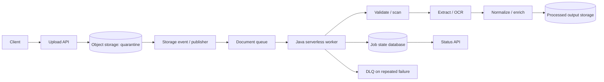

# Đo throughput, độ trễ hàng đợi và chi phí trên mỗi tài liệu

Một pipeline xử lý tài liệu serverless có thể nhận hàng nghìn file trong thời gian ngắn, đưa event vào queue, rồi dùng Java function để kiểm tra, trích xuất nội dung, gọi OCR, làm giàu metadata và lưu kết quả. Khi tải tăng, câu hỏi vận hành không chỉ là function có chạy thành công hay không. Nhóm cần biết pipeline hoàn tất được bao nhiêu tài liệu mỗi giây, tài liệu phải chờ trong queue bao lâu, backlog có tăng liên tục không và mỗi tài liệu hoàn tất tiêu tốn bao nhiêu chi phí.

Bài thực hành này xây dựng một mô hình đo lường end-to-end cho document event-processing pipeline. Người học sẽ định nghĩa workload, instrument producer và Java worker, đo throughput/queue latency/processing latency, tính cost per successful document, chạy load test và dùng kết quả để điều chỉnh batch size, concurrency, retry và giới hạn downstream.

Mục tiêu là tạo ra một phép đo có thể lặp lại và dùng để ra quyết định. Một con số throughput cao không có ý nghĩa nếu queue age tăng mãi, tỷ lệ tài liệu lỗi cao hoặc chi phí trên mỗi tài liệu tăng theo tải. Vì vậy, mọi kết quả phải được đọc cùng SLO, độ chính xác dữ liệu và ngân sách dependency.

## 1. Bối cảnh dự án và mục tiêu

Giả sử nhóm đang xây dựng dịch vụ nhận tài liệu cho khách hàng. Client upload file lên object storage thông qua API/presigned URL. Khi upload hoàn tất, storage event hoặc API phát event vào queue. Java worker được trigger từ queue và xử lý tài liệu theo các bước:

1. Xác thực metadata, tenant và phiên bản object.
2. Kiểm tra loại file, kích thước và checksum.
3. Quét malware hoặc kiểm tra chính sách nội dung.
4. Trích xuất text/metadata hoặc gọi OCR service.
5. Làm giàu dữ liệu, chuẩn hóa và tạo output.
6. Lưu kết quả, cập nhật trạng thái job và phát event hoàn tất.



Trong dự án, queue là buffer giữa tốc độ upload và tốc độ xử lý. Worker có thể scale theo backlog, nhưng OCR provider, database hoặc object storage có thể có giới hạn riêng. Vì vậy, ta cần đo cả năng lực của pipeline và áp lực lên dependency.

### Kết quả cần đạt

Sau bài thực hành, người học có thể:

- Phân biệt offered throughput, accepted throughput, processing throughput và successful completion throughput.
- Đo queue wait, processing duration và end-to-end completion latency.
- Theo dõi backlog, oldest-message age, retry và DLQ.
- Tính cost per successful document từ compute, queue, storage, database, OCR và network.
- Thiết kế load test với baseline, ramp, spike và soak workload.
- Ước tính concurrency cần thiết bằng định luật Little và service rate.
- Phát hiện bottleneck và điều chỉnh batch size/concurrency mà không làm downstream quá tải.
- Đưa ra quyết định capacity/cost dựa trên SLO và kết quả đo.

## 2. Định nghĩa đơn vị đo trước khi chạy

Một tài liệu có thể tạo nhiều message: upload event, validation event, extraction event và completion event. Vì vậy, message throughput không đồng nghĩa document throughput. Hãy chọn một đơn vị chuẩn là **một document version được chấp nhận xử lý**, định danh bằng `tenantId + documentId + objectVersion` hoặc một business key tương đương.

| Thuật ngữ | Định nghĩa |
|---|---|
| Offered documents | Số tài liệu mà load generator hoặc client cố gửi vào pipeline |
| Accepted documents | Số tài liệu được API xác nhận và ghi nhận bền vững |
| Enqueued documents | Số tài liệu có event được publish thành công vào queue |
| Started documents | Số document version bắt đầu được worker xử lý lần đầu |
| Attempt count | Tổng số lần xử lý, gồm retry/redelivery |
| Completed documents | Số document version hoàn tất nghiệp vụ thành công, đếm duy nhất |
| Failed documents | Số document version thất bại cuối cùng theo policy |
| Throughput | Số đơn vị hoàn tất trong một đơn vị thời gian, ví dụ documents/second |
| Queue wait | Thời gian từ lúc message được enqueue tới lúc worker bắt đầu xử lý |
| Processing duration | Thời gian worker thực hiện một attempt hoặc một stage |
| End-to-end latency | Thời gian từ lúc API chấp nhận tài liệu tới khi tài liệu đạt trạng thái terminal |
| Queue age | Tuổi của message đang chờ lâu nhất hoặc phân phối tuổi message theo broker telemetry |
| Cost per successful document | Tổng chi phí được phân bổ cho pipeline chia cho số document version hoàn tất duy nhất |

### Đếm tài liệu duy nhất, không đếm retry thành throughput

Nếu một document được xử lý ba lần rồi mới thành công, throughput nghiệp vụ là một tài liệu hoàn tất; attempt throughput là ba lần thử. Cần báo cáo cả hai:

- `documents_completed_total`: số document version hoàn tất duy nhất.
- `processing_attempts_total`: tổng số attempt.
- `retry_attempts_total`: số attempt phát sinh do retry/redelivery.

Không dùng số message đã ack hoặc số invocation thành công làm đại diện cho số tài liệu hoàn tất. Một invocation có thể xử lý batch nhiều tài liệu, và một tài liệu có thể tạo nhiều event ở các stage khác nhau.

## 3. Thiết kế timestamp để đo latency

Để tính queue wait và end-to-end latency, mỗi job cần có các mốc thời gian được định nghĩa rõ:

| Timestamp | Ý nghĩa |
|---|---|
| `acceptedAt` | API đã ghi nhận job bền vững |
| `enqueuedAt` | Event được publish/queue chấp nhận |
| `firstStartedAt` | Lần đầu worker bắt đầu xử lý document version |
| `lastAttemptStartedAt` | Bắt đầu attempt gần nhất |
| `completedAt` | Nghiệp vụ hoàn tất thành công |
| `terminalAt` | Job chuyển sang trạng thái terminal, kể cả thất bại cuối cùng |

Các công thức cơ bản:

\[
QueueWait = firstStartedAt - enqueuedAt
\]

\[
WorkElapsed = completedAt - firstStartedAt
\]

`WorkElapsed` bao gồm các khoảng chờ retry giữa những attempt. Duration của từng attempt được đo riêng bằng `attemptCompletedAt - attemptStartedAt`; không dùng hai khái niệm thay thế cho nhau.

\[
EndToEndLatency = completedAt - acceptedAt
\]

Nếu một document có nhiều stage/queue, nên đo queue wait và processing duration theo từng stage, đồng thời giữ end-to-end latency từ lúc accepted tới lúc hoàn tất cuối. Tổng thời gian có thể bao gồm thời gian chờ retry, chờ external API hoặc chờ một workflow step.

### Đồng hồ và timestamp nguồn

Timestamp producer và worker có thể lệch nhau. Đồng bộ thời gian trên runtime/host, dùng timestamp do service tin cậy tạo và ghi rõ nguồn của timestamp. Với broker có metric age riêng, dùng metric đó để đối chiếu. Không thay `enqueuedAt` ban đầu bằng thời điểm retry; nếu cần đo từng attempt, lưu timestamp attempt riêng.

Trong phép đo latency, dùng `Instant` để ghi mốc thời gian và `System.nanoTime()` để đo elapsed duration trong cùng process. `nanoTime` không phải timestamp tuyệt đối và không được truyền qua message.

## 4. Xây dựng trạng thái job và dữ liệu đo

Job state database là nguồn chuẩn cho số tài liệu đã accepted/completed/failed và các mốc nghiệp vụ. Metrics từ telemetry dùng để quan sát gần thời gian thực; chúng có thể bị sample, drop hoặc ghi lặp khi invocation crash, nên không thay thế ledger/job state khi tính số liệu chính thức.

Ví dụ schema rút gọn:

```sql
CREATE TABLE document_job (
    tenant_id               VARCHAR(100) NOT NULL,
    document_id             VARCHAR(160) NOT NULL,
    object_version          VARCHAR(160) NOT NULL,
    status                  VARCHAR(32) NOT NULL,
    accepted_at             TIMESTAMP NOT NULL,
    enqueued_at             TIMESTAMP,
    first_started_at        TIMESTAMP,
    last_attempt_started_at TIMESTAMP,
    completed_at            TIMESTAMP,
    terminal_at             TIMESTAMP,
    attempt_count           INTEGER NOT NULL DEFAULT 0,
    output_ref              VARCHAR(500),
    last_error_code         VARCHAR(100),
    PRIMARY KEY (tenant_id, document_id, object_version)
);

CREATE INDEX idx_document_job_status_time
    ON document_job (status, accepted_at);
```

Kiểu `TIMESTAMP`, timezone và cú pháp index phụ thuộc database. Trong hệ thống thực tế, ưu tiên lưu UTC và thống nhất semantics timezone. Không dùng object key đơn thuần làm identity nếu cùng key có thể được upload lại thành version mới.

### Trạng thái job gợi ý

| Status | Ý nghĩa |
|---|---|
| `ACCEPTED` | API đã xác nhận và tạo job |
| `QUEUED` | Event đã được queue chấp nhận |
| `PROCESSING` | Worker đang xử lý |
| `RETRY_WAIT` | Lỗi tạm thời, sẽ thử lại |
| `SUCCEEDED` | Tài liệu đã xử lý thành công và output đã commit |
| `FAILED` | Thất bại cuối cùng theo policy |
| `QUARANTINED` | Bị giữ lại do security/policy/format cần review |
| `MANUAL_REVIEW` | Cần người vận hành quyết định |

Chỉ tính `SUCCEEDED` sau khi output và job state được ghi bền vững. Nếu function upload output thành công nhưng không cập nhật trạng thái, retry có thể tạo output trùng; dùng deterministic output key, version guard hoặc transaction/outbox phù hợp.

## 5. Thiết kế event contract cho phép đo

Event cần có định danh tài liệu, phiên bản object và timestamp để worker có thể dedupe, đo queue wait và truy vết.

```json
{
  "eventId": "evt-doc-01JQ7M",
  "eventType": "DocumentUploaded",
  "schemaVersion": 1,
  "tenantId": "tenant-42",
  "documentId": "doc-10027",
  "objectRef": {
    "bucket": "documents-quarantine",
    "key": "tenant-42/doc-10027/source.pdf",
    "version": "v-17"
  },
  "documentType": "invoice",
  "sizeBytes": 482193,
  "pageCount": 4,
  "acceptedAt": "2026-11-17T09:00:00Z",
  "enqueuedAt": "2026-11-17T09:00:01Z",
  "correlationId": "upload-req-8d31"
}
```

Các ID và giá trị là dữ liệu giả. Không đưa nội dung tài liệu, access token hoặc PII không cần thiết vào event. Event chỉ nên chứa object reference và metadata tối thiểu; worker lấy file từ storage bằng execution identity có quyền phù hợp.

### Kích thước và loại tài liệu là workload dimension

Một PDF 2 trang và một PDF 300 trang có chi phí OCR/CPU rất khác nhau. Khi benchmark, phân nhóm theo:

- `documentType`: invoice, form, image, contract hoặc nhóm được hỗ trợ.
- `sizeBucket`: kích thước byte theo các dải hữu hạn.
- `pageCountBucket`: số trang theo dải.
- `processingPath`: text extraction, OCR, malware scan hoặc enrichment.

Dùng dimension có cardinality hữu hạn trong metrics. Không đưa `documentId`, object key hoặc tenant ID tự do vào metric label. Các ID cụ thể có thể ghi trong log/trace có quyền truy cập và retention phù hợp.

## 6. Định nghĩa workload và SLO của bài thực hành

Trước khi chạy load test, xác định workload phản ánh traffic thật. Không chỉ chọn một RPS duy nhất.

Một workload cần mô tả:

- Arrival rate trung bình và peak.
- Burst size và thời gian burst.
- Phân phối kích thước file và số trang.
- Tỷ lệ loại tài liệu cần OCR hoặc bước xử lý nặng.
- Tỷ lệ file không hợp lệ/quarantine.
- Số tenant và phân phối tải giữa tenant.
- Tỷ lệ retry dự kiến và lỗi dependency.
- Retention của input/output và dữ liệu trạng thái.

### Ví dụ SLO để bắt đầu

Các con số sau chỉ là mục tiêu mẫu cho môi trường lab; thay bằng yêu cầu của sản phẩm:

| Chỉ số | Mục tiêu ví dụ |
|---|---:|
| Accepted throughput | 40 documents/second ở tải mục tiêu |
| Completed throughput | Duy trì ít nhất 38 documents/second sau warm-up |
| Queue wait p95 | Dưới 30 giây |
| End-to-end completion p95 | Dưới 180 giây cho nhóm tài liệu chuẩn |
| Terminal failure rate | Dưới 0,5% tài liệu hợp lệ |
| Retry ratio | Dưới 3% attempt bổ sung trên số tài liệu accepted |
| Oldest message age | Không tăng liên tục; dưới 60 giây ở tải steady-state |
| Cost per successful document | Không vượt ngân sách đơn vị do product owner đặt |

SLO cần có cohort rõ ràng. Nếu trộn tài liệu 2 trang với tài liệu 300 trang, p95 tổng có thể tăng chỉ vì workload mix thay đổi. Báo cáo latency theo nhóm tài liệu và cả phân phối tổng.

## 7. Metrics cần instrument

### Throughput và kết quả nghiệp vụ

- `documents_offered_total`: số tài liệu load generator gửi.
- `documents_accepted_total`: số tài liệu API ghi nhận.
- `documents_enqueued_total`: số tài liệu có event được publish.
- `documents_started_total`: số tài liệu bắt đầu xử lý lần đầu.
- `documents_completed_total`: số tài liệu hoàn tất duy nhất.
- `documents_failed_total`: số tài liệu thất bại cuối cùng.
- `processing_attempts_total`: tổng số attempt.
- `retry_attempts_total`: số attempt bổ sung.

### Latency và backlog

- `document_queue_wait_seconds`: histogram queue wait.
- `document_processing_duration_seconds`: histogram duration theo stage/attempt.
- `document_end_to_end_seconds`: histogram accepted-to-terminal/success.
- `queue_oldest_message_age_seconds`: tuổi message cũ nhất.
- `queue_visible_messages`: số message đang chờ nếu broker cung cấp.
- `queue_inflight_messages`: số message đang được consumer xử lý.
- `document_retry_delay_seconds`: thời gian chờ giữa các attempt.

### Resource và dependency

- Function invocation/concurrency/throttle/error/duration.
- CPU/memory/GC/thread count nếu runtime cung cấp.
- Database connection/pool wait/query latency/transaction error.
- OCR/API request rate, latency, quota, 429/5xx.
- Object storage GET/PUT/bytes và egress.
- Queue send/receive/delete/request count.
- Log ingestion, trace volume và exporter failure.

### Cost

- Compute duration và memory/CPU allocation.
- Số invocation và request queue.
- Số trang OCR/API billable units.
- Storage GB-month, request và lifecycle tier.
- Database read/write/connection/IOPS.
- Network egress/NAT/private endpoint nếu có charge.
- Log/metric/trace ingestion và retention.

Không nhất thiết tất cả metric đều do ứng dụng tự phát. Kết hợp business metrics từ Java với platform metrics, broker metrics, database metrics và billing/usage export.

## 8. Tính throughput đúng cách

Throughput là số tài liệu hoàn tất trong một khoảng thời gian, không phải tổng số invocation. Với cửa sổ đo dài (T):

\[
CompletedThroughput = \frac{UniqueDocumentsCompleted}{T}
\]

Nếu 10.000 document version hoàn tất trong 200 giây, throughput trung bình là 50 documents/second. Báo cáo riêng throughput accepted và completed để biết hệ thống đang tích lũy backlog hay không.

### Đo theo cửa sổ thời gian

Không chia tổng số tài liệu hoàn tất từ lúc bắt đầu cho thời gian test nếu test có warm-up, ramp-up và cool-down. Nên:

1. Loại bỏ warm-up khỏi cửa sổ steady-state.
2. Ghi số completion theo bucket 1 phút hoặc 10 giây.
3. Tính rate trong từng bucket.
4. Báo cáo median/min/max hoặc percentile của throughput bucket.
5. Báo cáo tổng số unique completed trong toàn test.

Điều này cho thấy throughput có ổn định hay chỉ đạt peak ngắn. Cũng cần phân biệt throughput trong lúc producer đang gửi và throughput drain backlog sau khi producer dừng.

### Throughput nhiều stage

Nếu pipeline có stage validation, OCR và enrichment, đo throughput mỗi stage. Throughput cuối cùng bị giới hạn bởi stage chậm nhất hoặc dependency chung. Một stage có thể xử lý 100 documents/s trong khi OCR chỉ xử lý 30 documents/s; queue OCR sẽ tăng dù validation queue gần như trống.

## 9. Đo queue latency và queue stability

Queue wait là thời gian từ khi broker nhận message tới khi consumer bắt đầu xử lý. Với event timestamp đáng tin cậy:

\[
QueueWait = ConsumerStartedAt - EnqueuedAt
\]

Đo p50/p95/p99, không chỉ average. Một queue có average wait 2 giây nhưng p99 10 phút vẫn có thể vi phạm SLA với một nhóm tài liệu.

### Backlog và oldest-message age

Queue depth cho biết có bao nhiêu message đang chờ; oldest-message age cho biết message cũ nhất đã chờ bao lâu. Cả hai cần được theo dõi:

- Backlog tăng nhưng age ổn định có thể do burst ngắn đang được drain.
- Backlog giảm nhưng oldest age vẫn cao có thể có một message poison hoặc bị retry lâu.
- Backlog thấp nhưng completion throughput thấp có thể do producer ít tải hoặc consumer bị nghẽn.
- Backlog tăng liên tục khi producer đã ổn định nghĩa là capacity consumer thấp hơn arrival rate.

Một số broker chỉ cung cấp queue depth/age dạng approximate hoặc theo chu kỳ metric. Ghi rõ độ chính xác và sampling interval khi phân tích.

### Định luật Little

Định luật Little liên hệ số công việc trung bình trong hệ thống, arrival rate và thời gian lưu lại:

\[
L = \lambda \times W
\]

Trong đó:

- (L): số document/message trung bình đang chờ hoặc đang xử lý trong phạm vi đo.
- λ: arrival rate (documents/second).
- (W): thời gian trung bình trong hệ thống (second).

Ví dụ, nếu pipeline nhận 40 documents/second và thời gian từ enqueue tới completion trung bình là 5 giây:

\[
L = 40 \times 5 = 200\ documents
\]

Trung bình có khoảng 200 document đang chờ hoặc được xử lý trong phạm vi đó. Khi latency tăng mà arrival rate không đổi, số công việc in-flight/backlog cũng tăng.

### Ước tính thời gian drain queue

Nếu backlog là (B), consumer capacity tổng là μ documents/second và producer vẫn gửi λ documents/second, với μ > λ:

\[
DrainTime \approx \frac{B}{\mu - \lambda}
\]

Nếu producer dừng hoàn toàn, công thức gần đúng là (B/\mu). Ví dụ backlog 12.000 tài liệu, worker hoàn tất 80 tài liệu/giây và producer tiếp tục gửi 20 tài liệu/giây thì thời gian drain xấp xỉ 200 giây. Đây là ước lượng steady-state; retry, tài liệu nặng và scale-up delay có thể làm thời gian thực tế dài hơn.

## 10. Ước tính concurrency và capacity

Giả sử một worker xử lý trung bình (b) tài liệu trong một invocation mất (d) giây. Throughput trung bình của một invocation slot xấp xỉ:

\[
\mu_{slot} = \frac{b}{d}
\]

Nếu có (c) slot xử lý đồng thời và mỗi slot có throughput tương đương:

\[
Capacity \approx c \times \frac{b}{d}
\]

Ví dụ batch size 5, duration 2,5 giây, concurrency 20:

\[
Capacity \approx 20 \times \frac{5}{2.5} = 40\ documents/second
\]

Đây là mô hình ước tính. Thời gian xử lý thay đổi theo kích thước file, OCR, retry và downstream; tăng concurrency có thể làm mỗi invocation chậm hơn do contention.

### Tính concurrency từ Little's Law

Nếu arrival rate là 40 documents/second và thời gian xử lý trung bình một document là 3 giây, concurrency in-flight trung bình xấp xỉ 120 document. Nếu mỗi invocation xử lý batch 4 document, số invocation đồng thời ước tính khoảng 30, với giả định batch được xử lý tương đối đồng đều.

Không đặt max concurrency chỉ theo công suất function. Hãy kiểm tra database connections, OCR quota, API rate limit, memory, CPU và object storage request rate. Dependency thường là giới hạn thực tế.

### Capacity headroom

Thiết kế capacity cao hơn peak arrival rate để queue có thể drain sau burst. Headroom phải đủ cho retry và tài liệu nặng nhưng không được vượt budget downstream. Có thể dùng queue làm buffer và điều tiết worker concurrency theo quota.

## 11. Tính cost per successful document

Cost per successful document là tổng chi phí quy thuộc cho pipeline chia cho số document version hoàn tất duy nhất trong cùng kỳ đo.

\[
CostPerSuccess = \frac{TotalAllocatedPipelineCost}{UniqueSuccessfulDocuments}
\]

Tổng chi phí có thể gồm:

\[
\begin{aligned}
TotalCost ={}& Compute + Queue + Storage + Database \\
             &+ OCR/API + Network + Observability + Other
\end{aligned}
\]

Ví dụ một lần benchmark có:

| Thành phần | Chi phí giả định |
|---|---:|
| Java function compute/request | 8,00 USD |
| Queue operations | 0,80 USD |
| Object storage requests/storage | 1,20 USD |
| Database | 2,50 USD |
| OCR provider | 12,00 USD |
| Network egress | 0,50 USD |
| Logs/metrics/traces | 1,00 USD |
| **Tổng** | **26,00 USD** |

Nếu 10.000 tài liệu hoàn tất duy nhất:

\[
CostPerSuccess = \frac{26}{10000} = 0.0026\ USD/document
\]

Số tiền chỉ minh họa cách tính, không phải bảng giá cloud hiện hành. Trong thực tế, dùng usage export/billing report và chi phí provider theo đúng region, tier, discount và retention.

### Tính cả chi phí retry và thất bại

Tử số phải bao gồm chi phí đã tiêu tốn cho tài liệu thất bại, retry và DLQ trong cùng pipeline scope. Mẫu số chỉ gồm tài liệu thành công duy nhất. Nếu chỉ chia compute cost của lần chạy cuối cho số tài liệu thành công, unit cost sẽ bị đánh giá thấp.

Báo cáo thêm:

- `cost_per_accepted_document`: tổng cost / số tài liệu accepted.
- `cost_per_successful_document`: tổng cost / số tài liệu success duy nhất.
- `cost_per_failed_document`: chi phí quy thuộc / số tài liệu failed cuối cùng.
- `retry_cost_ratio`: chi phí retry / tổng chi phí.
- `ocr_cost_per_page`: chi phí OCR / số trang xử lý.

### Phân bổ chi phí shared resource

Database, NAT, collector hoặc cache có thể phục vụ nhiều service. Cần quy định cách phân bổ theo tag/cost center, request count, storage, compute time hoặc một driver có thể giải thích. Ghi rõ phần chi phí nào đo trực tiếp, phần nào phân bổ và sai số ước tính.

Đối với load test ngắn, billing có thể cập nhật chậm. Dùng platform usage metrics để ước lượng trong lúc chạy và đối chiếu billing sau khi dữ liệu đã hoàn tất.

## 12. Instrument Java worker

Ứng dụng cần phát business metrics có cardinality thấp và gắn timestamp theo từng stage. Ví dụ dưới đây dùng OpenTelemetry API để tạo counter/histogram. SDK/exporter được cấu hình một lần trong runtime hoặc thông qua Java agent/platform extension.

```java
import io.opentelemetry.api.GlobalOpenTelemetry;
import io.opentelemetry.api.common.AttributeKey;
import io.opentelemetry.api.common.Attributes;
import io.opentelemetry.api.metrics.LongCounter;
import io.opentelemetry.api.metrics.LongHistogram;
import io.opentelemetry.api.metrics.Meter;

import java.time.Duration;
import java.time.Instant;

public final class DocumentMetrics {
    private static final Meter METER =
            GlobalOpenTelemetry.getMeter("com.example.document-pipeline");

    private static final AttributeKey<String> STAGE =
            AttributeKey.stringKey("document.stage");
    private static final AttributeKey<String> TYPE =
            AttributeKey.stringKey("document.type");
    private static final AttributeKey<String> OUTCOME =
            AttributeKey.stringKey("processing.outcome");

    private static final LongCounter COMPLETED = METER.counterBuilder(
            "documents.completed")
            .setDescription("Unique document versions completed successfully")
            .setUnit("{document}")
            .build();

    private static final LongCounter ATTEMPTS = METER.counterBuilder(
            "documents.processing.attempts")
            .setDescription("Document processing attempts")
            .setUnit("{attempt}")
            .build();

    private static final LongHistogram QUEUE_WAIT = METER.histogramBuilder(
            "document.queue.wait")
            .ofLongs()
            .setUnit("ms")
            .build();

    private static final LongHistogram PROCESSING = METER.histogramBuilder(
            "document.processing.duration")
            .ofLongs()
            .setUnit("ms")
            .build();

    private static final LongHistogram END_TO_END = METER.histogramBuilder(
            "document.end_to_end.duration")
            .ofLongs()
            .setUnit("ms")
            .build();

    private DocumentMetrics() {}

    public static void attemptStarted(String stage, String type) {
        ATTEMPTS.add(1, Attributes.of(STAGE, stage, TYPE, type));
    }

    public static void recordQueueWait(Instant enqueuedAt, Instant firstStartedAt,
                                       String stage, String type) {
        long millis = Math.max(0, Duration.between(enqueuedAt, firstStartedAt).toMillis());
        QUEUE_WAIT.record(millis, Attributes.of(STAGE, stage, TYPE, type));
    }

    public static void recordProcessing(long elapsedMillis, String stage,
                                        String type, String outcome) {
        PROCESSING.record(elapsedMillis,
                Attributes.of(STAGE, stage, TYPE, type, OUTCOME, outcome));
    }

    public static void completedOnce(String type) {
        COMPLETED.add(1, Attributes.of(TYPE, type));
    }

    public static void recordEndToEnd(Instant acceptedAt, Instant completedAt,
                                      String type) {
        long millis = Math.max(0, Duration.between(acceptedAt, completedAt).toMillis());
        END_TO_END.record(millis, Attributes.of(TYPE, type));
    }
}
```

Chỉ dùng các giá trị `stage`, `type`, `outcome` có tập hữu hạn đã được kiểm soát. Không thêm `documentId`, tenant ID, object key hoặc event ID vào metric attributes.

### Đo processing duration trong service

```java
public ProcessingResult process(DocumentQueuedEvent event) {
    Instant startedAt = clock.instant();
    long startNanos = System.nanoTime();
    boolean firstStart = jobRepository.markAttemptStartedAndReturnFirst(event, startedAt);
    DocumentMetrics.attemptStarted("extract", event.documentType());
    if (firstStart) {
        DocumentMetrics.recordQueueWait(
                event.enqueuedAt(), startedAt, "extract", event.documentType());
    }

    try {
        ProcessingResult result = extractionService.extract(event.objectRef());
        jobRepository.commitSuccessIfCurrentVersion(event, result, startedAt);

        long elapsedMillis = TimeUnit.NANOSECONDS.toMillis(
                System.nanoTime() - startNanos);
        DocumentMetrics.recordProcessing(
                elapsedMillis, "extract", event.documentType(), "success");

        if (result.newlyCompleted()) {
            DocumentMetrics.completedOnce(event.documentType());
            DocumentMetrics.recordEndToEnd(
                    event.acceptedAt(), clock.instant(), event.documentType());
        }
        return result;
    } catch (RetryableProcessingException error) {
        long elapsedMillis = TimeUnit.NANOSECONDS.toMillis(
                System.nanoTime() - startNanos);
        DocumentMetrics.recordProcessing(
                elapsedMillis, "extract", event.documentType(), "retryable_error");
        throw error;
    }
}
```

Đây là skeleton; `clock`, repository và service được inject theo ứng dụng. `commitSuccessIfCurrentVersion` cần bảo đảm output/job state được commit idempotently. Counter telemetry có thể mất hoặc ghi trùng nếu process crash quanh thời điểm commit/export; số liệu tài chính và số completion chính thức nên được tổng hợp từ job ledger hoặc event audit có tính duy nhất. Metric counter dùng cho vận hành gần thời gian thực.

### Tách first-start khỏi attempt-start

`markAttemptStartedAndReturnFirst` cần cập nhật `firstStartedAt` theo conditional write, đồng thời tăng `attemptCount` và cập nhật `lastAttemptStartedAt`; nó trả `true` chỉ cho lần bắt đầu đầu tiên. Mỗi lần redelivery vẫn tăng attempt count nhưng không ghi queue wait ban đầu lần nữa. Để đo thời gian chờ retry, ghi thêm `retryScheduledAt` và `nextAttemptAt` hoặc dùng broker age metric.

## 13. Đo queue và platform metrics

Business metrics từ Java cần ghép với metric của broker và function platform.

### Với Amazon SQS và AWS Lambda

Các metric thường hữu ích:

- SQS `ApproximateNumberOfMessagesVisible`: message đang visible/chờ nhận.
- SQS `ApproximateNumberOfMessagesNotVisible`: message đang in-flight/visibility timeout.
- SQS `ApproximateAgeOfOldestMessage`: tuổi message cũ nhất theo metric của queue.
- Lambda `Invocations`, `Duration`, `Errors`, `Throttles` và `ConcurrentExecutions`.
- Event source mapping configuration: batch size, maximum batching window và maximum concurrency nếu được hỗ trợ.
- DLQ visible message count và redrive activity.

Các tên metric/semantics cần được xác nhận theo queue type, region và cấu hình AWS hiện hành. SQS queue metrics có tính approximate; không dùng một datapoint đơn lẻ làm ledger chính xác.

### Với Azure và Google Cloud

Azure Queue Storage/Service Bus và Google Pub/Sub/Cloud Tasks cung cấp metric backlog, oldest age, delivery/ack, retry hoặc subscription lag với tên gọi khác nhau. Ghi mapping metric vào dashboard chung nhưng giữ nguyên semantics của từng broker. Không so sánh trực tiếp queue depth giữa hai dịch vụ nếu cách tính visible/in-flight khác nhau.

### Dashboard tối thiểu

Dashboard dự án nên có các hàng:

1. Offered/accepted/enqueued/completed/failed documents per second.
2. Queue depth, in-flight và oldest-message age.
3. Queue wait p50/p95/p99 và end-to-end p50/p95/p99.
4. Processing duration theo stage và document type.
5. Attempts per unique document, retry ratio và DLQ count.
6. Worker concurrency, duration, throttles, CPU/memory.
7. Database pool wait, query latency và connection usage.
8. OCR/API latency, 429/5xx và quota usage.
9. Estimated cost per success và breakdown theo thành phần.

## 14. Xây dựng load generator và test dataset

Load generator cần tạo tải có kiểm soát và lưu lại cấu hình run. Không upload cùng một object key liên tục nếu hệ thống dùng object versioning hoặc event notification; mỗi tài liệu test cần ID/version riêng để tránh dedupe nhầm.

### Dataset

Chuẩn bị tập dữ liệu tổng hợp, không chứa dữ liệu cá nhân thật:

- Nhóm nhỏ: 1-2 trang, dưới 500 KB.
- Nhóm trung bình: 3-20 trang, 0,5-5 MB.
- Nhóm lớn: trên 20 trang hoặc nhiều ảnh, 5-25 MB.
- Nhóm file lỗi: định dạng không hỗ trợ, checksum sai hoặc file bị hỏng.
- Nhóm OCR-heavy: ảnh scan, độ phân giải và chất lượng khác nhau.

Các dải kích thước chỉ là ví dụ. Tuân thủ giới hạn upload của hệ thống và không đưa malware thật vào test; dùng fixture an toàn hoặc mock kết quả scanner.

### Workload profile

| Profile | Cách tạo tải | Mục đích |
|---|---|---|
| Baseline | 1-5 documents/s ổn định | Kiểm tra pipeline và đo chi phí nền |
| Ramp | Tăng 5 → 10 → 20 → 40 → 60 documents/s | Tìm capacity và điểm SLO bắt đầu xấu |
| Spike | Tăng đột ngột lên 3-5 lần baseline trong thời gian ngắn | Đo scale-out và backlog absorption |
| Soak | Giữ tải mục tiêu 1-4 giờ | Phát hiện memory leak, pool exhaustion và cost drift |
| Drain | Dừng producer khi queue còn backlog | Đo tốc độ xử lý hết backlog |
| Dependency degradation | Mock OCR/API chậm hoặc trả 429/5xx | Kiểm tra retry, backpressure và recovery |

### Record run configuration

Mỗi lần test cần lưu:

- `testRunId`.
- Artifact version/commit và runtime version.
- Region/environment và queue configuration.
- Worker memory/CPU, timeout, concurrency cap, batch size.
- Dataset version, size mix, page mix và document types.
- Arrival rate/stages/duration.
- OCR/API mock profile hoặc quota được cấp.
- Start/end time và operator.
- Expected SLO và cost budget.

Gắn `testRunId` vào event metadata/log/trace hoặc tag resource nếu phù hợp. Không dùng run ID làm metric label nếu mỗi lần test tạo một time series mới vô hạn trong backend lâu dài; có thể dùng log/traces hoặc metric scope riêng cho test environment.

## 15. Ví dụ load test producer với k6

Nếu pipeline có API nhận document job sau khi object đã upload, k6 có thể tạo arrival rate tới endpoint. Script dưới đây giả định endpoint test nhận metadata và tạo job; thay URL/payload theo contract thật.

```javascript
import http from 'k6/http';
import { check } from 'k6';

export const options = {
  scenarios: {
    document_ingest: {
      executor: 'ramping-arrival-rate',
      startRate: 5,
      timeUnit: '1s',
      preAllocatedVUs: 30,
      maxVUs: 250,
      stages: [
        { target: 10, duration: '2m' },
        { target: 20, duration: '3m' },
        { target: 40, duration: '5m' },
        { target: 60, duration: '3m' },
        { target: 0, duration: '1m' }
      ]
    }
  },
  thresholds: {
    http_req_failed: ['rate<0.01'],
    http_req_duration: ['p(95)<500'],
    dropped_iterations: ['count<1']
  }
};

export default function () {
  const runId = __ENV.TEST_RUN_ID;
  const sequence = `${__VU}-${__ITER}`;
  const payload = JSON.stringify({
    testRunId: runId,
    documentId: `doc-${sequence}`,
    objectRef: `test-data/${sequence}.pdf`,
    documentType: 'invoice',
    sizeBucket: 'medium'
  });

  const response = http.post(`${__ENV.BASE_URL}/test/documents`, payload, {
    headers: {
      'Content-Type': 'application/json',
      'X-Test-Run': runId
    }
  });

  check(response, {
    'accepted': (res) => res.status === 202 || res.status === 201
  });
}
```

Chạy trong môi trường test:

```bash
k6 run \
  -e BASE_URL=https://test-api.example.internal \
  -e TEST_RUN_ID=doc-pipeline-ramp-001 \
  document-ingest.js
```

Đoạn script này chỉ tạo request ingest. Nếu API cần upload file thật, hãy tạo fixture trước và dùng presigned URL hoặc endpoint test upload theo contract. Kiểm tra `dropped_iterations`, CPU/network của load generator và offered RPS; nếu generator không tạo đủ tải, không thể kết luận worker capacity từ kết quả đó.

### Theo dõi completion sau khi ingest

Load generator cần lấy `testRunId` để query job ledger hoặc một status/report endpoint sau khi producer dừng. Chỉ dừng test khi đã có số liệu accepted, completed, failed, backlog và DLQ cuối cùng. Không kết luận throughput bằng số request API trả 202.

## 16. Tính cost từ usage data

Trong lúc load test, thu thập usage counters theo từng thành phần:

| Thành phần | Usage cần ghi |
|---|---|
| Function compute | Invocation count, memory/CPU allocation, duration, provisioned capacity nếu có |
| Queue | Send/receive/delete/request operations, payload/retention nếu tính phí |
| Object storage | PUT/GET/LIST, GB-month, replication, lifecycle transition, egress |
| Database | Read/write units hoặc query/IOPS/CPU/storage/connection |
| OCR/provider | Số trang, số request, loại model/tier và retry |
| Network | Bytes egress, NAT processing, cross-region transfer |
| Observability | Log bytes, metric series, trace spans và retention |

### Cost model theo stage

Một document có thể đi qua nhiều stage. Cost per document có thể được phân rã:

\[
Cost_{doc} = Cost_{ingest} + Cost_{queue} + Cost_{validate}
             + Cost_{extract} + Cost_{store} + Cost_{observe}
\]

Nếu OCR được tính theo trang, chi phí OCR cho một document có (p) trang và đơn giá giả định (r) trên mỗi trang là:

\[
Cost_{OCR} = p \times r
\]

Phân rã theo stage giúp tìm tối ưu có tác động lớn. Nếu OCR chiếm 70% tổng cost, giảm invocation compute 20% chỉ cải thiện tổng cost khoảng 6% trước các yếu tố khác. Nếu log ingestion quá cao do log toàn bộ payload, giảm log volume có thể có tác động đáng kể mà không ảnh hưởng kết quả nghiệp vụ.

### Phân biệt estimated cost và billed cost

- **Estimated cost:** tính từ usage metrics và đơn giá tham chiếu trong test; hữu ích cho phản hồi nhanh.
- **Billed cost:** số liệu billing/usage export sau khi provider tổng hợp; dùng để đối chiếu và lập ngân sách.

Ghi rõ thời điểm lấy bảng giá, region, tier, discount và phần chi phí shared được phân bổ. Không so sánh hai lần test nếu một lần có bật provisioned capacity, verbose tracing hoặc cross-region replication còn lần kia không.

## 17. Phân tích kết quả và tìm bottleneck

Kết hợp throughput, queue wait, processing duration, dependency metrics và cost để xác định điểm nghẽn.

| Dấu hiệu | Khả năng nguyên nhân | Hướng kiểm tra |
|---|---|---|
| Accepted cao, completed thấp, queue age tăng | Consumer capacity thấp hơn arrival rate | Worker concurrency, batch size, duration và downstream quota |
| Queue wait cao, processing duration thấp | Thiếu consumer capacity hoặc scale-out chậm | Max concurrency, trigger polling, scale limits |
| Queue wait thấp, processing duration cao | OCR/DB/API hoặc CPU là bottleneck | Span theo stage, dependency latency, CPU/GC |
| Worker concurrency tăng nhưng throughput không tăng | Downstream contention, pool exhaustion hoặc throttling | DB connections, 429, lock wait, per-instance pool |
| Retry ratio cao, cost per success tăng | Dependency lỗi, timeout hoặc poison document | Error classification, retry policy, payload quality |
| Queue depth thấp nhưng oldest age cao | Một message bị kẹt/retry hoặc poison message | In-flight, visibility timeout, DLQ, per-message attempt |
| Throughput cao nhưng failed/quarantine tăng | Validation/quality issue hoặc overload | Tách valid/invalid cohort và terminal reason |
| Cost tăng nhanh hơn completed docs | Retry, OCR pages, logs, storage hoặc egress tăng | Cost breakdown theo stage và document size |
| p99 tăng khi spike nhưng p50 ổn | Cold scale-out, queue burst hoặc tail dependency | Instance startup, oldest age, downstream p99 |
| Load generator dropped iterations | Generator không tạo đủ offered load | Tăng generator capacity hoặc phân tán generator |

### Thay đổi một biến mỗi lần

Khi thử batch size 1, 5 và 10, giữ workload, artifact, region và downstream profile giống nhau. Sau đó thử concurrency cap khác. Nếu thay đồng thời batch size, memory, retry và pool, sẽ khó xác định yếu tố nào tạo cải thiện hoặc regression.

### So sánh cost/latency trên cùng cohort

Một cấu hình có thể rẻ hơn vì chỉ xử lý tài liệu nhỏ, còn cấu hình khác nhận nhiều file OCR-heavy. So sánh theo document type/size bucket và tính weighted average theo cùng workload mix. Báo cáo cả cost per success tổng thể lẫn theo cohort.

## 18. Điều chỉnh batch size, concurrency và retry

### Batch size

Batch lớn có thể giảm overhead invocation và tăng throughput, nhưng tăng memory, duration, blast radius của lỗi và số record có thể bị retry. Chọn batch size theo:

- Thời gian xử lý mỗi tài liệu và độ biến động.
- Memory/CPU của worker.
- Visibility timeout hoặc ack deadline.
- Partial batch failure support.
- Downstream request/connection budget.
- Queue age SLO.

### Concurrency

Tăng concurrency có thể drain queue nhanh hơn, nhưng có thể gây:

- Database connection exhaustion.
- OCR provider 429/quota exceeded.
- Object storage request burst.
- Thread/memory pressure.
- Chi phí tăng do retry và contention.

Giới hạn concurrency theo dependency yếu nhất. Với SQS/Lambda, xem reserved concurrency của function và maximum concurrency của event source mapping. Với các nền tảng khác, dùng max instances/concurrency hoặc dispatch limit tương ứng.

### Retry

Retry chỉ dành cho lỗi tạm thời. Dùng exponential backoff có jitter, giới hạn attempt và tổng deadline. Validation error hoặc file không hỗ trợ nên được quarantine/terminal failure thay vì retry vô hạn. Theo dõi retry ratio và DLQ age; mỗi retry đều làm tăng usage và cost.

## 19. Kiểm thử dependency degradation và recovery

Một pipeline có thể đạt throughput mục tiêu khi mọi dependency khỏe nhưng sụp khi OCR provider chậm. Hãy kiểm thử có kiểm soát:

| Kịch bản | Cách tạo | Kết quả mong đợi |
|---|---|---|
| OCR latency tăng | Mock response chậm 2-5 lần | Queue age tăng có kiểm soát, worker không giữ thread vô hạn |
| OCR trả 429 | Mock quota exceeded | Backoff, giảm concurrency và không retry storm |
| Database chậm | Hạ capacity trong sandbox | Pool wait có timeout, queue buffer hấp thụ burst |
| Worker timeout | Cấu hình xử lý vượt timeout | Redelivery an toàn, idempotency ngăn output trùng |
| Poison document | Fixture lỗi/không hỗ trợ | Quarantine hoặc DLQ, không chặn toàn pipeline |
| Queue backlog burst | Tăng producer đột ngột | Autoscaling/consumer cap giữ downstream trong budget |
| Recovery | Khôi phục dependency sau degradation | Backlog drain, oldest age giảm và cost per success trở về mục tiêu |

Không gây tải lên OCR provider hoặc production database nếu chưa có quota/test agreement. Dùng mock/stub hoặc sandbox được cấp riêng.

## 20. Tối ưu cost mà vẫn giữ SLO

Một số hướng tối ưu cần được đánh giá bằng cả latency và cost:

- Batch các thao tác database/object metadata khi API hỗ trợ.
- Bỏ xử lý OCR nếu file có text layer và business rule cho phép dùng text extraction.
- Chọn OCR tier/model theo chất lượng cần thiết, không mặc định dùng model đắt nhất.
- Cache kết quả xử lý theo content hash nếu semantics và data policy cho phép.
- Giảm log payload; giữ structured log và error code đủ điều tra.
- Dùng sampling cho trace ở production nhưng giữ metrics tổng.
- Chọn memory/CPU đủ để giảm duration; benchmark cost per success thay vì chỉ duration.
- Đặt lifecycle policy cho quarantine, intermediate artifact và output.
- Giới hạn retry và chuyển poison document sang quarantine.
- Đặt worker concurrency theo downstream capacity để tránh trả giá cho retry storm.

### Cost tối ưu không phải luôn là cost thấp nhất

Một cấu hình rẻ hơn nhưng làm p99 completion vượt SLA hoặc tăng tỷ lệ tài liệu lỗi có thể làm tổng chi phí nghiệp vụ cao hơn. Hãy chọn cấu hình nằm trong vùng thỏa SLO, correctness và budget. Có thể dùng biểu đồ cost per success theo throughput và queue p95 để tìm điểm vận hành hợp lý.

## 21. Bài thực hành theo từng bước

### Bước 1: Chuẩn bị pipeline

- Deploy API ingest, object storage, queue, Java worker, job database và status endpoint vào môi trường test.
- Chuẩn bị dataset tổng hợp có size/page/type mix.
- Xác minh event ID, document version và idempotency key.
- Xác minh DLQ, IAM, encryption và retention.

### Bước 2: Instrument

- Thêm business counters cho offered/accepted/enqueued/started/completed/failed/attempt.
- Thêm histogram queue wait, processing duration và end-to-end latency.
- Bật broker/platform metrics và dependency telemetry.
- Thêm `testRunId` vào log/trace để lọc kết quả.

### Bước 3: Chạy baseline

- Chạy 1-5 documents/s trong vài phút.
- Kiểm tra số accepted/completed khớp sau khi queue drain.
- Xác nhận không có DLQ ngoài dự kiến.
- Ghi p50/p95/p99, throughput và cost estimate.

### Bước 4: Ramp và capacity test

- Tăng arrival rate từng nấc.
- Giữ mỗi nấc đủ lâu để autoscaling ổn định.
- Ghi queue age, backlog, worker concurrency và dependency load.
- Dừng tăng khi SLO hoặc downstream budget bị vi phạm.

### Bước 5: Spike và drain

- Tạo burst ngắn 3-5 lần baseline trong môi trường test.
- Dừng producer sau burst.
- Đo thời gian drain backlog và oldest-message age.
- Xác nhận worker không vượt quota downstream.

### Bước 6: Soak và degradation

- Giữ tải mục tiêu đủ lâu để quan sát memory, connection pool, log volume và cost.
- Mô phỏng OCR/DB chậm hoặc 429.
- Kiểm tra retry/DLQ, recovery và cost per success.

### Bước 7: So sánh cấu hình

- Thử batch size khác nhau.
- Thử concurrency cap khác nhau.
- Thử memory/CPU khác nhau.
- Thử sampling/logging policy khác nhau.
- Giữ nguyên workload và so sánh cùng cohort.

### Bước 8: Viết báo cáo

Báo cáo cần có:

- Mục tiêu/SLO và workload profile.
- Artifact/configuration/testRunId.
- Offered, accepted và completed throughput.
- Queue wait, processing và end-to-end p50/p95/p99.
- Backlog/oldest age, retries và DLQ.
- Dependency bottleneck và concurrency.
- Cost breakdown và cost per successful document.
- Giới hạn đo, sai số và đề xuất capacity/configuration.

## 22. Tiêu chí nghiệm thu dự án

| Hạng mục | Tiêu chí pass mẫu |
|---|---|
| Correctness | Mỗi document version chỉ có một kết quả terminal hợp lệ; retry không tạo output trùng |
| Throughput | Completed throughput đạt target trong cửa sổ steady-state |
| Queue latency | p95/p99 queue wait nằm trong SLO đã chọn |
| End-to-end | p95 completion time nằm trong SLO theo cohort |
| Backlog | Không tăng liên tục khi arrival rate ở mức mục tiêu |
| Reliability | Lỗi tạm thời được retry; poison/invalid document được quarantine/DLQ |
| Downstream | DB/API/OCR không vượt quota/connection budget |
| Cost | Cost per successful document nằm trong budget và có breakdown |
| Observability | Dashboard nối được job state, queue, worker và dependency |
| Reproducibility | Có script/config/run ID để lặp lại benchmark |

Các ngưỡng số phải được project owner xác nhận. Không đánh dấu pass chỉ vì API ingest trả 202 hoặc số invocation tăng.

## 23. Các lỗi thường gặp

| Lỗi | Hệ quả | Cách khắc phục |
|---|---|---|
| Dùng invocation count làm document throughput | Đếm sai khi batch hoặc retry | Đếm unique document version hoàn tất |
| Chỉ đo API ingest latency | Không biết queue/worker có hoàn thành không | Đo end-to-end từ accepted tới terminal |
| Chỉ nhìn queue depth | Bỏ sót message cũ bị kẹt | Theo dõi oldest-message age và percentile queue wait |
| Dùng average latency | Che giấu tail latency | Báo p50/p95/p99 theo cohort |
| Không phân biệt retry với document mới | Throughput và cost bị thổi phồng | Event ID/document version và attempt metrics riêng |
| Tính cost chỉ từ function compute | Bỏ OCR, storage, DB, egress và logs | Cost breakdown toàn pipeline |
| Chia cost cho số message | Sai đơn vị kinh doanh | Chia cho unique successful document version |
| Tăng concurrency không giới hạn | Downstream quá tải và retry storm | Dependency budget, max concurrency và rate limit |
| Load generator không đủ tải | Đánh giá sai capacity | Kiểm tra dropped iterations và generator resources |
| Trộn tài liệu nhỏ/lớn không phân nhóm | So sánh benchmark không công bằng | Cohort theo size/page/type |
| Dùng metric counter làm sổ kế toán | Crash/export có thể làm thiếu hoặc lặp | Job ledger/audit là nguồn số liệu chính thức |
| Quên drain queue sau test | Bỏ sót chi phí và latency còn tồn | Theo dõi tới khi backlog/DLQ ổn định |

## 24. Checklist trước khi công bố benchmark

- [ ] Đơn vị throughput là document version duy nhất, không phải invocation/message.
- [ ] Workload mix có size, page count, type và OCR ratio được ghi lại.
- [ ] Có offered/accepted/enqueued/started/completed/failed và attempt counts.
- [ ] Timestamp accepted/enqueued/first-start/completed được định nghĩa.
- [ ] Queue wait, processing duration và end-to-end latency có p50/p95/p99.
- [ ] Có backlog, oldest-message age, in-flight, retry và DLQ metrics.
- [ ] Job ledger dùng làm nguồn số liệu completion chính thức.
- [ ] Load generator đạt offered rate và không có dropped iterations ngoài dự kiến.
- [ ] Có baseline, ramp, spike, soak, drain và dependency degradation test.
- [ ] Concurrency/batch size không vượt downstream quota và connection budget.
- [ ] Cost gồm compute, queue, storage, database, OCR, network và observability.
- [ ] Cost per success chia cho unique successful document version.
- [ ] Retry/failed document cost vẫn được tính vào pipeline numerator.
- [ ] So sánh cấu hình trên cùng artifact, region, dataset và workload.
- [ ] Lưu testRunId, config, thời điểm, kết quả và giới hạn đo.
- [ ] Queue được drain hoặc trạng thái backlog cuối test được ghi rõ.

## Kết luận

Đo một event-processing pipeline cần theo dõi cả tốc độ tiếp nhận, tốc độ hoàn tất, thời gian chờ queue, thời gian xử lý và chi phí trên mỗi tài liệu thành công. Dùng document version làm đơn vị nghiệp vụ, job ledger làm nguồn số liệu completion, broker/platform metrics để quan sát backlog và OpenTelemetry/business metrics để phân tích từng stage. Load test phải có workload mix thực tế, ramp/spike/soak/drain và kiểm thử dependency degradation. Throughput chỉ bền vững khi completed rate theo kịp arrival rate, queue age nằm trong SLO, downstream còn trong budget và cost per successful document có thể giải thích. Hãy lưu cấu hình và testRunId để mọi lần tối ưu batch size, concurrency hoặc retry đều có thể so sánh và tái lập.
