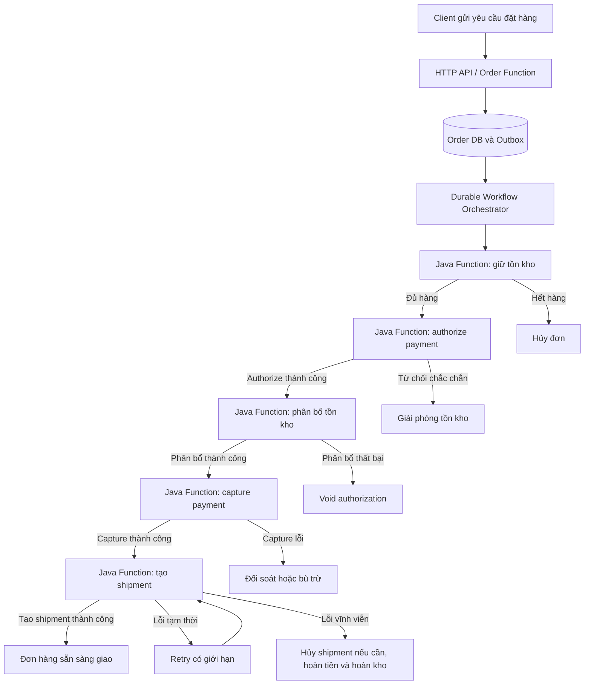

# Xây dựng bước giữ tồn kho, xác nhận thanh toán và giao hàng

Trong chương **Dự án workflow nghiệp vụ**, bài học này xây dựng luồng xử lý một đơn hàng qua ba nghiệp vụ có tác động đến hệ thống bên ngoài: giữ hàng trong kho, xác nhận thanh toán và tạo yêu cầu giao hàng. Đây là ví dụ điển hình cho ứng dụng serverless: một yêu cầu HTTP khởi tạo công việc, các Java function thực hiện từng bước, còn một bộ điều phối bền vững quản lý trạng thái, thời gian chờ, retry và xử lý bù trừ.

Mục tiêu không chỉ là gọi lần lượt ba API. Mỗi bước có thể thành công dù function gọi nó bị timeout; một thông điệp có thể được giao nhiều lần; tồn kho có thể bị nhiều đơn hàng tranh chấp; nhà cung cấp thanh toán hoặc vận chuyển có thể phản hồi chậm. Workflow phải giữ được tính đúng đắn trong những tình huống đó.

## 1. Kết quả nghiệp vụ cần đạt

Giả sử khách hàng đặt một đơn hàng gồm một hoặc nhiều SKU. Hệ thống cần bảo đảm:

1. Chỉ giữ hàng khi số lượng có thể bán còn đủ, kể cả khi nhiều đơn hàng cùng đặt một SKU.
2. Không thu tiền cho đơn hàng đã biết chắc chắn không thể giữ hàng.
3. Mỗi đơn hàng chỉ tạo một giao dịch thanh toán và một yêu cầu giao hàng về mặt nghiệp vụ, dù request hoặc event được gửi lặp.
4. Chỉ chuyển đơn hàng sang trạng thái sẵn sàng giao khi các điều kiện trước đó đã được xác nhận.
5. Khi một bước thất bại vĩnh viễn, hệ thống thực hiện hành động bù trừ phù hợp và lưu lại kết quả để có thể kiểm tra hoặc xử lý thủ công.

Một workflow không thể tạo ra transaction ACID xuyên qua cơ sở dữ liệu kho, cổng thanh toán và hãng vận chuyển. Thay vào đó, nó phối hợp nhiều transaction cục bộ bằng **Saga**: mỗi bước hoàn thành một thay đổi độc lập; nếu quy trình không thể tiếp tục, các bước bù trừ sẽ đưa nghiệp vụ về trạng thái hợp lệ.

## 2. Kiến trúc đề xuất

Nên dùng mô hình orchestration khi quy trình có thứ tự rõ ràng, nhiều nhánh lỗi, thời gian chờ và yêu cầu quan sát trạng thái tổng thể.



Các thành phần có trách nhiệm riêng:

| Thành phần | Trách nhiệm |
|---|---|
| HTTP API và Order Function | Xác thực request, kiểm tra dữ liệu, tạo `orderId`, lưu đơn hàng và trả mã theo dõi cho client. |
| Order DB | Lưu trạng thái nghiệp vụ hiện tại và dữ liệu cần để đối soát. |
| Outbox / event publisher | Phát sự kiện khởi tạo workflow đáng tin cậy sau khi đơn hàng đã được ghi nhận. |
| Durable Workflow Orchestrator | Lưu tiến trình, gọi từng function, quản lý retry, timeout, nhánh điều kiện và compensation. |
| Java Functions | Thực hiện một hành động nghiệp vụ nhỏ, có thể retry và có tính idempotent. |
| Kho, payment provider, carrier | Hệ thống bên ngoài; mỗi hệ thống có trạng thái và quy tắc nhất quán riêng. |

Không giữ một function chạy và chờ trong suốt thời gian xử lý đơn hàng. Function nên kết thúc sau một thao tác ngắn; bộ điều phối lưu trạng thái và tiếp tục ở lần gọi tiếp theo. Khi phải đợi webhook hoặc sự kiện giao hàng, workflow dùng cơ chế chờ sự kiện của nền tảng thay vì giữ một execution environment hoạt động liên tục.

Vì quy trình có thể kéo dài hơn thời gian một HTTP request, API thường trả `202 Accepted` cùng `orderId` và URL tra cứu trạng thái, ví dụ `GET /orders/{orderId}`. Client dùng idempotency key khi tạo đơn để retry request mạng mà không tạo đơn mới. API chỉ trả `READY_TO_SHIP` hoặc `PAID` khi trạng thái tương ứng đã được xác nhận từ các bước phía sau.

## 3. Thiết kế trạng thái đơn hàng và dữ liệu

Trạng thái workflow và trạng thái đơn hàng có liên quan nhưng không nhất thiết là một. Workflow mô tả tiến trình kỹ thuật; `order.status` là trạng thái nghiệp vụ mà API và người vận hành nhìn thấy. Hãy định nghĩa chuyển trạng thái hợp lệ rõ ràng, tránh để mỗi function tự gán một chuỗi trạng thái tùy ý.

| Trạng thái đơn hàng | Ý nghĩa |
|---|---|
| `PENDING` | Đã nhận yêu cầu, chưa giữ hàng. |
| `INVENTORY_RESERVED` | Đã giữ đủ số lượng trong một khoảng thời gian có hạn. |
| `PAYMENT_PENDING` | Đang xác nhận hoặc xử lý thanh toán. |
| `PAYMENT_AUTHORIZED` | Nhà cung cấp đã chấp thuận giữ hạn mức; tiền chưa nhất thiết được thu. |
| `INVENTORY_ALLOCATED` | Hàng đã được phân bổ riêng cho đơn; số lượng không còn nằm trong tồn kho có thể bán. |
| `PAID` | Khoản tiền đã được capture hoặc hoàn tất theo phương thức thanh toán và chính sách đã định nghĩa. |
| `SHIPMENT_PENDING` | Đang tạo yêu cầu giao hàng. |
| `READY_TO_SHIP` | Đã có shipment hợp lệ, chờ quy trình lấy hàng hoặc bàn giao. |
| `SHIPPED` | Đơn vị vận chuyển xác nhận đã nhận hàng hoặc đơn hàng đã được gửi đi theo định nghĩa nghiệp vụ. |
| `COMPLETED` | Quy trình hoàn tất theo tiêu chí của doanh nghiệp. |
| `CANCELLED` | Đơn hàng đã bị hủy và các tác động có thể bù trừ đã được xử lý. |
| `COMPENSATION_PENDING` | Có tác động bên ngoài cần hoàn tác nhưng chưa xác nhận hoàn tất. |
| `MANUAL_REVIEW` | Tình trạng không thể kết luận tự động; cần đối soát hoặc người vận hành xử lý. |

Một mô hình dữ liệu tối thiểu có thể gồm:

- `orders`: `order_id`, `customer_id`, `status`, `amount`, `currency`, `version`, `created_at`, `updated_at`.
- `order_items`: `order_id`, `sku`, `quantity`, `unit_price`.
- `inventory_reservations`: `reservation_id`, `order_id`, `sku`, `quantity`, `status`, `expires_at`.
- `payments`: `payment_id`, `order_id`, `provider_reference`, `amount`, `currency`, `status`, `idempotency_key`.
- `shipments`: `shipment_id`, `order_id`, `carrier_reference`, `status`, `idempotency_key`.
- `workflow_events` hoặc bảng audit: `event_id`, `order_id`, `event_type`, `occurred_at`, `correlation_id`, thông tin kết quả không nhạy cảm.

Lưu số tiền bằng đơn vị nhỏ nhất của tiền tệ (ví dụ số cent hoặc đồng nguyên theo quy ước hệ thống) trong kiểu số nguyên, kèm `currency`. Không dùng số thực dấu phẩy động cho phép tính tiền. Lưu `version` hoặc dùng điều kiện cập nhật theo trạng thái để ngăn hai execution đồng thời ghi đè trạng thái mới hơn.

## 4. Bước giữ tồn kho an toàn khi có cạnh tranh

### 4.1. Phân biệt tồn kho vật lý, đã giữ và còn có thể bán

Một cách tính phổ biến là:

\[
available = onHand - reserved - allocated
\]

Trong đó `onHand` là số lượng vật lý còn trong kho, `reserved` là số lượng đang được giữ tạm thời và `allocated` là số lượng đã phân bổ riêng cho đơn nhưng chưa bàn giao. Khi giữ hàng, tăng `reserved`; sau khi thanh toán được authorize và đơn được chấp nhận phân bổ, chuyển số lượng từ `reserved` sang `allocated`; khi bàn giao hàng, giảm cả `onHand` và `allocated` trong cùng transaction. Nếu hủy trước khi bàn giao, giảm `reserved` hoặc `allocated` theo trạng thái hiện tại. Nhờ vậy, hệ thống không bán lại hàng đã phân bổ và cũng không ghi nhận hàng đã rời kho quá sớm.

### 4.2. Không dùng read-then-write để giữ hàng

Đoạn logic nguy hiểm là đọc số lượng còn lại, kiểm tra trong Java, rồi cập nhật ở một câu lệnh khác. Hai request có thể cùng đọc `available = 1` và cả hai cùng đặt một sản phẩm cuối cùng. Việc kiểm tra và cập nhật phải được thực hiện nguyên tử tại cơ sở dữ liệu.

Ví dụ với SQL:

```sql
UPDATE inventory
SET reserved = reserved + :quantity,
    version = version + 1
WHERE sku = :sku
  AND on_hand - reserved - allocated >= :quantity;
```

Nếu số dòng được cập nhật là `1`, lượng hàng đã được giữ. Nếu là `0`, SKU không tồn tại hoặc không còn đủ hàng; cần phân biệt hai trường hợp nếu nghiệp vụ cần thông báo khác nhau. Câu lệnh này chỉ minh họa một SKU. Với đơn hàng nhiều SKU, thực hiện các cập nhật và ghi reservation trong **một transaction cơ sở dữ liệu**; nếu bất kỳ SKU nào không đủ, rollback toàn bộ. Có thể xử lý SKU theo thứ tự ổn định để giảm nguy cơ deadlock.

Tạo reservation với thời hạn, ví dụ `expires_at`, để tránh giữ hàng vô hạn khi workflow bị dừng. Một tiến trình hết hạn hoặc một bước workflow sẽ giải phóng reservation đã quá hạn. Việc giải phóng phải kiểm tra trạng thái hiện tại và có tính idempotent: chỉ chuyển `ACTIVE` sang `RELEASED` một lần. Không giải phóng reservation đã chuyển thành `ALLOCATED` hoặc đã được xuất kho.

Thời hạn reservation phải bao phủ khoảng thời gian dự kiến để authorize và xác nhận tồn kho. Trước khi gọi payment provider, workflow kiểm tra reservation còn hiệu lực; nếu cần, gia hạn bằng cập nhật có điều kiện trên trạng thái và `expires_at`. Tiến trình hết hạn chỉ được giải phóng reservation vẫn ở trạng thái có thể hết hạn. Nếu payment provider đang có kết quả chưa xác định, không giải phóng hàng chỉ vì một timeout đơn lẻ: trước hết phải đối soát giao dịch và trạng thái reservation. Cách an toàn là chuyển reservation sang `ALLOCATED` sau khi authorize thành công và trước khi capture; thao tác này khóa lượng hàng cho đơn, không phụ thuộc lease ngắn hạn nữa.

### 4.3. Java function cho thao tác giữ hàng

Function nên nhận `orderId` và các dòng hàng đã được kiểm tra; service phía dưới chịu trách nhiệm transaction và chống xử lý lặp.

```java
import java.util.List;

public record OrderItem(String sku, int quantity) {}

public record ReserveInventoryCommand(
    String orderId,
    String idempotencyKey,
    List<OrderItem> items
) {}

public record ReservationResult(
    String reservationId,
    boolean reserved,
    String reason
) {}

public interface InventoryService {
    ReservationResult reserve(ReserveInventoryCommand command);
}

public final class ReserveInventoryHandler {
    private final InventoryService inventoryService;

    public ReserveInventoryHandler(InventoryService inventoryService) {
        this.inventoryService = inventoryService;
    }

    public ReservationResult handle(ReserveInventoryCommand command) {
        if (command.orderId() == null || command.orderId().isBlank()) {
            throw new IllegalArgumentException("orderId is required");
        }
        if (command.items() == null || command.items().isEmpty()) {
            throw new IllegalArgumentException("order must contain items");
        }
        if (command.idempotencyKey() == null || command.idempotencyKey().isBlank()) {
            throw new IllegalArgumentException("idempotencyKey is required");
        }
        if (command.items().stream().anyMatch(item ->
                item.sku() == null || item.sku().isBlank() || item.quantity() <= 0)) {
            throw new IllegalArgumentException("each item needs a SKU and positive quantity");
        }
        return inventoryService.reserve(command);
    }
}
```

Đoạn code minh họa ranh giới của function, không thay thế transaction trong `InventoryService`. Service cần lưu kết quả theo `idempotencyKey`, kiểm tra payload của lần gọi lặp và trả lại cùng `reservationId` nếu thao tác trước đó đã thành công. Nếu cùng key nhưng payload khác, trả lỗi xung đột để tránh dùng nhầm kết quả.

## 5. Bước xác nhận thanh toán

Thanh toán thường có hai hành động khác nhau:

- **Authorize**: nhà cung cấp xác nhận có thể giữ hạn mức hoặc số tiền; tiền chưa nhất thiết đã được thu.
- **Capture**: yêu cầu thu khoản tiền đã authorize. Một số phương thức thanh toán hoặc nhà cung cấp chỉ hỗ trợ một thao tác thu tiền trực tiếp.

Vì vậy, trước khi triển khai cần thống nhất chính xác `PAID` có nghĩa là đã authorize hay đã capture; mô hình trong bài này dùng `PAYMENT_AUTHORIZED` cho authorize và `PAID` cho capture thành công. Với luồng thẻ hỗ trợ hai pha, một thứ tự thường dùng là giữ hàng, authorize, phân bổ tồn kho, capture, rồi tạo shipment. Doanh nghiệp có thể chọn capture sau một mốc khác, nhưng phải xác định rõ trách nhiệm hoàn tiền nếu bước sau thất bại.

Gọi payment provider bằng token hoặc payment method reference do nhà cung cấp cấp; không đưa số thẻ, CVV hoặc bí mật thanh toán vào event, log hay state input của workflow. Mỗi thao tác cần một idempotency key ổn định, chẳng hạn `orderId + ":authorize"` và `orderId + ":capture"`. Hai hành động khác nhau phải có key khác nhau.

Kết quả thanh toán cần phân biệt ít nhất:

| Kết quả | Cách xử lý |
|---|---|
| Thành công rõ ràng | Lưu provider reference và trạng thái; chuyển workflow sang bước kế tiếp. |
| Bị từ chối rõ ràng | Không retry vô hạn; void authorization nếu đã có, giải phóng reservation hoặc hoàn tác allocation, rồi hủy đơn. |
| Lỗi tạm thời, chắc chắn chưa xử lý | Retry theo chính sách có giới hạn. |
| Timeout hoặc mất kết nối, chưa biết provider đã thu tiền chưa | Đánh dấu kết quả chưa xác định; truy vấn provider bằng reference hoặc idempotency key trước khi quyết định retry hay bù trừ. |

Trường hợp cuối rất quan trọng. Timeout không chứng minh giao dịch thất bại. Nếu function gửi yêu cầu capture, provider đã thu tiền nhưng response bị mất, một lần gọi capture mới không có idempotency có thể thu tiền hai lần. Hãy dùng idempotency do provider hỗ trợ và có bước reconciliation để truy vấn trạng thái giao dịch khi kết quả không rõ.

Nếu payment provider gửi webhook, endpoint nhận webhook cần xác minh chữ ký, kiểm tra timestamp hoặc cơ chế chống replay, lưu event ID để khử trùng lặp, rồi mới phát event nội bộ. Không tin trạng thái thanh toán chỉ vì client gửi lên rằng họ đã trả tiền.

## 6. Bước tạo yêu cầu giao hàng

Chỉ tạo shipment sau khi workflow xác nhận các điều kiện cần thiết, ví dụ đơn đã được thanh toán và reservation còn hiệu lực hoặc đã chuyển sang trạng thái phân bổ hàng. Function tạo shipment nên nhận `orderId`, địa chỉ giao đã được xác thực, các kiện hàng và dịch vụ vận chuyển được chọn. Thông tin địa chỉ và giá cước nên được snapshot vào đơn hàng để kết quả không thay đổi nếu hồ sơ khách hàng được chỉnh sửa sau đó.

Dùng idempotency key như `orderId + ":create-shipment"` nếu carrier hỗ trợ. Lưu `carrier_reference` ngay khi nhận được. Nếu request timeout, truy vấn carrier theo mã tham chiếu hoặc idempotency key trước khi tạo yêu cầu mới. Nếu carrier không hỗ trợ idempotency hoặc truy vấn, cần một lớp tích hợp lưu request, kết quả và trạng thái đối soát để giảm nguy cơ tạo shipment trùng.

Tạo shipment thành công thường chỉ có nghĩa là hãng vận chuyển đã nhận yêu cầu hoặc tạo nhãn. Nó chưa chắc có nghĩa kiện hàng đã được lấy. Theo dõi các trạng thái tiếp theo như `LABEL_CREATED`, `PICKUP_SCHEDULED`, `PICKED_UP`, `IN_TRANSIT`, `DELIVERED` bằng webhook hoặc polling có giới hạn. Định nghĩa rõ sự kiện nào làm đơn hàng chuyển sang `SHIPPED` và `COMPLETED`.

Nếu tạo shipment gặp lỗi tạm thời, retry cùng idempotency key. Nếu lỗi vĩnh viễn (địa chỉ không phục vụ, thông tin kiện hàng không hợp lệ), workflow chuyển sang compensation. Nếu tiền đã capture, có thể cần hủy shipment nếu đã tạo một phần, hoàn tiền và giải phóng hoặc nhập lại tồn kho tùy theo việc hàng đã được phân bổ, đóng gói hay bàn giao. Chỉ đánh dấu `CANCELLED` sau khi các hành động bù trừ đã được xác nhận; trong lúc chờ, dùng `COMPENSATION_PENDING`.

## 7. Ghép các bước thành Saga có retry và compensation

Một thứ tự triển khai tham khảo:

1. Nhận đơn và tạo execution có `orderId` ổn định.
2. Giữ toàn bộ hàng trong một transaction kho. Nếu thiếu hàng, kết thúc với `CANCELLED`.
3. Kiểm tra reservation còn hiệu lực rồi authorize thanh toán. Nếu bị từ chối rõ ràng, giải phóng reservation.
4. Sau khi authorize thành công, chuyển reservation sang `ALLOCATED` trong transaction kho: giảm `reserved` và tăng `allocated` tương ứng. Nếu reservation không còn hiệu lực hoặc bước phân bổ thất bại, void authorization và không capture.
5. Capture thanh toán theo chính sách. Nếu thất bại chắc chắn, void authorization nếu còn hiệu lực và hoàn lại lượng hàng đã phân bổ. Nếu kết quả chưa rõ, đối soát trước khi retry hoặc hoàn kho.
6. Tạo shipment. Khi shipment được tạo thành công, cập nhật `READY_TO_SHIP`; nhận sự kiện carrier để tiếp tục cập nhật trạng thái vận chuyển.
7. Nếu một bước sau capture thất bại vĩnh viễn, hủy shipment nếu cần, refund payment và hoàn kho theo trạng thái thực tế của hàng.

Ví dụ bảng compensation:

| Bước đã hoàn thành | Hành động bù trừ có thể dùng |
|---|---|
| Reservation đang hoạt động | Release reservation. |
| Hàng đã chuyển sang `ALLOCATED` nhưng chưa bàn giao | Giảm `allocated` trong transaction có điều kiện để trả số lượng về tồn kho có thể bán; chỉ thực hiện một lần. |
| Payment đã authorize | Void authorization. |
| Payment đã capture | Refund; theo dõi `REFUND_PENDING` cho đến khi provider xác nhận. |
| Shipment đã tạo nhưng chưa bàn giao | Yêu cầu hủy shipment hoặc void label nếu carrier hỗ trợ. |
| Hàng đã được bàn giao cho carrier | Không tự động cộng lại tồn kho; cần quy trình hoàn hàng hoặc điều tra theo trạng thái vận chuyển. |

Compensation là một thao tác nghiệp vụ mới, không phải rollback lịch sử. Refund có thể thất bại hoặc xử lý bất đồng bộ; release reservation có thể đã xảy ra; carrier có thể không thể hủy kiện hàng đã nhận. Vì vậy, lưu trạng thái của từng hành động bù trừ, retry an toàn và đưa trường hợp vượt giới hạn sang hàng đợi xử lý thủ công.

## 8. Retry, timeout và idempotency trong serverless

Nền tảng serverless thường giao message ít nhất một lần. Function có thể được gọi lại sau timeout, lỗi runtime hoặc mất xác nhận từ queue. Hãy thiết kế với giả định cùng một event có thể đến nhiều lần và hai execution có thể chạy đồng thời.

**Idempotency** có nghĩa là thực hiện cùng một yêu cầu nghiệp vụ nhiều lần vẫn tạo ra một kết quả có thể xem như chỉ thực hiện một lần. Một mẫu triển khai là bảng `idempotency_records` gồm `key`, `request_hash`, `status`, `result`, `created_at` và `expires_at`. Trong transaction:

1. Tìm key đã tồn tại.
2. Nếu key đã hoàn tất và hash trùng, trả lại kết quả đã lưu.
3. Nếu key tồn tại nhưng hash khác, trả lỗi xung đột.
4. Nếu chưa tồn tại, tạo bản ghi đang xử lý, thực hiện thay đổi nghiệp vụ và lưu kết quả.
5. Nếu có lỗi, xác định rõ bản ghi có thể retry hay cần chuyển sang trạng thái điều tra.

Không thể dựa vào một khóa deduplication ngắn hạn của queue để bảo đảm một hành động tài chính chỉ xảy ra một lần. Khóa nghiệp vụ cần tồn tại đủ lâu theo vòng đời đơn hàng và chính sách đối soát. Khi gọi hệ thống ngoài, ưu tiên idempotency key của chính nhà cung cấp và lưu provider reference.

Retry chỉ áp dụng cho lỗi có khả năng tự hồi phục, như rate limit, lỗi mạng hoặc dịch vụ tạm thời không khả dụng. Dùng exponential backoff có jitter, giới hạn số lần thử và tổng thời gian; tôn trọng `Retry-After` nếu provider trả về. Không retry lỗi dữ liệu không hợp lệ hoặc từ chối nghiệp vụ. Với timeout, phải phân loại kết quả là chưa xác định và đối soát trước khi lặp lại hành động có tác động tài chính.

Đặt timeout riêng cho mỗi lần gọi provider, timeout tổng cho từng bước và deadline cho toàn workflow. Các bước chờ webhook hoặc chờ hết hạn reservation nên dùng trạng thái chờ bền vững của orchestrator. Thiết kế thứ tự timeout sao cho function có đủ thời gian ghi kết quả hoặc để orchestrator nhận diện lần chạy bị gián đoạn.

## 9. Khởi tạo workflow đáng tin cậy bằng Outbox

Một lỗi thường gặp là ghi đơn hàng vào database rồi gọi API khởi tạo workflow. Nếu database commit thành công nhưng function chết trước khi gọi orchestrator, đơn hàng tồn tại mà không có workflow. Nếu gọi orchestrator trước rồi transaction database rollback, workflow lại xử lý một đơn không tồn tại.

Transactional Outbox giải quyết khoảng trống này: trong cùng transaction, ghi `orders` và một bản ghi `outbox_events` như `OrderAccepted`. Một publisher riêng đọc outbox, phát event hoặc khởi tạo workflow, sau đó đánh dấu đã gửi. Publisher có thể gửi trùng nếu chết sau khi gửi nhưng trước khi đánh dấu; consumer/orchestrator vẫn phải idempotent theo `orderId` hoặc `eventId`.

Ví dụ event nội bộ:

```json
{
  "eventId": "evt-01J...",
  "eventType": "OrderAccepted",
  "eventVersion": 1,
  "orderId": "ord-2026-00042",
  "occurredAt": "2026-11-17T10:30:00Z",
  "correlationId": "req-7f2..."
}
```

Event khởi tạo chỉ nên chứa định danh và metadata cần thiết. Workflow có thể tải snapshot đơn hàng từ service tin cậy. Tránh nhúng dữ liệu thanh toán nhạy cảm hoặc một bản sao lớn của hồ sơ khách hàng vào message.

## 10. Triển khai workflow trên nền tảng serverless

Chọn một dịch vụ orchestration có khả năng lưu execution state, retry, timeout, nhánh điều kiện và chờ callback/event. Tùy cloud provider, đó có thể là state machine, durable workflow hoặc workflow service tương đương. Tên dịch vụ khác nhau nhưng các yêu cầu thiết kế vẫn giống nhau.

Mỗi task nên gọi một Java function có hợp đồng đầu vào/đầu ra rõ ràng. Ví dụ:

```json
{
  "orderId": "ord-2026-00042",
  "reservationId": "res-123",
  "paymentReference": "pay-456",
  "operation": "CREATE_SHIPMENT"
}
```

Không đưa secret vào workflow definition hoặc event. Function lấy thông tin xác thực từ secret manager, chỉ có quyền truy cập tài nguyên cần thiết: function giữ kho được phép cập nhật reservation; function thanh toán được phép gọi payment provider; function giao hàng được phép gọi carrier. Dùng role riêng theo function hoặc theo nhóm quyền nhỏ, giới hạn quyền đọc/ghi dữ liệu và xoay vòng credential.

Đưa workflow definition, function, queue, database policy, secret reference, retry policy và alarm vào Infrastructure as Code. Tách cấu hình theo môi trường; không dùng chung tài khoản thanh toán hoặc thông tin carrier giữa môi trường thử nghiệm và production. Khi thay đổi schema event, tăng `eventVersion` và duy trì khả năng đọc event cũ trong thời gian message cũ còn tồn tại.

## 11. Ước lượng chi phí và chọn cách điều phối

Chi phí của workflow serverless thường đến từ nhiều phần: số lần chuyển trạng thái hoặc thời lượng execution của orchestrator; số lần gọi và thời gian chạy của Java function; queue/event delivery; lượt đọc ghi database; log, metric và trace; cùng phí giao dịch của payment provider hoặc carrier. Retry, webhook trùng và polling quá thường xuyên đều làm tăng chi phí mà không tạo thêm giá trị nghiệp vụ.

Ước lượng theo một đơn hàng thay vì chỉ nhìn giá của một function. Ví dụ, cộng số bước trung bình, số lần retry dự kiến, số lần truy vấn provider, dung lượng lưu trạng thái và thời gian giữ dữ liệu audit. Sau đó nhân với sản lượng bình thường và tải đỉnh. Dùng callback hoặc event để chờ kết quả dài hạn thường tiết kiệm hơn việc polling liên tục hoặc giữ function hoạt động trong lúc chờ.

Orchestration có thêm chi phí cho từng bước hoặc thời lượng workflow, nhưng thường đáng giá khi cần lịch sử execution, timeout, retry và compensation rõ ràng. Choreography có thể giảm phần điều phối trung tâm, nhưng chi phí vận hành và điều tra sự cố có thể tăng khi khó lần theo chuỗi event. So sánh tổng chi phí và khả năng vận hành ở tải thực tế, đồng thời đặt giới hạn concurrency để tránh làm quá tải database hoặc provider.

## 12. Quan sát và xử lý sự cố

Mọi log và event liên quan cần mang `orderId`, `workflowExecutionId`, `correlationId`, `stepName` và `attempt`. Không ghi token, thông tin thẻ, secret hoặc dữ liệu cá nhân không cần thiết. Có thể dùng các metric sau:

- Số đơn theo từng trạng thái và tuổi của đơn ở trạng thái đó.
- Tỷ lệ giữ kho thành công, tỷ lệ payment decline và tỷ lệ tạo shipment thành công.
- Số lần retry, timeout, duplicate event và lỗi ở từng function.
- Số reservation quá hạn chưa giải phóng, payment chưa rõ kết quả, refund đang chờ và shipment không cập nhật.
- Thời gian từ `PENDING` đến `READY_TO_SHIP`, cùng chi phí execution và số lần gọi provider trên mỗi đơn.

Thiết lập cảnh báo cho workflow bị kẹt, DLQ tăng, tỷ lệ lỗi vượt ngưỡng, reservation quá hạn và compensation tồn đọng. Một công cụ vận hành cần cho phép tra cứu toàn bộ lịch sử theo `orderId`, xem bước cuối cùng, trạng thái provider và hành động bù trừ đã thực hiện. Chỉ cho phép retry thủ công hoặc tiếp tục workflow khi người vận hành đã xác minh trạng thái bên ngoài; tránh bấm chạy lại một bước capture hoặc tạo shipment mà chưa đối soát.

## 13. Kiểm thử các tình huống quan trọng

Kiểm thử không chỉ đường đi thành công. Cần mô phỏng lỗi ở ranh giới giữa hai hệ thống, đặc biệt là trường hợp tác động đã thành công nhưng response bị mất.

| Tình huống | Kết quả mong đợi |
|---|---|
| Hai đơn cùng mua sản phẩm cuối cùng | Chỉ một reservation thành công; đơn còn lại nhận kết quả hết hàng. |
| Cùng `OrderAccepted` được phát hai lần | Chỉ một workflow nghiệp vụ được tạo hoặc lần khởi tạo lặp được nhận diện. |
| Function giữ hàng chạy lại sau timeout | Trả lại reservation đã tạo; không tăng `reserved` lần thứ hai. |
| Payment bị từ chối | Release reservation và hủy đơn. |
| Capture thành công nhưng response bị mất | Truy vấn provider hoặc dùng idempotency để xác định giao dịch; không thu tiền lần hai. |
| Carrier tạo shipment nhưng response bị mất | Tra cứu theo idempotency/reference trước khi gửi yêu cầu mới. |
| Reservation hết hạn khi payment đang xử lý | Không capture nếu chưa xác nhận và phân bổ được tồn kho; void authorization nếu cần. |
| Refund tạm thời thất bại | Giữ `COMPENSATION_PENDING`, retry có giới hạn và cảnh báo khi quá hạn. |
| Webhook carrier gửi trùng hoặc sai chữ ký | Bỏ qua event trùng; từ chối event không xác thực. |
| Workflow bị dừng giữa các bước | Có thể tiếp tục hoặc đối soát từ trạng thái đã lưu, không tạo tác động trùng. |

Nên có unit test cho luật chuyển trạng thái và idempotency; integration test với database thật hoặc môi trường tương thích để xác minh transaction giữ kho; contract test cho payload của payment/carrier; và end-to-end test với provider sandbox. Thêm fault injection để mô phỏng timeout sau khi provider đã xử lý request. Với workflow chạy lâu, kiểm thử cả việc deploy phiên bản function mới trong khi execution cũ vẫn đang chạy.

## 14. Quyết định thiết kế và tiêu chí hoàn thành

Orchestration phù hợp khi cần một nơi nhìn thấy toàn bộ tiến trình, compensation và thời gian chờ. Choreography bằng event phù hợp hơn với quy trình đơn giản, các consumer ít phụ thuộc thứ tự và không cần một coordinator trung tâm. Với luồng giữ kho, thanh toán và giao hàng, orchestration thường dễ kiểm soát hơn vì thứ tự nghiệp vụ và hành động bù trừ có ý nghĩa trực tiếp.

Trước khi đưa vào production, nhóm phát triển cần xác nhận các câu hỏi sau:

- Provider xác nhận capture/settlement có phải điều kiện để phát ra `PAID` không? Với phương thức không có bước capture riêng, quy ước hoàn tất thanh toán là gì?
- Reservation có thời hạn bao lâu và ai giải phóng reservation hết hạn?
- Khi capture thành công nhưng không thể tạo shipment, chính sách refund và hoàn kho là gì?
- Carrier hỗ trợ idempotency, tra cứu shipment và hủy shipment ở những trạng thái nào?
- Event có version, event ID, correlation ID và chính sách lưu trữ ra sao?
- Ai được phép xử lý `MANUAL_REVIEW`, và mọi thao tác thủ công được audit thế nào?
- Mục tiêu thời gian hoàn tất, giới hạn retry, ngưỡng cảnh báo và ngân sách chi phí là bao nhiêu?

Workflow được xem là hoàn thành về mặt kỹ thuật khi đường đi thành công và các nhánh lỗi đã được định nghĩa; thao tác giữ kho, thanh toán và tạo shipment có idempotency; trạng thái được lưu bền vững; timeout và retry có giới hạn; compensation có thể theo dõi; webhook được xác thực; và các tình huống cạnh tranh, duplicate, timeout không rõ kết quả đã được kiểm thử. Những chính sách như thời hạn giữ hàng, thời điểm capture và điều kiện hoàn tiền vẫn phải được chủ nghiệp vụ xác nhận trước khi triển khai thật.
