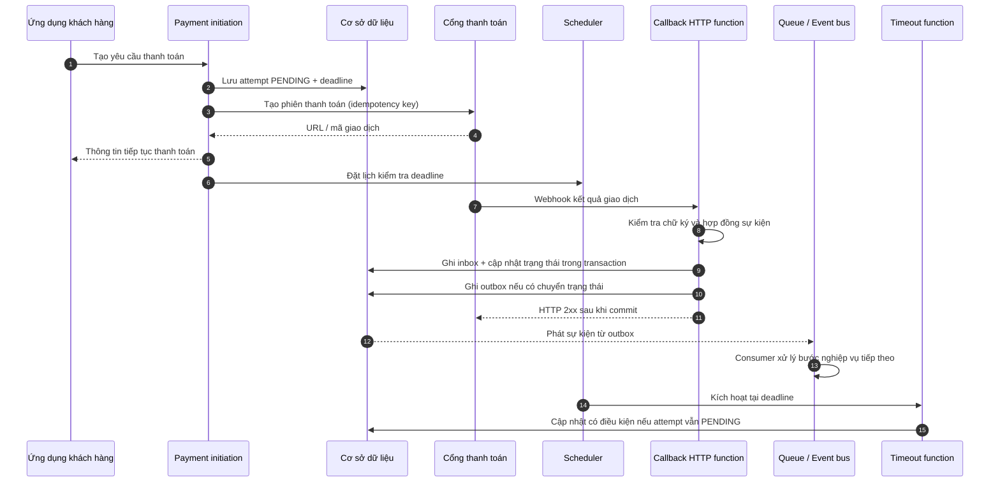

# Triển khai callback và thời hạn chờ xác nhận thanh toán

Trong một quy trình đặt hàng, việc gửi yêu cầu thanh toán thành công chưa có nghĩa là tiền đã được thu. Cổng thanh toán thường xử lý giao dịch bất đồng bộ: ứng dụng tạo một phiên thanh toán, người mua hoàn tất thao tác ở phía nhà cung cấp, rồi nhà cung cấp gửi webhook (callback HTTP) về hệ thống. Callback có thể đến chậm, đến lặp, đến sai thứ tự hoặc không đến vì sự cố mạng. Trong khi đó, đơn hàng vẫn cần một thời hạn chờ xác nhận rõ ràng.

Bài học này xây dựng một luồng serverless có thể chịu được các tình huống đó. Trọng tâm là một Java function nhận callback HTTP, lưu kết quả một cách idempotent, phối hợp với function xử lý hết hạn và phát sự kiện nghiệp vụ cho các bước tiếp theo. Thiết kế áp dụng được cho nhiều nền tảng FaaS; adapter HTTP, hàng đợi và bộ lập lịch cụ thể sẽ tùy theo nhà cung cấp cloud.

## 1. Kết quả cần đạt

Sau bài học, bạn có thể:

- Phân biệt việc khởi tạo thanh toán, việc nhà cung cấp xử lý giao dịch và việc hệ thống xác nhận đơn hàng đã thanh toán.
- Thiết kế hợp đồng callback có định danh sự kiện, mã giao dịch, số tiền, tiền tệ và thời điểm do nhà cung cấp xác thực.
- Lưu thời hạn thanh toán trong kho dữ liệu bền vững và kích hoạt xử lý hết hạn bằng scheduler, delayed queue hoặc tác vụ quét định kỳ.
- Xử lý callback trùng lặp, retry, callback đến muộn và cuộc đua giữa callback với tác vụ timeout.
- Dùng giao dịch dữ liệu, khóa duy nhất hoặc cập nhật có điều kiện để bảo đảm một kết quả nghiệp vụ nhất quán khi nhiều function chạy đồng thời.
- Bảo vệ endpoint webhook, quan sát luồng xử lý và kiểm thử các tình huống lỗi thực tế.

## 2. Bài toán và ranh giới trách nhiệm

Giả sử một cửa hàng có dịch vụ Order và tích hợp với một cổng thanh toán bên ngoài. Khi khách chọn thanh toán, Order tạo một `paymentAttempt` và yêu cầu cổng thanh toán mở phiên giao dịch. Người mua có thể rời trang, mạng có thể bị ngắt hoặc cổng thanh toán có thể xử lý trong vài giây đến vài phút. Cổng thanh toán gửi callback đến endpoint của ứng dụng khi có kết quả.

Hệ thống cần trả lời riêng ba câu hỏi:

1. **Yêu cầu thanh toán đã được tạo chưa?** Đây là kết quả của lời gọi khởi tạo phiên thanh toán.
2. **Nhà cung cấp đã ghi nhận giao dịch ở trạng thái nào?** Đây là thông tin đến từ callback đã xác thực hoặc API tra cứu giao dịch của nhà cung cấp.
3. **Đơn hàng có được phép chuyển sang trạng thái đã thanh toán không?** Đây là quyết định nghiệp vụ của hệ thống, dựa trên số tiền, tiền tệ, đơn hàng, thời hạn và trạng thái hiện tại.

Không dùng kết quả chuyển hướng của trình duyệt hoặc thông báo từ ứng dụng di động làm bằng chứng thanh toán. Người dùng có thể đóng trình duyệt trước khi chuyển hướng, sửa request ở client hoặc gửi lại request cũ. Chỉ callback đã xác thực hoặc kết quả tra cứu đáng tin cậy từ nhà cung cấp mới được dùng để xác nhận giao dịch.

Các thành phần có thể được triển khai thành những function riêng:

| Thành phần | Trigger | Trách nhiệm |
|---|---|---|
| Payment initiation function | HTTP từ ứng dụng | Tạo payment attempt, lưu deadline và yêu cầu nhà cung cấp tạo phiên thanh toán |
| Payment callback function | HTTP webhook từ nhà cung cấp | Xác thực callback, ghi nhận sự kiện và cập nhật trạng thái thanh toán |
| Payment timeout function | Scheduler hoặc thông điệp trễ | Kiểm tra deadline và chuyển attempt chưa được xác nhận sang hết hạn |
| Domain event consumer | Queue hoặc event bus | Xử lý các bước tiếp theo như xác nhận đơn, gửi thông báo hoặc hoàn tiền |
| Reconciliation job | Lịch định kỳ | Đối soát những giao dịch còn mơ hồ với API của nhà cung cấp |

Mỗi function nên làm một phần việc có thể retry độc lập. Dữ liệu trạng thái và deadline phải nằm trong kho lưu trữ bền vững; bộ nhớ của một instance function không phải nơi lưu trạng thái workflow.

## 3. Luồng xử lý tổng thể



Sơ đồ mô tả luồng logic. Trong triển khai thực tế, outbox có thể được phát bằng một publisher riêng hoặc bằng cơ chế change data capture. Không nên giả định một transaction của cơ sở dữ liệu có thể bao trùm cả database, queue và API của nhà cung cấp thanh toán.

## 4. Thiết kế trạng thái và hợp đồng sự kiện

### 4.1. Tách trạng thái đơn hàng khỏi trạng thái payment attempt

Một đơn hàng có thể có nhiều lần thử thanh toán. Vì vậy, không nên chỉ lưu một cờ `paid` trên đơn hàng rồi ghi đè mọi lần thử. Mỗi lần thử cần một định danh và lịch sử riêng.

Ví dụ trạng thái đơn hàng:

| Trạng thái đơn hàng | Ý nghĩa |
|---|---|
| `AWAITING_PAYMENT` | Đơn hàng đang chờ một lần thanh toán hợp lệ |
| `PAID` | Đã xác nhận nhận đủ khoản tiền cần thiết |
| `PAYMENT_EXPIRED` | Hết thời hạn mà chưa có khoản thanh toán được chấp nhận |
| `PAYMENT_REVIEW` | Có kết quả mâu thuẫn hoặc giao dịch muộn cần xử lý nghiệp vụ |
| `CANCELLED` | Đơn hàng đã bị hủy theo quy tắc nghiệp vụ |

Ví dụ trạng thái của một payment attempt:

| Trạng thái attempt | Ý nghĩa |
|---|---|
| `PENDING` | Đã tạo yêu cầu, đang chờ kết quả từ nhà cung cấp |
| `SUCCEEDED` | Nhà cung cấp xác nhận giao dịch thành công và hệ thống đã chấp nhận kết quả |
| `FAILED` | Nhà cung cấp xác nhận lần thử thất bại |
| `EXPIRED` | Deadline đã qua và attempt vẫn chưa có kết quả được chấp nhận |
| `REFUND_REQUIRED` | Đã thu tiền nhưng chính sách không cho phép chấp nhận khoản tiền muộn |
| `REFUNDING` / `REFUNDED` | Đang hoàn tiền / đã hoàn tiền |

Hợp đồng chuyển trạng thái mẫu cho một payment attempt:

| Trạng thái attempt hiện tại | Sự kiện/điều kiện | Trạng thái attempt tiếp theo | Quyết định với order / quy tắc |
|---|---|---|---|
| `PENDING` | Nhà cung cấp xác nhận thành công | `SUCCEEDED` | Chuyển order sang `PAID` nếu dữ liệu khớp và giao dịch đáp ứng chính sách deadline |
| `PENDING` | Nhà cung cấp xác nhận thất bại | `FAILED` | Order có thể vẫn `AWAITING_PAYMENT` nếu còn thời gian và cho phép lần thử khác |
| `PENDING` | Timeout đến sau deadline | `EXPIRED` | Chuyển order sang `PAYMENT_EXPIRED` chỉ khi không còn attempt hợp lệ khác |
| `EXPIRED` | Xác minh giao dịch thành công trước deadline | `SUCCEEDED` | Chấp nhận order nếu chính sách cho phép và tài nguyên nghiệp vụ còn hợp lệ; nếu không, đưa order vào `PAYMENT_REVIEW` hoặc hoàn tiền |
| `EXPIRED` | Xác minh giao dịch thành công sau deadline | `REFUND_REQUIRED` | Giữ order hết hạn hoặc review; không tự động xác nhận order và khởi tạo quy trình hoàn tiền |
| `REFUND_REQUIRED` | Refund được khởi tạo | `REFUNDING` | Dùng refund ID và idempotency key riêng |
| `REFUNDING` | Nhà cung cấp xác nhận hoàn tiền | `REFUNDED` | Chỉ hoàn tất sau khi xác minh kết quả refund |
| `SUCCEEDED` | Callback cũ báo `pending` hoặc `failed` | `SUCCEEDED` | Không hạ trạng thái bởi sự kiện cũ hoặc đến sai thứ tự |

`FAILED` và `SUCCEEDED` là kết quả terminal của attempt trong ví dụ này; hoàn tiền có state machine riêng, dù được minh họa bằng các trạng thái `REFUND_REQUIRED`, `REFUNDING` và `REFUNDED` cho nhánh thanh toán muộn. Nếu khách thử thanh toán lại sau `FAILED`, hãy tạo attempt mới thay vì mở lại attempt cũ. Nếu có nghiệp vụ hủy hoặc chargeback, mô hình hóa chúng bằng sự kiện và trạng thái riêng theo hợp đồng của nhà cung cấp.

`FAILED` của một attempt không nhất thiết làm đơn hàng hết hạn ngay. Đơn hàng có thể cho phép khách thử một payment attempt khác cho đến deadline chung. Quy tắc này cần được ghi rõ trong nghiệp vụ để tránh việc một callback thất bại vô tình đóng đơn hàng.

### 4.2. Các trường dữ liệu quan trọng

Một bản ghi attempt thường cần có:

| Trường | Mục đích |
|---|---|
| `attemptId` | Định danh nội bộ duy nhất của lần thử |
| `orderId` | Đơn hàng liên quan |
| `provider` và `providerReference` | Nhà cung cấp và mã giao dịch phía nhà cung cấp |
| `amountMinor` và `currency` | Số tiền ở đơn vị nhỏ nhất của tiền tệ và mã tiền tệ |
| `status` | Trạng thái hiện tại của attempt |
| `deadlineAt` | Thời điểm hết hạn tuyệt đối, lưu theo UTC |
| `version` | Phiên bản để cập nhật lạc quan hoặc kiểm tra cạnh tranh |
| `createdAt`, `updatedAt` | Thời điểm tạo và cập nhật |
| `lastProviderEventAt` | Thời điểm sự kiện nhà cung cấp gần nhất đã được chấp nhận |

Lưu số tiền bằng số nguyên ở đơn vị nhỏ nhất, chẳng hạn xu hoặc đồng theo quy ước của tiền tệ, hoặc dùng `BigDecimal` với scale được kiểm soát. Không dùng `double` cho phép tính tiền. Không tự giả định mọi loại tiền tệ đều có hai chữ số thập phân.

Callback nên có hợp đồng tương đương ví dụ sau (tên field tùy theo nhà cung cấp):

```json
{
  "eventId": "evt_8f2d1c",
  "eventType": "payment.succeeded",
  "merchantReference": "attempt_42",
  "providerTransactionId": "txn_7812",
  "amountMinor": 259900,
  "currency": "VND",
  "occurredAt": "2026-11-17T10:15:30Z"
}
```

`eventId` nhận diện một lần phát sự kiện của nhà cung cấp. `providerTransactionId` nhận diện giao dịch thanh toán. Hai mã này có thể khác nhau: cùng một giao dịch đôi khi phát nhiều loại sự kiện. `merchantReference` phải ánh xạ được về attempt nội bộ. `occurredAt` chỉ được tin cậy khi nó thuộc payload đã xác thực và nhà cung cấp định nghĩa rõ ý nghĩa thời gian đó.

## 5. Tạo deadline bền vững

Khi tạo attempt, ứng dụng xác định deadline theo quy tắc nghiệp vụ, ví dụ 15 phút sau khi phiên thanh toán được tạo. Hãy lưu thời điểm tuyệt đối (`Instant`) thay vì chỉ lưu “còn 15 phút” trong bộ nhớ của function.

Quy trình tạo attempt nên theo thứ tự:

1. Sinh `attemptId` và idempotency key ổn định cho yêu cầu tạo thanh toán.
2. Lưu attempt với `status = PENDING`, số tiền, tiền tệ và `deadlineAt`.
3. Gọi API tạo phiên thanh toán của nhà cung cấp bằng idempotency key đó.
4. Lưu `providerReference` và thông tin cần thiết để khách tiếp tục thanh toán.
5. Đặt lịch timeout hoặc để một tác vụ quét định kỳ tìm attempt đến hạn.

Nếu API nhà cung cấp thất bại tạm thời sau khi bản ghi đã được tạo, có thể retry lời gọi với cùng idempotency key. Nếu không biết nhà cung cấp đã tạo phiên hay chưa do timeout mạng, không tạo một key mới ngay lập tức; trước tiên retry với key cũ hoặc tra cứu theo merchant reference để tránh tạo hai phiên tính phí.

Có hai cách phổ biến để kích hoạt timeout:

- **Thông điệp trễ hoặc scheduler theo từng attempt:** khi tạo attempt, đặt một thông điệp mang `attemptId` và `deadlineAt` để chạy tại deadline. Cách này cho độ trễ thấp, nhưng cần hiểu giới hạn thời gian tối đa, độ chính xác và cách hủy hoặc bỏ qua lịch cũ của dịch vụ đang dùng.
- **Tác vụ quét định kỳ:** chạy theo lịch, truy vấn các attempt `PENDING` có `deadlineAt <= now`, rồi xử lý từng bản ghi. Cách này đơn giản và dễ phục hồi nếu lịch riêng lẻ bị mất, nhưng thời điểm hết hạn có thể trễ bằng chu kỳ quét.

Có thể kết hợp scheduler để phản hồi nhanh và tác vụ quét để đối soát. Trong cả hai cách, timeout function vẫn phải đọc trạng thái và deadline mới nhất từ database. Thông điệp timeout chỉ là tín hiệu “hãy kiểm tra attempt này”, không phải bằng chứng rằng attempt chắc chắn cần chuyển trạng thái.

Không giữ function sống bằng `Thread.sleep`, không dùng timer trong bộ nhớ instance và không dựa vào một request HTTP đang mở suốt 15 phút. Instance FaaS có thể bị dừng bất cứ lúc nào; thời gian chạy dài cũng làm tăng chi phí và dễ vượt giới hạn timeout.

## 6. Nhận callback HTTP an toàn

### 6.1. Xác thực trước khi thay đổi dữ liệu

Endpoint webhook thường không dùng đăng nhập người dùng. Thay vào đó, xác thực rằng request thực sự đến từ nhà cung cấp:

- Bắt buộc HTTPS.
- Kiểm tra chữ ký theo đúng thuật toán và canonicalization do nhà cung cấp quy định. Nếu chữ ký được tính trên raw request body, phải xác minh trên đúng byte nhận được trước khi parse hoặc serialize lại JSON.
- So sánh chữ ký theo cách constant-time nếu thư viện cung cấp.
- Kiểm tra timestamp hoặc nonce để hạn chế replay trong khoảng thời gian hợp lý; vẫn cần idempotency vì nhà cung cấp có thể retry hợp lệ.
- Quản lý secret trong secret manager, hỗ trợ xoay vòng secret và không ghi secret vào log.
- Có thể dùng IP allowlist như lớp phòng vệ bổ sung nếu nhà cung cấp công bố dải IP ổn định; không xem IP là cơ chế xác thực duy nhất.

Không tin `orderId`, `amount`, `status` hoặc `occurredAt` chỉ vì chúng có trong JSON. Sau khi xác minh chữ ký, vẫn phải kiểm tra merchant reference, mã giao dịch, số tiền, tiền tệ và trạng thái hiện tại. Với nhà cung cấp có API tra cứu giao dịch, hãy truy vấn API khi callback thiếu dữ liệu, mâu thuẫn hoặc có dấu hiệu bất thường.

### 6.2. Phân biệt lỗi có thể retry và lỗi vĩnh viễn

Quy tắc mã HTTP cần khớp tài liệu retry của nhà cung cấp:

| Tình huống | Phản hồi thường dùng | Hành động |
|---|---|---|
| Chữ ký sai hoặc payload sai định dạng | `400` hoặc `401` | Từ chối; ghi log bảo mật ở mức phù hợp |
| Sự kiện đã xử lý trước đó | `200` hoặc `204` | Trả thành công để dừng retry |
| Database hoặc dịch vụ phụ thuộc đang lỗi tạm thời | `5xx` | Cho phép nhà cung cấp retry theo chính sách |
| Callback hợp lệ nhưng chưa ánh xạ được attempt | Theo hợp đồng nhà cung cấp, thường trả `2xx` sau khi lưu vào vùng chờ xử lý | Lưu sự kiện unmatched để đối soát; tránh retry vô hạn nếu dữ liệu không thể tự sửa |

Chỉ trả `2xx` sau khi callback đã được ghi bền vững hoặc đã được xác định là bản trùng an toàn. Nếu trả thành công trước khi commit, function có thể bị dừng giữa chừng và nhà cung cấp sẽ không gửi lại, khiến kết quả thanh toán bị mất. Ngược lại, nếu database commit thành công nhưng response bị mất trên đường mạng, nhà cung cấp có thể gửi lại; do đó callback bắt buộc phải idempotent.

## 7. Idempotency và xử lý đồng thời

Hầu hết hệ thống webhook có ngữ nghĩa giao nhận ít nhất một lần (at-least-once). Cùng một sự kiện có thể được gửi nhiều lần khi nhà cung cấp không nhận được response. Queue và scheduler cũng có thể phát lại thông điệp. Vì vậy, không xây dựng logic dựa trên giả định “mỗi sự kiện chỉ chạy đúng một lần”.

### 7.1. Lưu inbox và ràng buộc duy nhất

Tạo bảng hoặc collection `payment_inbox` với khóa duy nhất như `(provider, eventId)`. Lưu thêm payload hash, thời điểm nhận, trạng thái xử lý và thông tin lỗi. Trong cùng transaction xử lý callback:

1. Thử insert inbox event.
2. Nếu khóa đã tồn tại và payload hash giống nhau, coi đây là callback lặp và trả kết quả đã xử lý.
3. Nếu khóa đã tồn tại nhưng payload hash khác nhau, ghi nhận sự kiện bất thường và đưa vào quy trình điều tra; không âm thầm bỏ qua.
4. Nếu là sự kiện mới, tìm payment attempt, kiểm tra hợp đồng và chuyển trạng thái.
5. Ghi outbox event nếu có thay đổi nghiệp vụ cần phát ra ngoài.
6. Commit inbox, payment attempt, order và outbox trong cùng transaction.

Nếu database không hỗ trợ transaction nhiều bản ghi, cần thiết kế một cơ chế tương đương bằng conditional write, khóa duy nhất và trạng thái xử lý có thể phục hồi. Không chỉ lưu event ID trong bộ nhớ hoặc cache có TTL ngắn rồi coi đó là bảo đảm duy nhất.

### 7.2. Callback và timeout có thể chạy cùng lúc

Callback function và timeout function có thể đọc cùng trạng thái `PENDING` rồi cùng cố cập nhật. Hãy để database phân xử bằng transaction hoặc cập nhật có điều kiện. Ví dụ SQL khái niệm:

```sql
UPDATE payment_attempt
SET status = 'EXPIRED', version = version + 1, updated_at = CURRENT_TIMESTAMP
WHERE attempt_id = :attemptId
  AND status = 'PENDING'
  AND deadline_at <= :now;
```

Nếu số dòng cập nhật bằng 0, function phải đọc lại bản ghi và quyết định dựa trên trạng thái mới. Callback cũng cần cập nhật có điều kiện theo `status`, `version` hoặc khóa hàng trong transaction. Không đọc trạng thái một lần rồi cập nhật vô điều kiện sau đó.

Quy tắc này bảo đảm chỉ một function thắng quyền chuyển trạng thái từ `PENDING`. Function còn lại sẽ nhìn thấy kết quả đã commit và xử lý theo chính sách callback trễ hoặc timeout trùng lặp.

### 7.3. Định nghĩa rõ ý nghĩa của “đến hạn”

Có hai thời điểm khác nhau:

- `receivedAt`: thời điểm hệ thống nhận callback.
- `occurredAt`: thời điểm nhà cung cấp cho biết giao dịch thực sự xảy ra.

Nếu deadline là hạn cuối để **giao dịch được thực hiện**, callback có thể đến sau deadline nhưng giao dịch vẫn được chấp nhận nếu nhà cung cấp xác nhận `occurredAt` nằm trước hoặc đúng deadline. Nếu deadline là hạn cuối để **hệ thống nhận xác nhận**, callback đến muộn phải đi theo chính sách giao dịch muộn. Đây là quyết định nghiệp vụ, không nên để cách triển khai scheduler tự quyết định.

Chỉ sử dụng `occurredAt` để ra quyết định khi timestamp được bảo vệ bởi chữ ký và có ngữ nghĩa đáng tin cậy. Nếu nhà cung cấp không bảo đảm điều đó, truy vấn API trạng thái giao dịch. Cần tính đến sai lệch đồng hồ và độ chính xác timestamp; có thể quy định một khoảng dung sai nhỏ và đưa trường hợp sát ranh giới vào đối soát.

## 8. Chính sách cho callback muộn và sự kiện sai thứ tự

Một callback thành công đến sau khi timeout đã đánh dấu attempt `EXPIRED` là tình huống quan trọng. Không nên tự động chuyển đơn hàng sang `PAID` trong mọi trường hợp. Có thể đã giải phóng tồn kho, hủy đơn hoặc khách đã đặt một đơn mới.

Hãy xác định chính sách rõ ràng:

| Tình huống | Cách xử lý gợi ý |
|---|---|
| Giao dịch thành công trước deadline, callback đến muộn, đơn vẫn đủ điều kiện | Xác minh với nhà cung cấp rồi chấp nhận thanh toán; phát sự kiện nghiệp vụ một lần |
| Giao dịch thành công sau deadline | Đánh dấu `REFUND_REQUIRED` hoặc `PAYMENT_REVIEW`; không tự động xác nhận đơn |
| Timeout đã chạy nhưng callback cho biết giao dịch thành công trước deadline | Đọc lại trạng thái, xác minh giao dịch và áp dụng quy tắc cho phép khôi phục nếu tài nguyên nghiệp vụ vẫn hợp lệ |
| Callback thất bại đến sau callback thành công | Không hạ trạng thái thành thất bại; kiểm tra thứ tự sự kiện và trạng thái hiện tại |
| Callback thành công lặp lại | Trả thành công, không phát lại tác động nghiệp vụ |
| Callback không tìm thấy attempt | Lưu vào vùng unmatched, tra cứu hoặc đối soát; không tự tạo đơn hàng từ callback |
| Số tiền hoặc tiền tệ không khớp | Cách ly sự kiện, cảnh báo và xác minh với nhà cung cấp |

Một số nhà cung cấp phát nhiều event như `pending`, `authorized`, `captured`, `refunded`. Không so sánh tên trạng thái theo thứ tự chữ hoặc chỉ dựa vào thứ tự callback đến. Xây dựng bảng chuyển trạng thái theo mô hình nghiệp vụ của nhà cung cấp. Trạng thái terminal như `SUCCEEDED` không được ghi đè bởi một event cũ hơn. Hoàn tiền là một giao dịch riêng, cần mã giao dịch, idempotency key và trạng thái riêng.

Nếu timeout làm giải phóng tồn kho, callback muộn phải kiểm tra khả năng giữ lại hoặc cấp lại tồn kho trước khi chấp nhận đơn. Nếu không thể khôi phục an toàn, chuyển sang hoàn tiền hoặc xử lý thủ công. Quyết định này nên được ghi lại cùng lý do để nhân viên vận hành có thể giải thích cho khách hàng.

## 9. Cấu trúc Java cho phần nghiệp vụ

Nên giữ logic thanh toán trong lớp nghiệp vụ độc lập với API Gateway, Cloud Functions, Lambda hoặc framework HTTP cụ thể. Adapter của nền tảng chịu trách nhiệm chuyển request thành raw body và headers, gọi service, rồi ánh xạ kết quả thành response HTTP. Phần service chịu trách nhiệm xác minh, idempotency và chuyển trạng thái.

Ví dụ dưới đây minh họa ranh giới và thứ tự xử lý; các interface `PaymentStore`, `SignatureVerifier`, `CallbackDecoder` và kiểu transaction là adapter cần triển khai theo database và nhà cung cấp được chọn.

```java
import java.time.Clock;
import java.time.Instant;
import java.util.Map;

public final class PaymentCallbackService {
    private final SignatureVerifier signatureVerifier;
    private final CallbackDecoder decoder;
    private final PaymentStore store;
    private final Clock clock;

    public PaymentCallbackService(
            SignatureVerifier signatureVerifier,
            CallbackDecoder decoder,
            PaymentStore store,
            Clock clock) {
        this.signatureVerifier = signatureVerifier;
        this.decoder = decoder;
        this.store = store;
        this.clock = clock;
    }

    public CallbackResult handle(byte[] rawBody, Map<String, String> headers) {
        // Xác minh trên raw body trước khi parse payload.
        VerifiedPayload verified = signatureVerifier.verify(rawBody, headers);
        ProviderPaymentEvent event = decoder.decode(verified.payload());
        Instant receivedAt = clock.instant();

        return store.inTransaction(tx -> {
            InboxClaim claim = tx.claimEvent(
                    event.provider(), event.eventId(), event.payloadHash(), receivedAt);

            if (claim == InboxClaim.DUPLICATE) {
                return CallbackResult.alreadyProcessed();
            }
            if (claim == InboxClaim.PAYLOAD_CONFLICT) {
                tx.recordSecurityAnomaly(event, receivedAt);
                return CallbackResult.quarantined();
            }

            PaymentAttempt attempt = tx.findAttempt(event.merchantReference())
                    .orElse(null);
            if (attempt == null) {
                tx.saveUnmatchedEvent(event, receivedAt);
                return CallbackResult.acceptedForReconciliation();
            }

            validatePaymentDetails(attempt, event);
            PaymentDecision decision = decide(attempt, event, receivedAt);

            if (decision.changesPayment()) {
                tx.applyDecision(attempt.id(), attempt.version(), decision);
                tx.updateOrderIfAllowed(attempt.orderId(), decision);
                tx.appendOutbox(decision.toDomainEvent(attempt, event));
            }

            tx.markEventProcessed(event.provider(), event.eventId());
            return CallbackResult.accepted();
        });
    }

    private static void validatePaymentDetails(
            PaymentAttempt attempt, ProviderPaymentEvent event) {
        if (!attempt.provider().equals(event.provider())
                || !attempt.amountMinor().equals(event.amountMinor())
                || !attempt.currency().equals(event.currency())) {
            throw new PaymentMismatchException(attempt.id(), event.eventId());
        }
    }

    private static PaymentDecision decide(
            PaymentAttempt attempt,
            ProviderPaymentEvent event,
            Instant receivedAt) {
        // Hàm quyết định phải áp dụng state machine và chính sách callback muộn.
        // occurredAt chỉ được dùng sau khi đã xác minh nguồn và ngữ nghĩa timestamp.
        return PaymentPolicy.evaluate(attempt, event, receivedAt);
    }
}
```

Một vài điểm cần giữ khi triển khai:

- `claimEvent`, cập nhật attempt, cập nhật order, ghi outbox và đánh dấu event đã xử lý phải nằm trong cùng ranh giới transaction nếu database hỗ trợ.
- `PaymentMismatchException` cần được phân loại để rollback transaction, lưu sự kiện vào vùng cách ly theo một transaction phù hợp và phát cảnh báo. Không được đánh dấu callback sai dữ liệu là đã xử lý thành công mà không để lại dấu vết.
- `PaymentPolicy.evaluate` phải là logic xác định, có thể kiểm thử bằng `Clock` giả và dữ liệu đầu vào cố định.
- Không gọi API hoàn tiền hoặc gửi email trong transaction database. Hãy ghi một outbox command, sau đó worker khác thực hiện side effect với idempotency key riêng.
- Nếu callback function chỉ cần tiếp nhận sự kiện, có thể đẩy xử lý sang queue sau khi ghi inbox bền vững. Khi đó consumer phải tiếp tục idempotent; việc trả `2xx` chỉ được thực hiện sau khi queue hoặc database xác nhận đã lưu sự kiện.

## 10. Timeout function và phát sự kiện nghiệp vụ

Timeout function nên nhận một payload nhỏ gồm `attemptId` và có thể có `deadlineAt` hoặc `scheduleGeneration`. Nó đọc attempt mới nhất, lấy thời gian hiện tại từ `Clock`, rồi thực hiện cập nhật có điều kiện.

Logic khái niệm:

```java
public TimeoutResult expire(String attemptId) {
    Instant now = clock.instant();

    return store.inTransaction(tx -> {
        PaymentAttempt attempt = tx.findById(attemptId).orElse(null);
        if (attempt == null) {
            return TimeoutResult.notFound();
        }
        if (attempt.status() != PaymentStatus.PENDING) {
            return TimeoutResult.noOp(attempt.status());
        }
        if (attempt.deadlineAt().isAfter(now)) {
            return TimeoutResult.notDue(attempt.deadlineAt());
        }

        boolean changed = tx.markExpiredIfPending(
                attempt.id(), attempt.version(), now);
        if (!changed) {
            return TimeoutResult.concurrentUpdate();
        }

        tx.expireOrderIfNoOtherActiveAttempt(attempt.orderId(), now);
        tx.appendOutbox(PaymentExpired.from(attempt, now));
        return TimeoutResult.expired();
    });
}
```

Đây cũng là ví dụ về cập nhật có điều kiện; cách triển khai thật cần bảo đảm `expireOrderIfNoOtherActiveAttempt` kiểm tra tất cả attempt liên quan trong cùng transaction hoặc bằng cơ chế khóa phù hợp. Không được hết hạn đơn hàng nếu một attempt khác vẫn đang chờ hợp lệ.

### 10.1. Transactional outbox

Sau khi payment attempt chuyển sang `SUCCEEDED`, các thành phần khác có thể cần xác nhận đơn, trừ tồn kho, phát hành hóa đơn hoặc gửi email. Nếu cập nhật database xong rồi gọi queue nhưng function bị dừng trước khi gửi, sự kiện nghiệp vụ sẽ mất. Nếu gửi queue trước rồi database rollback, consumer có thể xử lý một sự kiện không có trạng thái tương ứng.

Transactional outbox giải quyết khoảng trống này:

1. Trong transaction cập nhật payment/order, ghi một dòng outbox với event ID duy nhất.
2. Publisher đọc các dòng chưa phát, gửi lên queue/event bus.
3. Sau khi broker xác nhận, publisher đánh dấu dòng đã phát.
4. Nếu publisher bị dừng sau khi gửi nhưng trước khi đánh dấu, nó có thể gửi lại; consumer phải khử trùng lặp theo event ID.

Outbox giúp không mất sự kiện giữa database và broker, nhưng không tạo ra exactly-once end-to-end. Từng consumer vẫn cần idempotency và phải ghi nhận kết quả xử lý bền vững.

## 11. Retry, DLQ và đối soát

Retry là một phần bình thường của workflow serverless. Cần phân loại lỗi:

- **Lỗi tạm thời:** timeout mạng, giới hạn tốc độ, database tạm unavailable, lỗi `5xx` từ nhà cung cấp. Retry với exponential backoff và jitter, có giới hạn số lần hoặc thời gian.
- **Lỗi dữ liệu hoặc cấu hình:** chữ ký sai, số tiền không khớp, tiền tệ không hỗ trợ, merchant reference không hợp lệ. Không retry vô hạn; cách ly và cảnh báo.
- **Kết quả không xác định:** request đến nhà cung cấp timeout nhưng không biết giao dịch đã thành công hay chưa. Tra cứu trạng thái hoặc retry bằng cùng idempotency key trước khi tạo giao dịch mới.

Với queue, cấu hình visibility timeout hoặc thời gian khóa thông điệp đủ dài so với thời gian xử lý dự kiến, đặt giới hạn nhận lại và dead-letter queue (DLQ). DLQ cần có quy trình xem nguyên nhân, sửa lỗi dữ liệu hoặc cấu hình, rồi redrive an toàn. Không redrive bằng cách xóa dấu vết idempotency nếu điều đó có thể tạo tác động tài chính lặp lại.

Đối soát định kỳ là lớp bảo vệ cuối cùng. Job đối soát tìm các attempt `PENDING` quá lâu, callback unmatched, giao dịch `REFUND_REQUIRED` chưa hoàn tất và trạng thái nội bộ không khớp với nhà cung cấp. Job gọi API tra cứu theo provider reference, áp dụng cùng state machine và ghi audit trail. Đối soát phải có giới hạn tốc độ, phân trang và retry để không tạo tải đột biến lên nhà cung cấp.

## 12. Kiểm thử các tình huống quan trọng

Không chỉ kiểm thử happy path. Nên dùng `Clock` có thể điều khiển, fake provider, database test và queue test để kiểm tra:

| Ca kiểm thử | Kết quả mong đợi |
|---|---|
| Callback thành công hợp lệ trước deadline | Attempt thành `SUCCEEDED`, order được cập nhật một lần, có outbox event |
| Cùng callback được gửi hai hoặc nhiều lần | Chỉ có một thay đổi nghiệp vụ và một outbox event tương ứng |
| Cùng event ID nhưng payload khác | Sự kiện bị cách ly và có cảnh báo |
| Chữ ký sai hoặc body bị sửa | Không thay đổi payment/order |
| Sai amount, currency hoặc merchant reference | Không xác nhận thanh toán; có audit/cảnh báo |
| Timeout chạy trước deadline | Không hết hạn; có thể lên lịch kiểm tra lại |
| Timeout chạy sau deadline khi attempt còn `PENDING` | Attempt hết hạn đúng một lần |
| Callback và timeout chạy đồng thời | Database chỉ chấp nhận một chuyển trạng thái hợp lệ; bên thua đọc lại trạng thái mới |
| Callback thành công đến sau timeout nhưng giao dịch xảy ra trước deadline | Áp dụng chính sách chấp nhận giao dịch muộn sau khi xác minh |
| Giao dịch xảy ra sau deadline | Chuyển sang quy trình hoàn tiền hoặc review theo chính sách |
| Callback thất bại cũ đến sau callback thành công | Không ghi đè trạng thái terminal thành thất bại |
| Database lỗi trước commit | Trả lỗi có thể retry; không đánh dấu event đã xử lý |
| Commit thành công nhưng HTTP response bị mất | Callback retry trở thành no-op an toàn |
| Publisher outbox gửi thành công nhưng không kịp đánh dấu | Có thể phát lại; consumer khử trùng lặp |
| Một order có nhiều attempt | Timeout một attempt không hết hạn order nếu attempt khác còn hợp lệ |

Kiểm thử cạnh tranh nên tạo hai worker thực sự hoặc dùng test lặp với barrier để tăng khả năng hai luồng cùng đọc `PENDING`. Chỉ test tuần tự sẽ không phát hiện lỗi “đọc rồi ghi” thiếu điều kiện. Cần kiểm thử hợp đồng với payload mẫu và chữ ký theo tài liệu nhà cung cấp, đồng thời giữ một số test integration trên môi trường sandbox của cổng thanh toán.

## 13. Quan sát và vận hành

Mỗi log nên có các correlation field như `orderId`, `attemptId`, `provider`, `providerReference`, `eventId`, `functionName` và `traceId`. Không log secret, chữ ký đầy đủ, dữ liệu thẻ hoặc thông tin cá nhân không cần thiết. Với payload cần điều tra, lưu bản đã giảm nhạy cảm trong vùng lưu trữ có quyền truy cập và thời hạn lưu phù hợp.

Theo dõi ít nhất các chỉ số sau:

- Số callback nhận được, callback hợp lệ, callback trùng và callback bị từ chối.
- Độ trễ từ `occurredAt` đến `receivedAt` và từ lúc nhận đến lúc commit.
- Số attempt hết hạn, số callback muộn, số giao dịch cần hoàn tiền hoặc review.
- Tuổi của attempt `PENDING` lâu nhất và số bản ghi unmatched.
- Độ sâu queue, số lần retry, số message trong DLQ và tuổi của outbox chưa phát.
- Tỷ lệ lỗi, thời gian chạy, cold start và mức tiêu thụ tài nguyên của từng function.

Đặt cảnh báo cho DLQ tăng bất thường, outbox bị tồn đọng, attempt pending vượt ngưỡng, tỷ lệ mismatch tăng hoặc callback thành công không được chuyển thành trạng thái đơn hàng tương ứng. Có dashboard để nhân viên vận hành tra cứu một order xuyên suốt từ yêu cầu tạo phiên, callback, quyết định state machine đến hoàn tiền.

Khi triển khai, cấp quyền tối thiểu cho từng function: callback chỉ cần đọc secret xác minh và ghi các bảng liên quan; timeout chỉ cần đọc/cập nhật attempt và outbox; publisher chỉ cần đọc outbox và gửi queue. Đặt giới hạn concurrency và timeout phù hợp với database, provider API và tốc độ xử lý. Nếu provider giới hạn request, dùng queue hoặc rate limiter cho các thao tác tra cứu/hoàn tiền. Theo dõi chi phí từ số lần kích hoạt, thời gian chạy, số lần retry, scheduler, queue, log và lưu trữ; một vòng retry vô hạn có thể tạo chi phí và tải không kiểm soát.

## 14. Quy trình triển khai đề xuất

1. **Chốt chính sách nghiệp vụ:** deadline tính từ thời điểm nào, dùng `occurredAt` hay `receivedAt`, cho phép callback muộn trong trường hợp nào, và xử lý hoàn tiền ra sao.
2. **Thiết kế schema và state machine:** tách order với payment attempt; thêm khóa duy nhất cho event ID, provider reference và idempotency key theo phạm vi phù hợp.
3. **Xây phần nghiệp vụ Java:** triển khai xác minh, kiểm tra hợp đồng, quyết định trạng thái và các interface repository; dùng `Clock` để kiểm thử thời gian.
4. **Tạo adapter HTTP:** đọc raw body, chuyển headers, ánh xạ lỗi thành mã HTTP và cấu hình giới hạn request phù hợp.
5. **Tạo timeout trigger:** chọn scheduler, delayed queue hoặc sweeper; mọi lần kích hoạt đều đọc lại trạng thái trong database.
6. **Thêm inbox/outbox và DLQ:** bảo đảm sự kiện được ghi bền vững, retry an toàn và có đường xử lý message lỗi.
7. **Thiết lập secret và IAM:** lưu secret trong secret manager, bật TLS, giới hạn quyền truy cập và cấu hình xoay vòng.
8. **Kiểm thử race và callback muộn:** chạy test đồng thời, test retry, test mismatch và test trên sandbox.
9. **Triển khai theo từng bước:** bật dashboard/cảnh báo trước, triển khai function và trigger, sau đó bật tích hợp callback ở môi trường kiểm soát.
10. **Diễn tập vận hành:** thử redrive DLQ, đối soát giao dịch không có callback, xử lý hoàn tiền và khôi phục sau khi queue hoặc database gián đoạn.

## 15. Những lỗi thiết kế thường gặp

- **Tin redirect của trình duyệt:** người dùng có thể giả mạo hoặc không quay lại trang; hãy xác nhận bằng webhook đã xác thực hoặc API provider.
- **Dùng bộ nhớ function để đếm ngược:** instance có thể bị dừng; deadline phải được lưu bền vững và kiểm tra lại khi timeout chạy.
- **Coi queue hoặc webhook là exactly-once:** duplicate là bình thường; dùng inbox, khóa duy nhất và consumer idempotent.
- **Trả HTTP 2xx trước khi lưu:** callback có thể mất vĩnh viễn nếu function dừng sau response; chỉ ACK sau khi dữ liệu đã bền vững.
- **Cập nhật trạng thái vô điều kiện:** callback và timeout có thể ghi đè nhau; dùng transaction, compare-and-set hoặc optimistic locking.
- **Dựa vào thứ tự callback đến:** mạng và retry có thể đảo thứ tự; kiểm tra trạng thái hiện tại và quy tắc chuyển trạng thái.
- **Tự động chấp nhận mọi giao dịch muộn:** có thể xác nhận đơn đã hủy hoặc hết tồn kho; áp dụng chính sách late-payment và hoàn tiền.
- **Gọi dịch vụ bên ngoài trong transaction dài:** tăng thời gian giữ khóa và tạo kết quả không nhất quán; dùng outbox/worker riêng.
- **Retry vô hạn mọi lỗi:** lỗi vĩnh viễn sẽ làm queue tắc và tăng chi phí; phân loại lỗi, giới hạn retry và dùng DLQ.
- **Bỏ qua đối soát:** callback có thể bị mất hoặc payload không ánh xạ được; cần job tra cứu giao dịch và quy trình xử lý unmatched.

## 16. Tiêu chí hoàn thành

Một triển khai có thể xem là đáp ứng bài toán khi:

- Mỗi payment attempt có `deadlineAt` bền vững và định danh duy nhất.
- Callback được xác thực trước khi tác động đến dữ liệu nghiệp vụ.
- Sự kiện trùng lặp không tạo ra thay đổi hoặc side effect tài chính lặp lại.
- Callback và timeout cập nhật trạng thái bằng transaction hoặc điều kiện nguyên tử.
- Chính sách callback muộn, sự kiện sai thứ tự và mismatch được định nghĩa và có audit trail.
- Sự kiện downstream được phát qua outbox hoặc cơ chế có bảo đảm tương đương; consumer có idempotency.
- Retry có giới hạn, có DLQ và có quy trình redrive/đối soát.
- Có kiểm thử race, timeout, duplicate, late success, chữ ký sai và lỗi phụ thuộc.
- Có metric, log tương quan, cảnh báo và quyền truy cập tối thiểu.

Khi các điều kiện này được đáp ứng, callback và timeout trở thành hai đầu vào độc lập của cùng một state machine bền vững. Workflow có thể tiếp tục dù function bị khởi động lại, thông điệp được giao lại hoặc các sự kiện đến không đúng thứ tự; quyết định thanh toán vẫn dựa trên dữ liệu đã xác thực và quy tắc nghiệp vụ có thể kiểm tra được.
