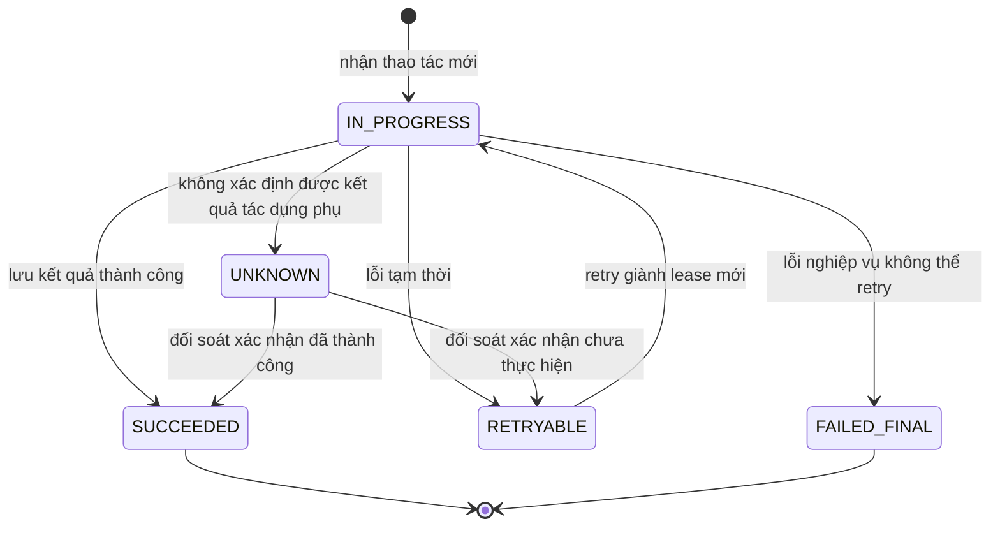
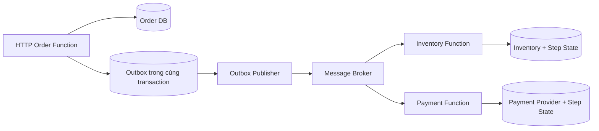

# Thiết kế idempotency cho từng bước xử lý đơn hàng

Một workflow xử lý đơn hàng thường đi qua nhiều bước độc lập: tiếp nhận yêu cầu, xác nhận tồn kho, thu tiền, tạo lệnh giao hàng và gửi thông báo. Trong mô hình serverless, mỗi bước có thể chạy trong một function riêng và được kích hoạt bởi HTTP request, message queue hoặc sự kiện từ dịch vụ khác. Hệ thống có thể retry khi timeout, function bị dừng giữa chừng hoặc consumer nhận lại cùng một message. Vì vậy, một yêu cầu hợp lệ có thể được xử lý nhiều lần dù người dùng chỉ bấm nút đặt hàng một lần.

Idempotency (tính lũy đẳng) giúp hệ thống chịu được những lần thực thi lặp: cùng một thao tác nghiệp vụ được gửi lại nhiều lần nhưng trạng thái và hiệu ứng nghiệp vụ cuối cùng tương đương với việc thao tác đó chỉ được thực hiện một lần. Với workflow nhiều bước, không thể chỉ đặt một khóa idempotency ở đầu luồng rồi xem như mọi vấn đề đã được giải quyết. Mỗi bước cần một danh tính thao tác, một ranh giới dữ liệu và một quy tắc xử lý lặp phù hợp với tác dụng phụ của chính bước đó.

Bài học này trình bày cách thiết kế các ranh giới đó cho một workflow đơn hàng chạy bằng Java trên nền tảng serverless, đồng thời chỉ ra cách kết hợp idempotency với retry, trạng thái, quyền truy cập, mở rộng và chi phí.

## 1. Vì sao phải thiết kế idempotency theo từng bước?

Giả sử khách hàng gửi yêu cầu tạo đơn hàng. Function HTTP ghi nhận đơn và phát sự kiện `OrderPlaced`. Các function phía sau lần lượt giữ hàng, thu tiền, tạo vận đơn và gửi email.

Một lần thực thi có thể gặp những tình huống như sau:

- Function đã gọi cổng thanh toán thành công nhưng bị timeout trước khi ghi kết quả vào cơ sở dữ liệu. Khi retry, function không biết giao dịch trước đã thành công hay chưa.
- Message đã được xử lý nhưng consumer chưa kịp xác nhận (ack) thì tiến trình bị dừng. Hàng đợi phát lại message.
- Nhà cung cấp thanh toán hoặc vận chuyển gửi webhook nhiều lần vì chưa nhận được phản hồi đúng hạn.
- Người dùng gửi lại HTTP request vì trình duyệt không nhận được response, dù server đã tạo đơn thành công.
- Hai bản sao của cùng một message được xử lý đồng thời trên hai instance function khác nhau.

Các hệ thống message và function serverless thường ưu tiên giao nhận ít nhất một lần (at-least-once). Điều đó có nghĩa là message có thể được giao lại; nó không đảm bảo function chỉ chạy đúng một lần. Ngay cả khi một nền tảng cung cấp cơ chế giao nhận khác, lỗi mạng và ranh giới giữa hai dịch vụ vẫn khiến ứng dụng phải xử lý trường hợp kết quả không rõ ràng.

Cần phân biệt ba khái niệm:

| Khái niệm | Ý nghĩa | Điều nó không đảm bảo |
|---|---|---|
| Retry | Thử thực hiện lại sau lỗi tạm thời | Không ngăn tác dụng phụ bị lặp |
| Deduplication | Nhận diện và bỏ qua message hoặc request đã thấy | Không tự giải quyết trường hợp lần trước đang chạy hoặc đã gây tác dụng phụ nhưng chưa lưu kết quả |
| Idempotency | Bảo đảm thao tác lặp có cùng kết quả nghiệp vụ | Không tự sửa được dữ liệu sai hoặc một quy trình không có trạng thái rõ ràng |

Mục tiêu thực tế không phải là làm cho function chỉ được gọi một lần. Mục tiêu là làm cho mỗi thao tác nghiệp vụ có thể được gọi lại an toàn, kể cả khi hệ thống không biết lần chạy trước dừng ở đâu.

## 2. Xác định danh tính của từng thao tác

Một idempotency key phải nhận diện một ý định nghiệp vụ ổn định. Không nên tạo khóa ngẫu nhiên mới ở mỗi lần retry, vì như vậy mỗi lần thử sẽ bị xem là một thao tác mới. Cũng không nên chỉ dùng mã message làm khóa cho toàn bộ workflow: cùng một đơn hàng có thể được phát ra dưới nhiều message khác nhau, trong khi các bước giữ hàng và thu tiền có quy tắc lặp khác nhau.

Có thể dùng cấu trúc khóa:

```text
<tenantId>:<aggregateId>:<stepName>:<operationVersion>:<operationId>
```

Trong đó:

- `tenantId` xác định cửa hàng hoặc khách hàng tổ chức trong hệ thống đa tenant.
- `aggregateId` là mã đơn hàng.
- `stepName` là bước nghiệp vụ như `RESERVE_INVENTORY` hoặc `CAPTURE_PAYMENT`.
- `operationVersion` phân biệt phiên bản quy tắc của thao tác khi cần thay đổi hợp đồng xử lý.
- `operationId` xác định lần thực hiện nghiệp vụ cụ thể, ví dụ mã lần thanh toán hoặc mã lần thử giao hàng.

Ví dụ:

```text
shop-17:ORD-2026-0042:RESERVE_INVENTORY:v1:reservation-01
shop-17:ORD-2026-0042:CAPTURE_PAYMENT:v1:payment-01
shop-17:ORD-2026-0042:CREATE_SHIPMENT:v1:shipment-01
```

Đối với API tạo đơn, client gửi một khóa ổn định trong header `Idempotency-Key`. Server lưu khóa đó cùng hash của payload và kết quả đã tạo. Nếu client gửi lại cùng khóa và cùng nội dung, server trả lại kết quả trước đó. Nếu cùng khóa nhưng payload khác, server trả lỗi xung đột vì một khóa không được đại diện cho hai ý định khác nhau.

Đối với message nội bộ, producer nên đưa `orderId`, `eventId` và mã thao tác nghiệp vụ vào envelope. Consumer tạo khóa từ dữ liệu nghiệp vụ đã được xác thực. Nếu một sự kiện có thể khởi động lại một thao tác có chủ đích, chẳng hạn thu tiền lần hai sau khi khách hàng đổi phương thức thanh toán, thao tác mới phải có `operationId` mới; không tái sử dụng khóa của lần thu tiền trước.

Không dùng riêng timestamp, số lần retry hoặc ID instance function để tạo khóa. Các giá trị đó thay đổi giữa những lần thử và phá vỡ khả năng nhận diện thao tác lặp.

## 3. Mô hình trạng thái idempotency

Mỗi bước cần lưu trạng thái xử lý bền vững bên ngoài bộ nhớ của function. Function serverless có thể bị kết thúc sau một invocation; biến static, singleton hoặc bộ nhớ cục bộ không phải nơi lưu trạng thái đáng tin cậy.

Một bản ghi idempotency tối thiểu có thể gồm:

| Trường | Mục đích |
|---|---|
| `idempotency_key` | Khóa duy nhất của thao tác |
| `request_hash` | Phát hiện cùng khóa nhưng payload khác |
| `status` | Trạng thái xử lý |
| `owner_token` | Token nhận quyền xử lý hiện tại |
| `lease_until` | Thời điểm quyền xử lý hết hạn |
| `result_reference` | Tham chiếu đến kết quả nghiệp vụ |
| `created_at`, `updated_at` | Theo dõi vòng đời bản ghi |
| `expires_at` | Thời điểm có thể dọn bản ghi theo chính sách lưu trữ |

Một vòng đời phổ biến:



Ý nghĩa các trạng thái:

- `IN_PROGRESS`: một invocation đã giành quyền xử lý thao tác.
- `SUCCEEDED`: thao tác đã hoàn tất; các lần gọi lại nhận kết quả đã lưu.
- `RETRYABLE`: lỗi tạm thời đã được xác định an toàn để thử lại.
- `FAILED_FINAL`: lỗi nghiệp vụ không thể khắc phục bằng retry, ví dụ địa chỉ giao hàng không hợp lệ.
- `UNKNOWN`: hệ thống chưa thể xác định tác dụng phụ bên ngoài đã xảy ra hay chưa. Trạng thái này cần đối soát trước khi thử lại một thao tác có thể gây hậu quả như thu tiền.

Không phải workflow nào cũng cần đủ mọi trạng thái. Tuy nhiên, không nên gộp `UNKNOWN` vào `FAILED`: một timeout sau khi gửi yêu cầu thanh toán không chứng minh rằng giao dịch thanh toán thất bại.

## 4. Quy trình xử lý một bước an toàn khi retry

Một consumer nên thực hiện các bước sau:

1. Xác thực nguồn message và kiểm tra schema, tenant, mã đơn hàng cùng mã thao tác.
2. Tạo idempotency key và hash của dữ liệu nghiệp vụ có liên quan.
3. Thử tạo bản ghi `IN_PROGRESS` bằng thao tác nguyên tử có điều kiện. Chỉ một invocation được quyền tạo bản ghi mới.
4. Nếu bản ghi đã tồn tại, đọc trạng thái:
   - `SUCCEEDED`: trả lại hoặc phát lại kết quả đã lưu mà không lặp tác dụng phụ.
   - `IN_PROGRESS` còn lease: không chạy song song lần nữa; để message được retry theo chính sách hoặc trả kết quả đang xử lý.
   - `IN_PROGRESS` hết lease: chỉ được tiếp quản bằng cập nhật có điều kiện và token mới.
   - `RETRYABLE`: giành lease mới bằng cập nhật nguyên tử.
   - `FAILED_FINAL`: dừng và chuyển thông tin lỗi cho luồng xử lý nghiệp vụ.
   - `UNKNOWN`: đối soát với hệ thống đích trước khi quyết định.
5. Thực hiện tác dụng phụ với cùng idempotency key nếu dịch vụ đích hỗ trợ.
6. Lưu kết quả và chuyển trạng thái sang `SUCCEEDED` bằng cập nhật có điều kiện dựa trên `owner_token`.
7. Chỉ xác nhận message sau khi kết quả hoặc trạng thái retry đã được lưu bền vững.

Việc giành quyền xử lý phải có tính nguyên tử. Mẫu `SELECT` rồi `INSERT` riêng rẽ không đủ an toàn: hai invocation có thể cùng đọc thấy chưa có bản ghi và cùng thực hiện tác dụng phụ. Dùng unique constraint, conditional write, transaction hoặc cơ chế compare-and-set của kho dữ liệu.

Lease giúp phục hồi khi function chết giữa chừng. Nhưng lease không tự ngăn một invocation cũ tiếp tục chạy sau khi lease hết hạn. Vì vậy cần fencing token hoặc owner token tăng/đổi theo mỗi lần tiếp quản. Mọi cập nhật trạng thái phải kiểm tra token hiện tại; nếu token không còn khớp, invocation cũ không được ghi đè kết quả của invocation mới.

## 5. Phân chia idempotency theo các bước của đơn hàng

Mỗi bước có tác dụng phụ và cách phục hồi khác nhau. Bảng dưới đây là một thiết kế tham khảo:

| Bước | Danh tính thao tác | Tác dụng phụ | Cách bảo vệ khi lặp |
|---|---|---|---|
| Nhận yêu cầu tạo đơn | `clientRequestId` hoặc `Idempotency-Key` | Tạo đơn hàng | Unique key theo tenant và request; lưu response |
| Giữ tồn kho | `orderId + reservationId` | Giảm số lượng khả dụng hoặc tạo reservation | Conditional update/transaction; reservation có trạng thái và thời hạn |
| Thu tiền | `orderId + paymentAttemptId` | Gọi cổng thanh toán | Truyền idempotency key cho cổng thanh toán; lưu provider transaction ID |
| Tạo vận đơn | `orderId + shipmentId` | Tạo shipment ở nhà vận chuyển | Dùng client reference duy nhất; tra cứu trước khi tạo lại nếu timeout |
| Gửi email/SMS | `orderId + notificationType + recipient` | Gửi thông báo | Bản ghi outbox/delivery; chấp nhận rằng nhà cung cấp gửi tin có thể có ngữ nghĩa riêng |
| Hoàn tiền/hủy giữ hàng | `orderId + compensationId` | Hoàn tiền hoặc giải phóng tồn kho | Khóa riêng cho từng hành động bù trừ; không dùng lại khóa thao tác ban đầu |

### 5.1. Tiếp nhận yêu cầu tạo đơn

API cần yêu cầu client giữ nguyên `Idempotency-Key` khi retry. Trong cùng một transaction, hệ thống tạo đơn hàng và lưu kết quả phản hồi gắn với khóa đó. Unique constraint ngăn hai request đồng thời tạo hai đơn.

Ví dụ DDL trên PostgreSQL:

```sql
CREATE TABLE api_idempotency (
    tenant_id       VARCHAR(80)  NOT NULL,
    idempotency_key VARCHAR(160) NOT NULL,
    request_hash    VARCHAR(64)  NOT NULL,
    order_id        VARCHAR(80),
    response_json   JSONB,
    status          VARCHAR(24)  NOT NULL,
    created_at      TIMESTAMPTZ  NOT NULL DEFAULT now(),
    PRIMARY KEY (tenant_id, idempotency_key)
);
```

Nếu khóa đã tồn tại và hash khớp, API trả lại `response_json`. Nếu hash khác, trả `409 Conflict`. Nếu transaction đầu tiên đang chạy, transaction sau phải chờ hoặc xử lý xung đột theo cơ chế của cơ sở dữ liệu. Không trả một mã đơn mới cho cùng một khóa.

### 5.2. Giữ tồn kho

Giữ hàng là một thao tác có thể gây tranh chấp. Hai đơn hàng khác nhau cùng mua sản phẩm cuối cùng phải được tuần tự hóa ở cấp dữ liệu. Idempotency ngăn cùng một reservation bị trừ kho hai lần; transaction hoặc conditional update bảo đảm tổng lượng giữ không vượt tồn kho.

Ví dụ cập nhật có điều kiện:

```sql
UPDATE inventory
SET available_quantity = available_quantity - :quantity
WHERE sku = :sku
  AND available_quantity >= :quantity;
```

Nếu số dòng cập nhật bằng 0, hàng không đủ hoặc SKU không tồn tại. Reservation nên có mã riêng và trạng thái `ACTIVE`, `RELEASED`, `EXPIRED`. Khi workflow thất bại sau khi giữ hàng, bước bù trừ giải phóng reservation bằng một `compensationId` ổn định. Lặp thao tác giải phóng không được cộng tồn kho nhiều lần.

### 5.3. Thu tiền

Thu tiền là bước rủi ro nhất khi kết quả mạng không rõ ràng. Function có thể gửi lệnh thu tiền, nhà cung cấp đã xử lý, nhưng response bị mất. Nếu gọi lại bằng một request mới, khách hàng có thể bị tính tiền hai lần.

Ưu tiên gửi idempotency key ổn định tới cổng thanh toán. Lưu mã giao dịch của nhà cung cấp và liên kết nó với `paymentAttemptId`. Khi timeout, truy vấn trạng thái giao dịch theo khóa tham chiếu hoặc chờ webhook; không tự tạo một lần thanh toán mới. Nếu khách hàng chủ động thử một phương thức thanh toán khác, tạo `paymentAttemptId` mới sau khi xác định trạng thái lần cũ.

Không phải mọi cổng thanh toán đều hỗ trợ idempotency giống nhau. Cần đọc rõ phạm vi khóa, thời gian lưu khóa, hành vi khi payload khác và khả năng truy vấn giao dịch của nhà cung cấp. Nếu dịch vụ đích không hỗ trợ, ứng dụng phải xây dựng quy trình đối soát và trạng thái `UNKNOWN`; không thể hứa bảo đảm exactly-once cho tác dụng phụ bên ngoài chỉ bằng một bảng local.

### 5.4. Tạo vận đơn và gửi thông báo

Với nhà vận chuyển, gửi `shipmentId` hoặc client reference duy nhất để có thể tra cứu shipment đã tạo. Nếu timeout, truy vấn bằng reference trước khi gửi lệnh tạo mới.

Gửi email/SMS có đặc tính khác: nhiều nhà cung cấp không cam kết loại bỏ trùng tuyệt đối. Có thể dùng bảng outbox với unique key cho loại thông báo, người nhận và phiên bản nội dung. Worker đánh dấu `SENT` sau khi nhận xác nhận từ provider. Nếu provider không hỗ trợ khóa idempotency, lỗi sau khi provider nhận tin nhưng trước khi worker ghi `SENT` vẫn có thể tạo tin trùng. Với thông báo, cần quyết định rõ mức chấp nhận trùng, dùng mã thông báo hoặc nội dung có thể nhận diện, và giám sát các trường hợp không xác định.

## 6. Ví dụ Java: consumer dùng kho idempotency

Ví dụ sau minh họa ranh giới xử lý trong Java. Các interface `IdempotencyStore` và `PaymentGateway` đại diện cho adapter tới cơ sở dữ liệu và cổng thanh toán; implementation thực tế phải dùng conditional write/transaction và API idempotency của nhà cung cấp.

```java
import java.time.Instant;
import java.util.Objects;

enum StepStatus {
    IN_PROGRESS, SUCCEEDED, RETRYABLE, FAILED_FINAL, UNKNOWN
}

record StepKey(
        String tenantId,
        String orderId,
        String step,
        String operationId
) {
    String value() {
        return tenantId + ":" + orderId + ":" + step + ":" + operationId;
    }
}

record PaymentCommand(
        String tenantId,
        String orderId,
        String paymentAttemptId,
        long amountMinor,
        String currency
) {
    StepKey idempotencyKey() {
        return new StepKey(
                tenantId, orderId, "CAPTURE_PAYMENT", paymentAttemptId
        );
    }
}

record PaymentResult(String providerTransactionId, String status) {}

record Claim(
        boolean acquired,
        StepStatus status,
        String ownerToken,
        PaymentResult previousResult
) {}

interface IdempotencyStore {
    // Claim phải là thao tác nguyên tử; không triển khai bằng SELECT rồi INSERT.
    Claim claim(StepKey key, String requestHash, Instant now);

    // Chỉ owner hiện tại mới được hoàn tất bản ghi.
    boolean markSucceeded(
            StepKey key, String ownerToken, PaymentResult result
    );

    void markFailedFinal(StepKey key, String ownerToken, String reason);

    void markRetryable(StepKey key, String ownerToken, String reason);

    void markUnknown(StepKey key, String ownerToken, String reason);
}

interface PaymentGateway {
    PaymentResult capture(
            String providerIdempotencyKey,
            long amountMinor,
            String currency
    );

    // Tra cứu theo khóa tham chiếu khi lần gọi trước có kết quả không rõ.
    PaymentResult findByIdempotencyKey(String providerIdempotencyKey);
}

final class PaymentStep {
    private final IdempotencyStore store;
    private final PaymentGateway gateway;

    PaymentStep(IdempotencyStore store, PaymentGateway gateway) {
        this.store = store;
        this.gateway = gateway;
    }

    PaymentResult handle(PaymentCommand command, String requestHash) {
        StepKey key = command.idempotencyKey();
        Claim claim = store.claim(key, requestHash, Instant.now());

        if (!claim.acquired()) {
            return switch (claim.status()) {
                case SUCCEEDED -> Objects.requireNonNull(claim.previousResult());
                case IN_PROGRESS -> throw new IllegalStateException(
                        "Payment operation is already in progress"
                );
                case UNKNOWN -> throw new IllegalStateException(
                        "Payment result must be reconciled before retry"
                );
                case FAILED_FINAL -> throw new IllegalStateException(
                        "Payment operation failed permanently"
                );
                case RETRYABLE -> throw new IllegalStateException(
                        "Retry claim was not acquired"
                );
            };
        }

        try {
            PaymentResult result = gateway.capture(
                    key.value(),
                    command.amountMinor(),
                    command.currency()
            );

            boolean saved = store.markSucceeded(
                    key, claim.ownerToken(), result
            );
            if (!saved) {
                // Lease/token có thể đã bị một invocation khác thay thế.
                // Không ghi đè kết quả của owner mới.
                throw new IllegalStateException("Idempotency claim was lost");
            }
            return result;
        } catch (DefinitivePaymentDecline e) {
            // Lỗi từ chối nghiệp vụ rõ ràng, không retry cùng thao tác.
            store.markFailedFinal(key, claim.ownerToken(), e.getMessage());
            throw e;
        } catch (PaymentOutcomeUnknown e) {
            store.markUnknown(key, claim.ownerToken(), e.getMessage());
            throw e;
        } catch (TemporaryGatewayFailure e) {
            store.markRetryable(key, claim.ownerToken(), e.getMessage());
            throw e;
        }
    }
}

final class DefinitivePaymentDecline extends RuntimeException {}
final class PaymentOutcomeUnknown extends RuntimeException {}
final class TemporaryGatewayFailure extends RuntimeException {}
```

Đoạn code tập trung vào các quyết định nghiệp vụ. Trong production, cần bổ sung:

- Hash được tính từ trường có ý nghĩa nghiệp vụ như số tiền, tiền tệ và mã tài khoản thanh toán; không hash các trường biến động như thời điểm retry.
- `claim` phải phân biệt khóa mới, khóa đã hoàn tất, khóa đang có lease và khóa có lease hết hạn. Mọi chuyển trạng thái phải là conditional write.
- Khi cổng thanh toán trả lỗi không rõ kết quả, cần tra cứu giao dịch trước khi cho phép retry. Việc đánh dấu `UNKNOWN` phải được ghi bền vững ngay cả khi invocation chuẩn bị kết thúc.
- Khi `markSucceeded` thất bại vì token đã mất, worker mới hoặc tiến trình đối soát phải đọc kết quả từ provider. Không được giả định lệnh thu tiền chưa xảy ra.
- Với HTTP handler, trả status code phù hợp: kết quả đã có thì trả lại response đã lưu; đang xử lý thì trả trạng thái có thể retry kèm hướng dẫn; payload xung đột thì trả `409`.

Trong function được kích hoạt từ queue, lỗi tạm thời thường được ném ra để nền tảng retry hoặc đưa message vào dead-letter queue theo cấu hình. Không retry vô hạn các lỗi nghiệp vụ vĩnh viễn. Cấu hình visibility timeout, thời gian chạy tối đa, số lần retry và DLQ phải phối hợp để một message không bị nhiều consumer xử lý đồng thời quá lâu.

## 7. Tính nhất quán giữa cập nhật dữ liệu và phát sự kiện

Một lỗi phổ biến là cập nhật đơn hàng trong cơ sở dữ liệu rồi phát message ở thao tác riêng. Nếu function chết sau khi commit đơn hàng nhưng trước khi publish, workflow không nhận được sự kiện tiếp theo. Nếu publish thành công nhưng function chết trước khi ghi nhận, message có thể được phát lại.

Transactional outbox giải quyết khoảng trống này: trong cùng transaction cập nhật đơn hàng, ghi thêm một bản ghi outbox. Một publisher riêng đọc outbox và phát sự kiện. Publisher có thể phát trùng, vì vậy consumer vẫn phải idempotent.



Outbox không loại bỏ nhu cầu idempotency ở consumer. Nó bảo đảm sự kiện đã được lưu cùng thay đổi nghiệp vụ và có thể phát lại sau lỗi. Consumer cần inbox hoặc bảng idempotency riêng để nhận diện sự kiện đã xử lý.

Nếu mỗi bước dùng một kho dữ liệu khác nhau, không nên giả định có một transaction phân tán bao trùm toàn workflow. Thiết kế Saga: mỗi bước commit trạng thái cục bộ và phát sự kiện cho bước tiếp theo; nếu bước sau thất bại, chạy hành động bù trừ đã được định nghĩa trước. Hành động bù trừ cũng phải idempotent và có khóa riêng.

## 8. Phối hợp idempotency với retry, timeout và mở rộng

Retry chỉ an toàn khi bước xử lý có thể nhận diện lần thực thi trước. Cần phân loại lỗi:

| Loại lỗi | Ví dụ | Hành động |
|---|---|---|
| Lỗi tạm thời | HTTP 503, throttling, mất kết nối trước khi gửi request | Retry với exponential backoff và jitter |
| Kết quả không rõ | Timeout sau khi gửi lệnh thu tiền | Chuyển `UNKNOWN`, đối soát trước khi retry |
| Lỗi nghiệp vụ | Không đủ tồn kho, thẻ bị từ chối rõ ràng | `FAILED_FINAL` hoặc nhánh nghiệp vụ khác |
| Lỗi dữ liệu/hợp đồng | Schema không hợp lệ, tenant không khớp | Từ chối, ghi log có kiểm soát, có thể đưa DLQ |

Một số nguyên tắc vận hành:

- Chọn timeout của lời gọi downstream nhỏ hơn thời gian xử lý tối đa của function, đồng thời chừa thời gian để ghi trạng thái và hoàn tất invocation.
- Lease nên dài hơn thời gian xử lý dự kiến nhưng có cơ chế gia hạn nếu bước có thể chạy lâu. Lease quá ngắn gây tranh chấp; lease quá dài làm chậm phục hồi.
- Dùng exponential backoff có jitter để nhiều invocation không retry đồng loạt.
- Đặt giới hạn retry và DLQ. Message ở DLQ cần giữ correlation ID, order ID, step, attempt ID và lý do lỗi để có thể replay có kiểm soát.
- Không giữ lock phân tán trong thời gian dài khi gọi mạng. Claim ngắn, lease có hạn và cập nhật trạng thái theo token giúp function có thể scale ngang.
- Giới hạn concurrency ở các bước có quota của nhà cung cấp, nhưng vẫn dùng idempotency vì giới hạn concurrency không loại bỏ retry hoặc webhook trùng.

Idempotency cũng có chi phí. Mỗi bước có thể cần một lần đọc/ghi trạng thái, index duy nhất, outbox và log đối soát. TTL giúp dọn bản ghi cũ nhưng không nên đặt quá ngắn. Thời gian giữ khóa phải dài hơn cửa sổ retry, thời gian replay DLQ, độ trễ webhook và khoảng thời gian người dùng có thể gửi lại request. Với thao tác tài chính, cần lưu dấu vết theo yêu cầu kiểm toán và chính sách lưu trữ; không xóa khóa chỉ vì invocation đã kết thúc.

## 9. Bảo mật và quyền truy cập

Idempotency key không phải bí mật và không thay thế xác thực. Một người dùng không được phép lấy khóa của đơn hàng khác rồi truy vấn kết quả. API phải xác thực danh tính, kiểm tra quyền truy cập đơn hàng và tenant trước khi trả kết quả đã lưu.

Các function nên dùng quyền tối thiểu:

- Function nhận đơn chỉ có quyền ghi đơn hàng và outbox cần thiết.
- Function tồn kho chỉ có quyền đọc/ghi reservation và lượng tồn liên quan.
- Function thanh toán chỉ có quyền gọi thao tác cần thiết ở tài khoản merchant và đọc/ghi trạng thái thanh toán.
- Function thông báo chỉ có quyền đọc dữ liệu tối thiểu và gửi thông báo.

Không đưa số thẻ, access token, địa chỉ đầy đủ hoặc dữ liệu nhạy cảm vào idempotency key, log hay message nếu không cần thiết. Lưu hash payload thay vì bản sao dữ liệu nhạy cảm; nếu phải lưu request/response để replay, mã hóa và giới hạn quyền đọc. Kiểm tra chữ ký webhook, thời gian phát và định danh sự kiện trước khi chấp nhận. Idempotency chỉ ngăn xử lý lặp; nó không ngăn kẻ tấn công gửi một yêu cầu giả với khóa mới.

## 10. Quan sát và đối soát workflow

Để tìm được một thao tác qua nhiều function, truyền các trường sau xuyên suốt log và message:

- `correlationId`: mã theo dõi toàn workflow.
- `orderId`: mã đơn hàng.
- `eventId`: mã sự kiện.
- `stepName` và `operationId`: bước và lần thực hiện nghiệp vụ.
- `idempotencyKeyHash`: dấu vết không tiết lộ khóa đầy đủ nếu khóa có chứa dữ liệu nội bộ.
- `attempt`, `status`, `providerReference`: lần thử, trạng thái và mã tham chiếu phía nhà cung cấp.

Các metric hữu ích gồm số lần gặp khóa trùng, số claim thất bại, số lease hết hạn, số thao tác ở trạng thái `UNKNOWN`, tỷ lệ retry, số message vào DLQ, độ trễ từng bước và chi phí invocation/kho dữ liệu. Cảnh báo khi `UNKNOWN` tồn tại quá lâu hoặc một bước có tỷ lệ retry tăng đột biến.

Cần có quy trình đối soát định kỳ cho các tác dụng phụ bên ngoài: lấy danh sách payment/shipment ở trạng thái `UNKNOWN`, tra cứu theo provider reference, rồi chuyển trạng thái sang thành công hoặc có thể retry. Quy trình đối soát cũng cần idempotency vì chính nó có thể chạy lặp.

## 11. Khi nào nên dùng FaaS cho workflow này?

FaaS phù hợp khi các bước có ranh giới rõ, thời gian xử lý ngắn hoặc có thể chia nhỏ, lưu lượng biến động và có thể kích hoạt bằng HTTP/message/event. Ví dụ, nhận đơn qua HTTP, giữ hàng khi có sự kiện, thu tiền qua queue và gửi thông báo sau khi hoàn tất là những bước có thể triển khai thành function riêng.

Cần cân nhắc workflow engine hoặc worker chạy lâu khi quy trình có thời gian chờ kéo dài, nhiều nhánh phức tạp, cần lịch sử trạng thái chi tiết, cần điều phối timeout/compensation hoặc cần xử lý liên tục vượt giới hạn thời gian của function. Dù dùng FaaS hay worker, nguyên tắc idempotency theo từng thao tác vẫn giữ nguyên.

Đánh giá chi phí không chỉ dựa vào số lần function chạy. Hãy tính cả số lần retry, lượt đọc/ghi kho idempotency, transaction, lưu trữ outbox, truyền message, truy vấn đối soát và thời gian chờ downstream. Một thiết kế có thể tăng một vài thao tác ghi nhưng giảm đáng kể chi phí xử lý đơn trùng, hoàn tiền sai và hỗ trợ thủ công.

## 12. Checklist thiết kế và ví dụ kiểm thử

Trước khi đưa một bước vào production, hãy trả lời được các câu hỏi:

- Khóa nào đại diện cho đúng một ý định nghiệp vụ? Khóa có ổn định qua retry và replay không?
- Cùng khóa nhưng payload khác được xử lý thế nào?
- Bản ghi trạng thái được tạo và claim bằng thao tác nguyên tử nào?
- Nếu hai invocation chạy đồng thời, chỉ một invocation có quyền gây tác dụng phụ bằng cách nào?
- Nếu function dừng sau tác dụng phụ nhưng trước khi lưu kết quả, hệ thống đối soát ra sao?
- Dịch vụ bên ngoài có hỗ trợ idempotency key hoặc tra cứu theo client reference không?
- Khi nào được retry tự động, khi nào chuyển `UNKNOWN`, khi nào dừng ở `FAILED_FINAL`?
- Lease, fencing token, timeout, retry, DLQ và TTL được cấu hình ra sao?
- Quyền đọc kết quả idempotency có được giới hạn theo tenant và chủ sở hữu đơn hàng không?
- Có metric và cảnh báo cho thao tác trùng, lease hết hạn và trạng thái không xác định không?

Một bộ kiểm thử có giá trị nên mô phỏng ít nhất các trường hợp sau:

| Tình huống | Kết quả mong đợi |
|---|---|
| Gửi cùng request tạo đơn hai lần với cùng khóa | Chỉ một đơn được tạo; hai response cùng tham chiếu một đơn |
| Cùng khóa nhưng thay đổi số lượng hoặc số tiền | Trả xung đột; không tạo tác dụng phụ |
| Hai consumer nhận cùng message đồng thời | Chỉ một consumer giành claim hợp lệ |
| Consumer chết sau khi ghi trạng thái nhưng trước ack | Message được giao lại; consumer trả kết quả đã lưu |
| Payment provider thành công nhưng response timeout | Trạng thái `UNKNOWN`; đối soát tìm thấy giao dịch và không thu tiền lần hai |
| Lease hết hạn khi invocation cũ vẫn chạy | Invocation cũ không thể ghi đè vì token không còn hợp lệ |
| Giải phóng reservation được gọi lặp | Tồn kho chỉ được cộng lại một lần |
| Replay message từ DLQ | Các bước đã thành công được bỏ qua; bước còn thiếu tiếp tục an toàn |

Có thể kiểm thử consumer với kho dữ liệu thật hoặc môi trường tích hợp có hỗ trợ transaction/conditional write. Mock đơn thuần thường không bộc lộ race condition giữa hai invocation. Cần có kiểm thử đồng thời và fault injection tại các ranh giới: ngay trước tác dụng phụ, ngay sau tác dụng phụ, trước khi lưu kết quả và trước khi ack message.

## Kết luận

Thiết kế idempotency tốt bắt đầu bằng việc xác định ý định nghiệp vụ và tác dụng phụ của từng bước. Mỗi bước cần khóa ổn định, trạng thái bền vững, thao tác claim nguyên tử và cách phục hồi khi kết quả không rõ. Kết hợp các cơ chế đó với transactional outbox, Saga, retry có giới hạn, DLQ và đối soát sẽ giúp workflow đơn hàng chạy an toàn trước message trùng, timeout và việc function được thực thi lại. Đây là nền tảng quan trọng để tận dụng khả năng mở rộng của serverless mà vẫn giữ được tính đúng đắn của nghiệp vụ.

